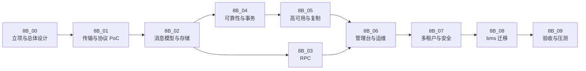

# 消息平台规划

> 定位 · 要解决的问题 · 能力全景 · 设计取舍 · 阶段路线 · 判据与推翻条件

[文档首页](../文档首页.md) › 规划 › 消息平台规划

---

## 1. 定位 

**msg** 是 BMS 平台之上的独立消息产品，目标是自研一套**完整消息平台（L3）**，统一承载三类通信：

| 能力 | 内容 | 替换对象 |
| --- | --- | --- |
| **事件总线** | topic / partition / offset、发布订阅、消费组、顺序、重试、死信、重放 | RocketMQ + 事务性发件箱 + 轮询投递器 |
| **同步 RPC** | 请求/响应、deadline 传播、取消、流式 | `HttpServiceClient` + FastAPI 同步链路 |
| **管理台与运维** | 主题与消费组管理、积压、死信、重放、配额、指标、追踪 | 分散的脚本与人工排查 |

形态与 mdm 同构：独立仓库、独立服务、独立库、独立部署，经产品声明 `deploy/registry/msg.toml` 接入 bms 基座；不修改基座业务代码。

## 2. 要解决的问题 

| 类别 | 现状 | 后果 |
| --- | --- | --- |
| **性能** | 同步链路是 `HttpServiceClient`（httpx + JSON）调 **FastAPI** 服务；开销来自路由匹配、依赖注入、Pydantic 校验与序列化、中间件，叠加 httpx 连接与 JSON 编解码 | 同步链延迟与吞吐都不理想 |
| **隔离** | outbox 等基础设施表名写死（`sys_outbox`），靠「每服务独立库」天然隔离 | 产品共库时同名表重叠 |
| **能力** | 事件账本、重放、死信绑在业务库的 outbox 表上；broker 侧没有统一位点、积压视图、死信处置 | 排障要跨库查表，重放要靠脚本 |
| **运维** | 事件与 RPC 两套机制、两套契约、两套运维 | 故障定位要跨三处 |

> **必须澄清的口径**：**OpenAPI 是契约规范（文档格式），不产生运行时开销**；性能瓶颈在 **FastAPI 框架栈 + JSON 序列化 + HTTP/1.1 连接**。因此本产品的方向是「换框架栈、换序列化、换传输」，**不是换契约格式**。对外契约仍走 OpenAPI。

## 3. 能力全景 

按 13 个能力域组织，逐项对应阶段与知识依据：

| 能力域 | 内容 | 阶段 | 知识依据 |
| --- | --- | --- | --- |
| 消息模型与语义 | topic / partition / offset / 消费组；至多一次 / 至少一次 / 效果一次；顺序性三级；延迟消息 | 8B_02 | 知识 02 |
| 存储引擎 | 追加日志、稀疏索引、分段、页缓存与零拷贝、fsync 策略、崩溃恢复、retention 与 compaction | 8B_02 | 知识 03 |
| 复制与高可用 | 主从 / ISR / 多数派；选举、任期、fencing、脑裂；故障切换；跨机房 | 8B_05 | 知识 04 |
| 消费组与再均衡 | join / sync / heartbeat；eager 与 cooperative；分配策略；位点提交；重平衡风暴 | 8B_02 | 知识 05 |
| 背压与流控 | 长轮询、inflight 上限、磁盘水位、慢消费者隔离、队头阻塞 | 8B_01 / 02 | 知识 06 |
| 协议与传输 | 帧格式与版本演进、错误码；HTTP/2 多路复用、HPACK、流控窗口；h2c 与 TLS；连接管理 | 8B_01 | 知识 07 |
| 序列化与 Schema | MessagePack 默认；字段只增不删；消费端校验；批量压缩 | 8B_01 | 知识 08 |
| RPC 模型 | 关联 ID、deadline 传播、取消、流式、错误分类、幂等重试、熔断限流 | 8B_03 | 知识 09 |
| 运维与可观测 | 吞吐 / 延迟 / 积压 / ISR 指标、链路追踪、管理台、重放与死信处置 | 8B_06 | 知识 10 |
| 多租户与安全 | 三级命名空间、配额、认证、授权、加密、密钥轮换、操作审计 | 8B_07 | 知识 11 |
| 压测与容量规划 | 五类压测、瓶颈定位、容量模型、故障演练 | 8B_09 | 知识 12 |
| 开源实现对照 | Kafka / Pulsar / RocketMQ / NATS 的取舍依据 | 贯穿设计 | 知识 13 |
| 可靠性原语 | 事务性发件箱、事务消息、CDC、直接发布；outbox 适配 | 8B_04 | 知识 14~17 |

> 完整知识见 bms《[消息与事件驱动总览](../../bms文档/资料/知识档案/消息与事件驱动/01_事件驱动_总览.md)》20 篇。

## 4. 边界 

| 属于 msg | 不属于 msg |
| --- | --- |
| Broker、连接管理、协议、存储、客户端 | 用户 / 角色 / 菜单 / 权限 / 字典 / 参数（bms 基座） |
| 事件总线、RPC、管理台 | 业务事件语义与业务消费逻辑（各业务服务） |
| 多租户隔离、配额、限流 | 审计业务本身（bms 审计域） |
| 消息平台自身的操作留痕（写 bms 审计链） | 跨服务写的一致性（TM + XA） |
| 传输与序列化的性能优化 | 对外 OpenAPI 契约的制定与发布 |

**三条容易混淆的边界**：

1. **消息不替代事务**：跨服务写仍走 TM + XA；消息只保证「业务提交 ⇒ 事件可投递」，不保证「两个库同时改」。
2. **复制不替代备份**：副本会同步删除与损坏，只防节点故障，不防逻辑错误。
3. **换框架不等于换契约**：msg 绕开 FastAPI 与 JSON，但对外接口仍用 OpenAPI。

## 5. 设计取舍（已定） 

| 决策点 | 选择 | 依据 |
| --- | --- | --- |
| 自研深度 | **L3**（独立 broker + RPC + 管理台 + 多租户 + 高可用） | 与 bms 深度集成、统一事件与 RPC、摆脱表名绑死 |
| 部署形态 | **单服务多域**（broker / rpc / console / admin） | 单人运维，组件越少越好 |
| 传输 | **HTTP/2（h2c）+ MessagePack** | 多路复用 + 复用现有网关生态 + PoC 可控 |
| 存储 | **每分区追加日志 + 稀疏索引 + 分段** | 删除 / 隔离 / 迁移简单（学 Kafka） |
| 复制 | **ISR 式半同步**（8B_05 实现） | 吞吐优先，与现有事件量匹配 |
| 消费组 | **服务端主导 + 粘性分配** | 客户端与 broker 同源，无需兼容多版本 |
| 重试与死信 | **平台内建** | 不把重试甩给应用（学 RocketMQ） |
| 多租户 | **租户 / 命名空间 / 主题 三级** | 预留租户内业务线划分（学 Pulsar） |
| 投递语义 | **至少一次 + 消费端幂等** | 与现有 outbox 基线一致，迁移成本最低 |
| 事务消息 | **后置**；先做 outbox 适配 | 平台已有序日志与位点，账本能力天然具备 |
| 运维 | **极简组件 + 指标先行** | 单人运维（学 NATS） |

**一句话**：**存储学 Kafka、重试学 RocketMQ、租户学 Pulsar、运维学 NATS、协议自己做**。

## 6. 标识符登记（暂定，最终以 07C 为准） 

| 项 | 值 |
| --- | --- |
| 产品键 `product_key` | `msg` |
| 服务键 `service_key` | `msg` |
| 模块键 `module_key` | `msg` |
| 表前缀 `table_prefix` | `msg_` |
| 业务码 `business_code` | `msg` |
| 事件域 `event_domain` | `msg` |
| 错误码段 `errcode_segment` | `35`（暂定） |
| 内部 API | `/api/v1/msg/...` |
| 对外 API | `/api/msg/v1/msg/...` |
| 库名前缀 | `msg`（`prefix == service` 去重 → `msg` / `msg_{tenant}` / `msg_archive`） |
| 消息命名空间 | `(tenant, namespace, topic)` 三级 |
| 权限码 | `msg:query`（只读）/ `msg:manage`（管理操作） |

## 7. 阶段路线与硬依赖 

| 阶段 | 目标 | 关键退出条件 | 硬依赖 |
| --- | --- | --- | --- |
| 8B_00 | 需求、总体设计、协议与存储选型、PoC 计划 | 设计六块无开放 blocker | — |
| 8B_01 | HTTP/2 + 二进制 PoC：单机 broker、收发 / ack / 重试 / 死信、基准 | 五项验证通过 + 基准达标（**go/no-go 点**） | 8B_00 |
| 8B_02 | 消息模型与存储：多分区、位点、分段、崩溃恢复 | 崩溃恢复不丢已确认、位点可重放 | 8B_01 |
| 8B_03 | RPC：关联 ID、deadline、取消、错误码 | 可替换一个真实 `HttpServiceClient` 调用 | 8B_01 |
| 8B_04 | 可靠性与事务：至少一次 + 幂等 + outbox 适配 | 审计事件不丢、重复消费效果一次 | 8B_02 |
| 8B_05 | 高可用与复制：ISR、选举、故障切换 | 单节点故障可恢复、不丢已提交 | 8B_04 |
| 8B_06 | 管理台与运维：指标、追踪、积压、死信、重放 | 积压 / 死信 / 重放可操作 | 8B_02 |
| 8B_07 | 多租户与安全：隔离、配额、认证授权、审计 | 租户隔离与配额验收通过 | 8B_06 |
| 8B_08 | bms 迁移：适配层、分域切换、回滚 | 一条事件链 + 一个 RPC 切换成功且可回滚 | 8B_05 / 8B_06 / 8B_07 |
| 8B_09 | 验收与压测：性能、稳定性、故障演练 | 验收报告通过 | 8B_08 |

**四条不能颠倒的硬依赖**：

1. **8B_01 是刹车点**：基准不达标就退回「只换 RPC」的局部方案，不硬推。
2. **8B_02 是 8B_04 的前提**：没有可靠存储与位点，可靠性无从谈起。
3. **8B_05 必须早于 8B_08**：无复制就迁移生产事件，等于把单点故障放大到全平台。
4. **8B_06 必须早于或同步于 8B_08**：没有管理台就迁移，出问题只能重启。

> 进度与投入以[阶段计划](../项目/08B_消息平台/计划/01_计划_消息平台.md)为唯一落点。

## 8. 与 bms / mdm 的关系 

| 对象 | 关系 |
| --- | --- |
| **bms 基座** | 提供产品接入（服务目录 / 表归属 / 域布局）、认证、租户、审计、事件契约、CI、文档体系；msg 不改基座业务 |
| **bms 事件总线** | msg 成熟后逐步替换 RocketMQ / outbox / `HttpServiceClient`；通过 `EventPublisher` / `BaseServiceClient` 适配层接入，业务代码不改 |
| **bms 对外 OpenAPI** | 不替换、不影响；msg 只优化内部链路的框架栈与传输 |
| **bms TM + XA** | 不替代；跨服务写仍走 TM + XA |
| **mdm** | 同为 bms 之上的独立产品；参考其仓结构、产品声明与接入方式，两者互不依赖 |
| **业务服务** | 只依赖 `EventPublisher` / `BaseServiceClient` 端口；消息语义与消费逻辑由业务负责 |

## 9. 成功判据与推翻条件 

### 9.1 成功判据

| # | 判据 | 含义 |
| --- | --- | --- |
| 1 | 传输性能达标 | 相对 HTTP/1.1 + JSON 基线有明显提升（阈值在 8B_01 定稿） |
| 2 | 事件不丢 | 业务提交 ⇒ 事件可投递；消费端幂等保证效果一次 |
| 3 | 分区有序 | 同聚合键有序 |
| 4 | 崩溃恢复 | 重启后不丢已确认、未确认可重投 |
| 5 | RPC 可用 | 超时、取消、错误码、流式行为符合设计 |
| 6 | 多租户隔离 | 越权不可达、配额生效 |
| 7 | 可运维 | 积压 / 延迟 / 死信可观测可操作 |
| 8 | 可迁移可回滚 | 分域切换、回滚演练通过 |

### 9.2 什么情况下应该推翻（刹车条件）

| 触发条件 | 应对 |
| --- | --- |
| 8B_01 基准未达标 | 退回「只换 RPC、保留 RocketMQ」的局部方案 |
| 自研可靠性无法保证（崩溃恢复 / 复制反复丢数据） | 退回开源自建（RocketMQ / Kafka），保留适配层 |
| 运维成本失控（单人无法维护） | 改用云服务或托管版；适配层保证可切换 |
| 业务规模远低于预期 | 冻结 8B，保留现有 outbox |
| 团队扩充但设计未跟上 | 先补复制与多租户设计评审，再继续 |

**推翻不等于失败**：适配层的存在就是为了让「换实现」不牵连业务代码。

## 10. 风险 

| # | 风险 | 影响 | 缓解 |
| --- | --- | --- | --- |
| 1 | L3 范围大（broker + 复制 + 管理台 + 多租户） | 长期半成品 | 分阶段、每阶段可独立验收；8B_01 可刹车 |
| 2 | 自研存储 / 复制的 bug | 数据丢失（最高） | 先单机 + CRC + 恢复演练；HA 前不承载唯一副本 |
| 3 | Python 性能上限 | 吞吐 / 延迟不达标 | PoC 先测；热点用异步批处理或 C 扩展 |
| 4 | 单人运维 | 出问题无人定位 | 指标与管理台先于功能 |
| 5 | 与 bms 迁移耦合 | 生产事故 | 适配层 + 分域切换 + 回滚演练 |
| 6 | 多库 / 多环境行为差异 | 本地通过、生产失败 | Windows 与 Linux 双端验证；关键路径真机复测 |
| 7 | 协议演进破坏老客户端 | 升级即断 | 只增字段、未知忽略、版本可见 |
| 8 | 多租户设计滞后 | 无法承载产品 | 与 bms 租户体系同步设计，不后补 |

## 11. 非目标 

- **不替代跨服务写事务**：TM + XA 仍负责「两个库同时改」。
- **不做商业化计费与运营后台**：L3 之后的独立阶段。
- **首期不做多语言 SDK**：先 Python，跨语言需求出现再评估 Protobuf。
- **首期不做跨机房复制**：单机房内先做机架分散。
- **首期不做 Schema Registry**：事件契约快照 + 消费端校验已够。
- **不做通用 CDC 平台**：只保留「outbox connector」形态的口子。
- **不接管对外 OpenAPI 契约**：对外契约仍由 bms 体系管理。

## 12. 参考 

| 主题 | 文档 |
| --- | --- |
| 知识档案总览（20 篇） | [消息与事件驱动总览](../../bms文档/资料/知识档案/消息与事件驱动/01_事件驱动_总览.md) |
| 消息模型与语义 | [02](../../bms文档/资料/知识档案/消息与事件驱动/02_事件驱动_消息模型与语义.md) |
| 存储引擎 | [03](../../bms文档/资料/知识档案/消息与事件驱动/03_事件驱动_存储引擎.md) |
| 复制与高可用 | [04](../../bms文档/资料/知识档案/消息与事件驱动/04_事件驱动_复制与高可用.md) |
| 协议与传输 | [07](../../bms文档/资料/知识档案/消息与事件驱动/07_事件驱动_协议与传输.md) |
| RPC 模型 | [09](../../bms文档/资料/知识档案/消息与事件驱动/09_事件驱动_RPC模型.md) |
| 开源实现对照 | [13](../../bms文档/资料/知识档案/消息与事件驱动/13_事件驱动_开源实现对照.md) |
| 选型对比与推翻条件 | [18](../../bms文档/资料/知识档案/消息与事件驱动/18_事件驱动_选型对比（BMS）.md) |
| 项目评估 | [20](../../bms文档/资料/知识档案/消息与事件驱动/20_事件驱动_项目评估（BMS）.md) |
| 总体设计 | [8B_00 总体设计](../项目/08B_消息平台/设计/01_详细设计_8B_00_总体设计.md) |
| 需求 | [01 需求：消息平台](../项目/08B_消息平台/需求/01_需求_消息平台.md) |

---

> 依《[文档生成规范](../../bms文档/规范/文档生成规范.md)》编写 · 进度以[阶段计划](../项目/08B_消息平台/计划/01_计划_消息平台.md)为唯一落点
