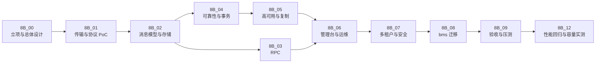

# 消息平台规划

> 定位 · 要解决的问题 · 能力全景 · 设计取舍 · 阶段路线 · 判据与推翻条件

[文档首页](../文档首页.md) › 规划 › 消息平台规划

---

## 1. 定位 

**msg** 是 BMS 平台之上的独立消息产品，目标是自研一套**完整消息平台（L3）**，统一承载三类通信：

| 能力 | 内容 | 替换对象 |
| --- | --- | --- |
| **事件总线** | topic / partition / offset、发布订阅、消费组、顺序、重试、死信、重放、延迟投递 | RocketMQ + 事务性发件箱 + 轮询投递器 |
| **同步 RPC** | 请求/响应、deadline 传播、取消、流式 | `HttpServiceClient` + FastAPI 同步链路 |
| **管理台与运维** | 主题与消费组管理、积压、死信、重放、配额、指标、追踪 | 分散的脚本与人工排查 |

形态与 mdm 同构：独立仓库、独立服务、独立库、独立部署，经产品声明 `deploy/registry/msg.toml` 接入 bms 基座；不修改基座业务代码。

## 2. 要解决的问题 

| 类别 | 现状 | 后果 |
| --- | --- | --- |
| **性能** | 同步链路是 `HttpServiceClient`（httpx + JSON）调 **FastAPI** 服务；开销来自路由匹配、依赖注入、Pydantic 校验与序列化、中间件，叠加 httpx 连接与 JSON 编解码 | 同步链延迟与吞吐都不理想 |
| **隔离** | outbox 等基础设施表名写死（`sys_outbox`），靠「每服务独立库」天然隔离 | 产品共库时同名表重叠 |
| **能力** | 事件账本、重放、死信绑在业务库的 outbox 表上；broker 侧没有统一位点、积压视图、死信处置 | 排障要跨库查表，重放要靠脚本 |
| **运维** | 事件与 RPC 两套机制、两套契约、两套运维 | 故障定位要跨三处 |

> **必须澄清的口径**：**OpenAPI 是契约规范（文档格式），不产生运行时开销**；性能瓶颈在 **FastAPI 框架栈 + JSON 序列化 + HTTP/1.1 连接**。因此本产品的方向是「换框架栈、换序列化、换传输」，**不是换契约格式**。对外契约仍走 OpenAPI。

## 3. 能力全景 

按 15 个能力域组织，逐项对应阶段与知识依据：

| 能力域 | 内容 | 阶段 | 知识依据 |
| --- | --- | --- | --- |
| 消息模型与语义 | topic / partition / offset / 消费组；至多一次 / 至少一次 / 效果一次；顺序性三级；单条消息大小上限（**待定**，见 §10 #10） | 8B_02 | 知识 02 |
| 延迟投递 | 固定档位（1s~60m）、延迟区暂存、到期转投、到期索引恢复 | 01 域（语义与接口）/ 8B_02（持久化与恢复） | 知识 02 |
| 存储引擎 | 追加日志、稀疏索引、分段、页缓存与零拷贝、fsync 策略、崩溃恢复、retention（按段删除；**compaction 首期不做**，见 §11） | 8B_02 | 知识 03 |
| 保留与重放 | 按时间 / 容量保留、按段删除、按 offset / 时间 / key 重放、重放限速与留痕 | 01 域（语义与接口）/ 8B_02（分段删除） | 知识 03 §7、知识 02 §7 |
| 复制与高可用 | 主从 / ISR / 多数派；选举、任期、fencing、脑裂；故障切换；跨机房 | 8B_05 | 知识 04 |
| 消费组与再均衡 | join / heartbeat / leave；成员状态机；eager 与 cooperative；分配策略；位点提交；重平衡风暴 | 01 域（协议 / 分摊 / 位点语义）/ 8B_02（位点落盘、多副本再均衡） | 知识 05 |
| 背压与流控 | 长轮询、inflight 上限、信用额度（h2 流控窗口映射）、磁盘水位、慢消费者隔离、队头阻塞 | 8B_01 / 02 | 知识 06 |
| 协议与传输 | 帧格式与版本演进、错误码；HTTP/2 多路复用、HPACK、流控窗口；h2c 与 TLS；连接管理 | 8B_01 | 知识 07 |
| 序列化与 Schema | MessagePack 默认；字段只增不删；消费端校验；批量压缩 | 8B_01 | 知识 08 |
| RPC 模型 | 关联 ID、deadline 传播、取消、流式、错误分类、幂等重试、熔断限流、**服务发现与负载均衡**（当前仅部署层 Compose DNS，客户端选实例待定） | 8B_03 | 知识 09 |
| 运维与可观测 | 吞吐 / 延迟 / 积压 / ISR 指标、**告警（分级 / 抑制 / 恢复）**、链路追踪、管理台、重放与死信处置 | 8B_06 | 知识 10 |
| 多租户与安全 | 继承基座 + msg 扩展：资源作用域、数据面接入、配额、topic ACL、审计留痕、生命周期、用量板块（bms 架构 41 与 07D） | 8B_07 | 知识 11 |
| 压测与容量规划 | 五类压测、瓶颈定位、容量模型、故障演练 | 8B_09 | 知识 12 |
| 开源实现对照 | Kafka / Pulsar / RocketMQ / NATS 的取舍依据 | 贯穿设计 | 知识 13 |
| 可靠性原语 | 事务性发件箱、事务消息、CDC、直接发布；outbox 适配 | 8B_04 | 知识 14~17 |

> 完整知识见 bms《[消息与事件驱动总览](../../bms文档/资料/知识档案/消息与事件驱动/01_事件驱动_总览.md)》20 篇。

## 4. 边界 

| 属于 msg | 不属于 msg |
| --- | --- |
| Broker、连接管理、协议、存储、客户端 | 用户 / 角色 / 菜单 / 权限 / 字典 / 参数（bms 基座） |
| 事件总线、RPC、管理台 | 业务事件语义与业务消费逻辑（各业务服务） |
| 多租户隔离、配额、限流 | 审计业务本身（bms 审计域） |
| 消息平台自身的操作留痕（写 bms 审计链） | 跨服务写的一致性（TM + XA） |
| 传输与序列化的性能优化 | 对外 OpenAPI 契约的制定与发布 |

**三条容易混淆的边界**：

1. **消息不替代事务**：跨服务写仍走 TM + XA；消息只保证「业务提交 ⇒ 事件可投递」，不保证「两个库同时改」。
2. **复制不替代备份**：副本会同步删除与损坏，只防节点故障，不防逻辑错误。
3. **换框架不等于换契约**：msg 绕开 FastAPI 与 JSON，但对外接口仍用 OpenAPI。

## 5. 设计取舍（已定） 

| 决策点 | 选择 | 依据 |
| --- | --- | --- |
| 自研深度 | **L3**（独立 broker + RPC + 管理台 + 多租户 + 高可用） | 与 bms 深度集成、统一事件与 RPC、摆脱表名绑死 |
| 部署形态 | **单服务多域**（broker / rpc / console / admin） | 单人运维，组件越少越好 |
| 传输 | **HTTP/2（h2c）+ MessagePack** | 多路复用 + 复用现有网关生态 + PoC 可控 |
| 存储 | **每分区追加日志 + 稀疏索引 + 分段** | 删除 / 隔离 / 迁移简单（学 Kafka） |
| 复制 | **ISR 式半同步**（8B_05 实现） | 吞吐优先，与现有事件量匹配 |
| 消费组 | **服务端主导 + range 分摊**（首期）；**cooperative / sticky 后置**（分配器已留策略位） | 客户端与 broker 同源，无需兼容多版本；首期用确定性分配便于验收与断言，粘性收益在 eager 全撤销下有限 |
| 重试与死信 | **平台内建** | 不把重试甩给应用（学 RocketMQ） |
| 多租户 | **租户 / 命名空间 / 主题 三级** | 预留租户内业务线划分（学 Pulsar） |
| 投递语义 | **至少一次 + 消费端幂等** | 与现有 outbox 基线一致，迁移成本最低 |
| 延迟消息存储 | **延迟区暂存 + 到期 `append`**（不占 offset、不参与停等） | 位点 / 停等 / 死信 / 保留全部复用，01-3 的不变量不被延迟消息破坏；代价是到期时刻有一次落盘搬迁 |
| 延迟驱动 | **分层时间轮 + 后台定时任务** | 到期转投与拉取解耦，无人消费也按时进入日志；惰性扫描会让到期精度依赖拉取频率 |
| 延迟档位 | **固定档位枚举**（1s / 5s / 10s / 30s / 1m / 5m / 10m / 30m / 60m） | 需求不支持任意精度；档位可扩展且向后兼容（只增不删） |
| 事务消息 | **后置**；先做 outbox 适配 | 平台已有序日志与位点，账本能力天然具备 |
| 运维 | **极简组件 + 指标先行** | 单人运维（学 NATS） |

**一句话**：**存储学 Kafka、重试学 RocketMQ、租户学 Pulsar、运维学 NATS、协议自己做**。

## 6. 标识符登记（暂定，最终以 07C 为准） 

| 项 | 值 |
| --- | --- |
| 产品键 `product_key` | `msg` |
| 服务键 `service_key` | `msg` |
| 模块键 `module_key` | `msg` |
| 表前缀 `table_prefix` | `msg_` |
| 业务码 `business_code` | `msg` |
| 事件域 `event_domain` | `msg` |
| 错误码段 `errcode_segment` | `35`（暂定） |
| 内部 API | `/api/v1/msg/...` |
| 对外 API | `/api/msg/v1/msg/...` |
| 库名前缀 | `msg`（`prefix == service` 去重 → `msg` / `msg_{tenant}` / `msg_archive`） |
| 消息命名空间 | `(tenant, namespace, topic)` 三级 |
| 权限码 | `msg:query`（只读）/ `msg:manage`（管理操作） |

## 7. 阶段路线与硬依赖 

| 阶段 | 目标 | 关键退出条件 | 硬依赖 |
| --- | --- | --- | --- |
| 8B_00 | 需求、总体设计、协议与存储选型、PoC 计划 | 设计六块无开放 blocker | — |
| 8B_01 | HTTP/2 + 二进制 PoC：单机 broker、收发 / ack / 重试 / 死信、基准 | 五项功能验证通过（**go/no-go 点**）；性能不作门禁，容量结论归 8B_12。**已达成（2026-11-05，03 域 03-1~03-5 收口，门禁 2 复核）** | 8B_00 |
| 8B_02 | 消息模型与存储：多分区、位点、分段、崩溃恢复、**延迟区与到期索引恢复** | 崩溃恢复不丢已确认、位点可重放、**未到期延迟消息重启后按剩余时间投递** | 8B_01 |
| 8B_03 | RPC：关联 ID、deadline、取消、错误码 | 可替换一个真实 `HttpServiceClient` 调用 | 8B_01 |
| 8B_04 | 可靠性与事务：至少一次 + 幂等 + outbox 适配 | 审计事件不丢、重复消费效果一次 | 8B_02 |
| 8B_05 | 高可用与复制：ISR、选举、故障切换 | 单节点故障可恢复、不丢已提交 | 8B_04 |
| 8B_06 | 管理台与运维：指标、追踪、积压、死信、重放 | 积压 / 死信 / 重放可操作 | 8B_02 |
| 8B_07 | 多租户与安全：隔离、配额、认证授权、审计 | 租户隔离与配额验收通过 | 8B_06 |
| 8B_08 | bms 迁移：适配层、分域切换、回滚 | 一条事件链 + 一个 RPC 切换成功且可回滚 | 8B_05 / 8B_06 / 8B_07 |
| 8B_09 | 验收与压测：性能、稳定性、故障演练 | 验收报告通过 | 8B_08 |
| 8B_12 | 性能回归与容量实测：独立压测环境、编译型客户端、容量模型定参、性能基线回归 | 容量模型与单机拐点可解释；性能基线可重复回归（03 / 04 / 05 域每次性能敏感变更后复测） | 8B_09 |

> **阶段编号**：`8B_10` / `8B_11` 暂未使用（为后续拆解的需求域预留）；**`8B_12` 沿用既有任务记录中已存在的引用编号**（01-6、03-1 的遗留均以 `8B_12` 指容量与压测），此处将其正式定义为独立阶段，历史记录无需回改。
>
> **8B_12 与 8B_09 的分工**：8B_09 是**一次性验收压测**（验收报告通过即可退出）；8B_12 是**容量定参与持续回归**——定容量模型参数、找单机拐点、提供可重复的性能基线。需求 07-5「客户端与服务端分离部署、报 P50 / P95 / P99」的执行落点在 8B_12，不在 8B_09 重复取证。

**四条不能颠倒的硬依赖**：

1. **8B_01 是功能刹车点**：功能项（同连接多流、长驻流、取消即释放、契约零漂移、可启动）不通过就退回「只换 RPC」的局部方案，不硬推。**性能不作为刹车依据**——自研的驱动因素是业务功能能力，性能是附带收益；传输层性能的量化结论归 8B_12（2026-11-05 刹车评审，见 §9.3）。
2. **8B_02 是 8B_04 的前提**：没有可靠存储与位点，可靠性无从谈起。
3. **8B_05 必须早于 8B_08**：无复制就迁移生产事件，等于把单点故障放大到全平台。
4. **8B_06 必须早于或同步于 8B_08**：没有管理台就迁移，出问题只能重启。

> **任务域 01 的定位（语义层 ≠ 存储层）**：语义与接口（分区模型、投递语义、顺序性、组协议、延迟档位与延迟区端口）
> 在 8B_01 之前落地；分区日志、分段、位点文件、延迟区落盘等**存储实现严格排在 8B_01 之后（8B_02）**。
> 因此 01 域任务的完成标准只写「语义可验」，凡依赖落盘的判据（如「未到期延迟消息重启后不丢」）一律显式标注
> 承接阶段（8B_02），不得写成当前任务的验收项。

> 进度与投入以阶段计划为唯一落点（阶段计划待按需求编排后重建）。

## 8. 与 bms / mdm 的关系 

| 对象 | 关系 |
| --- | --- |
| **bms 基座** | 提供产品接入（服务目录 / 表归属 / 域布局）、认证、租户、审计、事件契约、CI、文档体系；msg 不改基座业务。多租户与安全按 bms《架构设计 · 产品租户与安全接入》继承，msg 只写扩展项 |
| **bms 事件总线** | msg 成熟后逐步替换 RocketMQ / outbox / `HttpServiceClient`；通过 `EventPublisher` / `BaseServiceClient` 适配层接入，业务代码不改 |
| **bms 对外 OpenAPI** | 不替换、不影响；msg 只优化内部链路的框架栈与传输 |
| **bms TM + XA** | 不替代；跨服务写仍走 TM + XA |
| **mdm** | 同为 bms 之上的独立产品；参考其仓结构、产品声明与接入方式，两者互不依赖 |
| **业务服务** | 只依赖 `EventPublisher` / `BaseServiceClient` 端口；消息语义与消费逻辑由业务负责 |

## 9. 成功判据与推翻条件 

### 9.1 成功判据

| # | 判据 | 含义 |
| --- | --- | --- |
| 1 | 容量可支撑平台事件量 | 阈值由 8B_12 容量实测定参；8B_01 只验传输可行性（能跑、能长驻、能取消），不作性能达标判据（见 §9.3） |
| 2 | 事件不丢 | 业务提交 ⇒ 事件可投递；消费端幂等保证效果一次 |
| 3 | 分区有序 | 同聚合键有序 |
| 4 | 崩溃恢复 | 重启后不丢已确认、未确认可重投；**未到期的延迟消息按剩余时间投递**（不提前、不丢） |
| 5 | RPC 可用 | 超时、取消、错误码、流式行为符合设计 |
| 6 | 多租户隔离 | 越权不可达、配额生效 |
| 7 | 可运维 | 积压 / 延迟 / 死信可观测可操作 |
| 8 | 可迁移可回滚 | 分域切换、回滚演练通过 |

### 9.2 什么情况下应该推翻（刹车条件）

| 触发条件 | 应对 |
| --- | --- |
| 8B_01 功能项未通过（同连接多流 / 长驻流 / 取消即释放 / 契约零漂移 / 可启动） | 退回「只换 RPC、保留 RocketMQ」的局部方案 |
| 8B_12 容量实测显示无法支撑平台事件量（吞吐或延迟不达容量模型要求） | 先按容量模型扩容 / 分片；仍不达则退回开源自建（RocketMQ / Kafka）或云托管，适配层保证可切换 |
| 自研可靠性无法保证（崩溃恢复 / 复制反复丢数据） | 退回开源自建（RocketMQ / Kafka），保留适配层 |
| 运维成本失控（单人无法维护） | 改用云服务或托管版；适配层保证可切换 |
| 业务规模远低于预期 | 冻结 8B，保留现有 outbox |
| 团队扩充但设计未跟上 | 先补复制与多租户设计评审，再继续 |

> **性能不单独构成推翻条件**（2026-11-05 评审，见 §9.3）：性能只通过与「容量模型」对照才进入推翻判断，且须在独立压测环境取值——同机 Python 客户端测出的比值不具裁定力。

**推翻不等于失败**：适配层的存在就是为了让「换实现」不牵连业务代码。

### 9.3 8B_01 刹车评审结论（2026-11-05） 

#### 9.3.1 结论

**go（功能驱动）**：继续推进 03 域剩余任务（03-2 ~ 03-5）至 8B_01 功能收口，随后按序进入 8B_02 存储与 8B_03 RPC。判定依据是**立项动因**：自研的价值在业务功能能力——统一位点与重放、平台内建重试与死信、固定档位延迟、三级命名空间、事件与 RPC 一套运维；RocketMQ + 事务性发件箱 + 轮询投递器满足不了，与快多少无关。性能是附带收益，不构成立项前提，也不单独构成推翻条件。

#### 9.3.2 为什么 1.44x 不能当判据（也不是传输层上限）

| 事实 | 说明 |
| --- | --- |
| 装置是闭环 | 基准脚本以 16 个 worker 各串行发请求，故「吞吐 × 延迟 = 并发数」恒成立。h2c 档 16 ÷ 304.5 ≈ 52.5ms，与实测 p50 53.6ms 吻合——装置已跑满，吞吐与延迟只是同一个量的两种写法 |
| 对照档服务端不干活 | 判据取 `GET /msg/connection`，服务端只是回一段 JSON（亚毫秒级），而实测每请求周期 53ms → **九成以上耗时在压测客户端与同机 CPU 竞争**（同进程解析 JSON、16 协程共用一个事件循环） |
| 因此比值测的是客户端 | 1.44x 是「httpx 在 16 条 h1 连接与单条 h2 连接下的每请求开销之比」，**既不是传输层上限，也不是传输层达标 / 不达标的证据**；方向偏保守（对 h2 不利），幅度不可外推 |
| publish 档同理不可用 | 每请求应用固定成本约 17ms（主题解析 + 保留清理 + 会话），端到端被压到数百毫秒；h2c 反而更慢属装置与实现问题，不能读作协议结论 |

**判断口径**：装置在同一台机器上让客户端与服务端争抢 CPU，两个变量绑死在一起，任何比值都无法拆分「协议能力」与「客户端成本」。换装置（独立压测机 + 编译型客户端）之前，传输层性能**没有可裁定数字**。

#### 9.3.3 判据变更（本次拍板）

| 项 | 原 | 现 |
| --- | --- | --- |
| 8B_01 门禁 | 五项验证通过 + 基准达标 | **五项功能验证通过**；性能不作门禁 |
| 成功判据 1（§9.1） | 传输性能达标 | 容量可支撑平台事件量（阈值由 8B_12 定参） |
| 推翻条件（§9.2） | 8B_01 基准未达标 | 8B_01 功能项未通过；或 8B_12 容量不达容量模型 |
| 压测取证 | 8B_01 内完成 | 暂停；独立机 + 编译型客户端归 8B_12 |
| 传输层对照档（设计 §8.3 分层测量） | 作为判据 | **降为诊断记录**，不作裁定 |

#### 9.3.4 评审引出的必办项

| # | 事项 | 归属 |
| --- | --- | --- |
| 1 | publish 档 9 个失败（1200 条中 0.75%，脚本只计数未记原因）按**缺陷**定位；缺陷无对应需求，**不单立任务** | 03-1 收口（工作量计入该任务） |
| 2 | 应用固定成本治理：主题元数据缓存 + 保留清理改时间节流（现状每条请求都做一次全量清理） | **需求 01-7 / 任务 01-7**（2026-11-05 同日补充，需求总数 44 → 45 条） |
| 3 | 容量定参与性能基线回归：独立压测机 + `h2load` + P50 / P95 / P99 | 8B_12 |
| 4 | 03-1 收口遗留：msg 仓提交前预检钩子未装配 | 03-1 |
| 5 | 判据口径同步（任务 03-1 §3、详细设计 §8.2） | 已随本次评审回写 |

#### 9.3.5 若日后触发退回（影响面预案）

| 资产 | 处置 |
| --- | --- |
| 03-1 ~ 03-5、bms hypercorn 启动器、契约快照零漂移门禁 | **可留**——「只换 RPC」同样需要整条 03 域（传输 / 帧 / 序列化 / 连接 / 流控） |
| 01 域全部任务（含 01-7 成本治理） | **作废**——主题 / 分区 / 消费组 / 延迟 / 保留语义只在自研 broker 分支下成立；设计文档可留作资产，代码作废 |
| 02 域 7 条任务（未开工） | 取消 |
| 8B_02 / 8B_04 / 8B_05 / 8B_06 / 8B_07 路线；需求 01 / 02 域 | 关闭，收缩为「RPC 客户端 + 适配层」 |
| 8B_08 迁移 | 「一条事件链切换」改为「一个 RPC 调用切换」（与 8B_03 原有退出条件一致） |

#### 9.3.6 回归条件

8B_12 出具容量模型后回看本节：若端到端吞吐或延迟不能满足容量模型，按 §9.2 处置（扩容 / 换实现），不回到「以单机基准比值判刹车」的旧口径。

## 10. 风险 

| # | 风险 | 影响 | 缓解 |
| --- | --- | --- | --- |
| 1 | L3 范围大（broker + 复制 + 管理台 + 多租户） | 长期半成品 | 分阶段、每阶段可独立验收；8B_01 可刹车 |
| 2 | 自研存储 / 复制的 bug | 数据丢失（最高） | 先单机 + CRC + 恢复演练；HA 前不承载唯一副本 |
| 3 | Python 性能上限 | 吞吐 / 延迟不达容量模型 | 容量结论归 8B_12（独立机 + 编译型客户端，P50 / P95 / P99）；不以同机基准比值判刹车（§9.3）；热点用异步批处理或 C 扩展 |
| 4 | 单人运维 | 出问题无人定位 | 指标与管理台先于功能 |
| 5 | 与 bms 迁移耦合 | 生产事故 | 适配层 + 分域切换 + 回滚演练 |
| 6 | 多库 / 多环境行为差异 | 本地通过、生产失败 | Windows 与 Linux 双端验证；关键路径真机复测 |
| 7 | 协议演进破坏老客户端 | 升级即断 | 只增字段、未知忽略、版本可见 |
| 8 | 多租户扩展项与 bms 07D 基线对齐滞后 | 无法承载产品 | 按 bms 架构节点接入，扩展项只写 msg 语义，不后补 |
| 10 | **单条消息大小上限未定**（架构 05 §5 已为「消息过大」预留 `350006`，但规划 / 需求均未定值） | 超大消息打爆内存与段文件，或客户端行为不一致 | 8B_01 帧契约定值（建议 1MB 级），01-2 契约层补校验；在定值前不做超限拒绝 |
| 9 | 任务域 01 先于存储落地，完成标准易写成跨阶段承诺（01-5「重启不丢失」、01-6「旧段删除」已实证） | 验收时被判「未达成」，或被迫在内存阶段提前钉死落盘形态 | 每层文档把「语义可验」与「存储可验」分开写；跨阶段项显式标注承接阶段（8B_02），判据以承接阶段的任务为准 |

## 11. 非目标 

- **不替代跨服务写事务**：TM + XA 仍负责「两个库同时改」。
- **不做商业化计费与运营后台**：L3 之后的独立阶段。
- **首期不做多语言 SDK**：先 Python，跨语言需求出现再评估 Protobuf。
- **首期不做跨机房复制**：单机房内先做机架分散。
- **首期不做 Schema Registry**：事件契约快照 + 消费端校验已够。
- **首期不做任意精度延迟与定时消息**：只支持固定档位（1s~60m）；任意毫秒与绝对时间（定时消息）在需求出现后再评估。
- **首期不做日志压缩（compaction）**：消息按时间 / 容量整段删除即可；键压缩（key compaction）在「事件账本需要按 key 只留最新值」的需求出现后再评估。
- **不做通用 CDC 平台**：只保留「outbox connector」形态的口子。
- **不接管对外 OpenAPI 契约**：对外契约仍由 bms 体系管理。

## 12. 参考 

| 主题 | 文档 |
| --- | --- |
| 知识档案总览（20 篇） | [消息与事件驱动总览](../../bms文档/资料/知识档案/消息与事件驱动/01_事件驱动_总览.md) |
| 消息模型与语义 | [02](../../bms文档/资料/知识档案/消息与事件驱动/02_事件驱动_消息模型与语义.md) |
| 存储引擎 | [03](../../bms文档/资料/知识档案/消息与事件驱动/03_事件驱动_存储引擎.md) |
| 复制与高可用 | [04](../../bms文档/资料/知识档案/消息与事件驱动/04_事件驱动_复制与高可用.md) |
| 消费组与再均衡 | [05](../../bms文档/资料/知识档案/消息与事件驱动/05_事件驱动_消费组与再均衡.md) |
| 背压与流控 | [06](../../bms文档/资料/知识档案/消息与事件驱动/06_事件驱动_背压与流控.md) |
| 协议与传输 | [07](../../bms文档/资料/知识档案/消息与事件驱动/07_事件驱动_协议与传输.md) |
| 序列化与 Schema | [08](../../bms文档/资料/知识档案/消息与事件驱动/08_事件驱动_序列化与Schema.md) |
| RPC 模型 | [09](../../bms文档/资料/知识档案/消息与事件驱动/09_事件驱动_RPC模型.md) |
| 运维与可观测 | [10](../../bms文档/资料/知识档案/消息与事件驱动/10_事件驱动_运维与可观测.md) |
| 多租户与安全 | [11](../../bms文档/资料/知识档案/消息与事件驱动/11_事件驱动_多租户与安全.md) |
| 压测与容量规划 | [12](../../bms文档/资料/知识档案/消息与事件驱动/12_事件驱动_压测与容量规划.md) |
| 开源实现对照 | [13](../../bms文档/资料/知识档案/消息与事件驱动/13_事件驱动_开源实现对照.md) |
| 可靠性原语（4 篇） | [14 事务性发件箱](../../bms文档/资料/知识档案/消息与事件驱动/14_事件驱动_事务性发件箱.md) · [15 事务消息](../../bms文档/资料/知识档案/消息与事件驱动/15_事件驱动_事务消息.md) · [16 CDC](../../bms文档/资料/知识档案/消息与事件驱动/16_事件驱动_CDC与日志尾随.md) · [17 直接发布](../../bms文档/资料/知识档案/消息与事件驱动/17_事件驱动_直接发布与补偿.md) |
| 选型对比与推翻条件 | [18](../../bms文档/资料/知识档案/消息与事件驱动/18_事件驱动_选型对比（BMS）.md) |
| 常见误区 | [19](../../bms文档/资料/知识档案/消息与事件驱动/19_事件驱动_常见误区.md) |
| 项目评估 | [20](../../bms文档/资料/知识档案/消息与事件驱动/20_事件驱动_项目评估（BMS）.md) |
| 设计体系 | [架构设计总览](../设计/架构设计/01_架构设计_总览.md)（9 篇）· [概要设计总览](../设计/概要设计/01_概要设计_总览.md) · [数据库设计总览](../设计/数据库设计/01_数据库设计_总览.md) · [原型设计总览](../设计/原型设计/01_原型设计_总览.html) |
| 需求 | [00 需求总览](../项目/08B_消息平台/需求/00_需求_消息平台.md)（7 域 45 条） |

---

> 依《[文档生成规范](../../bms文档/规范/文档生成规范.md)》编写 · 进度以阶段计划为唯一落点
