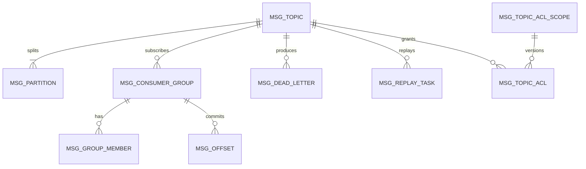

# 数据库设计总览

> 元数据入库 · 消息本体不入库 · 表集规划 · 与文件日志的分界

[文档首页](../../文档首页.md) › [消息平台规划](../../规划/01_规划_消息平台.md) › 数据库设计　|　[概要设计 · 总览 →](../概要设计/01_概要设计_总览.md)

---

## 1. 目的与边界 <a id="purpose"></a>

明确「消息平台哪些数据进数据库、哪些必须走文件」，以及表集规划与命名口径。

| 属于本篇 | 不属于本篇 |
| --- | --- |
| 元数据表集规划、命名、归属 | 具体字段与索引（按任务建表文件，见第 4 节登记） |
| 元数据与消息本体的分界 | 消息记录的字节格式（8B_02 详细设计） |
| 迁移与版本口径 | 业务库表（各业务服务） |

> **重要**：本文件是**规划**，不是定稿。表名与字段以各任务的数据库设计表文件（`数据表设计/{表名}.md`）为准；本文件只定「哪些表、归哪个数据源、为什么」。
>
> **字段级通用约定**沿用基座《[数据库设计 · 数据规范](../../../bms文档/设计/数据库设计/02_数据库设计_数据规范.md)》（公共字段 / 类型映射 / 时间 UTC / 索引命名 / 方言差异），本文与各表文件**只写 msg 差异**，不重复基座约定（与 mdm 产品仓同口径）。

## 2. 核心原则 <a id="principle"></a>

### 2.1 消息本体不入库

| 数据 | 存储 | 理由 |
| --- | --- | --- |
| **消息本体** | 分区日志文件 | 顺序写、零拷贝、整段删除；入库会带来写放大、保留期清理困难、吞吐受限 |
| **元数据** | 数据库表 | 需事务、查询、关联、权限校验 |
| **消费位点** | 独立文件优先（可后置入表） | 高频写，文件更轻 |
| **延迟消息** | 分区延迟区文件（`.delay` 段） | 到期才进分区日志；**不入库**——延迟区是高频读写，且 `deliver_at` 是记录头字段而非表列 |
| **运行态（LEO / HW / ISR）** | 内存 + 恢复点文件 | 每秒多次更新，不能每次写库 |

这条分界来自知识档案 03 篇的结论：**用数据库表存消息能快速验证功能，但在吞吐、保留期清理、崩溃恢复上都会成为瓶颈**。

### 2.2 元数据是平台级

消息平台的元数据（主题、消费组、配额、授权）是**跨租户的平台级数据**，按 `tenant_id` 列区分，而不是按租户分库：

| 方案 | 优点 | 缺点 | 选择 |
| --- | --- | --- | --- |
| 平台库 + `tenant_id` 列 | 跨租户查询方便、运维简单 | 单库压力 | **是** |
| 每租户独立库 | 隔离彻底 | 建库/迁移/连接管理复杂 | 否 |

### 2.3 与 bms 租户体系的关系

| 项 | 结论 |
| --- | --- |
| 租户标识 | 一律 `tenant_id`（雪花，不可变）；不用可变的租户编码，避免改名导致数据断链 |
| 租户有效性 | 不复制 bms 租户表；以基座解析结果为准，每次请求校验状态 |
| 配额 | **msg 自维护 `msg_quota`**；不写 bms `sys_tenant_quota`（该表归属 bms tenant 服务） |
| 配额回显 | bms 租户管理页经 **产品数据源**（`deploy/registry/msg.toml` 的 `[[data_sources]]`）只读加载 msg 的用量接口 |
| 命名空间 | `namespace` 取自已启用 `module_key`，与平台模块、权限码对齐 |
| 数据目录 | 消息本体按 `data/{tenant_id}/...` 分目录，对应 bms「每服务每租户一库」的物理隔离 |

## 3. 表集规划 <a id="tables"></a>

| 表 | 作用 | 数据源 | 主要列（规划） |
| --- | --- | --- | --- |
| `msg_topic` | 主题定义 | platform | tenant_id、namespace、name、partition_count、retention_ms、retention_bytes、cleanup_policy、status |
| `msg_partition` | 分区定义与检查点 | platform | topic_id、partition_no、leader、replicas、isr、checkpoint_leo、checkpoint_hw |
| `msg_consumer_group` | 消费组 | platform | tenant_id、namespace、name、topic_id、state |
| `msg_group_member` | 组成员 | platform | group_id、member_id、instance_id、last_heartbeat |
| `msg_offset` | 消费位点（若入表） | platform | group_id、topic_id、partition_no、committed_offset、updated_at |
| `msg_quota` | 配额限额（用量实时算、不落库） | platform | tenant_id、namespace、quota_key、limit_value、soft_limit、unit、period、origin |
| `msg_topic_acl` | 主题授权规则 | platform | tenant_id、namespace、topic、principal_type、principal_key、action、effect、status |
| `msg_topic_acl_scope` | 主题授权作用域版本戳 | platform | tenant_id、namespace、scope_version |
| `msg_dead_letter` | 死信 | platform | tenant_id、topic_id、partition_no、msg_offset、message_id、reason、retry_count、status |
| `msg_replay_task` | 重放任务 | platform | tenant_id、namespace、topic_id、partitions、offset_from、offset_to、time_from、time_to、filter_key、rate_per_second、status、total、replayed、cursor_state、log_id_first、log_id_last |
| `msg_tenant_lifecycle` | 租户生命周期动作账本 | platform | tenant_id、action、applied_version、deleted_event_at、purge_after、purged_at、failure_count、last_error、last_event_id |
| `msg_audit_ref` | 操作留痕关联（可选） | platform | 操作类型、目标、结果、trace_id、`log_id`（正文在 bms 审计链） |

**说明**：

- `msg_partition` 只存**检查点**（周期性落库），不存实时 LEO——实时值在内存，重启后从日志扫描恢复。
- `msg_offset` 首期用文件；表先建好，8B_02 实测后再决定是否切换。
- `msg_audit_ref` 只作索引，审计正文写 bms 审计链，避免重复存储；`log_id` 仅用于「审计条目 → 一条物理日志记录」的定位，非记录必填（只有涉及具体记录的操作才写）。
- **不新增延迟相关表**：延迟消息既不是元数据也不是运行态计数器，走 `.delay` 段（架构 04 §2.4）；
  「延迟中消息」视图的数据来自延迟区与时间轮，不来自数据库。
- **不建表不影响「不丢」**：延迟消息的持久化靠 `.delay` 段（顺序追加 + fsync + CRC + 段级删除），
  到期转投「先写日志并刷盘、再清延迟记录」（不丢），恢复期按 `log_id` 扫尾部比对（不重）；
  数据库只承担元数据，消息本体与延迟记录一概不入库。

## 4. 已设计数据表登记 <a id="tables-registry"></a>

> 表文件是字段唯一事实源；未在本表登记视为未定稿（《数据库开发规范》§5「新建表前置」）。

| 表 | 归属库 | 归属业务域 / 服务 | 表文件 | 对应任务 | 状态 |
| --- | --- | --- | --- | --- | --- |
| `msg_topic` | msg 平台库（`platform`） | `msg` / `msg` | [msg_topic](数据表设计/msg_topic.md) | 01-1 主题与分区模型 / 01-6 增 `retention_bytes` | 已落库（2026-11-04） |
| `msg_partition` | msg 平台库（`platform`） | `msg` / `msg` | [msg_partition](数据表设计/msg_partition.md) | 01-1 主题与分区模型 | 已落库（2026-11-04） |
| `msg_replay_task` | msg 平台库（`platform`） | `msg` / `msg` | [msg_replay_task](数据表设计/msg_replay_task.md) | 01-6 消息保留与重放 | 已落库（2026-11-04） |
| `msg_tenant_lifecycle` | msg 平台库（`platform`） | `msg` / `msg` | [msg_tenant_lifecycle](数据表设计/msg_tenant_lifecycle.md) | 05-5 租户生命周期资源清理 | 已落库（2026-11-08） |
| `msg_quota` | msg 平台库（`platform`） | `msg` / `msg` | [msg_quota](数据表设计/msg_quota.md) | 05-2 消息维度配额 | 已落库（2026-11-08） |
| `msg_topic_acl` | msg 平台库（`platform`） | `msg` / `msg` | [msg_topic_acl](数据表设计/msg_topic_acl.md) | 05-3 主题授权 | 已落库（2026-11-08） |
| `msg_topic_acl_scope` | msg 平台库（`platform`） | `msg` / `msg` | [msg_topic_acl_scope](数据表设计/msg_topic_acl_scope.md) | 05-3 主题授权 | 已落库（2026-11-08） |

> **状态口径**：`已设计`（表文件定稿、未落库）/ `已落库`（模型 + 幂等建表已落地）。本阶段无迁移脚本，结构以模型为唯一事实源（《数据库开发规范》§5）。

## 5. 表关系 <a id="er"></a>



| 关系 | 基数 | 说明 |
| --- | --- | --- |
| topic → partition | 1 : N | 分区数决定并行度 |
| topic → consumer_group | 1 : N | 多组独立消费 |
| group → member | 1 : N | 组内成员 |
| group → offset | 1 : N | 按分区存位点 |
| topic → dead_letter | 1 : N | 死信来自某主题 |
| topic → replay_task | 1 : N | 重放任务针对主题 |
| topic → topic_acl | 1 : N | 主题授权规则按 `(tenant_id, namespace, topic)` 归属 |
| topic_acl_scope → topic_acl | 1 : N | 版本戳按 `(tenant_id, namespace)` 失效该作用域规则 |

## 6. 命名与归属 <a id="naming"></a>

| 项 | 取值 | 依据 |
| --- | --- | --- |
| 表前缀 | `msg_` | 产品表前缀规范 |
| 表名风格 | snake_case | bms《命名规范》 |
| 主键 | 自增 / 雪花（按基座口径） | 与平台一致 |
| 租户列 | `tenant_id`（雪花，不可变） | 平台级元数据，不按租户分库；不用可变的租户编码 |
| 时间列 | `created_at` / `updated_at` | 统一口径 |
| 软删除 | 元数据表**不用**软删除（状态列表达） | 避免唯一约束受 NULL 影响 |

**数据源归属**：全部为 `platform` 数据源（平台库）。消息日志走文件系统，不占数据库容量。

## 7. 与文件日志的分界 <a id="boundary"></a>

```text
┌─────────────────────────────┐
│ 数据库（platform）           │
│  msg_topic / msg_partition  │  ← 描述「有什么、什么状态」
│  msg_consumer_group / ...   │
└──────────────┬──────────────┘
               │ 引用（topic_id / partition_no）
┌──────────────▼──────────────┐
│ 文件系统                     │
│  data/{tenant_id}/{ns}/{topic}/│  ← 存放「消息本体」
│    {partition}/*.log        │
│    {partition}/*.delay      │  ← 延迟消息暂存（到期才搬入 .log）
│  offsets/{group}/...offset  │  ← 消费位点（首期）
└─────────────────────────────┘
```

| 问题 | 答案 |
| --- | --- |
| 消息内容能查库吗？ | **不能**，只能按 offset 从日志读 |
| 删除主题时数据怎么办？ | 先改状态，再删目录（异步清理） |
| 位点与日志一致吗？ | 非原子；靠恢复流程对齐 |
| 备份数据库能恢复消息吗？ | **不能**，消息靠日志 + 副本 |

## 8. 迁移与版本 <a id="migration"></a>

| 项 | 口径 |
| --- | --- |
| 迁移工具 | Alembic（机制保留；**本阶段无脚本**，结构以模型为唯一事实源） |
| 链目录 | `alembic/versions/msg/platform/`（00-1 已建，当前空链） |
| 表集派生 | 由 `services/table_registry.py` 归属登记后按「域 × 数据源」派生（`msg:platform`） |
| 建表落地 | 幂等建表：开发库启动期 `[database].auto_create`、运维经基座 `ops.init_schema`；开发 / 演示库结构不符即删库重建 |
| 生产库 | 迁移执行（按新基线重建脚本后才走迁移路径），不自动建表 |
| 兼容 | 只增列不删列；删列先标记废弃 |

## 9. 后续表文件规划 <a id="next"></a>

表文件按任务逐个创建（**已建**表见第 4 节登记）：

| 数据表文件 | 任务 / 阶段 | 状态 |
| --- | --- | --- |
| `msg_topic.md` | 01-1 主题与分区模型 | 已建（2026-11-04） |
| `msg_partition.md` | 01-1 主题与分区模型 | 已建（2026-11-04） |
| `msg_consumer_group.md` | 8B_02（01-4 已按端口 + 内存交付，表在 8B_02 建） | 待建 |
| `msg_group_member.md` | 8B_02（同上） | 待建 |
| `msg_offset.md` | 8B_02（位点首期走文件，表定稿留待实测） | 待建 |
| `msg_dead_letter.md` | 8B_02（01-2 已按内存死信队列交付） | 待建 |
| `msg_replay_task.md` | 01-6 消息保留与重放 | 已建（2026-11-04） |
| `msg_tenant_lifecycle.md` | 05-5 租户生命周期资源清理 | 已建（2026-11-07） |
| `msg_quota.md` | 05-2 消息维度配额 | 已建（2026-11-08） |
| `msg_topic_acl.md` | 05-3 主题授权 | 已建（2026-11-08） |
| `msg_topic_acl_scope.md` | 05-3 主题授权 | 已建（2026-11-08） |

> **归口口径**：01-2 / 01-4 阶段只交付「端口 + 内存实现」，不建表；对应表文件随 8B_02
> （消息模型与存储）一次建齐，端口与字段同时定稿，避免表结构在内存阶段被提前钉死。
> 本表「任务 / 阶段」列写的是**表文件建成的阶段**，不是功能首发的阶段。

## 10. 待定项 <a id="tbd"></a>

| # | 待定项 | 回填位置 |
| --- | --- | --- |
| 1 | 位点最终存文件还是 `msg_offset` 表 | 8B_02 实测 |
| 2 | `msg_partition` 检查点落库频率 | 8B_02 |
| 3 | 死信是否单独分表（按租户） | 8B_04 |
| 4 | 配额用量是实时计算还是定时汇总 | 8B_07 |
| 5 | 是否需要 `msg_schema`（Schema 注册）表 | 跨语言需求出现时 |
| 6 | 延迟区软上限（租户 / 全局条数）与 TTL 兜底值 | 01-5 定端口与 `350015` 拒绝语义，8B_02 实测取值 |

---

> 依《[文档生成规范](../../../bms文档/规范/文档生成规范.md)》编写 · 存储依据见 bms《[存储引擎](../../../bms文档/资料/知识档案/消息与事件驱动/03_事件驱动_存储引擎.md)》
