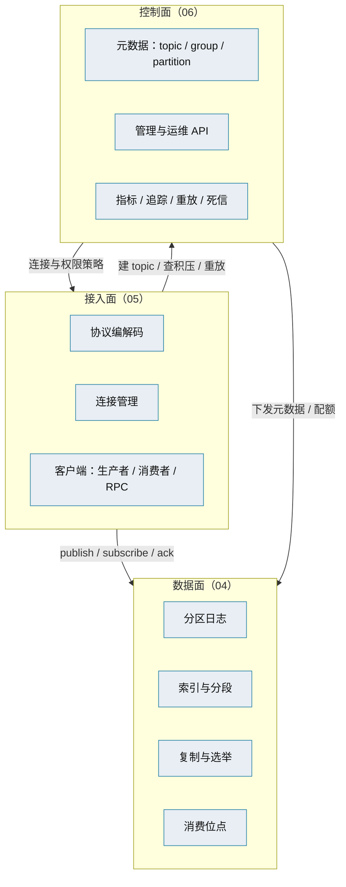

# 消息平台架构设计总览

> 产品级架构总纲 · 三面模型 · 与 8B 阶段设计的分工 · 文档地图

[文档首页](../../文档首页.md) › [消息平台规划](../../规划/01_规划_消息平台.md) › 架构设计 › 总览　|　[目标与约束 →](02_架构设计_目标与约束.md)

---

## 1. 文档目的 <a id="purpose"></a>

本文档是 msg（消息平台）**产品级架构设计**的总纲：说明平台由哪几面构成、边界在哪、与 bms 基座如何衔接、关键决策是什么。

**它写什么**：

- 不随阶段变化的**稳定决策**：三面划分、域边界、机制复用、部署形态、非功能目标、决策与风险。
- 跨阶段成立的**约束**：单人运维、Python 技术栈、三库兼容、已上线链路不可中断。

**它不写什么**：

- 具体协议字段、帧布局、存储记录格式——这些在 8B 阶段详细设计里。
- 接口参数与错误码明细——这些在概要设计与契约快照里。
- 表字段——这些在数据库设计的数据表文件里。

## 2. 与 8B 阶段设计的分工 <a id="split"></a>

这是本套文档最重要的口径，避免两份文档各说一套：

| 维度 | 产品架构设计（本套） | 8B 阶段详细设计 |
| --- | --- | --- |
| 时间尺度 | 跨阶段稳定，不随阶段变 | 服务单阶段推进，随阶段调整 |
| 内容 | 三面划分、域边界、机制复用、非功能目标、部署形态、关键决策 | 协议帧、存储格式、PoC 参数、迁移步骤、测试设计 |
| 变更成本 | 高（改了要评审） | 低（阶段内可迭代） |
| 典型问题 | 「消息平台由哪几面构成」 | 「publish 帧的 header 有哪些字段」 |

**规则**：

1. 架构设计里出现「具体参数」时，只作为**示例**并注明「以 8B 详细设计为准」。
2. 8B 详细设计若推翻架构决策，**先回写架构设计**再改实现。
3. 两者冲突时，**以架构设计为准**；架构设计未覆盖时，以 8B 详细设计为准。

> 8B_00 总体设计将按本套分工**重写为阶段实现路径**（保留协议、存储格式、PoC 计划），架构层面的内容上提到本套。

## 3. 三面模型 <a id="three-planes"></a>

消息平台的组件按职责分三面，这个划分贯穿后续 8 篇：



| 面 | 职责 | 关键问题 | 对应篇目 |
| --- | --- | --- | --- |
| **接入面** | 客户端怎么连进来、说什么话 | 协议、连接、背压、客户端 API | 05 |
| **数据面** | 消息怎么存、怎么复制、怎么被消费 | 存储、索引、恢复、复制、位点 | 04 |
| **控制面** | 平台怎么被管理与观测 | 元数据、配额、指标、重放 | 06 |

**三面分离的价值**：

1. **故障隔离清晰**：消费不动是数据面还是接入面的问题，一眼能分。
2. **扩容策略不同**：接入面按连接数扩，数据面按吞吐与存储扩，控制面基本不扩。
3. **演进节奏不同**：接入面协议要长期兼容，数据面格式要预留复制字段，控制面可以快速迭代。

## 4. 产品定位（一句话） <a id="position"></a>

**msg 是 BMS 平台之上的独立产品，自研完整消息平台（L3），统一承载事件总线、同步 RPC 与管理运维，替换 RocketMQ + 事务性发件箱 + `HttpServiceClient` + FastAPI 同步链路。**

三条不同于「轻量封装」的定位：

| 维度 | 轻量封装（不做） | 完整平台（要做） |
| --- | --- | --- |
| 消息落点 | 存业务库表 | 独立分区日志 + 索引 + 分段 |
| 可靠性 | 依赖上游 broker | 自己保证持久化、位点、重放 |
| 可用性 | 跟随上游 | 自己做复制与故障切换 |
| 运维 | 靠上游工具 | 自建管理模块与指标 |

## 5. 与 bms 架构设计的关系 <a id="bms"></a>

msg **复用基座机制、不重复立法**；下列 bms 架构节点是 msg 的上位依据：

| 机制 | bms 架构依据 | msg 的处理 |
| --- | --- | --- |
| 服务间通信与一致性 | 平台《架构设计 · 服务间通信与一致性》 | 替换其中「同步调用」与「事件投递」的实现，**不改变一致性口径** |
| 事件总线 | 平台《架构设计 · 事件总线》 | 对齐事件契约、分区有序、消费组、死信语义 |
| API 网关与边缘 | 平台《架构设计 · API 网关与边缘》 | 对外仍经网关，命名空间 `/api/msg/v1/msg/...` |
| 多租户路由 | 平台《架构设计 · 多租户路由》 | 租户识别从令牌解析，与基座租户上下文对齐 |
| 认证与会话 / 权限计算引擎 | 平台《架构设计 · 认证与会话》《权限计算引擎》 | 复用服务 JWT 与权限码，不自建身份体系 |
| 审计哈希链 | 平台《架构设计 · 审计哈希链》 | 管理操作写 bms 审计链，不自建审计 |
| 可观测性 | 平台《架构设计 · 可观测性》 | 指标 / 日志 / 追踪格式对齐基座 |
| 部署与运维 | 平台《架构设计 · 部署与运维》 | 产品声明 + compose，接入平台网络 |
| 产品与服务划分 | 平台《架构设计 · 产品与服务划分》 | 按产品形态接入（`deploy/registry/msg.toml`） |

**msg 自己做架构决策的只有三件**：存储与复制、协议与传输、消息模型与消费组。这三件 bms 没有对应节点（现有实现是 RocketMQ 黑盒），必须自研。

## 6. 文档地图 <a id="map"></a>

```text
msg文档/设计/
├── README.md
├── 架构设计/
│   ├── 01_架构设计_总览.md              # 本文件：目的 / 分工 / 三面 / 关系 / 地图
│   ├── 02_架构设计_目标与约束.md        # 功能与非功能目标 / 约束 / 质量属性
│   ├── 03_架构设计_总体架构.md          # 三面组件图 / 请求路径 / 部署单元
│   ├── 04_架构设计_数据面_存储与复制.md  # 分区日志 / 索引 / 恢复 / 延迟区 / ISR / 选举
│   ├── 05_架构设计_接入面_协议与客户端.md # 协议分层 / 帧 / HTTP2 / 客户端 / 背压
│   ├── 06_架构设计_控制面_元数据与运维.md # 元数据 / 管理模块 / 指标 / 重放 / 死信
│   ├── 07_架构设计_多租户与安全.md       # 三级命名空间 / 配额 / 认证 / 授权 / 审计
│   ├── 08_架构设计_部署与运维.md         # 部署单元 / 配置 / 升级回滚 / 备份 / 容量
│   └── 09_架构设计_决策与风险.md         # 关键决策 / 开放项 / 风险 / 推翻条件
├── 概要设计/
│   └── 01_概要设计_总览.md               # 模块划分 / 接口清单 / 数据流
└── 数据库设计/
    └── 01_数据库设计_总览.md             # 表集规划 / 命名 / 元数据与消息本体的分界
```

| 篇目 | 回答的问题 | 读者 |
| --- | --- | --- |
| 01 总览 | 这套文档是什么、怎么分工、由哪几面构成 | 所有人 |
| 02 目标与约束 | 要做到什么程度、受什么限制 | 评审 / 立项 |
| 03 总体架构 | 组件怎么摆、请求怎么走、部署几个单元 | 开发 |
| 04 数据面 | 消息怎么存、怎么复制、崩了怎么恢复、延迟消息怎么等和怎么转投 | 8B_02 / 8B_05 |
| 05 接入面 | 客户端怎么连、协议怎么演进 | 8B_01 / 8B_03 |
| 06 控制面 | 平台怎么管、怎么观测、怎么重放 | 8B_06 |
| 07 多租户与安全 | 怎么隔离、怎么限、怎么防越权 | 8B_07 |
| 08 部署与运维 | 怎么部署、怎么升级、怎么备份 | 8B_08 |
| 09 决策与风险 | 定了什么、没定什么、什么情况刹车 | 评审 / 后续阶段 |

## 7. 阅读路径 <a id="path"></a>

| 目的 | 顺序 | 预计 |
| --- | --- | --- |
| **快速了解平台** | 01 → 03 → 02 | 约 30 分钟 |
| **参与设计评审** | 01 → 02 → 03 → 09 | 约 60 分钟 |
| **动手实现 broker** | 03 → 04 → 05 → 06 | 约 90 分钟 |
| **准备上线运维** | 03 → 07 → 08 → 09 | 约 60 分钟 |
| **系统通读** | 01 → 02 … → 09 | 约 3 小时 |

## 8. 维护口径 <a id="maintain"></a>

- **架构决策变更必须回写本套**：尤其是 04 / 05 / 09，改一处要检查其余篇是否矛盾。
- **参数不写进架构**：默认值、阈值、超时统一放 8B 详细设计与配置说明。
- **引用知识档案不复制**：原理与业界对照指向 bms《消息与事件驱动》20 篇，本套只写「msg 怎么选、为什么」。
- **新增篇目按序编号**：`{NN}_架构设计_{主题}.md`，目录树同步更新到 `设计/README.md`。

---

> 依《[文档生成规范](../../../bms文档/规范/文档生成规范.md)》编写 · 与《[消息平台规划](../../规划/01_规划_消息平台.md)》及 bms《架构设计》配套
