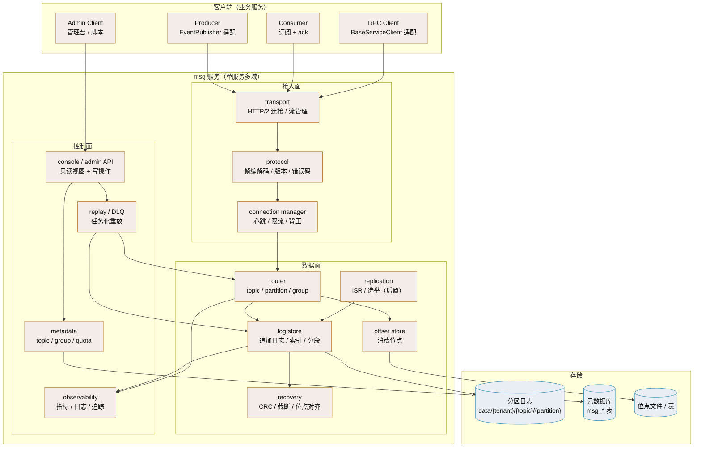
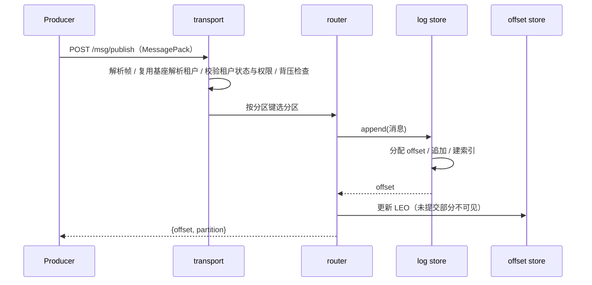
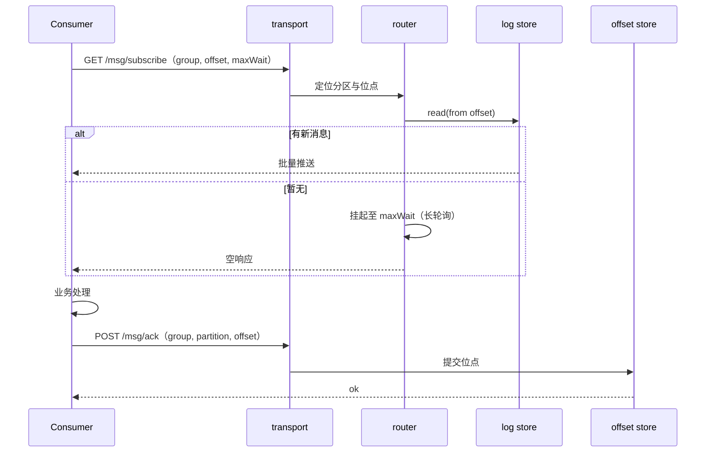
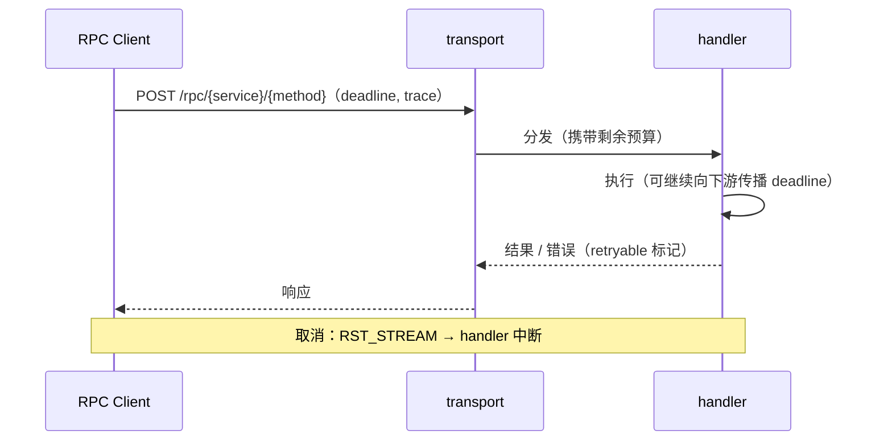
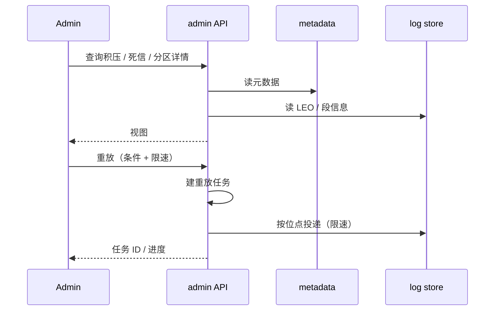

# 总体架构

> 三面组件全景 · 四条请求路径 · 部署单元 · 进程内模块 · 故障域

[文档首页](../../文档首页.md) › [消息平台规划](../../规划/01_规划_消息平台.md) › 架构设计 › 总体架构　|　[← 目标与约束](02_架构设计_目标与约束.md) · [数据面 →](04_架构设计_数据面_存储与复制.md)

---

## 1. 组件全景 <a id="components"></a>



## 2. 四条请求路径 <a id="paths"></a>

### 2.1 发布（publish）



关键点：

- **offset 由 broker 分配**，客户端不能指定。
- **租户在帧入口解析**：数据面不走 ASGI，复用基座解析函数（同一套来源次序），并校验租户状态（停用拒绝）。
- **背压检查在入队前**（写 06 篇），超限直接返回限流错误。
- **零拷贝**：broker 只解析 header，payload 原样落盘与转发。
- **懒初始化**：首次发布到未开通的 `(tenant_id, namespace)` 时自动创建，查询不创建。

### 2.2 消费（subscribe + ack）



关键点：

- **先处理后 ack**，未 ack 超时重投（至少一次）。
- **位点按 `(group, topic, partition)` 存**，与消费者实例无关。
- **长轮询避免空转**，同时天然背压。

### 2.3 RPC（invoke）



关键点：

- **deadline 传播**：每跳扣除已消耗时间。
- **错误带 `retryable`**，客户端据此决定重试。
- **与事件共用连接**，按 path 分配配额。

### 2.4 管理（console / admin）



关键点：

- **只读先于写操作**：只读视图就能解决大部分排障。
- **重放任务化**：可暂停、可查看进度、有速率上限。
- **写操作留痕**：写入 bms 审计链。

## 3. 部署单元 <a id="deploy"></a>

| 单元 | 内容 | 扩容方式 |
| --- | --- | --- |
| `msg` 服务 | 三面全在一个进程（接入 / 数据 / 控制） | 8B_05 前单实例；之后按分区迁移扩 |
| 元数据库 | `msg_*` 表（topic / group / quota 等） | 随平台库 |
| 消息日志 | 分区目录（本地盘） | 按分区分布 |
| 网关 | bms 统一网关 | 平台负责 |

**为什么单服务**：单人运维下，拆成 broker / console / gateway 三个进程意味着三套部署、三套日志、三套健康检查。**先单进程跑通，再按面拆**。

**拆分信号**（满足任一才考虑拆）：

1. 管理台查询影响数据面吞吐。
2. 接入面连接数成为瓶颈。
3. 需要独立升级管理面而不重启数据面。

## 4. 进程内模块 <a id="modules"></a>

```text
backend/services/msg/src/bms_msg/
├── main.py / asgi.py / __main__.py     # 装配与入口
├── broker/
│   ├── transport.py                    # HTTP/2 连接与流
│   ├── protocol.py                     # 帧编解码 / 版本 / 错误码
│   ├── router.py                       # topic / partition / group 路由
│   ├── log.py                          # 追加日志 / 索引 / 分段
│   ├── recovery.py                     # CRC / 截断 / 位点对齐
│   ├── offset.py                       # 消费位点
│   └── replication.py                  # ISR / 选举（8B_05）
├── rpc/
│   ├── dispatch.py                     # 方法分发 / deadline
│   └── client.py                       # BaseServiceClient 适配
├── console/
│   ├── api.py                          # 管理台只读 + 写操作
│   └── replay.py                       # 重放任务
├── admin/
│   ├── metrics.py                      # 指标
│   └── health.py                       # 探针
├── models/ · repositories/ · schemas/  # 元数据持久化
└── config.py · errors.py
```

**分层规则**：`console` / `admin` 只能读数据面状态，**不得绕过 router 直接写日志**；所有写入必须经 `router → log`，保证 offset 分配与索引一致。

## 5. 与 bms 的边界 <a id="boundary"></a>

| 交互 | 方向 | 方式 |
| --- | --- | --- |
| 服务目录 / 产品声明 | msg → 平台 | `deploy/registry/msg.toml` 启动上报 |
| 认证 | msg → 平台 | 服务 JWT 校验（复用基座） |
| 租户上下文 | msg ← 平台 | 从令牌解析租户 |
| 审计留痕 | msg → 平台 | 管理操作写 `audit-chain` |
| 事件契约 | msg ↔ 平台 | 对齐 `{域}.{对象}.{动作}` 命名与版本规则 |
| 对外访问 | 客户端 → 网关 → msg | `/api/msg/v1/msg/...` |

**msg 不做的**：不写基座表、不改基座业务、不自建身份体系、不自建审计链。

## 6. 故障域 <a id="fault"></a>

| 故障 | 影响范围 | 隔离手段 |
| --- | --- | --- |
| 单条消息毒化 | 单分区消费阻塞 | 重试上限 + 死信 + 单 key 隔离 |
| 单分区磁盘满 | 该分区不可写 | 分区目录独立 + 水位拒绝 |
| 单消费者挂死 | 该组位点停滞 | 可见性超时 + 分区重分配 |
| 接入连接异常 | 单连接 | 心跳 + 重连 + GOAWAY |
| 管理台慢查询 | 全服务 | 查询超时 + 只读副本 / 限流 |
| 进程崩溃 | 全服务 | 重启 + 日志恢复 |
| 单节点故障 | 全服务（8B_05 前） | 8B_05 复制后降为分区级 |

**首期必须承认的现实**：8B_05 之前是单点。因此 8B_08（迁移生产）必须排在 8B_05 之后。

---

> 依《[文档生成规范](../../../bms文档/规范/文档生成规范.md)》编写 · 原理与业界对照见 bms《[消息与事件驱动](../../../bms文档/资料/知识档案/消息与事件驱动/01_事件驱动_总览.md)》
