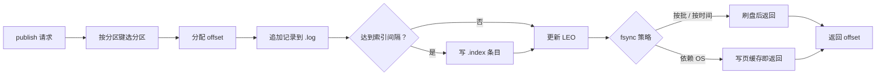

# 数据面：存储与复制

> 分区日志 · 索引与分段 · 恢复 · 位点 · ISR 与选举 · 数据面取舍

[文档首页](../../文档首页.md) › [消息平台规划](../../规划/01_规划_消息平台.md) › 架构设计 › 数据面　|　[← 总体架构](03_架构设计_总体架构.md) · [接入面 →](05_架构设计_接入面_协议与客户端.md)

---

## 1. 数据面职责 <a id="scope"></a>

数据面只做四件事：**存、读、恢复、复制**。

| 职责 | 内容 | 不做 |
| --- | --- | --- |
| 存储 | 追加日志、索引、分段、保留期 | 不做消息内容解析 |
| 读取 | 按 offset 定位、批量读、长轮询推送 | 不做业务过滤（消费端做） |
| 恢复 | CRC 校验、尾部截断、索引重建、位点对齐 | 不做全量校验（只扫尾部） |
| 复制 | ISR 同步、选举、fencing（8B_05） | 不做跨城强一致 |

**边界**：数据面不感知「消息内容是什么」，只感知「字节 + 头 + offset」。这是保零拷贝的前提。

## 2. 存储模型 <a id="model"></a>

### 2.1 目录布局

```text
data/{tenant}/{topic}/{partition}/
├── 00000000000000000000.log        # 消息追加（record 顺序）
├── 00000000000000000000.index      # 稀疏索引：相对 offset → 物理位置
├── 00000000000000000000.timeindex  # 时间戳 → 相对 offset
├── 00000000000000001000.log        # 下一段（按 base offset 命名）
└── ...
data/{tenant}/offsets/{group}/{topic}-{partition}.offset   # 消费位点
```

**为什么按租户分目录**：删除租户、统计用量、限制磁盘都能按目录做，成本 O(1)。这是 07 篇多租户隔离的物理基础。

### 2.2 记录结构（示意）

```text
record = [length][crc][header_len][header][payload]
```

| 字段 | 作用 | 口径 |
| --- | --- | --- |
| `length` | 记录总长 | 用于顺序扫描与尾部判定 |
| `crc` | 校验和 | **崩溃恢复的唯一可靠判据** |
| `header_len` | 头长度 | 路由与排障只读头，不解 payload |
| `header` | 结构化头（topic / key / tenant / trace / epoch） | MessagePack |
| `payload` | 业务字节 | broker 不解析 |

> 具体字节序与字段编码**以 8B_02 详细设计为准**；架构层只约定「头体分离 + CRC + 预留 epoch」。

### 2.3 索引

| 索引 | 内容 | 建立方式 |
| --- | --- | --- |
| offset 索引 | `(relative_offset, position)` | 每写入 N 字节记一条（稀疏） |
| 时间索引 | `(timestamp, relative_offset)` | 按时间间隔记录 |

**为什么稀疏**：每条都建索引会让索引体积接近数据量。稀疏索引用「少量顺序扫描」换「极小索引体积」，是追加日志的标准做法。

## 3. 写入路径 <a id="write"></a>



| 决策 | 选择 | 理由 |
| --- | --- | --- |
| offset 分配方 | broker | 保证单调不冲突 |
| 索引建立 | 写入时按间隔补 | 避免读时重建 |
| 默认 fsync | **按批**（可配 0 / 按时间 / 每条） | 平衡吞吐与持久性；审计场景可升到每条 |
| 批量写入 | 支持多消息一次 append | 减少系统调用 |

## 4. 读取路径与零拷贝 <a id="read"></a>


**保零拷贝的三条硬约束**：

1. broker **不反序列化 payload**（只读 header 做路由）。
2. 压缩由**生产者做、消费者解**，broker 原样存。
3. 不做「逐条内容审计」——否则必须解包。

## 5. 崩溃恢复 <a id="recovery"></a>

| 步骤 | 内容 |
| --- | --- |
| 1 读恢复点 | 从 `recovery-point` 取上次已知 LEO |
| 2 校验尾部 | 从 LEO 向后逐条校验 `length` 与 `crc` |
| 3 截断 | 遇到不完整记录，截断到上一条完整记录 |
| 4 重建索引 | 扫描过程中补建缺失索引条目 |
| 5 对齐位点 | 已提交位点若超过新 LEO，回退并告警（数据丢失事件） |

**为什么只扫尾部**：追加日志中间记录写成功后不再修改，唯一可能损坏的是最后一条未完成的记录。恢复成本 O(尾部) 而非 O(全量)。

**为什么必须有 CRC**：崩溃可能造成「长度正确、内容残缺」的伪完整记录，只校验长度会读到垃圾数据。

## 6. 保留与清理 <a id="retention"></a>

| 机制 | 触发 | 动作 |
| --- | --- | --- |
| 分段 | 段大小 / 时间超限 | 关闭当前段、开新段 |
| 保留期 | 段最后修改时间超 N 天或总量超限 | 删除整段 |
| compaction | 后台任务（后置） | 同 key 保留最新值 |

**首期只做 retention，不做 compaction**：compaction 面向状态型 topic（changeling），平台首期没有该场景；提前做会增加文件重写与并发复杂度。

## 7. 复制模型（8B_05） <a id="replication"></a>

**架构决策：ISR 式半同步**，而不是固定多数派或纯异步。

| 模型 | 优点 | 缺点 | 是否选 |
| --- | --- | --- | --- |
| 异步主从 | 吞吐最高 | 故障丢未复制数据 | 否 |
| **ISR 半同步** | 不丢已确认 + 吞吐可控 | 靠超时判断「是否同步」，有误判窗口 | **是** |
| 固定多数派（Raft） | 一致性强 | 写延迟高、实现复杂 | 否（首期） |

### 7.1 预留字段（8B_02 就必须带上）

即使 8B_05 才实现复制，**8B_02 定记录格式时就要留**：

| 字段 | 用途 | 不留的后果 |
| --- | --- | --- |
| `epoch` / `term` | 拒绝旧 leader 的过期写入 | 切换后无法判断哪份数据是新的 |
| 副本位点（HW / LEO） | 判断提交与可见性 | 消费者可能读到未提交数据 |
| 段级校验 | 副本比对 | 无法发现静默损坏 |

### 7.2 选举与 fencing

| 机制 | 做法 |
| --- | --- |
| 首期 | **手动切换**（单人运维，自动选主误判代价高） |
| 后续 | 心跳超时 + 多数派投票 + 最小稳定期 |
| 防脑裂 | 日志带 `epoch`，写入校验；旧 leader 的写被拒 |
| 客户端感知 | 元数据版本 + leader epoch，客户端主动刷新 |

**切换必须回答四问**：谁是新 leader、旧 leader 怎么办、未提交数据截断还是保留、客户端怎么感知。第 4 点最易漏——客户端缓存旧地址会持续写错地方。

## 8. 位点管理 <a id="offset"></a>

| 决策 | 选择 | 理由 |
| --- | --- | --- |
| 存储位置 | **独立位点文件**（首期），后续可入元数据库 | 简单、可恢复；不依赖数据库事务 |
| 粒度 | `(group, topic, partition)` | 与消费组语义一致 |
| 提交时机 | 处理完再提交 | 保证至少一次 |
| 刷盘 | 定期 + 关键点（关闭时） | 平衡性能与重复窗口 |
| 重放 | 按位点重置 | 支持补消费与排障 |

**位点丢失的后果**：位点文件损坏或丢失 → 该组从头消费或跳到末尾。**默认策略是「回退到最近已持久化位点」**（宁可重复，不可丢），并告警。

## 9. 数据面取舍汇总 <a id="tradeoff"></a>

| 决策点 | 选择 | 主要代价 |
| --- | --- | --- |
| 日志粒度 | 每分区一组文件（学 Kafka） | 分区多时文件句柄与元数据压力 |
| 索引 | 稀疏 | 读时有少量扫描 |
| 刷盘 | 按批可配 | 极端断电丢最后一批 |
| 恢复 | 只扫尾部 | 中间静默损坏无法发现（靠副本比对） |
| 复制 | ISR 半同步 | 判断「同步」有误判窗口 |
| 位点 | 独立文件 | 与消息日志非原子（跨文件一致性靠恢复流程） |

## 10. 与阶段设计的分工 <a id="split"></a>

| 内容 | 本文件 | 8B 详细设计 |
| --- | --- | --- |
| 存储模型与目录 | ✅ 定形 | 8B_02 定具体字节格式 |
| 索引与分段策略 | ✅ 定方向 | 8B_02 定间隔与大小 |
| 恢复流程 | ✅ 定步骤 | 8B_02 定恢复点文件格式 |
| 复制模型 | ✅ 定 ISR | 8B_05 定选举细节与参数 |
| 位点存储 | ✅ 定文件 | 8B_02 定文件格式与刷盘频率 |

## 11. 待定项 <a id="tbd"></a>

| # | 待定项 | 回填位置 |
| --- | --- | --- |
| 1 | 记录字节格式与字段编码 | 8B_02 详细设计 |
| 2 | 索引间隔、段大小、保留期默认值 | 8B_02 详细设计 |
| 3 | 默认 fsync 策略 | 8B_01 / 8B_02 实测 |
| 4 | ISR lag 阈值、`min.insync.replicas` | 8B_05 详细设计 |
| 5 | 位点文件刷盘频率 | 8B_02 / 8B_04 实测 |

---

> 依《[文档生成规范](../../../bms文档/规范/文档生成规范.md)》编写 · 原理与业界对照见 bms《[存储引擎](../../../bms文档/资料/知识档案/消息与事件驱动/03_事件驱动_存储引擎.md)》《[复制与高可用](../../../bms文档/资料/知识档案/消息与事件驱动/04_事件驱动_复制与高可用.md)》
