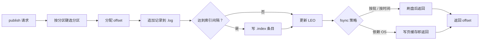

# 数据面：存储与复制

> 分区日志 · 索引与分段 · 恢复 · 位点 · ISR 与选举 · 数据面取舍

[文档首页](../../文档首页.md) › [消息平台规划](../../规划/01_规划_消息平台.md) › 架构设计 › 数据面　|　[← 总体架构](03_架构设计_总体架构.md) · [接入面 →](05_架构设计_接入面_协议与客户端.md)

---

## 1. 数据面职责 <a id="scope"></a>

数据面只做五件事：**存、读、恢复、复制、延迟转投**。

| 职责 | 内容 | 不做 |
| --- | --- | --- |
| 存储 | 追加日志、索引、分段、保留期 | 不做消息内容解析 |
| 读取 | 按 offset 定位、批量读、长轮询推送 | 不做业务过滤（消费端做） |
| 恢复 | CRC 校验、尾部截断、索引重建、位点对齐、延迟索引重建 | 不做全量校验（只扫尾部） |
| 复制 | ISR 同步、选举、fencing（8B_05） | 不做跨城强一致 |
| 延迟 | 延迟区暂存、时间轮到点转投（到期才分配 offset） | 不做业务判断（到期即投，不猜业务意图） |

**边界**：数据面不感知「消息内容是什么」，只感知「字节 + 头 + offset」。这是保零拷贝的前提。

## 2. 存储模型 <a id="model"></a>

### 2.1 目录布局

```text
data/{tenant_id}/{namespace}/{topic}.{topic_id}/{partition}/
├── 00000000000000000000.log        # 消息追加（record 顺序）
├── 00000000000000000000.index      # 稀疏索引：相对 offset → 物理位置
├── 00000000000000000000.timeindex  # 时间戳 → 相对 offset
├── 00000000000000000000.delay      # 延迟消息暂存（不占 offset 空间；见 2.4）
├── 00000000000000001000.log        # 下一段（按 base offset 命名）
└── ...

offsets/{tenant_id}/{group}-{hash8}/{topic_id}-{partition}.offset   # 消费位点（与 data/ 平级）
```

**为什么位点与 `data/` 平级**（02-3 定稿）：① 两者备份口径不同——位点每日快照、日志不备份（架构 08 §6），分目录让备份只搬 `offsets/`；② 命名空间模式允许 `offsets` 作名字，塞进 `data/{tenant_id}/` 会与命名空间目录撞名。

**为什么组目录名带哈希**（`{group}-{sha1[:8]}`）：组名允许大小写混用，而 Windows / macOS 大小写不敏感——直接用 `{group}` 会让 `Audit` 与 `audit` 共享一个位点文件（前者位点丢失、后者跳消息）。可读名截断到 64 字符，唯一性由哈希保证。

**为什么主题目录名带 `topic_id`**（`{topic}.{topic_id}`）：主题删除后重建同名会拿到新的 `topic_id`，目录天然隔离——严格用 `{topic}` 时旧段会被新主题读到，属数据级错误。02-1 落盘时定稿。

**为什么按 `tenant_id` 分目录**：bms 的内部租户身份是不可变的雪花 `tenant_id`，而租户编码 `code` 允许变更（bms《架构设计 · 多租户路由》）。

- 用 `tenant_id`：目录永不漂移，code 改名不影响存储。
- 用 `code`：一旦改名就要重命名目录，风险高且不可逆。
- `db_basis`（库名基）虽冻结且可读，但只用于库名派生，不作内部身份。

停止 / 删除 / 统计用量 / 限制磁盘都能按目录做，成本 O(1)。这是 07 篇多租户隔离的物理基础。

### 2.2 记录结构（示意）

```text
record = [length][crc][header_len][header][payload]
```

| 字段 | 作用 | 口径 |
| --- | --- | --- |
| `length` | 记录总长 | 用于顺序扫描与尾部判定 |
| `crc` | 校验和 | **崩溃恢复的唯一可靠判据** |
| `header_len` | 头长度 | 路由与排障只读头，不解 payload |
| `header` | 结构化头（topic / key / tenant_id / message_id / log_id / trace / epoch） | MessagePack |
| `payload` | 业务字节 | broker 不解析 |

> 具体字节序与字段编码**以 8B_02 详细设计为准**；架构层只约定「头体分离 + CRC + 预留 epoch」。

**两类 ID 的分工（记录身份 ≠ 消息身份）**：

| ID | 分配时机 | 唯一性 | 何时不变 | 用途 |
| --- | --- | --- | --- | --- |
| `message_id` | 发布时（broker 生成） | 全局唯一，标识**一条消息** | 重投、延迟转投、**重放都不变** | 消费端幂等、按消息排障 |
| `log_id` | 发布时（**延迟消息也在发布时分配**） | **每条日志记录唯一、永不复用**（雪花，空间用不完） | 延迟转投**沿用**；**重放分配新的** | 记录级去重、复制比对、精确定位一条记录、**审计引用**（审计条目钉住一条物理记录，检索一次寻址） |

> **为什么记录级去重不能用 `message_id`**：重放不改变 `message_id`（01-6 口径），会以原 ID 追加新 offset 的记录——
> 日志中同 `message_id` 多条是**合法**的。拿它判「这条是否已写过」会误杀「被重放过、延迟区还没清」的记录，导致丢消息。
> `log_id` 只在「一次物理写入」内唯一：延迟转投是同一个 `log_id` 从 `.delay` 搬到 `.log`，重放则是新 `log_id`，两者可判。
> `log_id` 属**内部头字段**：不进**消费端**契约（消费端幂等仍用 `message_id`），但**发布响应下发**——
> 上游（尤其审计域）要在「发布成功」这一刻就能引用记录，否则只能按 `message_id` 反查（重放会多条，且慢）。
> 06 域消息查询按它精确定位；消费响应不下发（`topic + partition + offset` 已足够）。
>
> **对审计的增益要说准**：已分配 offset 的普通消息，`(topic, partition, offset)` 本就是精确坐标，`log_id` 是更短的单值键（一条审计记录只多一个字段，不必复合三列）；
> 真正不可替代的是两处——**延迟消息到期前还没有 offset**（`log_id` 是此刻唯一可引用的记录标识），以及**同 `message_id` 多条**（重放）时要指向「哪一次物理写入」。
> 「快」的前提是**有 `log_id` 索引**（见 §2.3）；没有索引的 `log_id` 只能证明「是这条」，仍要扫段。

### 2.3 索引

| 索引 | 内容 | 建立方式 |
| --- | --- | --- |
| offset 索引 | `(relative_offset, position)` | 每写入 N 字节记一条（稀疏） |
| 时间索引 | `(timestamp, relative_offset)` | 按时间间隔记录 |
| `log_id` 索引 | `log_id` → 记录位置（`.log` 段 + 位移；未转投时指向 `.delay` 条目） | 发布时登记，常驻内存映射；重启扫段头重建（重建成本见 §11 #10） |

**为什么稀疏**：每条都建索引会让索引体积接近数据量。稀疏索引用「少量顺序扫描」换「极小索引体积」，是追加日志的标准做法。

### 2.4 延迟消息区（`deliver_at` 与 `.delay` 段）

延迟消息**不进 `.log`**，先进该分区的延迟区；到期才搬入 `.log` 并分配 offset：

```text
data/{tenant_id}/{namespace}/{topic}/{partition}/
├── 00000000000000000000.log        # 已到期 / 普通消息（offset 空间）
├── 00000000000000000000.delay      # 延迟消息暂存（不占 offset 空间）
└── ...
```

| 项 | 口径 | 理由 |
| --- | --- | --- |
| 分区归属 | **发布时按 key 锁定分区**并写入该分区延迟区 | 扩分区后同 key 不漂移，与「同 key 恒同分区」一致 |
| offset | **到期 `append` 时才分配**；延迟区记录无 offset | 未到期消息不占位：位点、停等、积压、死信口径全部不受影响 |
| 记录头字段 | `deliver_at`（到期时刻，UTC）、`delay_level`（档位名）、`message_id`、`log_id`、`key` | 重建到期索引只需头；payload 照旧不解析；`log_id` 发布即分配、转投沿用，是记录级去重判据 |
| 到期转投 | 时间轮到点 → 从 `.delay` 段读出 → `append` 到同分区 `.log`（`message_id` 不变、offset 新分配） | 到期后完全走既有投递链路（停等 / 死信 / 保留 / 重放） |
| 保留期 | **从到期 `append` 时起算**；延迟区自身另设 TTL 兜底 | 长延迟消息不会被保留期在到期前清掉；TTL 只防极端积压 |
| `.delay` 段命名 | `{seq:020d}.delay`，**独立段序号**（0 起、只增不复用），与 `.log` 的 base offset 无关 | 用 offset 命名会造出一个「没有记录占用的 offset」，且保留期删段后同号 `.delay` 仍在、删空后新段又复用同一 base（02-7 定） |
| 转投偏序（不丢的关键） | **先 `append` 并刷盘、再清 `.delay`**：崩溃只会重复、不会丢 | 与位点「宁可重复，不可丢」同口径；反向（先清后写）会把崩溃变成丢消息 |
| 去重（可判定） | 延迟消息**发布时即分配 `log_id`**、转投时携带并沿用；「这条是否已入日志」按 **`log_id`** 判定：**恢复期扫 `.log` 尾部收集 `log_id` 集合**，`.delay` 中命中者直接清掉、不重复 `append`；运行期由单进程串行转投 + 转投后立即清保证不重 | `log_id` 每条记录唯一且重放会换新，判定不会被「同 `message_id` 的重放记录」误杀；不需要「已转投」标记回写（标记本身也会写一半）；前提是单副本单写者，多副本归 8B_05 fencing |

> **为什么不做「同日志 + `deliver_at` 过滤」**：那样消息已占 offset，未到期就会成为停等队头——一条延迟 1 小时的
> 消息足以让整个分区停 1 小时；绕过它推进位点又违反 01-3「位点只按连续前缀推进」，到期后无法再投。
> 「延迟区 + 到期 `append`」把延迟完全移出 offset 空间，代价只是到期时刻的一次落盘搬迁。

### 2.5 到期驱动：分层时间轮

| 层 | 粒度 | 用途 |
| --- | --- | --- |
| L0 | 秒级桶（轮长 60） | 最近 1 分钟 |
| L1 | 分钟级桶（轮长 60） | 1 分钟 ~ 1 小时 |
| L2 | 小时级桶（轮长 24） | 1 ~ 24 小时（首期最长档位 60m，L2 仍保留） |

- **后台定时任务推进**（进程内协程），到点批量取出该桶的延迟记录转投；**与消费拉取解耦**——无人拉取也按时进入日志。
- 时间轮只存「分区 + 延迟记录位置」引用，不缓存 payload；重启后由 §5 的「延迟索引重建」重新装填。
- 首期最长档位 60m，故轮层只需 L0~L2；扩档位时按「层数 = ceil(log_60(最长档位/1s))」增设，**不改协议**。

### 2.6 延迟的健壮性要求（失败模式与处置）

延迟投递是「出问题时的兜底」，**它自己不能再成为新的故障点**：任何失败都必须「可见、可重试、不静默丢」。

| # | 失败模式 | 处置 | 判据 |
| --- | --- | --- | --- |
| 1 | 到期转投时 `append` 失败（磁盘满 / 写错） | **不删延迟记录**、退避重试、计次；超限告警并保留记录 | 延迟记录仍在 `.delay`，指标可见 |
| 2 | 转投成功、清 `.delay` 失败 | 重启时**恢复期去重**：扫 `.log` 尾部建 `log_id` 集合，命中即清 `.delay`、不再 `append` | **不丢且不重**（单副本）；该 `log_id` 只出现一条 |
| 3 | 进程重启 | 扫 `.delay` 重建时间轮：未到期按**剩余时间**装填，已到期未转投立即转投（限速） | 首次投递时刻不早于 `deliver_at` |
| 4 | 时钟回拨 / 前跳（NTP） | 轮转用单调时钟推进、到期判定用绝对时刻；回拨**不得提前投**，前跳**批量到期但限速** | 回拨不产生提前投递；前跳不产生突发风暴 |
| 5 | 延迟区段损坏 | CRC 校验 → 损坏段**隔离**（改名 + 告警），不静默丢、不阻塞其他段 | 告警含段路径与损坏条数 |
| 6 | 优雅关闭 | 停收新延迟 → `.delay` 刷盘 → 时间轮进度落恢复点 | 关闭后重启无丢失 |
| 7 | 主题停用 / 删除 | 停用：暂停转投、记录保留；删除：延迟区随目录清理并留痕 | 停用期间不产生新 offset |
| 8 | 租户停用 | 拒绝新延迟发布（`350011`）；已存记录保留，恢复后继续转投 | 停用期间不投递 |
| 9 | 延迟区满 | 软上限（租户 + 全局），超限 `350015` 拒绝；不静默丢、不波及其他租户 | 指标与拒绝计数可查 |
| 10 | 档位非法 | 契约层拒绝（`10001`） | — |

> **为什么失败也要留记录**：延迟区的语义是「承诺在某个时刻投递」。一旦为腾空间删掉记录，等于平台单方面
> 撕毁承诺，且业务侧无从感知——这比拒绝新请求严重得多。故**只能拒绝进、不能静默清**。

## 3. 写入路径 <a id="write"></a>



| 决策 | 选择 | 理由 |
| --- | --- | --- |
| offset 分配方 | broker | 保证单调不冲突 |
| 索引建立 | 写入时按间隔补 | 避免读时重建 |
| 默认 fsync | **按批**（可配 0 / 按时间 / 每条） | 平衡吞吐与持久性；审计场景可升到每条 |
| 批量写入 | 支持多消息一次 append | 减少系统调用 |

**延迟分支**（带 `delay_level` 的发布）：选分区（**按 key 锁定**）→ 写该分区 `.delay` 段（`deliver_at` = 发布时刻 + 档位）
→ 装入时间轮 → 返回 `{message_id, log_id, deliver_at}`（**没有 offset**，此时尚未进入 offset 空间）。
到期后由时间轮走正常写入路径 `append`，此后与普通消息完全一致。

## 4. 读取路径与零拷贝 <a id="read"></a>


**保零拷贝的三条硬约束**：

1. broker **不反序列化 payload**（只读 header 做路由）。
2. 压缩由**生产者做、消费者解**，broker 原样存。
3. 不做「逐条内容审计」——否则必须解包。

## 5. 崩溃恢复 <a id="recovery"></a>

| 步骤 | 内容 |
| --- | --- |
| 1 读恢复点 | 从 `recovery-point` 取上次已知 LEO |
| 2 校验尾部 | 从 LEO 向后逐条校验 `length` 与 `crc` |
| 3 截断 | 遇到不完整记录，截断到上一条完整记录 |
| 4 重建索引 | 扫描过程中补建缺失索引条目 |
| 5 对齐位点 | 已提交位点若超过新 LEO，回退并告警（数据丢失事件） |
| 6 重建延迟索引 | 扫描各分区 `.delay` 段，把未到期记录按 `deliver_at` 重新装填时间轮；已到期未转投的立即转投 |

**为什么只扫尾部**：追加日志中间记录写成功后不再修改，唯一可能损坏的是最后一条未完成的记录。恢复成本 O(尾部) 而非 O(全量)。

**为什么必须有 CRC**：崩溃可能造成「长度正确、内容残缺」的伪完整记录，只校验长度会读到垃圾数据。

**延迟区恢复的两个额外判据**：

- **不提前**：重建以 `deliver_at` 为准，重启不缩短剩余时间；也不得以「重启了」为由立即全量转投。
- **不丢（偏序）**：先 `append` 并刷盘、再清 `.delay`——反向会让崩溃变成丢消息；偏序保证最坏结果是重复，不是丢失。
- **不重（恢复期比对）**：按 **`log_id`**（每条记录唯一、延迟发布即分配、转投沿用）启动时扫 `.log` 尾部建立 `log_id` 集合
  （范围覆盖 `.delay` 中最早的未清条目之后），`.delay` 中命中者判定为「已转投」，直接清掉不再 `append`。
  用 `log_id` 而非 `message_id`：重放会以原 `message_id` 追加新记录，用它判重会误杀。运行期由单进程串行转投 + 立即清理保证不重；
  多副本时两个副本可能各自转投，须由 8B_05 的单写者 / fencing 收敛。

## 6. 保留与清理 <a id="retention"></a>

| 机制 | 触发 | 动作 |
| --- | --- | --- |
| 分段 | 段大小 / 时间超限 | 关闭当前段、开新段 |
| 保留期 | 段最后修改时间超 N 天或总量超限 | 删除整段 |
| compaction | 后台任务（后置） | 同 key 保留最新值 |

**首期只做 retention，不做 compaction**：compaction 面向状态型 topic（changeling），平台首期没有该场景；提前做会增加文件重写与并发复杂度。

## 7. 复制模型（8B_05） <a id="replication"></a>

**架构决策：ISR 式半同步**，而不是固定多数派或纯异步。

| 模型 | 优点 | 缺点 | 是否选 |
| --- | --- | --- | --- |
| 异步主从 | 吞吐最高 | 故障丢未复制数据 | 否 |
| **ISR 半同步** | 不丢已确认 + 吞吐可控 | 靠超时判断「是否同步」，有误判窗口 | **是** |
| 固定多数派（Raft） | 一致性强 | 写延迟高、实现复杂 | 否（首期） |

### 7.1 预留字段（8B_02 就必须带上）

即使 8B_05 才实现复制，**8B_02 定记录格式时就要留**：

| 字段 | 用途 | 不留的后果 |
| --- | --- | --- |
| `epoch` / `term` | 拒绝旧 leader 的过期写入 | 切换后无法判断哪份数据是新的 |
| 副本位点（HW / LEO） | 判断提交与可见性 | 消费者可能读到未提交数据 |
| 段级校验 | 副本比对 | 无法发现静默损坏 |

> **02-4 定稿的字段用法**：`epoch` **逐条记录写入**（leader 任期，follower 拉取时校验）；
> `hw` / `replicas` 保持预留字段的缺省值，**不逐条写**——HW 与各副本 LEO 是随拉取持续变化的
> 动态状态，写进每条记录会立刻过期且放大体积；副本位点由复制协调器的运行时状态维护。
> 段级校验沿用 02-1 的逐条 CRC 与 02-2 的段尾对账，不新增格式版本。

### 7.2 选举与 fencing

| 机制 | 做法 |
| --- | --- |
| 首期 | **手动切换**（单人运维，自动选主误判代价高；内部领域服务 + 审计，管理端点与二次确认归 06-2） |
| 后续 | 心跳超时 + 多数派投票 + 最小稳定期（复用同一 `LeaderSwitchService` 接口） |
| 防脑裂 | 日志带 `epoch`，写入校验；`msg_partition.epoch` 是权威源，phase 1 CAS 递增；旧 leader 超租约即拒写（`350033`） |
| 两阶段 | 先 `switch_state='switching'` 停写 → 等旧租约 → 目标节点按真实 HW 截断 / 保留尾部并激活 → `idle` 收口 |
| 未提交尾部 | 旧 leader 可达按真实 HW 截断；不可达保留并记 `retained_tail`；「已提交不丢」以目标在 ISR / 最后已知 ISR 为前提，`force` 降级不保证 |
| 客户端感知 | topic 详情 `metadata_version = max(partition.epoch)` + 分区 `leader` / `epoch`；写拒绝 `350033.data` 带 leader / epoch，客户端主动刷新 |

**切换必须回答四问**：谁是新 leader、旧 leader 怎么办、未提交数据截断还是保留、客户端怎么感知。第 4 点最易漏——客户端缓存旧地址会持续写错地方。

**02-5 定稿**：`LeaderSwitchStore`（DB CAS）与 `LeaderControlTransport`（节点控制）是两个协议；生产实现为 `DbLeaderSwitchStore` 与进程内控制传输，真实网络通道与多实例编排归 02-8；自动选举不在首期，接口按可复用设计。

### 7.3 多实例网络复制与控制通道（02-8）

| 项 | 口径 |
| --- | --- |
| 节点与地址 | `node_id`（`msg-1..3`）与内部地址 `http://msg-N:8001` 一一对应，经 `MSG_REPLICATION_NODE_ENDPOINTS` 注入；本节点控制走本地快路径 |
| 内部通道 | 独立 ASGI 应用监听 8001（仅平台网络 + 服务令牌），不与业务 8000 混用；复制关闭 / 单实例不监听 |
| 复制协议 | `ReplicaTransport.fetch` 的 HTTP 实现；409 `stale_epoch` / 410 `diverged` / 503 `not_leader` / `switching` 映射到既有领域异常，协调器判定逻辑零改 |
| 控制协议 | `LeaderControlTransport` 的 `snapshot` / `demote` / `apply_switch` HTTP 实现；切换服务两阶段流程零改 |
| 协议版本 | 响应带 `protocol_version=1`；未知版本按不可达处理，不做尽力解析 |
| 失败语义 | 端口占用 / 多实例缺端点或令牌密钥 → 启动失败；传输层不重试（重试归协调器与切换服务） |

### 7.4 分区分配与迁移（02-8）

| 项 | 口径 |
| --- | --- |
| 分配算法 | 节点插入序 + `(topic_id*31+partition_no)%nodes` 轮转，副本数 `min(factor,len(nodes))`；与 02-4 配置兜底逐字一致 |
| 持久化 | 建主题 / 增分区 / `ops.rebalance` 三处共用 `PartitionAssigner`，结果写 `msg_partition.replicas`；拓扑缓存 1s 内收敛 |
| 迁移状态机 | `planned` → `running` → `catching_up` → `succeeded` / `failed` / `degraded` / `cancelled`；台账 `msg_partition_migration` 一计划一分区一行 |
| 先扩后缩 | 替换类先写入并集等待追平，再缩到目标集；移除 leader 时先切主；追平判据为「目标在 ISR 且 LEO ≥ leader HW」 |
| 能力边界 | `leader start_offset > 0`（保留期已裁剪）时拒绝迁移并登记遗留；全量重同步不在本任务 |
| 降级纪律 | `force` 切主记 `degraded`（`isr_verified=false`），不计通过；演练与报告不得写成「通过」 |

## 8. 位点管理 <a id="offset"></a>

| 决策 | 选择 | 理由 |
| --- | --- | --- |
| 存储位置 | **独立位点文件**（首期），后续可入元数据库 | 简单、可恢复；不依赖数据库事务 |
| 粒度 | `(group, topic, partition)` | 与消费组语义一致 |
| 提交时机 | 处理完再提交 | 保证至少一次 |
| 刷盘 | 定期 + 关键点（关闭时） | 平衡性能与重复窗口 |
| 重放 | 按位点重置 | 支持补消费与排障 |

**位点丢失的后果**：位点文件损坏或丢失 → 该组从头消费或跳到末尾。**默认策略是「回退到最近已持久化位点」**（宁可重复，不可丢），并告警。

**延迟消息与位点无关**：延迟消息在到期 `append` 前不占 offset，位点推进、停等、积压统计一律不感知它；到期后才按普通消息参与位点。

## 9. 数据面取舍汇总 <a id="tradeoff"></a>

| 决策点 | 选择 | 主要代价 |
| --- | --- | --- |
| 日志粒度 | 每分区一组文件（学 Kafka） | 分区多时文件句柄与元数据压力 |
| 索引 | 稀疏 | 读时有少量扫描 |
| 刷盘 | 按批可配 | 极端断电丢最后一批 |
| 恢复 | 只扫尾部 + 段尾对账 | 段中间记录的静默翻转检不出（靠副本比对）；**非末段做 size + 末条 CRC 对账（02-2）**，让损坏可见而不修复 |
| 复制 | ISR 半同步 | 判断「同步」有误判窗口 |
| 位点 | 独立文件 | 与消息日志非原子（跨文件一致性靠恢复流程） |
| 延迟 | 延迟区 + 到期 `append` | 到期时刻一次落盘搬迁；延迟区需 TTL 兜底；先写后清 + 恢复期按 `log_id` 比对（不丢不重） |

## 10. 与阶段设计的分工 <a id="split"></a>

| 内容 | 本文件 | 8B 详细设计 |
| --- | --- | --- |
| 存储模型与目录 | ✅ 定形 | 8B_02 定具体字节格式 |
| 索引与分段策略 | ✅ 定方向 | 8B_02 定间隔与大小 |
| 恢复流程 | ✅ 定步骤 | 8B_02 定恢复点文件格式 |
| 复制模型 | ✅ 定 ISR | 8B_05 定选举细节与参数 |
| 位点存储 | ✅ 定文件 | 8B_02 定文件格式与刷盘频率 |
| 延迟消息 | ✅ 定「延迟区 + 到期 `append`」与时间轮分层 | 8B_02 定 `.delay` 段格式、时间轮参数、转投去重与 TTL |

## 11. 待定项 <a id="tbd"></a>

| # | 待定项 | 回填位置 |
| --- | --- | --- |
| 1 | 记录字节格式与字段编码 | 8B_02 详细设计 |
| 2 | 索引间隔、段大小、保留期默认值 | **已定稿（02-1，2026-11-05）**：段 64 MiB、按段首记录时间滚动一天、offset 索引 4096 字节、时间索引 1s；实测索引体积约为数据的 1/35 |
| 3 | 默认 fsync 策略 | 8B_01 / 8B_02 实测 |
| 4 | ISR lag 阈值、`min.insync.replicas` | **已定稿（02-4，2026-11-11）**：ISR 时间阈值 `replica.lag.time.max.ms = 10 000` 与条数阈值 `replica.lag.records.max = 10 000` 任一超限即踢出；重入条件为「follower LEO ≥ leader LEO 且最近一次拉取在时间阈值内」；`min.insync.replicas` 全局缺省 + `msg_partition.min_insync_replicas` 分区覆盖（0 = 继承）；扫描周期 1s |
| 5 | 位点文件刷盘频率 | **已定稿（02-3，2026-11-05）**：后台定时刷（缺省 **1000ms**）+ 脏条目达 **256** 条提前刷 + 关闭强制刷；崩溃窗口 = 窗口内的提交，后果是**重复消费而非丢消息**。代价与容量结论（千组规模 fsync 次数）归 8B_12 |
| 6 | `.delay` 段轮转大小与延迟区 TTL 兜底默认值 | **已定稿（02-7，2026-11-05）**：段 **8 MiB / 10 000 条**（先到者轮转）；TTL **7 天**且**只告警不删、不提前投**——删掉一条卡住的延迟记录等于平台单方面撕毁「某时刻一定投递」，提前投则违反「不早投」（架构 §2.6 #1） |
| 7 | 恢复期去重的扫描范围（尾部窗口与 `.delay` 未清条目时间窗的对应关系） | **已定稿（02-7，2026-11-05）**：以 `.delay` 的 `log_id` 集合为**查询集**（有界），`.log` 侧以「`.delay` 中最小 `deliver_at`」为下界（转投时 `published_at` 取 `deliver_at`，故已转投记录必在其后），用时间索引二分出锚点后扫到尾部；不做固定尾部窗口（会漏判 → 重复投递）也不做全量扫（启动成本随日志量增长） |
| 8 | 时间轮桶粒度与后台任务推进周期 | 8B_02 实测 |
| 9 | `log_id` 在帧契约中的位置（HTTP 发布响应已定下发；8B_01 的 h2 帧是否同样带出） | 8B_01 帧契约定稿时定 |
| 11 | 恢复点文件格式与写入时机 | **已定稿（02-2，2026-11-05）**：每分区 `recovery-point.json`（LEO + 段清单含末条 offset/位置/CRC，外层 CRC32），临时文件 + rename 原子替换；随 fsync 更新（`os` 档仅轮转 / 关闭），先 fsync 数据后写恢复点；缺失或 CRC 不符退回推导，版本过高拒绝加载 |
| 10 | `log_id` 索引的常驻形态与重建成本（全量常驻 / 有界 LRU / 落盘稀疏索引） | **已定稿（02-1，2026-11-05）**：进程内 LRU（上限 10 万）+ 未命中扫段头兜底，不重建全量；冷查询成本由 `msg_log_id_scan` 日志观测，容量结论归 8B_12 |

---

> 依《[文档生成规范](../../../bms文档/规范/文档生成规范.md)》编写 · 原理与业界对照见 bms《[存储引擎](../../../bms文档/资料/知识档案/消息与事件驱动/03_事件驱动_存储引擎.md)》《[复制与高可用](../../../bms文档/资料/知识档案/消息与事件驱动/04_事件驱动_复制与高可用.md)》
