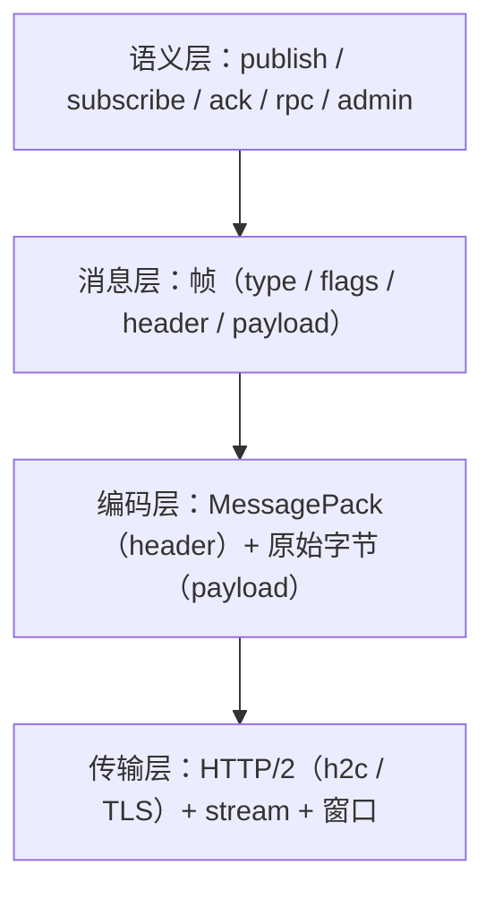

# 接入面：协议与客户端

> 协议分层 · 端点与帧 · 错误码 · 连接管理 · 背压 · 客户端形态 · 端口适配

[文档首页](../../文档首页.md) › [消息平台规划](../../规划/01_规划_消息平台.md) › 架构设计 › 接入面　|　[← 数据面](04_架构设计_数据面_存储与复制.md) · [控制面 →](06_架构设计_控制面_元数据与运维.md)

---

## 1. 接入面职责 <a id="scope"></a>

接入面解决「客户端怎么连进来、说什么话、说多快」：

| 职责 | 内容 |
| --- | --- |
| 传输 | HTTP/2 连接建立、stream 管理、TLS |
| 协议 | 帧编解码、版本协商、错误码 |
| 会话 | 心跳、断线重连、GOAWAY 优雅关闭 |
| 背压 | 长轮询、inflight 上限、流控窗口 |
| 适配 | 对 bms 暴露 `EventPublisher` / `BaseServiceClient` 端口 |

**边界**：接入面不碰存储，只把请求翻译成 `router` 的调用；不碰元数据写，只做校验与转发。

## 2. 协议分层 <a id="layers"></a>



| 层 | 关心什么 | 变更频率 |
| --- | --- | --- |
| 语义层 | 端点与操作含义 | 低（新增端点常见，改语义罕见） |
| 消息层 | 帧结构 | 低（只增字段） |
| 编码层 | 序列化格式 | 中（按 topic 可切 Protobuf） |
| 传输层 | 连接与流控 | 极低 |

## 3. 端点设计 <a id="endpoints"></a>

| 端点 | 方法 | 语义 | 响应 |
| --- | --- | --- | --- |
| `/msg/publish` | POST | 发布一条消息（带 `delay_level` 即延迟发布） | `{message_id, log_id, offset, partition}`；延迟发布为 `{message_id, log_id, partition, deliver_at}`（`offset` 为 null） |
| `/msg/subscribe` | GET | 长轮询订阅（可长驻流） | 消息批次 / 流 |
| `/msg/ack` | POST | 确认消费 | `{ok}` |
| `/msg/nack` | POST | 显式拒绝（可选） | `{ok}` |
| `/rpc/{service}/{method}` | POST | RPC 调用 | 结果 / 错误 |
| `/rpc/{service}/{method}/stream` | POST | RPC 服务端流式（一请求多响应） | 帧流：`48`+`response` 逐帧 + 帧头 `seq`，末帧置 `end_of_stream`；流内错误以 `ERROR` 帧收尾（04-3-1） |
| `/admin/topics` | GET/POST | 主题查询 / 创建 | 元数据 |
| `/admin/groups` | GET | 消费组与积压 | 元数据 |
| `/admin/delayed` | GET | 延迟中消息（待投列表 + 计数，只读） | 延迟记录 |
| `/admin/replay` | POST | 建重放任务 | `{task_id}` |
| `/admin/dlq` | GET/POST | 死信查询 / 处置 | 死信列表 |

**设计原则**：

1. **动词化路径**（publish / subscribe / ack）比资源化（`/messages`）更贴合消息语义。
2. **管理面与数据面路径分离**（`/admin/*` vs `/msg/*`），便于分别限流与鉴权。
3. **长驻订阅用 GET + 流**，与 HTTP/2 server streaming 对应。
4. **延迟是发布的一个维度，不是新端点**：`/msg/publish` 带 `delay_level`（固定档位枚举）即延迟发布，
   避免为「延迟版发布」多开一条路径；响应形态随档位而定（延迟发布没有 offset——尚未进入 offset 空间）。
5. **发布响应带 `log_id`**：两种响应都含 `message_id` 与 `log_id`；`log_id` 随延迟记录保存、到期转投沿用。
   上游（尤其审计域）靠它在「发布成功」这一刻就钉住记录，不必事后按 `message_id` 反查。消费响应不下发。

## 4. 帧与版本 <a id="frame"></a>

```text
+--------+--------+--------+--------+------------------+
| magic  | ver    | type   | flags  | header length    |
+--------+--------+--------+--------+------------------+
| header（MessagePack：topic / key / tenant / trace…） |
+--------------------------------------------------------+
| payload（原始字节，broker 不解析）                     |
+--------------------------------------------------------+
```

| 字段 | 作用 |
| --- | --- |
| `magic` | 快速拒绝非本协议流量 |
| `ver` | 主版本不兼容即断连；次版本只增字段 |
| `type` | `publish` / `ack` / `subscribe` / `error` / `heartbeat` |
| `flags` | 压缩、流结束、需响应、批量 |
| `header length` | 头体分离，便于只读头做路由 |

**三条演进铁律**（写进协议契约，评审必查）：

1. **只增可选字段**，不删字段、不改名、不改语义。
2. **未知帧类型 / 未知字段必须忽略**，不得报错。
3. **版本必须可见**：连接元数据里能读到协议版本，排障第一问。

**内容类型与压缩（03-3 定稿）**：header 可选 `content_type`（媒体类型字符串，缺省 `application/msgpack`；未登记但语法合法即透传，broker 不做白名单拒绝）、`compression`（`none` / `gzip` / `zstd` / `lz4` / `snappy`）与 `uncompressed_len`（可选声明、不参与上限判定）；`flags.compressed` 只表「是否压缩」，与 `compression` 必须自洽（矛盾 `350018`）。payload 顶层约定为 **Map**（「只增字段」的前提），压缩作用于 **payload 段整体**（批帧落地后即按批），broker 不解压、上限仍按压缩后字节判；`application/x-protobuf` 为**预留取值**（不做 Schema Registry，实现归 8B_03 SDK）。详见 [03-3 详细设计](../../项目/08B_消息平台/任务/03_传输与协议/03_传输与协议_03_序列化与内容类型/设计/01_详细设计_03_序列化与内容类型.md)。

## 5. 错误码 <a id="errors"></a>

| 层 | 示例 | 处理 | 是否断连 |
| --- | --- | --- | --- |
| 传输层 | magic 不符、版本不支持（`350019`）、帧过大（`350006`） | 返回 error 后断开；**HTTP/2 下服务端只能结束该 stream，「断开连接」由客户端执行**（`GOAWAY` 归 03-4） | 是（客户端） |
| 协议层 | 缺必填头 / 类型不合法 / 帧格式非法（`350018`） | 返回 error 帧 | 否 |
| 业务层 | 主题不存在、消息过大、限流 | 返回 error 帧 + `retryable` | 否 |
| 系统层 | 磁盘满（`350022`）、内部异常 | 返回 error 帧 + `retryable`（磁盘满为 `true`——清理后即可恢复；内部异常为 `false`） | 否 |

**错误必须带 `retryable`**：没有它，客户端只能全量重试或全量放弃。帧形态另带 `layer`（`transport` / `protocol` / `business` / `system`），客户端按层决定「断开 / 改参 / 重试」，不必靠码值反查。

**04-4 起错误帧另带 `category`（五类正式枚举，`classify()` 是唯一出处）**：

| 类别 | 取值 | 代表码 | `retryable` | 客户端动作 |
| --- | --- | --- | --- | --- |
| 参数错误 | `param_error` | `10001` / `350018` / `350019` / `350006` | 否 | 改参后放弃 |
| 业务拒绝 | `business_reject` | `350001` / `350023` 等非可重试 business 码 | 否 | 上抛调用方 |
| 瞬时故障 | `transient` | `350005` / `350015` / `350020` / `350021` / `350022` / `10006` / `10007` | 是 | 指数退避 + full jitter 重试 |
| 超时未知 | `unknown` | `350004` | **否** | 仅在带幂等键时谨慎重试 |
| 服务端 bug | `server_bug` | system 层未登记码 / 协议解析异常 | 否 | 上抛 + 告警 |

`category` 与 `layer` **正交**：前者回答「调用方该怎么办」，后者回答「错在哪一层」；同一 `transient` 可跨 business（`350005`）与 system（`350022`）。`retryable` 表示「可否常规重试」，`unknown` 是独立于它的特例——两者不是同一件事。04-4 **未新增任何产品码**：重试预算耗尽 / 熔断打开 / 非幂等无键被阻止 / 重复请求处理中都是客户端本地判定或复用平台码（处理中用 `10007`），`msg.toml` 的 `[[errcodes]]` 不变；「重复请求处理中」带 `Retry-After` 语义，按 `transient` 处理。

**重试与幂等（04-4，只覆盖一元）**：`RetryPolicy` 默认 2 次重试 / 100ms 基数 / ×2 / 封顶 2000ms + full jitter（下界 1ms，禁止无退避立即重试）；`Retry-After` 帧 `retry_after_ms` 与 HTTP delta-seconds 双来源，取 `max(退避, 建议)` 并封顶。帧头 `retry_budget` 逐跳递减 + 进程内 `ContextVar` 共享，防调用链重试风暴。幂等键由客户端生成、重试全程复用，服务端按 `(tenant, service, method, key)` 去重并复用首次结果（首期进程内，不跨实例 / 重启）。熔断复用 bms `BaseCircuitBreaker` 契约的三态（关闭 → 打开 → 半开限流探测），打开即快速失败、不进入重试。**流式错误重试完全排除**：已产出 N 帧后无法整体重放，需 `seq` 断点续传契约，归后续阶段。详见 [04-4 详细设计](../../项目/08B_消息平台/任务/04_RPC/04_RPC_04_错误语义与幂等重试/设计/01_详细设计_04_RPC_04_错误语义与幂等重试.md)。

**码段**（暂定，最终以 07C 登记为准）：`35xxxx`（6 位码 = 2 位段 + 4 位序号）；`350001` 主题不存在、`350004` **RPC 预算耗尽**（04-2 启用：business / 不重试 / 504，`detail.outcome=unknown`）、`350005` **生产限流**（03-5 启用，429 + `Retry-After`）、`350006` 帧或消息过大（**上限 1 MiB，03-2 定稿**）、`350018` 帧格式非法、`350019` 协议版本不支持、`350022` **存储水位拒绝**（02-6 已实现，507 + 系统层 `retryable=true`）。

**延迟相关码位**：档位非法属契约层（`10001`）；**延迟区满新占 `350015`**（兜底能力不能因堆满而静默失效，
也不能与全局背压 `350005` 混用，否则排障时分不清「延迟区堆满」还是「平台背压」）。

**背压相关三码分工（2026-11-05 定）**：`350005` 生产限流（客户端退避重试即可）、`350022` 存储水位拒绝（02-6：必须停止发布并介入清理，退避无用）、`350015` 延迟区满（延迟档位的问题，普通发布不受影响）；`350020` / `350021` 是连接 / 流打满，属另一维度。

## 6. 连接管理 <a id="connection"></a>

| 机制 | 作用 | 关键点 |
| --- | --- | --- |
| 心跳（PING / heartbeat 帧） | 探测半开连接 | **不能用 TCP keepalive 替代**（默认 2 小时太粗） |
| 最大并发流 | 防单连接压垮 broker | `MAX_CONCURRENT_STREAMS` |
| 空闲回收 | 释放长期不用连接 | 空闲超时 |
| 断线重连 | 客户端自动恢复 | 指数退避 + 抖动 |
| GOAWAY | 优雅关闭 | 滚动重启必备 |
| 连接池 | 多连接分摊 | 按目标 broker / 租户分池 |

**半开连接是最隐蔽的问题**：网络中断后一端不知道对端已死，连接仍占资源。心跳 + 超时是唯一可靠判据。

## 7. 背压 <a id="backpressure"></a>

接入面负责**两层**背压，数据面负责磁盘水位：

| 层 | 机制 | 超限动作 |
| --- | --- | --- |
| 连接层 | HTTP/2 流控窗口（即**信用额度**：接收方按已消费字节归还 credit，发送方窗口用尽即停） | 自动暂停发送 |
| 消费层 | 单消费者 `inflight` 条数 / 字节双阈值 | 暂停推送 |
| 订阅层 | 长轮询 `maxWait` | 到期返回空 |
| 生产层 | 租户 / topic 速率配额 | 返回 `350005` |

**不能只靠一层**：窗口只保护单连接，保护不了内存总量与磁盘。

> **定值与实现落点（03-5）**：长轮询 `max_wait_ms`、inflight 双阈值、预取、两级限流与指标口径见 [03-5 详细设计](../../项目/08B_消息平台/任务/03_传输与协议/03_传输与协议_05_背压与流控/设计/01_详细设计_05_背压与流控.md)；h2 连接级窗口由同连接所有 stream 共享（一条流停读会连带其它 stream 暂停发送），属协议语义，已写进契约。

> **RPC 流式的消费层口径（04-3-1）**：`/rpc/{service}/{method}/stream` 复用同两层——连接层靠 h2 窗口阻断写出，消费层把 `InflightUsage` 双阈值挂在**单条流**上（不是 `(group, topic, partition)`：RPC 流没有组 / 位点 / ack）。账本的「在途」是**已产出未写出**的帧：服务端攒批（64 KiB / 8 帧，保留末帧用于判收尾），攒批上界先到时即交出一批，处理器一停顿就先把手上那批写出去（不吞时延）。超限**暂停生产、不返错**（慢消费者是正常状态，返错会引发重试风暴）。

**长轮询的价值**：既保留「消费者能力驱动」的天然背压，又把空轮询延迟从「轮询间隔」降到「消息到达即返回」。

## 8. 客户端形态 <a id="clients"></a>

| 客户端 | 职责 | 关键行为 |
| --- | --- | --- |
| **Producer** | 发布消息、批量、重试 | 分区键选择、批量聚合、失败重试 |
| **Consumer** | 订阅、处理、ack | 先处理后 ack、未 ack 超时重投、位点提交 |
| **RPC Client** | 一元 / 流式调用 | deadline 传播、五类错误分类（`category`）、取消（发 `RST_STREAM(CANCEL)`）、**一元重试中间层**（指数退避 + 抖动 / 调用链预算 / 幂等键 / `Retry-After`）、熔断（三态 + 半开限流）；**流式用句柄且不进重试层**：`async for` 逐帧、`async with` 退出即取消、`aclose()` 幂等 |
| **Admin Client** | 管理操作 | 权限校验、操作留痕 |

**客户端不做的事**：不做消息存储、不做跨实例协调、不做业务幂等（业务自己做）。

**传输层归属（04-7 定稿）**：客户端自持 HTTP/2 连接（连接池按实例地址分、并发流上限按对端 `SETTINGS`），不经第三方 HTTP 客户端——「精确取消」依赖拿到**单条 stream** 并发 `RST_STREAM`，而通用客户端在取消时只做本地放弃（实测 `httpx 0.28` / `httpcore 1.0` 均无公开的流重置出口）。实现见 [04-7-1 详细设计](../../项目/08B_消息平台/任务/04_RPC/04_RPC_07_客户端精确取消/04_RPC_07_客户端精确取消_01_H2传输层/设计/01_详细设计_04_RPC_07_客户端精确取消_01_H2传输层.md)，取消接线与验收见 [04-7-2 详细设计](../../项目/08B_消息平台/任务/04_RPC/04_RPC_07_客户端精确取消/04_RPC_07_客户端精确取消_02_取消发RST/设计/01_详细设计_04_RPC_07_客户端精确取消_02_取消发RST.md)。

**流式消费用句柄而不是异步生成器（04-3-2 定稿）**：`client.stream()` 返回 `RpcStream`，`async for` 逐帧产出、`async with` 退出即发 `RST_STREAM(CANCEL)`、`aclose()` 幂等。**不用生成器**是因为 `async for` 的 `break` 在语言层面不通知迭代器，生成器的清理时机取决于 GC——取消落点必须显式；因此「提前不看了」只有 `async with` 与 `aclose()` 两条路，SDK 封装（8B_03）必须强制上下文。整条流的期限由服务端预算兜底，客户端只兜「单次读取 90s 无数据」（服务端空闲 60s 先到，两阈值刻意错开）。实现见 [04-3-2 详细设计](../../项目/08B_消息平台/任务/04_RPC/04_RPC_03_流式调用/04_RPC_03_流式调用_02_客户端流式消费/设计/01_详细设计_04_RPC_03_流式调用_02_客户端流式消费.md)。

### 8.1 寻址与负载均衡 <a id="discovery"></a>

| 场景 | 首期 | 多实例后 |
| --- | --- | --- |
| 寻址 | Compose DNS（`msg:8000`）+ 单实例 | 服务目录 / DNS 返回多实例，客户端持有实例列表 |
| 选实例 | 无需选择 | 轮询或「最少在途」两种策略，默认轮询（确定性、易断言） |
| 失败处置 | 连接错误即失败 | 实例级失败重试（换实例，不重放已提交批次）+ 摘除与探活恢复 |
| 归口 | 8B_03（RPC 客户端） | 8B_05（broker 多副本） / 8B_03 |

**为什么首期不做客户端 LB**：单实例部署下 LB 是空转代码；但**接口要留位**——`RPC Client` 与 `Producer` 的实例列表必须从「一个地址」抽象为「一组地址」，否则多实例时改的是客户端契约而不是配置。

## 9. 与 bms 端口适配 <a id="adapter"></a>

这是「业务代码不改」的关键：

| bms 端口 | msg 实现 | 业务影响 |
| --- | --- | --- |
| `EventPublisher.publish()` | 转 `/msg/publish` | 不改 |
| `EventPublisher.publish_transactional()` | 首期委托普通发布；事务消息后置 | 不改 |
| `BaseServiceClient.call()` | 转 `/rpc/{service}/{method}` | 不改 |
| `BaseOutboxStore` / relay | 可选：relay 换成 msg 客户端，或由 msg connector 扫 outbox | 不改 |

**适配层的价值**：出问题时配置切回原实现，业务无感。这也是「8B_01 可刹车」的技术基础。

## 10. 协议演进纪律 <a id="evolution"></a>

| 变更 | 兼容性 | 流程 |
| --- | --- | --- |
| 新增可选 header 字段 | 兼容 | 直接发 |
| 新增帧类型 | 兼容 | 老客户端忽略未知类型 |
| 新增端点 | 兼容 | 直接发 |
| 修改字段语义 | 不兼容 | 新增字段替代，旧字段标记废弃 |
| 删除字段 | 不兼容 | 观察一个版本后再删 |
| 改帧布局 | 不兼容 | 升主版本，双协议并行 |

## 11. 与阶段设计的分工 <a id="split"></a>

| 内容 | 本文件 | 8B 详细设计 |
| --- | --- | --- |
| 端点清单与语义 | ✅ 定形 | 8B_01 / 8B_03 定参数 |
| 帧结构 | ✅ 定字段 | 8B_01 定字节序与编码 |
| 错误码段 | ✅ 定段位 | 8B_01 定码表 |
| 连接与背压策略 | ✅ 定机制 | 8B_01 定阈值 |
| 客户端形态 | ✅ 定职责 | 8B_03 定 API |

## 12. 待定项 <a id="tbd"></a>

| # | 待定项 | 回填位置 |
| --- | --- | --- |
| 1 | 帧字节序与字段编码 | **已定稿（03-2）**：帧头 15B、全字段大端、`magic=b"MS"`、`ver=major(1B)+minor(1B)`、无 crc32；见 03-2 详细设计 §4.1~§4.3 |
| 2 | 订阅是否用长轮询还是长驻流（或两者） | **已定稿（03-5）：两者都要**——拉取端点长轮询（`max_wait_ms`）+ 长驻流（SSE 与帧流），共用同一等待器 |
| 3 | `maxWait`、`inflight` 默认值 | **已定值（03-5）**：`max_wait_ms` 缺省 30s / 上限 60s（0=不等待）；`inflight` 100 条 / 16 MiB（按 `len(payload)`）；预取缺省 0；生产限速缺省关闭（两级令牌桶，数值由 05-3 / 8B_12 给）；见 03-5 详细设计 §5~§8 与契约 `x-msg-frame.backpressure` |
| 3.1 | 连接 / 心跳阈值（心跳 10s、超时 30s、连接数 1024、单连接长驻流 100） | **已定值（03-4）**：见 03-4 详细设计 §4.3 与契约 `x-msg-frame.connection` |
| 4 | 客户端批量大小与重试参数 | 8B_03 / 8B_04 |
| 5 | 单条消息大小上限（`350006` 的阈值） | **已定稿（03-2）**：1 MiB（帧头 header 另限 64 KiB） |
| 6 | 客户端选实例策略（轮询 / 最少在途）与失败摘除参数 | 8B_03 |

---

> 依《[文档生成规范](../../../bms文档/规范/文档生成规范.md)》编写 · 原理与业界对照见 bms《[协议与传输](../../../bms文档/资料/知识档案/消息与事件驱动/07_事件驱动_协议与传输.md)》《[背压与流控](../../../bms文档/资料/知识档案/消息与事件驱动/06_事件驱动_背压与流控.md)》
