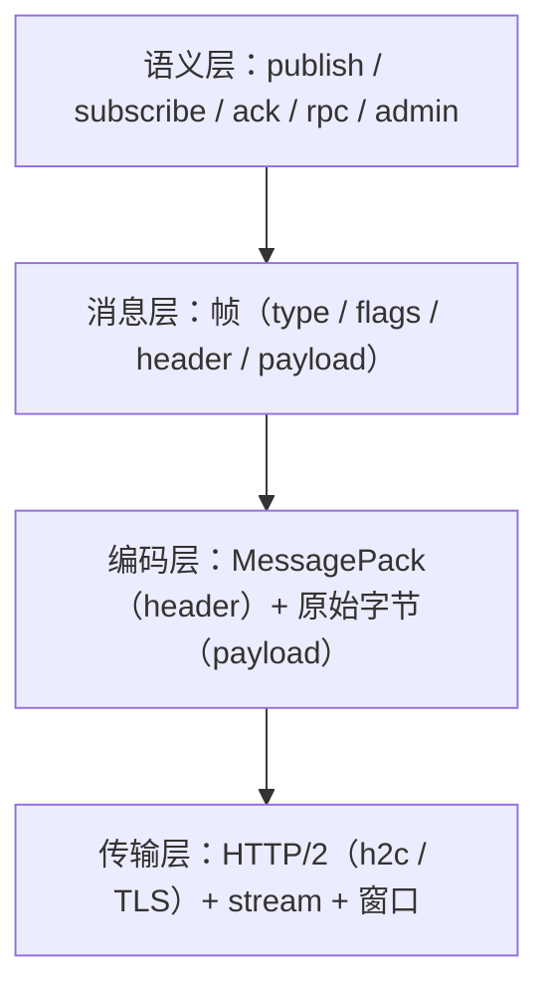

# 接入面：协议与客户端

> 协议分层 · 端点与帧 · 错误码 · 连接管理 · 背压 · 客户端形态 · 端口适配

[文档首页](../../文档首页.md) › [消息平台规划](../../规划/01_规划_消息平台.md) › 架构设计 › 接入面　|　[← 数据面](04_架构设计_数据面_存储与复制.md) · [控制面 →](06_架构设计_控制面_元数据与运维.md)

---

## 1. 接入面职责 <a id="scope"></a>

接入面解决「客户端怎么连进来、说什么话、说多快」：

| 职责 | 内容 |
| --- | --- |
| 传输 | HTTP/2 连接建立、stream 管理、TLS |
| 协议 | 帧编解码、版本协商、错误码 |
| 会话 | 心跳、断线重连、GOAWAY 优雅关闭 |
| 背压 | 长轮询、inflight 上限、流控窗口 |
| 适配 | 对 bms 暴露 `EventPublisher` / `BaseServiceClient` 端口 |

**边界**：接入面不碰存储，只把请求翻译成 `router` 的调用；不碰元数据写，只做校验与转发。

## 2. 协议分层 <a id="layers"></a>



| 层 | 关心什么 | 变更频率 |
| --- | --- | --- |
| 语义层 | 端点与操作含义 | 低（新增端点常见，改语义罕见） |
| 消息层 | 帧结构 | 低（只增字段） |
| 编码层 | 序列化格式 | 中（按 topic 可切 Protobuf） |
| 传输层 | 连接与流控 | 极低 |

## 3. 端点设计 <a id="endpoints"></a>

| 端点 | 方法 | 语义 | 响应 |
| --- | --- | --- | --- |
| `/msg/publish` | POST | 发布一条消息 | `{offset, partition}` |
| `/msg/subscribe` | GET | 长轮询订阅（可长驻流） | 消息批次 / 流 |
| `/msg/ack` | POST | 确认消费 | `{ok}` |
| `/msg/nack` | POST | 显式拒绝（可选） | `{ok}` |
| `/rpc/{service}/{method}` | POST | RPC 调用 | 结果 / 错误 |
| `/admin/topics` | GET/POST | 主题查询 / 创建 | 元数据 |
| `/admin/groups` | GET | 消费组与积压 | 元数据 |
| `/admin/replay` | POST | 建重放任务 | `{task_id}` |
| `/admin/dlq` | GET/POST | 死信查询 / 处置 | 死信列表 |

**设计原则**：

1. **动词化路径**（publish / subscribe / ack）比资源化（`/messages`）更贴合消息语义。
2. **管理面与数据面路径分离**（`/admin/*` vs `/msg/*`），便于分别限流与鉴权。
3. **长驻订阅用 GET + 流**，与 HTTP/2 server streaming 对应。

## 4. 帧与版本 <a id="frame"></a>

```text
+--------+--------+--------+--------+------------------+
| magic  | ver    | type   | flags  | header length    |
+--------+--------+--------+--------+------------------+
| header（MessagePack：topic / key / tenant / trace…） |
+--------------------------------------------------------+
| payload（原始字节，broker 不解析）                     |
+--------------------------------------------------------+
```

| 字段 | 作用 |
| --- | --- |
| `magic` | 快速拒绝非本协议流量 |
| `ver` | 主版本不兼容即断连；次版本只增字段 |
| `type` | `publish` / `ack` / `subscribe` / `error` / `heartbeat` |
| `flags` | 压缩、流结束、需响应、批量 |
| `header length` | 头体分离，便于只读头做路由 |

**三条演进铁律**（写进协议契约，评审必查）：

1. **只增可选字段**，不删字段、不改名、不改语义。
2. **未知帧类型 / 未知字段必须忽略**，不得报错。
3. **版本必须可见**：连接元数据里能读到协议版本，排障第一问。

## 5. 错误码 <a id="errors"></a>

| 层 | 示例 | 处理 | 是否断连 |
| --- | --- | --- | --- |
| 传输层 | magic 不符、版本不支持、帧过大 | 返回 error 后断开 | 是 |
| 协议层 | 缺必填头、类型不合法 | 返回 error 帧 | 否 |
| 业务层 | 主题不存在、消息过大、限流 | 返回 error 帧 + `retryable` | 否 |
| 系统层 | 磁盘满、内部异常 | 返回 error 帧 + `retryable=false` | 否 |

**错误必须带 `retryable`**：没有它，客户端只能全量重试或全量放弃。

**码段**（暂定，最终以 07C 登记为准）：`35xxxx`（6 位码 = 2 位段 + 4 位序号）；`350001` 主题不存在、`350004` 超时、`350005` 背压 / 限流、`350006` 消息过大。

## 6. 连接管理 <a id="connection"></a>

| 机制 | 作用 | 关键点 |
| --- | --- | --- |
| 心跳（PING / heartbeat 帧） | 探测半开连接 | **不能用 TCP keepalive 替代**（默认 2 小时太粗） |
| 最大并发流 | 防单连接压垮 broker | `MAX_CONCURRENT_STREAMS` |
| 空闲回收 | 释放长期不用连接 | 空闲超时 |
| 断线重连 | 客户端自动恢复 | 指数退避 + 抖动 |
| GOAWAY | 优雅关闭 | 滚动重启必备 |
| 连接池 | 多连接分摊 | 按目标 broker / 租户分池 |

**半开连接是最隐蔽的问题**：网络中断后一端不知道对端已死，连接仍占资源。心跳 + 超时是唯一可靠判据。

## 7. 背压 <a id="backpressure"></a>

接入面负责**两层**背压，数据面负责磁盘水位：

| 层 | 机制 | 超限动作 |
| --- | --- | --- |
| 连接层 | HTTP/2 流控窗口 | 自动暂停发送 |
| 消费层 | 单消费者 `inflight` 条数 / 字节双阈值 | 暂停推送 |
| 订阅层 | 长轮询 `maxWait` | 到期返回空 |
| 生产层 | 租户 / topic 速率配额 | 返回 `350005` |

**不能只靠一层**：窗口只保护单连接，保护不了内存总量与磁盘。

**长轮询的价值**：既保留「消费者能力驱动」的天然背压，又把空轮询延迟从「轮询间隔」降到「消息到达即返回」。

## 8. 客户端形态 <a id="clients"></a>

| 客户端 | 职责 | 关键行为 |
| --- | --- | --- |
| **Producer** | 发布消息、批量、重试 | 分区键选择、批量聚合、失败重试 |
| **Consumer** | 订阅、处理、ack | 先处理后 ack、未 ack 超时重投、位点提交 |
| **RPC Client** | 一元 / 流式调用 | deadline 传播、错误分类、熔断 |
| **Admin Client** | 管理操作 | 权限校验、操作留痕 |

**客户端不做的事**：不做消息存储、不做跨实例协调、不做业务幂等（业务自己做）。

## 9. 与 bms 端口适配 <a id="adapter"></a>

这是「业务代码不改」的关键：

| bms 端口 | msg 实现 | 业务影响 |
| --- | --- | --- |
| `EventPublisher.publish()` | 转 `/msg/publish` | 不改 |
| `EventPublisher.publish_transactional()` | 首期委托普通发布；事务消息后置 | 不改 |
| `BaseServiceClient.call()` | 转 `/rpc/{service}/{method}` | 不改 |
| `BaseOutboxStore` / relay | 可选：relay 换成 msg 客户端，或由 msg connector 扫 outbox | 不改 |

**适配层的价值**：出问题时配置切回原实现，业务无感。这也是「8B_01 可刹车」的技术基础。

## 10. 协议演进纪律 <a id="evolution"></a>

| 变更 | 兼容性 | 流程 |
| --- | --- | --- |
| 新增可选 header 字段 | 兼容 | 直接发 |
| 新增帧类型 | 兼容 | 老客户端忽略未知类型 |
| 新增端点 | 兼容 | 直接发 |
| 修改字段语义 | 不兼容 | 新增字段替代，旧字段标记废弃 |
| 删除字段 | 不兼容 | 观察一个版本后再删 |
| 改帧布局 | 不兼容 | 升主版本，双协议并行 |

## 11. 与阶段设计的分工 <a id="split"></a>

| 内容 | 本文件 | 8B 详细设计 |
| --- | --- | --- |
| 端点清单与语义 | ✅ 定形 | 8B_01 / 8B_03 定参数 |
| 帧结构 | ✅ 定字段 | 8B_01 定字节序与编码 |
| 错误码段 | ✅ 定段位 | 8B_01 定码表 |
| 连接与背压策略 | ✅ 定机制 | 8B_01 定阈值 |
| 客户端形态 | ✅ 定职责 | 8B_03 定 API |

## 12. 待定项 <a id="tbd"></a>

| # | 待定项 | 回填位置 |
| --- | --- | --- |
| 1 | 帧字节序与字段编码 | 8B_01 详细设计 |
| 2 | 订阅是否用长轮询还是长驻流（或两者） | 8B_01 PoC 结论 |
| 3 | `maxWait`、`inflight` 默认值 | 8B_01 / 8B_12 实测 |
| 4 | 客户端批量大小与重试参数 | 8B_03 / 8B_04 |

---

> 依《[文档生成规范](../../../bms文档/规范/文档生成规范.md)》编写 · 原理与业界对照见 bms《[协议与传输](../../../bms文档/资料/知识档案/消息与事件驱动/07_事件驱动_协议与传输.md)》《[背压与流控](../../../bms文档/资料/知识档案/消息与事件驱动/06_事件驱动_背压与流控.md)》
