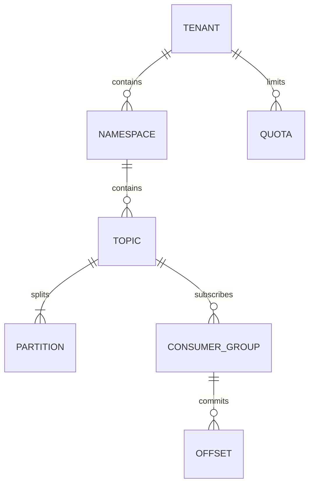
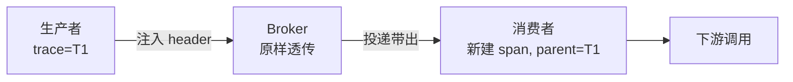
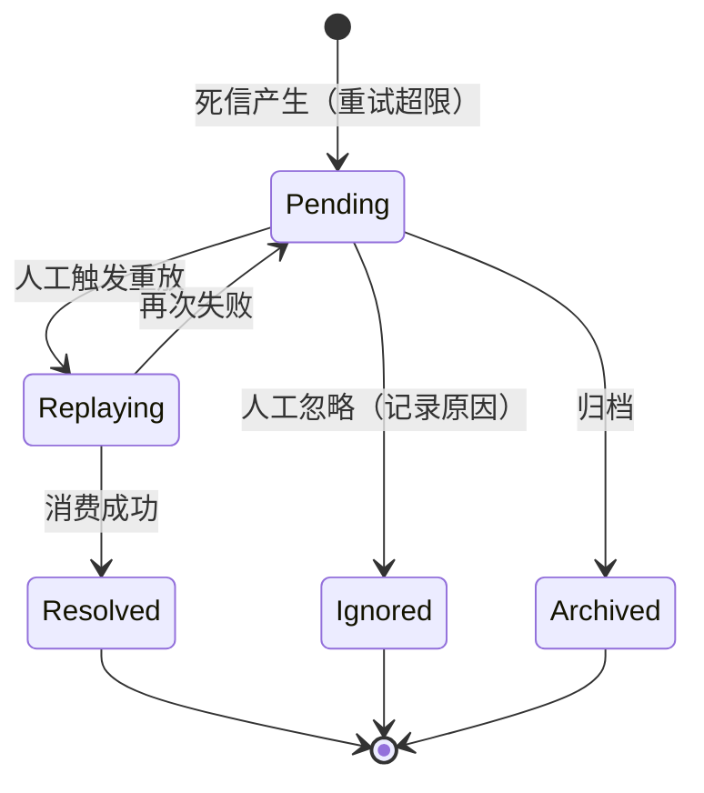

# 控制面：元数据与运维

> 元数据模型 · 管理台 · 指标与追踪 · 重放任务 · 死信处置 · 告警

[文档首页](../../文档首页.md) › [消息平台规划](../../规划/01_规划_消息平台.md) › 架构设计 › 控制面　|　[← 接入面](05_架构设计_接入面_协议与客户端.md) · [多租户与安全 →](07_架构设计_多租户与安全.md)

---

## 1. 控制面职责 

控制面管「平台是什么样、出了什么问题、怎么处置」：

| 职责 | 内容 | 特点 |
| --- | --- | --- |
| 元数据 | topic / namespace / group / partition / quota | 读多写少，需强一致 |
| 管理台 | 只读视图 + 写操作 | 只读先于写 |
| 可观测 | 指标 / 日志 / 追踪 | 必须早于功能 |
| 处置 | 重放、死信、位点重置 | 必须限流、留痕 |

**边界**：控制面**不直接写消息日志**，所有写操作最终经 `router → log`，保证 offset 与索引一致。

## 2. 元数据模型 

| 实体 | 关键属性 | 归属 |
| --- | --- | --- |
| Tenant | `tenant_id`（雪花）+ 状态 | 与 bms 租户对齐；不复制 bms 租户表 |
| Namespace | 对齐 bms `module_key` | 三级命名空间的中间层 |
| Topic | 名称、分区数、保留期、清理策略 | 核心元数据 |
| Partition | 分区号、leader、副本集、LEO / HW | 运行态 + 元数据 |
| ConsumerGroup | 组名、订阅 topic、状态 | 核心元数据 |
| Offset | `(group, topic, partition) → offset` | **独立文件优先** |
| Quota | 租户 / 命名空间的 topic 数、吞吐、存储上限 | **msg 自维护**；bms 经产品数据源只读回显 |

**为什么用三级命名空间**：只有「租户 + topic」两级时，租户内多条业务线无法分别管理配额与权限；namespace 对齐 bms `module_key` 后，权限码、菜单、模块开关天然一致。

**元数据与 bms 的关系**：msg 的元数据表（`msg_topic` / `msg_quota` 等）都在 msg 平台库，`tenant_id` 只作为列区分，**不复制 bms 租户表**；租户有效性以基座解析结果为准（07 篇第 4 节）。配额**不进 `sys_tenant_quota`**（该表归属 bms tenant 服务），由 msg 自维护并在 bms 租户管理页经产品数据源只读回显。

## 3. 元数据存储 

| 数据 | 存储位置 | 理由 |
| --- | --- | --- |
| topic / namespace / group / quota | **元数据库表**（`msg_*`） | 需事务、查询、关联 |
| partition 运行态（LEO / HW / ISR） | 内存 + 恢复点文件 | 高频更新，不能每次写库 |
| 消费位点 | **独立文件优先**，后续可入表 | 高频写，文件更轻 |
| 消息本体 | **分区日志文件** | 大容量、顺序写 |

**关键分界**：**消息本体绝不入数据库**。入库会带来写放大、保留期清理困难、吞吐受限——这正是知识档案 03 篇的结论。数据库只存「描述消息系统是什么样」的元数据。

## 4. 管理台 

### 4.1 只读视图（先做）

| 视图 | 内容 | 解决的问题 |
| --- | --- | --- |
| 主题列表 | 名称、分区数、消息量、保留期 | 有哪些主题 |
| 消费组列表 | 组、成员、积压、最后提交时间 | 谁在消费、跟不跟得上 |
| 分区详情 | LEO、HW、ISR、积压 | 单分区为什么卡 |
| 消息查询 | 按 offset / key / 时间 | 这条消息到底在不在 |
| 死信列表 | 死信、原因、重试次数 | 有哪些需要处置 |
| 配额用量 | 租户 / topic 的用量 | 谁快超限了 |

### 4.2 写操作（后做，必须留痕）

| 操作 | 约束 |
| --- | --- |
| 建 / 删 topic | 需 `msg:manage`；删除需二次确认 |
| 改分区数 | 只能增不能减（减会破坏 key → partition 映射） |
| 改保留期 / 配额 | 留痕 + 生效时间 |
| 重放 | **任务化 + 限速 + 可暂停** |
| 死信处置 | 重放 / 忽略 / 归档，均留痕 |
| 位点重置 | 高危，需二次确认 |

**重放必须任务化**：一次重放百万条会打挂消费端、吃满带宽。任务化后可以限速、暂停、看进度、取消。

## 5. 指标 

### 5.1 核心指标

| 指标 | 类型 | 用途 |
| --- | --- | --- |
| `msg_messages_in_total` | Counter | 入口流量 |
| `msg_bytes_in_total` | Counter | 带宽 |
| `msg_publish_latency_ms` | Histogram | 发布延迟 P99 |
| `msg_publish_errors_total{reason}` | Counter | 失败原因分布 |
| `msg_consumer_lag{group,topic,partition}` | Gauge | **积压（最重要）** |
| `msg_inflight_messages{group}` | Gauge | 背压与重复消费信号 |
| `msg_dlq_total` | Counter | 死信增长 |
| `msg_isr_shrink_total` | Counter | 复制稳定性 |
| `msg_disk_used_ratio` | Gauge | 水位 |

**标签基数纪律**：核心指标按 topic 聚合；`partition` / `group` 只在排障视图（管理台）展开，避免监控系统被标签基数拖垮。

### 5.2 日志

| 原则 | 做法 |
| --- | --- |
| 结构化 | key=value / JSON |
| 关联 | `trace_id` / `message_id` / `topic` / `partition` / `offset` |
| 聚合 | 同类错误按分钟聚合 + 计数 |
| 脱敏 | payload 不落日志，只记长度与摘要 |
| 采样 | 高频路径抽样 |

**不要每条消息打一条 INFO**：日志量会是消息量的 10 倍，磁盘很快被日志打满。

## 6. 链路追踪 

| 要点 | 说明 |
| --- | --- |
| 注入 | 消息 header 带 `trace_id` / `span_id` / `parent_span_id` |
| broker 不解包 | 只在 header 透传，不影响零拷贝 |
| 消费建新 span | parent 指向生产 span |
| 批量消费 | 一批可能来自多个 trace，逐条记录 |
| 采样 | 按 trace 采样，保证单条链路完整 |

**消息队列容易成为「追踪黑洞」**：生产者没注入、broker 丢头、消费者没读取，任一断链都断在这里。

## 7. 重放与死信处置 

| 处置 | 适用 | 约束 |
| --- | --- | --- |
| 重放 | 消费端修复后 | 任务化、限速、可暂停 |
| 忽略 | 数据本身无效 | 必须填原因，留痕 |
| 归档 | 需长期保留但不再处理 | 转入归档存储 |

**重放不破坏幂等**：重放会再次触发消费，业务必须仍按幂等键去重。

## 8. 告警 

| 级别 | 触发 | 通知 |
| --- | --- | --- |
| P0 | 全平台不可写 / 数据损坏 | 立即电话 |
| P1 | 单 topic 积压超阈值且持续增长 | 立即消息 |
| P2 | 死信快速增长 / ISR 频繁收缩 | 工作时间内 |
| P3 | 磁盘接近高水位 | 日常巡检 |

**三条纪律**：可行动、有抑制、有恢复通知。不可行动的告警是噪音，会让人忽略真正的告警。

## 9. 权限与审计 

| 操作 | 权限码 | 审计 |
| --- | --- | --- |
| 查询主题 / 组 / 积压 | `msg:query` | 敏感查询可留痕 |
| 建删主题、改配额、重放、死信处置 | `msg:manage` | **必须留痕** |
| 位点重置 | `msg:manage` | 必须留痕 + 二次确认 |

审计写入 bms 审计链（`audit-chain`），不自建一套——这样「谁在消息平台做了什么」与其他平台操作在同一处可查。

## 10. 与阶段设计的分工 

| 内容 | 本文件 | 8B 详细设计 |
| --- | --- | --- |
| 元数据模型 | ✅ 定实体 | 8B_02 定表字段 |
| 管理台视图 | ✅ 定范围 | 8B_06 定接口与页面 |
| 指标清单 | ✅ 定指标 | 8B_06 定采集与看板 |
| 重放 / 死信流程 | ✅ 定状态机 | 8B_06 定任务参数 |

## 11. 待定项 

| # | 待定项 | 回填位置 |
| --- | --- | --- |
| 1 | 元数据表字段与索引 | 8B_02 数据库设计 |
| 2 | 位点最终存文件还是入表 | 8B_02 实测 |
| 3 | 重放限速默认值 | 8B_06 实测 |
| 4 | 积压告警阈值 | 8B_12 容量模型 |
| 5 | 管理台是否独立部署 | 8B_06 / 8B_08 |

---

> 依《[文档生成规范](../../../bms文档/规范/文档生成规范.md)》编写 · 原理与业界对照见 bms《[运维与可观测](../../../bms文档/资料/知识档案/消息与事件驱动/10_事件驱动_运维与可观测.md)》
