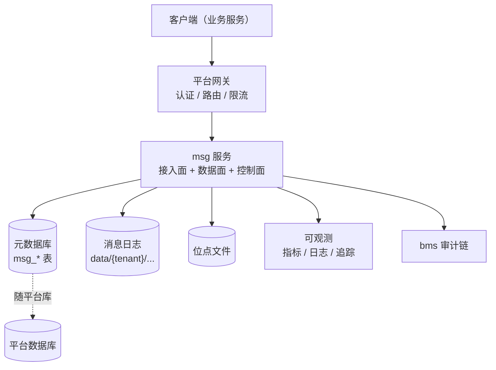
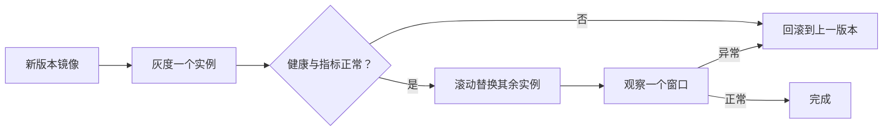

# 部署与运维

> 部署拓扑 · 容器与配置 · 存储布局 · 升级回滚 · 备份恢复 · 容量与扩缩容

[文档首页](../../文档首页.md) › [消息平台规划](../../规划/01_规划_消息平台.md) › 架构设计 › 部署与运维　|　[← 多租户与安全](07_架构设计_多租户与安全.md) · [决策与风险 →](09_架构设计_决策与风险.md)

---

## 1. 部署拓扑 <a id="topology"></a>



| 单元 | 形态 | 归属 |
| --- | --- | --- |
| msg 服务 | 单容器，容器内 8000 | msg 仓 `deploy/compose/` |
| 元数据库 | 随平台库（首期共库） | 平台 / msg 共用 |
| 消息日志 | 容器挂载卷（本地盘） | msg 仓 |
| 网关 | 平台统一网关 | bms |
| 可观测 | 平台 OTel / Prometheus | bms |

## 2. 容器与编排 <a id="container"></a>

```text
msg/deploy/
├── registry/msg.toml          # 产品声明（服务行 / 路由 / 能力 / 错误码）
├── compose/msg.yml            # 容器编排
├── local_stack.toml           # 本机裸跑规格
├── .env.example               # 凭据模板（.env 不入库）
└── Dockerfile                 # 构建上下文为工作区根
```

| 项 | 约定 |
| --- | --- |
| 服务名 | `msg` |
| 容器内端口 | 8000 |
| 网络 | 接入平台 Docker 网络（`PLATFORM_NETWORK`） |
| 镜像 | `MSG_REGISTRY_IMAGE_PREFIX` + `MSG_TAG`，**无 latest 兜底** |
| 健康检查 | 基座统一探针（`/health` / `/ready`） |
| 数据卷 | 消息日志目录必须持久化挂载，不能放容器可写层 |

**必须持久化的三样**：消息日志、位点文件、元数据库。少任何一个，重启即丢状态。

## 3. 配置分层 <a id="config"></a>

| 文件 | 内容 | 是否入库 |
| --- | --- | --- |
| `backend/config.toml` | 基线（app / server / database / cache / service_client） | 是 |
| `config.dev.toml` | 本地开发覆盖（debug、SQLite、宽松日志） | 是 |
| `config.test.toml` | CI 覆盖（临时库、关闭自动建表） | 是 |
| `config.prod.toml` | 生产覆盖（关闭 docs、JSON 日志、Redis） | 是 |
| `deploy/.env` | 凭据与连接串 | **否**（gitignore） |

**优先级**：环境变量（`BMS_` 前缀）> 环境覆盖文件 > 基线。

**必须走环境变量注入的**：数据库连接串与密码、Redis URL、OTLP 端点、服务令牌密钥、TLS 证书路径。**任何凭据不得写入配置文件或镜像**。

## 4. 存储布局 <a id="storage"></a>

```text
/var/lib/msg/                    # 挂载卷根
├── data/
│   └── {tenant}/{namespace}/{topic}/{partition}/
│       ├── *.log / *.index / *.timeindex
└── offsets/
    └── {tenant}/{group}/{topic}-{partition}.offset
```

| 要求 | 说明 |
| --- | --- |
| 独立磁盘 / 卷 | 消息日志与系统盘分离，避免日志打满拖垮进程 |
| 文件系统 | 优先 ext4 / xfs；**不要用网络文件系统**（fsync 语义不可靠） |
| 预留空间 | 默认预留 10%~15%，避免磁盘 100% 后无法写索引 |
| 目录权限 | 仅服务账号可读写 |
| 备份 | 见第 6 节 |

## 5. 升级与回滚 <a id="upgrade"></a>



| 原则 | 说明 |
| --- | --- |
| 向后兼容 | 新版本必须能读旧格式日志（格式演进只增字段） |
| 先 GOAWAY 再停 | 优雅关闭：停止接新流、等在途完成 |
| 一次一个 | 不要同时重启全部实例 |
| 可回滚 | 保留上一版本镜像与配置 |
| 数据格式不回滚 | **日志格式变更必须向前兼容**，否则回滚后读不了新数据 |

**最危险的是「格式变更 + 回滚」**：新版本写了新格式日志，回滚后旧版本读不了。所以格式变更要么不兼容就双写过渡，要么只做向后兼容的增量。

## 6. 备份与恢复 <a id="backup"></a>

| 对象 | 方式 | 频率 |
| --- | --- | --- |
| 元数据库 | 常规数据库备份 | 随平台 |
| 位点文件 | 定期快照 | 每日 |
| 消息日志 | **不做全量备份**（量大），靠副本 + 保留期 | — |
| 配置 | Git 管理 | 变更即提交 |

**必须讲清的两个事实**：

1. **复制不是备份**：副本会同步删除与损坏，只防节点故障。
2. **消息日志通常不备份**：成本高、价值低于元数据；重要事件靠「业务侧 outbox / 归档」兜底。

**恢复顺序**：元数据库 → 位点文件 → 消息日志（缺失则从最近段开始）→ 校验对齐。

## 7. 容量与扩缩容 <a id="capacity"></a>

```text
日增字节 = 峰值 msg/s × 平均消息大小 × 86400 × 峰值占比
所需磁盘 = 日增字节 × 保留天数 × 副本数 × 1.3（索引与预留）
分区数   = 峰值消费并行度 × 1.5 ~ 2
实例数   = 峰值吞吐 / 单机安全吞吐 × 1.5（冗余）
```

| 操作 | 可行性 | 说明 |
| --- | --- | --- |
| 扩实例 | 8B_05 后需要分区迁移 | 首期单实例，扩不了 |
| 增分区 | 可以（**只能增不能减**） | 减少会破坏 key → partition 映射 |
| 缩短保留期 | 可以 | 立即释放空间（按段删除） |
| 加磁盘 | 可以（同机） | 需停机或迁移分区 |

**容量必须按「N−1」设计**：N 台里坏 1 台，剩下的要能扛住全量。首期单实例时，这意味着**不能把单机跑到极限**。

## 8. 监控与健康检查 <a id="monitor"></a>

| 检查 | 端点 / 指标 | 失败处理 |
| --- | --- | --- |
| 存活 | `/health` | 重启容器 |
| 就绪 | `/ready`（元数据可达、日志可写） | 从负载移除 |
| 磁盘 | `msg_disk_used_ratio` | 高水位告警 / 拒绝写 |
| 积压 | `msg_consumer_lag` | 告警 |
| 死信 | `msg_dlq_total` | 告警 |

**就绪探针必须检查「能写」**：只检查进程活着不够——磁盘满的实例活着但不可用。

## 9. 与 bms 平台部署的关系 <a id="bms"></a>

| 项 | 归属 |
| --- | --- |
| 网关、认证、Redis、MySQL、可观测后端 | **bms 部署** |
| msg 服务、消息日志卷、位点文件、消息元数据表 | **msg 部署** |
| 网络 | msg 加入平台网络 |
| 服务发现 | Compose DNS（`msg:8000`） |
| 审计写入 | msg → 平台审计链 |

**msg 不部署基座基础设施**，只声明依赖。

## 10. 与阶段设计的分工 <a id="split"></a>

| 内容 | 本文件 | 8B 详细设计 |
| --- | --- | --- |
| 部署拓扑 | ✅ 定形态 | 8B_08 定 compose 细节 |
| 存储布局 | ✅ 定目录 | 8B_08 定挂载与权限 |
| 升级回滚 | ✅ 定原则 | 8B_08 定发布流程 |
| 备份恢复 | ✅ 定对象与方式 | 8B_08 定脚本 |
| 容量模型 | ✅ 定公式 | 8B_12 定参数与实测 |

## 11. 待定项 <a id="tbd"></a>

| # | 待定项 | 回填位置 |
| --- | --- | --- |
| 1 | 元数据库首期是否与平台共库 | 8B_08 部署设计 |
| 2 | 消息日志卷的磁盘规格与预留比例 | 8B_12 容量模型 |
| 3 | 是否启用容器内 TLS 终止 | 8B_07 / 8B_08 |
| 4 | 备份频率与保留期 | 8B_08 |
| 5 | 多实例时的分区迁移方案 | 8B_05 |

---

> 依《[文档生成规范](../../../bms文档/规范/文档生成规范.md)》编写 · 平台部署口径见 bms《架构设计 · 部署与运维》
