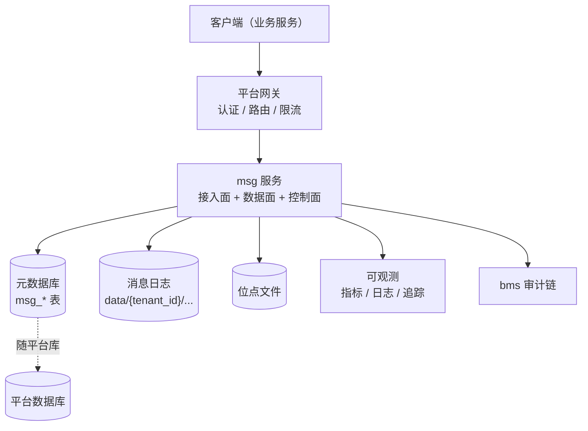
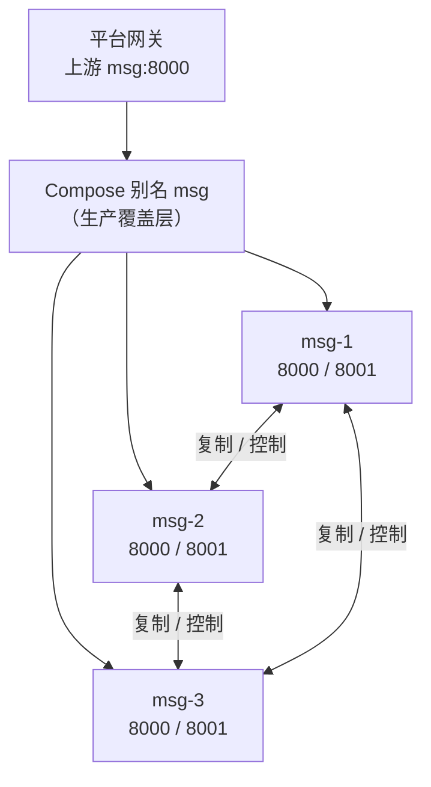
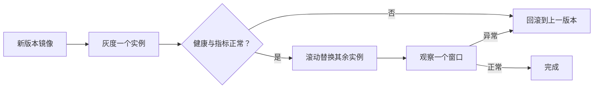

# 部署与运维

> 部署拓扑 · 容器与配置 · 存储布局 · 升级回滚 · 备份恢复 · 容量与扩缩容

[文档首页](../../文档首页.md) › [消息平台规划](../../规划/01_规划_消息平台.md) › 架构设计 › 部署与运维　|　[← 多租户与安全](07_架构设计_多租户与安全.md) · [决策与风险 →](09_架构设计_决策与风险.md)

---

## 1. 部署拓扑 <a id="topology"></a>



| 单元 | 形态 | 归属 |
| --- | --- | --- |
| msg 服务 | 单容器，容器内 8000 | msg 仓 `deploy/compose/` |
| 元数据库 | 随平台库（首期共库） | 平台 / msg 共用 |
| 消息日志 | 容器挂载卷（本地盘） | msg 仓 |
| 网关 | 平台统一网关 | bms |
| 可观测 | 平台 OTel / Prometheus | bms |

**多实例形态（02-8）**：



| 项 | 单实例（默认） | 三实例（`cluster` profile） |
| --- | --- | --- |
| 服务名 | `msg` | `msg-1` / `msg-2` / `msg-3` |
| 端口 | 8000 | 8000（业务）+ 8001（内部，仅平台网络） |
| 数据卷 | `MSG_DATA_HOST_DIR` / `MSG_OFFSETS_HOST_DIR` | 每实例独立 `_1..3` 两组卷 |
| 复制 | 关闭 | 开启，`NODES=msg-1,msg-2,msg-3`、`FACTOR=3`、`MIN_INSYNC=2` |
| 网关 | 上游直连 `msg:8000` | 生产覆盖层加别名 `msg`；drill 不启用别名 |

**为什么用显式三服务而不是 `--scale`**：缩放副本没有稳定 DNS 名，无法让 `node_id` 与内部地址一一对应；网络复制要求「节点 → 可寻址地址」。

## 2. 容器与编排 <a id="container"></a>

```text
msg/deploy/
├── registry/msg.toml          # 产品声明（服务行 / 路由 / 能力 / 错误码）
├── compose/msg.yml            # 容器编排
├── local_stack.toml           # 本机裸跑规格
├── .env.example               # 凭据模板（.env 不入库）
└── Dockerfile                 # 构建上下文为工作区根
```

| 项 | 约定 |
| --- | --- |
| 服务名 | `msg` |
| 容器内端口 | 8000 |
| 网络 | 接入平台 Docker 网络（`PLATFORM_NETWORK`） |
| 镜像 | `MSG_REGISTRY_IMAGE_PREFIX` + `MSG_TAG`，**无 latest 兜底** |
| 健康检查 | 基座统一探针：`/healthz` 表存活、`/readyz` 表就绪；镜像层 `HEALTHCHECK` **打 `/readyz`**（与网关摘流同一判据），编排不重复声明 |
| 运行用户 | 非 root（镜像内建服务账号），数据卷属主与之一致 |
| 数据卷 | 消息日志与位点**各挂一个**宿主卷（与系统盘分离），不能放容器可写层 |

**编排文件（02-8）**：

| 文件 | 作用 |
| --- | --- |
| `compose/msg.yml` | 单实例默认 + `cluster` profile 三实例（每实例独立卷、8000/8001） |
| `compose/msg-cluster.gateway.yml` | 生产覆盖层：给三实例加网络别名 `msg`（drill 不启用） |
| `compose/msg-drill.override.yml` | 演练覆盖层：容器名 `msg-drill-1..3`、宿主回环端口、独立演练库前缀 |
| `drill/cluster.env.example` | 远程主机 / 临时工作区 / 隧道端口 / 演练依赖键位模板（真实值不入库） |

**单实例回退**：默认 `docker compose -f compose/msg.yml up -d` 只起 `msg`；回退前先 `ops.rebalance` 收敛副本集 / 切主，分配结果保留在 `msg_partition.replicas`，单实例按首元素或自身标识运行。

**必须持久化的三样**：消息日志、位点文件、元数据库。少任何一个，重启即丢状态。

## 3. 配置分层 <a id="config"></a>

| 层 | 载体 | 内容 | 是否入库 |
| --- | --- | --- | --- |
| 1 基线 | `backend/config.toml` | app / server / database / cache / service_client 的结构与非敏感默认值 | 是 |
| 2 环境覆盖 | `config.dev.toml` / `config.test.toml` / `config.prod.toml` | 环境差异（开发态 SQLite、CI 临时库、生产关 docs 与自动建表） | 是 |
| 3 dotenv | `backend/.env` | 本地裸跑可选；部署态不用 | **否** |
| 4 进程环境变量 | `BMS_` 前缀，嵌套键以双层下划线分隔 | 部署态的凭据、端点与运行旋钮 | — |
| 宿主插值 | `deploy/.env` | 凭据与连接串，经编排插值后注入层 4 | **否** |

**优先级**：层 4 > 层 3 > 层 2 > 层 1（深合并）。「环境变量 > 环境覆盖 > 基线」的三段表述把 dotenv 与进程变量同归环境变量段；`BMS_ENV` 决定加载哪一份层 2，本身亦来自环境变量或 dotenv。生效顺序由启动期断言与仓库级检查钉住，不靠文档约定；两份 `.env` 都不入库，仓内只保留键位模板。

**必须走环境变量注入的六类**：数据库连接串与密码、Redis URL、OTLP 端点、服务令牌密钥、用户令牌密钥、TLS 证书路径。配置文件、镜像与公开文档只保留结构与空占位，**任何凭据不得写入配置文件或镜像**；模板不出现服务器地址、内网 IP、端口与账号。容器内是否启用 TLS 终止仍按第 12 节待定项。

**生产配置语义**：不得出现 `debug`、文档端点开启、SQLite 兜底或开发态租户覆盖；判的是环境变量覆盖后的**最终生效值**。缺服务 / 用户令牌密钥时沿用「可装配、使用时失效关闭」，不静默降级；生产安全密钥缺失仍由基座启动校验拒启。公开文档不得出现服务器 / 内网地址 / 账号，明显凭据形态由仓库级检查扫描并给出文件与行号。

## 4. 存储布局 <a id="storage"></a>

```text
/var/lib/msg/                    # 挂载卷根
├── data/
│   └── {tenant_id}/{namespace}/{topic}.{topic_id}/{partition}/
│       ├── *.log / *.index / *.timeindex / *.delay
│       └── recovery-point.json
└── offsets/
    └── {tenant_id}/{group}-{hash8}/{topic_id}-{partition}.offset
```

> 位点与 `data/` 平级、组目录名带哈希后缀（大小写不敏感文件系统不串组）的口径见《[架构设计 · 数据面](04_架构设计_数据面_存储与复制.md#model)》§2.1；分区目录结构与恢复点见同一文档 §2 / §5。

| 要求 | 说明 |
| --- | --- |
| 独立磁盘 / 卷 | 消息日志与系统盘分离，避免日志打满拖垮进程 |
| 文件系统 | 优先 ext4 / xfs；**不要用网络文件系统**（fsync 语义不可靠） |
| 预留空间 | 默认预留 10%~15%，避免磁盘 100% 后无法写索引 |
| 目录权限 | 仅服务账号可读写 |
| 备份 | 见第 6 节 |

## 5. 升级与回滚 <a id="upgrade"></a>



| 原则 | 说明 |
| --- | --- |
| 向后兼容 | 新版本必须能读旧格式日志（格式演进只增字段） |
| 先 GOAWAY 再停 | 优雅关闭：停止接新流、等在途完成 |
| 一次一个 | 不要同时重启全部实例 |
| 可回滚 | 保留上一版本镜像与配置 |
| 数据格式不回滚 | **日志格式变更必须向前兼容**，否则回滚后读不了新数据 |

**最危险的是「格式变更 + 回滚」**：新版本写了新格式日志，回滚后旧版本读不了。所以格式变更要么不兼容就双写过渡，要么只做向后兼容的增量。

## 6. 备份与恢复 <a id="backup"></a>

| 对象 | 方式 | 频率 |
| --- | --- | --- |
| 元数据库 | 常规数据库备份 | 随平台 |
| 位点文件 | 定期快照 | 每日 |
| 消息日志 | **不做全量备份**（量大），靠副本 + 保留期 | — |
| 配置 | Git 管理 | 变更即提交 |

**必须讲清的两个事实**：

1. **复制不是备份**：副本会同步删除与损坏，只防节点故障。
2. **消息日志通常不备份**：成本高、价值低于元数据；重要事件靠「业务侧 outbox / 归档」兜底。

**恢复顺序**：元数据库 → 位点文件 → 消息日志（缺失则从最近段开始）→ 校验对齐。

**备份产物的语义约束**（落地形态归 8B 详细设计，本节不写实现细节）：

- 元数据库随平台库备份，产品侧只核对「平台备份是否覆盖本产品的表集合」并登记清单，不另建第二套库备份；
- 位点快照须与消息日志分离、且可校验：复制前后的校验和必须一致，写入期间的并发变更不得产出半文件快照；
- 每次备份都要有可核对的清单，覆盖服务与配置版本、租户、表集合、位点校验和、分区段范围与日志末端摘要、备份文件清单；清单与快照同处，供恢复与审计共同使用；
- 消息日志不复制，只在清单登记段范围与日志末端摘要，恢复后据此对齐；恢复点不可用时须显式标注，不得静默当作零值；
- 发布必须原子：失败不覆盖、不删除上一份可用备份；空间不足提前失败并给出可定位原因；保留期可配置，且无论怎样清理都至少留一份可用快照；
- 定时执行须能补跑挂起期错过的触发点，失败非零退出并留下可定位原因。

**恢复演练的语义约束**（落地形态归 8B 详细设计，本节不写实现细节）：

- 演练须可重复：同一份备份可反复演练，隔离目标用完即清，不污染共享数据；真实环境演练必须停服、可回退，生产环境不执行破坏性恢复；
- 恢复按固定顺序执行且不跳步，每步留下命令、耗时与结果；校验至少覆盖表集合、位点校验和、位点与日志末端关系、已确认消息可读、未到期延迟消息不提前不丢；
- 日志缺口必须显式登记（缺口区间与最近可用起点），不得静默按完整处理；恢复后的位点不得越过日志尾；
- 任何失败都要可回退到上一份可用备份，且回退参数可直接复现；不允许「部分恢复后直接接流量」；
- 演练结论须有记录（环境、版本、配置版本、备份时间、起止、RTO / RPO、数据完整性、失败注入、问题与遗留），结论区分「通过 / 降级通过 / 失败」，降级需人工复核。

## 7. 容量与扩缩容 <a id="capacity"></a>
```text
日增字节 = 峰值 msg/s × 平均消息大小 × 86400 × 峰值占比
所需磁盘 = 日增字节 × 保留天数 × 副本数 × 1.3（索引与预留）
分区数   = 峰值消费并行度 × 1.5 ~ 2
实例数   = 峰值吞吐 / 单机安全吞吐 × 1.5（冗余）
```

| 操作 | 可行性 | 说明 |
| --- | --- | --- |
| 扩实例 | 可以（02-8 `ops.rebalance`） | 受控加入：新副本先追平进 ISR，再缩旧集；逐分区串行 |
| 缩实例 | 可以（先切主再移除） | 移除 leader 时先切到剩余副本；缩容后剩余副本数须 ≥ `min.insync` |
| 增分区 | 可以（**只能增不能减**） | 减少会破坏 key → partition 映射 |
| 缩短保留期 | 可以 | 立即释放空间（按段删除） |
| 加磁盘 | 可以（同机） | 需停机或迁移分区 |

**迁移纪律**：`ops.rebalance plan` 只读运行态并生成台账；`apply` 串行执行，追平期间写入不中断；`leader start_offset > 0`（保留期已裁剪）时拒绝迁移并登记遗留，不做全量重同步。

**容量必须按「N−1」设计**：N 台里坏 1 台，剩下的要能扛住全量。首期单实例时，这意味着**不能把单机跑到极限**。

## 8. 监控与健康检查 <a id="monitor"></a>

| 检查 | 端点 / 指标 | 失败处理 |
| --- | --- | --- |
| 存活 | `/healthz` | 重启容器 |
| 就绪 | `/readyz`（元数据可达、日志可写、水位未超拒绝阈值） | 从负载移除 |
| 磁盘 | `msg_disk_used_ratio` | 高水位告警 / 拒绝写 |
| 积压 | `msg_consumer_lag` | 告警 |
| 死信 | `msg_dlq_total` | 告警 |
| 切主结果 | `msg_leader_switch_total{result}` | `degraded` 需人工复核 |
| 迁移进度 | `msg_partition_migration_tasks` / `..._remaining_records`、`ops.rebalance status` | 追平中 / 失败项告警 |
| 内部通道 | `msg_internal_replication` 就绪项、`msg_replication_transport_errors_total` | 内部服务退出即摘流 |

**就绪探针必须检查「能写」**：只检查进程活着不够——磁盘满的实例活着但不可用。

## 9. 故障演练 <a id="drill"></a>

故障域与隔离手段（[03 §6](03_架构设计_总体架构.md#fault)）不能只写在文档里：发版前必须能一次性复现并按固定判据判定。六类场景与判定的语义：

| 场景 | 注入语义 | 判据语义（缺一即不算通过） |
| --- | --- | --- |
| 进程崩溃 | 两档终止（强杀 / 优雅停）后以同一数据根重启 | 已确认消息不回退、未确认消息重新投递、offset 不重排、恢复在预算内 |
| 磁盘满 | 隔离数据卷受控填满至拒绝水位以上 | 写入被拒并返回可定位错误码、就绪转失败、进程存活、清理后自动恢复 |
| 慢盘 | 受控写入压同一卷并 fsync | 不产生假确认、位点不越尾、停压后积压归零 |
| 网络分区 | 客户端侧断开 / 丢包 / 加延迟 | 断开期请求失败可观测、恢复可重连、不重复投递 |
| 消费者卡死 | 只拉不确认直至在途填满 | 背压生效且不越在途上限、确认后积压归零 |
| 毒消息 | 非法载荷被入口拒绝 + 反复投递到重投上限 | 入口拒绝且不入日志、重投不超上限、转死信后可查、不阻塞同分区后续消息 |

**语义约束**（落地形态归 8B 详细设计，本节不写实现细节）：

- **默认拒绝生产**：演练带破坏性，生产环境一律拒绝且不提供逃生开关；非隔离环境执行前必须给出备份证据，缺证据即拒绝执行；
- **注入前二次确认**：每次注入要显式确认场景标识，避免误打共享环境；
- **一次运行一份记录**：记录须含环境、版本、注入方式、三段观测（注入前 / 注入中 / 恢复后）、判据逐条实测值、恢复耗时、数据完整性、偏离项与遗留；结论区分「通过 / 降级通过 / 失败」，后两者必须有可读原因；
- **可重复**：同一场景任何时候重跑都要得到可比较的记录；隔离实例用完即清，不污染共享数据与生产元数据；
- **证据可降级、不可伪造**：隔离环境与生产在存储介质、网络形态上必然不同，差异须逐条写入偏离项；判据采不到样本时记「降级」并写出实测值，不得按通过记录；
- **发版前复跑**：场景与判据是发版检查的一部分，口径随代码演进，不允许多份手写清单并存。
- **判据与清单单一事实源**：判据表与发版前检查清单由同一份场景登记生成；判据变更只改登记，不另写第二份清单。
- **证据机器判读**：记录按判据逐条对账；硬判据非通过即场景不通过，可降级项单列且不计通过；未通过项必须有归口，缺归口不得放行。
- **复跑闭环与可比性**：非通过记录必须有后继复跑；证据与版本、配置摘要一起归档，跨版本可比较，不以「服务起来了」代替数据完整性结论。

## 10. 与 bms 平台部署的关系 <a id="bms"></a>

| 项 | 归属 |
| --- | --- |
| 网关、认证、Redis、MySQL、可观测后端 | **bms 部署** |
| msg 服务、消息日志卷、位点文件、消息元数据表 | **msg 部署** |
| 网络 | msg 加入平台网络 |
| 服务发现 | Compose DNS（`msg:8000`）；多实例时客户端侧选实例与失败重试见 [05 §8.1](05_架构设计_接入面_协议与客户端.md#discovery) |
| 审计写入 | msg → 平台审计链 |

**msg 不部署基座基础设施**，只声明依赖。

## 11. 与阶段设计的分工 <a id="split"></a>

| 内容 | 本文件 | 8B 详细设计 |
| --- | --- | --- |
| 部署拓扑 | ✅ 定形态 | 8B_08 定 compose 细节 |
| 存储布局 | ✅ 定目录 | 8B_08 定挂载与权限 |
| 升级回滚 | ✅ 定原则 | 8B_08 定发布流程 |
| 备份恢复 | ✅ 定对象与方式 | 8B_08 定脚本 |
| 容量模型 | ✅ 定公式 | 8B_12 定参数与实测 |
| 故障演练 | ✅ 定场景与判据语义 | 8B_08 定真实环境执行窗口 |

## 12. 待定项 <a id="tbd"></a>

| # | 待定项 | 结论 / 回填 |
| --- | --- | --- |
| 1 | 元数据库首期是否与平台共库 | 随部署能力重建（07 域已剥离；当前走平台库） |
| 2 | 消息日志卷的磁盘规格与预留比例 | 平台级容量实测 |
| 3 | 是否启用容器内 TLS 终止 | 随部署能力重建（07 域已剥离） |
| 4 | 备份频率与保留期 | 随部署能力重建（07 域已剥离） |
| 5 | 多实例时的分区迁移方案 | **已定（02-8）**：`ops.rebalance` 计划 / 应用 / 台账 + 副本集变更收敛（02-8-3） |
| 6 | 六类演练在真实容器 / 真盘上的执行窗口 | 随部署能力重建（07 域已剥离） |

---

> 依《[文档生成规范](../../../bms文档/规范/文档生成规范.md)》编写 · 平台部署口径见 bms《架构设计 · 部署与运维》
