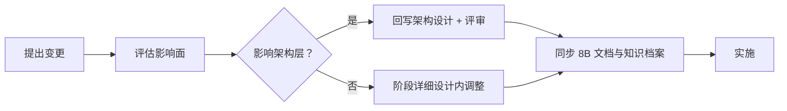

# 决策与风险

> 关键决策记录 · 开放项 · 风险登记 · 推翻条件 · 决策变更流程

[文档首页](../../文档首页.md) › [消息平台规划](../../规划/01_规划_消息平台.md) › 架构设计 › 决策与风险　|　[← 部署与运维](08_架构设计_部署与运维.md) · [总览](01_架构设计_总览.md)

---

## 1. 文档目的 

把「已经定了什么、为什么定、什么情况下该改」写成可追溯的记录。**决策不记录 = 下次重新吵一遍**。

## 2. 关键决策记录 

### 2.1 平台形态

| # | 决策 | 选择 | 理由 | 主要代价 |
| --- | --- | --- | --- | --- |
| D1 | 自研深度 | **L3 完整平台** | 与 bms 深度集成、统一事件与 RPC、摆脱表名绑死 | 数月级投入，自研 bug 风险 |
| D2 | 产品形态 | 独立仓 `msg`，类 mdm | 产品自治、独立演进 | 需维护跨仓集成 |
| D3 | 服务形态 | **单服务多域** | 单人运维，组件越少越好 | 资源隔离弱，后期可能要拆 |
| D4 | 阶段编排 | 独立 08B | 不污染 bms 阶段计划 | 跨仓协调 |

### 2.2 传输与协议

| # | 决策 | 选择 | 理由 | 主要代价 |
| --- | --- | --- | --- | --- |
| D5 | 传输 | **HTTP/2（h2c）+ MessagePack** | 多路复用、复用网关生态、PoC 可控 | 头部有固定开销；订阅长流要自研 |
| D6 | 协议归属 | 自定义帧，不用 gRPC | 避免引入 protoc 与第三套契约 | 需自维护编解码 |
| D7 | 版本策略 | 只增字段、未知忽略、版本可见 | 长期兼容 | 老字段无法删除（只能废弃） |

### 2.3 存储与复制

| # | 决策 | 选择 | 理由 | 主要代价 |
| --- | --- | --- | --- | --- |
| D8 | 日志粒度 | **每分区一组文件** | 删除 / 隔离 / 迁移简单 | 分区多时文件句柄压力 |
| D9 | 索引 | 稀疏索引 | 索引体积小 | 读时少量扫描 |
| D10 | 刷盘 | 按批 fsync（可配） | 平衡吞吐与持久性 | 极端断电丢最后一批 |
| D11 | 消息本体位置 | **文件日志，不入库** | 避免写放大与保留期清理难题 | 查询能力弱（需自建索引） |
| D12 | 复制模型 | **ISR 半同步**（8B_05） | 吞吐优先 + 不丢已确认 | 判断「同步」有误判窗口 |
| D13 | 存储格式 | 8B_02 就预留 epoch / 副本位点 | 避免 8B_05 推倒重来 | 前期格式稍复杂 |

### 2.4 消息模型与投递

| # | 决策 | 选择 | 理由 | 主要代价 |
| --- | --- | --- | --- | --- |
| D14 | 投递语义 | **至少一次 + 消费端幂等** | 与现有 outbox 基线一致 | 业务必须实现幂等 |
| D15 | 顺序 | 分区有序（按聚合键） | 满足多数场景，保留并行 | 无全局顺序 |
| D16 | 位点 | 独立文件优先，按组存 | 简单、可恢复 | 与日志非原子 |
| D17 | 事务消息 | **后置**，先做 outbox 适配 | 平台已有序日志与位点 | 业务仍需维护 outbox 表 |
| D36 | 延迟消息存储 | **延迟区暂存 + 到期 `append`**（不占 offset、不参与停等） | 位点 / 停等 / 死信 / 保留全部复用，不破 01-3 不变量 | 到期时刻一次落盘搬迁；需先写后清 + 恢复期按 `log_id` 去重（记录身份与消息身份分离；单副本不丢不重，多副本归 8B_05 fencing） |
| D37 | 延迟驱动 | **分层时间轮 + 后台定时任务** | 到期转投与拉取解耦（无人消费也按时进日志） | 多一层定时任务的生命周期与恢复要管 |

### 2.5 多租户与安全

| # | 决策 | 选择 | 理由 | 主要代价 |
| --- | --- | --- | --- | --- |
| D18 | 隔离 | 逻辑隔离 + 目录隔离 | 单人运维成本可控 | 故障不隔离（共享进程） |
| D19 | 命名空间 | **三级（租户 / 命名空间 / 主题）** | 预留租户内业务线 | 路径变长 |
| D20 | 身份 | 复用 bms 服务 JWT | 不另造身份体系 | 受基座约束 |
| D21 | 租户识别 | **从令牌解析，不接受自报** | 防冒充 | 客户端需正确携带令牌 |
| D22 | 审计 | 写 bms 审计链 | 统一可查 | 依赖平台审计可用性 |

### 2.6 运维与迁移

| # | 决策 | 选择 | 理由 | 主要代价 |
| --- | --- | --- | --- | --- |
| D23 | 迁移方式 | 适配层 + 分域切换 + 回滚开关 | 业务代码不改、可回退 | 适配层长期存在 |
| D24 | 迁移前置 | **8B_05 复制必须先于 8B_08 迁移** | 否则单点故障放大到全平台 | 阶段顺序不可调 |
| D25 | 运维入口 | 管理台只读先行 | 只读能解决大部分排障 | 写操作延后 |
| D26 | 备份 | 元数据 + 位点备份；消息日志不备份 | 成本与价值权衡 | 消息历史靠副本与保留期 |

### 2.7 租户（2026-11 专项讨论）

| # | 决策 | 选择 | 理由 | 主要代价 |
| --- | --- | --- | --- | --- |
| D27 | 租户标识 | **`tenant_id`（雪花，不可变）做目录与元数据列** | bms 明确 code 可变、内部身份用 `tenant_id` | 目录不可读，排障需映射 |
| D28 | 命名空间 | **对齐 bms `module_key`** | 与模块、权限码、菜单天然对齐 | 产品内部事件需占一个 module_key |
| D29 | 租户解析 | **复用基座解析链**；管理面 / RPC 用中间件，数据面复用解析函数 | 与平台口径一致，不另造 | 数据面需自己做令牌校验与缓存 |
| D30 | 租户状态 | **复用基座租户源**（版本键即时生效），不自建缓存 | 长连接不能只校验一次；基座已提供即时失效 | 依赖租户源可用性 |
| D31 | 开通初始化 | **懒初始化，仅发布时创建**；查询返回不存在 | 读请求不产生写副作用 | 首次发布需处理并发竞争 |
| D32 | 停用后数据 | **保留数据、拒绝收发**，不自动清理 | bms 无租户删除语义，停用可恢复 | 停用租户仍占磁盘 |
| D33 | 平台级消息 | **平台租户当普通租户**，不引入全局 topic | 无特例、无额外权限模型 | 跨租户广播需每租户一份 |
| D34 | 配额归属 | **msg 自维护 `msg_quota`**，bms 经产品数据源只读回显 | 不跨服务直写 `bms_tenant` 库 | 需 msg 提供只读数据源与接口 |
| D35 | 配额表 | **不写 `sys_tenant_quota`** | 该表归属 bms tenant 服务，隔离纪律不允许跨服务写 | 平台超管需在 bms 页面看只读投影 |

## 3. 开放项 

| # | 开放项 | 影响 | 何时收敛 |
| --- | --- | --- | --- |
| O1 | 订阅用长轮询还是长驻流（或两者） | 接入面实现复杂度 | 8B_01 PoC |
| O2 | 帧字节序与字段编码 | 协议定型 | 8B_01 |
| O3 | 默认 fsync 策略 | 吞吐与持久性平衡 | 8B_01 / 8B_12 |
| O4 | 位点最终存文件还是入表 | 元数据设计 | 8B_02 |
| O5 | 是否启用 mTLS | 安全与性能 | 8B_07 |
| O6 | 管理台是否独立部署 | 部署单元数 | 8B_06 / 8B_08 |
| O7 | 元数据库是否与平台共库 | 部署与隔离 | 8B_08 |
| O8 | 分区迁移方案（多实例时） | 扩容能力 | 8B_05 |
| O9 | `.delay` 段轮转大小、时间轮桶粒度与推进周期 | 延迟投递的精度与恢复成本 | 8B_02 |

## 4. 风险登记 

| # | 风险 | 概率 | 影响 | 缓解 |
| --- | --- | --- | --- | --- |
| R1 | 自研存储 / 复制 bug 导致数据丢失 | 中 | **极高**（审计合规） | CRC + 恢复演练 + HA 前不承载唯一副本 |
| R2 | Python 性能不达标 | 中 | 高 | PoC 先测；热点异步批处理或 C 扩展 |
| R3 | 工作量远超预期 | 高 | 高 | 分阶段 + 每阶段可独立验收 + 8B_01 可刹车 |
| R4 | 单人运维无以为继 | 高 | 中 | 管理台与指标先于功能 |
| R5 | 与 bms 迁移耦合出生产事故 | 中 | 高 | 适配层 + 分域切换 + 回滚演练 |
| R6 | 协议演进破坏老客户端 | 中 | 中 | 只增字段、未知忽略、版本可见 |
| R7 | 多租户设计滞后 | 中 | 中 | 与基座租户体系同步设计 |
| R8 | 本地（Windows）与生产（Linux）行为差异 | 中 | 中 | 双端验证；关键路径真机复测 |
| R9 | 三库（MySQL / PG / 达梦）元数据行为差异 | 低 | 中 | 元数据只用通用 SQL；方言测试 |
| R10 | 运维工具缺失导致故障定位慢 | 中 | 中 | 指标 + 追踪 + 管理台只读先行 |
| R11 | 延迟兜底自身失效（延迟区损坏 / 转投风暴 / 重启丢计时） | 中 | 高（业务承诺被静默撕毁） | 到期失败不删记录 + CRC 段隔离 + 重启限速补投 + 延迟区积压与失败计数告警（架构 04 §2.6） |

## 5. 推翻条件 

| 触发条件 | 应对 | 恢复成本 |
| --- | --- | --- |
| 8B_01 基准未达标 | 退回「只换 RPC、保留 RocketMQ」的局部方案 | 低（适配层切换） |
| 自研可靠性无法保证（崩溃恢复 / 复制反复丢数据） | 退回开源自建（RocketMQ / Kafka） | 中（适配层 + 部署） |
| 运维成本失控 | 改用云服务或托管版 | 中（迁移 + 适配） |
| 业务规模远低于预期 | 冻结 8B，保留现有 outbox | 低（停止投入） |
| 团队扩充但设计未跟上 | 先补复制与多租户评审，再继续 | 低（暂停推进） |

**推翻不等于失败**：适配层（`EventPublisher` / `BaseServiceClient`）的存在，就是为了让「换实现」不牵连业务代码。

## 6. 决策变更流程 

| 变更类型 | 流程 |
| --- | --- |
| 影响三面划分 / 存储模型 / 协议铁律 | 架构评审 + 回写本套 + 通知相关阶段 |
| 影响阶段实现路径 | 改 8B 详细设计，不改架构 |
| 影响知识判断（如某方案不可行） | 回写 bms 知识档案 |
| 推翻整体方向 | 走第 5 节，登记决策记录 |

**一条纪律**：**实现跑偏了先改文档，不要让文档追着代码跑**。

## 7. 决策与知识档案的对应 

| 决策群 | 知识依据 |
| --- | --- |
| D1~D4 平台形态 | 知识 18（选型对比）、20（项目评估） |
| D5~D7 传输与协议 | 知识 07（协议与传输）、08（序列化） |
| D8~D13 存储与复制 | 知识 03（存储引擎）、04（复制与高可用） |
| D14~D17 消息模型与投递 | 知识 02（消息模型）、14~17（可靠性原语） |
| D18~D22 多租户与安全 | 知识 11（多租户与安全） |
| D23~D26 运维与迁移 | 知识 10（运维与可观测）、12（压测与容量） |
| D27~D35 租户 | 知识 11（多租户与安全）、平台《架构设计 · 多租户路由》 |

---

> 依《[文档生成规范](../../../bms文档/规范/文档生成规范.md)》编写 · 决策依据见 bms《[消息与事件驱动](../../../bms文档/资料/知识档案/消息与事件驱动/01_事件驱动_总览.md)》20 篇
