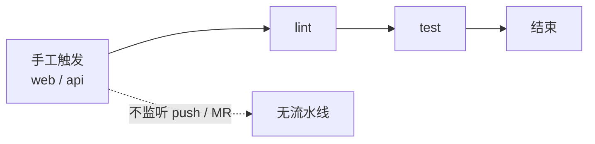

# 工程化与文档基线收口详细设计

> 消息平台 · 00 工程骨架 · 02 工程化与文档基线收口 · 详细设计

[文档首页](../../../../../../文档首页.md) › 消息平台任务 › [00 工程骨架](../../00_工程骨架.md) › [02 工程化与文档基线收口](../00_工程骨架_02_工程化收口.md) › 详细设计

## 1. 概述 

- **目标**：给 msg 仓补上全量回归入口，并把上一轮盘点发现的 25 处过期文档口径一次修正，使后续任务不再在错误基线上判断归属。
- **口径**：CI **与 bms / mdm 同构**——推送不触发、手工触发即全量；只验不发布，**不含镜像构建与推送**（部署能力已剥离，待重建）。文档只改 `msg文档/` 与 `engkit.toml` 注释，**不改产品代码**。
- **依据**：任务 [00-2](../00_工程骨架_02_工程化收口.md)；bms《AI开发规范》「提交环 / 推送环」「覆盖率要求」；同构先例 `mdm/.gitlab-ci.yml`；盘点报告 `tmp/msg-质量盘点-20261113.md` §6。

## 2. 现状与差距 

| 项 | 现状（实测） | 差距 |
| --- | --- | --- |
| 流水线 | `msg/.gitlab-ci.yml` 不存在 | 推送环把 46/200 个测试文件「交 CI 全量回归」，但 msg 没有流水线，全量保障为空 |
| 触发入口 | bms `scripts/tools/ci/trigger.py` 的 `REPO_NAMES` 无 `msg` | `--project msg` 不可用；GitLab 路径为 `mjs/msg` |
| CI 准备脚本 | `msg/scripts/tools/ci/` 不存在 | 路径依赖 `bms-core` 与 ruff 基线 `engkit/toolchain/ruff-base.toml` 在 CI 中无处可取 |
| 需求计数 | 同一项目存在 44/45/46/48/49/53/54/55 七种说法；总清单实际 46 行 | 读者无法据此做覆盖核对 |
| 07 域残留 | 需求 §2.2 仍列 07 行；计划 §6 仍写「07 域 9 条 + 18 个嵌套子任务已拆解」 | 07 域已整体删除，残留表述会把读者带回已废弃范围 |
| 计划表归位 | 05-2 / 06-1 / 01-8 / 02-4 / 02-5 / 02-8 / 02-9 / 02-10 均「已完成」却留在 §3「剩余任务表」 | 进度唯一落点自相矛盾 |
| 门禁与时间轴 | 门禁 3 仍写「02-8 仍搁置」；时间轴 05-2 / 02-9 无 `done`；02-10 注释写「立项」 | 与实际交付不一致 |
| 台账编号 | 缺 4/5/13/17/18/19/22；02-10 记录引用「台账 #22」 | 悬空引用 |
| `hw/isr` | 多处仍写「可空占位」 | 02-4 已接真实 HW/ISR/leader |
| 工程配置注释 | `engkit.toml` 写「本仓无 `uv.lock` 与仓内 `.venv`」 | 两者均已存在 |

## 3. 交付物清单 

| # | 交付物 | 落点 |
| --- | --- | --- |
| 1 | CI 流水线 | `msg/.gitlab-ci.yml` |
| 2 | CI 准备脚本 | `msg/scripts/tools/ci/bms_setup.sh`、`msg/scripts/tools/ci/engkit_setup.sh` |
| 3 | 触发入口登记 | bms `scripts/tools/ci/trigger.py`（`REPO_NAMES` 加 `msg`） |
| 4 | CI 结构用例 | `msg/backend/services/msg/tests/deploy/test_ci_pipeline.py`（YAML 结构 / job 集合 / 无镜像 job） |
| 5 | 文档基线修正 | `msg文档/` 下需求总览、阶段计划、规划、设计 README / 总览 / 架构待定项、文档首页 |
| 6 | 工程配置注释 | `msg/engkit.toml` 顶部与预检注释 |

## 4. CI 设计 

### 4.1 触发与阶段 

| 项 | 口径 |
| --- | --- |
| 触发 | 仅 `$CI_PIPELINE_SOURCE == "web"` / `"api"`；**推送不触发**，推送无需 `-o ci.skip` |
| 自动取消 | `auto_cancel.on_new_commit: interruptible`，连续手工触发只保留最新 |
| 阶段 | `lint`、`test` 两段（无 build 段） |
| 串行闸门 | `ci-queue-acquire`（`.pre`）/ `ci-queue-release`（`.post`），锁名 `ci-queue-lock` 与 bms / mdm 同键 |
| 镜像 | 各 job 按需 `python:3.14-slim` / `node:24` / `docker:27-cli`（仅闸门） |
| 变量 | `PIP_INDEX_URL` / `UV_DEFAULT_INDEX` 走清华源；`UV_LINK_MODE=copy`；`MSG_COVERAGE_DATA` / `MSG_COVERAGE_SOURCE` 与 `engkit.toml` 一致 |

### 4.2 Job 清单 

| Job | 阶段 | 内容 | 依赖 |
| --- | --- | --- | --- |
| `gate-smoke` | lint | Python 版本 ≥ 3.14 | 无 |
| `backend-lint` | lint | `uv run ruff check .` + `ruff format --check .` | bms / engkit 克隆 + `uv sync --frozen` |
| `backend-typecheck` | lint | `uv run pyright` | 同上 |
| `backend-test` | test | 清测试库 → `uv run pytest` → `uv run engkit coverage --module bms_msg --module services --module ops --fail-under 100` | 同上 |
| `backend-contract` | test | `uv run python -m ops.contract_snapshot check` | 同上 |
| `backend-deploy-assets` | test | `uv run pytest services/msg/tests/deploy -q`（编排 / 镜像契约 / 集群覆盖层断言） | 同上 |
| `base-guards` | test | `uv run --project backend python -m engkit base backend-base` / `frontend-base` / `bare-collections` / `snowflake-ids` / `base env-example`（`--root .`） | 同上 |
| `docs-links` | lint | 补 `bms文档` 软链 → `engkit links --root ..` | 同上 |
| `docs-scope` | lint | `engkit docs-scope --root ..` | 同上 |
| `frontend-lint` | lint | `pnpm run msg:lint` + `pnpm run msg:typecheck` | bms 克隆 + 两侧 `pnpm install` |
| `frontend-test` | test | `pnpm run api-types:check` + `pnpm --filter @msg/module_msg run test:cov` | 同上 |
| `frontend-build` | test | `pnpm run msg:build` + `msg:budget` + `msg:guard` | 同上 |

**不含**：`image-build` / Registry 推送、三库集成、E2E、Allure、父子流水线——随部署能力重建时另立。

### 4.3 CI 准备脚本 

- `bms_setup.sh`：与 mdm 同构，克隆 `../bms`，`BMS_REF` 缺省 `main`，支持 `latest-tag` / 分支 / tag / SHA；每次刷新 `origin/main` 供差分门禁。
- `engkit_setup.sh`：与 mdm 同构，克隆 `../engkit`，`ENGKIT_REV` 缺省 `main`，导出 `ENGKIT_HOME`。
- 两脚本均 `set` 失败即退出、不静默跳过；CI 只 clone msg 时也能自洽。

### 4.4 前端安装口径 

msg `frontend/pnpm-workspace.yaml` **不把 bms 包纳入成员**，模块以 `link:` 引用 `../../../../bms/frontend/packages/*`。因此 `frontend-*` job 的安装顺序固定为：

1. `corepack enable`；
2. `. scripts/tools/ci/bms_setup.sh`；
3. `cd ../bms && pnpm install --frozen-lockfile`（装平台包自身依赖）；
4. `cd msg/frontend && pnpm install --frozen-lockfile`（建 link、装模块依赖）；
5. 再执行 lint / test / build。

不改为「bms 包纳入 msg 工作区」——那会重建 bms 包 `node_modules` 并反向污染 bms 构建（现状注释已说明原因）。

### 4.5 覆盖率与测试库 

- 采集走 `engkit.coverage_plugin`（`MSG_COVERAGE_DATA` 落 `.cache/coverage/.coverage`），判定走 `engkit coverage`，**不用** `pytest --cov`。
- 门禁：行 + 分支 100%，模块 `bms_msg` / `services` / `ops`，与 `engkit.toml` 的 `coverage_packages` 一致。
- 测试库隔离：job 开始先 `rm -rf .cache/test .cache/coverage` 并清 `*.db` / `*.db-journal`，与 mdm 同口径（runner 工作区跨流水线复用）。

## 5. 文档基线修正清单 

> 只改文档，不改产品代码。代码注释（`PartitionNotBoundError` 相关、`errors.py` 码清单）归 06-1-4 / 05-4-1，不在本任务。

### 5.1 需求与范围 

| # | 文件 / 位置 | 现状 | 改为 |
| --- | --- | --- | --- |
| D01 | 需求总览 §1 | 「按能力域分 7 篇域文档」 | **6 篇**（01~06） |
| D02 | 需求总览 §2.2 | 范围内仍列「07 部署、迁移与验收」 | 删除该行；范围外保留「生产部署 / 容量压测 / 阶段验收归平台级」 |
| D03 | 需求总览 §3 末 | 「共 6 域 46 条」 | 保持 **46 条**；核对 01:8 / 02:10 / 03:5 / 04:7 / 05:7 / 06:9 |
| D04 | 规划 §9.3.4 | 需求计数 44→45 | 改为 **46 条**，并注明 07 域剥离后不再回加 |
| D05 | 规划 §7 阶段路线 | 8B_07 多租户排在 8B_06 后；8B_08 / 09 / 12 仍列 | 标注 05 域已交付（2026-11-07/08）；**8B_08 生产迁移、8B_09 验收压测、8B_12 容量归平台级**，msg 不承接 |
| D06 | 规划 §10 风险 #10 | 「单条消息大小上限未定」 | 改为「已定 1 MiB（03-2），超限 `350006`」 |

### 5.2 计划：表归位与状态 

| # | 文件 / 位置 | 现状 | 改为 |
| --- | --- | --- | --- |
| D07 | 计划 §2 标题 | 「已完成任务（2026-11-04 ~ 2026-11-09）」 | **~ 2026-11-13** |
| D08 | 计划 §3 表 | 05-2 / 06-1 / 01-8 / 02-4 / 02-5 / 02-8 / 02-9 / 02-10 已完成却留在「剩余任务表」 | 全部迁入 §2，保留完成日期、Kiwi 与偏差遗留；§3 只留未完成项 |
| D09 | 计划 §3.1 队列 | 5 项「待立项」 | A1 由本任务闭环（标「已完成」）；A2 → 06-1-4；A3 → 02-5；A4 → 02-8-4；A5 → 06-5-3（写成承接任务号） |
| D10 | 计划 §5 门禁 3 | 「02-8 属 8B_05 仍搁置」 | 「02-8 已交付（2026-11-12）、8B_05 已达成；02-10 已闭环空闲分区限定」 |
| D11 | 计划 §5 门禁 4 | 「04-1~04-6」的量级表述 | 改为「04-1~04-7」的合计 |
| D12 | 计划 §4 时间轴 | 05-2、02-9 无 `done`；02-10 注释「立项」 | 05-2 / 02-9 标 `done`；02-10 注释改「已交付（2026-11-12）」 |
| D13 | 计划 §6 首段 | 「07 域 9 条 + 18 个嵌套子任务已拆解」「02-10 进行中」 | 删 07 域表述；02-10 改「已交付」 |
| D14 | 计划 §6.1 台账 | 缺 4/5/13/17/18/19/22；02-10 引用 #22 | 重编为连续编号；把悬空引用改为实际编号；新增本轮承接项（P0 项、后端项、多实例项、功能补齐项） |
| D15 | 计划 §2 02-7 / 02-6 / 01-5 / 03-4 行 | 已闭环项仍写「待定 / 归 06 域」 | 按台账 #6 / 风险 #18 等回填闭环结论 |
| D16 | 计划 §2 06-3 行 | 「`msg_isr_shrink_total` 恒 0 → 02-5」 | 「02-4 已改真实计数；02-8 补 `msg_leader_switch_total`」 |
| D17 | 计划 §2 05-3 行 | 「主题授权前端未做 → 06-7」；「500 → 02-10 / 06-1-1」 | 「06-7 已交付（Kiwi 2470）」；「500 由 06-1-4 承接」 |
| D18 | 计划 §2 04-7-1 行 | client 子包在 msg 仓；证书 2056-11 到期 | 客户端传输在 bms `bms_core/msgclient/transport`；证书 `NotAfter = 2056-10-29` |
| D19 | 计划 §2 01-8 行 | 「RocketMQ 链路已下线」 | 与实施记录一致：「代码路径已切换；真实集群未联调（degraded）」 |

### 5.3 设计与文档首页 

| # | 文件 / 位置 | 现状 | 改为 |
| --- | --- | --- | --- |
| D20 | 设计 README §4/§5/§6 | 「表文件 8B_02 定稿后创建」「原型随 8B_06 补充」「待按 7 域 43 条拆解」 | 表文件 10 份、原型 10 页、6 域 46 条已拆解并交付；07 域已删 |
| D21 | 数据库设计总览 | `msg_dead_letter` §4「已设计」vs §4 后文「待建」；§7「位点存文件还是表 → 8B_02」 | 统一为「已设计（2026-11-09）」；位点已定文件实现（02-3）；`msg_consumer_group` / `msg_group_member` 标注「01-4-1 落库」 |
| D22 | 概要设计总览 §8 | 5 项待定（订阅形态 / 分页 / RPC 注册 / 选实例 / `.delay` / 契约快照） | 逐项回填：帧式推送 + 长轮询、`page/size`、注册表、bms 服务目录、独立 `.delay` 段、契约快照已接预检 |
| D23 | 架构设计 05 §12 / 06 §11 / 07 §12 / 08 §12 / 09 §3 | 待定项归口 8B_07 / 8B_08（已不可达） | 按 03~06 域交付结论回填；无承接的转 §6.1 台账；部署相关标「随部署能力重建」 |
| D24 | 架构设计 07 §12 #9/#10 | 删消息 → 06-2；授权界面 → 06-7 | 删消息由 05-4-1 补做；授权界面 06-7 已交付 |
| D25 | 文档首页 | 「项目 08B（阶段文档待重建）」 | 「08B 项目文档完整（需求 / 任务 / 计划 / 设计）」 |
| D26 | `engkit.toml` 顶部 / 预检注释 | 「本仓无 `uv.lock` 与仓内 `.venv`」「实现阶段启用」 | 已有 `uv.lock` / `.venv`；未启用步骤按实际状态改写 |
| D27 | 02-10 实施记录 §8 #3 | 「副本集只增不减 → 02-8 迁移流程」 | 已由 02-8-3 闭环（2026-11-13） |

## 6. 失败分支 

| 场景 | 语义 |
| --- | --- |
| bms / engkit 克隆失败 | job 失败并打印 `BMS_REF` / `ENGKIT_REV` 与解析结果，不静默回落 |
| `uv sync --frozen` 与锁文件不一致 | job 失败（锁文件必须提交） |
| 覆盖率未采集到 | `engkit coverage` 退出 1，job 失败 |
| 文档软链未建 | `docs-links` 断链全红；先建 `bms文档` 软链再跑 |
| 前端 bms 依赖未装 | `frontend-*` 构建报模块解析失败；按 §4.4 顺序重装 |
| 文档修正后锚点失效 | `engkit links` 失败；按报错修锚点，不改判据 |

## 7. 测试设计 

| # | 用例 | 断言 |
| --- | --- | --- |
| 1 | 流水线存在且可解析 | `.gitlab-ci.yml` 可被 `yaml.safe_load`；`stages` 为 `lint` / `test` |
| 2 | 触发规则 | `workflow.rules` 只含 `web` / `api`；无 `push` / `merge_request_event` |
| 3 | job 覆盖 | 必备 job 名全在（§4.2）；**无** `image-build` / `registry` 字样 |
| 4 | 串行闸门 | `.pre` / `.post` 各一个，锁名与 bms / mdm 一致 |
| 5 | 覆盖率口径 | `backend-test` 含 `engkit coverage` 与 `--fail-under 100`；不含 `pytest --cov` |
| 6 | 脚本存在 | 两个 `.sh` 存在且含 `BMS_REF` / `ENGKIT_REV` 解析 |
| 7 | 触发入口登记 | `trigger.py` 的 `REPO_NAMES["msg"] == "mjs/msg"`（可在 msg 侧用文本断言） |
| 8 | 文档计数 | 需求总览 / 计划 / 规划中不再出现 48/49/53/54/55 条表述；统一 46 |

覆盖口径见《AI开发规范》「覆盖率要求」节；用例先登记 Kiwi 再编码。

## 8. 实施步骤 

1. 复制 mdm 的 `bms_setup.sh` / `engkit_setup.sh` 到 `msg/scripts/tools/ci/`，改注释与仓库名。
2. 落 `msg/.gitlab-ci.yml`（按 §4 全量 job）。
3. 改 bms `trigger.py` 的 `REPO_NAMES`，本地 `--project msg --dry-run` 验证。
4. 按 §5 清单逐条修正文档；先改需求与规划，再改计划，最后设计。
5. 补 CI 结构用例；跑 `engkit links` / `docs-scope` / `eol`。
6. 手工触发一次 CI（或至少 `--check` 等价结构断言），记录结果；失败项一次改完再重跑。
7. 写实施 / 测试记录，回写计划（00-2 行 + §3.1 A1 闭环）。

## 9. 边界与开放项 

| # | 项 | 归口 |
| --- | --- | --- |
| 1 | 镜像构建 / Registry 推送 | 部署能力重建（另立） |
| 2 | 三库集成 / E2E / Allure | 部署能力重建（另立） |
| 3 | 概要设计 02~06 五篇从未创建 | 在阶段计划登记为后续文档任务；本任务只回填总览待定项 |
| 4 | 架构设计待定项中无法判定的条目 | 转 §6.1 台账，不硬填 |
| 5 | 前端 bms 依赖安装耗时 | 若 CI 超时，后续改「只装 bms 前端必要包」；本任务先按全量安装 |
| 6 | `ops.check_modules` / `event_contracts` 未启用 | 随对应能力交付再开；本任务不启 |
