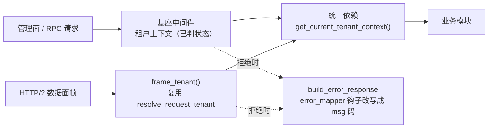

# 租户接入详细设计

> 08B / 任务 01-1-1 · 任务级详细设计（可落地、可逐条验收）

[文档首页](../../../../../../../文档首页.md) › [01 消息模型与投递](../../../../01_消息模型与投递/01_消息模型与投递.md) › [01-1 主题与分区模型](../../01_消息模型与投递_01_主题与分区模型.md) › [01-1-1 租户接入](../01_消息模型与投递_01_主题与分区模型_01_租户接入.md) › 详细设计

---

## 1. 概述 <a id="overview"></a>

本任务是 01-1 的前置子任务：先解决「请求进来时怎么确定租户、租户能不能用」，主题与分区接口才能在此基础上做隔离校验。

**上游依据**：

- [需求 05-1](../../../../../需求/05_需求_多租户与安全.md#r05-1)、[05-2](../../../../../需求/05_需求_多租户与安全.md#r05-2)
- [架构设计 · 多租户与安全](../../../../../../../设计/架构设计/07_架构设计_多租户与安全.md) 第 2~4 节

**与父任务的关系**：01-1 的主题创建 / 查询 / 列表接口依赖本任务提供的「当前租户」依赖与状态校验；本任务不实现任何业务接口。

## 2. 现状与差距 <a id="gap"></a>

| 项 | 现状 | 目标 |
| --- | --- | --- |
| 租户上下文 | 基座中间件已有，msg 未接入 | 管理面直接可用；数据面复用解析函数 |
| 状态校验 | 无 | 复用基座租户源（版本键即时生效） |
| 统一依赖 | 无 | `get_current_tenant()` 供所有模块使用 |
| 错误码 | 未定义 | `350011` 停用 / `350012` 不存在 |

## 3. 设计 <a id="design"></a>

### 3.1 两个入口，一套解析



| 入口 | 做法 |
| --- | --- |
| 管理面 / 远程调用 | 直接读基座中间件写入的请求态租户上下文（`scope["state"]["tenant"]`），**不重复解析、不再回源**；上下文缺失或无内部身份即 fail-closed |
| 数据面 | 帧入口调 `frame_tenant()`，内部复用基座 `resolve_request_tenant`；**只认已校验令牌里的租户位**，`Host` 与 `X-Tenant-ID` 一律不采信 |

**禁止**：数据面自行实现第二套解析、信任客户端 header、用连接建立时的租户覆盖后续请求。

**生效范围（2026-11-04 定稿）**：本任务只落**纯函数解析层**（`bms_msg/tenant/resolve.py`），h2 帧服务由后续 broker 任务直接调用，本次不建网关空壳。

### 3.2 状态校验（复用基座租户源）

| 项 | 规则 |
| --- | --- |
| 校验时机 | 业务校验之前 |
| 取数来源 | **基座 `RemoteTenantSource`**（租户注册只读契约 + 服务侧缓存 + 全局版本戳） |
| 生效方式 | 租户开通 / 停用 / 改名后由租户服务 INCR 版本键，**即时生效** |
| 停用处理 | 返回 `350011`，不进入业务逻辑 |
| 不存在 | 返回 `350012`，不泄露租户是否存在 |
| 降级 | 租户源不可达按基座策略（`ServiceUnavailableError`），不静默放行 |

**不自建缓存**：基座租户源已带版本键与快照缓存，msg 再建一层 TTL 缓存只会引入「基座已停用、msg 仍放行」的不一致窗口。

#### 3.2.1 异步消费入口（基座租户可用性守卫）

消费循环不经过 ASGI 中间件，状态校验经基座**租户可用性守卫**（平台任务 `04_02`，`bms_core/tenant/guard.py`）完成：

| 项 | 规则 |
| --- | --- |
| 取用 | `MsgTenantGuard`（`bms_msg/tenant_guard.py`）继承基座 `SourceTenantGuard`，装配期经 `configure_plugins()` 登记为 `tenant_guard:msg`，配置 `[tenant_guard].provider = "msg"` 生效 |
| 每轮校验 | 循环入口 `await guard.per_round(TenantTarget(tenant_id=…), scope=namespace)`；停用 / 不存在 / 租户源不可达三分支由基座抛（`80002` / `80001` / `10007`），msg 映射为 `350011` / `350012` / 503 |
| 命名空间 | `scope` 即消息的 `namespace`，子类 `verify` 经 `tenant/context.py::ensure_namespace` 校验其属服务目录**已登记且启用**的 `module_key`；未登记即 `350010`（与统一依赖共用同一判定） |
| 批处理 | 单次批量作业（重放 / 校验）用 `async with guard.batch(target) as tenant`，整批只校验一次 |
| 不复制解析 | 守卫只做「取上下文 + 状态判定」，租户解析仍走 §3.1 的同一套来源次序 |

### 3.3 统一依赖

```text
bms_msg/api/deps.py
└── get_current_tenant_context() -> CurrentTenant
    ├── tenant: TenantContext（编码 / 库键 / 主键 / 状态）
    ├── tenant_id: str（主键，必非空；缺失即 350012）
    ├── namespace_allowlist: 已登记启用的 module_key 快照（服务目录进程内常量）
    ├── status: 由中间件状态校验填入
    └── ensure_namespace(ns): 命名空间判定单点（非法 350010）
```

**命名口径（2026-11-04 定稿）**：出口名取 `get_current_tenant_context()`——基座已有
`bms_core.core.context.get_current_tenant()` 返回租户**编码字符串**，同名不同义会诱导误引入。

后续模块（主题、分区、配额、管理模块）一律经此依赖取租户，**不得再写解析代码**。

### 3.4 错误码

| 码 | 含义 | HTTP |
| --- | --- | --- |
| `350010` | 命名空间非法（非已启用 `module_key`） | 400 |
| `350011` | 租户已停用 | 403 |
| `350012` | 租户不存在 | 404 |

判定顺序：`350012` / `350011` → `350010`（命名空间非法）→ `350001` / `350008`（主题不存在 / 已存在）。

> **码值与生效面（2026-11-04 定稿）**：平台要求产品码 6 位（2 位段 + 4 位序号，5 位属平台码区），
> 故 `350011` / `350012` / `350010` 为 6 位定稿值，并在 `deploy/registry/msg.toml` 的 `[[errcodes]]` 登记。
> 管理面由基座中间件在进入业务前拒绝，产品无改写点——经基座新增能力域 `error_mapper`
> （`[error_mapper].provider = "msg"`，`MsgErrorMapper`）在统一渲染单点把 `80002` / `80001` 改写为
> `350011` / `350012`，**管理面与数据面同码**。

### 3.5 开发态便利

本地无令牌时，允许通过**仅 dev 生效**的配置项显式指定租户；该开关在 prod 配置中不存在，且启动时校验「prod 不得开启」。

**落地形态（2026-11-04 定稿）**：基座 `TenantSettings` 新增 `dev_override_tenant`（租户**编码**），
`validate_startup` 对 prod 非空即拒启；**懒解析链不自动消费**，由数据面入口 `frame_tenant(dev_override_tenant=…)`
读取（管理面仍走基座解析链：`X-Tenant-ID` 或 dev 回落演示租户）。

## 4. 测试设计 <a id="tests"></a>

| 层 | 文件 | 用例 |
| --- | --- | --- |
| 依赖 | `tests/api/test_deps_tenant.py` | 管理面取到正确 tenant_id；请求体租户字段被忽略；无上下文 / 无内部身份 fail-closed；命名空间 `350010` |
| 数据面 | `tests/broker/test_tenant_resolve.py` | 无中间件时解析结果与管理面一致；自报 header 被忽略；三态映射；dev 显式租户 |
| 状态 | `tests/api/test_tenant_status.py` | 启用通过；停用 `350011`；不存在 `350012`；停用后即时生效 |
| 降级 | `tests/api/test_tenant_source_down.py` | 租户源不可达返回 503，不静默放行 |
| 对账 | `tests/test_error_codes.py` | 清单 `[[errcodes]]` ↔ `MsgErrorCode` ↔ 异常 `http_status_` 逐条一致；装配钩子登记 `error_mapper:msg` |

**覆盖率**：变更模块行 + 分支 100%。

## 5. 实施步骤 <a id="steps"></a>

| 步 | 内容 |
| --- | --- |
| 1 | 接入管理面租户上下文（读基座中间件结果） |
| 2 | 数据面接 `resolve_request_tenant`，与管理面对齐 |
| 3 | 接入基座租户源并实现状态校验 |
| 4 | 提供 `get_current_tenant()` 统一依赖 |
| 5 | 定义 `350011` / `350012` 并与业务错误码串联 |
| 6 | 补测试与门禁 |

## 6. 验收映射 <a id="accept-map"></a>

| 完成标准 | 验证方式 |
| --- | --- |
| 管理面拿到正确 tenant_id、请求体字段被忽略 | 依赖用例 |
| 数据面与管理面解析一致 | 数据面用例 |
| 停用 `350011`、不存在 `350012` | 状态用例 |
| 状态变更即时生效 | 状态用例 |
| 无第二套解析实现 | 代码检索 + 评审 |

## 7. 风险与开放项 <a id="risk"></a>

| # | 项 | 处置 |
| --- | --- | --- |
| 1 | 数据面复用解析函数需确认函数不依赖 ASGI 上下文 | **已核实无风险**：`resolve_request_tenant` 是纯 async 函数（入参 path / host / header / token / source），直接复用，无需另抽函数层 |
| 2 | 租户源不可达时的降级体验 | 按基座 `ServiceUnavailableError` 处理，不静默放行（管理面 503 / `10007`，数据面原样冒泡） |
| 3 | 服务目录快照在数据面是否可读 | **已核实无风险**：`service_catalog_view()` 为进程内常量合并视图（无 IO），同进程可读，不需要装配期落 `app.state` |
| 4 | 5 位码与平台「产品码须 6 位」冲突 | 已按 6 位定稿并在 `[[errcodes]]` 登记（见 §3.4、§8 #6） |
| 5 | 管理面拿不到产品码 | 已由基座 `error_mapper` 能力域覆盖（见 §3.4、§8 #7） |

## 8. 对齐记录 <a id="align"></a>

| # | 事项 | 结论 |
| --- | --- | --- |
| 1 | 解析实现 | 管理面用中间件结果，数据面复用同一函数，不写第二套 |
| 2 | 状态校验 | 复用基座租户源（版本键即时生效），停用 `350011` |
| 3 | 租户标识 | `tenant_id`（雪花），不用租户编码 |
| 4 | 开发态 | 仅 dev 可显式指定租户，prod 禁止 |
| 5 | 异步消费入口（2026-11-04 回写） | 状态校验改由基座租户可用性守卫承担：`MsgTenantGuard` 继承 `SourceTenantGuard`、命名空间经 `scope` 校验；消费循环本体仍归本任务，接线在 8B_01_01 实施（详见 §3.2.1） |
| 6 | 错误码位数（2026-11-04 定稿） | 平台「产品码须 6 位、5 位属平台码区」⇒ 定稿 `350010` / `350011` / `350012`（原文 5 位）；同步登记 `[[errcodes]]`，并回写任务文档、父任务设计与架构 05/07、需求 02/03 |
| 7 | 错误码生效面（2026-11-04 定稿） | 管理面由基座中间件先行拒绝，产品无改写点 ⇒ 选「基座加产品码覆盖钩子」：新增能力域 `error_mapper`（`BaseErrorMapper` / `NullErrorMapper` / `[error_mapper].provider`），在 `build_error_response` 单点改写，管理面与数据面同码 |
| 8 | 统一依赖命名（2026-11-04 定稿） | 出口名取 `get_current_tenant_context()`（基座同名函数返回租户编码字符串，避免同名不同义） |
| 9 | 数据面落地范围（2026-11-04 定稿） | 本次只落纯函数解析层 `frame_tenant()`；h2 帧服务由后续 broker 任务接入，不建空壳网关 |
| 10 | 开发态开关落点（2026-11-04 定稿） | 基座 `TenantSettings.dev_override_tenant` + `validate_startup` 拒 prod 非空；消费点在数据面入口（解析链不自动消费） |

---

> 依《[文档生成规范](../../../../../../../../bms文档/规范/文档生成规范.md)》与《[任务文档规范](../../../../../../../../bms文档/规范/任务文档规范.md)》编写
