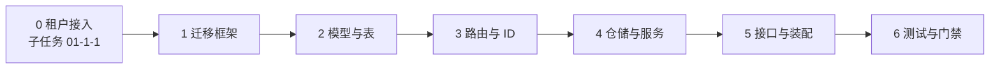

# 主题与分区模型详细设计

> 08B / 任务 01 · 任务级详细设计（可落地、可逐条验收）

[文档首页](../../../../../../文档首页.md) › [01 消息模型与投递](../../01_消息模型与投递.md) › [01-1 主题与分区模型](../01_消息模型与投递_01_主题与分区模型.md) › 详细设计

---

## 1. 概述 <a id="overview"></a>

本文档是任务 [01 主题与分区模型](../01_消息模型与投递_01_主题与分区模型.md) 的**详细设计**，粒度到「按序落地、逐条验收」。任务级设计位于产品架构设计之下一级；两者不一致时，架构层以《架构设计》为准，实现细节以本文档为准。

**上游依据**：

- [需求 01-1](../../../../需求/01_需求_消息模型与投递.md#r01-1)
- [架构设计 · 数据面：存储与复制](../../../../../../设计/架构设计/04_架构设计_数据面_存储与复制.md) 第 2 节
- [架构设计 · 多租户与安全](../../../../../../设计/架构设计/07_架构设计_多租户与安全.md) 第 2~4 节
- [需求 05-1 租户标识与三级命名空间](../../../../需求/05_需求_多租户与安全.md#r05-1)、[需求 05-2 租户隔离与解析](../../../../需求/05_需求_多租户与安全.md#r05-2)
- [数据库设计总览](../../../../../../设计/数据库设计/01_数据库设计_总览.md) 第 3 节
- [概要设计 · 总览](../../../../../../设计/概要设计/01_概要设计_总览.md) 第 3 节

**与前后任务的关系**：本任务是 8B 的首个实现任务，交付主题与分区的元数据模型、路由与接口。任务 02（投递语义）依赖本任务的分区与 offset 模型；任务 03~06 依赖本任务的路由规则；域 02（存储与复制）在本任务的分区标识上挂载日志目录。

**子任务**：[01-1-1 租户接入](../01_消息模型与投递_01_主题与分区模型_01_租户接入/01_消息模型与投递_01_主题与分区模型_01_租户接入.md) 先交付统一租户依赖与状态校验（错误码 `350011` / `350012`），本任务的接口建立在其之上。

## 2. 现状与差距 <a id="gap"></a>

msg 仓当前只有骨架，无任何业务模型与接口：

| 项 | 现状 | 本任务目标 | 动作 |
| --- | --- | --- | --- |
| 元数据表 | 无（`services/table_registry.py` 为空清单） | `msg_topic` / `msg_partition` 两表 + 迁移 | 新建 |
| 迁移框架 | **无 `alembic/` 目录** | 建 `alembic/env.py` + `versions/msg/platform/` 骨架 | 新建 |
| 领域模型 | 无 | `MsgTopic` / `MsgPartition` ORM 模型 | 新建 |
| 请求响应 | 无 | 主题创建 / 查询 / 列表 schema | 新建 |
| 仓储与服务 | 无 | 主题仓储 + 主题服务（含路由与 ID 生成） | 新建 |
| 管理接口 | 无（`service_routers()` 返回空） | `/api/v1/msg/admin/topics` 三端点 | 新建 |
| 表归属登记 | 空清单 | 登记两表（domain=msg，datasource=platform） | 修改 |
| 测试 | 仅服务身份自检 | 模型 / 路由 / 服务 / 接口四层用例 | 新建 |

## 3. 目标目录与交付物清单 <a id="tree"></a>

```text
msg/backend/
├── alembic/                                  # 新建（迁移框架）
│   ├── alembic.ini                           # 迁移配置
│   ├── env.py                                # 环境入口（复用基座约定）
│   ├── script.py.mako                        # 迁移模板
│   └── versions/msg/platform/
│       └── 0001_msg_metadata.py              # msg_topic / msg_partition
└── services/msg/src/bms_msg/
    ├── models/
    │   ├── __init__.py                        # 模型导出
    │   ├── topic.py                           # MsgTopic
    │   └── partition.py                       # MsgPartition
    ├── schemas/
    │   ├── __init__.py
    │   └── topic.py                           # TopicCreate / TopicRead / TopicListQuery
    ├── repositories/
    │   ├── __init__.py
    │   └── topic.py                           # TopicRepository
    ├── services/
    │   ├── __init__.py
    │   └── topic.py                           # TopicService（创建 / 查询 / 列表）
    ├── core/
    │   ├── __init__.py
    │   ├── routing.py                         # 分区键路由
    │   └── message_id.py                      # message_id 生成封装
    ├── api/
    │   ├── __init__.py
    │   └── admin/
    │       ├── __init__.py
    │       └── topics.py                      # 管理接口路由
    └── main.py                                # 修改：注册 admin 路由
```

交付物清单：

| 文件 | 类型 | 说明 |
| --- | --- | --- |
| `alembic/alembic.ini`、`env.py`、`script.py.mako` | 新建 | 复用 mdm 同构骨架 |
| `alembic/versions/msg/platform/0001_msg_metadata.py` | 新建 | 两表 DDL |
| `models/topic.py`、`models/partition.py` | 新建 | ORM 模型 |
| `schemas/topic.py` | 新建 | 请求 / 响应 schema |
| `repositories/topic.py` | 新建 | 仓储 |
| `services/topic.py` | 新建 | 领域服务 |
| `core/routing.py`、`core/message_id.py` | 新建 | 路由与 ID 生成 |
| `api/admin/topics.py` | 新建 | 管理接口 |
| `services/table_registry.py` | 修改 | 登记两表 |
| `main.py` | 修改 | 注册路由 |
| `tests/**` | 新建 | 四层用例 |

## 4. 数据模型设计 <a id="data"></a>

### 4.1 `msg_topic`

| 列 | 类型 | 约束 | 说明 |
| --- | --- | --- | --- |
| `id` | `SnowflakeId` | PK | 主题 ID（基座雪花） |
| `tenant_id` | `String(64)` | NOT NULL | 租户内部身份（雪花字符串，不可变；从基座解析链获取，不接受客户端自报） |
| `namespace` | `String(64)` | NOT NULL | 命名空间（**对齐 bms `module_key`**，须为已登记且启用的模块） |
| `name` | `String(200)` | NOT NULL | 主题名（命名规范见 bms《命名规范》） |
| `partition_count` | `Integer` | NOT NULL | 分区数（**只增不减**） |
| `retention_ms` | `BigInteger` | NOT NULL | 保留时长（毫秒） |
| `cleanup_policy` | `String(16)` | NOT NULL，默认 `delete` | `delete` / `compact`（首期只支持 delete） |
| `status` | `String(16)` | NOT NULL，默认 `active` | `active` / `disabled` |
| 审计 / 版本 | — | `BaseModel` 提供 | `created_at/by`、`updated_at/by`、`version`、`deleted_at` |

**约束与索引**：

| 名称 | 类型 | 列 | 说明 |
| --- | --- | --- | --- |
| `uq_msg_topic_identity` | Unique | `(tenant_id, namespace, name)` | **不带 `deleted_at`** |
| `idx_msg_topic_status` | Index | `status` | 列表过滤 |

> **为什么唯一约束不带 `deleted_at`**：本表不做软删除（状态列表达）；若把 `deleted_at` 并入唯一键，MySQL 会把多个 NULL 视为互异，导致约束失效。这也与架构设计「元数据表不用软删除」一致。`BaseModel` 的 `deleted_at` 列保留（基类提供），业务恒为 NULL。

### 4.2 `msg_partition`

| 列 | 类型 | 约束 | 说明 |
| --- | --- | --- | --- |
| `id` | `SnowflakeId` | PK | 分区记录 ID |
| `topic_id` | `SnowflakeId` | NOT NULL | 逻辑外键 → `msg_topic.id`（不建物理外键） |
| `partition_no` | `Integer` | NOT NULL | 分区号（0 起） |
| `leader` | `String(128)` | NOT NULL | 当前 leader 标识（首期单机为实例标识） |
| `replicas` | `JSON` | NOT NULL，默认 `[]` | 副本列表（8B_05 使用） |
| `checkpoint_leo` | `BigInteger` | NOT NULL，默认 0 | 检查点 LEO（周期落库，实时值在内存） |
| `checkpoint_hw` | `BigInteger` | NOT NULL，默认 0 | 检查点 HW |
| `epoch` | `Integer` | NOT NULL，默认 0 | 领导者任期（8B_05 防脑裂；**格式现在就留**） |

**约束与索引**：

| 名称 | 类型 | 列 |
| --- | --- | --- |
| `uq_msg_partition_no` | Unique | `(topic_id, partition_no)` |
| `idx_msg_partition_topic` | Index | `topic_id` |

> `epoch` 列在 8B_02 就建好，避免 8B_05 复制落地时改表（架构设计 D13）。

### 4.3 数据源归属

两表均登记为 **`platform` 数据源**（平台库），`domain = msg`，`owner = msg`。消息本体不in库（见数据库设计总览第 2 节）。

## 5. 领域模型与仓储 <a id="domain"></a>

### 5.1 模型

```text
MsgTopic（bms_msg.models.topic）
├── __tablename__ = "msg_topic"
├── __table_args__ = (UniqueConstraint(tenant_id, namespace, name), Index(status))
└── 字段同 4.1

MsgPartition（bms_msg.models.partition）
├── __tablename__ = "msg_partition"
├── __table_args__ = (UniqueConstraint(topic_id, partition_no), Index(topic_id))
└── 字段同 4.2
```

两者均继承 `bms_core.models.base.BaseModel`（雪花 ID + 审计 + 乐观锁）。

### 5.2 仓储 `TopicRepository`

| 方法 | 职责 |
| --- | --- |
| `create(session, topic, partitions)` | 同事务写入主题与 N 条分区记录 |
| `get_by_id(session, topic_id)` | 按 ID 查主题 |
| `get_by_identity(session, tenant_id, namespace, name)` | 按唯一键查主题 |
| `list(session, tenant_id, namespace, keyword, offset, limit)` | 分页列表（不含分区明细） |
| `list_partitions(session, topic_id)` | 查某主题全部分区 |
| `update_partition_count(session, topic, new_count)` | 增分区（只校验新增，不删） |

**事务边界**：创建主题时主题行与分区行必须**同一事务**提交，避免出现「有主题无分区」的半成品。

## 6. 分区键路由设计 <a id="routing"></a>

### 6.1 算法

```text
partition = crc32(key.encode("utf-8")) % partition_count      # 有 key
partition = next_counter() % partition_count                  # 无 key（轮询）
```

| 决策 | 选择 | 理由 |
| --- | --- | --- |
| 哈希算法 | `zlib.crc32` | 标准库、跨进程稳定、开销低 |
| 不用 Python `hash()` | — | 进程间随机（`PYTHONHASHSEED`），重启后路由漂移 |
| 不用 md5 / sha256 | — | 开销大，均匀性无明显收益 |
| 无 key 策略 | 进程内轮询计数器 | 分布均匀，实现简单 |
| 路由稳定性 | 分区数不变则结果不变 | 这是「分区只能增不减」的根本原因 |

### 6.2 增分区的影响

增分区后，`% new_count` 会使部分 key 重新映射到新分区。这是**已知且可接受**的行为（Kafka 同样如此），但必须满足：

1. 增分区只追加新分区，不重排已有分区编号。
2. 增分区后，旧 key 的消息可能落在新分区——**同键有序只在新旧交替点之后成立**，文档需写明。
3. 增分区操作必须留痕（管理操作审计）。

### 6.3 接口

```python
def select_partition(key: str | None, partition_count: int) -> int: ...
def next_partition(partition_count: int) -> int: ...
```

`select_partition` 为纯函数（可单测），`next_partition` 维护进程内计数器。

## 7. message_id 设计 <a id="mid"></a>

| 项 | 决策 |
| --- | --- |
| 生成方式 | 复用基座 `bms_core.core.id.id_generator.next_id()`（126 位雪花） |
| 输出形式 | **字符串**（超 JS 安全整数，接口一律字符串） |
| 与 offset 关系 | 完全解耦：`message_id` 是全局唯一标识，`offset` 是分区内序号 |
| 唯一性前提 | 部署保证 `worker_id` 全局唯一（同环境多副本） |
| 封装 | `core/message_id.py` 暴露 `new_message_id() -> str`，便于替换与测试 |

**为什么不自己生成**：基座雪花已处理时钟回拨、序列耗尽、线程安全，重复实现只会引入 bug。

## 8. 接口设计 <a id="api"></a>

### 8.1 端点

| 方法 | 路径 | 权限 | 说明 |
| --- | --- | --- | --- |
| POST | `/api/v1/msg/admin/topics` | `msg:manage` | 创建主题 |
| GET | `/api/v1/msg/admin/topics` | `msg:query` | 列表（分页 + 过滤） |
| GET | `/api/v1/msg/admin/topics/{topic_id}` | `msg:query` | 详情（含分区列表） |

对外经网关：`/api/msg/v1/msg/admin/topics`。

### 8.2 创建请求

```json
{
  "namespace": "audit",
  "name": "audit.operation",
  "partition_count": 3,
  "retention_ms": 604800000,
  "cleanup_policy": "delete"
}
```

**`tenant_id` 不在请求体中**：由基座解析链（管理面中间件 / 数据面解析函数）注入，防止客户端自报冒充。请求进入后先校验租户状态，停用即拒绝。

**校验规则**：

| 字段 | 规则 |
| --- | --- |
| `namespace` | 1~64 字符，`[a-z0-9_-]+` |
| `name` | 1~200 字符，`[a-zA-Z0-9._-]+`，建议 `{域}.{对象}.{动作}` |
| `partition_count` | 1~1024，整数 |
| `retention_ms` | 正数，上限按配置（默认 30 天，上限 366 天） |
| `cleanup_policy` | 首期只允许 `delete` |

### 8.3 响应

```json
{
  "id": "12345678901234567890",
  "tenant_id": "12345678901234567890",
  "namespace": "audit",
  "name": "audit.operation",
  "partition_count": 3,
  "retention_ms": 604800000,
  "cleanup_policy": "delete",
  "status": "active",
  "created_at": "2026-11-04T10:00:00Z"
}
```

详情接口额外返回 `partitions` 数组（`partition_no` / `leader` / `checkpoint_leo` / `checkpoint_hw` / `epoch`）。

### 8.4 错误码

| 码 | 含义 | HTTP |
| --- | --- | --- |
| `350001` | 主题不存在 | 404 |
| `350008` | 主题已存在（同 `tenant_id` / 命名空间 / 名称） | 409 |
| `350009` | 分区数非法（≤0、超上限、或尝试减少） | 400 |
| `350010` | 命名空间非法（格式不符或非已启用 `module_key`） | 400 |
| `350011` | 租户已停用 | 403 |
| `350012` | 租户不存在 | 404 |

> 码段 `35` 为 msg 产品段（暂定，最终以 07C 登记为准）；本任务新增 `350008~350012` 在详细设计中定稿，并回写产品声明。租户状态校验由子任务 01-1-1 提供，发生在业务校验之前：先 `350012` / `350011`，再 `350010`，最后 `350001` / `350008`。

### 8.5 列表查询

| 参数 | 说明 |
| --- | --- |
| `namespace` | 可选，按命名空间过滤 |
| `keyword` | 可选，按名称模糊匹配 |
| `offset` / `limit` | 分页，默认 0 / 20，上限 100 |

## 9. 装配与登记 <a id="assembly"></a>

| 项 | 动作 |
| --- | --- |
| 表归属 | `services/table_registry.py` 登记 `msg_topic` / `msg_partition`（`domain=msg`、`datasource=platform`） |
| 路由注册 | `main.py` 的 `service_routers()` 返回 admin 路由 |
| 迁移 | `alembic` 首次接入，`0001_msg_metadata.py` 建两表 |
| 开发库 | `config.dev.toml` 已开 `auto_create`，本地 SQLite 自动建表 |
| 产品声明 | `deploy/registry/msg.toml` 无需新增服务行；错误码段在实现后补登记（若声明支持） |

## 10. 测试设计 <a id="tests"></a>

| 层 | 文件 | 用例 |
| --- | --- | --- |
| 路由 | `tests/core/test_routing.py` | 同 key 结果稳定；不同 key 分布；无 key 轮询；分区数变化后映射变化 |
| ID | `tests/core/test_message_id.py` | 连续生成不重复；输出为字符串；长度符合雪花 |
| 模型 | `tests/models/test_topic.py` | 唯一约束生效；字段默认值；分区号唯一 |
| 仓储 | `tests/repositories/test_topic.py` | 同事务创建；按标识查询；分页；分区列表 |
| 服务 | `tests/services/test_topic_service.py` | 创建成功 / 重名拒绝 / 分区数非法拒绝；增分区；减少分区拒绝；**namespace 非已启用 module_key 拒绝**；**停用租户拒绝** |
| 接口 | `tests/api/test_admin_topics.py` | 三端点状态码；请求校验；权限拦截；错误码（含 `350011` / `350012`）；**请求体携带 tenant 被忽略、以解析结果为准** |

**覆盖率**：变更模块行 + 分支 100%（`engkit` 门禁）。

## 11. 实施步骤 <a id="steps"></a>



| 步 | 内容 | 产出 |
| --- | --- | --- |
| 0 | 交付子任务 [01-1-1 租户接入](../01_消息模型与投递_01_主题与分区模型_01_租户接入/01_消息模型与投递_01_主题与分区模型_01_租户接入.md) | 统一租户依赖与状态校验可用 |
| 1 | 建 `alembic/`（env / ini / mako / versions 目录） | 迁移可执行 |
| 2 | 写两个模型 + `0001` 迁移，登记表归属 | 表可建、归属校验通过 |
| 3 | 实现 `routing.py`、`message_id.py` 与单测 | 路由与 ID 可用 |
| 4 | 实现仓储与主题服务（含事务与校验） | 服务层可用 |
| 5 | 实现三个管理端点并注册路由 | 接口可调 |
| 6 | 补测试、跑覆盖率与静态检查 | 门禁通过 |

## 12. 验收映射 <a id="accept-map"></a>

| 任务完成标准 | 验证方式 |
| --- | --- |
| 可创建指定分区数主题并返回完整元数据 | 接口用例 + 手工调用 |
| 同 key 路由一致、不同 key 分布均匀 | 路由单测（同 key 100 次一致；1000 个 key 分布偏差在阈值内） |
| 减少分区被拒绝、数据不变 | 服务层用例（断言错误码与库内状态） |
| `message_id` 不重复且与 offset 解耦 | ID 单测（10 万次无重复） |
| 权限校验：无 `msg:query` / `msg:manage` 被拒 | 接口用例（无权限令牌） |
| 停用租户被拒绝、namespace 非已启用模块被拒绝 | 服务 / 接口用例（`350011` / `350010`） |
| 表归属登记、装配校验通过 | 启动自检 + `check_modules` |
| 覆盖率 100%、静态全绿 | 推送预检 |

## 13. 风险与开放项 <a id="risk"></a>

| # | 项 | 影响 | 处置 |
| --- | --- | --- | --- |
| 1 | msg 仓无 alembic 框架 | 迁移无法执行 | 步骤 1 先建，参考 mdm 同构骨架 |
| 2 | 增分区导致部分 key 重映射 | 短暂同键乱序 | 文档写明边界；增分区操作需评审 |
| 3 | 租户来源在无令牌的开发环境 | 本地调试不便 | 开发态提供显式租户覆盖开关（仅 dev） |
| 4 | 错误码 `350008~350010` 未在 07C 登记 | 码段冲突风险 | 标注暂定，登记后回写 |
| 5 | 雪花 `worker_id` 多副本重复 | message_id 冲突 | 部署约束 + 启动校验 |

## 14. 对齐记录 <a id="align"></a>

| # | 事项 | 结论 |
| --- | --- | --- |
| 1 | 唯一约束是否带 `deleted_at` | **不带**：元数据表不软删；带 NULL 会使 MySQL 唯一约束失效 |
| 2 | 哈希算法 | `crc32`，不用 Python `hash()` |
| 3 | message_id | 复用基座雪花，字符串输出 |
| 4 | 分区数变更 | 只增不减，增分区需留痕 |
| 5 | 租户来源 | 基座解析链（管理面中间件 / 数据面解析函数），请求体不接收 |
| 6 | epoch 字段 | 本任务就建，避免 8B_05 改表 |
| 7 | 租户标识 | `tenant_id`（雪花，不可变），不用租户编码 |
| 8 | 命名空间 | 对齐 `module_key`，须已登记且启用 |
| 9 | 租户状态 | 每次请求校验，停用返回 `350011` |

---

> 依《[文档生成规范](../../../../../../../bms文档/规范/文档生成规范.md)》与《[任务文档规范](../../../../../../../bms文档/规范/任务文档规范.md)》编写
