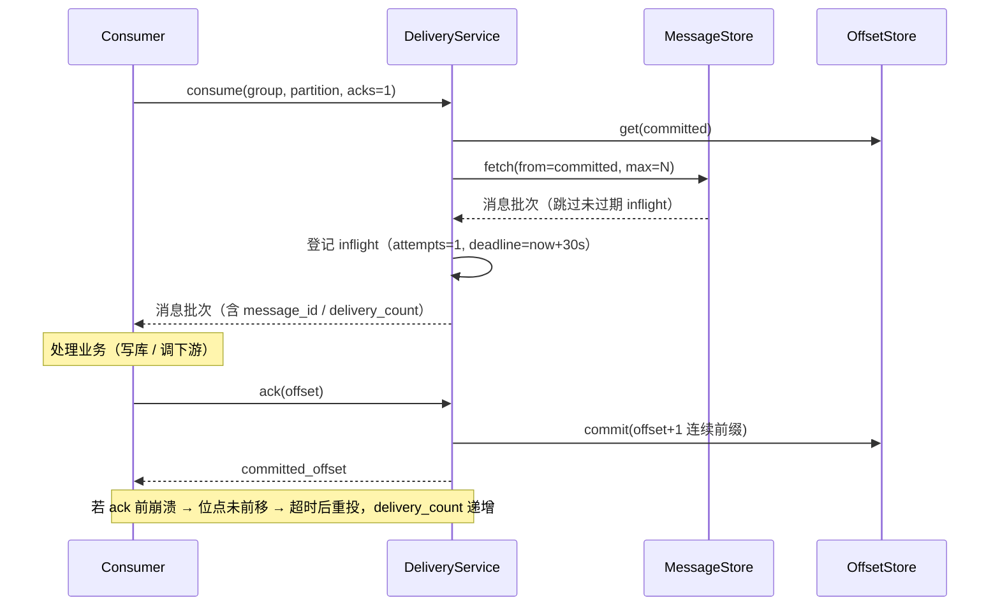
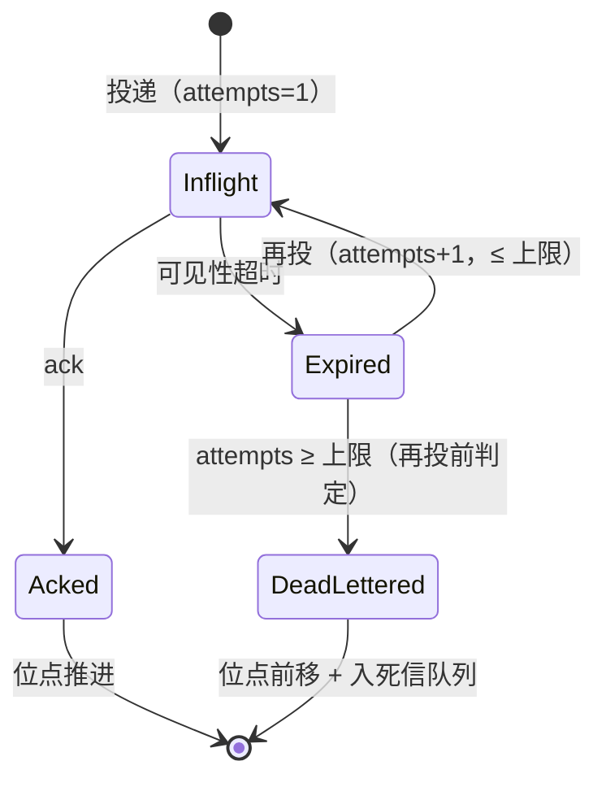
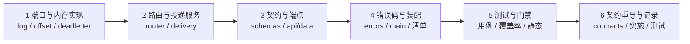

# 投递语义详细设计

> 08B / 任务 01-2 · 任务级详细设计（可落地、可逐条验收）

[文档首页](../../../../../../文档首页.md) › [01 消息模型与投递](../../01_消息模型与投递.md) › [01-2 投递语义](../01_消息模型与投递_02_投递语义.md) › 详细设计

---

## 1. 概述 <a id="overview"></a>

本文档是任务 [01-2 投递语义](../01_消息模型与投递_02_投递语义.md) 的**详细设计**，粒度到「按序落地、逐条验收」。与架构层不一致时以《架构设计》为准，实现细节以本文档为准。

**上游依据**：

- [需求 01-2 投递语义](../../../../需求/01_需求_消息模型与投递.md#r01-2)
- [架构设计 · 数据面：存储与复制](../../../../../../设计/架构设计/04_架构设计_数据面_存储与复制.md) 第 3 节（写入路径）、第 5 节（崩溃恢复口径）、第 8 节（位点管理）
- [架构设计 · 接入面：协议与客户端](../../../../../../设计/架构设计/05_架构设计_接入面_协议与客户端.md) 第 3 节（端点）、第 5 节（错误码）、第 7 节（背压边界）
- [概要设计 · 总览](../../../../../../设计/概要设计/01_概要设计_总览.md) 第 2 节（`broker/log.py`、`broker/offset.py`、`broker/router.py`）、第 3.1 节（数据面接口清单）
- bms《[消息模型与语义](../../../../../../../bms文档/资料/知识档案/消息与事件驱动/02_事件驱动_消息模型与语义.md)》第 4 节（三种投递语义）

**与前后任务的关系**：

| 方向 | 任务 | 关系 |
| --- | --- | --- |
| 前置 | [01-1 主题与分区模型](../../01_消息模型与投递_01_主题与分区模型/01_消息模型与投递_01_主题与分区模型.md) | 复用主题元数据、`core/routing.py::select_partition`、`core/message_id.py::new_message_id`、租户依赖与错误码骨架 |
| 本任务 | 01-2 投递语义 | 交付「端口 + 内存实现」的消息存储与位点、可见性超时重投、acks 两档、死信 |
| 后继 | 01-3 顺序性 | 在本任务的分区投递上补「同 key 阻塞重试」；本任务的 `partition` 单分区投递是其前提 |
| 后继 | 01-4 消费组 | 组内分摊 / 再均衡；本任务已按 `(group, topic, partition)` 存位点，01-4 不改键 |
| 后继 | 01-6 保留与重放 | 本任务的 `MessageStore.start_offset()`（保留起点）与位点重置是重放的基础 |
| 后继 | 8B_02 存储与复制 | **只换实现不动端口**：文件段 / 索引 / CRC / 恢复替换 `InMemoryMessageStore` / `InMemoryOffsetStore` |

**口径基线（2026-11-04 已确认，不再变更）**：开三个数据面 HTTP 端点（`/msg/publish`、`/msg/consume`、`/msg/ack`，消费端点为拉取语义）；数据面租户走 `frame_tenant()`；位点 `(group, topic, partition)` + 内存端口实现；毒消息进内存死信队列；新增码 `350002` / `350003` / `350007`；常量 30s / 5 次 / 100 条；载荷 base64；权限码 `msg:publish` / `msg:consume`；consume / ack 必带 `partition`；`acks=1|0` 为请求参数（缺省 1）。

## 2. 现状与差距 <a id="gap"></a>

01-1 已交付主题与分区的元数据、路由与三个管理端点；**消息本体、位点与投递流程尚不存在**：

| 项 | 现状（2026-11-04 复核） | 本任务目标 | 动作 |
| --- | --- | --- | --- |
| 消息存储 | 无（仅 `msg_topic` / `msg_partition` 元数据表） | `MessageStore` 端口 + 内存实现（append / fetch / LEO / 保留起点） | 新建 |
| 位点 | 无 | `OffsetStore` 端口 + 内存实现（键 `(group, topic, partition)`） | 新建 |
| 投递流程 | 无 | 可见性超时、重投、`delivery_count` 递增、acks 两档、位点连续推进 | 新建 |
| 死信 | 无（`dead_letters` 只在架构里提及） | 内存死信队列（超重投上限转入） | 新建 |
| 数据面端点 | 无（`api/router.py` 只挂 admin 主题路由） | `/msg/publish`、`/msg/consume`、`/msg/ack` | 新建 |
| 错误码 | 6 条（`350001` / `008` / `009` / `010` / `011` / `012`） | 再加 3 条（`350002` / `003` / `007`） | 修改 |
| 域声明 | `[[domains]]` 的 `paths` 未含 `broker/`、`api/data/` | 补齐两段 glob（否则新代码不在归属域内） | 修改 |
| 契约快照 | 仅三个管理端点 + 探针 | 重导（含三个数据面端点与 `x-error-codes`） | 修改 |
| 装配 | `configure_service()` 未实现（无进程级状态） | 注入消息存储 / 位点 / 死信三个进程级单例 | 修改 |

## 3. 目标目录与交付物清单 <a id="tree"></a>

```text
msg/backend/services/msg/src/bms_msg/
├── broker/                                    # 数据面（本任务新建）
│   ├── __init__.py
│   ├── log.py                                  # StoredMessage + MessageStore 端口 + InMemoryMessageStore
│   ├── offset.py                               # OffsetStore 端口 + InMemoryOffsetStore
│   ├── deadletter.py                           # DeadLetter + DeadLetterQueue 端口 + InMemoryDeadLetterQueue
│   ├── router.py                               # TopicRouter（主题解析 + 分区选择，复用 core/routing）
│   └── delivery.py                             # DeliveryState（进程级投递状态）+ DeliveryService（投递语义）
├── schemas/
│   └── message.py                              # Publish/Consume/Ack 请求响应契约
├── api/
│   ├── deps.py                                 # 修改：数据面租户依赖 + 三个进程级状态依赖
│   ├── router.py                               # 修改：挂载数据面路由
│   └── data/
│       ├── __init__.py
│       └── messages.py                         # /msg/publish、/msg/consume、/msg/ack
├── core/
│   └── config.py                               # 修改：投递常量（可见性超时 / 重投上限 / 拉取上限）
├── errors.py                                   # 修改：350002 / 350003 / 350007
└── main.py                                     # 修改：configure_service() 注入进程级状态

msg/deploy/registry/msg.toml                    # 修改：3 条 [[errcodes]] + 域 paths 补 broker/ 与 api/data/
msg/deploy/contracts/msg.json                   # 修改：重导
```

交付物清单：

| 文件 | 类型 | 说明 |
| --- | --- | --- |
| `broker/log.py`、`broker/offset.py`、`broker/deadletter.py` | 新建 | 三个端口 + 三个内存实现（8B_02 只替换实现类） |
| `broker/router.py` | 新建 | 主题解析（租户作用域 + `active` 判定）与分区选择（复用 `select_partition`） |
| `broker/delivery.py` | 新建 | 投递状态机（可见性超时 / 重投 / acks 两档 / 位点推进 / 死信） |
| `schemas/message.py` | 新建 | 6 个契约模型（3 请求 + 3 响应主体） |
| `api/data/messages.py` | 新建 | 三个数据面端点（声明 `x-error-codes`） |
| `api/deps.py` | 修改 | `DataPlaneTenantDep`（走 `frame_tenant()`）与状态依赖 |
| `api/router.py`、`main.py` | 修改 | 挂路由 + 注入进程级状态（`configure_service()`） |
| `core/config.py` | 修改 | `DEFAULT_VISIBILITY_TIMEOUT_MS` / `MAX_DELIVERY_ATTEMPTS` / `MAX_FETCH_MESSAGES` |
| `errors.py`、`deploy/registry/msg.toml` | 修改 | 3 条错误码（枚举 + 异常 + 声明）与域路径 |
| `deploy/contracts/msg.json` | 修改 | 重导（三个新端点） |
| `tests/**` | 新建 / 扩 | 见 §9 |

## 4. 数据结构设计 <a id="data"></a>

> **消息本体不入库**（架构 04 §2、数据库设计总览「消息本体不入库」）：表只有 `msg_topic` / `msg_partition`，
> 本任务**不新增表**，投递状态全部在进程内；持久化归 8B_02（文件段）与 8B_07（位点文件口径）。

### 4.1 `StoredMessage`（存储中的一条消息）

| 字段 | 类型 | 说明 |
| --- | --- | --- |
| `message_id` | `str` | 全局唯一（基座雪花，字符串）；重投/重放不变 |
| `topic_id` | `int` | 主题主键（雪花） |
| `partition_no` | `int` | 分区号 |
| `offset` | `int` | 分区内序号（**唯一由 store.append 分配**，其他模块不得自行编号） |
| `key` | `str \| None` | 分区键（幂等去重与顺序性的业务入口） |
| `payload` | `bytes` | 业务字节（broker 不解析；HTTP 契约以 base64 传输） |
| `headers` | `ConcurrentStableDict[str, str]` | 结构化头（trace / 业务标记） |
| `trace_id` | `str \| None` | 链路标识（排障） |
| `published_at` | `datetime` | 发布时间（UTC） |

不可变值对象（`frozen=True`）：重投返回的是同一条记录的不同投递，**记录本身不改**。

### 4.2 `DeliveryState`（进程级投递状态）

| 字段 | 类型 | 说明 |
| --- | --- | --- |
| `inflight` | `dict[PartitionKey, dict[int, InflightDelivery]]` | 已投递未确认的消息：`offset → (attempts, deadline)` |
| `acked` | `dict[PartitionKey, ConcurrentStableSet[int]]` | 乱序已确认、尚未并入位点的 offset |
| `lock` | `asyncio.Lock` | consume / ack / reject 的状态临界区（多请求并发） |

`PartitionKey = (group, topic_id, partition_no)`。

`InflightDelivery`（`frozen`）：`attempts: int`（本次是第几次投递）、`deadline: datetime`（可见性超时到期时刻）。

> **为什么 `delivery_count` 挂在投递状态而非消息记录上**：同一条消息被 A 组重投 3 次，不应影响 B 组的
> `delivery_count`；重试计数属「组 × 分区 × offset」维度。`message_id` 不变、`delivery_count` 递增，
> 正是需求「重复投递可识别」的两个侧面。

### 4.3 `DeadLetter`（死信记录）

| 字段 | 类型 | 说明 |
| --- | --- | --- |
| `message_id` | `str` | 原消息 ID（重放时不变） |
| `topic_id` / `partition_no` / `offset` | `int` | 定位三元组 |
| `attempts` | `int` | 累计投递次数（达上限值） |
| `failed_at` | `datetime` | 转入死信时间 |
| `reason` | `str` | 转入原因（如 `delivery_exhausted`） |

> 死信**不在消息日志里删除**：offset 仍可读，只是投递侧不再投；06 域的死信查询 / 重放直接读该队列，
> 8B_02 落盘时随消息存储一并持久化（端口不变）。

## 5. 端口设计 <a id="ports"></a>

三个端口均为 `abc.ABC` + 全 async 方法，**不引入插件键**——基座 `Settings` 为 `extra="forbid"`，产品无法新增
`[message_store].provider` 这类配置段（与 01-1「保留期常量」同一约束）；实现替换由**装配处**（`main.py` 的
`configure_service()`）完成，8B_02 只改这一处的类名。

### 5.1 `MessageStore`（`broker/log.py`）

| 方法 | 签名 | 职责 |
| --- | --- | --- |
| `append` | `(*, topic_id, partition_no, message_id, key, payload, headers, trace_id, published_at) -> StoredMessage` | 追加一条并**分配 offset**（返回含 offset 的记录） |
| `fetch` | `(*, topic_id, partition_no, from_offset, max_messages) -> ConcurrentStableList[StoredMessage]` | 从 `from_offset` 起取至多 N 条（不足即返回实际条数） |
| `leo` | `(*, topic_id, partition_no) -> int` | 分区日志末端位点（下一条将被分配的 offset） |
| `start_offset` | `(*, topic_id, partition_no) -> int` | 分区日志起点（内存实现恒 `0`；8B_02 保留期清理后会 > 0） |

**判据约定**：`0 <= offset < leo` 为可读区间；`offset < start_offset` 表示已被保留期清理（本任务由 `350003` 报出）。

### 5.2 `OffsetStore`（`broker/offset.py`）

| 方法 | 签名 | 职责 |
| --- | --- | --- |
| `get` | `(*, group, topic_id, partition_no) -> int` | 取已提交位点（无记录即 `0`，即从头消费） |
| `commit` | `(*, group, topic_id, partition_no, offset) -> None` | 提交位点；**只前进不后退**（提交值 ≤ 现值即幂等无操作） |

**提交语义**：提交值 = 「已处理完的最后一条 + 1」，即下一条待消费的 offset。仓储内部不吞异常——
提交失败必须冒泡，由调用方保证「位点不前移」（§6.4）。

### 5.3 `DeadLetterQueue`（`broker/deadletter.py`）

| 方法 | 签名 | 职责 |
| --- | --- | --- |
| `add` | `(letter: DeadLetter) -> None` | 转入一条死信（同 `(topic_id, partition_no, offset)` 重复转入幂等） |
| `list_all` | `() -> ConcurrentStableList[DeadLetter]` | 全量（插入序；06 域查询端点直接消费） |
| `contains` | `(*, topic_id, partition_no, offset) -> bool` | 判定某条消息是否已死信（ack 报 `350007` 的判据） |

## 6. 投递语义设计 <a id="delivery"></a>

### 6.1 至少一次（缺省 `acks=1`）



**硬约束（逐条对应任务完成标准）**：

1. **先处理后提交**：consume 只投递、不改位点；位点只由 ack 推进。
2. **未 ack 超时重投**：`deadline` 到期（`DEFAULT_VISIBILITY_TIMEOUT_MS`）后，下一次 consume 会重新投出该消息，
   `delivery_count` 递增。
3. **超时前不重投**：未过期的 inflight 消息被跳过（同组同一消息在可见性窗口内只投一次），避免「同一消息并发处理」。
4. **`message_id` 不变**：重投复用原记录，`message_id` / `offset` / `payload` 全不变，仅 `delivery_count` 变化。
5. **消费端幂等**：平台只提供 `message_id` 与 `delivery_count` 作去重依据，**不承诺协议级恰好一次**（需求 01-2 内容 2）。

### 6.2 `acks=0`（不等确认 / 尽力而为）

| 步骤 | 行为 |
| --- | --- |
| 读取 | 从已提交位点取批次 |
| 提交 | **返回前**直接提交到「本批最后一条 + 1」，不登记 inflight |
| 返回 | 消息批次（`delivery_count` 恒 `1`） |

**两档行为矩阵**：

| 场景 | `acks=1`（缺省） | `acks=0` |
| --- | --- | --- |
| 消费端处理后崩溃 | 位点未前移 → 超时重投（至少一次） | 位点已前移 → **不重投（可能丢）** |
| 消费端处理失败主动放弃 | ack 不调用即可，超时重投 | 无补救（已视为成功） |
| 同消息并发处理 | 超时前不会重复投 | 不会重复投 |
| 位点推进时机 | ack 成功后（连续前缀） | 返回前一次性 |

**适用边界（写入对外说明）**：`acks=0` 只用于「可丢」场景——指标打点、缓存失效通知、非关键检索同步；
审计、资金、库存等**必须**用缺省档并实现消费端幂等。

### 6.3 重投与死信



| 决策 | 取值 | 理由 |
| --- | --- | --- |
| 重投上限 | `MAX_DELIVERY_ATTEMPTS = 5`（最多投 5 次） | 覆盖偶发故障，又不让毒消息长期占用分区 |
| 超限处置 | 转死信 + 位点前移 | 不阻塞后续消息；死信可查可重放（06 域） |
| 死信消息再 ack | `350007` | 客户端必须知道该消息已被放弃，不能当作成功 |
| 死信不删日志 | offset 仍可读 | 重放（01-6）与排障需要原始记录 |

### 6.4 位点推进规则

| 规则 | 说明 |
| --- | --- |
| 提交值 | 「连续已 ack 的最大 offset + 1」；乱序 ack 先暂存（`acked` 集合），补齐后成段推进 |
| 单调 | 提交值 ≤ 现值即幂等无操作（重复 ack 不报错、不回退） |
| 失败不前移 | `OffsetStore.commit()` 抛错时**先不落内存状态**（不 remove inflight、不加 `acked`），异常冒泡；客户端重试 ack 仍命中 inflight，可重试成功 |
| 越界 | `offset < 0` 或 `offset >= LEO` → `350002`；`offset < 已提交位点` → 幂等返回（不报错） |
| 未投递 | `[已提交, LEO)` 内但不在 inflight、也未死信（未投递过 / 已被死信）→ `350003` / `350007` |

> **为什么「先提交存储、再改内存」**：反过来会造出「内存已前移、存储未落」的窗口，崩在这条缝上就丢位点。
> 先落存储则最坏结果是「重复 ack」，而重复 ack 是幂等的（`350003` 之外的路径不会重复推进）。

### 6.5 主题与分区校验

| 判定 | 条件 | 码 |
| --- | --- | --- |
| 命名空间 | 形态不符 / 非已启用 `module_key` | `350010` |
| 主题 | 不存在、不属于当前租户、或 `status != active` | `350001` |
| 分区号 | `< 0` 或 `>= topic.partition_count` | `350009`（沿用「分区数 / 分区号非法」口径） |
| 分组名 | 形态不符（契约层正则） | `10001` |

## 7. 接口设计 <a id="api"></a>

### 7.1 端点

| 方法 | 路径 | 权限码 | 说明 |
| --- | --- | --- | --- |
| POST | `/api/v1/msg/publish` | `msg:publish` | 发布一条消息，返回分配到的 `{message_id, partition, offset}` |
| POST | `/api/v1/msg/consume` | `msg:consume` | 拉取一批（必带 `partition`），返回消息与 `delivery_count` |
| POST | `/api/v1/msg/ack` | `msg:consume` | 确认消费，返回已提交位点 |

对外经网关：`/api/msg/v1/msg/publish` 等（前缀规则同 01-1）。

**租户口径**：三个端点一律 `DataPlaneTenantDep` → `frame_tenant()`（令牌租户位取中间件已解析的租户主键，
dev 走 `[tenant].dev_override_tenant`）；**请求体不接收 `tenant`**。

**`acks=0` 是否仍可调 ack**：可以但无意义——该档不登记在途记录，位点已在返回前前移，`ack` 命中
「`offset < 已提交位点`」分支按**幂等**返回已提交位点（不报错）。客户端不应在 `acks=0` 后再 ack。

### 7.2 发布

```json
{ "namespace": "msg", "topic": "audit.operation", "key": "order-1001",
  "payload": "eyJvcmRlcl9pZCI6MTAwMX0=", "headers": {"source": "bpm"}, "trace_id": "t-1" }
```

| 字段 | 规则 |
| --- | --- |
| `namespace` | 1~64，`[a-z0-9_-]+`，须为已启用 `module_key`（`350010`） |
| `topic` | 1~200，`[a-zA-Z0-9._-]+`（同 01-1 主题名形态） |
| `key` | 可空，≤256；给定即按 `crc32 % partition_count` 定分区（同 key 恒同分区） |
| `payload` | **base64 字符串**，可空串（空消息体合法）；非法 base64 → `10001` |
| `headers` | 可选，`str → str` |
| `trace_id` | 可选，≤128 |

响应：

```json
{ "message_id": "12345678901234567890", "topic": "audit.operation", "partition": 2, "offset": 17 }
```

### 7.3 消费

```json
{ "group": "audit-consumer", "namespace": "msg", "topic": "audit.operation",
  "partition": 2, "max_messages": 20, "acks": 1 }
```

| 字段 | 规则 |
| --- | --- |
| `group` | 1~128，`[a-zA-Z0-9._-]+`；存在性 / 归属校验归 01-4（组元数据） |
| `partition` | 必带，`0 ~ partition_count-1`（越界 `350009`） |
| `max_messages` | 1~100（`MAX_FETCH_MESSAGES`），缺省 20 |
| `acks` | `1`（缺省，确认后才算成功）/ `0`（不等确认） |

响应：

```json
{ "messages": [ { "message_id": "…", "topic": "audit.operation", "partition": 2, "offset": 17,
                  "key": "order-1001", "payload": "eyJvcmRlcl9pZCI6MTAwMX0=",
                  "headers": {"source": "bpm"}, "trace_id": "t-1",
                  "delivery_count": 2, "published_at": "2026-11-04T10:00:00Z" } ] }
```

### 7.4 确认

```json
{ "group": "audit-consumer", "namespace": "msg", "topic": "audit.operation", "partition": 2, "offset": 17 }
```

响应：`{ "committed_offset": 18 }`（下一条待消费的 offset）。

### 7.5 错误码

| 码 | 含义 | HTTP | 触发点 |
| --- | --- | --- | --- |
| `350001` | 主题不存在 / 不属于当前租户 / 非 `active` | 404 | publish / consume / ack |
| `350002` | 位点非法（`>= LEO`；负值由契约 `ge=0` 以 `10001` 拒绝） | 400 | ack |
| `350003` | 消息不存在（未投递 / 已确认推进 / 已被保留期清理） | 404 | consume（位点早于保留起点）、ack（无投递记录） |
| `350007` | 消息重投超限、已转入死信（不可再确认） | 409 | ack |
| `350009` | 分区数 / 分区号非法 | 400 | consume / ack（分区号越界） |
| `350010` | 命名空间非法 | 400 | publish / consume / ack |
| `350011` / `350012` | 租户停用 / 不存在 | 403 / 404 | 三者（`frame_tenant()` 抛出） |

**`x-error-codes` 声明**：publish `[350001, 350010, 350011, 350012]`；consume `[350001, 350003, 350009, 350010, 350011, 350012]`；
ack `[350001, 350002, 350003, 350007, 350009, 350010, 350011, 350012]`。

> `350006`（消息过大）与 `350005`（背压）本任务**不使用**：载荷上限与 inflight 上限属背压 / 配额（8B_01、8B_07），
> 这里不提前设限，避免与背压口径冲突。

## 8. 装配与登记 <a id="assembly"></a>

| 项 | 动作 |
| --- | --- |
| 进程级状态 | `main.py::configure_service()` 创建 `InMemoryMessageStore` / `InMemoryOffsetStore` / `InMemoryDeadLetterQueue` / `DeliveryState`，落 `app.state`（进程内单例；重启即清空，与内存存储一致） |
| 依赖注入 | `api/deps.py` 增 `get_message_store` / `get_offset_store` / `get_dead_letter_queue` / `get_delivery_state`（读 `app.state`）与 `get_data_plane_tenant`（`frame_tenant()`） |
| 请求级服务 | `DeliveryService` 每请求构造（绑定平台库 `TopicRepository` 与进程级状态），与 01-1 `TopicService` 同构 |
| 路由注册 | `api/router.py` 的 `mount_service_routers` 追加 `api/data/messages.py::router`（仍是一条聚合路由，`service_routers()` 数量不变） |
| 域声明 | `deploy/registry/msg.toml` 的 `[[domains]].paths` 追加 `broker/**/*.py`、`api/data/**/*.py`（否则新代码不在归属域内，`check_modules` 会报未归属） |
| 错误码 | `errors.py` 增 `MsgErrorCode` 三值 + 三个异常类；清单增 3 条 `[[errcodes]]`（`msg.error.offset_invalid` / `msg.error.message_not_found` / `msg.error.delivery_exhausted`） |
| 表归属 | **不变**（消息本体不入库，本任务不新增表） |
| 契约快照 | 重导 `deploy/contracts/msg.json`（`ApplicationFactory().create(None).openapi()` + `render_contract_json`） |

## 9. 测试设计 <a id="tests"></a>

| 层 | 文件 | 用例 |
| --- | --- | --- |
| 存储 | `tests/broker/test_message_store.py` | append 分配连续 offset；`leo` 递增；`fetch` 起点 / 上限 / 不足；跨分区隔离；`start_offset` 恒 0 |
| 位点 | `tests/broker/test_offset_store.py` | 无记录即 0；提交后可见；只进不退（小值幂等）；组 / 主题 / 分区三维隔离 |
| 死信 | `tests/broker/test_deadletter.py` | 转入后可列；同三元组重复转入幂等；`contains` 判定 |
| 路由 | `tests/broker/test_topic_router.py` | 按标识取主题；不存在 / 非 active → `350001`；分区号越界 `350009`；同 key 同分区（复用 `select_partition`） |
| 投递 | `tests/broker/test_delivery.py` | 首次投递 `delivery_count=1`；超时前不重投；超时后重投且计数递增、`message_id` 不变；`acks=0` 直接前移且不重投；ack 推进位点；乱序 ack 成段推进；重复 ack 幂等；提交失败位点不前移且可重试；重投 5 次转死信 + 位点前移；死信后 ack → `350007`；ack 越界 → `350002`；ack 未投递 → `350003`；位点早于保留起点 → `350003`（store 替身） |
| 接口 | `tests/api/test_data_messages.py` | 三端点 200 与响应结构（base64、字符串化雪花）；非法 base64 → `10001`；`acks=0` 与 `acks=1` 行为可区分；权限码拦截（无 `msg:publish` / `msg:consume`）；主题不存在 `350001`；分区号越界 `350009`；停用租户 `350011`；未知租户 `350012`；请求体带 `tenant_id` 被契约拒绝 |
| 装配 | `tests/test_skeleton.py`（扩） | `create(None)` 的 OpenAPI 含三个数据面路径；`app.state` 四个状态对象齐备 |

**测试库**：沿用 01-1 的内存 SQLite（`sqlite+aiosqlite` + `StaticPool`）建 `msg_topic` / `msg_partition`；
消息 / 位点 / 死信全部为进程内实现，**不需要额外建表**。时间通过 `now` 可调用注入（`DeliveryService(now=…)`），
用固定时钟 + 手动推进模拟可见性超时，不 sleep。

**覆盖率**：变更模块行 + 分支 100%（`engkit` 门禁）；`350003` 的「位点早于保留起点」分支用返回 `start_offset > 0`
的 store 替身覆盖（内存实现恒 0，正常路径到不了该分支）。

## 10. 实施步骤 <a id="steps"></a>



| 步 | 内容 | 产出 |
| --- | --- | --- |
| 1 | 写三个端口 + 三个内存实现与常量 | 存储 / 位点 / 死信可用 |
| 2 | 写 `TopicRouter` 与 `DeliveryState` / `DeliveryService` | 投递语义可用 |
| 3 | 写契约与三个端点，挂路由 | 接口可调 |
| 4 | 补三条错误码、域路径与 `configure_service()` 注入 | 装配可启动 |
| 5 | Kiwi 登记 → 写用例 → 覆盖率与静态 | 门禁通过 |
| 6 | 重导契约快照、写实施 / 测试记录、回写计划表 | 交付闭环 |

## 11. 验收映射 <a id="accept-map"></a>

| 任务完成标准 | 验证方式 |
| --- | --- |
| 消费端 ack 前崩溃，消息在超时后重新投递且 `delivery_count` 递增 | 投递用例：投递 → 推进时钟过 30s → 再 consume 命中同 offset，计数 1→2，`message_id` 不变 |
| 同一 `message_id` 重复消息可被幂等识别（平台提供标识） | 接口用例：重投返回的 `message_id` 与首次相同；`message_id` 与 `offset` 解耦（不同分区同 offset 不同 ID） |
| `acks=0` 与缺省档在失败场景下行为可区分并有文档说明 | 投递用例：`acks=0` 后不 ack，再次 consume 不重投；`acks=1` 超时后重投。文档见 §6.2 适用边界 |
| 位点提交失败时位点不前移，重启后从正确位置续读 | 投递用例：commit 抛错的替身 → 位点不变、再 ack 可成功；`OffsetStore` 用例：值持久于进程内，重读一致 |
| 变更模块行 + 分支覆盖率 100%，静态全绿 | `engkit coverage` + `ruff` / `pyright` |

## 12. 风险与开放项 <a id="risk"></a>

| # | 项 | 影响 | 处置 |
| --- | --- | --- | --- |
| 1 | 消息 / 位点 / 死信均为进程内状态 | 进程重启后消息与位点全丢 | 明确登记为「首期口径」，与架构 04 §8 的位点文件、8B_02 的文件段一并落地；本任务只保证端口不变 |
| 2 | 多副本部署下内存存储不共享 | 同租户请求打到不同副本会「看不到彼此的消息」 | 首期单副本（`[server].workers = 1`）；多副本归 8B_02 / 8B_05 |
| 3 | `acks=0` 无补偿 | 处理失败即丢消息 | 文档写明适用边界（§6.2），仅用于可丢场景；审计类必须用 `acks=1` |
| 4 | 消费组存在性未校验 | 拼错组名会静默产生新位点 | 组元数据与再均衡归 01-4，届时补 `3500xx` 组不存在码 |
| 5 | 分区号越界复用 `350009` | 语义略宽（分区数 ↔ 分区号） | 已在清单描述中扩写为「分区数 / 分区号非法」；06 域若需细分再拆码 |
| 6 | 主题非 `active` 复用 `350001` | 客户端无法区分「不存在」与「停用」 | 登记遗留：06 域管理操作落地时补「主题停用」专用码 |
| 7 | 无载荷上限 | 超大消息可撑爆内存 | 消息过大（`350006`）与背压（`350005`）归 8B_01 / 8B_07 |

## 13. 对齐记录 <a id="align"></a>

| # | 事项 | 结论（2026-11-04 确认） |
| --- | --- | --- |
| 1 | 数据面是否开 HTTP 端点 | **开**三个（publish / consume / ack）：当前无 h2 帧入口，HTTP 是唯一可端到端验收通道；8B_01 帧落地为纯追加 |
| 2 | 消费端点命名 | `/msg/consume`（拉取语义）；`/msg/subscribe` 留给 8B_01 长轮询 |
| 3 | 数据面租户出口 | `frame_tenant()`（令牌租户位取中间件已解析租户，dev 走 `dev_override_tenant`），不新写解析 |
| 4 | 位点存储 | `OffsetStore` 端口 + 内存实现；文件格式归 8B_02 |
| 5 | 位点粒度 | `(group, topic, partition)` |
| 6 | 毒消息处置 | 超上限转内存死信队列 + 位点前移（不阻塞后续消息） |
| 7 | 新增错误码 | `350002` 位点非法 / `350003` 消息不存在 / `350007` 重投超限（已死信） |
| 8 | 投递常量 | 可见性超时 30s / 重投上限 5 次 / 单次拉取上限 100 条（落 `core/config.py`） |
| 9 | 载荷编码 | `payload` 为 base64 字符串（二进制安全，与帧协议「原始字节」同口径） |
| 10 | 数据面权限码 | `msg:publish` / `msg:consume` |
| 11 | 分区参数 | consume / ack 必带 `partition`（组内分摊归 01-4） |
| 12 | acks 表达 | 请求参数 `acks=1\|0`，缺省 `1` |
| 13 | `delivery_count` 归属 | 挂「组 × 分区 × offset」投递状态，不写消息记录（组间互不影响） |
| 14 | 位点与提交顺序 | 先 `commit` 存储、成功后才改内存状态；失败即异常冒泡、状态不变 |
| 15 | 死信是否删除日志 | 不删：offset 仍可读，重放与排障需要原始记录 |
| 16 | 校验分工细化（实施回写） | 位点负值归契约（`AckRequest.offset` 的 `ge=0` → `10001`），服务只判 `>= LEO`；`acks=0` 后的 `ack` 命中「`offset < 已提交位点`」按幂等返回已提交位点（不报 `350003`），比原文更友好且不引入新分支 |
| 17 | 分区号越界码（实施回写） | 复用 `350009`，清单描述扩写为「分区数 / 分区号非法」；不新增码（码段只允许 `350002` / `350003` / `350007`） |

---

> 依《[文档生成规范](../../../../../../../bms文档/规范/文档生成规范.md)》与《[任务文档规范](../../../../../../../bms文档/规范/任务文档规范.md)》编写
