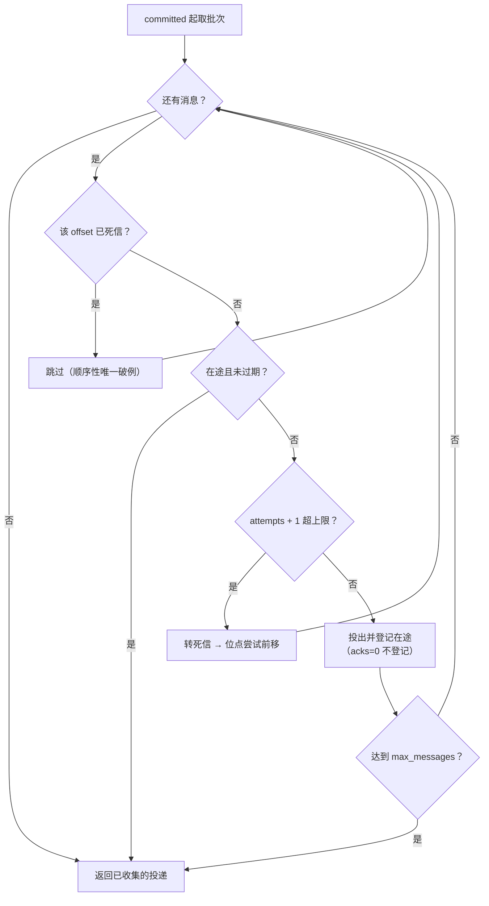
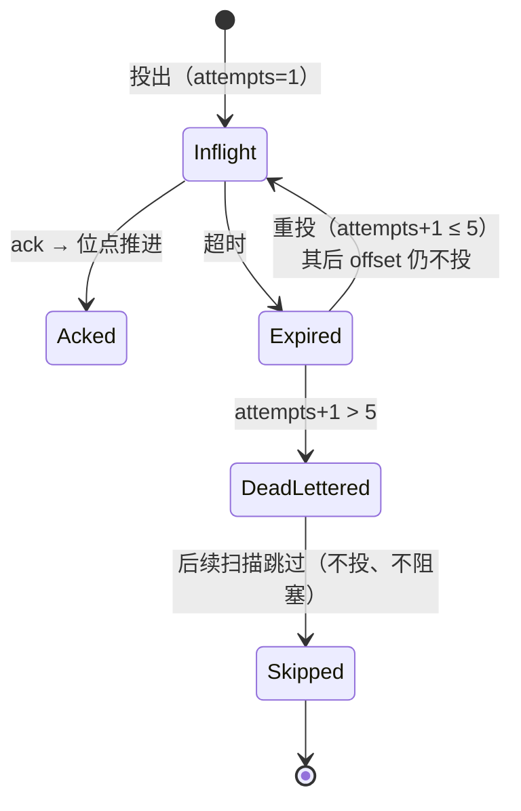

# 顺序性详细设计

> 08B / 任务 01-3 · 任务级详细设计（分区内停等、重投不越队头、死信例外、位点不跳）

[文档首页](../../../../../../文档首页.md) › [01 消息模型与投递](../../01_消息模型与投递.md) › [01-3 顺序性](../01_消息模型与投递_03_顺序性.md) › 详细设计

---

## 1. 概述 <a id="overview"></a>

本文档是任务 [01-3 顺序性](../01_消息模型与投递_03_顺序性.md) 的**详细设计**，粒度到「按序落地、逐条验收」。与架构层不一致时以《架构设计》为准，实现细节以本文档为准。

**上游依据**：

- [需求 01-3 顺序性](../../../../需求/01_需求_消息模型与投递.md#r01-3)
- [架构设计 · 数据面：存储与复制](../../../../../../设计/架构设计/04_架构设计_数据面_存储与复制.md) 第 2 节（分区与 offset）、第 8 节（位点管理）
- [架构设计 · 接入面：协议与客户端](../../../../../../设计/架构设计/05_架构设计_接入面_协议与客户端.md) 第 3 节（端点与消费语义）
- [概要设计 · 总览](../../../../../../设计/概要设计/01_概要设计_总览.md) 第 2 节（`broker/router.py`）、第 3.1 节（数据面接口清单）
- bms《[消息模型与语义](../../../../../../../bms文档/资料/知识档案/消息与事件驱动/02_事件驱动_消息模型与语义.md)》第 5 节（顺序性三级取舍与三个陷阱）
- bms《[消费组与再均衡](../../../../../../../bms文档/资料/知识档案/消息与事件驱动/05_事件驱动_消费组与再均衡.md)》第 6 节（再均衡期间的投递与位点）

**与前后任务的关系**：

| 方向 | 任务 | 关系 |
| --- | --- | --- |
| 前置 | [01-1 主题与分区模型](../../01_消息模型与投递_01_主题与分区模型/01_消息模型与投递_01_主题与分区模型.md) | 复用 `core/routing.py::select_partition`（同 key 恒同分区）与分区号校验，**不另写哈希** |
| 前置 | [01-2 投递语义](../../01_消息模型与投递_02_投递语义/01_消息模型与投递_02_投递语义.md) | 复用 `MessageStore` / `OffsetStore` / `DeadLetterQueue` 端口与 `DeliveryState`；本任务只改 `DeliveryService` 的收集循环，**端口签名不变** |
| 本任务 | 01-3 顺序性 | 把「分区内按 offset 投递」从默认行为升级为**停等语义**：未确认队头不越过；补死信跳过判定 |
| 后继 | 01-4 消费组 | 组内分摊 / rebalance / 租约；本任务只保证「位点不跳」，**不引入 owner / lease / 世代** |
| 后继 | 01-6 保留与重放 | 位点重置后的顺序仍由同一停等规则保证；重放不改变 `message_id` |
| 后继 | 8B_02 存储与复制 | 只换实现不动端口；本任务不新增状态载体，文件段不需要 key 级索引 |

**口径基线（2026-11-04 已确认，不再变更）**：

1. **顺序性强度 = 分区内严格停等**：顺序单位是分区，未确认的队头挡住其后的所有 offset；同键有序由「同 key 同分区」保证，跨分区不承诺顺序。
2. **默认强制**：不加 `ordered` 开关，顺序是分区投递的固有语义；需要吞吐按分区并发。
3. **再均衡范围**：只做「位点不跳」判据 + 消费者失效模拟用例；lease / owner / 组内分摊归 01-4。
4. **毒消息例外**：死信转出后允许越过（顺序性的唯一破例）；已死信的 offset 后续扫描跳过，不重投。
5. **重投位置**：回原 offset（`message_id` / `offset` / `payload` 不变，仅 `delivery_count` 递增）。
6. **`acks=0` 口径**：按 offset 升序返回、返回前推进位点、不保证处理成功；自身投出不登记 inflight（不阻塞后续），但扫描时受他人在途队头约束。
7. **状态载体**：不新增「阻塞头 / 队头位点」，不落库；队头判据 = 已提交位点 + 在途扫描。

## 2. 现状与差距 <a id="gap"></a>

01-2 已交付消息存储、位点、死信、投递语义与三个数据面端点。**顺序性在现状下只有「返回批次按 offset 升序」这一层，重试与死信会越过未确认队头**：

| 项 | 现状（2026-11-04 复核 `broker/delivery.py`） | 本任务目标 | 动作 |
| --- | --- | --- | --- |
| 未确认队头 | `_collect` 遇到未过期 inflight 时 `continue`，**继续投后面的 offset**（`blocked` 只影响 `acks=0` 的提交游标，不阻断投递） | 遇未过期队头**立即停止本批**，其后 offset 一律不投 | 改 `_collect` |
| 重试不越队头 | 超时重投时，队头与其后消息可在同一次 consume 一并投出（若队头未被先处理） | 重投只投到期的最早未确认 offset，队头未 ack 前不投其后消息 | 改 `_collect` |
| 死信判定 | `_deliver` **不查死信队列**；死信那次 `_commit` 若因前面有缺口未推进，下轮从旧位点重扫会把已死信 offset 当新消息重投（`attempts` 从 1 重计） | 已死信 offset 在扫描时跳过（不投、不阻塞）；刚转死信的 offset 本批继续越过 | 改 `_collect` |
| 死信例外 | 死信已「位点前移 + 不阻塞」，但缺口场景下行为未定义 | 明确定义为顺序性唯一破例：死信即消息终结，其后 offset 可继续投 | 文档 + 用例 |
| 再均衡 | 无判据、无用例 | 用「实例丢失 inflight → 超时重投 → 位点不跳」验收；不做 owner / lease | 新增用例 |
| 端口 | `MessageStore` / `OffsetStore` / `DeadLetterQueue` 四 / 二 / 三方法 | **不改签名**（顺序性不需要存储提供新能力） | 不改 |
| 契约 | 三端点、7 个 schema、9 条错误码 | **不改字段、不加端点、不新占码** | 不改（仅核对描述漂移） |

> **为什么改 `_collect` 就够**：停等是「扫描顺序」的约束，不涉及存储格式、位点语义或端点契约。存储层（8B_02）只要保证 `fetch` 按 offset 升序返回，停等规则即可原样复用。

## 3. 交付物清单 <a id="deliverables"></a>

```text
msg/backend/services/msg/
├── src/bms_msg/broker/
│   └── delivery.py                             # 修改：_collect 停等 + 死信跳过；_deliver 传入 existing
└── tests/
    ├── broker/
    │   └── test_ordering.py                    # 新建：顺序性用例（停等 / 重投 / 死信例外 / 失效模拟）
    └── api/
        └── test_data_messages.py               # 扩：HTTP 层停等与 ack 后继续投递
```

| 文件 | 类型 | 说明 |
| --- | --- | --- |
| `broker/delivery.py` | 修改 | `_collect` 改为停等扫描（遇未过期队头即停）、补已死信跳过；`_deliver` 接 `existing` 入参，`None` 仅表示「本次刚转死信」 |
| `tests/broker/test_ordering.py` | 新建 | 同 key 顺序、停等、超时重投不越队头、死信例外、已死信不重投、`acks=0` 受停等约束、消费者失效后位点不跳、跨分区独立 |
| `tests/api/test_data_messages.py` | 扩 | 接口层：未 ack 时再次拉取为空、ack 后继续投下一条 |
| `deploy/contracts/msg.json` | **仅在漂移时** | 端点函数 docstring 变更会改 OpenAPI `description`；重导前先比对，无漂移不动 |
| `deploy/registry/msg.toml` | 不改 | 不加码、不加域路径（`broker/**/*.py` 已在 01-2 登记） |
| `errors.py`、`schemas/message.py`、`api/**` | 不改 | 错误码复用 `350002` / `350007`；请求 / 响应字段不变 |

## 4. 顺序语义设计 <a id="semantics"></a>

### 4.1 保证级别与单位 <a id="level"></a>

| 级别 | 本任务是否承诺 | 实现依据 |
| --- | --- | --- |
| 全局有序（跨分区） | **不承诺** | 多分区按分区并行投递；需求 §4 内容 2 明确「跨分区不承诺全局顺序」 |
| 分区有序 | **承诺** | 同分区按 offset 升序投递 + 停等；需求 §4 内容 1 |
| 键有序 | **承诺**（由分区有序派生） | `select_partition` 同 key 恒同分区；需求 §4 内容 2 |
| 批次内顺序 | **承诺**（返回按 offset 升序） | `fetch` 升序 + `_collect` 顺序扫描 |
| 消费端处理顺序 | **客户端契约**（批次内串行处理） | 平台只保证投递顺序；并发处理导致的应用层乱序由消费端负责（需求 §4 内容 4） |

> **顺序单位为什么是分区而不是 key**：位点按 `(group, topic, partition)` 存且只能按连续前缀推进。若按 key 阻塞，受阻 key 后面的 offset 即使已 ack 也无法并入位点，重启后重复范围会覆盖整段；且分区内跨 key 投递会乱序，与需求「分区内按 offset 顺序投递」冲突。分区内停等与位点模型同构，8B_02 不需要 key 级索引。

### 4.2 停等规则 <a id="stop-and-wait"></a>

`consume` 在已提交位点 `committed` 处开始，按 offset 升序逐条判定，**遇到第一条「未过期在途」即停止本批**：



规则按优先级排列（与错误码判定顺序无关，只影响扫描）：

| 序 | 判定 | 动作 | 理由 |
| --- | --- | --- | --- |
| 1 | 已死信（`DeadLetterQueue.contains`） | 跳过，继续看下一条 | 死信是消息终结，属唯一破例（口径 4） |
| 2 | 在途且 `deadline > now` | **停止本批**，返回已收集部分 | 停等核心：未确认队头不越过（口径 1） |
| 3 | 本批已含重投，且当前是新消息 | **停止本批**（新消息留到下一批） | 失败重试不与主链路同批下发（需求 §4 内容 3） |
| 4 | 在途已过期且 `attempts + 1 > MAX` | 转死信（`_dead_letter`）→ 继续看下一条 | 毒消息不堵死分区（口径 4，沿用 01-2） |
| 5 | 其余 | 投出；`acks=1` 登记在途，`acks=0` 不登记 | 至少一次 / 尽力而为（01-2 §6.1、§6.2） |

**「停止」不是「跳过」**：停止后其后的 offset 一条都不投，包括已经到期的、已 ack 的。这保证同一次 consume 返回的消息在 offset 上连续（死信例外除外）。

> **规则 3 的由来（实施回写）**：停等若只判「未过期在途」，重投批次会继续投后面的新消息——0 刚重投未 ack、2 同批下发，
> 正是「失败重试与主链路并行消费」。因此一批内一旦投出过重投消息，后续新消息一律留到下一批；重投消息自身可以
> 连续投多条（它们都是 offset 更小的未完成消息，顺序安全）。

### 4.3 批次内与跨批次的边界 <a id="batch"></a>

| 场景 | 行为 |
| --- | --- |
| 首次拉取 | 从 `committed` 起最多投 `max_messages` 条（缺省 20，上限 100），返回按 offset 升序 |
| 批内多条未 ack | 允许（客户端拿到一批，按序处理）；这是 01-2 批量拉取口径，本任务不改 |
| 下一次拉取 | 从 `committed` 重新扫描，第一条就是未确认队头 → **返回空**（直到队头 ack 或超时重投） |
| 队头 ack 后 | 位点前移；下一次拉取从新位点继续，仍按 offset 升序 |
| 队头超时 | 重投队头（`delivery_count` 递增），其后的 offset 仍不投，直到队头 ack |

> **为什么不在批次内只投一条**：那会让 `max_messages` 失效、推翻 01-2 已定的批量拉取契约，并把吞吐压到「一次一条」。分区内顺序由「投递顺序 + 客户端串行处理」共同保证，这也是业界（分区单消费者 + 批量拉取）的常规口径。

### 4.4 重投：回原 offset <a id="retry"></a>

| 项 | 取值 |
| --- | --- |
| 重投位置 | 原 offset（不追加副本、不搬到分区尾部） |
| 触发 | 在途到期（`DEFAULT_VISIBILITY_TIMEOUT_MS` 30s）后再次被扫描到 |
| 计数 | `delivery_count = attempts + 1`（首次 1，重投递增） |
| 不变项 | `message_id` / `offset` / `payload` / `headers` / `published_at` |
| 阻塞范围 | 队头未 ack 前，其后 offset 不投（含已到期的） |
| 批内隔离 | 本批一旦含重投消息，后续新消息留到下一批（重投不与主链路同批下发） |
| 上限 | 第 6 次投递前判定超限 → 转死信（最多投 5 次） |

> **为什么不回分区尾部**：尾部重投要在日志里追加副本，破坏「offset 由 `append` 唯一分配」与「重投返回同一条记录」两条 01-2 口径；8B_02 的文件段还要支持搬运。回原 offset 下，`offset` 即业务顺序号，重放与排障都简单。

### 4.5 死信例外 <a id="dead-letter"></a>



| 规则 | 说明 |
| --- | --- |
| 转出条件 | `attempts + 1 > MAX_DELIVERY_ATTEMPTS`（即已投 5 次仍到期） |
| 位点 | 尝试前移（`_commit`）；前面有缺口时只暂存，等缺口补齐后成段推进 |
| 后续投递 | 本批继续看下一条（不停止）；后续批次遇到该 offset 直接跳过（`contains` 判定） |
| 不删日志 | offset 仍可读，06 域死信查询 / 01-6 重放直接用 |
| 再 ack | `350007`（沿用 01-2） |
| 顺序性含义 | **唯一破例**：死信消息已被平台放弃，不再参与顺序链；其后的消息可以继续投。若业务要求「毒消息也阻塞」，正确做法是不 ack（让它在途）或人工介入，而不是改平台口径 |

> **补这个分支的必要性**：现状 `_deliver` 不查死信。若死信发生时前面有未确认缺口，位点推不动，下轮扫描会把已死信 offset 当新消息重新投（`attempts` 从 1 重计），既违反「死信不再投」，也让顺序链出现重复。停等语义下这个漏洞更隐蔽（队头挡住时走不到死信），必须在扫描入口显式判死信。

### 4.6 `acks=0` 与顺序 <a id="acks-zero"></a>

| 面 | 行为 |
| --- | --- |
| 返回顺序 | 按 offset 升序（`fetch` 升序 + 顺序扫描） |
| 位点 | 返回前一次性提交到「已投出的连续前缀 + 1」；不登记 inflight |
| 处理成功 | **不保证**（返回即视为成功，可能丢）；文档写明适用边界（指标打点 / 缓存失效 / 非关键同步） |
| 对后续的阻塞 | 自己投出的消息不留 inflight，**不阻塞**后续批次 |
| 受他人阻塞 | 扫描时遇到 `acks=1` 留下的未过期在途，**同样停止**（不越过未确认队头） |
| 缺口 | 位点不越过未确认缺口（存量用例 `test_acks_zero_does_not_jump_unacked_gap` 的语义保留，断言改为「不投缺口后的消息」） |

> **为什么两面都要写**：只写「不参与停等」会让 `acks=0` 越过 `acks=1` 的在途队头，同一消费者先用 `acks=1` 拿 0、再用 `acks=0` 拿 1，应用层就乱了；只写「受停等约束」又会让人误以为 `acks=0` 投出的消息会留下阻塞。准确口径是：**停等是分区扫描规则，与档位无关；档位只决定投出后是否登记在途、何时推进位点**。

### 4.7 再均衡范围 <a id="rebalance"></a>

本任务**不实现**组协议、成员注册、心跳、租约与分区分配（归 01-4）。只交付「位点不跳」的判据：

| 场景 | 本任务行为 | 验收方式 |
| --- | --- | --- |
| 消费者实例失效（进程重启 / 分区转移） | 进程内 `DeliveryState` 随实例消失；新实例从**已提交位点**续读，未 ack 的消息重投（`delivery_count` 从 1 重计），已 ack 的不重投 | 用例：投 3 条 → ack 1 条 → 换新 `DeliveryService` + 新 `DeliveryState`（同一 store / offsets）→ 从位点续读，offset 连续、无跳过 |
| 再均衡期间停摆 | 允许短暂停摆（无消费者时不投递），位点不动 | 同上（新实例接管前的空窗即停摆） |
| 位点跳号 | **不允许**：提交值只能是连续已确认前缀 + 1 | 既有 `_commit` 逻辑 + 乱序 ack 用例 |
| 分区被重复分配 | 本任务不涉及（无分配器）；`(group, topic, partition)` 位点唯一 | 归 01-4 |

> **为什么现在不做 lease**：没有组元数据、成员注册与心跳，lease 只能自造一套组协议；01-4 落地时协议形态（服务端主导 / 客户端主导、eager / cooperative）尚未定，现在做大概率推翻。用「实例失效 + 位点续读」已能验收需求「再均衡后无消息跳过」。

### 4.8 并发边界 <a id="concurrency"></a>

| 边界 | 保证 |
| --- | --- |
| 同进程、同分区 | `DeliveryState.lock` 串行化 `consume` / `ack`，不会并发投递同一分区 |
| 同进程、不同分区 | 各自独立推进，互不阻塞（分区是并行单位） |
| 多副本 | 不在本任务（进程内状态不共享，首期 `workers = 1`；归 8B_02 / 8B_05） |
| 消费端并发 | 平台不限制；批次内并发处理导致的乱序由消费端负责（客户端契约：同分区串行处理） |

## 5. 代码改造设计 <a id="code"></a>

### 5.1 `DeliveryService._collect`（重写扫描循环） <a id="collect"></a>

现状（01-2）：`blocked` 标记一旦置位就不再前移 `contiguous`，但 `continue` 后仍继续投后面的 offset。改造后：

```text
delivered = []
cursor = committed
contiguous = committed
retried = False
while len(delivered) < max_messages:
    batch = store.fetch(from_offset=cursor, max_messages=剩余额度)
    if not batch:
        break
    for message in batch:
        cursor = message.offset + 1
        if 已死信(topic, partition, offset):
            continue                      # 例外：跳过，不阻塞
        existing = state.lookup(key, offset)
        if existing is not None and existing.deadline > now:
            break                         # 停等：未确认队头，整批停止
        if retried and existing is None:
            break                         # 本批已有重投，新消息留到下一批
        delivery = _deliver(message, acks, existing)
        if delivery is None:              # 本次刚转死信
            continue                      # 例外：继续看下一条
        delivered.add(delivery)
        if existing is not None:
            retried = True                # 本批含重投
        contiguous = message.offset + 1   # 已投出即连续前缀（停等保证中间无跳过）
        if len(delivered) == max_messages:
            break
    if 本批停止:
        break
if acks == 0 and contiguous > committed:
    offsets.commit(contiguous)            # 返回前推进（可能丢，属该档语义）
```

改动要点：

| # | 改动 | 说明 |
| --- | --- | --- |
| 1 | 删 `blocked` 变量 | 停等后不再有「越过缺口后继续投」的路径，`contiguous` 每次投出都前移 |
| 2 | 新增已死信判定 | 扫描入口先 `contains`；命中即 `continue`（不投、不阻塞） |
| 3 | 未过期在途 → `break` | 由 `continue` 改为 `break`，这是顺序性的核心 |
| 4 | `_deliver` 接 `existing` | 避免重复 `lookup`；`None` 返回值收敛为「刚转死信」一种语义 |
| 5 | `_dead_letter` 不变 | 仍尝试 `_commit`；缺口场景只暂存，等补齐成段推进 |

### 5.2 `DeliveryService._deliver`（签名与返回值收敛） <a id="deliver"></a>

| 项 | 现状 | 改造后 |
| --- | --- | --- |
| 签名 | `(*, key, message, acks)` | `(*, key, message, acks, existing: InflightDelivery \| None)` |
| 返回 `Delivery` | 需投出 | 不变 |
| 返回 `None` | 「未过期在途」或「刚转死信」两义 | **只表示「刚转死信」**；未过期在途的判定上移到 `_collect` |
| `attempts` | 内部 `lookup` | 用入参 `existing`（`1 if existing is None else existing.attempts + 1`） |
| `acks=0` | 直接返回 `delivery_count=1` | 不变（不登记 inflight） |

> 返回值从两义收敛为一义，是这次改造可读性的关键：`_collect` 用 `break` 表达停等、用 `continue` 表达死信越过，两个动作不再混在同一个 `None` 里。

### 5.3 不改的部分 <a id="unchanged"></a>

| 项 | 结论 |
| --- | --- |
| `MessageStore` / `StoredMessage` | 不改：`fetch` 已按 offset 升序返回，停等不需要新能力 |
| `OffsetStore` | 不改：位点仍只按连续前缀前移、只进不退 |
| `DeadLetterQueue` | 不改：`contains` 已够用（扫描入口判定） |
| `DeliveryState` | 不改：不新增阻塞头 / 队头位点（口径 7）；`inflight` / `acked` / `lock` 三件足够表达停等 |
| `TopicRouter` / `core/routing.py` | 不改：同 key 同分区由 01-1 保证 |
| `schemas/message.py`、`api/**` | 不改：端点、字段、权限码不变 |
| `errors.py`、`deploy/registry/msg.toml` | 不改：不新占码；顺序性失败复用 `350002` / `350007` |
| `main.py` / `api/deps.py` | 不改：装配与依赖注入无新增对象 |

## 6. 接口与契约 <a id="api"></a>

| 项 | 结论 |
| --- | --- |
| 端点 | 不变（`/msg/publish`、`/msg/consume`、`/msg/ack`）；**不加新端点** |
| 请求字段 | 不变；`consume` 不加 `ordered`（口径 2） |
| 响应字段 | 不变；不新增 `blocked_offset` / 积压字段（运维可见性归 06 域只读视图） |
| 错误码 | 不新占；`350002`（位点非法）、`350007`（重投超限）语义不变 |
| `x-error-codes` | 不变（顺序性不引入新的失败码） |
| 契约快照 | **仅当**端点 docstring 变更导致 OpenAPI `description` 漂移时重导；重导前先 diff，无漂移不动 |

**对外语义补充（写进端点 docstring 与测试记录，不改结构）**：

- `consume` 返回的消息在分区内按 offset 升序；
- 队头未 ack 时，下一次 `consume` 返回空（不越过未确认队头）；
- 队头超时后重投同一条消息（`message_id` 不变、`delivery_count` 递增）；
- 死信消息不再投递，其后的消息可以继续（顺序性唯一破例）；
- `acks=0` 只保证按序返回、不保证处理成功。

## 7. 测试设计 <a id="tests"></a>

### 7.1 用例清单 <a id="cases"></a>

新增 `tests/broker/test_ordering.py`（单分区主题 `audit.ordering`，沿用 01-2 的 `topic` 夹具覆盖写法）：

| # | 用例 | 断言要点 | 覆盖分支 |
| --- | --- | --- | --- |
| 1 | 同 key 顺序投递 | 发布 5 条同 key → 一次 consume 返回 offset `[0,1,2,3,4]`；逐条 ack 后位点 `1..5` | 正常投出 |
| 2 | 停等：未确认队头挡住下一批 | 发布 3 条 → consume `max=2` 得 `[0,1]` → 再 consume 空 → ack 0 后仍空（队头 1） → ack 1 后得 `[2]` | `break`（停等） |
| 3 | 超时重投不越队头 | consume `max=2` 得 `[0,1]` → 推进 30s+1ms → 再 consume 得 `[0,1]` 且 `delivery_count` 均 2；不出现 offset 2 | 停等 + 过期重投 |
| 4 | 重投后 ack 才继续 | 接 #3：ack 0 → 位点 1；再 consume 空（队头 1 在途）；ack 1 → 位点 2；consume 得 `[2]` | 位点连续前缀 |
| 5 | 毒消息死信后可越过 | 发布 2 条 → 5 轮 consume `max=1` 并推进时钟 → 第 6 轮 consume 得 `[1]`（offset 0 已死信）；死信记录 `(0, 5)`、位点 1 | 转死信 + 越过 |
| 6 | 已死信不重投（缺口场景） | 发布 3 条 → 3 轮 `consume max=3`（不 ack，推进时钟）→ 第 4 轮 `consume max=3`：offset 0/1 重投（count 4）、offset 2 达上限转死信并跳过（delivered 不含 2）→ ack 0、1 后位点 3；再 consume 空 | 死信跳过 + `contains` |
| 7 | `acks=0` 受停等约束 | consume `acks=1` 得 `[0]`（不 ack）→ `acks=0` consume 空（不越过未确认队头）→ ack 0 → `acks=0` consume 得 `[1]` 且位点 2 | `acks=0` 投出 + 停等 |
| 8 | 消费者失效后位点不跳 | 发布 3 条 → consume 得 `[0,1,2]` → ack 0（位点 1）→ 新 `DeliveryService` + 新 `DeliveryState`（同 store / offsets）→ consume 得 `[1,2]`（count 1），不含 0；位点续到 3 | 重启续读 |
| 9 | 跨分区独立 | 两分区主题：分区 0 / 1 各发 2 条，分别 consume，offset 均从 0 起、互不影响 | 分区隔离（不承诺跨分区顺序） |

接口层（`tests/api/test_data_messages.py` 扩 2 例）：

| # | 用例 | 断言要点 |
| --- | --- | --- |
| 10 | HTTP 停等 | 发布 2 条 → `consume max=1` 得 1 条 → 再 `consume` 的 `messages` 为空 → `ack 0` 后 `consume` 得 offset 1 |
| 11 | 死信后 ack 报 350007 | 接口层只验既有错误码映射（服务层造死信，接口层复核 `350007`）——若无法在 HTTP 层造 5 次超时则不做，避免 sleep；改由服务层覆盖 |

> 接口层不注入时钟，无法造 30s 超时与 5 次重投；超时 / 死信路径在服务层用 `ManualClock` 覆盖（与 01-2 同一处置），接口层只覆盖「停等 → 空 → ack 后继续」。

### 7.2 覆盖与门禁 <a id="coverage"></a>

| 项 | 要求 |
| --- | --- |
| 变更模块 | `bms_msg`（尤其 `broker/delivery.py`）行 + 分支 **100%** |
| 新增分支 | 已死信跳过、未过期队头停止、刚转死信继续、`acks=0` 投出，四支均需用例命中 |
| 存量回归 | `test_delivery.py` 全绿；`test_acks_zero_does_not_jump_unacked_gap` 断言改为「缺口后的 offset 不投、位点不前进」 |
| 静态 | `ruff check` / `format --check` / `pyright --pythonpath …` 全零 |
| 装配 | `create(None)` 可启动（本任务不改装配，随会话复核） |
| 文档 | `engkit links` / `docs-scope` / `eol` 三项通过 |

### 7.3 存量用例影响 <a id="regression"></a>

| 用例 | 影响 | 处置 |
| --- | --- | --- |
| `test_acks_zero_does_not_jump_unacked_gap` | 现状断言「缺口挡住位点、仍投 offset 1」；停等后 offset 1 也不投 | 改为断言 `delivered == []` 且位点仍 0（语义从「不越位点」升级为「不越队头」） |
| `test_consume_skips_inflight_until_timeout` | 单条消息，停等前后行为一致 | 不改 |
| `test_consume_batches_up_to_max_messages` | 先 ack 0、1 再拉，队头已推进 | 不改 |
| `test_dead_letter_after_max_attempts` | 单条毒消息，位点无缺口 | 不改 |
| `test_ack_out_of_order_advances_when_gap_filled` | 批内乱序 ack 仍允许（停等只约束投递，不约束 ack 顺序） | 不改 |

## 8. 实施步骤 <a id="steps"></a>


| 步 | 内容 | 产出 |
| --- | --- | --- |
| 1 | 本文档定稿并提交 | 设计提交 |
| 2 | Kiwi 登记一条用例（覆盖 §7.1） | 平台自增编号 |
| 3 | 改 `_collect`（停等 + 死信跳过）、`_deliver`（接 `existing`） | 代码 |
| 4 | 新增 `test_ordering.py`、扩接口用例、改存量缺口用例断言 | 用例 |
| 5 | 按文件清单跑 pytest；`engkit coverage` 100%；`ruff` / `pyright`；契约 diff | 门禁结果 |
| 6 | 写实施 / 测试记录，回写计划表（迁 §2、按《计划文档规范》回填） | 记录 + 计划 |

## 9. 验收映射 <a id="accept-map"></a>

| 任务完成标准 | 验证方式 |
| --- | --- |
| 同一 key 的多条消息严格按发布顺序被消费，重复验证多次结果一致 | 用例 #1（一次 consume 返回 `[0..4]`）；用例 #9（跨分区各自有序） |
| 模拟某条消息处理失败并重试，后续同 key 消息不会越过它先被消费 | 用例 #3 / #4（队头超时重投，其后 offset 不投；ack 后才继续） |
| 再均衡后位点连续，无消息被跳过或重复投递到不同消费者 | 用例 #8（新实例从已提交位点续读，offset 连续、不重投已 ack） |
| 跨分区不承诺顺序的边界在文档中写明，并有测试覆盖「不同 key 可并行」 | §4.1 保证级别表 + 用例 #9（两分区各自独立推进） |
| 变更模块行 + 分支覆盖率 100%，静态全绿 | `engkit coverage` + `ruff` / `pyright` |

## 10. 风险与开放项 <a id="risk"></a>

| # | 项 | 影响 | 处置 |
| --- | --- | --- | --- |
| 1 | 停等降低单分区吞吐（队头未 ack 时整分区空转） | 消费慢的消费者会放大积压 | 分区是并行单位，吞吐靠多分区；06 域监控积压并告警（后续） |
| 2 | 批次内多条在途，客户端并发处理会乱序 | 应用层顺序不保 | 明确为客户端契约（§4.1）；需要严格串行的场景用 `max_messages=1` |
| 3 | 进程内 `DeliveryState` 不跨实例 | 多副本下同一分区可能被两个实例同时投递 | 首期单副本（`workers = 1`）；多副本归 8B_02 / 8B_05 |
| 4 | 死信「缺口未补齐」时位点暂不前进 | 死信 offset 暂时留在可读区间 | `mark_acked` 已暂存，缺口补齐后成段推进；用例 #6 覆盖 |
| 5 | 无 owner / lease | 再均衡期间可能重复投递（至少一次） | 归 01-4；本任务只保证「不跳过」，重复由消费端幂等兜底（需求 01-2 口径） |
| 6 | 停等与 `acks=0` 混用 | 同一分区两种档位并存时，`acks=0` 会被 `acks=1` 的在途挡住 | 已在 §4.6 写明：停等是分区规则、与档位无关；不建议同分区混用两档（消费组语义归 01-4） |

## 11. 对齐记录 <a id="align"></a>

| # | 事项 | 结论（2026-11-04 确认） |
| --- | --- | --- |
| 1 | 顺序性强度 | 分区内严格停等；顺序单位 = 分区，键有序由同 key 同分区派生 |
| 2 | 是否默认强制 | 默认强制，不加 `ordered`；顺序是分区投递固有语义 |
| 3 | 再均衡范围 | 只做位点不跳 + 消费者失效模拟；lease / owner 归 01-4 |
| 4 | 毒消息例外 | 死信转出后允许越过，是唯一破例；已死信 offset 后续跳过 |
| 5 | 重投位置 | 回原 offset，`message_id` / `offset` / `payload` 不变 |
| 6 | `acks=0` 与顺序 | 按 offset 升序返回、不保处理成功；自身不留阻塞，但受他人在途队头约束 |
| 7 | 状态载体 | 不新增阻塞头 / 队头位点，不落库；判据 = 已提交位点 + 在途扫描 |
| 8 | 批次内边界（推导） | 批次内允许多条在途（沿用 01-2 `max_messages`），停等在跨批次生效；客户端契约：批次内串行处理 |
| 9 | 死信跳过位置（推导） | 放在扫描入口（`contains`），先于停等判定；刚转死信的 `None` 与「未过期在途」分开表达 |
| 10 | 契约影响（推导） | 不加端点 / 字段 / 错误码；仅当端点 docstring 改描述导致快照漂移时重导 |
| 11 | 重投批内隔离（实施回写） | 本批一旦投出重投消息，后续新消息留到下一批：否则「0 刚重投未 ack、2 同批下发」就是失败重试与主链路并行 |

---

> 依《[文档生成规范](../../../../../../../bms文档/规范/文档生成规范.md)》与《[任务文档规范](../../../../../../../bms文档/规范/任务文档规范.md)》编写
