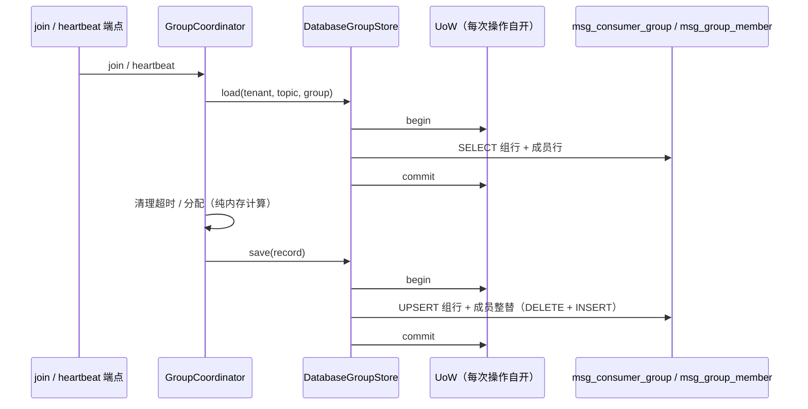

# 消费组落库详细设计

> 消息平台 · 01 消息模型与投递 · 04 消费组 · 01 消费组落库 · 详细设计

[文档首页](../../../../../../../文档首页.md) › 消息平台任务 › [01 消息模型与投递](../../../01_消息模型与投递.md) › [01-4 消费组](../../01_消息模型与投递_04_消费组.md) › [01-4-1 消费组落库](../01_消息模型与投递_04_消费组_01_消费组落库.md) › 详细设计

## 1. 概述 <a id="overview"></a>

- **目标**：把消费组从「进程内内存」换成「平台库两表 + 成员租约」，补上组删除端点、空组回收、新组接入（B1）、长驻流 ACL 复核（B12）与 inflight 字节口径（B19）。
- **口径（2026-11-13 拍板）**：
  1. 组存储**每次操作自开 UoW**（请求会话不参与，后台扫描另开会话）；
  2. 成员存活**心跳写穿**；
  3. 新组无提交**从最早（`start_offset`）开始**；
  4. 组删除**默认保留位点**（可选 `purge_offsets=true`）；
  5. `dead` 态 = **空组超 7 天**；
  6. 长驻流 **30s 重判 + 每批判 ACL**；
  7. inflight 字节**按分区持有者记账**。
- **依据**：任务 [01-4-1](../01_消息模型与投递_04_消费组_01_消费组落库.md)；质量盘点 `tmp/msg-质量盘点-20261113.md` B1 / B12 / B19 与「消费组不落库」条目。

## 2. 现状与差距 <a id="gap"></a>

| 项 | 现状（实测） | 差距 |
| --- | --- | --- |
| 组存储 | `InMemoryGroupStore`（`broker/group.py`），随进程重启清空 | 重启后组、成员、分配、世代全丢；多实例各持一份 |
| 两表 | `msg_consumer_group` / `msg_group_member` 只在数据库设计「规划」里，未建模型 | 无行可查、无法跨实例 |
| 成员存活 | `last_seen` 只在内存 | 无法判断「重启前成员是否还活着」 |
| 空组回收 | 无 `dead` 产生路径（常量已定义） | 组列表长期堆积空组 |
| 组删除 | 无端点 | 只能等位点清理，组永远在列表里 |
| B1 新组 | `OffsetStore.get` 无记录返回 0，`committed < start` 直接 350003 | 保留期清理过的分区上新组建不起来 |
| B12 长驻流 | 只在进流前判一次 ACL | 授权收回后长驻流仍按旧授权投递 |
| B19 inflight | 字节账键为 `(group, topic, partition)` | 同分区被 N 个组消费时额度放大 N 倍 |

## 3. 交付物清单 <a id="deliver"></a>

| # | 交付物 | 落点 |
| --- | --- | --- |
| 1 | 组模型 | `models/consumer_group.py`（两表 + 状态常量） |
| 2 | 模型登记 | `models/__init__.py` 的 `MODEL_MODULES` 与导入 |
| 3 | 组仓储 | `repositories/consumer_group.py` |
| 4 | DB 组存储 | `broker/group_db.py`（`DatabaseGroupStore`） |
| 5 | 端口扩展 | `broker/group.py`（`delete` / `mark_idle_dead`，带默认实现） |
| 6 | 空组回收 | `services/group_sweeper.py`（`GroupSweeper`） |
| 7 | B1 | `broker/offset.py`（`committed`）+ `broker/delivery.py`（`consume`） |
| 8 | B12 | `api/frame/routes.py`（`_stream_core` 复核） |
| 9 | B19 | `broker/delivery.py`（`DeliveryState.usage` 按分区聚合） |
| 10 | 组删除端点 | `api/admin/groups.py`、`schemas/group.py`、`audit/trail.py` |
| 11 | 装配 | `main.py`（组存储 / 扫描器）、`broker/lifecycle.py`、`api/deps.py`（`GroupSweeperDep`） |
| 12 | 配置 | `core/config.py`（空闲天数 / 扫描间隔 / ACL 复核间隔） |
| 13 | 前端 | `views/GroupDetailPage.vue`、`services/admin-service.ts`、`i18n/messages.ts` |
| 14 | 文档 | 数据库设计总览 + 两份表设计 + 本任务三件套 |

## 4. 数据模型 <a id="schema"></a>

### 4.1 `msg_consumer_group` <a id="table-group"></a>

| 列 | 类型 | 说明 |
| --- | --- | --- |
| `id` | 雪花 | 主键（`BaseModel`） |
| `tenant_id` | 雪花 | 租户主键 |
| `topic_id` | 雪花 | 主题主键（组按主题维度建） |
| `name` | `String(128)` | 组名（**不用 `group`**：MySQL 保留字） |
| `namespace` | `String(64)` | 命名空间快照（管理面过滤 / 排障） |
| `state` | `String(24)` | `empty` / `preparing_rebalance` / `stable` / `dead` |
| `generation` | `Integer` | 世代号（成员集合变化 +1） |
| 审计 / 乐观锁 | — | `created_at` / `updated_at` / `version`（`BaseModel`） |

- 唯一键 `uq_msg_consumer_group_identity (tenant_id, topic_id, name)`；
- 索引 `idx_msg_consumer_group_tenant (tenant_id, name)`、`idx_msg_consumer_group_topic (topic_id)`、`idx_msg_consumer_group_state (state, updated_at)`（扫描器用）。

### 4.2 `msg_group_member` <a id="table-member"></a>

| 列 | 类型 | 说明 |
| --- | --- | --- |
| `id` | 雪花 | 主键 |
| `group_id` | 雪花 | 所属组（逻辑外键 → `msg_consumer_group.id`） |
| `member_id` | `String(128)` | 成员标识（`consumer_id`） |
| `instance_id` | `String(64)` | 最后写入该成员的实例标识（排障用，可空） |
| `joined_at` | `DateTime` | 加入时刻（UTC；重连不刷新） |
| `last_heartbeat` | `DateTime` | 最后心跳（UTC；存活判据） |
| `partitions` | `StableJson` | 持有分区号（升序，`ConcurrentStableList[int]`） |

- 唯一键 `uq_msg_group_member_identity (group_id, member_id)`；
- 索引 `idx_msg_group_member_heartbeat (group_id, last_heartbeat)`。

### 4.3 映射 <a id="mapping"></a>

```text
ConsumerGroup(tenant_id, topic_id, group, state, generation, members)
  ↔ msg_consumer_group.tenant_id / topic_id / name / state / generation
       + msg_group_member.*

GroupMember(consumer_id, joined_at, last_seen, partitions)
  ↔ member_id / joined_at / last_heartbeat / partitions
```

`instance_id` 不属于值对象：它是「哪台实例最后写了这行」的运维信息，由 `DatabaseGroupStore` 在落库时统一填当前实例标识，不改端口签名。

## 5. 存储设计 <a id="store"></a>



### 5.1 每次操作自开 UoW <a id="store-uow"></a>

```python
class DatabaseGroupStore(GroupStore):
    def __init__(self, *, uow_factory: UowFactory, instance_id: str = "") -> None: ...

    async def load(self, *, tenant_id, topic_id, group) -> ConsumerGroup | None:
        async with self._uow_factory() as uow, uow.begin():
            return await ConsumerGroupRepository(cast("DbSession", uow.session)).get_with_members(...)
```

- 不自持长会话、不复用请求会话：心跳 / 加入是短事务，避免长驻流与后台扫描互相拖住连接；
- 失败语义：DB 异常直接上抛（500），不静默返回「无组」——静默会让客户端误以为组被删而重建。

### 5.2 `save` = 组行 upsert + 成员整替 <a id="store-save"></a>

1. 按 `(tenant_id, topic_id, name)` 查组行：无则 INSERT（`state` / `generation` 取自快照）；
2. 有则 UPDATE `state` / `generation` / `namespace`（**直接 SQL update，不走 ORM 乐观锁**：协调器在请求内已串行化，`version` 冲突只会误报，不影响正确性）；
3. `DELETE FROM msg_group_member WHERE group_id = ?` 后按快照逐条 INSERT（成员数一般个位数，整替最直观且天然对齐顺序）；
4. 同一事务提交。

> **为什么整替而不是差异更新**：成员集合每次再均衡都可能大改，差异更新要算集合差且容易漏删；整替的代价是几条 DELETE/INSERT，却让「库里就是快照」这一条不变量永远成立。

### 5.3 其它端口方法 <a id="store-others"></a>

| 方法 | 语义 |
| --- | --- |
| `list_for_tenant(tenant_id, topic_id?)` | 按组名升序；管理面列表 |
| `list_all()` | 全量（指标采样）；按 `(tenant_id, topic_id, name)` 排序 |
| `delete(tenant_id, topic_id, group)` | 物理删组 + 成员（位点不动）；返回是否命中 |
| `mark_idle_dead(before)` | `UPDATE ... SET state='dead' WHERE state='empty' AND updated_at < ?`；返回条数 |
| `purge_tenant(tenant_id)` | 删该租户全部组与成员（租户清理） |
| `purge_topic(topic_id)` | 删该主题全部组与成员（删主题清理） |

## 6. 空组回收 <a id="sweeper"></a>

- `GroupSweeper`：进程级、`ensure_started()` / `stop()` / `run_once()` 与 `TopicCleanupService` 同形；周期 `GROUP_SWEEP_INTERVAL_SECONDS`（缺省 3600）。
- `run_once()`：`cutoff = now - GROUP_IDLE_DAYS(7) 天` → `store.mark_idle_dead(before=cutoff)`；命中数记 info 日志。
- 只动 `empty`：`stable` / `preparing_rebalance` 说明还有成员，交给会话超时清理；`dead` 幂等跳过。
- `dead` 组重新 `join`：协调器把 `dead` 当普通组处理（清除 `dead` 后按成员集合重算），不新增状态迁移分支。

## 7. 组删除端点 <a id="delete-api"></a>

```text
DELETE /api/v1/msg/admin/groups/{namespace}/{topic}/{group}?confirm=true&purge_offsets=false
权限：msg:manage + 主题级 manage；强审计 msg:group.delete
返回：{group, namespace, topic, deleted, offsets_purged}
```

- `confirm` 缺失 → 10001；组不存在 → 350013；主题不存在 / 未启用 → 350001；无 `manage` → 350027。
- 删除顺序：先删组与成员（同一 UoW），再按 `purge_offsets` 调 `OffsetPurger.purge_group`（位点文件不在同一事务，失败只告警「组已删、位点残留」并交由孤儿位点清理）。
- 审计：`params` 带 `group` / `namespace` / `topic` / `purge_offsets`（请求意图）；位点清理在 DB 事务提交后执行，实际条目数回填响应 `offsets_purged`，失败只告警（组已删、位点残留交由孤儿位点清理）。`session=uow.session`（同事务写）。
- 默认保留位点：重建同名组后从原已提交位点续消费。

## 8. B1 新组接入 <a id="b1"></a>

- `OffsetStore` 增 `committed(...) -> int | None`：
  - 文件实现：无位点文件 → `None`；有 → 当前值（含 0）；
  - 内存实现：键不存在 → `None`。
- `DeliveryService.consume`：
  ```python
  committed = await self._offsets.committed(...)
  start = await self._store.start_offset(...)
  if committed is None:
      committed = start
      await self._offsets.commit(...)   # 把起点写实，避免起点前移后行为漂移
  elif committed < start:
      raise MsgMessageNotFoundError(...)
  ```
- 兼容：`get()` 保留原语义（无记录返回 0），管理面展示与既有调用不变。

## 9. B12 长驻流 ACL 复核 <a id="b12"></a>

- `_stream_core` 新增 `acl: TopicAclService` 入参（SSE 与帧流两个入口各自传入）。
- 复核时机：**每批拉取到消息后**判一次；空闲循环中距上次复核 ≥ `STREAM_ACL_RECHECK_MS`（30s）时判一次。
- 判定失败（`BizError`，典型 350027）：`error` 帧 / `error` 事件 + `close(acl_revoked)`，登记表按新原因关闭、归还连接名额。
- 关闭原因新增 `acl_revoked`（与 `member_lost` / `deadline` / `client_closed` 并列，前端按字符串展示）。

## 10. B19 inflight 字节口径 <a id="b19"></a>

- 在途条数仍按组（每组成员各自持有自己的在途）；
- **字节账按分区聚合**：`usage(key)` 汇总同 `(topic_id, partition_no)` 下所有组的 `_sizes`，同 offset 取最大值（同一条消息被多组投递只算一份）。
- `track` / `forget` / `drop_partition` / `drop_topic` 的写路径不变（仍按组维护，聚合在读侧完成）。
- 阈值语义：`inflight_bytes` 是「单分区在途数据量上限」，与「分区持有者」一致。

## 11. 失败分支 <a id="fail"></a>

| 场景 | 语义 |
| --- | --- |
| DB 不可用（load / save） | 500（不静默当「无组」） |
| 组删除时主题不存在 | 350001 |
| 组删除时组不存在 | 350013 |
| 组删除缺 `confirm` | 10001 |
| 位点清理失败 | 组已删、响应 200 + `offsets_purged=0`，warning 日志 |
| 新组位点已被清理 | 350003（仅「有提交记录且 < start」） |
| 长驻流 ACL 被收回 | `error(350027)` + `close(acl_revoked)` |
| 扫描器 DB 异常 | warning 日志，下一轮重试；不影响请求 |

## 12. 测试设计 <a id="test"></a>

| # | 用例 | 断言 |
| --- | --- | --- |
| 1 | 组落库往返 | `save` 后重建存储 `load` 出同快照（成员 / 分区 / 世代一致） |
| 2 | 成员整替 | 再均衡后库里成员数与分区与快照一致，无残留旧成员 |
| 3 | 重启续用 | 新存储实例 `heartbeat` 直接成功（组未丢） |
| 4 | 心跳写穿 | 两次心跳 `last_heartbeat` 前进 |
| 5 | 空组回收 | `empty` + 超期 → `dead`；`stable` 不动；幂等 |
| 6 | `dead` 组重新 join | 回到 `stable` 并重新分配 |
| 7 | 组删除（默认） | 组与成员行消失、位点保留 |
| 8 | 组删除（清位点） | `purge_offsets=true` 时位点消失 |
| 9 | 组删除错误码 | 缺 confirm 10001；组不存在 350013；无权限 350027 |
| 10 | B1 新组 | `start_offset=5` 时首拉从 5 开始，不再 350003 |
| 11 | B1 已提交被清理 | 提交 1、start 5 → 350003 |
| 12 | B12 复核 | ACL 从 allow 改 deny 后流在下一批 / 30s 内结束（350027 + `acl_revoked`） |
| 13 | B19 字节 | 两个组同分区在途同 offset → 字节只算一份 |
| 14 | 租户 / 主题清理 | `purge_tenant` / `purge_topic` 清空对应组与成员 |

覆盖口径见《AI开发规范》「覆盖率要求」节；用例先登记 Kiwi 再编码。

## 13. 实施步骤 <a id="steps"></a>

1. 模型 + 仓储 + 端口扩展；
2. `DatabaseGroupStore` + 装配替换 + 生命周期扫描器；
3. 组删除端点 + 审计动作 + 前端入口；
4. B1 / B12 / B19；
5. 契约重导、前端类型、用例、门禁、记录、计划与数据库设计回写。

## 14. 边界与开放项 <a id="open"></a>

| # | 项 | 归口 |
| --- | --- | --- |
| 1 | 组行 / 成员行的跨实例缓存 | 02-8-4（多实例一致性） |
| 2 | 心跳写穿的 DB 压力（每成员 10s 一次） | 平台级容量实测；必要时在 02-8-4 评估合并写 |
| 3 | 组删除后位点残留 | 孤儿位点清理（06-2 已有触发） |
| 4 | 长驻流 ACL 复核的 DB 开销 | 30s 兜底 + 每批判；实测后调 `STREAM_ACL_RECHECK_MS` |
| 5 | `dead` 组的位点保留期 | 与主题保留期一致，不额外回收 |
