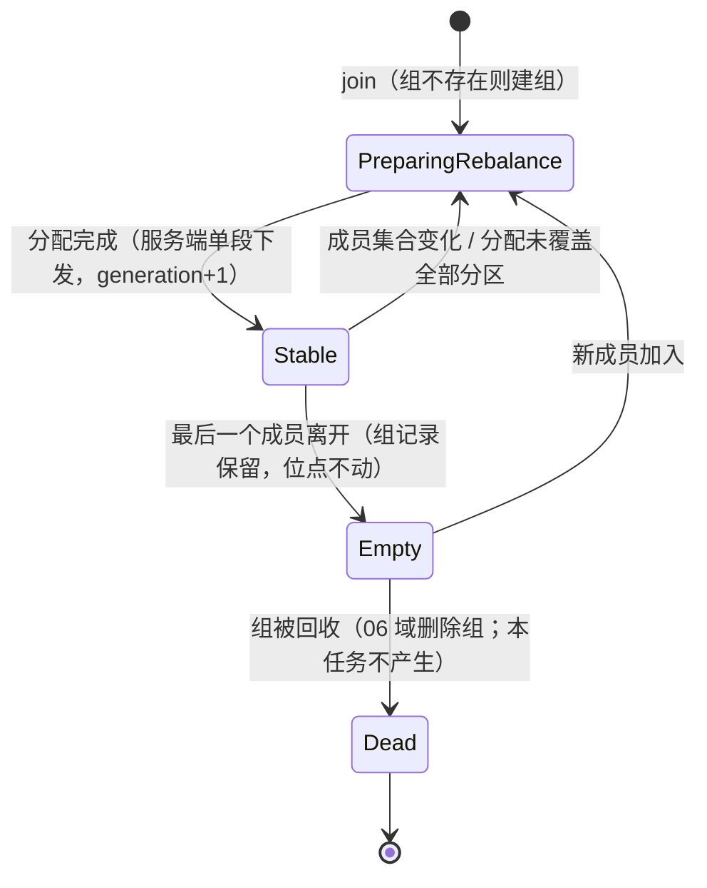
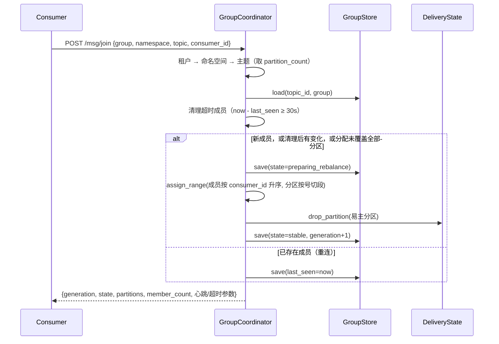
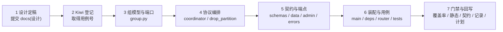

# 消费组详细设计

> 08B / 任务 01-4 · 任务级详细设计（组内分摊、eager 再均衡、成员心跳、位点不动）

[文档首页](../../../../../../文档首页.md) › [01 消息模型与投递](../../01_消息模型与投递.md) › [01-4 消费组](../01_消息模型与投递_04_消费组.md) › 详细设计

---

## 1. 概述 <a id="overview"></a>

本文档是任务 [01-4 消费组](../01_消息模型与投递_04_消费组.md) 的**详细设计**，粒度到「按端点落地、逐条验收」。与架构层不一致时以《架构设计》为准，实现细节以本文档为准。

**上游依据**：

- [需求 01-4 消费组](../../../../需求/01_需求_消息模型与投递.md#r01-4)
- [架构设计 · 接入面：协议与客户端](../../../../../../设计/架构设计/05_架构设计_接入面_协议与客户端.md#endpoints) 第 3 节（端点设计：`/msg/join` 族与 `/admin/groups`）、第 5 节（码段与预留）
- [架构设计 · 数据面：存储与复制](../../../../../../设计/架构设计/04_架构设计_数据面_存储与复制.md#offset) 第 8 节（位点管理：粒度 `(group, topic, partition)`、处理完再提交）
- [架构设计 · 控制面：元数据与运维](../../../../../../设计/架构设计/06_架构设计_控制面_元数据与运维.md#console) 第 4.1 节（消费组列表只读视图）、第 2 节（ConsumerGroup / Offset 实体）
- [概要设计 · 总览](../../../../../../设计/概要设计/01_概要设计_总览.md#modules) 第 2 节（`broker/router.py` 的组路由）、第 3.3 节（`/admin/groups`）
- bms《[消费组与再均衡](../../../../../../../bms文档/资料/知识档案/消息与事件驱动/05_事件驱动_消费组与再均衡.md#protocol)》第 2~6 节（协议流程、分配策略、位点提交、重平衡风暴）、第 7 节（组状态机）、第 9 节（对 msg 的设计约束）

**与前后任务的关系**：

| 方向 | 任务 | 关系 |
| --- | --- | --- |
| 前置 | [01-1 主题与分区模型](../../01_消息模型与投递_01_主题与分区模型/01_消息模型与投递_01_主题与分区模型.md) | 复用 `TopicRouter` 的主题解析与分区校验、`TopicService.expand_partitions`（扩分区后触发再均衡的判据）；**不另查主题表** |
| 前置 | [01-2 投递语义](../../01_消息模型与投递_02_投递语义/01_消息模型与投递_02_投递语义.md) | 位点键 `(group, topic_id, partition_no)` **不变**；`DeliveryService` 语义不动，组内分摊只在**数据面入口**约束「谁调得动」 |
| 前置 | [01-3 顺序性](../../01_消息模型与投递_03_顺序性/01_消息模型与投递_03_顺序性.md) | 停等 / 重投回原 offset / 死信例外 / 位点只按连续前缀推进**全部保留**；撤销只清在途、不动位点 |
| 本任务 | 01-4 消费组 | 组元数据 + 成员心跳 + eager 再均衡 + 分区归属约束 + 组状态只读视图 |
| 后继 | 01-5 延迟消息 / 01-6 保留与重放 | 重放 / 位点重置沿用同一 `(group, topic, partition)` 键；重放不改 `message_id` |
| 后继 | 06 域管理与运维 | `/admin/groups` 扩字段与筛选、积压监控、组删除（`Dead` 态由此产生）、cooperative 再均衡 |
| 后继 | 8B_02 存储与复制 | `GroupStore` 换 DB 实现（`msg_group` / `msg_group_member`），端口与端点不变 |

**口径基线（2026-11-04 已确认，不再变更）**：

1. **组元数据落点 = 端口 + 内存实现**：`GroupStore` 端口 + `InMemoryGroupStore`；8B_02 换 DB 实现，端口签名不变，本任务**不建表**。
2. **再均衡由服务端主导**：broker 计算分配，`join` 单段下发 `generation + partitions`；客户端只接收。不引入 Kafka 式 `sync` 段。
3. **分配策略 = range + 可插拔分配器**：成员按 `consumer_id` 字典序、分区按号升序连续切段；分配器为纯函数，后续加 sticky 只新增函数与策略常量，不动协议与状态机。
4. **成员身份由客户端自带**：成员键 `(consumer_id)` 在组内唯一；同一 `consumer_id` 再次 `join` 视为**重连**（刷新 `last_seen`、不触发再均衡、返回当前分配）。
5. **组与主题维度 = 按 topic**：组身份 `(tenant_id, topic_id, group)`，与位点键 `(group, topic_id, partition_no)` 一一对应；`join` 必带 `namespace` + `topic`。
6. **eager 全量再均衡**：成员集合变化即全组重算分配；cooperative 只预留（分配器策略位 + `generation` 语义），本任务不实现两阶段。
7. **成员失效判定 = 服务端 `last_seen` + 会话超时（30s）**；显式 `leave` 只作正常退出的快速路径。**无后台定时器**，超时清理在 `join` / `heartbeat` 时被动触发。
8. **心跳参数 = 心跳间隔 10s / 会话超时 30s**（3 倍余量，容忍两次丢包），常量落 `core/config.py`。
9. **`consume` / `ack` 强制成员制**：两请求新增必填 `consumer_id`；组必须存在（已 `join` 过），成员必须活跃，分区必须在该成员的分配内。这是本任务对 01-2 契约的**唯一破坏性变更**。
10. **撤销只依赖已提交位点**：分区易主时清该分区在途登记、**不动位点**；新 owner 从已提交位点续读，未 ack 消息重投（至少一次），重复由消费端幂等兜底。
11. **消费者数 > 分区数**：多余成员正常加入、分配为空、照常心跳，不报错（需求明文）。
12. **错误码新占 `350013`（组不存在）/ `350014`（成员非法）**；`350004` / `350005` / `350006` 仍由架构 05 §5 预留，**不得占用**。
13. **组状态可查在本任务落地**：只读 `GET /msg/admin/groups`（列表）与 `GET /msg/admin/groups/{namespace}/{topic}/{group}`（详情，含各分区位点与积压）；06 域在此基础上扩字段。

## 2. 现状与差距 <a id="gap"></a>

| 项 | 现状（2026-11-04 复核） | 本任务目标 | 动作 |
| --- | --- | --- | --- |
| 组元数据 | 无（`group` 只是位点键与投递状态键的字符串维度，拼错即静默产生新位点，01-2 §12 遗留 4） | 组记录（状态 / 世代 / 成员 / 分配）可建、可查、可回收 | 新增 `GroupStore` 端口 + 内存实现 |
| 成员管理 | 无（`consume` 直接指定 `partition`，谁都能拉任意分区） | 加入 / 心跳 / 离开三端点；分区只在分配内可拉 | 新增 `GroupCoordinator` + 三端点 |
| 组内分摊 | 无分配器 | range 分配，组成员变更即重算，`generation` 递增 | 新增纯函数 `assign_range` |
| 组间独立 | 位点键已含 `group`（01-2 已成立） | 保持（本任务不改键、不改语义） | 不改 |
| 顺序性 | 分区内停等 + 位点只按连续前缀推进（01-3） | 分区易主后仍从**已提交位点**续读，不得跳号 / 重置 | 撤销清在途，位点不动 |
| 心跳与处理分离 | 无心跳 | 心跳独立端点，处理慢不误判死亡 | 单列 `heartbeat` 端点 |
| 组状态可查 | 无 | 只读列表 + 详情（状态 / 世代 / 成员 / 分配 / 位点 / 积压） | 新增 `GroupInspector` + 管理面路由 |
| 契约 | 三数据面端点、7 schema、9 错误码 | +3 数据面端点、+1 管理面端点、consume / ack 加 `consumer_id`、+2 错误码 | 重导 `deploy/contracts/msg.json` |

> **为什么组校验不进 `DeliveryService`**：01-4 的前置契约明写「组内分摊只决定谁消费哪个分区，**不改位点键与投递语义**」。把归属校验放在**数据面入口**（端点 / 8B_01 帧入口）而不是 `DeliveryService`，一是让 01-2 / 01-3 的投递语义与其 31 个服务层用例保持不变，二是将来帧入口只需复用同一个 `GroupCoordinator.ensure_owner()`。

## 3. 交付物清单 <a id="deliverables"></a>

```text
msg/backend/services/msg/
├── src/bms_msg/
│   ├── broker/
│   │   ├── group.py                            # 新建：GroupStore 端口 + InMemoryGroupStore + 记录 + range 分配器 + 状态常量
│   │   ├── coordinator.py                      # 新建：GroupCoordinator（join / heartbeat / leave / ensure_owner）
│   │   ├── inspector.py                        # 新建：GroupInspector（列表 / 详情只读投影）
│   │   └── delivery.py                         # 修改：DeliveryState 增 drop_partition（撤销清在途）
│   ├── api/
│   │   ├── data/groups.py                      # 新建：/msg/join、/msg/heartbeat、/msg/leave
│   │   ├── data/messages.py                    # 修改：consume / ack 加 consumer_id + 归属校验
│   │   ├── admin/groups.py                     # 新建：/msg/admin/groups 列表与详情
│   │   ├── deps.py                             # 修改：get_group_store
│   │   └── router.py                           # 修改：挂两组新路由
│   ├── schemas/group.py                        # 新建：成员 / 分配 / 组列表 / 组详情契约
│   ├── schemas/message.py                      # 修改：consume / ack 增 consumer_id
│   ├── core/config.py                          # 修改：心跳间隔 / 会话超时 / consumer_id 形态
│   ├── errors.py                               # 修改：350013 / 350014 + 两个异常类
│   └── main.py                                 # 修改：app.state.group_store
├── tests/
│   ├── broker/
│   │   ├── test_group_store.py                 # 新建：端口与内存实现
│   │   ├── test_assignment.py                  # 新建：range 分配（均分 / 余数 / 成员多于分区 / 空组）
│   │   ├── test_coordinator.py                 # 新建：加入 / 重连 / 心跳 / 超时 / 离开 / 撤销 / 归属
│   │   └── test_delivery.py                    # 扩：drop_partition
│   ├── api/
│   │   ├── test_data_groups.py                 # 新建：三端点 + 成员制校验
│   │   ├── test_admin_groups.py                # 新建：列表 / 详情 / 过滤 / 分页 / 错误码
│   │   └── test_data_messages.py               # 改：消费前须 join（15 例加前置）
│   └── test_skeleton.py                        # 扩：新端点与 group_store 装配断言
├── deploy/registry/msg.toml                    # 修改：+2 条 [[errcodes]]
└── deploy/contracts/msg.json                   # 重导：+5 端点、+12 schema、consume / ack 字段
```

| 文件 | 类型 | 说明 |
| --- | --- | --- |
| `broker/group.py` | 新建 | `GroupStore` 端口（`load` / `save` / `list_for_tenant`）、`InMemoryGroupStore`、`GroupMember` / `ConsumerGroup` 值对象、`assign_range()`、状态与策略常量 |
| `broker/coordinator.py` | 新建 | `GroupCoordinator`：`join` / `heartbeat` / `leave` / `ensure_owner`，含超时清理、再均衡编排、撤销清在途 |
| `broker/inspector.py` | 新建 | `GroupInspector`：`list_groups` / `describe`，拼装位点与积压（只读，不写状态） |
| `broker/delivery.py` | 修改 | 仅增 `DeliveryState.drop_partition()`（清某分区全部在途）；投递语义、停等、位点推进**一行不改** |
| `api/data/groups.py` | 新建 | 三端点，权限码 `msg:consume`，租户走 `DataPlaneTenantDep` |
| `api/data/messages.py` | 修改 | `consume` / `ack` 调 `ensure_owner()`；不改投递实现 |
| `api/admin/groups.py` | 新建 | 列表 + 详情，权限码 `msg:query`，租户走 `CurrentTenantDep` |
| `schemas/group.py` | 新建 | `MemberRequest` / `MemberAssignment` / `LeaveResult` / `GroupItem` / `GroupPage` / `GroupMemberItem` / `GroupPartitionItem` / `GroupDetail` |
| `schemas/message.py` | 修改 | `ConsumeRequest` / `AckRequest` 增必填 `consumer_id` |
| `errors.py` / `msg.toml` | 修改 | `350013` / `350014` 与两条 `[[errcodes]]` 逐条对齐 |
| 表 / 迁移 | **不改** | 组元数据走端口 + 内存（口径 1），本任务不建表、不动 `services/table_registry.py` |
| 域路径 | **不改** | `api/**/*.py` / `broker/**/*.py` 已在 01-1 / 01-2 登记的 `[[domains]].paths` 内 |

## 4. 组模型 <a id="model"></a>

### 4.1 组身份与维度 <a id="identity"></a>

| 项 | 取值 | 理由 |
| --- | --- | --- |
| 组身份 | `(tenant_id, topic_id, group)` | 与位点键 `(group, topic_id, partition_no)` 一一对应；`topic_id` 雪花全局唯一，`tenant_id` 冗余存一份只为管理面按租户列表，不参与判定 |
| 组名 | 1~128，`[a-zA-Z0-9._-]+` | 沿用 01-2 已定的 `GROUP_NAME_PATTERN`（契约层 `10001`） |
| 成员身份 | `consumer_id`，1~128，`[a-zA-Z0-9._:-]+` | 允许 `host:pid` 形态；组内由客户端保证唯一（服务端不校验唯一性，同 id 即重连） |
| 分配单位 | 分区号（`0 ~ partition_count-1`） | 组内分摊只到分区粒度；同分区内仍由 01-3 停等保证顺序 |

> **为什么不把 namespace 放进组键**：`topic_id` 已隐含 `(tenant, namespace, name)`，再带 namespace 会让「改命名空间」出现两个组；管理面展示 namespace / topic 名由 `topic_id` 反查主题表得到。

### 4.2 成员与记录结构 <a id="member"></a>

| 结构 | 字段 | 说明 |
| --- | --- | --- |
| `GroupMember` | `consumer_id` / `joined_at` / `last_seen` / `partitions` | `partitions` 为该成员当前持有分区号（升序）；空闲成员为空列表 |
| `ConsumerGroup` | `tenant_id` / `topic_id` / `group` / `state` / `generation` / `members` | 不可变快照；`members` 按 `consumer_id` 升序（分配结果确定） |

**`generation` 语义**：成员集合每变化一次 +1（新成员加入、成员超时被清理、成员离开后仍有他人、扩分区导致的分配重算）。客户端凭 `generation` 判断自己手上的分配是否过期——`heartbeat` 返回值与本地不同即按新分配执行。`generation` 单调递增、不回退；重连（同 `consumer_id`）**不**递增。

### 4.3 组状态机 <a id="state"></a>



| 状态 | 含义 | 排障含义 |
| --- | --- | --- |
| `empty` | 组存在但无成员（全部离开 / 从未成功加入后离开） | 位点保留，消费停摆属正常；有积压即无消费者 |
| `preparing_rebalance` | 成员集合已变化、分配尚未落生效 | **卡在此态**说明分配计算失败或进程在两步 `save` 之间崩溃 |
| `stable` | 分配已生效，成员按 `generation` 拉取 | 位点不推进通常是业务处理阻塞或提交失败（非组问题） |
| `dead` | 组被回收 | 06 域组删除后出现；本任务不产生（常量与迁移条件预留给 06 域） |

> **`preparing_rebalance` 为什么保留为可观测态**：服务端同步计算分配，理论上同一请求内即转 `stable`；但内存实现两次 `save` 之间、8B_02 持久化后主键写入之间都可能中断。把中间态落进存储，排障时才能回答「卡在哪个状态」——这正是需求 01-4 内容 5 的目的。

### 4.4 首期范围与预留 <a id="scope"></a>

| 能力 | 本任务 | 预留方式 |
| --- | --- | --- |
| eager 全量再均衡 | 实现 | — |
| cooperative 增量再均衡 | **不实现** | 分配器策略常量 + `generation` 语义；cooperative 只需在 `MemberAssignment` 加 `revoked` 字段（向后兼容）并在 `heartbeat` 返回撤销清单 |
| sticky 分配 | **不实现** | `assign_range` 为纯函数、`ASSIGNMENT_STRATEGY_RANGE` 为策略位；新增 `assign_sticky` 不改协议 |
| 静态成员令牌 | **不实现** | `consumer_id` 即身份键；05 域认证后加成员令牌，键不变 |
| 组跨主题订阅 | **不做** | 组按 topic 建（口径 5）；跨主题订阅属客户端订阅能力，届时另立组键维度 |

## 5. 再均衡设计 <a id="rebalance"></a>

### 5.1 协议流程（服务端主导 · 单段） <a id="flow"></a>



`heartbeat` 与 `join` 共用同一段「清理 → 判定是否需要再均衡 → 保存」，差别只有两条：`heartbeat` 要求**成员已存在**（否则 `350014`），且不把本成员当作「新加入」；`leave` 只做「移除成员 → 有他人则再均衡、无他人则转 `empty`」。

| 触发再均衡的条件 | 判定点 | 说明 |
| --- | --- | --- |
| 新 `consumer_id` 加入 | `join` | 必然重算 |
| 成员超时被清理 | `join` / `heartbeat` | 被动清理，无后台定时器 |
| 成员显式离开且仍有他人 | `leave` | 必然重算 |
| 分配未覆盖全部分区 | `join` / `heartbeat` | 覆盖 `TopicService.expand_partitions()` 扩分区后组自动纳入新分区（`Σ 分配分区数 ≠ partition_count` 且成员非空） |
| 重连（同 `consumer_id`） | `join` | **不**触发（口径 4） |
| 最后一个成员离开 | `leave` | 转 `empty`，不重算 |

### 5.2 成员失效判定 <a id="timeout"></a>

| 项 | 取值 | 理由 |
| --- | --- | --- |
| 判据 | `now - last_seen >= SESSION_TIMEOUT_MS`（30s） | 单一判据、可注入时钟精确测；不依赖客户端「记得发 leave」 |
| 刷新时机 | `join` / `heartbeat` 成功即刷新 | 心跳独立端点，与拉取/处理解耦（需求 01-4 内容 4） |
| 清理时机 | `join` / `heartbeat` 进入时**被动**清理同组其他成员 | 首期无调度器；全部成员同时死亡时组自然静默，位点不动，新成员一加入即清理并接管 |
| 显式离开 | `leave` 立即移除 | 正常退出的快速路径，不等超时 |

> **为什么不加后台定时器**：定时器要引入任务调度、生命周期与多副本互斥（8B_02 / 8B_05 才有），而被动清理已满足「死成员在本组下一次有任何活动时被清理」。空组无人活动时本来也无人消费，清理与否不影响正确性。

> **成员会话的进程内边界**：成员会话与 `last_seen` 都在进程内存，进程重启后客户端必须重新 `join`（不能沿用旧会话）；同一 `consumer_id` 跨主题复用会互相判死，故成员标识按主题唯一。07-6-2 崩溃场景的重启取证按此口径。

### 5.3 分配算法（range） <a id="assign"></a>

```text
assign_range(members: 升序 consumer_id 列表, partition_count):
    if 成员为空: 返回空映射                      # 组转 empty，不分配
    base, extra = divmod(partition_count, len(members))
    cursor = 0
    for i, consumer_id in enumerate(members):
        size = base + (1 if i < extra else 0)    # 余数分给字典序靠前的成员
        分配 partitions[cursor : cursor + size] 给 consumer_id
        cursor += size
    return 映射                                  # 每个成员一个升序分区列表（可能为空）
```

| 性质 | 结论 |
| --- | --- |
| 不重复 | 区间连续切段，任一分区只出现一次 |
| 不全漏 | `Σ size == partition_count`（成员非空时） |
| 确定性 | 结果只取决于「成员 id 集合 + 分区数」，同样输入同样输出（可断言、可复现） |
| 空闲成员 | 成员数 > 分区数时，字典序靠后的成员拿到空列表（不报错，口径 11） |
| 迁移代价 | eager 下每次成员变化全量重算，分区易主面最大；sticky 为后续优化（§4.4） |

### 5.4 撤销与接管 <a id="revoke"></a>

| 项 | 规则 |
| --- | --- |
| 位点 | **不动**（唯一写入方仍是 `ack` / `acks=0` 的批量前移，01-2 / 01-3 口径） |
| 在途 | 分区易主时 `DeliveryState.drop_partition((group, topic_id, partition))` 清掉该分区全部在途登记 → 新 owner 立即可重投，不必等 30s 可见性超时 |
| 计数 | 被清掉的在途消息重投时 `delivery_count` 从 1 重计（组内投递状态随 owner 移交重置，属至少一次的重复窗口） |
| 暂存确认 | **保留**（`acked` 集合不清）：已 ack 但受缺口阻塞的 offset 仍参与连续前缀推进，清掉只会多一次重复投递 |
| 旧 owner | 丢失分区后仍可 `heartbeat`（拿到新 `generation` 与空分配）；再对该分区 `consume` / `ack` 一律 `350014` |

> **为什么清在途**：不清的话，易主分区的第一条未 ack 消息会以「他人未过期在途」挡住新 owner 整批拉取（01-3 停等），最长 30s 空转——这正是「再均衡停摆」的主要来源。清在途把停摆压到一次重算的时间量级，代价是未 ack 消息被重投一次（本就该重投）。

### 5.5 空闲成员与扩容 <a id="idle"></a>

| 场景 | 行为 |
| --- | --- |
| 成员数 > 分区数 | 多余成员加入成功、`partitions` 为空、`state` 仍 `stable`、照常心跳（不报错） |
| 分区扩容（`expand_partitions`） | 下一次 `join` / `heartbeat` 检测到「分配未覆盖全部分区」→ 重算，新分区按 range 落在现有成员上 |
| 成员退出 | 空出的分区由剩下成员按 range 重新覆盖 |
| 组成员全部离开 | 组转 `empty`、位点保留；重新加入者从已提交位点续读 |

### 5.6 并发与边界 <a id="concurrency"></a>

| 边界 | 保证 |
| --- | --- |
| 同进程、同组 | 组读写经 `GroupCoordinator` 串行（`GroupStore` 内存实现单事件循环内无 `await` 切换点）；跨组互不影响 |
| 多副本 | 不在本任务（进程内状态不共享，首期 `workers = 1`；归 8B_02 / 8B_05） |
| 与投递并发 | 再均衡清在途与 `consume` / `ack` 互斥由 `DeliveryState.lock` 保证（`drop_partition` 在锁内调用） |
| 同 `consumer_id` 双进程 | 视为重连（同一成员），两者会拿到同一分配——客户端须保证 `consumer_id` 组内唯一（契约约定，服务端不校验） |

## 6. 与投递的边界 <a id="boundary"></a>

### 6.1 成员制强约束 <a id="membership"></a>

| 端点 | 约束 | 失败码 |
| --- | --- | --- |
| `consume` | 组必须存在；`consumer_id` 必须是活跃成员；`partition` 必须在该成员的分配内 | `350013` / `350014` |
| `ack` | 同上（含「已被撤销的分区不可确认」） | `350013` / `350014` |
| `join` / `heartbeat` / `leave` | 主题与命名空间校验同数据面口径 | `350001` / `350010` / `350011` / `350012`；`heartbeat` / `leave` 另加组与成员判定 |

**判定顺序（在 01-2 既有链上插入两级）**：租户（`350012` / `350011`）→ 命名空间（`350010`）→ 主题（`350001`）→ **组（`350013`）** → 分区号（`350009`）→ **成员与归属（`350014`）** → 位点 / 消息（`350002` / `350003` / `350007`）。

### 6.2 不变的部分 <a id="unchanged-delivery"></a>

| 项 | 结论 |
| --- | --- |
| 位点键与粒度 | 不变：`(group, topic_id, partition_no)`，组间独立、消费者无关 |
| 停等 | 不变：未 ack 队头挡住其后 offset（01-3 §4.2） |
| 重投位置与计数 | 不变：回原 offset、`message_id` 不变（仅撤销时计数重置，见 §5.4） |
| 死信 | 不变：唯一破例、跳过不阻塞（01-3 §4.5） |
| `acks=0` | 不变：不登记在途、返回前推进位点；**仍受成员制约束**（必须带 `consumer_id`） |
| `DeliveryService` 方法签名 | 不变（`publish` / `consume` / `ack` 三方法一行不改） |

> **`acks=0` 与成员制**：`acks=0` 只是「不等确认」，不豁免「你得是这个分区的主人」——否则组内任意连接都能推位点，组内不重复分配就没有意义。

## 7. 接口与契约 <a id="api"></a>

### 7.1 端点清单 <a id="endpoints"></a>

| 方法 | 路径 | 权限码 | 说明 |
| --- | --- | --- | --- |
| POST | `/api/v1/msg/join` | `msg:consume` | 加入组（同 `consumer_id` 即重连），返回分配与 `generation` |
| POST | `/api/v1/msg/heartbeat` | `msg:consume` | 刷新存活并取回当前分配（可能已变化） |
| POST | `/api/v1/msg/leave` | `msg:consume` | 主动离开（幂等：未注册也返回成功） |
| POST | `/api/v1/msg/consume` | `msg:consume` | **改**：必填 `consumer_id`，校验成员与分区归属 |
| POST | `/api/v1/msg/ack` | `msg:consume` | **改**：同上 |
| GET | `/api/v1/msg/admin/groups` | `msg:query` | 组列表（可按 namespace / topic 过滤，页码分页） |
| GET | `/api/v1/msg/admin/groups/{namespace}/{topic}/{group}` | `msg:query` | 组详情（状态 / 世代 / 成员 / 分配 / 各分区位点与积压） |

三个成员端点共用请求体 `MemberRequest`：

```json
{ "group": "audit-consumer", "namespace": "msg", "topic": "audit.operation", "consumer_id": "worker-1" }
```

| 字段 | 规则 |
| --- | --- |
| `group` | 1~128，`[a-zA-Z0-9._-]+`（`GROUP_NAME_PATTERN`） |
| `namespace` | 1~64，须为已启用 `module_key`（`350010`） |
| `topic` | 1~200（同主题名形态） |
| `consumer_id` | 1~128，`[a-zA-Z0-9._:-]+`（`CONSUMER_ID_PATTERN`） |

### 7.2 加入 / 心跳响应 <a id="assignment"></a>

```json
{ "group": "audit-consumer", "topic": "audit.operation", "consumer_id": "worker-1",
  "generation": 3, "state": "stable", "partitions": [0, 1], "member_count": 2,
  "heartbeat_interval_ms": 10000, "session_timeout_ms": 30000 }
```

| 字段 | 说明 |
| --- | --- |
| `generation` | 当前世代；与客户端本地不同即须按 `partitions` 执行 |
| `state` | `empty` / `preparing_rebalance` / `stable` / `dead` |
| `partitions` | 本成员的分配（升序；空闲成员为空数组） |
| `member_count` | 组内当前活跃成员数（排障用） |
| `heartbeat_interval_ms` / `session_timeout_ms` | 服务端声明的节奏，客户端据此定心跳周期（避免客户端硬编码与服务端调参漂移） |

`leave` 响应：`{ "group": …, "topic": …, "consumer_id": …, "generation": 4, "state": "empty" }`（组内仍有他人则 `state` 为 `stable`）。

### 7.3 消费 / 确认的字段变更 <a id="consume"></a>

`ConsumeRequest` / `AckRequest` 各增一个必填字段：

```json
{ "group": "audit-consumer", "consumer_id": "worker-1", "namespace": "msg",
  "topic": "audit.operation", "partition": 1, "max_messages": 20, "acks": 1 }
```

> **破坏性变更的取舍**：设为**必填**而不做「可选兼容」，是为了让「不加入就能拉」这条绕过路径根本不存在（否则组内不重复分配形同虚设）。代价是 01-2 / 01-3 的 15 个接口用例须先 `join`（服务层 31 个用例不受影响，因为校验在端点层）。

### 7.4 组只读视图 <a id="admin"></a>

列表 `GET /api/v1/msg/admin/groups?namespace=&topic=&page=1&size=20`：

```json
{ "items": [ { "group": "audit-consumer", "namespace": "msg", "topic": "audit.operation",
               "state": "stable", "generation": 3, "member_count": 2, "assigned_partitions": 2 } ],
  "total": 1, "page": 1, "size": 20 }
```

详情 `GET /api/v1/msg/admin/groups/{namespace}/{topic}/{group}`：

```json
{ "group": "audit-consumer", "namespace": "msg", "topic": "audit.operation",
  "state": "stable", "generation": 3, "partition_count": 2,
  "members": [ { "consumer_id": "worker-1", "joined_at": "…", "last_seen": "…", "partitions": [0, 1] } ],
  "partitions": [ { "partition": 0, "owner": "worker-1", "committed": 12, "leo": 15, "lag": 3 } ] }
```

| 字段 | 口径 |
| --- | --- |
| `owner` | 该分区的当前持有者；无成员或未分配为 `null` |
| `committed` | `OffsetStore.get(group, topic_id, partition)`（下一条待消费 offset） |
| `leo` | `MessageStore.leo(topic_id, partition)` |
| `lag` | `leo - committed`（组在该分区的积压；06 域指标同口径） |
| 列表排序 | 组名升序（稳定、可断言）；`total` 为过滤后总数 |

> **积压只进详情**：列表要遍历全租户所有组的所有分区，成本随分区数线性增长；06 域做监控时再用聚合视图（架构 06 §5.1 的 `msg_consumer_lag`）。

### 7.5 错误码 <a id="errors"></a>

| 码 | 含义 | HTTP | 触发点 |
| --- | --- | --- | --- |
| `350013` | 组不存在（未 `join` 过，或已被回收 / 06 域删除） | 404 | `consume` / `ack` / `heartbeat` / 详情 |
| `350014` | 成员非法（心跳的成员不在组内、已超时清理、已离开；或分区不在该成员分配内） | 409 | `consume` / `ack` / `heartbeat` |
| `350001` / `350009` / `350010` | 主题 / 分区号 / 命名空间（01-2 既有） | 404 / 400 / 400 | 三个成员端点与组视图同样适用 |
| `350011` / `350012` | 租户停用 / 不存在 | 403 / 404 | 全部端点（`frame_tenant()` / 中间件抛出） |

**`x-error-codes` 声明**：`join` `[350001, 350010, 350011, 350012]`；`heartbeat` `[350001, 350013, 350014, 350010, 350011, 350012]`；`leave` `[350001, 350013, 350010, 350011, 350012]`（幂等，不报 `350014`）；`consume` 在 01-2 六项上追加 `350013` / `350014`；`ack` 在八项上追加 `350013` / `350014`；`admin/groups` 列表与详情 `[350001, 350013, 350010, 350011, 350012]`。

> `350004` / `350005` / `350006` 仍为架构 05 §5 预留（超时 / 背压 / 消息过大），本任务**不占用**；`leave` 不报 `350014`（幂等，见 §5.1）。

**契约快照**：重导 `deploy/contracts/msg.json`（`ApplicationFactory().create(None).openapi()` + `render_contract_json`）。重导前先写 `.cache/contracts/msg.new.json` 与现行快照 `diff`，确认漂移只含「+5 端点（3 数据面 + 2 管理面只读）、+12 schema（8 个业务 schema + 4 个 `ApiResponse` 包装）、consume / ack 新字段、2 条错误码描述」，再覆盖。

## 8. 代码设计 <a id="code"></a>

### 8.1 模块职责 <a id="modules"></a>

| 模块 | 职责 | 依赖 |
| --- | --- | --- |
| `broker/group.py` | 数据结构与端口：`GroupMember` / `ConsumerGroup` / `GroupStore` / `InMemoryGroupStore` / `assign_range` / 状态与策略常量 | 无（纯内存 + 值对象） |
| `broker/coordinator.py` | 协议编排：清理超时、判定是否重算、调分配器、撤销清在途、世代推进、归属校验 | `GroupStore`、`TopicRouter`、`DeliveryState` |
| `broker/inspector.py` | 只读投影：列表 / 详情，拼位点与积压（不写任何状态） | `GroupStore`、`TopicRouter`、`MessageStore`、`OffsetStore` |
| `broker/delivery.py` | 仅增 `DeliveryState.drop_partition()` | 无新增依赖 |
| `api/data/groups.py` | 三端点编排（租户、参数、响应拼装） | `GroupCoordinator` |
| `api/admin/groups.py` | 列表 / 详情（含分页与命名空间校验） | `GroupInspector` |

### 8.2 `GroupStore` 端口 <a id="port"></a>

```text
class GroupStore(ABC):
    async def load(tenant_id, topic_id, group) -> ConsumerGroup | None      # 无记录即 None
    async def save(record: ConsumerGroup) -> None                           # 整条覆盖（快照语义）
    async def list_for_tenant(tenant_id, topic_id | None) -> List[ConsumerGroup]
```

| 设计点 | 结论 | 理由 |
| --- | --- | --- |
| 快照读写而非增量 | `save` 覆盖整条记录 | 8B_02 落 `msg_group` / `msg_group_member` 时一次事务写两表，端口不用改；协调器不感知存储形态 |
| 无 `delete` | 本任务不删组（`dead` 由 06 域产生） | 避免留下无人调用的端口方法；06 域要删组时再加一个方法，属向后兼容扩展 |
| `list_for_tenant` 带可选 `topic_id` | 管理面列表 / 详情共用 | 列表按租户全量取，详情按 `topic_id` 精准取 |

### 8.3 `GroupCoordinator` <a id="coordinator"></a>

| 方法 | 输入 | 输出 | 关键分支 |
| --- | --- | --- | --- |
| `join` | `tenant` + `MemberRequest` | `ConsumerGroup` | 组不存在→建；成员已存在→重连；存在超时成员→清理；新成员→重算 |
| `heartbeat` | 同上 | `ConsumerGroup` | 组不存在→`350013`；成员不存在→`350014`；有超时成员 / 分配不完整→重算 |
| `leave` | 同上 | `ConsumerGroup` | 成员不存在→幂等返回；移除后无成员→`empty`；有成员→重算 |
| `ensure_owner` | `tenant` / `namespace` / `topic` / `group` / `consumer_id` / `partition` | `None` | 组不存在→`350013`；成员非法或分区非其所有→`350014` |

内部要点：

| # | 要点 | 说明 |
| --- | --- | --- |
| 1 | `_load_or_create` | 组不存在则建 `state=empty, generation=0, members=[]`（首成员加入后走重算，转 `preparing_rebalance`） |
| 2 | `_prune(record, now)` | 返回「是否有成员被清理」，供调用方决定是否重算 |
| 3 | `_stale(record, partition_count)` | 成员非空且 `Σ 分配分区数 ≠ partition_count` → 需重算（覆盖扩分区） |
| 4 | `_rebalance(record, partition_count)` | 两次 `save`：`preparing_rebalance` → 分配 + 撤销清在途 → `stable` 且 `generation+1` |
| 5 | `_revoke(old, new)` | 对比新旧 owner，对**易主分区**调 `DeliveryState.drop_partition()`（锁内） |
| 6 | `_active_member(record, consumer_id)` | 取活跃成员；不存在即 `350014` |

### 8.4 `DeliveryState.drop_partition` <a id="drop"></a>

```text
def drop_partition(self, key: PartitionKey) -> None:
    """清掉某分区全部在途登记（分区易主时用；位点与暂存确认不动）。"""
    self._inflight.pop(key, None)
```

唯一的 01-2 / 01-3 代码改动：**只删在途**，不碰 `acked`（§5.4）、不碰 `OffsetStore`、不影响停等规则本身。

### 8.5 `GroupInspector` <a id="inspector"></a>

| 方法 | 行为 |
| --- | --- |
| `list_groups(namespace, topic, page, size)` | 取本租户组记录（可按 `topic_id` 收窄）→ 按 `topic_id` 反查主题（`TopicRepository.get`，缺失即**跳过**该记录，防主题被删后脏展示）→ 按 namespace 过滤 → 组名升序 → 分页 |
| `describe(namespace, topic, group)` | 解析主题（`350001`）→ 取组（`350013`）→ 逐分区拼 `owner` / `committed` / `leo` / `lag` |

分页与过滤参数校验沿用主题列表口径：`page ≥ 1`、`1 ≤ size ≤ MAX_LIST_SIZE`（`ParamError` → `10001`），`namespace` 非法即 `350010`。

### 8.6 装配与登记 <a id="assembly"></a>

| 项 | 动作 |
| --- | --- |
| 进程级状态 | `main.py::configure_service()` 增 `app.state.group_store = InMemoryGroupStore()`（与消息 / 位点 / 死信同层） |
| 依赖注入 | `api/deps.py` 增 `get_group_store` + `GroupStoreDep` |
| 请求级服务 | `GroupCoordinator` / `GroupInspector` 每请求构造（绑定平台库 `TopicRepository` + 进程级状态），与 `DeliveryService` 同构 |
| 路由注册 | `api/router.py` 追加 `api/data/groups.py` 与 `api/admin/groups.py`（仍是一条聚合路由，`service_routers()` 数量不变） |
| 常量 | `core/config.py` 增 `HEARTBEAT_INTERVAL_MS=10_000` / `SESSION_TIMEOUT_MS=30_000` / `CONSUMER_ID_PATTERN` / `ASSIGNMENT_STRATEGY_RANGE` |
| 错误码 | `errors.py` 增 `GROUP_NOT_FOUND` / `MEMBER_INVALID` 两值 + 两个异常类；`msg.toml` 增两条 `[[errcodes]]` |
| 表归属 | **不变**（不建表；`services/table_registry.py` 仍两表） |

## 9. 测试设计 <a id="tests"></a>

### 9.1 用例清单 <a id="cases"></a>

服务层（`tests/broker/`）：

| # | 文件 · 用例 | 断言要点 | 覆盖点 |
| --- | --- | --- | --- |
| 1 | `test_group_store.py::test_load_missing_returns_none` | 未存过的组 `load` 为 `None` | 缺省分支 |
| 2 | `…::test_save_then_load_round_trip` | 成员与分配往返一致（成员升序、分区升序） | 快照语义 |
| 3 | `…::test_groups_isolated_by_topic_and_tenant` | 同组名不同 `topic_id` / 不同租户互不可见 | 三维隔离 |
| 4 | `…::test_list_for_tenant_filters_topic` | 不带 / 带 `topic_id` 两种取法 | 可选过滤两支 |
| 5 | `test_assignment.py::test_range_even_split` | 4 分区 2 成员 → `[0,1]` / `[2,3]` | 无余数 |
| 6 | `…::test_range_remainder_to_earlier_members` | 5 分区 2 成员 → `[0,1,2]` / `[3,4]` | 有余数 |
| 7 | `…::test_idle_members_get_empty_assignment` | 2 分区 3 成员 → 末位为空列表 | 空闲成员 |
| 8 | `…::test_no_members_yields_empty_mapping` | 空成员 → 空映射 | 空组分支 |
| 9 | `test_coordinator.py::test_join_creates_group_and_assigns` | 首成员加入：`generation=1`、`state=stable`、分到全部分区 | 建组 + 重算 |
| 10 | `…::test_second_member_triggers_rebalance` | 第二成员加入：`generation=2`、两成员分区不重叠、并集为全集 | 成员变化重算 |
| 11 | `…::test_rejoin_same_consumer_is_reconnect` | 同 `consumer_id` 再 `join`：`generation` 不变、分配不变 | 重连分支 |
| 12 | `…::test_more_members_than_partitions_keeps_idle` | 1 分区 2 成员：后加入者分配为空、`state=stable`、不报错 | 空闲成员 |
| 13 | `…::test_heartbeat_refreshes_last_seen` | 心跳后推进 29s 再心跳仍活跃（不误踢） | 心跳刷新 |
| 14 | `…::test_heartbeat_reports_member_timeout` | 成员 A 心跳、B 静默 30s → A 心跳触发清理，`generation+1`、A 接管全部分区 | 超时清理 + 重算 |
| 15 | `…::test_heartbeat_unknown_group_returns_350013` | 未见过的组 → `350013` | 组不存在 |
| 16 | `…::test_heartbeat_unknown_member_returns_350014` | 组存在但成员未加入 → `350014` | 成员非法 |
| 17 | `…::test_leave_rebalances_remaining_members` | 两成员，一成员离开 → `generation+1`、剩下者接管 | 离开重算 |
| 18 | `…::test_leave_last_member_marks_empty` | 最后成员离开 → `state=empty`、成员清空 | 转空态 |
| 19 | `…::test_leave_unknown_member_is_idempotent` | 未注册成员 `leave` 不报错、`generation` 不变 | 幂等分支 |
| 20 | `…::test_rebalance_drops_inflight_of_moved_partition` | 分区易主后新 owner 立即能拉到原未 ack 消息（`delivery_count=1`），位点不变 | 撤销清在途 |
| 21 | `…::test_expand_partitions_rebalances_on_heartbeat` | 2→4 分区后心跳触发重算，分配覆盖 4 个分区 | 分配不完整分支 |
| 22 | `…::test_ensure_owner_rejects_foreign_partition` | 非本成员分区 → `350014`；本成员分区通过 | 归属校验两支 |
| 23 | `…::test_ensure_owner_unknown_group_returns_350013` | 组不存在 → `350013` | 组不存在 |
| 24 | `test_delivery.py::test_drop_partition_clears_inflight` | 清在途后再次 `consume` 重投（计数 1）、位点不动；清不存在的分区无副作用 | `drop_partition` 两支 |

接口层（`tests/api/`）：

| # | 文件 · 用例 | 断言要点 |
| --- | --- | --- |
| 25 | `test_data_groups.py::test_join_returns_assignment` | 200 + `generation=1` / `state=stable` / `partitions` 覆盖全部分区 / 两个节奏参数 |
| 26 | `…::test_join_second_member_rebalances` | 两成员各自拿到不重叠分区，第三次 `join` 同 id 不改 `generation` |
| 27 | `…::test_heartbeat_returns_current_assignment` | 心跳 200 + `generation` 与 `join` 一致 |
| 28 | `…::test_leave_removes_member` | 离开 200 + `state` 转 `empty`（单成员组） |
| 29 | `…::test_join_missing_topic_returns_350001` | 主题不存在 → 404 / `350001` |
| 30 | `…::test_heartbeat_unknown_group_returns_350013` | 未加入 → 404 / `350013` |
| 31 | `…::test_consume_requires_membership` | 不 `join` 直接拉 → 404 / `350013` |
| 32 | `…::test_consume_rejects_foreign_partition` | 分区不在分配内 → 409 / `350014` |
| 33 | `…::test_ack_rejects_unknown_member` | 成员不存在 → 409 / `350014` |
| 34 | `…::test_permission_denied_blocks_group_endpoints` | 无 `msg:consume` → 403（30001） |
| 35 | `test_admin_groups.py::test_list_groups` | 200 + 1 条 + `member_count` / `assigned_partitions` / `total` |
| 36 | `…::test_list_groups_filters` | 按 `namespace` / `topic` 过滤，命中与未命中两支 |
| 37 | `…::test_list_groups_paginates` | `size=1` 分两页，`total` 恒为过滤后总数 |
| 38 | `…::test_list_skips_group_of_deleted_topic` | 主题缺失的组记录跳过（防脏展示） |
| 39 | `…::test_describe_group_returns_partitions` | 详情含 `owner` / `committed` / `leo` / `lag`；无成员时 `owner=null` |
| 40 | `…::test_describe_missing_group_returns_350013` | 组不存在 → 404 / `350013` |
| 41 | `…::test_describe_missing_topic_returns_350001` | 主题不存在 → 404 / `350001` |
| 42 | `…::test_invalid_namespace_returns_350010` | 命名空间非法 → 400 / `350010` |
| 43 | `…::test_permission_denied_blocks_group_admin` | 无 `msg:query` → 403 |

**存量用例调整**：`test_data_messages.py` 15 例与 `test_ordering.py` 的 1 例接口用例，在消费前加 `join` 前置（`_join(client, consumer_id="c1")` 助手）；`test_skeleton.py` 扩「四个新路径 + `group_store` 已装配」断言。服务层 `test_delivery.py` / `test_ordering.py` 其余用例**不动**（校验在端点层）。

### 9.2 覆盖与门禁 <a id="coverage"></a>

| 项 | 要求 |
| --- | --- |
| 变更模块 | `bms_msg`（`broker/group.py` / `coordinator.py` / `inspector.py` / `delivery.py` / `api/data/groups.py` / `api/admin/groups.py` / `schemas/group.py` / `errors.py`）行 + 分支 **100%** |
| 新增分支 | 组不存在 / 成员不存在 / 重连 / 空闲成员 / 超时清理（有 / 无）/ 分配不完整 / 离开（有成员 / 无成员 / 未注册）/ 易主清在途 / 主题缺失跳过，逐一有用例命中 |
| 存量回归 | 服务层 31 例不动；接口层 16 例加 `join` 前置后全绿 |
| 静态 | `ruff check` / `format --check` / `pyright --pythonpath …` 全零 |
| 装配 | `create(None)` 可启动；`app.state.group_store` 就位（`test_skeleton.py`） |
| 文档 | `engkit links` / `docs-scope` / `eol` 三项通过 |

### 9.3 时钟与测试替身 <a id="clock"></a>

| 项 | 处置 |
| --- | --- |
| 会话超时 | `GroupCoordinator(now=…)` 注入 `ManualClock`（沿用 01-2 夹具），推进 30s 模拟静默，**不 sleep** |
| 投递时钟 | 撤销清在途用例里协调器与 `DeliveryService` 共用同一 `ManualClock`，保证「易主后立即可拉」可断言 |
| 接口层 | 不注入时钟：只覆盖「join → 分配 → 心跳 → 离开 → 归属校验」与错误码；超时路径由服务层覆盖（与 01-2 / 01-3 同处置） |

## 10. 实施步骤 <a id="steps"></a>



| 步 | 内容 | 产出 |
| --- | --- | --- |
| 1 | 本文档定稿并提交 | 设计提交 |
| 2 | Kiwi 登记一条用例（覆盖 §9.1） | 平台自增编号 |
| 3 | `broker/group.py`：记录 + 端口 + 内存实现 + `assign_range` + 常量 | 组模型可用 |
| 4 | `broker/coordinator.py` + `DeliveryState.drop_partition()` | 再均衡可用 |
| 5 | `schemas/group.py`、`api/data/groups.py`、`api/admin/groups.py`、`errors.py`、`msg.toml`、`schemas/message.py` | 端点可调 |
| 6 | `main.py` / `deps.py` / `router.py` 装配；写 §9.1 全部用例并调整存量接口用例 | 门禁可跑 |
| 7 | 覆盖率 100% / 静态 / 契约重导 / 文档三项校验；实施与测试记录；计划表迁行并回填 | 交付闭环 |

## 11. 验收映射 <a id="accept-map"></a>

| 任务完成标准 | 验证方式 |
| --- | --- |
| 两个消费组订阅同一主题，各自位点独立推进、互不影响 | 用例 #3 / #9 / #10（组键隔离）+ 接口用例 #25 / #26（两组各自 `join`、各自 `consume` 与 `ack`，位点互不牵连） |
| 组内消费者增减后，分区重新分配且无重复分配 | 用例 #10 / #17（`generation` 递增、区间不重叠且并集为全集）；`assign_range` 用例 #5~#8 直接断言无重复无遗漏 |
| 消费者数超过分区数时，多余消费者保持空闲状态，不报错 | 用例 #7 / #12；接口用例 #25 之后加成员后 `partitions` 为空、响应 200 |
| 处理耗时超过心跳间隔时，消费者不被误判死亡 | 用例 #13（29s 内两次心跳不踢）+ #14（30s 静默才清理）；心跳独立端点使处理与保活解耦（§5.1） |
| 组状态可查询，排障能定位当前状态 | 接口用例 #35~#40（列表 / 详情含 `state` / `generation` / 成员 / 分配 / 位点 / 积压） |
| 变更模块行 + 分支覆盖率 100%，静态全绿 | `engkit coverage` + `ruff` / `pyright` |

## 12. 风险与开放项 <a id="risk"></a>

| # | 项 | 影响 | 处置 |
| --- | --- | --- | --- |
| 1 | 组元数据为进程内状态 | 重启后组与分配全丢，客户端须重新 `join`（位点与消息本就内存态） | 明确首期口径；8B_02 换 `msg_group` / `msg_group_member`，端口不变 |
| 2 | 多副本下组状态不共享 | 同一组在两个副本各自维护成员与分配 → 重复分配（仍至少一次） | 首期单副本（`workers = 1`）；归 8B_02 / 8B_05（协调者归属与复制） |
| 3 | 无后台定时器 | 组内全员静默时不清理，`state` 停在 `stable` | 被动清理已满足正确性（下一次 `join` / `heartbeat` 即清理）；06 域可加周期扫描 |
| 4 | eager 全量再均衡 | 每次成员变动全组重算、分区易主面最大，短暂重复投递 | 首期口径；cooperative + sticky 预留（§4.4），06 域评估落地 |
| 5 | `consume` / `ack` 破坏性加 `consumer_id` | 既有客户端（尚未对外）须先 `join` | 版本仍为 `0.1.0` 预发布，无外部调用方；契约快照与用例同批更新 |
| 6 | 请求内主题解析两次（归属校验 + 投递服务） | 每条消费多一次元数据查询 | 接受（单条 SELECT）；8B_01 帧入口落地时合并为一次解析 |
| 7 | `consumer_id` 无身份校验 | 同组内可用他人 id 顶替（视为重连），拿到同一分配 | 首期组内互信；05 域认证接入成员令牌后收紧，键不变 |
| 8 | 撤销时清在途使 `delivery_count` 重计 | 消费端看到的重复计数可能回落 | 文档写明「计数按 owner 移交重置」；幂等靠业务键（01-2 口径） |
| 9 | `dead` 态本任务不产生 | 状态机少一条实际迁移 | 常量与迁移条件已定义，06 域组删除时启用；`docs` 与代码注释同口径 |
| 10 | 组列表按 `topic_id` 反查主题（N+1） | 组多时管理面列表查询放大 | 先分组再逐个 `get`（组数量级小）；06 域做聚合视图时改为联表 |

## 13. 对齐记录 <a id="align"></a>

| # | 事项 | 结论（2026-11-04 确认） |
| --- | --- | --- |
| 1 | 组元数据落点 | `GroupStore` 端口 + 内存实现；8B_02 换 DB 实现，不建表、不动表归属清单 |
| 2 | 再均衡主导方 | 服务端主导，`join` 单段下发 `generation + partitions`；无 `sync` 段 |
| 3 | 分配策略 | range（成员按 `consumer_id`、分区按号连续切段）+ 分配器策略位预留 |
| 4 | 成员身份 | 客户端自带 `consumer_id`；同 id 再 `join` 即重连（不递增世代） |
| 5 | 加入 / 心跳 / 离开表达 | 新增 `/msg/join` / `/msg/heartbeat` / `/msg/leave` 三端点，心跳独立于拉取 |
| 6 | 组状态查询落点 | 本任务开只读 `/msg/admin/groups`（列表 + 详情）；06 域扩字段与筛选 |
| 7 | 错误码 | 新占 `350013`（组不存在）/ `350014`（成员非法或分区非本成员）；`350004` / `350005` / `350006` 保持预留 |
| 8 | 撤销位点处置 | 只依赖已提交位点；撤销清在途、位点不动，新 owner 从位点续读重投 |
| 9 | 消费者数 > 分区数 | 允许加入、分配为空、照常心跳，不报错 |
| 10 | 失效判定 | 服务端 `last_seen` + 会话超时；显式 `leave` 为快速路径 |
| 11 | 组与主题维度 | 组身份 `(tenant_id, topic_id, group)`，与位点键一一对应；`join` 必带 topic |
| 12 | 心跳参数 | 心跳 10s / 会话超时 30s，常量落 `core/config.py`，响应回传供客户端自适应 |
| 13 | 消费归属校验强度 | 强制成员制：`consume` / `ack` 必填 `consumer_id`，组须存在、成员须活跃、分区须在其分配内 |
| 14 | 校验落点（推导） | 归属校验在**数据面入口**而非 `DeliveryService`：01-2 / 01-3 投递语义与 31 个服务层用例保持不变，8B_01 帧入口复用同一方法 |
| 15 | 分配不完整判定（推导） | `Σ 分配分区数 ≠ partition_count` 且成员非空即重算：覆盖 01-1 `expand_partitions()` 后组自动纳入新分区，避免新分区永不消费 |
| 16 | `leave` 幂等（推导） | 未注册成员 `leave` 返回成功（网络重试友好），`350014` 只由 `heartbeat` / 归属校验抛出 |
| 17 | 组列表排序（推导） | 组名升序 + `total` 为过滤后总数；`lag` 只进详情（列表成本随分区数线性增长） |
| 18 | `dead` 态（推导） | 常量与迁移条件定义在册，本任务不产生（组删除归 06 域），与「预留 cooperative」同口径处理 |

---

> 依《[文档生成规范](../../../../../../../bms文档/规范/文档生成规范.md)》与《[任务文档规范](../../../../../../../bms文档/规范/任务文档规范.md)》编写
