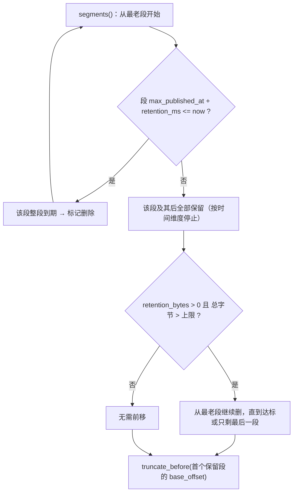
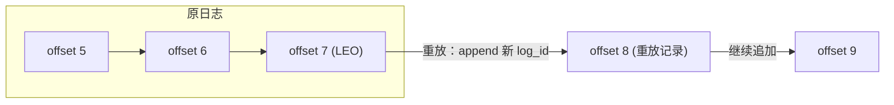
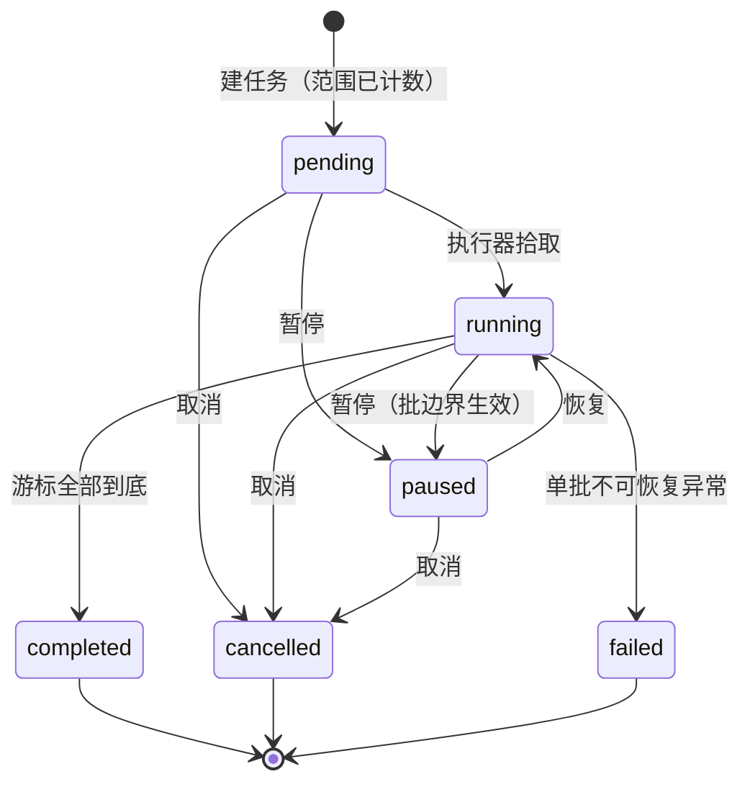

# 消息保留与重放详细设计

> 段级保留判定 + 可读区间起点前移 × 条件重放（新 `log_id`、原 `message_id`）× 任务化（限速 / 暂停 / 恢复 / 取消 / 进度）× 复用 bms 操作审计链

[文档首页](../../../../../../文档首页.md) › [消息平台规划](../../../../../../规划/01_规划_消息平台.md) › [阶段计划](../../../../计划/01_计划_消息平台.md) › [01-6 消息保留与重放](../01_消息模型与投递_06_消息保留与重放.md) › 详细设计

---

## 1. 概述 <a id="overview"></a>

### 1.1 目标

把「历史怎么退场」与「历史怎么再来一遍」这两件事做成**可判定、可验证、可留痕**的服务端能力：

1. **保留**：按时间与容量双维度判定到期，**按段整段删除**，可读区间起点随之前移；位点早于起点即报 `350003`（不静默从头）。
2. **重放**：按 offset / 时间 / key 条件选出历史记录，以**新的物理写入**（新 `log_id`、原 `message_id`、载荷不变）追加到原分区尾部。
3. **任务化**：重放以任务执行，可限速、可暂停 / 恢复 / 取消、可查进度（已投递 / 总量）。
4. **留痕**：创建与终态各写一条 bms 操作审计，载荷带范围、结果与首末 `log_id`。

三条不可动摇的边界：

1. **不改 01-2 / 01-3 的语义**：位点仍只由 `ack` 与 `acks=0` 批量前移推进；停等规则一行不改（`delivery.py::_collect` 不进入本次改动）；重放只往**尾部**追加，因此天然进入停等顺序链，不需要任何特殊处理。
2. **不提前钉死分段格式**：真段删除、`.log` 段文件、恢复点归 **8B_02**；本任务只交付「到期判定 + 起点前移 + 端口 + 内存实现」，完成标准逐条标注承接阶段。
3. **不做 compaction**（架构 09 D39）：`cleanup_policy = compact` 仍不接受，本任务不得顺手扩进来。

### 1.2 两段交付

| 段 | 内容 | 归口 |
| --- | --- | --- |
| **A 语义与接口（本任务）** | 段元数据端口、到期判定、起点前移、重放范围与任务、限速 / 暂停 / 恢复 / 取消 / 进度、审计留痕 | 01-6 |
| **B 真实段删除** | `.log` 分段落盘、段级删除与文件回收、启动恢复点、段损坏隔离 | 8B_02（需求 02-1 / 02-2） |

A 段用**定长条数段替身**验「旧段被删且不影响可读段」；B 段换文件实现时**端口签名不变**，只换实现。

### 1.3 口径来源

| 问题 | 定稿 | 出处 |
| --- | --- | --- |
| 保留机制 | 时间 / 容量双维度，按段整段删 | 架构 04 §6、需求 01-6 内容 1 |
| 不做 compaction | 首期只做 retention | 架构 09 D39、架构 04 §6 |
| 重放是否改标识 | 保留 `message_id`、分配新 `log_id`、不改载荷 | 需求 01-6 内容 4、架构 04 §2.2 |
| 重放必须任务化 | 限速 + 暂停 + 进度 + 取消 | 架构 06 §4.2 / §7、需求 06-6 |
| 审计落点 | 写 bms 审计链，不自建 | 架构 06 §9、架构 09 D22、需求 05-6 |
| 记录级定位 | 审计条目须带 `log_id`，但不因它洪泛 | 需求 05-6 内容 6 |
| 重放不得绕过成员制 | 服务端操作，不经 `/msg/consume` | 需求 01-6 前置契约（01-4 行） |

## 2. 现状与差距 <a id="gap"></a>

| 现状（01-1 ~ 01-5） | 差距 | 本任务处置 |
| --- | --- | --- |
| `MessageStore.start_offset` 端口已在，内存实现**恒 0** | 起点永不前移，`350003` 分支不可达 | 增加起点跟踪 + `truncate_before()`，`fetch` / `leo` 与起点对齐 |
| `delivery.py::consume` 已判 `committed < start → 350003` | 判据存在但无触发者 | 由清理前移起点触发（判定代码一行不改） |
| `msg_topic.retention_ms` 已在，**无容量列** | 「按容量保留」无处可配 | 新增 `retention_bytes`（0 = 不限） |
| 日志是一整条 `list`，无「段」概念 | 「按段删除」无判据 | 端口新增 `segments()`，内存实现按定长条数切段 |
| 无重放能力（无范围选择、无任务、无执行器） | 补历史 / 修逻辑后重放无入口 | 新增 `broker/replay.py` + `api/admin/replay.py` + 任务表 |
| 审计：msg 未配 `[outbox_store]`，落到 `NullOutboxStore` | **审计事件被静默丢弃**（含中间件那一条） | 配 `provider="sql"` + `exclude_paths` 排除高频路径 |
| 基座审计链只认 `sys.operation.logged` / `sys.login.logged` | 无产品侧业务审计事件类型入口 | 复用操作日志事件（报冲突、登记遗留，不新造事件类型） |

## 3. 交付物清单 <a id="deliverables"></a>

```text
backend/services/msg/src/bms_msg/
├── broker/log.py                        # 改：SegmentMeta / segments() / truncate_before() / 起点跟踪（fetch·leo 对齐）
├── broker/retention.py                  # 新增：RetentionService（双维度到期判定 + 起点前移）
├── broker/replay.py                     # 新增：ReplayScope / ReplayTask / 状态常量 / ReplayService / ReplayRunner / ReplayAuditor
├── models/replay.py                     # 新增：MsgReplayTask（任务表模型）
├── models/topic.py                      # 改：+ retention_bytes 列
├── models/__init__.py                   # 改：MODEL_MODULES 登记 bms_msg.models.replay
├── repositories/replay.py               # 新增：ReplayTaskRepository
├── schemas/replay.py                    # 新增：ReplayRequest / ReplayTaskItem
├── schemas/topic.py                      # 改：TopicCreateRequest / TopicItem + retention_bytes
├── services/topic.py                    # 改：保留容量校验（越界同 350009）
├── core/config.py                       # 改：段条数 / 重放速率上下限 / 推进周期 / 扫描批 / 令牌上限 / 任务批
├── errors.py                            # 改：350016（任务不存在）/ 350017（任务状态非法）
├── api/admin/replay.py                  # 新增：建任务 / 进度 / 暂停 / 恢复 / 取消
├── api/data/messages.py                 # 改：publish / consume 入口调一次清理（幂等）
├── api/deps.py                          # 改：ReplayTaskStoreDep / AuditSinkDep
├── api/router.py                        # 改：登记 admin/replay 路由
├── main.py                              # 改：装配 replay_runner / audit_sink / 平台库 uow 工厂
└── deploy/contracts/msg.json            # 重导：+5 端点、+3 schema、Topic 增 retention_bytes

deploy/registry/msg.toml                 # 改：+2 条 errcodes（350016 / 350017）
backend/config.toml                      # 改：[outbox_store] provider = "sql"；[audit_log].exclude_paths 显式列全
backend/services/table_registry.py       # 改：+1 条表归属（msg_replay_task）
backend/services/msg/tests/              # 改：新增 4 个用例文件 + 3 个存量文件补用例 + conftest 夹具

msg文档/设计/数据库设计/数据表设计/msg_replay_task.md   # 新增表文件
msg文档/设计/数据库设计/数据表设计/msg_topic.md        # 改：字段 + 变更记录
msg文档/设计/数据库设计/01_数据库设计_总览.md          # 改：已设计数据表登记
```

**契约增量**（重导前先写 `.cache/contracts/msg.new.json` 与现行快照 `diff`，确认漂移只含下列项）：

| 项 | 变更 |
| --- | --- |
| 路径 | `+ POST /api/v1/msg/admin/replay`、`+ GET /api/v1/msg/admin/replay/{task_id}`、`+ POST .../pause`、`+ POST .../resume`、`+ POST .../cancel`（5 条） |
| schema | `+ ReplayRequest`、`+ ReplayTaskItem`、`+ ApiResponse_ReplayTaskItem_`（3 条；后者由 5 个端点共用） |
| `TopicCreateRequest` | `+ retention_bytes: int`（缺省 0） |
| `TopicItem`（含 `TopicDetail`） | `+ retention_bytes: int` |
| 端点 description | `/msg/publish` 与 `/msg/consume` 各变更 1 处（补「入口触发保留清理」说明） |

> 新增字段一律**只增不改**；`PublishResult.offset` 已在 01-5 放宽可空，本次不再动发布契约。

## 4. 保留模型 <a id="model"></a>

### 4.1 段：端口上的元数据，实现里的索引 <a id="segment"></a>

```python
@dataclass(frozen=True)
class SegmentMeta(BaseValueObject):
    base_offset: int            # 段首 offset（含）
    end_offset: int             # 段尾 offset（不含）
    max_published_at: datetime  # 段内最大发布时间（时间维度判据）
    size_bytes: int             # 段内字节合计（容量维度判据）
```

- **端口只暴露段元数据，不暴露文件**：8B_02 以 `.log` 段文件 + 索引实现同一份元数据，`segments()` 从索引读，签名不变。
- **内存实现的替身规则**：从分区起点起**按定长条数切段**（`RETENTION_SEGMENT_RECORDS`，缺省 1000，用例注入 2），最后一段可不足额；段边界由起点 + 固定条数确定，**不随起点前移重排**（前移只会整段丢弃头部，段号语义不变）。
- **为什么是「定长条数」而不是「逐条」**：真实段删除是**整段**语义——段内只要还有未过期记录，整段就得留着。逐条段会让「到期即删」在内存实现里比真实实现更精细，8B_02 换实现后同一批用例的期望值必须重写；定长段与真实语义同构，换实现只换数据来源。

### 4.2 双维度到期判定 <a id="judge"></a>



判定细则：

| 维度 | 判据 | 停止条件 | 边界 |
| --- | --- | --- | --- |
| 时间 | `段内 max_published_at + retention_ms <= now` | 遇到第一个未过期段即停（段内保留到整段过期） | `retention_ms` 取主题列（1 ~ `MAX_RETENTION_MS`） |
| 容量 | `Σ size_bytes > retention_bytes`（`retention_bytes > 0` 时生效） | 达标即停；**最多删到只剩最后一段** | 单条记录本身超上限时仍保留最后一段：宁可超配额，也不把刚写入的数据删空 |
| 全删 | 时间维度可删到 0 段（`start == leo`） | 新消息仍可写（`append` 从 `start` 继续编号） | 容量维度**不**删空（见上） |

`size_bytes` 口径（内存实现）：`len(payload) + len(key or "") + Σ(len(k) + len(v)) + len(trace_id or "")`。**不含** Python 对象开销——它是**容量判据的近似**，不是进程内存实测值（真实字节由 8B_02 按段文件大小给）。

### 4.3 可读区间与起点前移 <a id="window"></a>

可读区间 = `[start_offset, leo)`：

| 端口方法 | 前端语义 | 起点前移后 |
| --- | --- | --- |
| `start_offset()` | 可读区间起点 | 由 `truncate_before()` 前移；无记录时 0 |
| `leo()` | 下一条将被分配的 offset | **不变**（前移只丢历史，不改末端） |
| `fetch(from_offset)` | 从某 offset 起取 | `from_offset < start` 时按 `start` 返回（不抛错） |
| `truncate_before(offset)` | 起点前移到 `offset` | 幂等：`offset <= start` 无操作；`offset > leo` 拒绝（`10001`） |

**为什么 `fetch` 夹到起点而不是报错**：`consume` 已有独立的 `committed < start → 350003` 判定（01-2 契约），错误必须由那一处给；`fetch` 若也抛就会盖掉更准确的业务码，并让「重放扫描」这类内部调用被迫处理异常。

### 4.4 触发点与幂等 <a id="trigger"></a>

**请求驱动**（已确认）：`api/data/messages.py` 的 `publish` 与 `consume` 两个入口，在调用投递服务**之前**各调一次 `RetentionService.apply(...)`。

- 放 API 层而非 `DeliveryService` 内部：01-2 / 01-3 的投递与停等语义**一行不改**（本次只碰 `api/data/messages.py` 与 `broker/log.py` 的端口实现）。
- `retention_ms` / `retention_bytes` 由入口处 `TopicRouter.resolve()` 的结果提供；执行序为**命名空间（`350010`）→ 主题（`350001`）→ 清理 → 既有链路（`_guard` → 投递 / 发布）**：非法请求在清理前就被拒，清理失败也不会把「主题不存在」误报成其他码。
- **幂等**：无可删段时**不调用** `truncate_before`（避免无意义的状态写），返回 `deleted_segments = 0`。
- 代价（已知并登记）：① 只写不读的分区不会触发清理——首期无磁盘压力，落盘后由 8B_02 的后台清理接手（§13 风险 2）；② 请求内主题解析多一次（`consume` 链路 2 次变 3 次），与 01-4 已登记的同类遗留合并，由 8B_01 帧入口统一收敛。

### 4.5 与位点 / 停等 / 死信 / 延迟的关系 <a id="impact"></a>

| 维度 | 清理后 |
| --- | --- |
| 位点 | 不动；`committed < start` 的组下次 `consume` 报 `350003`（须运维做位点重置，归 02-3 / 06-2） |
| 停等 | 不动（停等只看在途与 offset，不看起点） |
| 死信 | 不动（死信按 offset 记录，被清理段的死信条目保留但不可 ack，`350007` 优先级更高） |
| 延迟 | 延迟记录不在日志里，**清理不影响延迟区**；延迟到期转投写入的是「当下」的记录，不会立刻过期 |
| 积压 `lag = leo - committed` | 可能因 `committed < start` 变成「位点不可用」状态，由 `350003` 显式暴露，不静默纠正 |

### 4.6 配置 <a id="config"></a>

| 项 | 值 | 落点 |
| --- | --- | --- |
| 保留期 | 主题列 `retention_ms`（1 ~ `MAX_RETENTION_MS`） | 已有（01-1） |
| 容量上限 | 主题列 `retention_bytes`（0 = 不限，缺省 0） | **新增**（本任务） |
| 段替身条数 | `RETENTION_SEGMENT_RECORDS = 1000` | `core/config.py` |

> 基座 `Settings` 为 `extra="forbid"`、产品不能新增配置段，故除主题列外一律用模块常量（与 01-1 ~ 01-5 同口径，配置化已登记为依赖基座扩字段的遗留）。

## 5. 重放模型 <a id="replay"></a>

### 5.1 一次重放 = 一条新的物理写入 <a id="newwrite"></a>

| 字段 | 处置 | 理由 |
| --- | --- | --- |
| `message_id` | **原样沿用** | 消息身份不变，消费端仍按它幂等（需求 01-6 内容 4） |
| `log_id` | **新分配** | 记录身份；沿用会让同一 `log_id` 在日志里出现两条，延迟恢复期按 `log_id` 去重会误删（01-5 前置契约） |
| `payload` / `headers` / `key` / `trace_id` | **原样复制** | 重放不是修改，改载荷就等于造新消息 |
| `offset` | 由 `append` 新分配（分区尾部） | offset 只能由 `append` 分配（概要设计 §5 约束） |
| `published_at` | **取重放写入时刻**（已确认） | 保留期从自己的写入时刻起算，避免「刚重放就被清掉」；与延迟转投「`published_at` 取应投时刻」同一思路 |

### 5.2 范围选择 <a id="scope"></a>

请求条件（扁平字段，已确认）：`namespace` / `topic` / `partitions?` / `offset_from?` / `offset_to?` / `time_from?` / `time_to?` / `key?`。

| 条件 | 判据 | 缺省 |
| --- | --- | --- |
| 分区 | `partitions` 列表；缺省**全部分区**（按主题 `partition_count`） | 全部 |
| offset | `offset_from <= offset < offset_to`（左闭右开） | 全区间 |
| 时间 | `time_from <= published_at < time_to` | 全区间 |
| key | 精确相等 | 不过滤 |
| 组合 | **交集**（同类条件不叠加，跨类相与） | — |

**裁剪口径**：条件区间先与本分区可读区间 `[start_offset, leo)` 取交；落在已清理区间的部分**裁剪而非报错**（历史已不存在是正常状态，运维据此建任务不该 4xx）；裁剪后为空则该分区选中 0 条。

**总量 `total`**：建任务时按上述条件对每个分区**全量扫描一次**精确计数（内存实现逐批 `fetch`；8B_02 有索引后更快）。进度分母必须准确，否则「已投递 / 总量」失去意义。

### 5.3 不破坏原顺序链 <a id="ordering"></a>



| 关注点 | 结论 |
| --- | --- |
| 原记录 | 原位不动、offset 不变、可读性不变（除非被保留清理） |
| 已提交位点 | 不动；消费者不会因为重放而「跳回」或「跳过」 |
| 投递顺序 | 重放记录进入**尾部停等链**：若队头有未 ack 消息，重放记录自然排在后面（01-3 停等原样生效，无需特殊处理） |
| 自噬 | 任务的分区**扫描上界锁定为创建时刻的 `leo`**，重放写入的新记录不在扫描区间内，不会被同一任务再次选中 |
| 并发 | 重放与发布不互斥（已确认），记录相对顺序由 `append` 顺序决定（内存实现单事件循环内无 `await` 切换点，天然原子） |

### 5.4 与死信 / 延迟 / 位点的关系 <a id="adjacent"></a>

- **死信**：重放不消费死信队列、也不清死信；死信里那条 offset 仍是死信状态。重放产生的**新记录**若再失败，按普通消息重投直至进死信（01-3 复用）。
- **延迟**：延迟中消息不在日志里 → **不可重放**（重放只面向已入日志的记录）。延迟转投产生的记录可以被后续重放选中。
- **位点**：重放不改任何位点；`/admin/groups` 的 `committed` / `leo` / `lag` 会因 `leo` 增长而变化，进度展示口径不变。

### 5.5 幂等 <a id="idempotent"></a>

重放是「至少一次」的**生产**行为：同一任务被重复推进（进程重启后人工重建任务、或同范围建两个任务）会产生**多条同 `message_id` 的记录**——这是合法状态（架构 04 §2.2），幂等责任在消费端（按 `message_id`）。

## 6. 任务与执行 <a id="task"></a>

### 6.1 状态机 <a id="state"></a>



| 迁移 | 允许自 | 生效时机 | 越界处置 |
| --- | --- | --- | --- |
| `→ paused` | `pending` / `running` | **批边界**：当前批写完才停（不打断在写的一批，避免进度与写入不一致） | 对 `paused` / 终态再暂停 → `350017` |
| `→ running` | `paused` | 下一轮推进立即取新批 | 对 `pending` / 终态恢复 → `350017` |
| `→ cancelled` | `pending` / `running` / `paused` | 批边界 | 对终态取消 → `350017` |
| `→ completed` | `running` | 全部分区游标到达上界 | 仅执行器内部触发，无接口 |
| `→ failed` | `running` | `append` 抛异常（存储故障等） | 终态；`error_msg` 落库，运维重建任务 |

> **终态不可逆**（`completed` / `cancelled` / `failed`）：不提供重开，重试即「按原范围重建任务」——避免「同一任务内混入多次执行语义」。
>
> **`failed` 不再重试**，与延迟转投的「失败必重试、绝不丢弃」刻意不同：延迟是业务兜底通道（丢一条等于业务失联），重放是运维主动操作（失败就该显式停下来看，不替运维硬扛）。

### 6.2 限速 <a id="throttle"></a>

**单位：条/秒 `rate_per_second`**（已确认），实现为**按经过时间累计令牌**：

```text
每轮每任务：
  elapsed = max(0, now - last_advance_at)
  tokens  = min(tokens + rate_per_second * elapsed / 1000, rate_per_second * REPLAY_BURST_SECONDS)
  last_advance_at = now
  本轮最多写入 floor(tokens) 条（写入一条扣 1）
```

| 参数 | 值 | 作用 |
| --- | --- | --- |
| `DEFAULT_REPLAY_RATE_PER_SECOND` | 100 | 请求不给速率时的缺省值 |
| `MAX_REPLAY_RATE_PER_SECOND` | 1000 | 契约层上界（超限 `10001`） |
| `REPLAY_BURST_SECONDS` | 1 | 令牌上限 = 1 秒的量：进程长停摆后不会「攒一小时一次性爆发」 |
| `REPLAY_TICK_MS` | 200 | 推进周期（1 秒 5 轮，速率 100 时每轮约 20 条） |

**为什么不用 `batch_size + interval_ms`**（已确认口径）：后者实际速率 = `N / interval`，调用方要自己换算，容易配出意外值；且固定 `sleep` 期间无法及时响应暂停 / 取消。令牌法下暂停 / 取消在下一个批边界（≤ 一个周期）即生效。

> 令牌与 `last_advance_at` 是**运行期状态**（执行器内存），不落库：任务不做重启续跑，重启后令牌无意义。

### 6.3 推进算法 <a id="advance"></a>

```text
run_once():
  tasks = 仓储取 status=running 的前 REPLAY_TASK_BATCH 个任务（按 id 升序）
  对每个任务：
    ① 批开始：重读任务状态（可能在上一轮被暂停 / 取消）
    ② budget = 令牌计算（§6.2）
    ③ 对每个分区游标（partition, next, end）：
         当 next < end 且 budget > 0：
           batch = store.fetch(from_offset=next, max_messages=min(REPLAY_SCAN_BATCH, 剩余))
           逐条：
             next += 1
             若命中范围条件：
               若 budget == 0 → 回退 next（本条留到下一轮）并跳出
               store.append(message_id=原, log_id=新, payload/headers/key/trace_id=原, published_at=now)
               replayed += 1；budget -= 1；记录 log_id_first / log_id_last
    ④ 全部游标到底 → status=completed、finished_at、发终态审计
    ⑤ 落库（status / replayed / cursor / log_id_first / log_id_last / finished_at）
```

| 设计点 | 取值 | 理由 |
| --- | --- | --- |
| 单轮任务数 | `REPLAY_TASK_BATCH = 5` | 多任务并行推进，单轮不因一个任务卡死 |
| 单批扫描 | `REPLAY_SCAN_BATCH = 200` | 内存实现逐批 `fetch`；不物化全量选中列表（百万条会吃爆内存） |
| 游标回退 | 命中但额度用完 → `next` 回退 1 | 保证「一条不多、一条不少」 |
| 跨分区顺序 | 按分区号升序、分区内按 offset 升序 | 可预期、可断言；跨分区不承诺全局顺序（与 01-3 一致） |
| 状态冲突 | 批开始重读状态 | 暂停 / 取消请求可能在推进途中到达 |

### 6.4 生命周期 <a id="lifecycle"></a>

| 项 | 口径 |
| --- | --- |
| 启动 | **惰性**：首个建任务请求触发 `ensure_started()`（幂等）；无任务则不起后台任务（与 01-5 推进器同构） |
| 首拍 | **先等一个周期再推进**（ticker 语义）：建任务请求不再顺带做首轮推进，避免请求侧与执行器争用同一会话；首个任务最迟一个周期（200ms）后被拾取 |
| 单轮异常 | **不得终止任务**：`run_once()` 抛出的异常在循环里捕获并记日志，下一轮继续 |
| 停止 | `stop()` 幂等：取消任务并等待退出；首期无落盘，B 段不需要补刷 |
| 多副本 | 首期 `workers = 1`；多副本会各自推进同一任务（重复重放），由 8B_05 单写者 / fencing 收敛（§13 风险 5） |

### 6.5 任务表与游标 <a id="table"></a>

`msg_replay_task`（平台库，`tenant_id` 列隔离；表结构以 `msg文档/设计/数据库设计/数据表设计/msg_replay_task.md` 为唯一事实源，**该表文件随实施步骤 3 先行创建**）：

| 字段 | 说明 |
| --- | --- |
| `id` | 任务 ID（雪花） |
| `tenant_id` | 租户主键（隔离 + 审计归属） |
| `namespace` / `topic_id` / `topic` | 范围定位（`topic` 存展示名，主题停用后仍可排障） |
| `partitions_text` | 分区号的 JSON 数组（创建时**固化解析结果**，主题扩分区不影响已建任务） |
| `offset_from` / `offset_to` / `time_from` / `time_to` / `filter_key` | 条件副本（审计与排障据此复述范围） |
| `rate_per_second` | 限速 |
| `status` | 五态 + 两终态 |
| `total` / `replayed` | 进度（分母 / 分子） |
| `cursor_text` | 分区游标的 JSON：`[{"partition":0,"next":12,"end":100}]` |
| `log_id_first` / `log_id_last` | 首次 / 末次写入的记录标识（审计载荷来源） |
| `error_msg` | `failed` 的原因（截断 512） |
| `finished_at` | 终态时刻 |

**为什么游标存 JSON 文本而不是子表**：游标是「任务内部执行位置」，没有独立查询需求（按任务整取整存）；子表会带来两次往返与一批无用索引。8B_02 若需按分区续跑，再拆子表（端口不变）。

**不续跑（已确认）**：进程重启后 `running` 任务**停留在 running**，不自动恢复。重启后运维按 `GET /admin/replay/{task_id}` 看到「进度停住」，可取消后按**剩余范围**重建任务。自动续跑依赖基座启动钩子（归 8B_01）与恢复逻辑（归 8B_06）。

## 7. 审计 <a id="audit"></a>

### 7.1 落点与事件形态 <a id="event"></a>

**复用 `sys.operation.logged`**（已确认）：

| 事实（已查证） | 影响 |
| --- | --- |
| 基座 `AuditEventEmitter` 产品侧可直接用（identity 登录审计即此路径），依赖 `EngineRegistry` / `SessionFactory` / `Settings` / `db_key = PLATFORM_DB_KEY` | msg 在装配期构造一次，挂 `app.state.audit_sink` |
| `AuditLogWriter.write()` 只认 `sys.operation.logged` / `sys.login.logged`，其他类型抛 `EventConsumeError`（毒消息 → 死信） | **不能新造事件类型**；新造即「写了没人消费、还进死信」 |
| `sys_operation_log` 固定列（`module` / `action` / `method` / `path` / `params` / `status` / `error_msg` …），无 `log_id` 列 | 范围与 `log_id` 一律进 `params`（Text，JSON 串） |
| msg `config.toml` 未配 `[outbox_store]` → `NullOutboxStore` | 现状**审计静默丢弃**；必须配 `provider = "sql"` |

### 7.2 两条审计 <a id="payload"></a>

| 时机 | 触发方 | `action` | `params`（JSON 串） |
| --- | --- | --- | --- |
| 建任务成功 | 请求侧（`api/admin/replay.py`） | `msg:replay` | `task_id`、`namespace`、`topic`、`partitions`、`offset_from` / `offset_to`、`time_from` / `time_to`、`key`、`rate_per_second`、`total`、`status = pending` |
| 取消成功 | 请求侧（`api/admin/replay.py`） | `msg:replay` | `task_id`、`status = cancelled`、`total`、`replayed`、`log_id_first` / `log_id_last` |
| 完成 / 失败 | 执行器（`ReplayRunner`） | `msg:replay` | `task_id`、`status`（completed / failed）、`total`、`replayed`、`log_id_first` / `log_id_last`、`error_msg` |

- **只这两类时机**：创建、终态。暂停 / 恢复不记（它们不改「谁对什么做了什么」这个事实，且会随操作次数膨胀）。
- **终态审计「谁迁移谁记」**：`cancelled` 由请求侧记（有真实操作人与 IP），`completed` / `failed` 由执行器记——避免执行器与请求侧对同一终态各记一条。
- **`log_id` 取首末**（已确认）：审计条目能「一次寻址」到具体记录，又不会因为百万条重放产生审计洪泛（需求 05-6 内容 6）。
- 请求侧（创建 / 取消）取真实上下文：`user_id`（`get_current_user_id()`）、`ip`、`trace_id`；执行器侧（completed / failed）取任务记录的 `created_by` 作为 `user_id`，`ip` / `user_agent` 为空（不是用户请求），`path` 复用建任务路径、`method = POST`、`status = 200`。

### 7.3 落地配置 <a id="outbox"></a>

```toml
[outbox_store]
provider = "sql"          # 不配则落 NullOutboxStore，审计事件被静默丢弃

[audit_log]
exclude_paths = [
  "/api/v1/auth/login", "/api/v1/auth/refresh", "/api/v1/auth/logout", "/api/v1/auth/introspect",
  "/api/v1/msg/publish", "/api/v1/msg/consume", "/api/v1/msg/ack",
  "/api/v1/msg/join", "/api/v1/msg/heartbeat", "/api/v1/msg/leave",
  "/api/v1/msg/admin/replay",
]
```

- `exclude_paths` 是**整表覆盖**，所以默认 4 条 auth 路径必须一并写回（少写即丢默认值）。
- 排除数据面高频路径是需求 05-6 内容 4 的硬要求（「普通读写不逐条留痕」）；排除 `/admin/replay` 是避免「一个重放操作两条审计」（我们自己的结果级一条已含范围与结果）。
- 管理面其余写操作（建主题等）保持逐条留痕，行为不变。
- 端到端可见性（`sys_outbox` → MQ → platform 日志服务落 `sys_operation_log`）依赖平台事件链配置；本任务只保证**事件真的写进了 msg 平台库的 `sys_outbox`**，跨服务一跳登记为遗留（§13 风险 4）。

### 7.4 失败口径 <a id="failure"></a>

**审计失败不影响重放结果**（已确认）：`AuditEventEmitter.emit()` 内部已 `try/except` 只告警；`ReplayAuditor` 再兜一层返回值，**任何情况都不抛**。

理由：重放写的是物理记录、**不可回滚**；若审计不可用就报失败，运维会看到「记录已写入、接口却说失败」，进而重复重放（多一批同 `message_id` 的记录），比「少一条审计」危害大得多。

## 8. 接口与契约 <a id="api"></a>

### 8.1 建任务 <a id="create"></a>

`POST /api/v1/msg/admin/replay`，权限 `msg:manage`：

| 字段 | 类型 | 必填 | 说明 |
| --- | --- | --- | --- |
| `namespace` | `str` | 是 | 命名空间（≤64） |
| `topic` | `str` | 是 | 主题名（≤200） |
| `partitions` | `list[int] \| null` | 否 | 分区号列表；`null` = 全部分区（须非空、元素 ≥0） |
| `offset_from` / `offset_to` | `int \| null` | 否 | 左闭右开；给了则 `offset_to > offset_from`、`offset_from >= 0` |
| `time_from` / `time_to` | `datetime \| null` | 否 | 左闭右开；`time_to > time_from` |
| `key` | `str \| null` | 否 | 精确匹配（≤256） |
| `rate_per_second` | `int` | 否 | 缺省 100，范围 1 ~ 1000 |

响应 `ReplayTaskItem`：`task_id`、`namespace`、`topic`、`partitions`、条件副本、`rate_per_second`、`status`、`total`、`replayed`、`log_id_first` / `log_id_last`、`created_at`、`finished_at`、`error_msg`。

**失败分支**（判定顺序）：

| # | 分支 | 码 / HTTP |
| --- | --- | --- |
| 1 | 契约层：分区列表为空 / 元素为负、`offset_*` 越界或次序颠倒、`time_*` 次序颠倒、`rate_per_second` 越界、字段超长 | `10001` / 400 |
| 2 | 命名空间未登记或未启用 | `350010` / 400 |
| 3 | 主题不存在 / 不属于本租户 / 未启用 | `350001` / 404 |
| 4 | 分区号越界（超出主题 `partition_count`） | `350009` / 400 |
| 5 | 租户停用 / 不存在 | `350011` / 403、`350012` / 404 |
| 6 | 审计写入失败 | **不影响**：任务照建，只告警 |

> 范围裁剪后为 0 条 → **不报错**，任务 `total = 0`，由执行器在首轮直接判 `completed`（「没东西可重放」是合法结果，不是错误）。

### 8.2 进度 <a id="progress"></a>

`GET /api/v1/msg/admin/replay/{task_id}`，权限 `msg:query`：返回同一 `ReplayTaskItem`。

| 分支 | 码 |
| --- | --- |
| 任务不存在 / 不属于当前租户 | `350016` / 404 |
| 租户停用 / 不存在 | `350011` / `350012` |

### 8.3 暂停 / 恢复 / 取消 <a id="control"></a>

`POST /api/v1/msg/admin/replay/{task_id}/pause|resume|cancel`，权限 `msg:manage`，响应同一 `ReplayTaskItem`（返回迁移后的快照）。

| 接口 | 允许自 | 越界 |
| --- | --- | --- |
| `pause` | `pending` / `running` | 其余 → `350017` / 409 |
| `resume` | `paused` | 其余 → `350017` / 409 |
| `cancel` | `pending` / `running` / `paused` | 终态 → `350017` / 409 |

以上三者：任务不存在 → `350016` / 404；租户 → `350011` / `350012`。`cancel` 成功由**请求侧**落状态并写终态审计（`status = cancelled`，操作人真实可查），执行器下一轮见非 `running` 直接跳过、不再重复记审计；`completed` / `failed` 由执行器记（§7.2）。

> 概要设计 §3.3 只列了「建任务 / 进度」两条；暂停 / 恢复 / 取消是需求 01-6 内容 3 的落地，按「契约只增不改」补 3 条路径（对齐记录 §14-3）。

### 8.4 主题容量上限 <a id="topic"></a>

| 位置 | 变更 |
| --- | --- |
| `TopicCreateRequest` | `+ retention_bytes: int = 0`（`0` = 不限） |
| `TopicItem` / `TopicDetail` | `+ retention_bytes: int` |
| 服务层校验 | `0 <= retention_bytes <= MAX_RETENTION_BYTES`（越界同 `350009`，与 `retention_ms` 同码） |

> 需求只说「容量上限可配置」，没给口径；落成主题列（已确认）的理由：与 `retention_ms` 对称、可按主题差异化，8B_02 段删除直接消费同一配置（对齐记录 §14-6）。

### 8.5 错误码 <a id="errors"></a>

| 码 | HTTP | 语义 | 触发点 |
| --- | --- | --- | --- |
| `350016` | 404 | 重放任务不存在 | 进度 / 暂停 / 恢复 / 取消 |
| `350017` | 409 | 重放任务状态不允许该操作 | 暂停 / 恢复 / 取消 |
| `10001` | 400 | 参数非法（范围 / 速率 / 分页 / 分区列表） | 契约层 |
| `350001` / `350009` / `350010` | 404 / 400 / 400 | 主题 / 分区 / 命名空间 | 建任务 |
| `350003` | 404 | 位点早于可读区间起点（清理后果） | `consume`（已有） |

`350004` / `350005` / `350006` 仍为架构 05 §5 预留（超时 / 背压 / 消息过大），本任务不占用；`350018` 起留给 06 域。

### 8.6 契约快照 <a id="contract"></a>

重导 `deploy/contracts/msg.json`（`ApplicationFactory().create(None).openapi()` + `render_contract_json`），重导前先落 `.cache/contracts/msg.new.json` 并 `diff`，确认漂移**只含** §3 表列项（+5 路径 / +2 schema / 主题两处字段）。

## 9. 代码设计 <a id="code"></a>

### 9.1 模块职责 <a id="modules"></a>

| 模块 | 职责 | 依赖 |
| --- | --- | --- |
| `broker/log.py` | 段元数据 + 起点前移（`SegmentMeta` / `segments` / `truncate_before` / 起点跟踪） | 无 |
| `broker/retention.py` | 双维度到期判定、按段前移（纯逻辑 + 端口调用） | `log` |
| `broker/replay.py` | 范围与任务领域模型、`ReplayService`（建 / 控制 / 查）、`ReplayRunner`（推进）、`ReplayAuditor`（审计） | `log` / `replay` 仓储 / 审计端口 |
| `repositories/replay.py` | 任务表读写（`tenant_scoped`，服务层管事务） | `models/replay` |
| `api/admin/replay.py` | 五个端点 + 权限码 + `x-error-codes` | `replay` |
| `api/data/messages.py` | 在 `publish` / `consume` 入口前置一次清理 | `retention` |

> 概要设计把重放放 `console/replay.py`；本仓实际没有 `console/` 包（01-1 起统一 `broker/` + `api/`），故落 `broker/replay.py` + `api/admin/replay.py`，与 01-5 的 `delay.py` + `api/admin/delayed.py` 同构（对齐记录 §14-2）。

### 9.2 `MessageStore` 端口扩展 <a id="port"></a>

```python
class MessageStore(ABC):
    # 既有：append / fetch / leo / start_offset（签名不变）
    async def segments(self, *, topic_id: int, partition_no: int) -> ConcurrentStableList[SegmentMeta]: ...
    async def truncate_before(self, *, topic_id: int, partition_no: int, offset: int) -> int: ...
```

| 方法 | 语义 | 失败分支 |
| --- | --- | --- |
| `segments` | 按 offset 升序返回段元数据（空分区返回空列表） | 无 |
| `truncate_before` | 起点前移到 `offset`，返回新起点 | `offset > leo` → `10001`；`offset <= start` → 幂等无操作 |

**内存实现的内部状态**（`InMemoryMessageStore`）：

```text
_logs[key]   : list[StoredMessage]   # 只保留可读记录（头部被截掉的直接不在列表里）
_starts[key] : int                    # 可读区间起点；leo = _starts + len(_logs)
```

- `append`：`offset = start + len(log)`（**不变式：offset 只由 append 分配**）。
- `fetch`：`index = max(from_offset - start, 0)`（负值与早于起点一律夹到 0）。
- `truncate_before`：`del log[: offset - start]`、`start = offset`（`offset > leo` 直接 `10001`）。

### 9.3 `RetentionService` <a id="retention-service"></a>

```python
async def apply(
    self, *, topic_id: int, partition_no: int, retention_ms: int, retention_bytes: int
) -> RetentionOutcome
```

`RetentionOutcome(deleted_segments: int, start_offset: int, leo: int)`。

顺序：`segments()` → 时间维度逐段判（遇到未过期即停）→ 容量维度补删（不删空）→ 有变化才 `truncate_before()` → 返回前后对照。纯判定 + 一次端口写，无异常分支（`truncate_before` 的 `10001` 只可能由实现缺陷触发，不包 `try`）。

### 9.4 `ReplayService` / `ReplayRunner` / `ReplayAuditor` <a id="replay-code"></a>

```python
class ReplayService:                       # 请求级：平台库会话 + 进程级存储
    async def create(self, *, tenant, request: ReplayRequest) -> ReplayTask
    async def get(self, *, tenant, task_id: int) -> ReplayTask
    async def pause(self, *, tenant, task_id: int) -> ReplayTask
    async def resume(self, *, tenant, task_id: int) -> ReplayTask
    async def cancel(self, *, tenant, task_id: int) -> ReplayTask

class ReplayRunner:                        # 进程级单例
    def __init__(self, *, messages, uow_factory, audit, now, interval_ms, batch_limit, ...)
    async def run_once(self) -> int         # 返回本轮写入条数（用例精确驱动）
    def ensure_started(self) -> None        # 幂等
    async def stop(self) -> None            # 幂等

class ReplayAuditor:                       # 只依赖一个 emit 端口
    def __init__(self, *, sink: AuditSink) -> None
    async def record_created(self, *, task, actor_id, ip, trace_id) -> bool
    async def record_finished(self, *, task) -> bool
```

- `AuditSink` 是 msg 侧的**最小协议**（`async def emit(event: EventEnvelope) -> bool`），基座 `AuditEventEmitter` 结构上即满足，用例可注入替身（不引入 bms 具体类型到测试替身里）。
- `uow_factory` 是**无参可调用对象**，生产为 `session_scope(registry, db_key=PLATFORM_DB_KEY, factory)` + `DbUnitOfWork`，用例为内存会话——执行器因此不依赖请求上下文。
- 审计载荷用基座 `build_operation_event()` 构造信封（`module=msg`、`action=msg:replay`），再把范围 / 结果 JSON 塞进 `params`。

### 9.5 装配与登记 <a id="assembly"></a>

| 位置 | 变更 |
| --- | --- |
| `main.py::configure_service` | 新增 `app.state.audit_sink = AuditEventEmitter(registry, session_factory, settings)`；新增 `app.state.replay_runner = ReplayRunner(messages=..., uow_factory=..., audit=..., interval_ms=...)`（**不启动**，首个建任务触发） |
| `api/deps.py` | 新增 `AuditSinkDep`、`ReplayRunnerDep` |
| `api/router.py` | 登记 `admin/replay.router` |
| `models/__init__.py` | `MODEL_MODULES` 追加 `bms_msg.models.replay` |
| `services/table_registry.py` | 追加 `msg_replay_task`（`owner=msg`、`datasource=PLATFORM`） |

## 10. 测试设计 <a id="tests"></a>

### 10.1 用例清单（文件名先定） <a id="cases"></a>

**`tests/broker/test_retention.py`**（新增）

| # | 用例 | 断言要点 |
| --- | --- | --- |
| R1 | 时间维度整段删 | 段全过期 → 该段被删、起点前移到下一段 `base_offset` |
| R2 | 段内有一条未过期 | **整段保留**（起点不动），验证「按段而非按条」 |
| R3 | 容量维度补删 | `retention_bytes` 小值 → 从最老段删到达标 |
| R4 | 容量不删空 | 只剩最后一段仍超上限 → 保留（起点不越过最后一段） |
| R5 | 幂等 | 连跑两次 → 第二次 `deleted_segments = 0`、起点不变 |
| R6 | 空分区 / 空范围 | 无记录 → 不报错、起点 0、`leo` 0 |
| R7 | 前移后读一致性 | `fetch(from_offset < start)` 从起点返回；`leo` 不变 |

**`tests/broker/test_replay_scope.py`**（新增）

| # | 用例 | 断言要点 |
| --- | --- | --- |
| S1 | offset 范围 | 左闭右开、只选中区间内记录 |
| S2 | 时间范围 | 按 `published_at` 过滤 |
| S3 | key 过滤 | 精确匹配；跨分区命中数正确 |
| S4 | 组合条件 | 交集语义 |
| S5 | 缺省全分区 | `partitions` 为空 → 覆盖全部 `partition_count` |
| S6 | 裁剪到可读区间 | 条件落在已清理区间 → 裁剪不报错、计数为裁剪后条数 |
| S7 | 空范围 | 裁剪后为空 → `total = 0`（任务可建） |

**`tests/broker/test_replay_runner.py`**（新增）

| # | 用例 | 断言要点 |
| --- | --- | --- |
| P1 | 写入新 `log_id`、原 `message_id` | 新记录 `log_id` 不同、`message_id` 相同、`payload` / `key` / `headers` / `trace_id` 相同 |
| P2 | 追加到尾部 | 原记录 offset 不变、新记录 offset = 建任务时的 `leo` 起递增 |
| P3 | 不自噬 | 同一任务推进到完成后不再选中自己写入的记录 |
| P4 | 限速 | 注入速率与时钟 → 单轮写入条数 ≤ 令牌额度；跨轮累计速率不超 |
| P5 | 暂停 / 恢复 | 暂停后 `run_once` 不写入；恢复后继续且不重复、不跳条 |
| P6 | 取消 | 取消后不再写入、`status = cancelled`、终态审计一条 |
| P7 | 完成 | 游标到底 → `completed`、`replayed == total`、`log_id_first` / `log_id_last` 非空 |
| P8 | 单批异常 → `failed` | `append` 抛异常 → 任务 `failed`、`error_msg` 落库、不再被拾取 |
| P9 | 生命周期 | `ensure_started` 幂等（只一个任务）、`stop` 后不再推进、可重入 |
| P10 | 单轮异常不终止 | 仓储抛异常 → 循环继续（下一轮仍执行） |

**`tests/api/test_admin_replay.py`**（新增）

| # | 用例 | 断言要点 |
| --- | --- | --- |
| A1 | 建任务 | 200、`total` 正确、`status = pending`、首个请求启动执行器 |
| A2 | 审计写入 | `audit_sink` 替身收到一条（`action = msg:replay`、`params` 含范围与 `task_id`） |
| A3 | 审计失败不影响 | 替身返回 `False` → 仍 200、任务已建 |
| A4 | 进度查询 | 200、`replayed` / `total` / `status` 正确 |
| A5 | 暂停 / 恢复 / 取消 | 三次迁移各 200；终态再暂停 → `350017`（409） |
| A6 | 任务不存在 | `350016`（404） |
| A7 | 范围非法 | 分区空列表 / 速率越界 / 时间颠倒 → `10001`；分区越界 → `350009` |
| A8 | 权限 | 无 `msg:manage` → 403 |

**存量文件补充**

| 文件 | 补充点 |
| --- | --- |
| `tests/broker/test_message_store.py` | 段划分 / `truncate_before` 幂等与越界 / 起点前移后 `fetch`·`leo` 一致性；**删掉「start_offset 恒 0」断言**（语义已变） |
| `tests/api/test_data_messages.py` | `consume` 触发清理后位点早于起点 → `350003`；`publish` 触发清理后起点前移 |
| `tests/api/test_admin_topics.py` | 创建带 `retention_bytes` 透传、越界 `350009` |
| `tests/conftest.py` | 建表加 `msg_replay_task`；新增 `retention_service` / `replay_service` / `replay_runner` / `fake_audit_sink` / `uow_factory` 夹具 |

> 合计新增约 **32 例**（保留 7 + 范围 7 + 推进 10 + 接口 8）。Kiwi 用例编号在实施阶段**新登记取号**（不复用 2417），登记后回填 `@pytest.mark.kiwi_id(...)` 与实施 / 测试记录。

### 10.2 覆盖与门禁 <a id="coverage"></a>

- 变更模块行 + 分支覆盖率 **100%**（`bms_msg` / `services.module_registry` / `services.table_registry`）。
- 覆盖难点与对策：
  - **段边界与容量不删空**（R2 / R4）：用例注入 `RETENTION_SEGMENT_RECORDS = 2` 与极小 `retention_bytes`，不靠造大数据碰运气。
  - **令牌上限 / 游标回退 / 批边界暂停**（P4~P6）：用 `ManualClock` 精确驱动 `run_once`，不 sleep。
  - **单轮异常不终止**（P10）：仓储替身抛一次异常，再断言下一轮仍推进。
  - **审计两条分支**（A2 / A3）：替身返回 `True` / `False` 各一条。
- 不可达分支一律删除，不用 `pragma: no cover`；集合注解一律 `ConcurrentStable*`。

### 10.3 替身 <a id="doubles"></a>

| 替身 | 用途 |
| --- | --- |
| `ManualClock`（已有） | 驱动保留到期、令牌累计、任务超时 |
| `FakeAuditSink`（新增） | 记录审计信封、可按次返回 `True` / `False` |
| `FailingMessageStore`（新增） | 首次 `append` 抛异常，验证 `failed` 终态 |
| `uow_factory`（新增夹具） | 用例里把执行器的库会话指到内存库，不依赖请求上下文 |

## 11. 实施步骤 <a id="steps"></a>

1. `core/config.py` 常量（段条数 / 重放速率上下限 / 周期 / 扫描批 / 令牌上限 / 任务批 / 容量上限常量）。
2. `errors.py` + `deploy/registry/msg.toml`：`350016` / `350017`。
3. **表结构先行**（《数据库开发规范》§3.2 顺序）：`msg_replay_task` 表文件 + 总览登记 → `models/replay.py` → `models/__init__.py` + `services/table_registry.py` → 幂等建表；`msg_topic` 增 `retention_bytes`（表文件变更记录 → 模型 → 契约 → 服务校验）。
4. `broker/log.py`：`SegmentMeta` / `segments` / `truncate_before` / 起点跟踪（含 `fetch`·`leo` 对齐），跑通 `test_message_store` 改写。
5. `broker/retention.py` + `api/data/messages.py` 两处触发（先落 `test_retention`）。
6. `repositories/replay.py` + `broker/replay.py` 的领域模型与 `ReplayService`（范围解析 / 计数 / 建任务 / 控制 / 查询）。
7. `broker/replay.py` 的 `ReplayRunner`（推进 / 限速 / 生命周期）与 `ReplayAuditor`。
8. `schemas/replay.py` + `api/admin/replay.py` + `deps.py` / `router.py` / `main.py` 装配。
9. `config.toml`：`[outbox_store] provider = "sql"` + `[audit_log].exclude_paths` 全量列出。
10. Kiwi 用例登记取号 → 补齐 §10 用例 → 覆盖率补口（变更模块 100%）→ 静态三件（ruff / format / pyright）。
11. 重导契约快照（先 `.cache/contracts/msg.new.json` 再 `diff`）→ 跨仓 `check_modules` 对账 → 实施 / 测试记录 → 计划回写。

## 12. 验收映射 <a id="accept-map"></a>

| 任务完成标准 | 落地 | 验证 | 承接阶段 |
| --- | --- | --- | --- |
| 保留期到期后旧段被删除且**不影响可读段** | §4.1~§4.3 | R1 / R2 / R3 / R7 | **真段删除与文件回收归 8B_02**；本任务以定长段替身验「到期判定 + 起点前移」 |
| 可按 offset / 时间 / key 重放指定范围 | §5.2 | S1~S7 | — |
| 重放保留原 `message_id`、分配新 `log_id`、不改载荷 | §5.1 | P1 / P2 | — |
| 重放可限速，暂停后停止、恢复后继续、取消后终止 | §6.1~§6.3 | P4 / P5 / P6 / P9 | 多副本归属归 8B_05 |
| 重放任务进度可查询（已投递 / 总量） | §6.5 / §8.2 | A1 / A4 | 重启续跑归 8B_06（依赖 8B_01 启动钩子） |
| 重放操作在 bms 审计链可查到，含操作人与范围 | §7 | A2 / A3 / P6 / P7 | **跨服务一跳（`sys_outbox` → MQ → platform 日志表）依赖平台事件链**，本任务只保证写入 `sys_outbox` |
| 审计条目可凭 `log_id` 定位到重放产生的记录 | §7.2 | P7（首末 `log_id`）+ A2 | 全量 `log_id` 检索归 06 域消息查询 |
| 位点早于起点报 `350003`、不得静默从头 | §4.3 / §4.5 | 存量用例（`test_data_messages` 补充） | 位点重置归 02-3 / 06-2 |

## 13. 风险与开放项 <a id="risk"></a>

| # | 风险 / 开放项 | 处置 |
| --- | --- | --- |
| 1 | `total` 在创建请求内同步全量扫描计数，超大主题会阻塞请求 | 内存实现可接受；异步计数 / 近似进度归 06 域（登记遗留） |
| 2 | 清理仅在请求入口触发，只写不读的分区不会被清理 | 首期无磁盘压力；落盘后由 8B_02 的后台清理接手（登记遗留） |
| 3 | 任务不续跑：重启后 `running` 停住 | 运维取消后按剩余范围重建；自动续跑归 8B_06 + 8B_01 钩子（登记遗留） |
| 4 | 审计复用 `sys.operation.logged`，明细挤在 `params`；端到端可见依赖平台事件链 | 本任务保证写入 `sys_outbox`；独立业务审计事件类型需 bms 扩 `AuditLogWriter`（登记冲突，归 06 域 / bms 06 域） |
| 5 | 单进程执行器，多副本会重复推进同一任务 | 首期 `workers = 1`；单写者 / fencing 归 8B_05 |
| 6 | 段替身按条数切分，与真实段的字节 / 时间粒度不同 | 端口不变；粒度差异随 8B_02 的实现收敛（用例期望以「整段」语义书写，不依赖具体条数） |
| 7 | 清理会让落后位点的消费组永久 `350003` | 这是 01-2 既定契约（须位点重置）；告警与处置归 06 域 |
| 8 | 容量维度保留最后一段，可能仍超上限 | 宁可超配额也不删刚写入的数据；真实配额执行归 8B_12 |
| 9 | 重放与发布并发时记录相对顺序不确定 | 不互斥的既定代价（已确认）；跨分区本就不承诺顺序 |
| 10 | 逐次 `publish` 都扫一遍段元数据 | 段数 = 条数 / 段条数，量级可接受；8B_02 由索引提供，成本更低 |

## 14. 决策确认与对齐记录 <a id="align"></a>

### 14.1 已确认决策（16 项） <a id="decisions"></a>

| # | 事项 | 定稿 | 主要理由 |
| --- | --- | --- | --- |
| 1 | 重放范围契约形态 | 扁平范围字段 | 只增不改、客户端生成简单 |
| 2 | 跨分区 | `partitions` 可选，缺省全部分区 | 补历史按整主题一次建任务 |
| 3 | 清理触发 | 请求驱动（`publish` / `consume` 入口） | 零后台生命周期、不改投递语义 |
| 4 | 容量上限 | 主题新增 `retention_bytes`（0 = 不限） | 与 `retention_ms` 对称、8B_02 直接消费 |
| 5 | 限速口径 | 条/秒 `rate_per_second` + 令牌累计 | 速率不漂移、暂停响应及时 |
| 6 | 状态机 | 五态 + 批边界暂停 + 终态不可逆 | 排障可读、进度与写入一致 |
| 7 | 任务持久化 | 落表 `msg_replay_task`，**不做续跑** | 无其他归口；续跑依赖 8B_01 钩子 |
| 8 | 与发布互斥 | 不互斥，靠 `append` 原子 | 不争 `DeliveryState.lock`，不饿死消费 |
| 9 | 重放 `published_at` | 写入时刻 `now` | 避免「重放即过期」 |
| 10 | 审计事件形态 | 复用 `sys.operation.logged` | 基座只认两种类型，新造即毒消息 |
| 11 | 审计落地 | `provider="sql"` + `exclude_paths` 排除高频与重放路径 | 真落链且不洪泛（需求 05-6） |
| 12 | `log_id` 载荷 | 首末 `log_id` + `task_id` | 一次寻址且不洪泛 |
| 13 | 审计失败 | 不影响重放结果 | 与基座同口径；记录不可回滚 |
| 14 | 错误码 | `350016` / `350017` | 与 `350013` / `350014` 同构 |
| 15 | 段替身 | 定长条数段 + `segments()` / `truncate_before()` | 与真实整段删同构，换实现端口不变 |
| 16 | 位点重置 | 不纳入（归 02-3 / 06-2） | 越界到其他需求域 |

### 14.2 对齐记录 <a id="diff"></a>

| # | 项 | 原表述 | 本设计 | 理由 |
| --- | --- | --- | --- | --- |
| 1 | 任务范围 | 计划表 01-6 行写「保留期清理 + **位点重置** + 重放」 | 不含位点重置 | 位点重置在需求 02-3（8B_02）与 06-2（8B_06）；本任务只保证 `350003` 契约不被破坏（计划行描述回写纠正） |
| 2 | 模块落点 | 概要设计 §2 写 `console/replay.py` | `broker/replay.py` + `api/admin/replay.py` | 本仓无 `console/` 包（01-1 起统一 `broker/` + `api/`），与 01-5 同构 |
| 3 | 端点数量 | 概要 §3.3 只有「建任务 / 进度」 | +3 条（pause / resume / cancel） | 需求 01-6 内容 3 要求暂停 / 恢复 / 取消；契约只增不改 |
| 4 | 限速默认值 | 架构 06 §11 待定（归 8B_06） | 先定 100 / 上限 1000 | 本任务需要可验的缺省值；8B_06 实测后调整（常量一处改） |
| 5 | 审计事件类型 | 架构 06 §9 只说「写 bms 审计链」 | 复用 `sys.operation.logged` | 审计链写入器只认两种类型；新造类型进死信。独立业务审计类型需 bms 扩展，登记冲突 |
| 6 | 容量上限 | 需求只说「可配置」 | 主题列 `retention_bytes` | 与 `retention_ms` 对称；表文件 + 变更记录 + 模型 + 契约四处同步 |
| 7 | 段替身 | 任务文档写「单段替身」 | **定长条数段** | 单段替身起点只能跳到 `LEO`（等于清空分区），无法验证「不影响可读段」；定长段与真实整段删同构 |
| 8 | 重放 `published_at` | 需求未定 | 取写入时刻 | 与延迟转投「取应投时刻」同一思路；避免重放即过期 |
| 9 | 清理位置 | 未定 | `api/data/messages.py` 入口 | 不进 `DeliveryService`：01-2 / 01-3 语义与 `_collect` 一行不改；代价是多一次主题解析（与 01-4 同类遗留） |
| 10 | 审计条数 | 需求说「重放操作记录操作人 / 条件 / 范围 / 结果」 | 创建 + 终态各一条 | 暂停 / 恢复不记；避免随操作次数膨胀 |
| 11 | 失败语义 | 未定 | `failed` 为终态、不自动重试 | 延迟是兜底通道（必须重试），重放是运维主动操作（失败要显式停） |
| 12 | 范围裁剪 | 未定 | 裁剪到可读区间、不报错；空范围 → `total = 0` | 历史已清理是正常状态，不该 4xx；「没东西可重放」不是错误 |
| 13 | 审计触发层 | §7.2 写 `ReplayService.create` / `cancel` | 落在**接口层**（`api/admin/replay.py`） | 审计要真实操作人与 IP；服务层保持无请求上下文（执行器也复用它），避免把 `actor` 参数穿过 5 个方法 |
| 14 | 契约增量条数 | §3 写「+2 schema」 | 实为 **3 条**（多 `ApiResponse_ReplayTaskItem_`）+ 2 处端点 description 变更 | 5 个端点共用同一响应包装，`$defs` 因此多一条；description 因补「入口触发清理」说明而变（重导前 diff 已核对只含这些项） |
| 15 | 执行器首拍 | §6.4 只写「惰性启动」 | 启动后**先等一个周期**再推进 | 建任务请求触发启动时若立刻推进，请求侧与执行器会抢同一会话做读写（实测 `InvalidRequestError: A transaction is already begun`）；ticker 语义同时让首拍不插队 |

---

> 依《[文档生成规范](../../../../../../../bms文档/规范/文档生成规范.md)》。参考：架构 04 §6 / §2.2 / §2.3、
> 架构 06 §4.2 / §7 / §9、架构 09 D22 / D39、
> 需求 [01-6](../../../../需求/01_需求_消息模型与投递.md#r01-6) / [05-6](../../../../需求/05_需求_多租户与安全.md#r05-6) / [06-6](../../../../需求/06_需求_管理与运维.md#r06-6)、
> bms《[运维与可观测](../../../../../../../bms文档/资料/知识档案/消息与事件驱动/10_事件驱动_运维与可观测.md)》第 7 节、
> bms《[存储引擎](../../../../../../../bms文档/资料/知识档案/消息与事件驱动/03_事件驱动_存储引擎.md)》。
