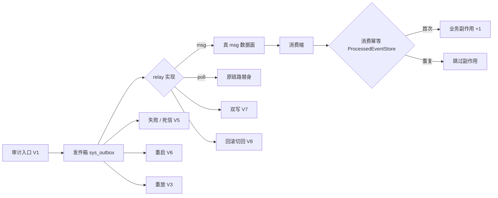

# 01-8-3 可靠性验收 · 详细设计

> 08B · 01 消息模型与投递 · 01-8 可靠性与事务 · 子任务 03（需求 01-8）

[文档首页](../../../../../../../文档首页.md) › [消息平台规划](../../../../../../../规划/01_规划_消息平台.md) › [阶段计划](../../../../../计划/01_计划_消息平台.md) › [01 消息模型与投递](../../../01_消息模型与投递.md) › [01-8 可靠性与事务](../../01_消息模型与投递_08_可靠性与事务.md) › [01-8-3 可靠性验收](../01_消息模型与投递_08_可靠性与事务_03_可靠性验收.md) › 详细设计

> **状态（2026-11-11 定稿）**：13 项待拍板事项已逐项确认（§12），验收范围、落点、判据与回写口径按确认结果定稿；实施与测试一律以本设计为准。验收 V1 暴露「事件编码把嵌套集合降级为字符串」的产品缺陷，按拍板**就地修复**（bms `5dc11652e`），偏差与回执见 §13。

## 0. 分章导航 

| 章 | 内容 |
| --- | --- |
| 1 | 任务级边界与输入基线 |
| 2 | 交付物清单与零变更清单 |
| 3 | 现状核对结论 |
| 4 | 验收场景总览 |
| 5 | 测试夹具与数据构造 |
| 6 | 用例设计与验收映射 |
| 7 | 失败分支与处置 |
| 8 | 验收判定与证据规范 |
| 9 | 登记落点与文档同步 |
| 10 | 实现约束 |
| 11 | 边界与开放项 |
| 12 | 对齐记录 |
| 13 | 实施偏差与验证回执 |

## 1. 任务级边界与输入基线 

**做什么**：把 01-8-1 的 relay 切换能力与 01-8-2 的后置边界，放到「业务提交 → 发件箱 → relay → msg 数据面 → 消费端」的同一条真实链路上做**端到端可靠性验收**——审计事件全链路不丢、记录级定位可还原；重复投递 / 重放 / 迁移在途不产生重复副作用；relay 投递失败、msg 不可达、进程重启不静默丢事件；在途未确认、双写窗口、回滚切回原链路行为恢复、不重复、不丢。交付验收用例、证据记录与计划回写。

**不做什么**：

- 不重做 01-8-1 的 provider 三态、工厂装配、CLI 一致性、端口契约与后置边界用例（Kiwi 2481），只复用其结论与判据；
- 不重复 01-8-2 的占位单源结构、文档断言与「不宣称已支持」护栏（Kiwi 2482）；
- 不实现事务消息 / CDC、不接 binlog / WAL、不新增扫描端点、不改公开契约快照；
- 不新增去重台账、不改 `ProcessedEventStore` / `event_id` 幂等键语义、不改 `sys_outbox` 表结构；
- 不做生产迁移、不触发平台级生产部署架构的真实集群切换、不替代 8B_05 的复制能力；
- 不新增指标名、不定阈值（沿用 `bms_outbox_delivery_total` / `bms_outbox_backlog`）；
- 不在本任务内推送远程、不触发 CI。

**输入基线**：

| 输入 | 事实 |
| --- | --- |
| 需求 / 任务 | [需求 01-8](../../../../../需求/01_需求_消息模型与投递.md#r01-8)、[01-8 父任务](../../01_消息模型与投递_08_可靠性与事务.md)、[01-8-3 任务](../01_消息模型与投递_08_可靠性与事务_03_可靠性验收.md) |
| 01-8-1 已交付 | `MsgOutboxDispatcher` + `[outbox].provider` 切换 + CLI 同判据；bms 提交 `7df9ae318`、Kiwi **2481**；T4~T7 / U1~U4 已覆盖「失败保行计次、恢复补发一次、切回不重投、每轮一条、单通道」 |
| 01-8-2 已交付 | 占位单源 `deploy/events/postponed_capabilities.toml`、Kiwi **2482**；事务消息 / CDC 仍后置，只复用其边界与文档断言口径，不把预留条目当实现清单 |
| 04-4 已交付 | 非幂等操作携带幂等键、客户端稳定生成、服务端按键去重；消费侧收敛沿用 bms `ProcessedEventStore`（`(consumer, event_id)` 唯一，与业务副作用同事务） |
| 05-4 已交付 | 审计四类留痕与记录级定位：`sys.operation.logged` / `sys.login.logged` 经 `sys_outbox` 同通道，`record_ref` 落载荷；审计写入失败分强 / 普通两档 |
| bms 发件箱现状 | `SqlOutboxStore`（`sys_outbox` + `sys_event_consumed` + `sys_event_dead_letter`）、`PollOutboxDispatcher` / `MsgOutboxDispatcher`、`ProcessedEventStore` |
| msg 仓夹具 | `tests_support/msg_fixtures.py` 的 `msg_app`（真路由 / 真数据面 / 真消费端）、`tests_support/bms_port_contract.py` 的 `msg_event_publisher`；跨仓用例只在 msg 仓可同时 import 两侧 |
| 覆盖率口径 | 见 bms《[AI开发规范](../../../../../../../../bms文档/规范/AI开发规范.md)》「覆盖率要求」节（本设计不复述数字） |
| 用例号 | **待设计定稿后先在 Kiwi 登记取得编号**，本设计不登记、不编造；口径见 §6 |

## 2. 交付物清单与零变更清单 

| 仓 | 类别 | 交付物 | 说明 |
| --- | --- | --- | --- |
| msg | 详细设计 | 本文件 `01-8-3/设计/01_详细设计_01-8-3_可靠性验收.md` | 验收范围 / 夹具 / 判据 / 回写 |
| msg | 验收用例 | `backend/services/msg/tests/client/test_reliability_acceptance.py` | V1~V8，一条 Kiwi，真 SQLite 发件箱 + 真 msg 应用 |
| msg | 契约回执 | 01-8-3 任务文档 §5 补「交付回执」；01-8 父任务子任务清单与计划表口径同步 | 进度只在计划表 |
| msg | 记录 | `实施/01_实施记录_01-8-3_可靠性验收.md`、`测试/01_测试记录_01-8-3_可靠性验收.md` | 含命令、原始输出、结论、未通过项归口 |
| msg | 登记回写 | 阶段计划 §3 的 01-8 行、§5 门禁 9、§6.1 #20 承接状态 | 按 §9 口径 |
| bms | 缺陷修复 | `libs/bms_core/src/bms_core/events/topic.py` + `tests/events/test_event_topic.py` | 验收 V1 暴露嵌套集合编码降级，按 §7 / §13 就地修复；bms `5dc11652e` |

**零变更清单**：`BaseOutboxStore` / `BaseOutboxDispatcher` 端口契约与版本；`sys_outbox` / `sys_event_consumed` / `sys_event_dead_letter` 表结构；`PollOutboxDispatcher` / `MsgOutboxDispatcher` 既有行为；`MsgEventPublisher` 与 `bms_core.msgclient` 全链；`AuditCapturer` / `AuditEventEmitter` / 审计事件字段；`[outbox].provider` / `[event].provider` / `[service_client].provider` 键位与语义；`ProcessedEventStore` 去重口径；两仓 `deploy/contracts/*.json` 与 `deploy/events/*`；错误码表 / 事件契约 / 配置节；msg 仓服务端业务代码与端点；01-8-1 / 01-8-2 已交付用例。**唯一例外**是 §13 记录的 `encode_event` 嵌套集合修复，它不改变事件契约、字段集或代码路径，只修正编码保真。

## 3. 现状核对结论 

| # | 现状 | 处置 |
| --- | --- | --- |
| 1 | 01-8-1 已用真 SQLite 发件箱覆盖「失败保行计次、恢复补发一次、切回不重投」，msg 侧已用真应用覆盖「信封到达、失败信号可观测、幂等键稳定、单通道」 | 本任务不重复这些**单元 / 契约级**判据，只补它们没有覆盖的**端到端组合**：审计入口 + 消费端去重 + 重启 + 回滚数据行为 + 双写数据行为 |
| 2 | 01-8-1 的 bms 用例 create 的 dispatcher 每轮新建，但没有显式「清空引擎与会话后重开」的重启证据 | 本任务用独立用例重建 `EngineRegistry` / `SessionFactory` / dispatcher，证明进程级状态丢失后仍不丢不重 |
| 3 | 01-8-1 未把「消费端副作用只执行一次」落成可计数断言（U3 只证 `event_id` 稳定） | 本任务用 `ProcessedEventStore` + 副作用计数器，把「效果一次」从推理变成断言 |
| 4 | 01-8-1 未串联审计入口（`build_operation_event` / `AuditEventEmitter`） | 本任务从真实审计事件信封与真实发射器开始，贯穿发件箱、relay、msg、消费端，并断言 `record_ref` 可还原 |
| 5 | bms 侧测试夹具 `tests/outbox/conftest.py` 不是可跨仓 import 的包；msg 仓 CI 只 clone msg | 在验收用例内自建临时 SQLite 三表与引擎注册表，不复制协议实现、不依赖 bms 测试包 |
| 6 | `Settings.event.contract_mode` 为 `enforce`，事件契约注册表需由应用装配从 bms 仓快照装载；msg 仓 CI 不保证有 bms 快照 | 验收只验证可靠性，不验证签发契约；经测试隔离返回 `SqlOutboxStore()`（`contract_mode=off`），并在记录中写明这一边界 |
| 7 | msg 测试应用是进程内内存存储，主题需先建、消费组需先 join | 每个用例内按数据面契约建主题 / join / consume / ack；判据与 01-8-1 的 U1~U3 同源 |
| 8 | 计划表 §3 的 01-8 行与 §5 门禁 9 仍按 01-8-1 遗留 #8 保持现状 | 本任务是 01-8 收口点，完成后按 §9 统一回写 |
| 9 | 验收 V1 实测发现 `encode_event()` 对**嵌套集合类**（审计载荷 `record_ref` 是 `ConcurrentStableDict`）走 `json.dumps(default=str)`，把对象降级为 `"ConcurrentStableDict({...})"` 字符串；经发件箱落库再投递也仍会丢失记录级定位 | 属产品缺陷，按拍板就地修复：`encode_event()` 改用 `stable_json_dumps()`（递归规整嵌套集合），补 bms 单测；bms `5dc11652e`，见 §13 |

## 4. 验收场景总览 

| 组 | 场景 | 覆盖任务内容 |
| --- | --- | --- |
| A 审计全链路 | 业务构造操作审计事件 → `AuditEventEmitter` 写发件箱 → msg relay → 真数据面 → 消费端解码 | 任务 §2-1：审计事件可达、可查、记录级定位不丢 |
| B 效果一次 | 重复投递 / outbox 重放 / 迁移在途三条重复来源，消费端副作用只增一次 | 任务 §2-2：复用 04-4 幂等键，不产生重复副作用 |
| C 失败与恢复 | 主题缺失 404、连接失败、重试超限转死信、进程重启 | 任务 §2-3：三类故障不静默丢失，恢复后按退避或显式失败 |
| D 迁移窗口 | 在途未确认切换、双写窗口、回滚切回原链路 | 任务 §2-4：切换 / 回滚行为恢复、不重复、不丢 |

## 5. 测试夹具与数据构造 

### 5.1 落点与文件 

- 文件：`backend/services/msg/tests/client/test_reliability_acceptance.py`（msg 仓内，`pytest` 由 `backend` 工作区根收集）。
- 复用夹具：`tests_support.msg_fixtures` 的 `msg_app` / `msg_declared_codes` / `msg_plugins`；`tests_support.bms_port_contract` 的 `EVENT_NAMESPACE`（`msg`）、`msg_event_publisher`。
- 自建夹具：临时 SQLite（发件箱三表）+ `EngineRegistry` + `SessionFactory` + 投递器构造器；不复制 `MsgEventPublisher` 协议实现。

### 5.2 临时发件箱库 

| 项 | 口径 |
| --- | --- |
| 库 | `tmp_path / "acceptance.db"`，`sqlite+aiosqlite:///<绝对路径>`；用例结束由 `tmp_path` 清理 |
| 建表 | `SysOutbox` / `SysEventConsumed` / `SysEventDeadLetter` 三表，`Base.metadata.tables[...]` 逐个建 |
| 配置 | `monkeypatch.setenv("BMS_DATABASE__PLATFORM__URL", url)` 后 `get_settings.cache_clear()`；用例结束再次清理缓存 |
| 引擎 | `EngineRegistry(EngineFactory(get_settings()))`；用例结束 `await registry.aclose()`，重启用例主动先关再建 |
| 会话 | `SessionFactory()` 交给 `SqlOutboxStore` / 投递器 / `ProcessedEventStore` |

> 不写死连接串与库路径：连接串由夹具生成、经 `Settings` 读取，符合「配置唯一来源」红线。

### 5.3 审计事件与发射器 

| 项 | 口径 |
| --- | --- |
| 事件类型 | `sys.operation.logged`（`audit.events.OPERATION_LOG_EVENT`），topic 由 `topic_for()` 派生为 `bms-sys-operation` |
| 信封 | `build_operation_event(...)`，租户 `7001`（msg 测试租户 `demo` 的主键，`X-Tenant-ID` 按纯数字走 `by_id`）；带 `trace_id`、`aggregate_key`、`record_ref=RecordRef(type="msg.message", id="<雪花/固定值>")` |
| 写入 | `AuditEventEmitter.emit(event)`：真实发射器 + 真实 `SqlOutboxStore`，自开短事务写发件箱；测试隔离返回 `SqlOutboxStore()`（`contract_mode=off`，§3 #6） |
| 断言 | 发件箱行 `event_type` / `tenant_id` / `trace_id` / `payload` 与信封一致；投递后 `status=delivered`、`delivered_at` 非空 |

### 5.4 真 msg 应用与消费 

| 动作 | 端点 / 口径 |
| --- | --- |
| 建主题 | `POST /api/v1/msg/admin/topics`，`namespace=msg`、`name=bms-sys-operation`（或验收事件 topic）、`partition_count=1`、`X-Tenant-ID: 7001` |
| 加入组 | `POST /api/v1/msg/join`，`group` 按用例取独立值，`consumer_id=c1` |
| 消费 | `POST /api/v1/msg/consume`，`partition=0`、`max_messages=10`、`max_wait_ms=0` |
| 确认 | `POST /api/v1/msg/ack`，按 `offset` 逐条确认（重放场景用独立组，避免位点互相干扰） |
| 发布 | `MsgEventPublisher(base_url="http://msg", namespace="msg", tenant="7001", transport=ASGITransport(msg_app))` |
| 解码 | `decode_event(body, attributes)` 还原信封；消息体 base64 解码后与 `encode_event(event)` 比对 |

### 5.5 投递器与消费幂等 

- 投递器：`MsgOutboxDispatcher(store=SqlOutboxStore(), publisher=..., engine_registry=..., session_factory=..., batch_size=100, max_retries=..., backoff=0.0, db_keys=ConcurrentStableList((PLATFORM_DB_KEY,)))`；零退避让失败行在下一轮立即可取，避免用例 sleep。
- 进程重启：关闭当前 `registry`，重新构造 `EngineRegistry` / `SessionFactory` / dispatcher（同一 SQLite 文件），旧对象不再使用。
- 消费幂等：`ProcessedEventStore(session).mark(consumer="acceptance", event_id=...)`；返回 `True` 时向 `ConcurrentStableList` 追加一次副作用，返回 `False` 时跳过。副作用计数即「效果一次」的判据。
- 指标：可选记录型 `BaseMetrics` 替身，断言 `bms_outbox_delivery_total` 的 `failed` / `dead` 标签与 `bms_outbox_backlog`；未改动生产指标实现。

### 5.6 失败注入 

| 注入 | 做法 | 判据 |
| --- | --- | --- |
| relay 投递失败（404） | 真 `MsgEventPublisher` 指向真 msg 应用，但不建主题 | 抛 `EventPublishError`，`data.status=404`；发件箱行保留、`retry_count` 递增、`error_msg` 含事件类型与 topic |
| msg 不可达（连接失败） | 真 `MsgEventPublisher` + `httpx.MockTransport` 抛 `httpx.ConnectError` | 抛 `EventPublishError`；行保留、原因可定位；不静默标记 delivered |
| 重试超限 | `max_retries=2`、`backoff=0.0`，连续两轮失败 | `status=dead`，`sys_event_dead_letter` 新增一行；`list_dead_letters` / `get_dead_letter` 可查 |
| 恢复 | 建主题后 `replay(event_id)` → 再投一轮 | 恢复后恰好投递一次；消费端按 `event_id` 幂等 |

## 6. 用例设计与验收映射 

**Kiwi 登记口径**：按《[KiwiTCMS部署使用说明](../../../../../../../../bms文档/资料/开发服务器/linux/KiwiTCMS部署使用说明.md)》§5.2 / §5.3——Category「平台骨架」、Priority `P2`、Status `CONFIRMED`、Tag「自动化」；一个任务登记**一条**用例，V1~V8 全部断言共用同一 `kiwi_id`；平台自增主键为准，先登记取得编号再回填代码与记录，**不复用 / 不改派** 2481 / 2482 等既有编号。

文件统一 `pytestmark = pytest.mark.kiwi_id(<编号>)`。

| 编号 | 用例 | 步骤要点 | 断言 | 对应验收 |
| --- | --- | --- | --- | --- |
| V1 | `test_audit_event_reaches_msg_and_keeps_record_ref` | 建主题 → `build_operation_event` + `AuditEventEmitter.emit` → 发件箱 pending → msg relay 投递 → 消费端拉取 → `decode_event` | 发件箱行 pending → delivered；`DispatchResult.published=1`；消息体与 `encode_event(event)` 一致；属性含 `event_id` / `event_type` / `tenant_id` / `trace_id` / `aggregate_key`；载荷 `record_ref == {"type": "msg.message", "id": ...}` | 任务 §2-1 / §3 第 1 条 |
| V2 | `test_duplicate_delivery_has_single_side_effect` | 同一事件经 relay 投两次（同 `event_id`）→ 消费端两条 → 逐条 `ProcessedEventStore.mark` | 消费端收到 2 条且 `event_id` 相同；`mark` 首次 True、第二次 False；副作用计数为 1 | 任务 §2-2 / §3 第 2 条 |
| V3 | `test_outbox_replay_keeps_single_side_effect` | 事件投递成功 → `SqlOutboxStore.replay(event_id=...)` → 再投一轮 → 新组消费 | `replay` 返回 1、行回 pending；再次投递 `published=1`；消费端再收到同 `event_id`；副作用计数仍为 1 | 任务 §2-2 / §3 第 2 条 |
| V4 | `test_in_flight_event_survives_switch_and_delivers_once` | 事件入发件箱 → 首轮连接失败 → 建主题 / 切到可用链路 → 补发 | 首轮 `failed=1`、行保留、`retry_count=1`；补发 `published=1`；消费端恰好 1 条；副作用计数 1 | 任务 §2-4 / §3 第 2、4 条 |
| V5 | `test_unreachable_and_exhausted_failures_are_observable` + `test_dead_letter_recovery_delivers_once` | ① 主题缺失 404；② 连接失败；③ `max_retries=2` 连续失败 → 死信；④ 建主题后 `replay()` 恢复 | 三类失败均抛 / 记 `EventPublishError` 或落 `error_msg`；死信行字段（`event_id` / `event_type` / `error_msg` / `retry_count`）可查；`bms_outbox_delivery_total{status=failed/dead}` 有记录；恢复后恰好一次 | 任务 §2-3 / §3 第 3 条 |
| V6 | `test_process_restart_delivers_pending_and_skips_delivered` | 一条已投递 + 一条未投递 → 关闭并重建引擎 / 会话 / 投递器 → 再投一轮 | 已投递行不重投（msg 侧不新增消息）；未投递行补发一次；发件箱最终全 delivered | 任务 §2-3 / §3 第 3 条 |
| V7 | `test_two_dispatchers_do_not_duplicate` | msg 实投一轮 → poll（记录型发布器）再跑一轮；反向重复一次 | msg 侧消费总数恰好 1；已 delivered 行不被另一实现再投；`DispatchResult` 第二轮 `published=0` | 任务 §2-4 / §3 第 4 条 |
| V8 | `test_rollback_to_poll_restores_behavior` | msg 投 A → 切 poll 不重投 → 新增 B 由 poll 投一次 → 再切 msg 不重投 | A 不再投；B 恰好一次；切回 msg 后无新增；msg 侧消费总数与 poll 记录数符合预期 | 任务 §2-4 / §3 第 4 条 |

**复用与不重复**：

- 01-8-1 T1~T3 / T8 / T9（三态、工厂职责、零改动、CLI、后置边界）与 U1~U4 继续作为**前置证据**引用，本任务不重新断言同一单点；
- 01-8-2 U1~U6（占位单源 / 兼容策略 / 零能力 / 文档断言）同理，只引用其边界结论；
- 本任务新增的判据集中在「跨层组合」：审计入口 → 消费端、重启、回滚 / 双写的数据行为、消费端副作用计数。

## 7. 失败分支与处置 

| # | 失败 | 触发 | 表现 | 处置 |
| --- | --- | --- | --- | --- |
| 1 | 审计事件未达 msg | 发件箱写入失败 / relay 未投 / 发布失败被吞 | V1 消费端 0 条或发件箱仍 pending | 属实现缺陷：按拍板**就地修复**（限本任务链路），补回归用例并回写本设计偏差 |
| 2 | 记录级定位丢失 | `record_ref` 未落载荷 / 被改键 | V1 载荷断言失败 | 就地修复或登记遗留；不得改 05-4 既有字段口径 |
| 3 | 消费端重复副作用 | `event_id` 变化 / 未用 `ProcessedEventStore` | V2 / V3 / V4 副作用计数 > 1 | 查 relay 是否改幂等键、消费端是否漏 mark；复用 04-4 判据 |
| 4 | 事件静默丢失 | 发布异常被吞、失败行被标记 delivered | 发件箱无 pending / delivered 但消费端无消息 | 属实现缺陷：就地修复；V5 / V6 拦截 |
| 5 | 死信不可查 | 未插死信行 / 字段缺失 | `list_dead_letters` 为空或字段为空 | 就地修复；死信落点与 01-8-1 §10 #3 一致 |
| 6 | 重启后重投或丢投 | 已 delivered 行被再取 / pending 行未取 | V6 消息数不符 | 查 `claim_pending` 状态条件与会话重建；复用 01-8-1 T4~T7 判据 |
| 7 | 双写 | 两实现同时投递 | V7 msg 侧总数 2 | 停止验收，查是否存在第二条通道；修复后重跑 |
| 8 | 回滚后行为不恢复 | 切回 `poll` 后不投 / 重投 | V8 断言失败 | 查 `outbox_dispatcher_class` 与工厂注入；修复后重跑 |
| 9 | 夹具 / 环境问题（非产品缺陷） | 临时库锁、配置缓存、主题未建 | 用例报错但不是断言失败 | 按测试记录「问题与处置」登记；不得把环境问题记为验收通过 |
| 10 | 真集群 / 生产窗口缺失 | 本机无真实集群 / 真盘 | 只覆盖进程内真应用 + 真 SQLite | 遗留归平台级生产部署架构，证据标 `degraded`，不默认通过 |
| 11 | 嵌套集合编码降级 | 审计载荷 `record_ref` 是集合类，`encode_event()` 的 `json.dumps` 走 `default=str` | V1 载荷中 `record_ref` 变成字符串，记录级定位丢失 | **就地修复**：`encode_event()` 改用 `stable_json_dumps()` 递归规整；补 bms 单测；bms `5dc11652e` |

## 8. 验收判定与证据规范 

- **判定顺序**：先跑新用例（V1~V8）→ 再跑 01-8-1 既有定向用例回归（bms `tests/outbox/` 与 msg `tests/client/test_outbox_relay_switch.py`）→ 静态 / 文档三项校验 → 提交前预检。
- **证据**：测试记录逐条列「用例号 / 命令 / 原始输出关键行 / 结论」；失败项写明 `失败原因 → 处置 → 复跑结果`，未通过项登记遗留与归口，**不默认通过**。
- **覆盖率**：口径见 bms《AI开发规范》「覆盖率要求」节；默认零产品代码改动，提交环判改动行，推送环与 CI 判模块级。验收暴露缺陷并按拍板就地修复后，按修复模块（`bms_core.events.topic`）补跑定向用例并复核模块级覆盖率。
- **降级证据**：真实集群、真实容器、真盘、生产窗口不在本任务（原 RocketMQ 链路已下线）；相关结论标 `degraded` 并归平台级生产部署架构。

## 9. 登记落点与文档同步 

| 落点 | 内容 | 时点 |
| --- | --- | --- |
| 本设计 | 验收范围 / 夹具 / V1~V8 / 失败分支 / 回写口径 | 本轮 |
| 01-8-3 任务文档 §5 | 补「交付回执」：用例文件、Kiwi 编号、证据记录、复用结论 | 测试通过后 |
| 01-8 父任务 | 子任务清单与「跨阶段」说明保持；不写进度字段 | 测试通过后按需补回执 |
| 阶段计划 §3 的 01-8 行 | 状态改「已完成」；实际投入按计划表既有口径回填；完成日期按实际；偏差与遗留列保留 8B_05 阻断与平台级生产部署架构真实窗口 | 测试通过后 |
| 阶段计划 §5 门禁 9 | 标「已达成（隔离环境证据；生产窗口归平台级生产部署架构）」 | 测试通过后 |
| 阶段计划 §6.1 #20 | 保持「待承接」——事务消息 / CDC 真实实现仍未立项，不由验收任务关闭 | 测试通过后 |
| 01-8-1 / 01-8-2 记录 | 只在偏差与遗留中引用本任务收口，不改其既有结论 | 按需 |
| 架构 / 规范 / 契约快照 | **不动**（本任务不新增架构节点、不改规范、不改公开契约） | — |
| bms 仓 | 缺陷修复提交 `5dc11652e`（`events/topic.py` + 单测）；不改端口 / 契约 / 配置 / 业务代码 | 已执行 |

## 10. 实现约束 

| 项 | 强制口径 |
| --- | --- |
| 解释器 | 只用 `D:/Develop/bizs/bms/backend/.venv/Scripts/python.exe`（3.14）；禁止 PATH 上的 `python` |
| 集合声明 | 用例内集合声明一律 `ConcurrentStable*` / `ConcurrentStableFrozen*`；不裸用 `dict` / `list` / `set` 作声明 |
| 用例登记 | 设计定稿后**先登记 Kiwi 再编码**（平台骨架 / P2 / CONFIRMED / 自动化）；一条用例共用编号 |
| 测试范围 | 只跑单文件 / 单节点定向用例；全量测试只由 CI 执行；不做 `pytest --cov` 手工采集 |
| 提交粒度 | msg 仓 `test(01-8-3)`（用例）与 `docs(01-8-3)`（设计 / 记录 / 回写）两次；bms 仓因缺陷修复多一次 `fix(events)`（`5dc11652e`） |
| 提交与推送 | 说「提交」只做 `commit`，说「推送」才走推送入口；本任务不推送、不触发 CI |
| 文档校验 | `engkit links` / `docs-scope` / `eol` 全绿；本设计链接均为相对链接 |
| 文档措辞 | 非计划文档不写进度类字段；架构节点只写语义；测试记录可写命令与结论 |

## 11. 边界与开放项 

| # | 开放项 | 影响 | 归口 |
| --- | --- | --- | --- |
| 1 | 真实集群 / 真实容器 / 真盘未联调（原 RocketMQ 链路已下线） | 原链路事件侧证据为 `degraded` | 平台级生产部署架构 |
| 2 | 8B_05 复制能力未交付 | 生产迁移仍被硬阻断 | 02-4 / 02-5 / 02-8 |
| 3 | 域级键（平台级生产部署架构）未落地 | 只能整端口切换，回滚粒度粗 | bms 平台级生产部署架构 |
| 4 | `claim_pending` 多实例重复抢批（无 `SKIP LOCKED` / 租约列） | 无效投递放大，消费端幂等兜底 | 02-8 / 平台级容量实测 |
| 5 | 事务消息 / CDC 真实实现未立项 | 本任务只引用 01-8-2 后置边界，不宣称已支持 | 后续实现评审（计划 §6.1 #20） |
| 6 | 审计哈希链消费组未在验收内重算 | 本任务只验「事件到达且 `record_ref` 可还原」，链校验归审计链消费组 | 05 域 / 后续阶段 |
| 7 | 死信表在真实 MySQL / PG / DM8 的 DDL 与时区行为 | 只在 SQLite 验证 | 平台级生产部署架构 |
| 8 | 指标阈值 / 容量数值未定 | 只断言指标被记录，不给「超阈值」结论 | 平台级容量实测 |

## 12. 对齐记录 

| # | 事项 | 定稿（2026-11-11 逐项确认） |
| --- | --- | --- |
| 1 | 验收用例落点 | msg 仓单份 `services/msg/tests/client/test_reliability_acceptance.py`；bms 仓默认零代码改动，验收暴露缺陷时按第 9 项就地修复 |
| 2 | 审计「可查」力度 | 消费端解码定位：`event_id` / 类型 / 租户 / `trace_id` / 载荷 / `record_ref` 一致 |
| 3 | 效果一次载体 | `ProcessedEventStore`（`(consumer, event_id)`）+ 副作用计数；不新增第二套去重 |
| 4 | 「重放」口径 | outbox `replay()`（已投递 / 死信 → pending），不取 01-6 消息重放 |
| 5 | 进程重启模拟 | 重建 `EngineRegistry` / `SessionFactory` / dispatcher，同一 SQLite 文件 |
| 6 | 失败注入 | 真 msg 应用缺主题 404 + 真实发布器连接失败传输；不用替身恒抛、不手动断网 |
| 7 | 回滚切回 | 数据行为四步：msg 投 A → poll 不重投 → 新 pending 由 poll 投一次 → 再切 msg 不重投 |
| 8 | 双写窗口 | 两实现先后各跑一轮，msg 侧总数恰好 1 |
| 9 | 产品缺陷处置 | **就地修复**（限本任务链路），修复须回写设计偏差并补回归用例 |
| 10 | 证据文档 | 实施记录 + 测试记录各一份，含命令 / 原始输出 / 结论 / 未通过项归口 |
| 11 | 计划回写 | 01-8 完成、门禁 9 标达成（隔离环境证据）、§6.1 #20 保持待承接、8B_05 阻断保留 |
| 12 | Kiwi 条数 | 一条新用例（顺延，预计 2483），V1~V8 共用；不复用 / 不改派既有编号 |
| 13 | 提交粒度 | msg `test(01-8-3)` + `docs(01-8-3)` 两次；bms 因缺陷修复多一次 `fix(events)`；推送另行确认 |

## 13. 实施偏差与验证回执 

| # | 偏差 / 发现 | 现象 | 处置与结果 |
| --- | --- | --- | --- |
| 1 | `encode_event()` 嵌套集合降级 | V1 首跑失败：消费端载荷 `record_ref` 为字符串 `"ConcurrentStableDict({'type': 'msg.message', ...})"`，记录级定位丢失 | 根因：`encode_event()` 用 `json.dumps(default=str)`，嵌套 `ConcurrentStableDict` 不是内置 `dict`。按拍板就地修复为 `stable_json_dumps()`（递归规整集合、保持键排序与非 ASCII），补 bms 单测 `test_encode_normalizes_nested_collections`；bms `5dc11652e`。修复后 V1 通过，bms events 140 例全绿 |
| 2 | 失败注入顺序 | V4 / V5b 原计划先用「主题缺失 404」再建主题；msg 测试应用的会话是单例，404 路径未提交事务，随后建主题报 `A transaction is already begun on this Session` | 不改测试应用：V4 / V5b 的失败轮改用真实 `MsgEventPublisher` + 连接失败传输（同为 `EventPublishError`），404 路径由 V5a 覆盖；判据未降低 |
| 3 | 解释器选择 | msg 仓测试依赖 `bms_msg`，bms 仓 venv 未安装该包 | msg 仓用例统一用 `msg/backend/.venv/Scripts/python.exe`（3.14.4，仓内 venv）；bms 仓用例用 `bms/backend/.venv/Scripts/python.exe`（3.14）；均不用 PATH 上的 `python` |
| 4 | 本地覆盖率数据 | 定向 pytest 不合并覆盖率数据，`coverage_report.py` 读到的是旧数据 | 不手工采集；模块级覆盖率由推送环与 CI 用 engkit 采集插件判定，测试记录如实注明 |

**验证回执**：V1~V8 共 9 个用例全绿（`9 passed in 2.18s`）；01-8-1 回归 bms `tests/outbox/` + `test_event_topic.py` 52 例、msg `test_outbox_relay_switch.py` 4 例全绿；bms events 目录 140 例全绿；Kiwi **2483** 已登记并回读一致；msg 提交 `8ebe5a2`（用例）与 `781bf7a`（设计）、bms 提交 `5dc11652e`（修复）。

> 依《[文档生成规范](../../../../../../../../bms文档/规范/文档生成规范.md)》编写 · 交付链条见 bms《[AI开发规范](../../../../../../../../bms文档/规范/AI开发规范.md)》§5 · 覆盖率口径见同规范「覆盖率要求」节 · 复用 01-8-1 / 01-8-2 证据，不重复取证
