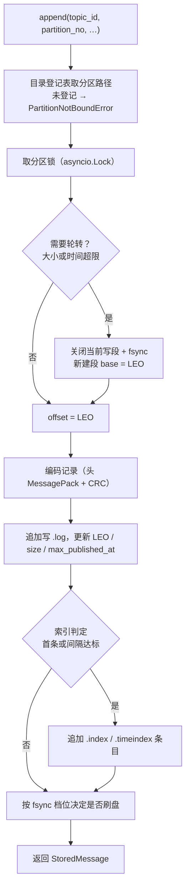
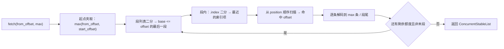

# 分区追加日志详细设计

> 记录字节格式 × 段与三种索引 × 写入 / 读取路径 × 读取原语 × length 级启动恢复 × 装配替换内存实现

[文档首页](../../../../../../文档首页.md) › [消息平台规划](../../../../../../规划/01_规划_消息平台.md) › [阶段计划](../../../../计划/01_计划_消息平台.md) › [02-1 分区追加日志](../02_存储与复制_01_分区追加日志.md) › 详细设计

---

## 1. 概述 <a id="overview"></a>

### 1.1 目标

把「消息怎么落盘、怎么按位点读、怎么整段删」从进程内 `list` 换成真实文件段，并**保持 `MessageStore` 端口签名不变**：

1. **记录格式一次做对**：头体分离、CRC 覆盖头体、`length` 支撑顺序扫描与尾部判定、`format_version` 支撑只增不删的演进；02-4 / 02-5 的复制字段（`epoch` / `hw` / `replicas`）现在就带。
2. **段与索引**：按 base offset 命名的 `.log` / `.index` / `.timeindex`；按大小与时间轮转；删除以整段为单位。
3. **读取原语**：给出「段文件 + 偏移 + 长度」坐标，供 03 域接 `sendfile`；本任务不写 socket、不做帧协议。
4. **装配替换**：`main.py` 直接装文件实现，`NotifyingMessageStore` 仍是最外层（唤醒归传输层，本任务不自己通知）。

### 1.2 边界与承接

| 项 | 本任务 | 归口 |
| --- | --- | --- |
| 记录格式 / 段文件 / 三种索引 / 写入 / 读取 / 读取原语 | ✅ 交付 | 02-1 |
| 崩溃恢复的**结构级**部分：段枚举、`length` 级尾部判定与截断 | ✅ 交付（否则新记录会接在半条记录之后写坏数据） | 02-1 |
| CRC 校验、`recovery-point`、索引补建、位点对齐、非尾部段隔离 | ❌ 不做 | 02-2 |
| `.delay` 段、时间轮重建、`log_id` 去重扫描 | ❌ 不做 | 02-7 |
| 消费位点文件 | ❌ 不做 | 02-3 |
| 存储水位与拒绝（`350022`）、`/ready` 可写判定 | ❌ 不做 | 02-6 |
| 指标采集与面板 | ❌ 不做（只出结构化日志） | 06-3 |
| compaction（含键压缩） | ❌ 不做（架构 09 D39） | — |
| 副本复制、epoch 校验、fencing | ❌ 不做（只预留字段） | 02-4 / 02-5 |
| 后台定时清理 | ❌ 不做（窗口常量与键表上限预留，接线归 06 域） | 06 域 |

### 1.3 口径来源

| 问题 | 定稿 | 出处 |
| --- | --- | --- |
| 记录结构 | `[length][crc][header_len][header][payload]`，头 MessagePack | 任务 §2.2、架构 04 §2.2 |
| 目录布局 | `data/{tenant_id}/{namespace}/{topic}.{topic_id}/{partition}/` | 任务 §2.1 + 本轮决策 3（带 `topic_id` 隔离同名重建） |
| 段文件 | 按 base offset（20 位零填充）命名，`.log` / `.index` / `.timeindex` | 任务 §2.3、架构 04 §2.3 |
| 索引稀疏 | 每 4096 字节一条；读取时二分 + 顺序扫描 | 任务 §2.4、知识 03 §2 |
| 保留 | 只前移起点、不改末端；按段整段删 | 01-6 详细设计 §4 |
| 两类 ID | `message_id` 消息身份、`log_id` 记录身份 | 需求 01-1 内容 4、架构 04 §2.2 |
| 唤醒 | 由最外层 `NotifyingMessageStore` 在 `append` 后 `notify` | 03 域收口回写（任务 §2 末段） |
| 端口签名 | `append` / `fetch` / `leo` / `start_offset` / `segments` / `truncate_before` 一字不改 | 01-2 / 01-6 前置契约 |

## 2. 现状与差距 <a id="gap"></a>

| 现状 | 差距 | 本任务处置 |
| --- | --- | --- |
| `InMemoryMessageStore` 用 `list[StoredMessage]` 存记录 | 重启即全丢；`SegmentMeta` 按定长条数切，只是语义替身 | 新增文件实现；内存实现保留作轻量用例的替身 |
| 段粒度 = `RETENTION_SEGMENT_RECORDS`（1000 条） | 与真实「段大小 / 时间」粒度无关 | 常量降为**内存替身专用**；文件实现按字节与时间轮转 |
| 端口只收 `topic_id` | 目录要 `tenant_id` / `namespace` / 主题名三段 | 进程内目录登记表（决策 2），`TopicRouter.resolve()` 登记 |
| 记录只存在内存对象里 | 没有字节格式、没有 CRC、没有 `format_version` | 新增 `broker/record.py`，格式一次定稿 |
| 无 fsync、无段文件 | 崩溃即丢全部 | 按批 fsync（缺省）+ 三档可切，各档崩溃窗口写进 §7.3 |
| 无读取原语 | 03 域无法接 `sendfile` | `locate` / `read_range` 返回坐标（决策 11） |
| 01-7 的节流键表只增不减 | 主题删除后条目永久残留 | 加上限 + 淘汰 + `forget()` 钩子（决策 17） |
| 删光段后 `start == leo` 只存在于内存 | 重启后 LEO 归零 → offset 重排 | 删光即建空段承载 LEO（决策 18） |

## 3. 交付物清单 <a id="deliverables"></a>

```text
backend/services/msg/src/bms_msg/
├── broker/record.py                 # 新增：RecordHeader / 编解码 / CRC / 记录扫描
├── broker/segment.py                # 新增：段文件、稀疏索引、时间索引、轮转与删除
├── broker/file_store.py             # 新增：FileMessageStore / PartitionDirectory / FileSlice / PartitionLog
├── broker/log.py                    # 改：模块文档补文件实现；内存实现 truncate_before 向下取整到段边界
├── broker/router.py                 # 改：可选 directory 参数，resolve 后登记（命中缓存也登记）
├── broker/waiter.py                 # 不动（仍是最外层装饰器）
├── broker/retention.py              # 改：RetentionThrottle 上限 + 淘汰 + forget()（01-7 交接）
├── core/config.py                   # 改：段大小 / 轮转时长 / 索引间隔 / 时间索引间隔 / fsync 三档 / log_id 索引上限 / 数据根
├── api/deps.py                      # 改：新增 PartitionDirectoryDep
├── api/data/messages.py             # 改：topic_router 透传 directory（仅装配参数，端点签名与错误码不变）
├── api/frame/routes.py              # 改：同上（长驻流预检与每轮拉取共用同一份目录登记）
└── main.py                          # 改：装配 FileMessageStore + PartitionDirectory

backend/var/                         # 新增忽略（开发态缺省数据根，不入库）
backend/services/msg/tests/broker/test_store_contract.py    # 新增：端口契约套件（内存 / 文件双实现参数化）
backend/services/msg/tests/broker/test_file_store.py        # 新增：文件实现专项
backend/services/msg/tests/broker/test_retention_throttle.py # 改：追加键表上限 / 淘汰 / forget
msg文档/.../设计/01_详细设计_01_分区追加日志.md              # 本文件
```

**零变更清单**：契约快照（`deploy/contracts/msg.json` 不重导）、错误码表、数据库表结构、`Settings` 配置段、端点 description（01-7 已踩：给 docstring 补一句就判快照漂移）、`RetentionService` 的判定逻辑、`DeliveryService` 与 `_collect`、`NotifyingMessageStore` 的委托语义。

> 说明：`api/data/messages.py` 与 `api/frame/routes.py` 只改**装配参数的透传**（多传一个 `directory`），端点函数签名、响应结构、`x-error-codes` 与 docstring 一字不动——否则契约快照会漂。

## 4. 目录布局与登记 <a id="layout"></a>

### 4.1 磁盘布局

```text
{MSG_DATA_DIR}/                          # 缺省 var/lib/msg（相对进程工作目录）
├── data/
│   └── {tenant_id}/
│       └── {namespace}/
│           └── {topic}.{topic_id}/      # 目录名带 topic_id：删除重建同名绝不读到旧段
│               └── {partition}/
│                   ├── 00000000000000000000.log
│                   ├── 00000000000000000000.index
│                   ├── 00000000000000000000.timeindex
│                   └── 00000000000000001000.log
└── offsets/                             # 02-3 使用，本任务不创建
```

- **`tenant_id` 用不可变雪花**：租户 `code` 可改名，目录不随它漂移（架构 04 §2.1）。
- **主题名后加 `.{topic_id}`**：主题删除后重建同名会拿到新 `topic_id`，目录天然隔离；路径可读性由前半段主题名保留（决策 3，已回写架构 04 §2.1）。
- **数据根**：`os.environ["MSG_DATA_DIR"]`，缺省相对 `var/lib/msg`。开发态从 `backend/` 启动即落 `backend/var/lib/msg`（已加入 `.gitignore`）；生产配 `/var/lib/msg` 挂载卷。
- **不写死绝对路径**：代码里只有常量与 `Path` 拼接，不做 `C:\` / `/opt` 之类硬编码。

### 4.2 目录登记表 <a id="directory"></a>

端口只收 `topic_id`，而目录需要三段名字。用一个**进程内登记表**把两者接起来，而不是让存储层去查库：

```python
@dataclass(frozen=True)
class TopicLocation(BaseValueObject):
    tenant_id: int
    namespace: str
    name: str
    topic_id: int


class PartitionDirectory:
    """topic_id → 目录三段（进程内；无 await，单事件循环内原子）。"""

    def bind(self, *, tenant_id: int, namespace: str, name: str, topic_id: int) -> None: ...
    def locate(self, topic_id: int) -> TopicLocation | None: ...
    def partition_path(self, *, topic_id: int, partition_no: int) -> Path: ...   # 未登记抛 PartitionNotBoundError
```

| 项 | 定稿 | 理由 |
| --- | --- | --- |
| 登记点 | `TopicRouter.resolve()`：**命中缓存与查库两条路径都登记** | 数据面全部经它解析；缓存的快照本身就有三段名字，登记零额外成本 |
| 幂等 | 同 `topic_id` 重复 `bind` 且值相同即无操作 | 每次请求都会登记一次 |
| 值不同 | 保留首次绑定，出结构化日志 `msg_partition_bind_conflict` | 本期无主题改名端点；改名后**不迁目录**（见 §17 风险 6） |
| 未登记 | `append` / `fetch` / `leo` / `start_offset` / `segments` / `truncate_before` / 读取原语一律抛 `PartitionNotBoundError`（fail-closed） | 装配缺陷当场暴露，绝不把数据写到错目录（决策 16） |
| 注入 | `main.py` 造一份落 `app.state.partition_directory`，同时给 `FileMessageStore` 与 `TopicRouter` | 两边看的是同一张表，不存在两份 |

> `PartitionNotBoundError` 是**程序性错误**（装配漏接线），按 500 暴露即可，不占错误码段位——它不是客户端可纠正的输入错误。

## 5. 记录格式 <a id="record"></a>

### 5.1 字节布局

```text
record := [length:u32][crc:u32][header_len:u32][header:bytes][payload:bytes]
```

| 字段 | 类型 | 口径 |
| --- | --- | --- |
| `length` | `u32` 大端 | **`length` 字段之后的字节数** = `4 + 4 + header_len + len(payload)`；记录总长 = `4 + length` |
| `crc` | `u32` 大端 | `zlib.crc32(header_len 的 4 字节 ‖ header ‖ payload)`，**覆盖头长度字段本身**（否则头长被改会漏检） |
| `header_len` | `u32` 大端 | 头字节数（`>= 1`） |
| `header` | MessagePack map | 见 §5.2 |
| `payload` | 原始字节 | broker 不解析、不解压（零拷贝前提） |

**为什么 `length` 不含自身**：顺序扫描时先读 4 字节拿到剩余长度，下一次读的起点就是 `position + 4 + length`，不需要再减；尾部判定也只需「剩余字节数 >= 4 + length」。

### 5.2 头字段

| 键 | 类型 | 说明 | 引入 |
| --- | --- | --- | --- |
| `format_version` | `int` | 记录格式版本，当前 `1`；**只增不删字段**，解码按 `get` 取缺省 | 02-1 |
| `topic_id` | `int` | 主题主键（与目录交叉校验，不一致即数据损坏） | 02-1 |
| `partition_no` | `int` | 分区号 | 02-1 |
| `tenant_id` | `int` | 租户主键（按租户统计 / 复制比对用） | 02-1 |
| `message_id` | `str` | 消息身份（重投 / 转投 / 重放不变） | 02-1 |
| `log_id` | `str` | 记录身份（发布分配、转投沿用、重放新分配） | 02-1 |
| `key` | `str \| None` | 分区键 | 02-1 |
| `trace_id` | `str \| None` | 链路标识 | 02-1 |
| `published_at` | `int` | **epoch 微秒**（UTC）；用微秒而非毫秒，避免回读丢精度导致既有断言失败 | 02-1 |
| `headers` | `map[str, str]` | 结构化头 | 02-1 |
| `content_type` | `str` | 内容类型（03-3：三出口回显，必须落盘） | 02-1（补 03-3 口径） |
| `compression` | `str` | 压缩算法（`none` 表示未压缩） | 02-1（补 03-3 口径） |
| `uncompressed_len` | `int \| None` | 解压后字节数（生产者可选声明，broker 不校验） | 02-1（补 03-3 口径） |
| `epoch` | `int` | leader 任期（复制预留，本期恒 `0`） | 02-1（需求 02-4 内容 5） |
| `hw` | `int` | 高水位（复制预留，本期恒 `0`） | 02-1（同上） |
| `replicas` | `list[int]` | 副本位点列表（复制预留，本期恒空） | 02-1（同上） |

> **为什么 `content_type` / `compression` / `uncompressed_len` / `headers` 必须进头**：它们都是 `append` 的入参、且 `fetch` 要原样回显（03-3 的三个出口）。头里不存，重启或跨页读就会丢这些字段——契约上的「逐字段一致」直接失效。任务 §2.2 的字段清单写于 03-3 之前，本设计按当前端口补齐（对齐记录 §18-1）。

> **为什么 `published_at` 存微秒整数**：`datetime` 直接交给 MessagePack 会走 `timestamp` 扩展类型，不同库版本编码可能不同（格式不回滚的隐患）；整数无歧义，且微秒精度保证「读回来与写进去相等」。

> **126 位雪花主键的编码约束**：`topic_id` / `tenant_id` 在基座是 126 位雪花，可能超出 MessagePack 整数上限 `2^64-1`。编码时**仅超限改十进制字符串**，解码统一 `int()`（小 id 的字节不变，旧记录可读）；不得截断或按有符号整数强转——07-6-2 演练中「真实启动后发布恒 500」的根因即此。

### 5.3 编解码与演进

| 规则 | 做法 |
| --- | --- |
| 只增不删 | 解码一律 `header.get(key, default)`；新增字段给缺省值即可读旧记录 |
| 版本校验 | `format_version > RECORD_FORMAT_VERSION` → 拒绝写入并报错（「格式不回滚」：旧版本不能读新数据，但**必须能识别并拒绝**，不能当垃圾数据解析） |
| 未知字段 | 忽略（不报错） |
| 头长度上限 | `header_len <= MAX_RECORD_HEADER_BYTES`（1 MiB），超出即判损坏（防伪造长度导致巨量分配） |
| 记录总长上限 | `length <= MAX_RECORD_BYTES`（1 MiB 载荷 + 头 + 20 字节框架）——与 `MAX_FRAME_PAYLOAD_BYTES` 同尺 |

## 6. 段与索引 <a id="segment"></a>

### 6.1 段文件

| 项 | 定稿 | 说明 |
| --- | --- | --- |
| 命名 | `{base_offset:020d}.log` | 20 位零填充，字典序即 offset 序（段名二分前提） |
| 轮转（大小） | 当前段 `.log` 字节数 `>= SEGMENT_MAX_BYTES`（64 MiB） | 写入前判定：本批写入会让段超限就先生成新段（单条记录不跨段） |
| 轮转（时间） | 当前段**首条记录**的 `published_at` 与本条相差 `>= SEGMENT_ROLL_MS`（一天） | 用记录时间而非墙钟：重放历史数据也按数据时间切段，保留判定才准 |
| 段内只追加 | 写入位置恒为文件尾 | 不重写、不就地修改（唯一例外见 §6.4 的时间索引末条） |
| 删除单位 | 整段（`.log` / `.index` / `.timeindex` 三个文件一起删） | 不做段重写（不做 compaction） |
| 空段 | 允许存在，但**不出现在 `segments()`** | 删光后承载 LEO（决策 18） |

### 6.2 `.index`（稀疏 offset 索引）

```text
entry := [relative_offset:u32][position:u32]      # 8 字节，大端
```

- `relative_offset` = 记录 offset − 段 `base_offset`；`position` = 记录**起始**（`length` 字段）在段文件内的字节偏移。
- 段大小 64 MiB < 4 GiB，`position` 用 `u32` 不会溢出；`relative_offset` 同理（单段 64 MiB 内记录数远小于 2³²）。
- **建立时机**：段内首条必写；其后当「本条记录起始位置 − 上一条索引项的 position `>= INDEX_INTERVAL_BYTES`（4096）」时追加一条。判定与写入在**同一个 append 临界区**内完成，索引与日志同源（概要设计 §5 约束）。
- **读取**：整段索引读入内存（64 MiB 段最多 16 K 条 × 8 B = 128 KiB），`bisect` 找 `relative_offset <= target` 的最后一条，从该 `position` 顺序扫描。

### 6.3 `.timeindex`（时间索引）

```text
entry := [timestamp_us:i64][relative_offset:u32]  # 12 字节，大端
```

- 条目按写入顺序追加，**时间戳单调不减**；写入条件：段内首条，或「本条 `published_at` − 末条时间戳 `>= TIME_INDEX_INTERVAL_MS`（1s）」。时间回退的记录不写条目（保证单调）。
- 用途两处：① 时间条件重放（01-6）的段内定位；② **段内最大发布时间的来源**（见 §6.5）。
- 条目量级：一天按 1s 间隔最多 8.64 万条 / 段 × 12 B ≈ 1 MiB，相对 64 MiB 数据约 **1.6%**（满足「索引体积显著小于数据体积」，实测值写进测试记录）。

### 6.4 索引与 `append` 的原子关系

- 顺序固定：**先写 `.log` 记录、后写索引条目**。反过来的话，索引会指向尚未落盘的记录（崩溃后读索引即读空）。
- 崩溃时「记录写了、索引没写」是安全状态：读取从上一个索引项顺序扫描，能扫到这条记录；02-2 的索引补建会把它补上。
- 索引条目为追加写（`O_APPEND` 语义），不做「末条覆写」——唯一例外是 §6.5 说明的「末条时间戳更新」，本设计**不采用**覆写方案，改为「时间索引末条即下界」的口径。

### 6.5 段内最大发布时间的来源 <a id="max-published"></a>

`SegmentMeta.max_published_at` 是保留判定的唯一时间输入，必须**准确或偏大**（偏小会提前删掉未过期数据）。

取 `.timeindex` 末条时间戳，并说明误差：

| 场景 | 末条时间与真实最大值的关系 |
| --- | --- |
| 发布 / 转投 / 重放的时间单调不减（正常路径） | 末条 = 真实最大值（本条时间 ≥ 末条时间 + 1s 时写新条目，故末条始终是「已记录的最大值」） |
| 时间回退（时钟回拨） | 回退记录不写条目，末条仍是回退前的最大值——**恒不小于真实最大值**，故只会「延后删」不会「提前删」 |
| 间隔内的小幅递增（差值 < 1s） | 末条 ≤ 真实最大值，差值 < 1s：保留期以天计，最多晚/早 1s |

> 结论：`max_published_at` 的取值误差**上界 1s、方向不确定但幅度有界**，写进测试记录；不为此落第四种段元数据文件（避免又一份要向前兼容的格式，与 02-2 的 `recovery-point` 也不重叠）。

### 6.6 段内状态与句柄

| 状态 | 内容 | 生命周期 |
| --- | --- | --- |
| `SegmentState` | `base_offset` / `path` / `size_bytes` / `max_published_at` / `index_entries`（懒加载）/ `time_entries`（懒加载） | 进程级，随段存在 |
| 写句柄 | 只有**当前写段**持有 `O_APPEND` 文件句柄 | 轮转时关闭旧段；进程退出由 OS 关闭 |
| 读句柄 | 不持有：每次读 `open` → `seek` → `read` → `close` | 避免句柄泄漏；页缓存命中后开销可忽略 |

> 「写持句柄、读不持」是刻意的：写的频率与顺序性要求持有句柄才能保证追加原子；读是随机的、可重入的，持有句柄只会带来「段被删了但句柄还开着」的回收难题。

## 7. 写入路径 <a id="write"></a>

### 7.1 `append` 步骤



| 步 | 关键点 |
| --- | --- |
| offset 分配 | **只在本模块、只在 `append` 内**：`offset = leo`，写完 `leo += 1`。其他模块不得自行编号（概要设计 §5） |
| 记录编码 | 头 MessagePack + `crc32` 覆盖「头长字段 + 头 + 载荷」；载荷原样（不解压、不改写） |
| 批量写 | 端口仍是单条 `append`；「多消息一次 append」落成**同一 fsync 窗口内合并刷盘**（决策 12）——写仍是多次 `write`，刷盘只有一次 |
| 失败处理 | 写 `.log` 失败 → 不推进 LEO、不写索引、异常冒泡（调用方 500）；写索引失败 → 记录已落盘，异常冒泡但 LEO 已推进（下次读取能扫到，02-2 补索引） |
| 唤醒 | **本模块不通知**；最外层 `NotifyingMessageStore.append` 成功后 `notify((topic_id, partition_no))`（装配顺序：内层实现 → 再包一层） |

### 7.2 并发

- 每个分区一把 `asyncio.Lock`，覆盖「轮转判定 → 写记录 → 写索引 → fsync 判定」全过程；跨分区互不阻塞。
- 分区对象懒加载本身无 `await`（同步枚举目录 + 读索引尾），在单事件循环内原子，不需要额外锁。
- 单进程 `workers = 1`（现有部署）；多副本各自持有自己的段文件，归 8B_05。

### 7.3 fsync 档位与崩溃窗口 <a id="fsync"></a>

| 档位 | 环境变量 | 行为 | 断电丢失窗口 | 适用 |
| --- | --- | --- | --- | --- |
| `batch`（缺省） | `MSG_FSYNC_MODE=batch` | 同分区累计 `FSYNC_BATCH_RECORDS`（64）条或距上次刷盘 `FSYNC_INTERVAL_MS`（200）即 `fsync` | 最近 ≤ 64 条 / ≤ 200ms | 默认；与「按批」的架构口径一致 |
| `time` | `MSG_FSYNC_MODE=time` | 只看时间：距上次刷盘超 `MSG_FSYNC_INTERVAL_MS` 即 `fsync` | ≤ 一个时间窗 | 写入稀疏、延迟敏感 |
| `each` | `MSG_FSYNC_MODE=each` | 每条 `append` 后 `fsync` | 0（单机） | 审计、资金类主题 |
| `os` | `MSG_FSYNC_MODE=os` | 只写页缓存，不主动 `fsync` | 不可控（OS 决定） | 可丢的指标类消息 |

- 段轮转与段删除**强制 fsync**（轮转时刷旧段；删除前不刷，删除本身不产生数据）。
- 所有档位都保证「同分区写入顺序 = 文件顺序」（单锁 + `O_APPEND`）。
- 「已确认」在平台语义里指 `ack`，而 `ack` 会写位点文件（02-3）；本任务只保证「写进页缓存即返回」，档位决定的是**断电窗口**，与 `ack` 语义解耦——这条写进测试记录，避免被读成「02-1 已保证不丢已确认」。

## 8. 读取路径与读取原语 <a id="read"></a>

### 8.1 `fetch`



- **早于起点夹到起点、不抛错**：`consume` 已有 `committed < start → 350003` 的独立判定（01-2 契约），端口再抛就盖掉更准确的业务码（01-6 详细设计 §4.3）。
- 跨段连续：本段扫到段尾仍有额度且不是末段 → 直接进下一段，结果按 offset 升序拼接。
- 解码失败（长度不合法 / CRC 不符 / 头无法解析）→ 抛 `CorruptedRecordError`（程序性错误，500），由 02-2 的恢复流程在启动期消除；读取期不静默跳过（跳过等于丢消息且无痕迹）。

### 8.2 读取原语 <a id="primitives"></a>

```python
@dataclass(frozen=True)
class FileSlice(BaseValueObject):
    path: Path          # 段文件
    position: int       # 记录起始在文件内的字节偏移
    length: int         # 记录总长（含 4 字节 length 字段）

class FileMessageStore(MessageStore):
    async def locate(self, *, topic_id: int, partition_no: int, offset: int) -> FileSlice | None: ...
    async def read_range(self, *, topic_id: int, partition_no: int, from_offset: int, max_messages: int) -> ConcurrentStableList[FileSlice]: ...
    async def read_bytes(self, *, topic_id: int, partition_no: int, offset: int) -> StoredMessage | None: ...
    async def locate_by_log_id(self, *, log_id: str) -> FileSlice | None: ...
```

| 方法 | 语义 | 失败分支 |
| --- | --- | --- |
| `locate` | 单条记录的「段 + 偏移 + 长度」坐标（**不读内容**） | offset 越界返回 `None`；未登记分区抛 `PartitionNotBoundError` |
| `read_range` | 一批记录的坐标列表（逐条只读 4+4 字节拿长度，跳过 payload） | 同上 |
| `read_bytes` | 读一条并解码（02-7 / 重放读记录用） | 同上；记录损坏抛 `CorruptedRecordError` |
| `locate_by_log_id` | 按记录身份定位（先查内存 LRU，未命中扫段头） | 不存在返回 `None` |

> 这四个是**实现类上的扩展方法**，不进 `MessageStore` 端口（端口签名不变）；03 域接 `sendfile` 时用 `locate` / `read_range` 的坐标，02-7 与重放用 `read_bytes`。设计上把它们声明为 `FileSliceSource` 协议，避免调用方依赖具体实现类。

### 8.3 `log_id` 索引 <a id="logindex"></a>

| 项 | 定稿 |
| --- | --- |
| 载体 | 进程内 `OrderedDict[str, tuple[int, int, int]]`（`log_id → (topic_id, partition_no, offset)`），LRU 上限 `LOG_ID_INDEX_LIMIT`（10 万条） |
| 写入 | `append` 成功后登记；超上限淘汰最久未用的条目 |
| 未命中 | 从最老段起逐段顺序扫描段头（只读头，不读 payload），命中即返回并回填缓存 |
| 为什么不用 `message_id` | 重放会以原 `message_id` 追加新记录，同 `message_id` 多条是合法状态；用它会误杀（架构 04 §2.2） |
| 重启后 | 索引为空，靠「未命中扫段」兜底；不重建全量（避免启动成本随数据量线性增长） |
| 成本可观测 | 每次扫段出一行 `msg_log_id_scan` 日志（`segments_scanned` / `records_scanned` / `elapsed_ms`），供 8B_12 判断是否要升级为落盘索引 |

## 9. 启动与恢复（结构级） <a id="startup"></a>

### 9.1 分区懒加载

首个访问某分区的请求触发加载（`PartitionLog` 构造），步骤：

1. 目录不存在 → 视为空分区（`leo = start = 0`，不建目录，直到首次 `append`）。
2. 列 `*.log`，按 `base_offset` 升序；无段 → 空分区。
3. 对**非末段**：`end_offset` = 下一段 `base_offset`；`max_published_at` 取该段 `.timeindex` 末条（只 `seek` 读末 12 字节）；`size_bytes` 取文件大小。
4. 对**末段**：读 `.index` 末条 → 从其 `position` **顺序扫描到文件尾**，得到末段条数与 `leo = base + 条数`；扫描同时做 §9.2 的截断判定。
5. 任一段的 `format_version` 高于实现支持 → 加载失败（拒绝服务而非读出垃圾数据）。

> 启动成本 = O(段数)（每段读 12 字节 + 末段扫一个索引间隔）；不扫全量，满足 02-2 「只扫尾部」的口径。

### 9.2 length 级尾部判定与截断 <a id="truncate"></a>

只在**末段**做，判定顺序：

| # | 条件 | 处置 |
| --- | --- | --- |
| 1 | 剩余字节 `< 4` | 尾部不完整 → 截断到本位置 |
| 2 | `length < 8` 或 `length > MAX_RECORD_BYTES` | 长度非法 → 截断 |
| 3 | 剩余字节 `< 4 + length` | 记录写了一半 → 截断 |
| 4 | `header_len > length - 8` | 头长非法 → 截断 |
| 5 | 以上都不命中 | 记录结构完整 → 继续下一条 |

- **截断 = `truncate(4 + 已完成的字节数)`**，并同步把 `.index` / `.timeindex` 中指向被截断区间的条目丢弃（内存里截断列表尾部，文件里 `truncate` 到对应长度）。
- **不做 CRC 校验**（02-2 的职责）：CRC 不符但长度合法的记录在本任务视为「结构完整」，读写照常；CRC 判定与截断由 02-2 在启动恢复里补。
- 出结构化日志 `msg_partition_recovered`（`partition_path` / `scanned_bytes` / `truncated_bytes` / `leo`）。
- **为什么要做这一步**：不做的话，崩溃后 `append` 会接在半条记录之后，把后续所有记录写到垃圾数据后面——那才是真正的数据损坏。

### 9.3 与 02-2 的接口

| 本任务留给 02-2 的东西 | 形态 |
| --- | --- |
| 段枚举与末段扫描 | `segment.py` 的公开函数（02-2 直接复用，不重写） |
| 恢复点 | 不需要新增文件：段名 + 末段条数已能推导 LEO；02-2 若引入 `recovery-point`，只需在加载后校验「文件里的 LEO == 推导值」 |
| CRC 校验与索引补建 | 在 §9.2 的第 5 步之后插一段（结构上留出扩展点：`scan_tail(verify_crc=False)`） |
| 位点对齐 | 与本模块无关（02-3 协同） |

## 10. 保留清理接端口 <a id="retention"></a>

| 端口方法 | 文件实现 | 与内存实现的差异 |
| --- | --- | --- |
| `segments()` | 按 offset 升序返回段元数据；**空段不返回**；`size_bytes` 取 `.log` 真实文件大小 | 内存实现按定长条数切、`size_bytes` 是估算值——两者都是「段元数据」，契约相同、数值口径不同（已登记） |
| `truncate_before(offset)` | 把 `offset` **向下取整到段边界**；删除 `base_offset < 目标` 的全部段（三个文件一起删）；删到空则建 `base = 当前 LEO` 的空段；返回新起点 | 内存实现同步改为「向下取整到段边界」（原为任意切片），两侧语义对齐（决策 18 的配套） |
| `start_offset()` | 首段 `base_offset`；无段时为末段 `base`（即 `leo`） | 一致 |
| `leo()` | 末段 `base + 条数` | 一致 |

- **幂等**：目标 `<= 当前起点` → 不删、返回当前起点；`> leo` → `ParamError`（`10001`）。
- **删除顺序**：先关写句柄（若是当前段）→ 删三个文件 → 更新内存段列表。删除失败（文件被占用）→ 异常冒泡，内存状态不改（下次重试幂等）。
- `RetentionService` 的判定与容量补删**一行不改**（01-6 §9.3）。
- 段删除后清理 `log_id` 索引中指向该段的条目？**不清理**：条目指向 `(topic, partition, offset)`，未命中扫段时自然找不到 → 返回 `None`。清理反而要遍历全表（10 万条），不划算。

### 10.1 01-7 节流键表的生命周期（交接） <a id="throttle-lifecycle"></a>

01-7 的 `RetentionThrottle._windows` 只增不减，交接给本任务处置。**不另建一套**，直接在原类上加两个口子：

| 新增 | 形态 | 作用 |
| --- | --- | --- |
| 容量上限 | `RETENTION_THROTTLE_KEY_LIMIT`（8192） | 超限时按「窗口序号最旧」淘汰，直到回到上限内 |
| `forget(topic_id, partition_no)` | 删单个键 | 主题删除 / 分区目录整体移除时调用；本期无调用方（删除入口归 06 域），为 06 域预留 |

- **淘汰为什么安全**：被淘汰的分区下一次请求会重扫一次清理——清理是幂等的，最坏多一次扫描，不改变判定结果。
- **为什么不共享键表给后台清理**：01-7 §4.4 已定「两条路径各自独立键表」，本任务不推翻。
- 追加用例覆盖「超限淘汰后最旧键重扫、最新键仍被节流」与「`forget` 后立即重扫」。

## 11. 装配与接线 <a id="assembly"></a>

| 位置 | 改动 |
| --- | --- |
| `main.py::configure_service` | `directory = PartitionDirectory()` → `app.state.partition_directory`；`app.state.message_store = NotifyingMessageStore(FileMessageStore(root=data_root(), directory=directory), waiter)`（**顺序：内层实现 → 再包通知**） |
| `api/deps.py` | 新增 `get_partition_directory()` + `PartitionDirectoryDep` |
| `api/data/messages.py::topic_router` | 追加 `directory` 参数并传给 `TopicRouter`（四个端点与 `ensure_member` / `delivery_service` 透传；**端点函数签名不变**） |
| `api/data/groups.py` / `api/frame/routes.py` | 同上（长驻流预检与每轮拉取共用同一份登记） |
| `core/config.py` | 新增常量：数据根缺省、段大小、轮转时长、索引间隔、时间索引间隔、fsync 三档与阈值、log_id 索引上限、节流键表上限、记录格式版本与两个长度上限 |

**装配顺序的硬约束**：`NotifyingMessageStore` 必须在**最外层**。装反了不报错，只是长轮询退化为「等到超时再拉」——这是 03 域收口回写里点名的坑（任务 §2 末段），实施记录必须登记核对结论。

## 12. 可观测 <a id="observe"></a>

只出结构化日志（指标与面板归 06-3）：

| 事件 | 触发点 | 字段 |
| --- | --- | --- |
| `msg_partition_opened` | 分区首次加载 | `partition_path`、`segments`、`leo`、`start_offset`、`elapsed_ms` |
| `msg_partition_recovered` | 尾部截断（§9.2） | `partition_path`、`scanned_bytes`、`truncated_bytes`、`leo` |
| `msg_segment_roll` | 段轮转 | `partition_path`、`closed_base`、`new_base`、`reason`（`size` / `time`） |
| `msg_segment_deleted` | 整段删除 | `partition_path`、`base_offset`、`files`、`deleted_bytes` |
| `msg_fsync` | 刷盘（`each` 档不出，避免刷屏） | `partition_path`、`records`、`elapsed_ms`、`mode` |
| `msg_log_id_scan` | `log_id` 未命中扫段 | `log_id`、`segments_scanned`、`records_scanned`、`elapsed_ms` |
| `msg_partition_bind_conflict` | 目录登记值冲突 | `topic_id`、`bound`、`incoming` |

## 13. 测试设计 <a id="tests"></a>

### 13.1 用例清单（Kiwi 2427）

**`tests/broker/test_store_contract.py`**（新增，端口契约套件对两个实现参数化）

| # | 断言要点 |
| --- | --- |
| C1 | `append` 分配连续 offset；`message_id` / `log_id` / `key` / `payload` / `headers` / `trace_id` / `published_at` / `content_type` / `compression` / `uncompressed_len` 原样回读 |
| C2 | `leo` 随追加递增；空分区为 0 |
| C3 | `fetch` 的起点、上限、不足、负数夹取 |
| C4 | 跨段读取连续（文件实现注入小段阈值造多段） |
| C5 | 分区隔离（不同主题 / 分区互不影响） |
| C6 | `segments()` 空分区为空列表；段按 offset 升序 |
| C7 | `truncate_before` 幂等（`<= 起点` 无操作）、越界 `ParamError`、返回新起点 |
| C8 | 起点前移后 `fetch` 从起点返回、`leo` 不变 |
| C9 | `truncate_before` 向下取整到段边界（非边界值 → 起点落在段边界） |
| C10 | 删光后 `start_offset == leo`，新记录接着编号（`start` 起） |

**`tests/broker/test_file_store.py`**（新增，文件实现专项）

| # | 断言要点 |
| --- | --- |
| F1 | 记录字节布局：`length` / `crc` 校验通过、`header_len` 与头长度一致、头字段齐全（含 3 个 03-3 字段与 3 个复制预留字段） |
| F2 | 单条记录损坏（改一个字节）→ `read_bytes` 抛 `CorruptedRecordError` |
| F3 | 段轮转（大小）：注入小 `SEGMENT_MAX_BYTES` → 生成多段，段名 = base offset 20 位 |
| F4 | 段轮转（时间）：注入小 `SEGMENT_ROLL_MS` → 按记录时间切段 |
| F5 | `.index` 稀疏：条目数 ≈ 段字节 / 4096；二分定位能读到目标 offset |
| F6 | `.timeindex` 末条时间 = 段内最大发布时间（单调不减的写入序列） |
| F7 | `size_bytes` == `.log` 真实文件大小 |
| F8 | 整段删除：删 1 段 → 其余段文件仍可读、`start_offset` 前移到下一段 `base` |
| F9 | 删光 → 留一个空段、`segments()` 为空、`start_offset == leo` |
| F10 | 重启（新实例指向同目录）→ 段列表、`leo`、`start_offset` 与重启前一致 |
| F11 | 尾部半条记录 → 重启时截断到上一条完整记录，`leo` 前移，后续 `append` 从截断点继续且 offset 连续 |
| F12 | 索引体积比：段数据 / `.index` + `.timeindex` 总字节 ≥ 10（实测记录进测试记录） |
| F13 | `locate` / `read_range` 返回坐标可用（按坐标 `open` + `seek` + `read` 读出的字节能解码回同一条记录） |
| F14 | `read_bytes` 与 `fetch` 对同一 offset 返回等值记录 |
| F15 | `log_id` 定位：命中缓存 / 未命中扫段两条路径都返回正确坐标；上限淘汰后仍能扫段命中 |
| F16 | 未登记 `topic_id` → 六个端口方法与四个原语全部抛 `PartitionNotBoundError` |
| F17 | 目录布局：路径包含 `tenant_id` / `namespace` / `{topic}.{topic_id}` / `partition` |
| F18 | `format_version` 高于实现支持 → 加载失败（拒绝服务而非读出垃圾） |
| F19 | `truncate_before` 删段后 `log_id` 索引未命中扫段返回 `None`（不误报） |

**`tests/broker/test_retention_throttle.py`**（追加）

| # | 断言要点 |
| --- | --- |
| T1 | 键表超上限 → 淘汰最旧窗口键，条目数回到上限 |
| T2 | 被淘汰的键下一次 `admit` 返回 `True`（重扫一次，幂等） |
| T3 | `forget` 后同窗口内 `admit` 立即返回 `True` |

> 合计新增 **C10 + F19 + T3 = 32 例**。`test_message_store.py`（Kiwi 2414）与 `test_retention.py`（Kiwi 2418）**不改**——前者已声明「起点恒 0」之外的断言与段替身无关，后者用内存替身验判定逻辑，正是「内存实现保留供轻量用例」的用法。

### 13.2 覆盖率与门禁

- 变更模块（`record.py` / `segment.py` / `file_store.py` / `log.py` / `router.py` / `retention.py` / `core/config.py` / `api/deps.py` / `main.py`）行 + 分支 **100%**（口径见《AI开发规范》「覆盖率要求」节）。
- 覆盖难点与对策：
  - **轮转与截断**（F3 / F4 / F11）：注入小阈值与小 `MAX_RECORD_BYTES`，不靠造大数据碰运气；
  - **fsync 四档**（§7.3）：注入假时钟与计数替身，断言「`batch` 满 64 条刷一次 / `each` 每条刷 / `os` 不刷」，不 sleep；
  - **未登记分区**（F16）：显式构造空目录登记表逐方法断言；
  - **`format_version` 过高**（F18）：直接写一个高版本头字节再实例化。
- 不可达分支一律删除，不用 `pragma: no cover`；集合注解统一 `ConcurrentStable*`；`fetch` / `locate` 返回用 `ConcurrentStableList`。
- 静态（ruff / pyright）全绿；文档三项（links / docs-scope / eol）全绿；**契约零变更**（不重导 `deploy/contracts/msg.json`）。
- 装配冒烟（改了装配代码，必跑）：`pytest services/msg/tests -k "plugin_assembly or plugin_registration or entrypoints or skeleton"`。

## 14. 实施步骤 <a id="steps"></a>

1. `core/config.py` 常量（数据根、段参数、索引间隔、fsync 三档、log_id 索引上限、节流键表上限、记录格式版本与长度上限）。
2. `broker/record.py`：`RecordHeader` + `encode_record` / `decode_record` / `scan_record_length` / CRC + 版本与长度校验。
3. `broker/segment.py`：`SegmentState` + 索引追加与加载 + 段枚举 + 末段扫描（含 length 级截断）+ 轮转 + 删除。
4. `broker/file_store.py`：`PartitionDirectory` / `FileSlice` / `PartitionLog` / `FileMessageStore` 六个端口方法 + 四个原语 + `log_id` 索引。
5. `broker/log.py`：模块文档补文件实现口径；内存实现 `truncate_before` 改为向下取整到段边界。
6. `broker/router.py`：可选 `directory`，`resolve` 两条路径都登记。
7. `broker/retention.py`：键表上限 + 淘汰 + `forget()`。
8. 装配：`main.py` / `api/deps.py` / `api/data/messages.py` / `api/data/groups.py` / `api/frame/routes.py` 透传。
9. `.gitignore` 加 `backend/var/`；`deploy/compose` 与部署说明登记 `MSG_DATA_DIR`（文档侧，随实施记录）。
10. Kiwi 2427 登记 → 三个用例文件 → 覆盖率补口 → 静态三件。
11. 契约快照 `check`（只校验不重导）→ 实施 / 测试记录 → 计划回写。

## 15. 验收映射 <a id="accept-map"></a>

| 任务 §3 完成标准 | 落地 | 验证 |
| --- | --- | --- |
| 顺序追加、offset 单调不跳号 | §7.1 | C1 / C2 |
| 重启后已落盘消息与 LEO 不变 | §9.1 / §9.2 | F10 / F11 |
| 按 offset 可定位读取，跨段读取结果连续 | §8.1 | C4 / F5 / F13 |
| 索引体积显著小于数据体积（给出实测比值） | §6.2 / §6.3 | F12（比值写进测试记录） |
| 段按大小 / 时间轮转，整段删除不影响其他段 | §6.1 / §10 | F3 / F4 / F8 / F9 |
| `SegmentMeta` 与实际文件一致 | §6.5 / §10 | F7 / F6 |
| `log_id` 可精确定位记录 | §8.3 | F15 / F19 |
| 延迟转投沿用 `log_id`、重放分配新 `log_id` | 本任务只保证头字段承载 `log_id`，两处语义由 01-5 / 01-6 实现 | C1（字段原样回读）+ 既有 `test_delay_scheduler` / `test_replay_runner` 全绿 |
| 读取原语可被传输层零拷贝消费（最小联调用例） | §8.2 | F13 |
| `MessageStore` 契约用例全绿 | §13.1 | C1~C10 |
| 变更模块行 + 分支覆盖率 100%，静态全绿 | §13.2 | 提交环 + 推送环 |

## 16. 风险与开放项 <a id="risk"></a>

| # | 风险 / 开放项 | 处置 |
| --- | --- | --- |
| 1 | 段内最大发布时间取时间索引末条，有 ≤1s 误差 | 保留期以天计；误差方向与幅度写进 §6.5 与测试记录；不为此落第四种段文件 |
| 2 | 同步 IO + `each` 档在事件循环里 fsync，可能拖慢并发 | 缺省是 `batch`；8B_12 实测后若明显，把 fsync 一处挪到 `to_thread`，接口不变 |
| 3 | `log_id` 未命中要扫段，最坏 O(全分区) | 有上限 LRU + `msg_log_id_scan` 日志可测；数据量上来后升级为落盘索引（接口不变） |
| 4 | 目录登记表是进程内状态，多实例不共享 | 单进程 `workers = 1`；跨实例归 8B_05（与 01-7 缓存同口径） |
| 5 | 主题改名不迁目录（路径仍是旧名） | 本期无改名端点；06 域做改名时按 `topic_id` 重命名目录（登记进计划「偏差与遗留」） |
| 6 | 主题删除后目录与节流键残留 | 目录清理与 `forget()` 调用归 06 域（本期只提供钩子） |
| 7 | `MSG_FSYNC_MODE` 等不走 `Settings` | 与 01-2 / 01-5 / 01-7 同口径（基座 `extra="forbid"`）；配置化依赖基座扩字段，已登记 |
| 8 | 02-1 不做 CRC，损坏记录在读取期抛错而非跳过 | 读取期不静默跳过（跳过等于丢消息且无痕迹）；CRC 由 02-2 在启动期消除 |
| 9 | 段删除与正在进行的读并发 | 读不持句柄（open/close），段被删后 open 失败即返回「记录不存在」；不引入锁竞争 |
| 10 | 单条记录上限 1 MiB 与帧上限同尺，但记录含头可能略超 | `MAX_RECORD_BYTES` = 1 MiB + 头 + 框架，头另受 `MAX_RECORD_HEADER_BYTES` 约束；两者都在编码前校验 |
| 11 | Windows 与 Linux 的 `fsync` / `rename` 语义差异 | 段文件只追加、删除用 `unlink`；不依赖 `rename`（本任务无原子替换需求）；开发机 Windows、部署 Linux 双端跑用例 |

## 17. 决策确认与对齐记录 <a id="align"></a>

### 17.1 已确认决策（18 项） <a id="decisions"></a>

| # | 事项 | 定稿 | 主要理由 |
| --- | --- | --- | --- |
| 1 | 模块拆分 | `record.py` + `segment.py` + `file_store.py`，`log.py` 只留端口与内存实现 | 02-2 / 02-7 要复用「解析一条记录」「枚举段」；单文件会过千行 |
| 2 | 目录三段来源 | 进程内 `PartitionDirectory`，`TopicRouter.resolve()` 登记 | 端口零改动、存储层不依赖数据库 |
| 3 | 同名重建隔离 | 目录名 `{topic}.{topic_id}` | 删除重建同名绝不读到旧段 |
| 4 | 数据根 | `MSG_DATA_DIR`，缺省相对 `var/lib/msg` | 与任务文档字面一致，部署可覆盖 |
| 5 | `log_id` 索引 | 内存有界 LRU + 未命中扫段兜底 | 内存封顶、正确性由扫段保证 |
| 6 | fsync | 缺省按批（64 条 / 200ms），`each` / `time` / `os` 可切 | 策略一处可切，档位崩溃窗口写明 |
| 7 | 复制预留字段 | `epoch` + `hw` + `replicas` 现在就带，值恒默认 | 02-4 不需加字段与双写 |
| 8 | 段参数 | 64 MiB / 一天 / 索引 4096B / 时间索引 1s | 删除粒度细、恢复快、用例易造 |
| 9 | IO 与并发 | 同步 IO + 每分区 `asyncio.Lock` | 行为确定、无竞态，单进程够用 |
| 10 | 恢复边界 | 02-1 做 length 级截断，CRC / 恢复点 / 索引补建归 02-2 | 02-1 交付即可用，02-2 是增强 |
| 11 | 读取原语 | `locate` / `read_range` 坐标 + `read_bytes` | 03 域 `sendfile` 直接消费 |
| 12 | 批量写 | 单条 `append` + 批次内合并 fsync | 端口不变，无第二套写入面 |
| 13 | 内存实现 | 保留，常量降为替身专用 | 纯逻辑用例秒级，存量用例不动 |
| 14 | 测试组织 | 双实现契约套件 + 文件专项，存量用例不改 | 换实现只加参数，Kiwi 编号不混标 |
| 15 | 默认装配 | `main.py` 直接装文件实现 | 02-2 / 02-7 不需再切一次 |
| 16 | 未登记分区 | 抛 `PartitionNotBoundError`（fail-closed） | 装配缺陷当场暴露，不写错目录 |
| 17 | 01-7 键表生命周期 | 上限 + 淘汰 + `forget()` 钩子 | 内存封顶且不依赖 06 域上线 |
| 18 | 删光段的 LEO | 删到空即建 `base = LEO` 的空段，`segments()` 不暴露 | 不需额外元数据文件，重启可推导 |

### 17.2 对齐记录 <a id="diff"></a>

| # | 项 | 原表述 | 本设计 | 理由 |
| --- | --- | --- | --- | --- |
| 1 | 记录头字段 | 任务 §2.2 列 `format_version` / `topic_id` / `partition_no` / `tenant_id` / `message_id` / `log_id` / `key` / `trace_id` / `epoch` + 副本位点 | 另加 `headers` / `published_at` / `content_type` / `compression` / `uncompressed_len` | 任务清单写于 03-3 之前；这五项都是端口入参且要原样回显，不落盘就丢字段 |
| 2 | 目录布局 | 架构 04 §2.1 与任务 §2.1 写 `{topic}` | `{topic}.{topic_id}` | 同名重建隔离（决策 3）；架构 04 §2.1 已回写 |
| 3 | 段替身常量 | 任务 §2.8 写「`RETENTION_SEGMENT_RECORDS` 段替身退役」 | 常量保留，语义降为「内存实现的替身专用」 | 内存实现保留供轻量用例（决策 13），删常量会连带改既有用例 |
| 4 | 批量 append | 任务 §2.6 写「支持多消息一次 append」 | 落成「同一 fsync 窗口合并刷盘」，端口仍单条 | 端口签名不得变（01-2 / 01-6 前置契约）；fsync 才是真开销 |
| 5 | 恢复职责 | 任务 §2.3 / 需求 02-2 把恢复整体归 02-2 | 02-1 先做 length 级尾部判定与截断 | 不做则崩溃后 `append` 接在半条记录之后写坏数据；CRC 仍归 02-2 |
| 6 | 读取原语 | 任务 §2.5 只写「提供段文件 + 偏移 + 长度」 | 落成 `FileSlice` + 四个扩展方法，并用协议声明 | 不进 `MessageStore` 端口（签名不变），调用方不依赖实现类 |
| 7 | 时间维度判据来源 | 01-6 §4.1 用 `SegmentMeta.max_published_at`（内存实现精确） | 文件实现取 `.timeindex` 末条，误差 ≤1s | 不落第四种段元数据文件；误差方向与幅度已界定 |
| 8 | `truncate_before` 边界 | 01-6 §4.3 只写「`offset` 须为段边界」 | 两个实现统一「向下取整到段边界」 | 内存实现原为任意切片，与「按段删」的真实语义不符；统一后契约套件可断言 |
| 9 | 节流键表 | 01-7 §4.5 写「8B_02 引入后台清理时随键表生命周期一起处置」 | 本任务加「上限 + 淘汰 + `forget()`」，不新建第二套窗口表 | 用户明确的交接项；后台清理本期不做，但键表封顶不必等它 |
| 10 | 段删除后 `log_id` 索引 | 未定 | 不主动清理，未命中扫段自然返回 `None` | 清理要遍历 10 万条，代价大于收益 |

---

> 依《[文档生成规范](../../../../../../../bms文档/规范/文档生成规范.md)》。参考：架构 04 §2~§7、架构 08 §4/§5、架构 09 D39、
> 需求 [02-1](../../../../需求/02_需求_存储与复制.md#r02-1) / [01-6](../../../../需求/01_需求_消息模型与投递.md#r01-6)、
> 01-6 详细设计 §4 / §9、01-7 详细设计 §4.4 / §4.5、03-3 详细设计 §4.7、
> bms《[存储引擎](../../../../../../../bms文档/资料/知识档案/消息与事件驱动/03_事件驱动_存储引擎.md)》第 1~7 节。
