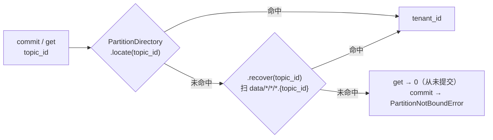
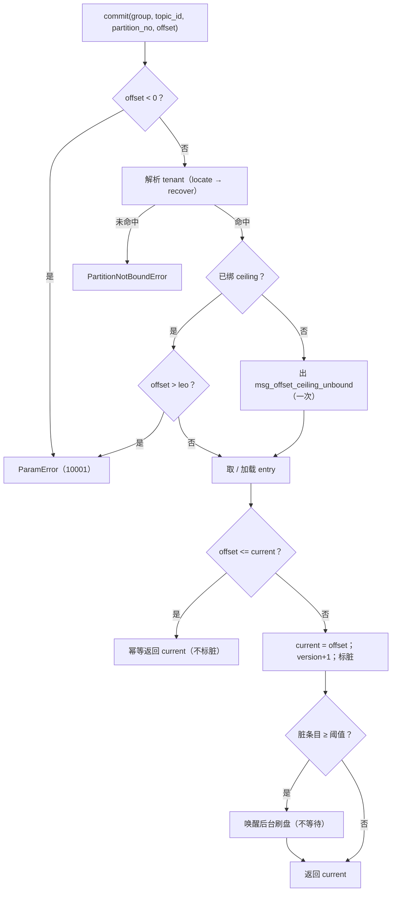
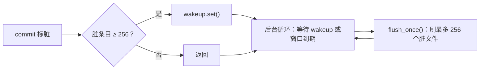
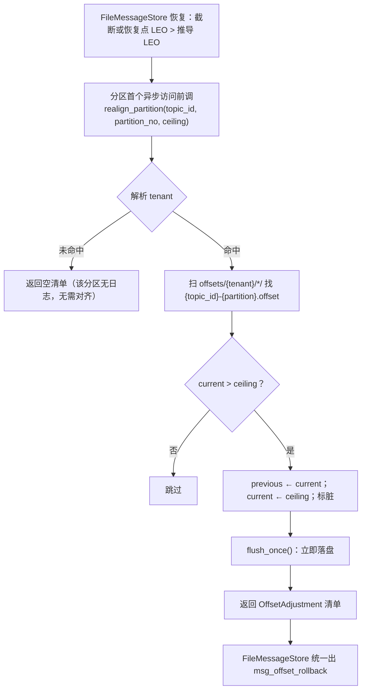

# 消费位点管理详细设计

> 位点文件格式（双槽）× 目录布局与租户解析 × 提交与刷盘 × 损坏回退 × 三个独立协议 × 装配偏序

[文档首页](../../../../../../文档首页.md) › [消息平台规划](../../../../../../规划/01_规划_消息平台.md) › [阶段计划](../../../../计划/01_计划_消息平台.md) › [02-3 消费位点管理](../02_存储与复制_03_消费位点管理.md) › 详细设计

---

## 1. 概述 <a id="overview"></a>

### 1.1 目标

把「消费到哪」从进程内字典换成按 `(group, topic_id, partition_no)` 的独立文件，并**保持 `OffsetStore` 端口签名不变**：

1. **位点可靠落盘**：`commit` 只改内存并标脏，后台定时刷 + 脏阈值提前刷 + 关闭强制刷；崩溃窗口等于刷盘间隔内的提交，后果是**重复消费而非丢消息**（重启前位点只会落后于已落盘 LEO）。
2. **「最近已持久化位点」真的有上一版**：单文件双槽（两槽各自 CRC + 递增序号），主槽损坏时用另一槽回退并告警；两槽皆坏则 fail-closed，不归零、不跳 LEO。
3. **接上 02-2 的位点对齐**：`FileOffsetStore` 实现 `OffsetRealigner`，截断后把越界位点夹到新 LEO 并立即落盘——恢复流程与调用链一行不改。
4. **能力留口不越界**：`reset` / `list_group` / `purge` 走三个独立小协议（与 `OffsetRealigner` 同构），管理端点、二次确认与权限校验归 06-2。

### 1.2 边界与承接

| 项 | 本任务 | 归口 |
| --- | --- | --- |
| 位点文件格式、双槽、CRC、原子替换 | ✅ 交付 | 02-3 |
| 提交语义（只前进、幂等、越界拒绝）与刷盘策略 | ✅ 交付 | 02-3 |
| 损坏回退（上一版）/ 全坏 fail-closed / 告警 | ✅ 交付 | 02-3 |
| `OffsetRealigner` 的**文件实现** | ✅ 交付 | 02-3（协议由 02-2 定） |
| `reset` / `list_group` / `purge` 底层能力 + 审计事件 | ✅ 交付 | 02-3 |
| 位点重置的管理端点、二次确认、`msg:manage` 权限校验 | ❌ 不做 | 06-2 |
| 位点查询端点（读视图） | ❌ 不做 | 06-2 |
| 消费组元数据（组表 / 成员 / 世代） | ❌ 不做（01-4 语义已交付，落表另归） | 8B_02 后续 / 06 域 |
| 多副本位点一致性与单写者 | ❌ 不做 | 8B_05 |
| 位点指标（lag / 提交速率） | ❌ 不做（只出结构化日志） | 06-3 |
| 位点文件定时快照备份 | ❌ 不做（运维手册口径） | 07 域 |

### 1.3 口径来源

| 问题 | 定稿 | 出处 |
| --- | --- | --- |
| 位点粒度 | `(group, topic_id, partition_no)` | 需求 02-3 §4.1、01-4 前置契约 |
| 提交值 | 已处理完的最后一条 + 1（下一条待消费） | 需求 02-3 §4.2 |
| 提交时机 | 处理完再提交；只前进不后退；重复提交幂等 | 任务 §2.3、01-2 交付 |
| 存储位置 | 独立文件（后续可评估入表），按 `tenant_id` 分目录 | 需求 02-3 §4.1、架构 04 §8 |
| 刷盘 | 定期 + 关闭强制；频率实测回填 | 需求 02-3 §4.3、架构 04 §11 #5 |
| 损坏处置 | 回退到最近已持久化位点 + 告警；只有从未持久化才按 0 | 需求 02-3 §4.4、任务 §2.5 |
| 重置 | 管理员操作，必须留痕；端点归 06-2 | 需求 02-3 §4.5、需求 06-2 |
| 位点对齐 | `realign_partition` 夹取 + 返回清单，告警由 store 统一出 | 02-2 详细设计 §7 |
| 关闭偏序 | 先刷日志（+ 恢复点）、后刷位点 | 02-2 交接项（方向已修正，见 §17.2 #6） |

## 2. 现状与差距 <a id="gap"></a>

| 现状 | 差距 | 本任务处置 |
| --- | --- | --- |
| `InMemoryOffsetStore` 用 `dict[OffsetKey, int]` 存位点 | 进程重启即全丢 → 整组从头消费 | 新增 `FileOffsetStore`；内存实现保留作轻量替身 |
| 端口 `get` / `commit` 只收 `group, topic_id, partition_no` | 目录要 `tenant_id` | 注入 `PartitionDirectory`（与 `FileMessageStore` 同一实例），`locate` → `recover` 兜底 |
| `get` 直接返回内存值 | 没有「已持久化位点」的概念，无处回退 | 每个键维护 `current` / `persisted` / `previous` 三值与 `version` |
| `commit` 不校验负数与上界 | 任务 §2.3 要求 `<0` 或 `>LEO` 拒绝（`10001`） | 注入只读 `leo()` 协议，`commit` / `reset` 自判 |
| `realign_partition` 只有内存实现 | 文件实现要「改值 + 立即落盘」 | 实现同一协议，夹取后立即刷一次 |
| 无重置 / 枚举 / 清理能力 | 06-2 挂端点时会回头改本层 | 三个独立协议一次做对（`OffsetResetter` / `OffsetEnumerator` / `OffsetPurger`） |
| 关闭钩子只有 `StorageCloser`（刷日志） | 位点没有关闭刷盘；且偏序无人保证 | 新增 `OffsetFlusher`（早注册 → 晚释放）与 `OffsetFlushLoop`（晚注册 → 早释放） |
| 01-6 的审计走 `build_operation_event` + `sys.operation.logged` | 位点重置要复用同一出口 | 注入 `AuditSink`，`action = msg:offset.reset` |

## 3. 交付物清单 <a id="deliverables"></a>

```text
backend/services/msg/src/bms_msg/
├── broker/offset.py                 # 改：新增位点文件编解码 / FileOffsetStore / 三个协议 / OffsetEntry
├── broker/lifecycle.py              # 改：新增 OffsetFlusher（刷盘）与 OffsetFlushLoop（停循环）两个句柄
├── core/config.py                   # 改：位点目录 / 刷盘间隔 / 脏阈值 / 文件格式版本与 magic
├── api/deps.py                      # 改：新增 OffsetResetterDep / OffsetEnumeratorDep / OffsetPurgerDep
└── main.py                          # 改：装配 FileOffsetStore（替换内存实现）+ 两个钩子的注册顺序 + 审计出口提前

backend/services/msg/tests/broker/test_offset_file_store.py   # 新增（Kiwi 2429）：文件实现 + 三协议 + 偏序
msg文档/.../02_存储与复制_03_消费位点管理/设计/01_详细设计_02_消费位点管理.md   # 本文件
```

**零变更清单**：契约快照（`deploy/contracts/msg.json` 不重导）、错误码表（不新增码）、数据库表结构、`Settings` 配置段、全部端点与 description、`OffsetStore` 的 `get` / `commit` 签名与语义、`InMemoryOffsetStore` 既有行为、02-2 的恢复点 / 段对账 / 截断取证 / `RecoveryProbe`、`DeliveryService` 与 `_collect`。

> 说明：`main.py` 只把 `InMemoryOffsetStore()` 换成 `FileOffsetStore(...)` 并调整两处注册顺序，端点与装配参数形态不变；`api/deps.py` 只增依赖别名（现有 `OffsetStoreDep` 不动）。

## 4. 目录布局与命名 <a id="layout"></a>

### 4.1 磁盘布局

```text
{MSG_DATA_DIR}/                          # 缺省 var/lib/msg（相对进程工作目录）
├── data/                                # 02-1 / 02-2 分区日志（本任务不读不写）
└── offsets/                             # 本任务
    └── {tenant_id}/
        └── {group_trimmed}-{hash8}/     # 组目录：可读名 + 8 位哈希
            ├── {topic_id}-{partition}.offset
            └── ...
```

- **与 `data/` 平级而不是塞进 `data/{tenant}/`**：位点与日志生命周期不同（位点每日快照备份、日志按段删且不备份，架构 08 §6），分目录让备份只搬 `offsets/`；且 `NAMESPACE_PATTERN = ^[a-z0-9_-]{1,64}$` **允许 `offsets` 作命名空间名**，塞进 `data/{tenant}/` 会与命名空间目录撞名。02-1 详细设计 §4.1 已预留 `{root}/offsets/`，本任务兑现。
- **`tenant_id` 用不可变雪花**：租户 `code` 可改名，目录不随它漂移（架构 04 §2.1）。
- **文件名用 `topic_id` 而非主题名**：任务 §2.1 口径；主题改名 / 删除重建同名都不漂移。

### 4.2 组目录名：为什么带哈希 <a id="group-dir"></a>

`GROUP_NAME_PATTERN = ^[a-zA-Z0-9._-]{1,128}$` 允许大小写混用，而 Windows / macOS 默认大小写不敏感：直接用 `{group}` 作目录名时，`Audit` 与 `audit` 会落到**同一个目录**——后写者覆盖前者的位点，前者整组从头消费，后者读到别的组的位点直接跳消息，属数据级错误。

| 方案 | 结果 |
| --- | --- |
| 直接用 `{group}` | Windows 下 `Audit` / `audit` 串组（数据级错误） |
| 统一小写 | 同样串组，只是「有意识地串」；且要改 01-4 已交付的组名语义 |
| **`{group}-{hash8}`** | 大小写不同的组得不同目录；哈希覆盖全名，唯一性不依赖文件系统 |

规则：

```text
group_dir = f"{group[:64]}-{sha1(group.encode('utf-8')).hexdigest()[:8]}"
```

- **截断到 64 字符**：`GROUP_NAME_PATTERN` 上限 128，加上租户目录与文件名后接近 Windows 路径长度上限；截断只影响可读性，唯一性由哈希保证（哈希取自**未截断**的组名）。
- **天然规避特殊名**：组名 `.` / `..` 是合法取值，加后缀后不再是特殊目录名。
- **不从目录名反推组名**：组名以 `group` 字段存在文件头里，目录名只是定位手段。

### 4.3 租户解析 <a id="tenant"></a>

`OffsetStore` 签名不带 `tenant_id`（01-2 定的端口契约，本任务不改），故按 `topic_id` 反查：



- 复用与 `FileMessageStore` **同一个** `PartitionDirectory` 实例（`main.py` 注入），不另建反查逻辑；
- `locate` 命中即免扫盘（请求路径常态）；`recover` 只在重启后内部调用（延迟转投 / 重放 / 首读位点）时兜底，与 02-1 口径一致；
- **解析不到时 `get` 返回 0、`commit` 抛 `PartitionNotBoundError`**：读侧按「从未提交」处理是安全的（未 resolve 过主题，必然没有位点），写侧不静默丢数据（与 02-1 `_location` 同口径）。

## 5. 位点文件格式 <a id="format"></a>

### 5.1 字节布局

```text
文件 = [header][slot 0][slot 1]
header = [magic 4 "MOFS"][format_version u16][group_len u8][group N][topic_id i64][partition_no i32]
slot   = [seq u32][offset u64][updated_at_us i64][crc32 u32]
```

| 字段 | 宽度 | 说明 |
| --- | --- | --- |
| `magic` | 4 ASCII | `MOFS`（msg offset file store）；不符即判「不是位点文件」 |
| `format_version` | u16 | 当前 `1`；读到更高版本 → **拒绝加载**（不按旧格式猜） |
| `group_len` / `group` | u8 / N ≤ 128 | UTF-8 原文组名；用于「文件被挪到别的组目录」的自检 |
| `topic_id` / `partition_no` | i64 / i32 | 目录归属自检 |
| `seq` | u32 | 每键独立递增；两槽取 `seq` 大者为最新 |
| `offset` | u64 | 已提交位点（下一条待消费） |
| `updated_at_us` | i64 | 写入时刻（epoch 微秒，排障用、不作判据） |
| `crc32` | u32 | 覆盖 header 全字段 + 本槽前 20 字节 |

- **槽固定 24 字节**，文件总长 = `header + 48`；header 变长（组名）但同一文件内恒定。
- **双槽而非双文件**：文件名恒定（目录干净、清理与备份只有一套规则）、原子替换保证「文件永远完整」、天然有上一版；代价是整文件损坏时两槽同坏（见 §7.3 的兜底）。
- **`crc32` 覆盖 header**：文件被截断或改写立即检出；「挪错目录」不会让 CRC 失效（字节没变），故 `group` / `topic_id` / `partition_no` 另做一致性校验，两类异常分开告警。

### 5.2 写入：整体重写 + 原子替换

```text
1. 组装 [header(当前键身份)][slot0 = (seq+1, 新值)][slot1 = (原 seq, 原持久化值)]
2. 写 {name}.tmp（O_BINARY，写完 fsync）
3. rename 覆盖目标文件
4. 内存：previous ← persisted；persisted ← 新值
```

- **必须带 `O_BINARY`**：Windows 上 `os.open` 默认文本模式会做 `0x0A → 0x0D0A` 翻译，CRC 与实际字节立刻对不上（02-1 / 02-2 同一个坑）。
- **不读旧文件**：内存里本就有 `current` / `persisted` / `previous` 三值，写文件不需要回读（重启后的首次写会先经过 `get` 加载，届时三值已就位）。
- **不做目录 fsync**：Windows 无对应语义；丢失最新一次 rename 的目录项只让位点回退到上一版，不损正确性（与 02-2 恢复点同口径）。

### 5.3 读取与三类异常

| 情形 | 处置 | 日志 |
| --- | --- | --- |
| 两槽 CRC 均通过 | `persisted` = `seq` 大者，`previous` = 另一槽 | — |
| 仅一槽通过 | `persisted` = `current` = 通过者，`previous` = None | `msg_offset_slot_recovered`（warning） |
| 两槽均不通过 / header 不符 / 版本过高 | 该键置**不可用**，`get` 抛 `OffsetUnavailableError`（fail-closed） | `msg_offset_unavailable`（warning） |
| 文件不存在 | `current = persisted = 0`（从未提交），不缓存「缺失」这个状态 | `msg_offset_absent`（info） |

**为什么全坏要 fail-closed**：任务 §2.5 明确「不得直接归零、不得跳 LEO」。两槽都坏时「最近已持久化位点」本身不存在——归零会让一个跑了几个月的组从头重消费，跳 LEO 会静默丢积压，两者都不如「停下来等人处置」。rename 是原子的，此态只可能来自磁盘损坏或外部改写，属真正的数据丢失事件。

**为什么「文件缺失」只按 0 不告警**：重启后无法区分「首次消费」与「文件被删」，噪音会盖住真信号；「曾持久化过却整文件消失」只能靠目录级巡检（运维手册）发现，本任务登记为遗留（§16）。

## 6. 提交路径 <a id="commit"></a>

### 6.1 `commit` 步骤



- **越界判定只看上界不看下界语义**：`offset == leo` 合法（等于「已消费到末尾」）；`offset > leo` 是调用方违约。
- **`leo()` 未绑定**（装配缺陷）→ 跳过上界判定并出一次 `msg_offset_ceiling_unbound`（warning）：与 02-2「未注入 realigner 出 `msg_offset_alignment_skipped`」同口径——缺陷要可见，但不该让服务写不进去。
- **不在 `commit` 里 await 刷盘**：写盘只在后台循环里发生，ack 路径零 IO（决策 1 / 3）。

### 6.2 内存结构

| 字段 | 含义 |
| --- | --- |
| `current` | 内存最新位点（`get` 的返回值） |
| `persisted` | 最近一次成功落盘的值（= 文件里 `seq` 大的槽） |
| `previous` | 上一次成功落盘的值（= 另一槽；没有则为 None） |
| `version` | 每次 `current` 变更 +1（刷盘后比对，决定能否清脏） |
| `dirty` | 是否有未落盘变更 |
| `unavailable` | 加载时判定为不可用（fail-closed） |

**三值都在内存**：`persisted` / `previous` 不是为了读，而是为了「刷盘时不必回读文件」——重启后的首次写一定先经过 `get`（加载三值），因此写路径永远有完整的三值可用。

### 6.3 只前进不后退

`commit` 只接受 `offset > current`，否则幂等返回。**倒退只有两条合法路径**：

1. `reset()`（管理员操作，带审计）；
2. `realign_partition()`（崩溃恢复夹取，带 store 级告警）。

两者都不走 `commit`，避免「只前进」这条不变量被内部路径悄悄破坏。

## 7. 刷盘 <a id="flush"></a>

### 7.1 触发与循环



- **循环体**：`await asyncio.wait_for(self._wakeup.wait(), timeout=interval)` → 超时或唤醒都进入 `flush_once()`；无脏时 `flush_once` 立刻返回（开销可忽略）。
- **窗口（1000ms）与脏阈值（256）分工**：窗口保证「低频组最多丢 1 秒的提交」；阈值保证「高频组不必等窗口」且**单次刷盘的文件数有上界**（每次 flush 最多 256 次 fsync，避免一次刷盘卡住事件循环）。
- **关闭强制**：`OffsetFlusher.aclose()` 无条件刷一次（不看窗口），保证停机后位点等于内存最新值。

### 7.2 单飞与版本比对 <a id="single-flight"></a>

```text
flush_once():
    1. 若已在刷（_flushing）→ 直接返回（单飞）
    2. 取快照：脏条目（最多 limit 个）→ [(key, current, seq+1, version)]
    3. 逐个写文件（临时文件 + fsync + rename）；成功后：
         persisted ← 快照值；previous ← 旧 persisted
         若 entry.version == 快照 version → 清脏，否则保留脏（下轮再刷）
    4. 单个文件写失败：保留脏 + msg_offset_flush_failed（warning），继续下一个（fail-open）
```

- **读写完全不加锁**：单事件循环内「读字典 → 改值 → 标脏」没有 `await` 断点，天然原子。
- **只有刷盘单飞**：`_flushing` 标志防止两个 flush 并发写同一文件（旧快照覆盖新值）。
- **版本比对是清脏的唯一判据**：快照取完后仍有 `commit` 进来时，`version` 不等 → 脏标记保留 → 下一轮必然补刷。这比「rename 前比对」简单且同等安全（rename 写的是快照内容，问题只在「清不清脏」）。

### 7.3 崩溃窗口

| 时刻 | 崩溃后果 |
| --- | --- |
| `commit` 后、刷盘前 | 重启读到的位点是窗口前的值 → **重复消费这段**（不丢） |
| 刷盘写到一半（`.tmp` 未 rename） | 目标文件仍是上一版 → 重复消费（不丢）；`.tmp` 由下次写入覆盖 |
| rename 后、清脏前 | 文件已是最新，只是内存标记未清 → 无影响（重启读到最新） |
| 关闭流程中（日志已刷、位点未刷） | 位点落后于 LEO → 重复消费（不丢）——这正是 §8 偏序要保证的方向 |

**不会出现「位点 > 已落盘 LEO」**：关闭时先刷日志；运行期位点可能超过已 fsync 的 LEO（日志按批刷），重启后 02-2 的对齐会把位点夹回 LEO，代价是重复消费。

## 8. 关闭偏序 <a id="close"></a>

### 8.1 两个句柄，各管一半

`ResourceManager` 是**逆序释放**（取 `resources[-1]`），所以「注册越早 → 释放越晚」。位点需要两件事，且它们要求的释放位置相反：

| 句柄 | 职责 | 注册位置 | 释放次序 |
| --- | --- | --- | --- |
| `OffsetFlushLoop` | 停刷盘循环 | `start_background_tasks()`（与 `BackgroundLoops` 同处，**先于它注册**） | 2 |
| `StorageCloser`（02-2） | 刷日志 + 写恢复点 | `configure_service()` | 3 |
| `OffsetFlusher` | 刷位点（无条件） | `configure_service()`，**早于 `StorageCloser`** | 4 |

释放序 1 → 4：`BackgroundLoops`（停延迟转投 / 重放）→ `OffsetFlushLoop`（停刷盘）→ `StorageCloser`（刷日志）→ `OffsetFlusher`（刷位点）。

### 8.2 为什么位点必须在日志之后刷

| 偏序 | 崩溃在两者之间时 | 后果 |
| --- | --- | --- |
| **先日志后位点**（本设计） | 位点仍是旧值 ≤ 已落盘 LEO | 重复消费，**不丢** |
| 先位点后日志 | 位点 = 新值，可能 > 已落盘 LEO | 重启后对齐把位点夹到 LEO → **(旧位点, 新位点) 之间未落盘的消息被跳过 = 丢消息** |

> **02-2 交接项的措辞写反了**：其原文是「位点刷盘的关闭钩子须注册在 `StorageCloser` 之后（逆序释放时更早执行）」——「更早执行」得到的是「先位点后日志」，恰是上表的危险方向。本任务按**正确偏序**实施（`OffsetFlusher` 早于 `StorageCloser` 注册），并回写 02-2 设计 §8.2 与实施记录 §7（见 §17.2 #6）。

## 9. 与 02-2 位点对齐联动 <a id="realign"></a>



- **允许倒退，但不走 `commit`**：夹取是恢复语义（数据丢失事件），与「提交只前进」是两件事（§6.3）。
- **立即落盘**：位点回退必须重启后依然可见，不能等窗口；这里破例 await 一次 `flush_once()`——它只在恢复路径发生一次，不在请求热路径。
- **目录扫描 O(组数)**：`realign_partition` 只带 `topic_id + partition_no`，只能扫该租户下所有组目录找同名文件。这条路**只在发生截断 / 恢复点超前时触发**（罕见），正常启动一次都不扫；千组规模的扫描成本归 8B_12（§16）。
- **未解析租户即返回空**：没有日志分区就不可能有截断，无需对齐；不报警（与 02-2「未注入 realigner」不同——那是装配缺陷，这是正常的未加载分区）。

## 10. 三个独立协议 <a id="protocols"></a>

### 10.1 为什么不扩 `OffsetStore`

`OffsetStore` 是 01-2 定的消费方契约，只有 `get` / `commit`。把 `reset` / `list_group` / `purge` 塞进去会让：内存替身与后续入表实现都被迫实现与本任务无关的方法；01-2 的端口契约被改写。故与 02-2 的 `OffsetRealigner` 同法——**独立小协议，文件实现多继承**。

```python
class OffsetResetter(Protocol):
    async def reset(self, *, group: str, topic_id: int, partition_no: int, offset: int,
                    actor_id: int | None = None, ip: str | None = None,
                    trace_id: str | None = None) -> int: ...

class OffsetEnumerator(Protocol):
    async def list_group(self, *, tenant_id: int, group: str) -> "ConcurrentStableList[OffsetEntry]": ...

class OffsetPurger(Protocol):
    async def purge_group(self, *, tenant_id: int, group: str) -> int: ...
    async def purge_topic(self, *, topic_id: int) -> int: ...
```

| 协议 | 签名要点 | 理由 |
| --- | --- | --- |
| `reset` | 不带 `tenant_id`（由 `topic_id` 反查）；可带 `actor_id / ip / trace_id` 供审计 | 与 `OffsetStore` 的键口径一致；审计需要操作人，但操作人只在有请求上下文时有值 |
| `list_group` | **必须带 `tenant_id`** | 只有组名无法定位租户目录；扫全部租户目录等于跨租户读取，隔离失效 |
| `purge_group` | 带 `tenant_id` | 同上 |
| `purge_topic` | 只带 `topic_id` | `topic_id` 全局唯一，反查租户后可精确删除 |

### 10.2 `reset` 的语义与审计 <a id="reset"></a>

| 项 | 口径 |
| --- | --- |
| 方向 | **可倒退可前跳**：倒退用于补消费 / 排障；前跳用于「跳过坏消息、丢弃积压」 |
| 范围 | `0 ≤ offset ≤ LEO`，越界 `ParamError`（`10001`），值不变 |
| 幂等 | 每次调用结果一致（同值重复调用返回同值），**但仍留痕**——重置动作本身要可追溯 |
| 落盘 | 改值后立即 `flush_once()`（管理员要立刻看到效果，且崩溃后不能「重置了个寂寞」） |
| 审计 | `build_operation_event`（`module="msg"` / `action="msg:offset.reset"` / `path="/api/v1/msg/admin/offsets/reset"` / `params` 含 group/topic_id/partition/previous/current），写 `sys.operation.logged` |
| **审计失败** | **拒绝重置**（fail-closed）：高危操作没留痕就不该生效——与 01-6 重放审计（fail-open）刻意不同，重放不改状态边界，位点重置直接决定「哪些消息会被跳过」 |
| 权限 | 不做（`msg:manage` 校验在 06-2 端点侧；本任务只保证底层能力不绕过审计） |

### 10.3 `purge` 的语义

| 方法 | 动作 |
| --- | --- |
| `purge_group(tenant_id, group)` | 删该组目录（含全部位点文件）+ 清进程内缓存，返回删除的文件数 |
| `purge_topic(topic_id)` | 反查租户 → 扫该租户所有组目录，删所有 `{topic_id}-*.offset`；组目录变空则一并删；清缓存 |

- **只删文件，不做隐式业务判断**：调用方（06-2）负责二次确认与影响范围说明；
- **出审计**（`msg:offset.purge`）：删除位点等于让相关组「忘记消费位置」，是数据级操作；
- **不删 `data/` 下的分区日志**（那是保留期 / 主题删除的职责）。

## 11. 装配与接线 <a id="assembly"></a>

| 文件 | 改动 |
| --- | --- |
| `core/config.py` | 新增：`OFFSETS_SUBDIR` / `OFFSET_FILE_SUFFIX` / `OFFSET_FILE_MAGIC` / `OFFSET_FILE_FORMAT_VERSION` / `OFFSET_SLOT_BYTES` / `OFFSET_FLUSH_INTERVAL_MS`（+ENV）/ `OFFSET_DIRTY_LIMIT`（+ENV）/ `OFFSET_GROUP_DIR_MAX_CHARS` |
| `broker/offset.py` | 新增：`OffsetEntry` / `OffsetUnavailableError` / 编解码（`encode_offset_file` / `decode_offset_file`）/ `FileOffsetStore` / `OffsetResetter` / `OffsetEnumerator` / `OffsetPurger` / `OffsetCeiling` 协议；**`OffsetStore` 与 `InMemoryOffsetStore` 一字不改**（内存实现补齐三协议，供端点用例） |
| `broker/lifecycle.py` | 新增：`OffsetFlushLoop`（停循环）/ `OffsetFlusher`（刷盘）两个 `BaseAsyncResource`；`start_background_tasks` 里先注册 `OffsetFlushLoop` |
| `api/deps.py` | 新增：`get_offset_resetter` / `get_offset_enumerator` / `get_offset_purger` 与三个 `Annotated` 别名；现有 `OffsetStoreDep` 不动 |
| `main.py` | 改：① `AuditEventEmitter` 的构造**提到最前**（位点存储要用）；② `app.state.offset_store = FileOffsetStore(directory=..., root=..., audit=sink)`；③ `file_store` 建好后 `offset_store.bind_ceiling(file_store)`（双向依赖：store 要 realigner、位点要 leo，只能构造后绑定）；④ `resources.register(OffsetFlusher(...))` **放在 `StorageCloser` 之前**；⑤ 模块文档串补 02-3 一行 |

**为什么用 `bind_ceiling` 而不是构造传参**：`FileMessageStore` 构造要 `realigner`（位点存储），位点存储又要 `leo`（`FileMessageStore`）——构造期互相引用只能二选一先建。绑定式解耦让两侧都保持「构造参数即完整依赖」的形态，且未绑定时有显式告警（§6.1）。

## 12. 可观测 <a id="observe"></a>

| 事件 | 级别 | 关键字段 |
| --- | --- | --- |
| `msg_offset_flushed` | info | `files` / `entries` / `elapsed_ms` |
| `msg_offset_flush_failed` | warning | `group` / `topic_id` / `partition_no` / `error` |
| `msg_offset_slot_recovered` | warning | `group` / `topic_id` / `partition_no` / `seq_used` / `seq_broken` |
| `msg_offset_unavailable` | warning | `group` / `topic_id` / `partition_no` / `reason`（`crc` / `header` / `version`） |
| `msg_offset_absent` | info | `group` / `topic_id` / `partition_no` |
| `msg_offset_ceiling_unbound` | warning | 装配缺陷（一次性） |
| `msg_offset_reset` | info | `group` / `topic_id` / `partition_no` / `previous` / `current` / `actor_id` |
| `msg_offset_purged` | info | `scope`（`group` / `topic`）/ `files` |
| `msg_offset_rollback` | warning | **由 `FileMessageStore` 出**（02-2 口径），本任务不重复 |

## 13. 测试设计 <a id="tests"></a>

### 13.1 用例清单（Kiwi 2429）

新增 `tests/broker/test_offset_file_store.py`，模块级 `pytestmark = pytest.mark.kiwi_id(2429)`。**既有 `test_offset_store.py`（Kiwi 2414）与 `test_recovery.py`（Kiwi 2428）不改不混标。**

| # | 用例 | 断言要点 |
| --- | --- | --- |
| O1 | 文件字节布局 | magic / version / group / topic_id / partition / offset / updated_at / CRC 自洽；`O_BINARY` 生效（无 `0x0D` 混入） |
| O2 | 双槽 seq 递增 | 两次提交后两槽 `seq` 递增，新值在 `seq` 大者 |
| O3 | 重启续读 | 提交 → 新建实例 → `get` 同值（不依赖进程内缓存） |
| O4 | 主槽 CRC 坏 | 回退到另一槽（上一版）+ `msg_offset_slot_recovered` |
| O5 | 两槽全坏 | `get` 抛 `OffsetUnavailableError` + `msg_offset_unavailable`（不归零、不跳 LEO） |
| O6 | 版本过高 | 视为不可用（拒绝加载） |
| O7 | 文件缺失 | `get` 返回 0 + `msg_offset_absent`（info） |
| O8 | group / topic / partition 与路径不符 | 视为不可用 + 告警（文件被挪错目录） |
| O9 | `commit` 负值 | `ParamError`（10001），值不变 |
| O10 | `commit` 超 LEO | `ParamError`（10001）；`offset == leo` 合法 |
| O11 | `commit` 未绑 ceiling | 跳过上界判定 + 一次性告警；写路径正常 |
| O12 | 只前进 | 5 → 2 不生效；5 → 5 幂等不标脏 |
| O13 | 三维隔离 | 同组不同 topic / partition 各自独立文件 |
| O14 | 大小写不同的组 | 落到不同目录（`Audit` ≠ `audit`） |
| O15 | 组名边界 | `.` / `..` / 128 字符 / 含 `-` 均安全，目录名截断后仍唯一 |
| O16 | 后台刷盘 | `run_once` 驱动：脏条目落盘、`msg_offset_flushed` 计数正确 |
| O17 | 脏阈值 | 达 256 立即唤醒刷盘（不依赖窗口） |
| O18 | 关闭刷盘 | `aclose` 后文件值为最新（无条件，不受窗口影响） |
| O19 | 刷盘失败 | 脏标记保留 + `msg_offset_flush_failed`；`commit` 不因此报错 |
| O20 | 单飞与版本比对 | 刷盘期间再 `commit` → 脏不清，下一轮刷到最新 |
| O21 | `realign` 夹取 | 超 `ceiling` 的位点被夹到 `ceiling`，立即落盘，返回清单 |
| O22 | `realign` 不越界 | 不改值、清单为空 |
| O23 | `realign` 未解析租户 | 空清单、不报错 |
| O24 | 装配替换 | `OffsetStoreDep` 取到文件实现，`get` / `commit` 语义不变 |
| O25 | 关闭偏序 | 注册序 → 释放序：`BackgroundLoops` → `OffsetFlushLoop` → `StorageCloser` → `OffsetFlusher` |
| O26 | `reset` 倒退 / 前跳 | 值生效且立即落盘可见 |
| O27 | `reset` 越界 | `<0` / `>LEO` → `10001`，值不变 |
| O28 | `reset` 审计失败 | 抛错且值不变（fail-closed） |
| O29 | `reset` 审计内容 | `action` / `path` / `params`（previous / current）/ `actor_id` 正确 |
| O30 | `list_group` | 多分区多主题枚举、按 `partition` 升序、`offset` 为当前值 |
| O31 | `purge_group` | 目录删除 + 缓存清理 + 审计；不存在的组返回 0 |
| O32 | `purge_topic` | 跨组删除同名文件、空组目录一并删 |
| O33 | 租户未登记 | `get` → 0；`commit` → `PartitionNotBoundError` |
| O34 | 内存实现补齐三协议 | `InMemoryOffsetStore` 同样满足 `reset` / `list_group` / `purge`（端点用例可用） |

补充边界（覆盖率用，参数化）：header 长度字段非法、`group_len > 128`、`partition_no` 为负、`.tmp` 残留被覆盖、`purge` 时文件已不存在、`list_group` 遇不可用文件（跳过并告警）、`reset` 在同值上重复调用。

### 13.2 覆盖率与门禁

- **变更模块行 + 分支 100%**：`offset` / `lifecycle` / `core.config` / `main` / `api.deps`；
- 不可达分支一律 `# pragma: no cover - <原因>`，逐处写明；
- 采集用 `scripts/tools/preflight/coverage_report.py --module <点分模块>`，数据文件给**绝对路径**；判定前清 `.cache/coverage/.coverage.*`，并用最终代码重采（`ruff format` 改行号会报假缺口）；
- 静态：`ruff check` / `ruff format --check` / `pyright` 改动文件全绿；
- 文档三项：`engkit links` / `engkit docs-scope` / `engkit eol`；
- 契约：`contract_snapshot check` 零漂移（本任务不新增端点、不改 description）。

## 14. 实施步骤 <a id="steps"></a>

| 步 | 动作 |
| --- | --- |
| 1 | `core/config.py` 加常量（目录 / 后缀 / magic / 版本 / 槽宽 / 窗口 / 脏阈值 / 组目录截断） |
| 2 | `broker/offset.py`：`OffsetEntry` / 编解码 / `OffsetUnavailableError` / 三个协议 / `FileOffsetStore`（含刷盘单飞与三值状态）/ 内存实现补齐三协议 |
| 3 | `broker/lifecycle.py`：`OffsetFlushLoop` / `OffsetFlusher`；`start_background_tasks` 注册顺序 |
| 4 | `main.py`：审计出口提前、换文件实现、`bind_ceiling`、两处注册顺序、模块文档串 |
| 5 | `api/deps.py`：三个依赖别名 |
| 6 | Kiwi 2429 已登记 → 写 `test_offset_file_store.py` → 覆盖率补口 |
| 7 | 门禁全绿 → 文档三项 → 提交（文档 / 代码分开） |

## 15. 验收映射 <a id="accept-map"></a>

| 任务 §3 完成标准 | 落点 |
| --- | --- |
| 重启后从正确位点续读；未提交消息重投（至少一次） | O3 / O16 / O18（重启后 `get` 同值、窗口内提交可重复消费） |
| 人为损坏位点文件：回退到最近持久化位点并告警，不重头也不跳过 | O4（回退上一版）/ O5（全坏 fail-closed）/ O7（缺失按 0 且有 info） |
| 位点重置的底层调用带审计事件 | O29（内容）+ O28（审计失败即拒绝） |
| 只前进不后退、重复提交幂等、越界拒绝均有护栏用例 | O9 / O10 / O11 / O12 / O27 |
| 变更模块行 + 分支 100%，静态全绿 | §13.2 |

## 16. 风险与开放项 <a id="risk"></a>

| # | 项 | 处置 |
| --- | --- | --- |
| 1 | 组目录扫描 O(组数)（`realign` / `purge_topic` / `list_group`） | 都非热路径（`realign` 仅截断时、`purge` 仅管理操作）；千组规模成本归 8B_12 |
| 2 | 千组 × 多分区时单次刷盘的 fsync 次数 | 脏阈值（256）就是单次上限；容量结论归 8B_12 |
| 3 | 刷盘窗口内的提交会重复消费 | 业务侧幂等兜底（01-2「至少一次」既定口径）；窗口 1000ms 的实测回填归本任务测试记录 + 架构 04 §11 #5 |
| 4 | 「曾持久化过但整文件被删」无法与「首次消费」区分 | 按 0 起 + info；靠运维巡检发现，本任务不做目录级一致性巡检（06 域） |
| 5 | `updated_at_us` 只作排障、不作判据 | 时钟回拨不影响正确性（无基于时间的位点判定） |
| 6 | 位点缓存是进程内状态 | 多 worker / 多副本各自缓存 → 8B_05（与目录登记表 / `log_id` LRU 同口径） |
| 7 | 组名截断到 64 字符后目录名不完全可读 | 唯一性由哈希保证；排障时以文件头 `group` 字段为准 |
| 8 | `reset` 前跳可丢弃积压 | 二次确认与影响说明归 06-2；本任务只保证「越界拒绝 + 必须留痕」 |

## 17. 决策确认与对齐记录 <a id="align"></a>

### 17.1 已确认决策（15 项） <a id="decisions"></a>

| # | 决策 | 结论 |
| --- | --- | --- |
| 1 | 写入策略 | 内存为准 + 定期刷 + 关闭强制刷（`commit` 零 IO） |
| 2 | 「上一版」形态 | 单文件双槽（各自 CRC + 递增 `seq`，整体重写 + 原子替换） |
| 3 | 刷盘触发 | 后台定时循环 + 脏阈值提前刷 + 关闭强制 |
| 4 | 位点目录 | `{root}/offsets/{tenant_id}/{group}-{hash8}/`（与 `data/` 平级） |
| 5 | 关闭偏序 | 位点钩子早于 `StorageCloser` 注册（先日志后位点） |
| 6 | 越界拒绝 | 存储层注入只读 `leo()` 协议判 `<0 / >LEO` → `10001`；投递层 `350002` 不动 |
| 7 | 租户解析 | 复用 `PartitionDirectory`（`locate` → `recover`）；`get` 未解析返回 0，`commit` 抛错 |
| 8 | 两槽均坏 | fail-closed（拒绝消费 + 告警），不归零不跳 LEO |
| 9 | 组目录名 | `{group[:64]}-{sha1(group)[:8]}` |
| 10 | 重置口径 | 可倒退可前跳、`0 ≤ offset ≤ LEO`、每次留痕、审计失败即拒绝 |
| 11 | 并发 | 读写无锁 + 刷盘单飞（快照 + 版本比对）；`realign` 只改内存 + 立即刷 |
| 12 | 孤儿清理 | 提供 `purge_group` / `purge_topic` 能力，端点归 06-2 |
| 13 | 刷盘缺省 | 1000ms / 脏文件数 256 |
| 14 | 常量落点 | `core/config.py` + 环境变量，构造参数优先 |
| 15 | 端口挂法 | 独立小协议族（`OffsetResetter` / `OffsetEnumerator` / `OffsetPurger`），`OffsetStore` 不动 |

### 17.2 对齐记录 <a id="diff"></a>

| # | 项 | 说明 |
| --- | --- | --- |
| 1 | 任务 §2.1 路径 `data/{tenant_id}/offsets/...` | 改为 `{root}/offsets/{tenant_id}/...`（与 `data/` 平级）：`offsets` 与命名空间目录平级会撞名（`NAMESPACE_PATTERN` 允许 `offsets`），且位点与日志的备份口径不同（架构 08 §6）。02-1 设计 §4.1 已预留该目录，回写架构 04 §2.1 与任务 §2.1 |
| 2 | 任务 §2.1 文件名 `{topic_id}-{partition}.offset` | 保持；组目录名补 8 位哈希（Windows 大小写不敏感撞名），回写架构 08 §4 |
| 3 | 任务 §2.3「越过 LEO 的位点拒绝（`10001`）」 | 落实为「存储层注入只读 `leo()` 协议自判」；对外接口的越界仍由投递层给 `350002`（契约零变更）。两码分工写进 §6.1 |
| 4 | 任务 §2.5「文件缺失也要回退到最近已持久化位点」 | 精化为：缺失 → 按 0 + info（无法与「首次消费」区分）；损坏 → 回退上一槽 + warning；两槽全坏 → fail-closed + warning。「不得直接归零」的语境是**有上一版时必须用上一版**，§5.3 已写明 |
| 5 | 任务 §2.2「临时文件 + rename 原子替换（或追加日志 + 恢复点，二选一）」 | 选前者，并加双槽承载「上一版」（只靠 rename 无上一版，不满足 §2.5） |
| 6 | **02-2 交接项「位点关闭钩子注册在 `StorageCloser` 之后（释放更早）」** | **措辞写反**：释放更早 = 先刷位点后刷日志 = 位点可能 > 已落盘 LEO → 对齐时跳过未落盘消息（丢）。本任务按「`OffsetFlusher` 早于 `StorageCloser` 注册」（释放更晚 → 先日志后位点）实施，回写 02-2 设计 §8.2 与实施记录 §7 #7 |
| 7 | 架构 04 §11 #5「位点刷盘频率」 | 本轮定 1000ms / 脏阈值 256，实测结论回填该行 |
| 8 | `start_background_tasks` 的资源注册顺序 | 追加 `OffsetFlushLoop`（先于 `BackgroundLoops` 注册），`BackgroundLoops` 签名不动 |
| 9 | `main.py` 审计出口构造位置 | 提到 `configure_service()` 最前（位点重置要审计），`replay_runner` 复用同一实例；行为与语义不变 |
| 10 | Kiwi 编号 | 从 2429 起（登记前回读最大号，当前 2428）；既有 2414 / 2428 不复用不改派 |

---

> 依《[文档生成规范](../../../../../../../bms文档/规范/文档生成规范.md)》编写 · 实施与测试记录见同级 `实施/`、`测试/`
