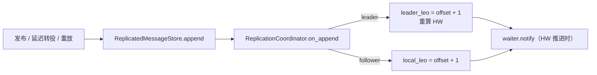
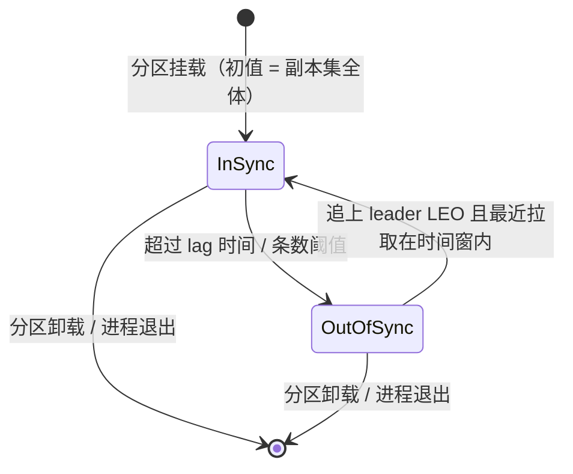
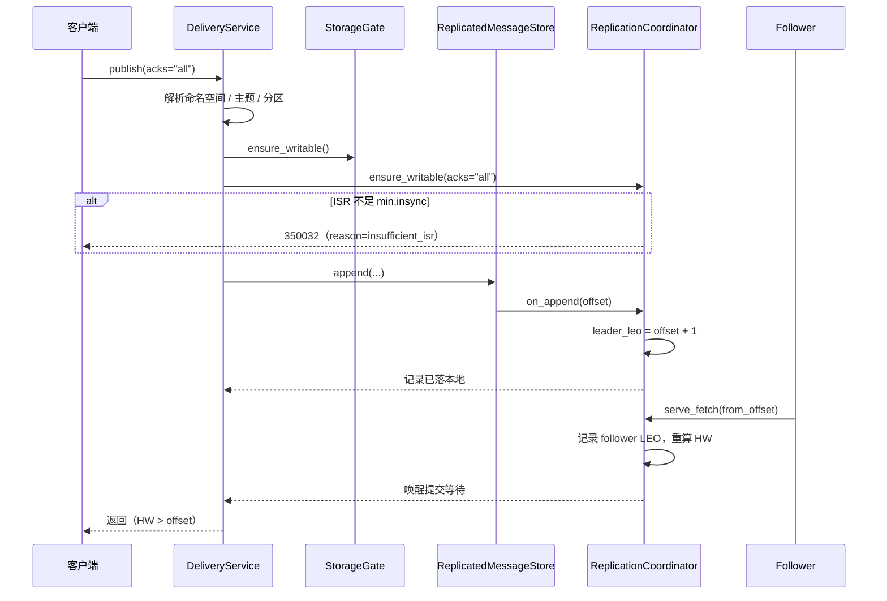
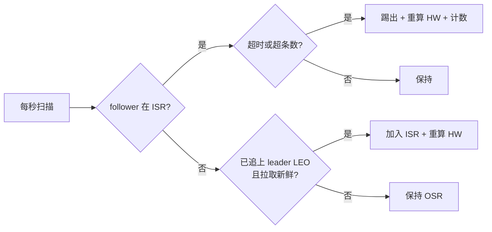

# 副本与 ISR 复制详细设计

> ISR 半同步 × HW 可见性 × `acks=all` × 副本拉取与 epoch 校验 × 可开关的进程内复制核心

[文档首页](../../../../../../文档首页.md) › [消息平台规划](../../../../../../规划/01_规划_消息平台.md) › [阶段计划](../../../../计划/01_计划_消息平台.md) › [02-4 副本与 ISR 复制](../02_存储与复制_04_副本与ISR复制.md) › 详细设计

---

## 1. 概述 <a id="overview"></a>

### 1.1 目标

把 02-1 / 02-2 / 02-3 的单机追加日志升级为**可开关、可断言的 ISR 半同步复制机制**，为 8B_05 的多实例部署与故障切换提供机制底座：

1. **副本模型**：每分区一个副本集与 leader；`replication_factor` 由副本集长度决定，`min.insync.replicas` 可按分区覆盖（`msg_partition`）。
2. **副本拉取**：follower 按 `(offset, epoch)` 从 leader 拉取记录；leader 以 follower 的上报位点维护各副本 LEO；拉取失败按退避重试，不阻塞写入主链路。
3. **提交语义**：leader 本地 append + ISR 确认后推进 HW；`acks=all` 要求 `|ISR| >= min.insync.replicas`，不足即拒绝写（新增 `350032`）。
4. **可见性**：消费者只能读到 `offset < HW`；未提交部分对消费不可见；HW 随 ISR 收敛推进并唤醒长轮询。
5. **ISR 收缩与重入**：落后超过时间或条数阈值即踢出，追上 leader LEO 且在时间窗内重新加入；收缩次数与 ISR 大小可观测。
6. **字段与格式**：使用 02-1 预留的 `epoch` 字段写入 leader 任期；**不新增记录格式版本**、不改头体分离与 CRC 口径。
7. **单实例零变化**：复制缺省关闭，关闭时 `HW = LEO`、`acks=all` 与 `acks=1` 行为一致，既有 01 / 02 域用例不回归。

### 1.2 边界与承接

| 项 | 本任务 | 归口 |
| --- | --- | --- |
| ISR 集合、HW 推进、`acks=all`、副本拉取、epoch 校验、ISR 收缩 / 重入 | ✅ 交付 | 02-4 |
| `ReplicaTransport` 协议 + 进程内传输（用例 / 同进程多节点） | ✅ 交付 | 02-4 |
| 管理与指标：HW / ISR / leader 实时值、`msg_isr_shrink_total` 真实计数、ISR 大小 / 副本延迟 | ✅ 交付 | 02-4 |
| 真实跨实例网络传输、分区分配与迁移、多实例编排 | ❌ 不做（接口已定） | 02-8 |
| 选举、epoch 递增、旧 leader 写拒绝、HW 截断未提交尾部 | ❌ 不做（只校验 epoch） | 02-5 |
| 跨机房强一致、Raft 多数派 | ❌ 不做 | 架构 04 §7 |
| 备份与恢复（副本不是备份） | ❌ 不做 | 07 域 |
| 跨租户共享副本 | ❌ 不做 | 05 域 |

### 1.3 口径来源

| 问题 | 定稿 | 出处 |
| --- | --- | --- |
| 复制模型 | ISR 半同步（leader + ISR 确认后提交） | 需求 02-4、架构 04 §7 |
| 副本集来源 | `msg_partition.replicas` 优先，空则按配置节点列表按分区号轮转 | 本设计 §4.5（2026-11-11 拍板） |
| `min.insync.replicas` | 每分区 `msg_partition.min_insync_replicas`（0 = 继承全局） | 本设计 §11（2026-11-11 拍板） |
| ISR 阈值 | 时间 10s + 条数 10 000，任一超限踢出；扫描周期 1s | 本设计 §7（2026-11-11 拍板） |
| `acks` 契约 | `"1"` / `"all"`，缺省 `"1"`；帧路径 header 同名键透传 | 本设计 §5.1（2026-11-11 拍板） |
| 副本不足 / 提交超时 | 新增 `350032`（503 / system / retryable） | 本设计 §5.4（2026-11-11 拍板） |
| 记录字段 | 每条写 `epoch`；`replicas` / `hw` 留运行时，不逐条写 | 本设计 §8（2026-11-11 拍板） |
| 重启后 HW | 复制开启时从 `start_offset` 起，等 ISR 上报后推进 | 本设计 §4.3（2026-11-11 拍板） |
| 可见性夹取 | 只读 `ReplicationView` 注入 `DeliveryService` | 本设计 §6（2026-11-11 拍板） |
| 配置落点 | `MSG_REPLICATION_*` + `.env.example` + compose `x-service-env` | 本设计 §12（2026-11-11 拍板） |

## 2. 现状与差距 <a id="gap"></a>

| 现状 | 差距 | 本任务处置 |
| --- | --- | --- |
| `msg_partition` 已有 `leader` / `replicas` / `checkpoint_hw` / `epoch` 列 | 列只是预留，运行期没有任何复制状态；`min.insync.replicas` 无处存 | 新增 `min_insync_replicas` 列；复制状态进进程内 `ReplicationCoordinator` |
| 记录头已有 `epoch` / `hw` / `replicas` 字段 | 写入恒 0 / 空，解析不消费 | `append` 增可选 `epoch`，`StoredMessage` 回显；其余字段不逐条写（§8） |
| `DeliveryService.publish` 只有普通发布 | 无 `acks` 档位、无 ISR 预检、无提交等待 | `PublishRequest.acks` + `ensure_writable` + `wait_committed` |
| `DeliveryService.consume` 直接读 `[start, LEO)` | 未提交尾部对消费可见 | `ReplicationView.visible_limit` 夹到 HW，未提交部分不拉 |
| 管理面 `hw` / `isr` 恒可空占位（06-1-1 遗留 #2） | 运维看不到提交位点与同步副本 | `PartitionInspector` 接 `ReplicationView.snapshot` |
| `msg_isr_shrink_total` 恒 0（06-3 遗留 #6） | ISR 收缩不可观测 | 指标改读 `ReplicationMetrics`，新增 ISR 大小 / 副本延迟 |
| 无副本拉取、无 ISR 生命周期、无 epoch 校验 | 单机崩溃能恢复，整机 / 磁盘故障仍会丢 | 新增 `broker/replication.py` 与 `ReplicaTransport` |

## 3. 交付物清单 <a id="deliverables"></a>

### 3.1 代码与配置

```text
backend/services/msg/src/bms_msg/
├── broker/
│   ├── replication.py                    # 新增：复制核心（配置 / 状态 / ISR / HW / 拉取 / 传输 / 指标）
│   ├── log.py                            # 改：append 增可选 epoch、StoredMessage 回显 epoch
│   ├── file_store.py                     # 改：记录头写 epoch、读取回显 epoch
│   ├── waiter.py                         # 改：NotifyingMessageStore.append 透传 epoch
│   ├── delivery.py                       # 改：acks 档位、可见性夹取、提交等待、ISR 预检
│   ├── admin_view.py                     # 改：PartitionView 增 hw / isr、接复制快照
│   └── lifecycle.py                      # 改：启动 / 停止复制拉取与 ISR 扫描
├── api/
│   ├── deps.py                           # 改：ReplicationDep
│   ├── data/messages.py                  # 改：delivery_service 注入复制视图
│   └── admin/partitions.py               # 改：填实时 hw / isr / leader
├── schemas/message.py                    # 改：PublishRequest.acks
├── models/partition.py                   # 改：min_insync_replicas 列
├── errors.py                             # 改：350032 与异常类
├── metrics/
│   ├── names.py                          # 改：新增两个 gauge 名与 HELP
│   └── collector.py                      # 改：ISR 收缩真实计数、ISR 大小 / 副本延迟
├── core/config.py                        # 改：MSG_REPLICATION_* 常量
└── main.py                               # 改：装配协调器 / 存储包装 / 拓扑加载器 / 指标

deploy/
├── registry/msg.toml                     # 改：登记 350032
├── contracts/msg.json                    # 重导：PublishRequest.acks
├── .env.example                          # 改：复制运行旋钮
└── compose/msg.yml                       # 改：x-service-env 同步键位

frontend/packages/api-types/               # 重生成：契约类型（只读产物）
```

### 3.2 文档

| 文档 | 动作 |
| --- | --- |
| `msg文档/设计/数据库设计/数据表设计/msg_partition.md` | 增 `min_insync_replicas` 列与变更记录 |
| `msg文档/设计/架构设计/04_架构设计_数据面_存储与复制.md` | 回填 §7.1 字段用法、§11 #4 阈值定稿 |
| 本任务 `实施/01_实施记录_02-4_副本与ISR复制.md` | 实施过程、问题、验证、覆盖率、遗留 |
| 本任务 `测试/01_测试记录_02-4_副本与ISR复制.md` | 用例、门禁、Kiwi、覆盖率 |
| `msg文档/项目/08B_消息平台/计划/01_计划_消息平台.md` | 状态 / 窗口 / 门禁 10 / §6.1 #2、#6 |
| `msg文档/项目/08B_消息平台/任务/02_存储与复制/02_存储与复制.md` | 域说明中的搁置口径同步 |

## 4. 复制模型与运行态 <a id="model"></a>

### 4.1 角色与分区状态



| 概念 | 口径 |
| --- | --- |
| 角色 | `disabled`（关闭复制）/ `leader` / `follower`；每分区独立判定 |
| `leader_leo` | leader 本地已追加末端（下一条 offset） |
| `local_leo` | 本节点该分区已落盘末端；leader 与 follower 共有 |
| 副本 LEO | leader 为每个 ISR follower 记录「最近一次拉取上报的 `from_offset`」 |
| `HW` | leader：`min(本节点 LEO, 各 ISR follower LEO)`；follower：`min(本地 LEO, leader 下发 HW)`；关闭时 `= 本地 LEO` |
| `ISR` | 与 leader 保持同步的副本集合（含 leader）；初值 = 副本集全体 |
| `epoch` | 分区 leader 任期；02-4 只透传 / 校验，递增与选举归 02-5 |

**为什么 HW 取 ISR 最小值**：`acks=all` 只保证「ISR 都收到」，消费者能读到的上限必须是所有 ISR 都已落盘的位置；取最小值同时覆盖 leader 自身（leader 本地写的最后一条未必已被任何 follower 确认）。

### 4.2 状态结构

```python
ReplicaKey = tuple[int, int]                     # (topic_id, partition_no)

class ReplicaRole(StrEnum):
    DISABLED = "disabled"
    LEADER = "leader"
    FOLLOWER = "follower"

@dataclass(frozen=True)
class FollowerProgress(BaseValueObject):
    leo: int                                     # 最近一次拉取上报的位点
    last_fetch_ms: float                         # 单调时钟毫秒（ISR 时间判据）
    in_sync: bool                                # 当前是否在 ISR

@dataclass
class PartitionReplication:
    topic_id: int
    partition_no: int
    leader: str
    epoch: int
    role: ReplicaRole
    replicas: ConcurrentStableList[str]
    min_insync_replicas: int
    local_leo: int
    leader_leo: int
    hw: int
    followers: ConcurrentStableDict[str, FollowerProgress]
    condition: asyncio.Condition                  # acks=all 提交等待
```

**集合声明**：运行态一律 `ConcurrentStableDict` / `ConcurrentStableList`；对外的不可变快照用 `ConcurrentStableFrozenList`（`ReplicationSnapshot`）。

### 4.3 初始值与重启

| 场景 | 初始 HW | 说明 |
| --- | --- | --- |
| 复制关闭 | `start_offset` | append 即推进到 `LEO`；行为与 8B_02 完全一致 |
| 复制开启、空分区 | `start_offset`（通常 0） | LEO = start，HW = start |
| 复制开启、已有数据（重启） | `start_offset` | **不把本地 LEO 直接当 HW**：未确认尾部可能尚未提交，直接置 LEO 会把它暴露给消费者 |
| follower 首次拉取 | 取 leader 下发 HW 与本地 LEO 的较小值 | 本地已落盘但 leader 尚未提交的部分不可见 |

**重启后消费会短暂停顿**：leader 需等 ISR 上报 LEO 后才推进 HW。这是「未提交不可见」的必然代价；02-8 可用 checkpoint 优化（本设计不落 recovery-point，避免改 02-2 格式）。

### 4.4 ISR 生命周期



| 事件 | 动作 | 留痕 |
| --- | --- | --- |
| 踢出 ISR | 从集合移除；重算 HW；唤醒等待者（可能让 `acks=all` 立即失败） | 日志 `msg_replication_isr_shrink`；`msg_isr_shrink_total + 1` |
| 重新加入 | 加回集合；重算 HW；唤醒长轮询 | 日志 `msg_replication_isr_expand` |
| 副本集变更 | 02-8 重挂载分区（本任务不实现迁移） | 02-8 记录 |

### 4.5 副本集与 `min.insync.replicas` 解析

```text
分区挂载（首次访问该分区时惰性执行）
├── 读拓扑快照（TTL 5s 缓存）
│   ├── msg_partition.replicas 非空 → 直接使用（02-8 的分区分配结果）
│   ├── msg_partition.replicas 为空 → 配置节点列表按 (topic_id + partition_no) 取模轮转，取 replication_factor 个
│   └── 行不存在 → 同上（仅配置兜底）
├── 校验 node_id 在副本集内（不在即视为 follower / 非本节点负责）
├── leader = 副本集首个节点（02-5 改为选举结果）
├── min_insync = 分区列 > 0 且 <= 副本集长度 ? 分区列 : 全局缺省
└── epoch = 分区行列值（缺省 0）
```

**为什么按 `(topic_id + partition_no)` 取模**：同一分区在同一配置下稳定落到同一副本集；不同分区错开，避免所有主题的 0 号分区都挤在前 N 个节点。主题扩建分区时新分区自然分摊，不需要重排已有分区（与 01-1「分区只增不减」一致）。

**配置校验**：`min_insync_replicas` 必须满足 `1 <= 值 <= replication_factor`；分区列值越界（大于副本集长度）按全局缺省处理并告警，不拒启（单分区元数据错误不应拖垮整个服务）。

**拓扑缓存的滞后**：TTL 5s 意味着 02-8 改分区分配后最多 5s 生效；02-5 的 epoch 递增同此窗口。这是「热路径不查库」与「分配可变」的折中，02-8 可改为显式失效。

## 5. 写入路径与 `acks` <a id="write"></a>

### 5.1 契约

`PublishRequest` 增字段：

```python
acks: Literal["1", "all"] = Field(
    default="1",
    description="写入确认档位：1 = leader 本地落盘即返回；all = ISR 确认并推进 HW 后返回",
)
```

| 项 | 口径 |
| --- | --- |
| 取值 | 字符串 `"1"` / `"all"`；非法值由契约层 `10001` 拒绝 |
| 缺省 | `"1"`（保持既有发布行为：本地落盘即返回） |
| 帧路径 | `api/frame/gate.py::_values_from_header` 按字段名透传，**不加新帧类型**；未带即 `"1"` |
| 契约影响 | additive（新增可选字段，默认值保持旧行为）；`deploy/contracts/msg.json` 与前端类型重导 |
| 与消费 `acks` 的区别 | 消费侧 `acks=0/1` 是**投递**档位；发布侧 `"1"/"all"` 是**提交**档位。两者字段名相同但所属请求不同，文档与 description 必须写清 |

### 5.2 发布流程



| 步骤 | `acks=1` | `acks=all` |
| --- | --- | --- |
| ISR 预检 | 不判 | `|ISR| >= min.insync.replicas`，否则 `350032` |
| 返回时机 | 本地 append 完成 | 本地 append + 等待 `HW > offset` |
| 未提交数据 | 允许存在（消费不可见） | 等待期间允许存在；超时返回 `350032`（记录**可能已提交**） |
| 复制关闭 | 与 `acks=1` 完全一致 | 与 `acks=1` 完全一致（不等待、不预检） |

### 5.3 失败分支

| # | 分支 | 判定 | 结果 | 数据状态 |
| --- | --- | --- | --- | --- |
| F1 | 存储水位超限 | `StorageGate` 已有判据 | `350022` / 507（优先于复制预检） | 未写入 |
| F2 | ISR 不足 | `len(isr) < min_insync` | `350032`，`data.reason=insufficient_isr` | 未写入 |
| F3 | 提交等待超时 | `HW <= offset` 且到时 | `350032`，`data.reason=commit_timeout` | **本地已写入**；可能稍后提交，生产者需按业务幂等重试 |
| F4 | 等待中 ISR 收缩到不足 | ISR 变化唤醒后复核 | `350032`，`data.reason=insufficient_isr` | 本地已写入；同 F3 |
| F5 | append 抛错（盘满 / IO） | 存储层异常 | 原异常（`OSError` / `350022` 等） | 未写入 |
| F6 | 复制关闭 | `enabled=false` | 不进入本任务任何分支 | 与现状一致 |
| F7 | 非 leader 收到写 | 02-4 不做路由；由 02-5 拒绝 | — | 归 02-5 |

**F3 / F4 的错误语义**：`350032` 是 `system` / `retryable`，但**不是「确定未写入」**——`commit_timeout` 时记录可能已经在 leader 落盘，只是尚未提交。客户端重试可能产生重复消息，消费端仍按 `message_id` 幂等（01 域既有口径）。这与 04-2「超时 = 结果未知」同构。

### 5.4 延迟转投与重放

延迟转投（02-7）与重放（01-6 / 06-6）**直接走 `store.append`，不经 `DeliveryService.publish`**：

- 它们不参与 `acks` 档位判定（平台内部写入，没有生产者可等待）；
- 但 `append` 经 `ReplicatedMessageStore` 后仍会推进 leader LEO 与 HW，因此复制与可见性口径对它们同样成立；
- 转投 / 重放失败不回滚复制状态：本地 append 成功即计入 LEO，follower 照常拉取。

## 6. 可见性与消费 <a id="visibility"></a>

### 6.1 只读视图

```python
class ReplicationView(BaseFrameworkObject, ABC):
    @property
    @abstractmethod
    def enabled(self) -> bool: ...

    @abstractmethod
    async def ensure_writable(self, *, topic_id: int, partition_no: int, acks: str) -> None: ...

    @abstractmethod
    async def wait_committed(self, *, topic_id: int, partition_no: int, offset: int) -> None: ...

    @abstractmethod
    async def visible_limit(self, *, topic_id: int, partition_no: int) -> int | None:
        """返回可见上限（不含）；None 表示不夹取（复制关闭）。"""

    @abstractmethod
    def snapshot(self, *, topic_id: int, partition_no: int) -> ReplicationSnapshot | None: ...
```

**为什么单独开只读协议而不是改 `MessageStore`**：可见性是「复制运行态」的职责，不是存储实现的能力；`MessageStore` 的内存替身、文件实现与外部测试替身都不必知道 HW。02-5 选举后只换协调器内部状态，消费侧不动。

### 6.2 夹取位置

`DeliveryService.consume`：

1. 取 `committed` 与 `start`（既有逻辑，位点早于起点仍 `350003`）；
2. 取 `limit = visible_limit(...)`；
3. `limit is None` → 按既有 `[start, LEO)` 拉取；
4. `limit is not None` 且 `committed >= limit` → 直接返回空批（**不调用 `fetch`**，避免把未提交记录读出后又被上层判死信 / 在途）；
5. 否则 `_collect(..., visible_limit=limit)`，每轮 `fetch` 的 `max_messages = min(剩余条数, limit - cursor)`；`cursor >= limit` 即停。

**为什么不在 `_collect` 里逐条丢弃**：逐条丢弃仍会把未提交记录读进内存、参与死信查询与在途判定，既浪费又会改变「停等」的判定顺序；夹取到读取上限才是语义正确的做法。

### 6.3 长轮询与 HW 推进

| 时机 | 动作 |
| --- | --- |
| leader `on_append` | HW 可能不变（等 follower）；仍由 `NotifyingMessageStore` 唤醒一次（既有行为） |
| leader `serve_fetch` 后 HW 推进 | `coordinator` 调 `waiter.notify((topic_id, partition_no))`，让长轮询 / 长驻流重拉 |
| follower 拉到新 HW | 同样调用本地 `waiter.notify`（follower 若有本地消费者，行为一致） |
| HW 未推进 | 长轮询按既有 `max_wait_ms` 超时返空批，不是错误 |

**一次多余唤醒可接受**：`on_append` 时 HW 未推进，长轮询醒来后仍读不到，会再次挂起；这比「漏唤醒导致等到超时」安全。01-7 的固定成本治理已把空唤醒的代价压到一次调度。

### 6.4 位点、停等与死信

- 位点（02-3）与 HW 分离：位点只由 ack 推进，**不得越过 HW**；`consume` 夹取后 ack 自然不可能越过（没有投出的消息不会 ack）。
- 停等：未提交消息不进 `_collect`，不参与「队头未确认」判定；HW 推进后按正常顺序投出。
- 死信：未提交消息不会触发死信判定；死信查询仍按已投出的 offset 进行。
- 重启后 `committed > HW`（HW 从 start 起）：`consume` 返回空批，直到 follower 追上、HW 越过 `committed`；这是「不暴露未提交」的预期停顿，不是位点丢失。

## 7. ISR 收缩与重入 <a id="isr"></a>

### 7.1 判据

| 判据 | 缺省 | 含义 | 可配 |
| --- | --- | --- | --- |
| `replica.lag.time.max.ms` | 10 000 | 距最近一次成功拉取超过该值即踢出 | `MSG_REPLICATION_LAG_TIME_MS` |
| `replica.lag.records.max` | 10 000 | `leader_leo - follower_leo` 超过该值即踢出 | `MSG_REPLICATION_LAG_RECORDS` |
| 扫描周期 | 1 000 ms | leader 侧定时扫描 | `MSG_REPLICATION_SCAN_INTERVAL_MS` |
| 重入条件 | — | `follower_leo >= leader_leo` 且 `now - last_fetch <= lag_time` | 同阈值 |

**时间与条数并存**：时间兜底「低速分区长时间不拉」，条数兜底「大流量下慢副本被时间判据放过」。任一超限即踢出；两个阈值都为 0 表示禁用对应判据（但至少一个须 > 0，配置校验拒启）。

### 7.2 扫描与重入



| 细节 | 口径 |
| --- | --- |
| 初值 | 分区挂载时 ISR = 副本集全体（含 leader）；未上报的 follower LEO 视为 `start_offset` |
| follower 上报时机 | 每次 `serve_fetch` 请求携带 `from_offset`（即 follower 当前 LEO）；leader 以它更新 LEO 与 `last_fetch_ms` |
| 空拉取 | follower 在无新记录时仍按周期拉取（携带相同 `from_offset`），用于维持 ISR 心跳；不因「没数据」被踢 |
| 踢出后 | follower 继续拉取；追上后自动重入 |
| 单副本（`replication_factor=1`） | ISR 恒为 `{leader}`；HW 恒等于 LEO；`acks=all` 退化为 `acks=1` |
| 副本集不含本节点 | 本节点为 follower：只拉取、只更新本地 HW；不承担 leader 的 ISR 扫描 |

### 7.3 可观测

| 事件 | 级别 | 字段 |
| --- | --- | --- |
| `msg_replication_isr_shrink` | warning | `topic_id` / `partition` / `replica` / `lag_ms` / `lag_records` / `isr_size` |
| `msg_replication_isr_expand` | info | `topic_id` / `partition` / `replica` / `leo` / `isr_size` |
| `msg_replication_fetch_failed` | warning（60s 窗口抑制） | `topic_id` / `partition` / `leader` / `reason` / `attempts` |
| `msg_replication_epoch_rejected` | warning | `topic_id` / `partition` / `local_epoch` / `leader_epoch` / `leader` |

## 8. epoch 与记录字段 <a id="epoch"></a>

### 8.1 记录写法

| 字段 | 本任务写法 | 理由 |
| --- | --- | --- |
| `epoch` | 写当前分区 leader 任期（来自拓扑 / 协调器） | 02-5 切换后 follower 可校验「这批数据是否来自旧 leader」；02-1 已预留，不改格式 |
| `hw` | 保持 `0` | HW 是随 follower 拉取持续变化的动态值；写进每条记录会立刻过期，且每条多 8 字节，零收益 |
| `replicas` | 保持空元组 | 任务原文「副本位点」由协调器按分区维护；逐条固化各副本 LEO 会放大记录体积且无读者 |
| `format_version` | 保持 `1` | 只增不删，新增 `epoch` 值不改变结构 |

**为什么任务写了「使用 epoch / 副本位点 / 段级校验」却只写 epoch**：02-1 预留字段的目的是「不因复制实现而改记录格式」，不是要求每个预留字段都必须逐条落值。动态位点写进记录既不能用于提交判定（提交判定必须用最新值），也不能用于恢复（恢复要看段与恢复点），故留在运行态；`hw` / `replicas` 字段继续保留，未来若有「按记录固化副本视图」的需求可 additive 启用，不需要再次改格式。

### 8.2 epoch 校验矩阵

| 方向 | 输入 | 判定 | 动作 |
| --- | --- | --- | --- |
| follower 拉取 | `result.leader_epoch < local_epoch` | 对端 leader 过期（旧 leader） | 拒绝本批，记 `msg_replication_epoch_rejected`，不入库 |
| follower 拉取 | `result.leader_epoch > local_epoch` | 对端是新 leader | 更新本地 epoch 后接受本批 |
| follower 拉取 | 相等 | 正常 | 接受 |
| leader 服务拉取 | `request.epoch > local_epoch` | 请求方认为本节点过期 | 抛内部 `StaleLeaderError`，不返回数据（02-8 网络传输映射为错误） |
| leader 服务拉取 | `request.epoch <= local_epoch` | 正常 / follower 落后 | 返回数据并携带 `leader_epoch`，让 follower 更新 |

**本任务不做的事**：不递增 epoch（02-5）、不拒绝客户端写旧 leader（02-5）、不按 HW 截断未提交尾部（02-5）。02-4 只保证「数据带着 epoch、follower 不会接受旧 leader 的数据」这条链成立。

### 8.3 段级校验

- 读取侧：`FileMessageStore.fetch` / `read_bytes` 解码每条记录时校验 `length` 与 CRC（02-1 既有）；
- 加载侧：分区打开时按 02-2 的段尾对账（`verify_stamp`）校验非末段 size + 末条 CRC；
- 复制侧：follower 只接受解码成功的记录；解码失败即整批拒绝，记 `msg_replication_fetch_failed`，不做「跳过坏记录继续」——跳过会破坏 offset 连续性；
- **不做**逐字节段文件比对（02-2 遗留的「中间记录静默翻转」仍由 8B_05 副本比对承接，本任务不扩）。

## 9. 传输与进程内实现 <a id="transport"></a>

### 9.1 协议

```python
@dataclass(frozen=True)
class ReplicaFetchRequest(BaseValueObject):
    leader: str
    follower: str
    topic_id: int
    partition_no: int
    from_offset: int
    max_messages: int
    epoch: int

@dataclass(frozen=True)
class ReplicaFetchResult(BaseValueObject):
    leader_epoch: int
    from_offset: int
    records: ConcurrentStableList[StoredMessage]
    leader_leo: int
    high_watermark: int

class ReplicaTransport(BaseFrameworkObject, ABC):
    @abstractmethod
    async def fetch(self, request: ReplicaFetchRequest) -> ReplicaFetchResult: ...
```

### 9.2 进程内实现

`InProcessReplicaTransport` 持一个 `ConcurrentStableDict[str, ReplicationCoordinator]`：

| 方法 | 行为 |
| --- | --- |
| `register(node_id, coordinator)` | 登记节点（重复登记即替换，便于用例重置） |
| `unregister(node_id)` | 移除节点 |
| `fetch(request)` | 取 `request.leader` 的协调器 → `await coordinator.serve_fetch(request)`；节点不存在抛 `ReplicaUnavailableError` |

**为什么先做进程内**：02-4 的验收是「机制正确」——ISR 判据、HW 推进、acks 等待、epoch 校验、可见性，都能在同进程用两个真实 `FileMessageStore` 完整验证，且不引入网络、鉴权与部署变量。02-8 接网络传输时只实现 `ReplicaTransport.fetch`，协调器与判定逻辑零改动。

### 9.3 失败与退避

| 失败 | follower 处置 |
| --- | --- |
| 传输异常 / leader 不可达 | 记 `msg_replication_fetch_failed`，按指数退避（`fetch_interval × 2`，封顶 5s）重试；不阻塞本地写入 |
| epoch 被拒 | 记 `msg_replication_epoch_rejected`，停止拉取该分区直到拓扑刷新（TTL 5s） |
| 记录 offset 不连续 | 记 `msg_replication_diverged`，停止拉取；尾部截断 / 重同步归 02-5，本任务不静默跳过 |
| leader 返回空批 | 正常，按周期继续拉取（维持 ISR 心跳） |

## 10. 装配与接线 <a id="assembly"></a>

### 10.1 `app.state` 对象

| 键 | 类型 | 生命周期 |
| --- | --- | --- |
| `replication` | `ReplicationCoordinator` | 进程级；`configure_service` 构造 |
| `replication_metrics` | `ReplicationMetrics` | 进程级；随协调器 |
| `replication_topology` | `ReplicationTopologyCache` | 进程级；TTL 5s |
| `message_store` | `NotifyingMessageStore(ReplicatedMessageStore(FileMessageStore))` | 进程级；包装顺序见下 |
| `file_store` | `FileMessageStore` | 进程级；复制协调器的读取源 |

### 10.2 写入包装顺序

```text
FileMessageStore（真正的落盘与读取）
└── ReplicatedMessageStore（append 后推进 LEO / HW）
    └── NotifyingMessageStore（append 后唤醒长轮询）
```

**顺序硬约束**：`ReplicatedMessageStore` 必须在 `NotifyingMessageStore` 内层——先更新复制定位，再唤醒；反过来会出现「等待者被唤醒但 HW 还是旧的」，导致一次空唤醒（虽不致命，但会放大空转）。

### 10.3 生命周期

| 阶段 | 动作 |
| --- | --- |
| `configure_service` | 构造协调器 / 指标 / 拓扑缓存；包装存储；注册 `ReplicationCloser` |
| `startup_hooks` → `start_background_tasks` | `replication.ensure_started()`：启动 follower 拉取循环与 leader ISR 扫描 |
| 停机 | `ReplicationCloser` 取消任务并等待；**在存储关闭前**完成（不写盘，只停循环） |
| 懒挂载 | 首次 `ensure_writable` / `visible_limit` / `snapshot` / `serve_fetch` 时挂载分区 |

**为什么不放在 `configure_service` 启动**：与 02-7 / 06 域一致，后台循环需要事件循环已就绪；`startup_hooks` 是基座提供的正确时机。

### 10.4 请求级注入

| 入口 | 注入 |
| --- | --- |
| `api/data/messages.py::delivery_service` | 增 `replication: ReplicationView | None`，从 `app.state.replication` 取 |
| `api/frame/gate.py` | 复用同一 `delivery_service`，不另建实例 |
| `api/admin/partitions.py` | `PartitionInspector(replication=app.state.replication)` |
| `api/deps.py` | 新增 `ReplicationDep`（返回 `app.state.replication`） |

### 10.5 拓扑加载器

`ReplicationTopologyLoader` 协议（`broker/replication.py`）：

```python
class ReplicationTopologyLoader(BaseFrameworkObject, ABC):
    @abstractmethod
    async def load(self, *, topic_id: int, partition_no: int) -> PartitionTopology | None: ...
```

生产实现放在 `main.py` 的闭包里（broker 不依赖 repositories）：

1. 查 `ReplicationTopologyCache`（按 `topic_id` 缓存整主题分区行，TTL 5s）；
2. 未命中则用 `app.state.uow_factory()` 开平台库短会话，`PartitionRepository.list_by_topic(topic_id)`；
3. 映射为 `PartitionTopology(replicas, min_insync_replicas, epoch)`；
4. 行不存在 / 查询异常 → 返回 `None`（协调器走配置兜底并记 warning，**不因元数据库抖动拒绝发布**）。

**为什么按主题缓存而不是按分区**：一次查询取回该主题全部分区，分区数上限 1024，缓存一条记录即可；按分区缓存会产生 N 次查询。

## 11. 数据库变更 <a id="database"></a>

### 11.1 `msg_partition` 新列

| 列 | 类型 | 空 | 缺省 | 说明 |
| --- | --- | --- | --- | --- |
| `min_insync_replicas` | INT | 否 | 0 | `acks=all` 的最小同步副本数；0 = 继承全局配置；> 副本集长度按全局处理并告警 |

**为什么放分区表而不是主题表**：`replicas` 已在分区表，副本集是分区级事实；把 `min.insync.replicas` 放主题表会出现「主题级阈值 + 分区级副本集」的跨层校验，且 02-8 的分区迁移本就要按分区写元数据。

### 11.2 变更顺序

1. 先改表文件 `msg_partition.md`（含变更记录）；
2. 再改模型 `models/partition.py`；
3. 建表落地：开发 / 测试库由启动期自动建表生效；生产库随 07-8 建表 / 变更（本仓无迁移脚本，口径同 06-5 新增表）；
4. 回写《数据库设计总览》登记状态（表已登记，仅补列说明）。

### 11.3 兼容

- 列有默认值 0，旧数据 / 未写该列的行按「继承全局」处理，不需要数据回填；
- `replicas` 仍为 JSON 列表，02-4 只读不写；02-8 写分配结果。

## 12. 配置与部署 <a id="config"></a>

### 12.1 环境变量

| 键 | 缺省 | 说明 |
| --- | --- | --- |
| `MSG_REPLICATION_ENABLED` | `false` | 复制总开关；关闭时单实例行为与 8B_02 完全一致 |
| `MSG_REPLICATION_NODE_ID` | `local` | 本节点标识；开启时必须在节点列表内 |
| `MSG_REPLICATION_NODES` | `""` | 逗号分隔节点标识（如 `msg-1,msg-2,msg-3`）；为空且开启则拒启 |
| `MSG_REPLICATION_FACTOR` | `1` | 配置兜底的副本数；`1 <= 值 <= len(nodes)` |
| `MSG_REPLICATION_MIN_INSYNC` | `1` | 全局最小同步副本数；`1 <= 值 <= factor` |
| `MSG_REPLICATION_LAG_TIME_MS` | `10000` | ISR 时间阈值 |
| `MSG_REPLICATION_LAG_RECORDS` | `10000` | ISR 条数阈值 |
| `MSG_REPLICATION_FETCH_INTERVAL_MS` | `200` | follower 拉取周期 |
| `MSG_REPLICATION_FETCH_BATCH` | `100` | 单次拉取上限 |
| `MSG_REPLICATION_COMMIT_TIMEOUT_MS` | `5000` | `acks=all` 等待 HW 的超时 |
| `MSG_REPLICATION_SCAN_INTERVAL_MS` | `1000` | leader ISR 扫描周期 |
| `MSG_REPLICATION_TOPOLOGY_TTL_MS` | `5000` | 拓扑缓存 TTL |

### 12.2 校验（拒启）

| 条件 | 处理 |
| --- | --- |
| `enabled=true` 且 `nodes` 为空 | `ValueError`（启动期拒启） |
| `node_id` 不在 `nodes` | `ValueError` |
| `factor < 1` 或 `factor > len(nodes)` | `ValueError` |
| `min_insync < 1` 或 `min_insync > factor` | `ValueError` |
| 两个 lag 阈值同时为 0 | `ValueError`（等同没有判据） |
| `fetch_interval` / `batch` / `timeout` / `scan` / `ttl` <= 0 | `ValueError` |

**关闭时不校验节点列表**：单实例部署不必配置节点，避免「只是没开复制却因缺节点拒启」。

### 12.3 部署资产

- `deploy/.env.example`：在「运行旋钮」段追加上述键（空值 = 代码缺省）；
- `deploy/compose/msg.yml` 的 `x-service-env`：同步追加 `MSG_REPLICATION_*`（空值不打进容器也允许，但键位必须与模板一致，避免 02-8 再改结构）；
- `engkit.toml` 的 `[rules.env_example].templates.required_keys`：**不新增必填键**（复制默认关闭，缺省即合法）；若后续要求生产必填，由 02-8 调整；
- 文档：本设计 §12 与 02-8 任务文档引用同一键表，不另写一份。

## 13. 可观测 <a id="observability"></a>

### 13.1 管理面

`GET /api/v1/msg/admin/partitions` 的 `PartitionItem` 字段语义变化（契约结构不变）：

| 字段 | 复制关闭 | 复制开启 |
| --- | --- | --- |
| `leader` | 分区行的 `leader`（单机标识） | 协调器的 leader（副本集首个 / 02-5 选举结果） |
| `hw` | `LEO` | 协调器当前 HW（可能小于 LEO） |
| `isr` | `["local"]`（本节点） | ISR 副本集（含 leader） |
| `leo` | 不变 | 不变 |

**为什么关闭时也要填值**：06-1-1 的「恒可空占位」让运维无法判断「没有复制」与「取不到值」；关闭时给出 `hw=LEO`、`isr=[本节点]` 才是真实状态。

### 13.2 指标

| 指标 | 类型 | 标签 | 口径 |
| --- | --- | --- | --- |
| `msg_isr_shrink_total` | counter | `service` | ISR 收缩累计次数（替换原恒 0 实现） |
| `msg_isr_size` | gauge | `service` / `topic_id` / `partition` | 每个分区当前 ISR 大小（含 leader） |
| `msg_replication_lag_records` | gauge | `service` / `topic_id` / `partition` | `leader_leo - min(ISR follower LEO)`；关闭时为 0 |

- `topic_id` 用数值字符串，避免 broker 为了指标去查主题名（热路径无 DB）；
- 卡片基数上限 500 个分区，超出部分不输出并记一次 warning（防指标爆炸）；
- `metrics/names.py` 增 `msg_isr_size` / `msg_replication_lag_records` 的名单与 HELP，`test_collector` 的名单对账同步。

### 13.3 日志事件

| 事件 | 级别 | 触发 |
| --- | --- | --- |
| `msg_replication_isr_shrink` | warning | 踢出 ISR |
| `msg_replication_isr_expand` | info | 重新加入 |
| `msg_replication_fetch_failed` | warning | follower 拉取失败（60s 窗口抑制） |
| `msg_replication_epoch_rejected` | warning | epoch 校验失败 |
| `msg_replication_diverged` | error | offset 不连续 / leader 起点不匹配 |

## 14. 测试设计 <a id="tests"></a>

### 14.1 用例分组

| 组 | 文件 | 覆盖 |
| --- | --- | --- |
| G1 配置与校验 | `tests/broker/test_replication.py` | 关闭时 `HW=LEO`、`acks=all` 等价 `acks=1`、节点 / 因子 / 阈值非法拒启 |
| G2 副本拉取与 HW | 同上 | 两节点追赶、HW 只在 ISR 确认后推进、空拉取维持心跳、follower 重启后从本地 LEO 续拉 |
| G3 `acks` 语义 | 同上 + `tests/api/test_publish_acks.py` | `acks=1` 立即返回、`acks=all` 等 HW、ISR 不足 `350032`、超时 `350032(reason=commit_timeout)`、非法值 `10001` |
| G4 可见性 | `tests/broker/test_replication_visibility.py` | 未提交不可见、HW 推进后可读、`committed > HW` 返空批、长轮询被 HW 推进唤醒 |
| G5 ISR 收缩 / 重入 | `tests/broker/test_replication.py` | 时间阈值踢出、条数阈值踢出、追上重入、收缩计数与日志 |
| G6 epoch | 同上 | 旧 leader 数据被拒、epoch 前进被接受、leader 侧 `StaleLeaderError` |
| G7 管理与指标 | `tests/api/test_admin_partitions.py`、`tests/metrics/test_collector.py` | `hw` / `isr` / `leader` 实时值、`msg_isr_shrink_total` 真实值、两个新 gauge 与基数上限 |
| G8 回归 | 既有 02 / 03 域用例 | 复制关闭时 `test_delivery` / `test_file_store` / 契约用例全绿 |

### 14.2 用例清单（Kiwi 登记后回填编号）

1. 复制关闭：发布 / 消费 / 位点行为与现状一致，`hw == leo`、`isr == [node]`；
2. 复制开启、单副本：`acks=all` 不等 follower，直接成功；
3. 两节点：leader 发布 → follower 拉取 → HW 推进到 `LEO`；
4. `acks=1`：follower 未拉取前 HW 不动，消费读不到；拉取后可读；
5. `acks=all`：follower 未拉取时发布挂起，拉取后返回；
6. ISR 不足：`min_insync=2`、follower 踢出后 `acks=all` 立即 `350032`，`acks=1` 仍成功；
7. 提交超时：`commit_timeout` 到点返回 `350032`，记录仍在本地 LEO；
8. 时间阈值踢出：超过 `lag_time` 未拉取 → ISR 收缩 + 计数 +1；
9. 条数阈值踢出：`lag_records` 超限 → 收缩；
10. 重入：踢出后 follower 追上 → ISR 恢复、HW 推进；
11. epoch 旧 leader：follower 本地 epoch 更高时拒绝低 epoch 批次；
12. epoch 前进：leader epoch 更高时 follower 接受并更新；
13. 可见性夹取：`fetch` 不被调用（或只取到 HW）——用计数器替身断言；
14. 长轮询：HW 推进唤醒等待，返回新消息；
15. 重启：复制开启时 HW 回到 `start_offset`，ISR 上报后恢复；
16. 管理面：`hw` / `isr` / `leader` 与协调器快照一致；
17. 指标：`msg_isr_shrink_total` / `msg_isr_size` / `msg_replication_lag_records` 取值与基数上限；
18. 契约：`acks` 缺省 `"1"`、`"all"` 透传、非法值 `10001`、帧路径同名头透传；
19. 延迟转投 / 重放写入推进 HW（不经 `acks` 预检）；
20. 配置非法组合拒启（节点缺失、因子越界、`min > factor`、两个 lag 都为 0）。

### 14.3 覆盖率与门禁

- 新增 / 变更模块**行 + 分支 100%**：`bms_msg.broker.replication`、`bms_msg.broker.delivery`、`bms_msg.broker.admin_view`、`bms_msg.api.admin.partitions`、`bms_msg.schemas.message`、`bms_msg.errors`、`bms_msg.metrics.collector`、`bms_msg.metrics.names`；
- 静态：`ruff check` / `ruff format --check` / `pyright` 全绿；
- 文档：`engkit links` / `docs-scope` / `eol` 全绿；
- 契约：`contract_snapshot export` 后 `check` 零漂移；`api-types --check` 零漂移；
- 回归：复制关闭路径的既有 02 / 03 域用例全绿（提交前定向 + 推送环）。

## 15. 实施步骤 <a id="steps"></a>

| # | 步骤 | 产物 |
| --- | --- | --- |
| 1 | 契约与错误码：`PublishRequest.acks`、`350032`、`msg.toml` | 契约快照 / 错误码对账 |
| 2 | 模型与表文件：`min_insync_replicas` | 表文件 / 模型 / 总览 |
| 3 | 存储字段：`append(epoch=)`、`StoredMessage.epoch` | log / file_store / waiter |
| 4 | 复制核心：配置 / 状态 / ISR / HW / 拉取 / epoch / 传输 / 指标 | `broker/replication.py` |
| 5 | 写入与可见性：`DeliveryService`、包装器、拓扑加载器 | delivery / main |
| 6 | 管理与指标：`PartitionInspector`、collector / names | admin_view / metrics |
| 7 | 生命周期：启动 / 停止 | lifecycle / main |
| 8 | 配置与部署：`core/config.py`、`.env.example`、compose | 三处键位一致 |
| 9 | 用例：G1~G8，先登记 Kiwi 再编码 | 用例文件 + `kiwi_id` |
| 10 | 门禁：单文件 pytest / ruff / pyright → 推送环 | 覆盖率与静态结果 |
| 11 | 回写：架构 04、数据库表文件、计划、记录 | 登记落点 |

## 16. 验收映射 <a id="accept-map"></a>

| 完成标准（任务 §3） | 本设计落点 | 用例 |
| --- | --- | --- |
| 单副本故障时，已提交（HW 之前）消息不丢；未提交部分允许回退且可说明 | §4.3 重启 HW、§6 可见性 | G4 / G15 |
| ISR 收缩与恢复可观测；副本不足时按配置拒绝写而非静默降级 | §7、§13、§5.3 F2 | G5 / G6 / G8 |
| `acks=all` 与 `acks=1` 的行为差异有契约用例；消费端读不到 HW 之后的消息 | §5、§6、§14 | G3 / G4 |
| 单实例模式回归全绿：复制关闭时行为与 8B_02 完全一致 | §1.1 #7、§4.3、§12 | G1 / G8 |
| 变更模块行 + 分支覆盖率 100%，静态检查全绿 | §14.3 | 门禁 |

## 17. 风险与开放项 <a id="risk"></a>

| # | 风险 / 开放项 | 处置 / 归口 |
| --- | --- | --- |
| 1 | 进程内传输不是生产形态，真实跨进程复制未验证 | 接口已定，网络实现与多实例部署归 **02-8** |
| 2 | leader 重启后 HW 回到 `start_offset`，消费短暂停顿 | 偏安全；checkpoint 优化归 **02-8**（本任务不改 02-2 恢复点格式） |
| 3 | 拓扑缓存 5s 滞后，02-8 改分配 / 02-5 改 epoch 有窗口 | 02-8 可改显式失效或缩短 TTL |
| 4 | `commit_timeout` 时记录可能已提交，客户端重试可能重复 | 消费端按 `message_id` 幂等（01 域既有）；错误码 `retryable` 已在文档写明 |
| 5 | leader 侧不拒绝非 leader 写入 | 归 **02-5**（fencing）；02-4 只在协调器内校验 epoch |
| 6 | follower 尾部不一致只停拉、不截断 | 归 **02-5**（复用 02-2 截断） |
| 7 | 逐条记录不写副本位点，与任务字面「使用副本位点字段」有差异 | 本设计 §8.1 已说明；字段保留，未来可 additive 启用 |
| 8 | 指标按 `topic_id` 标签，运维需与主题名对照 | 管理面已给主题名；02-8 / 07-5 需要时再加名称映射 |
| 9 | 拓扑加载器查元数据库失败时走配置兜底，可能与真实分配不一致 | 打 warning；02-8 保证元数据库可用性；单机默认配置兜底即可 |
| 10 | 单实例 `isr=[local]` 改变了 06-1-1 的占位断言 | 用例同步更新；契约结构不变 |

## 18. 决策确认与对齐记录 <a id="align"></a>

### 18.1 决策（2026-11-11 逐项确认）

| # | 事项 | 确认结果 |
| --- | --- | --- |
| 1 | 复制实现边界 | 核心机制 + `ReplicaTransport` 协议；进程内传输；网络与部署归 02-8 |
| 2 | `acks` 契约 | 字符串 `"1"` / `"all"`，缺省 `"1"`；帧路径 header 同名键透传 |
| 3 | HW 可见性落点 | 只读 `ReplicationView` 注入 `DeliveryService`；HW 推进时 `waiter.notify` |
| 4 | ISR 判据 | 时间 10s + 条数 10 000，任一超限；追上 leader LEO 且在时间窗内重入 |
| 5 | 副本不足错误码 | 新增 `350032`（503 / system / retryable），`reason` 区分 |
| 6 | 每分区可配 | `msg_partition.min_insync_replicas`（0 = 继承全局） |
| 7 | 副本集来源 | `msg_partition.replicas` 优先，空则按配置节点轮转 |
| 8 | 预留字段用法 | 写 `epoch`；`replicas` / `hw` 留运行时 |
| 9 | 重启后 HW | 从 `start_offset` 起，等 ISR 上报后推进 |
| 10 | 可观测 | 管理面 `hw` / `isr` / `leader` + 三项指标 |
| 11 | 配置落点 | env + `.env.example` + compose `x-service-env` |
| 12 | 计划回写 | 解搁置改「进行中」，窗口自 2026-11-11，按任务书估时回填 |
| 13 | 架构回写 | 回填架构 04 §7.1 与 §11 #4 |

### 18.2 与既有设计的对齐

| 文档 | 口径 | 本设计关系 |
| --- | --- | --- |
| 02-1 分区追加日志 | 头字段 `epoch` / `hw` / `replicas` 预留；`format_version=1` | 只写 `epoch`，不改格式版本 |
| 02-2 崩溃恢复 | 尾部截断、段尾对账、恢复点 | follower 读记录复用 CRC 校验；尾部不一致归 02-5 |
| 02-3 消费位点 | 位点只前进、与日志非原子；提交位点不得越过 HW | `consume` 夹取到 HW，ack 自然不越界 |
| 05 域投递语义 | 停等 / 死信 / 重投 / 重放语义不变 | 未提交消息不进 `_collect`，不参与停等与死信 |
| 06-1-1 只读视图 | `hw` / `isr` 可空占位 | 填实时值，契约结构不变 |
| 06-3 指标 | `msg_isr_shrink_total` 恒 0 | 改真实计数，新增两个 gauge |
| 架构 04 §7 | ISR 半同步；8B_05 定阈值 | 本设计 §7 定值，回填 §11 #4 |
| 架构 04 §7.1 | `epoch` / 副本位点 / 段级校验 | 本设计 §8 定用法，回填 §7.1 |

### 18.3 与 02-5 / 02-8 的接口

| 下游 | 可依赖的接口 | 需要补的内容 |
| --- | --- | --- |
| 02-5 选举与故障切换 | `ReplicationSnapshot`（leader / epoch / HW / ISR）、`ReplicationCoordinator.attach_partition`、epoch 校验矩阵 | 递增 epoch、写拒绝、按 HW 截断尾部、客户端刷新 |
| 02-8 多实例部署 | `ReplicaTransport.fetch`、拓扑加载器、`MSG_REPLICATION_*` 配置 | 网络实现、分区分配写入 `replicas`、多实例编排与故障演练 |

---

> 依《[文档生成规范](../../../../../../../bms文档/规范/文档生成规范.md)》编写 · 决策确认见 §18.1
