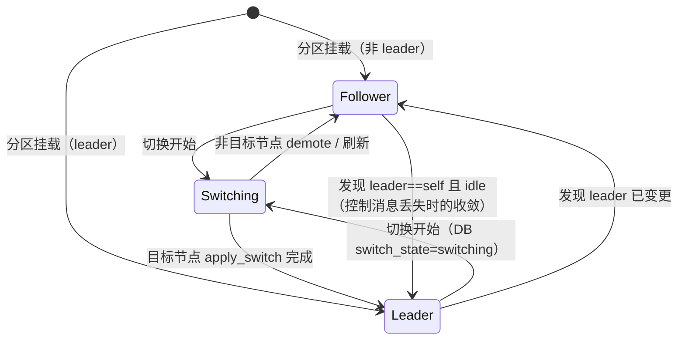
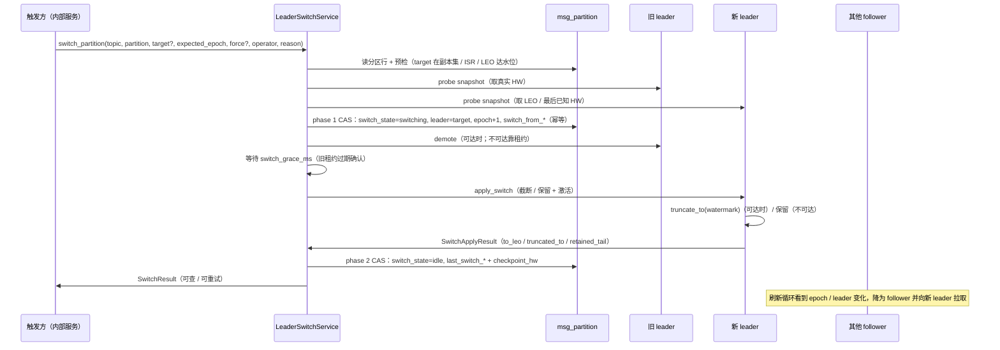
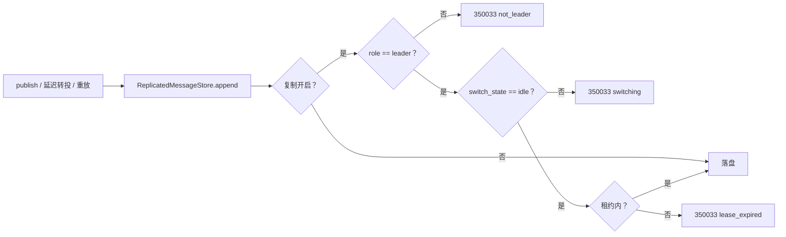

# 选举、epoch 与故障切换详细设计

> 手动切换 × epoch fencing × 两阶段停写 × 未提交尾部截断 / 保留 × 客户端刷新字段

[文档首页](../../../../../../文档首页.md) › [消息平台规划](../../../../../../规划/01_规划_消息平台.md) › [阶段计划](../../../../计划/01_计划_消息平台.md) › [02-5 选举、epoch 与故障切换](../02_存储与复制_05_选举与故障切换.md) › 详细设计

---

## 1. 概述 <a id="overview"></a>

### 1.1 目标

在 02-4 已交付的 ISR 复制、HW 可见性与 epoch 校验之上，补齐「主节点怎么换」的完整机制：

1. **手动切换**：提供可注入的内部领域服务，支持单分区与主题批量；首期不实现自动选举。
2. **epoch / term**：每次切换递增并持久化到 `msg_partition`；写入校验 leader 与 epoch，非 leader / 过期 epoch 一律拒绝（`350033`），不静默丢弃。
3. **两阶段停写切换**：先置 `switching` 让旧 leader 停写，等旧租约过期确认后再切 leader / epoch，最后恢复写；切换中断可重试且不产生数据分叉。
4. **未提交尾部处理**：旧 leader 可达时按真实 HW 截断新 leader 尾部（复用 02-2 截断实现）；不可达时保留尾部并记录 `retained_tail`；「已提交不丢」的成立条件是新 leader 在旧 leader 的 ISR（或最后已知 ISR）内，无法验证时须 `force=True` 并判为降级。
5. **客户端感知**：topic 详情提供 `metadata_version`（= 各分区 epoch 最大值）与分区 `epoch`；写拒绝的 `data` 带当前 leader / epoch，供 03 / 05 域的协议侧刷新。
6. **留痕与可查**：切换过程与结果写平台审计链；`msg_partition` 记录最近一次切换的时间、触发人、epoch、截断位点与结果。
7. **单实例零变化**：复制关闭时行为与 8B_02 / 02-4 完全一致，不引入 `350033`、租约与切换状态。

### 1.2 边界与承接

| 项 | 本任务 | 归口 |
| --- | --- | --- |
| 手动切换内部服务、epoch 递增、两阶段停写、租约 fencing、尾部截断 / 保留、审计与结果列 | ✅ 交付 | 02-5 |
| 复制核心（ISR / HW / `acks=all` / 副本拉取） | 依赖，不改语义 | 02-4（已交付） |
| 尾部截断的段级实现与恢复点写入 | ✅ 复用 / 扩展 | 02-2（已交付） |
| 真实跨实例网络控制通道、多实例编排、分区分配与迁移、三类故障演练 | ❌ 不做（接口已定） | 02-8 |
| 管理端点、二次确认、操作权限 | ❌ 不做（内部服务已就位） | 06-2 后续 |
| 客户端 SDK 按 `metadata_version` / `epoch` 主动刷新 | ❌ 不做（只给字段与错误语义） | 03 / 05 域（8B_03 SDK） |
| 自动选举（心跳超时 + 多数派投票 + 稳定期） | ❌ 不做（接口可复用） | 后续任务 |
| 跨机房强一致、Raft 多数派 | ❌ 不做 | 架构 04 §7 |
| 备份与恢复（副本不是备份） | ❌ 不做 | 部署域（已剥离，待重建） |

### 1.3 口径来源与确认结果

| # | 事项 | 定稿 | 出处 |
| --- | --- | --- | --- |
| 1 | 任务范围 | 完整一条龙：设计 → 代码 → Kiwi 用例 → 门禁 → 回写 → 提交（不推送） | 2026-11-11 确认 |
| 2 | 切换入口 | 内部领域服务 + 审计；管理端点与二次确认归 06-2 | 2026-11-11 确认 |
| 3 | 切换粒度 | 单分区 + 主题批量（逐分区 CAS） | 2026-11-11 确认 |
| 4 | 新 leader | 显式指定（须在 ISR 且 LEO 达切换水位）；未指定时选 ISR 内 LEO 最大、并列按副本集顺序；ISR 无法验证时须 `force=True` 并判降级 | 2026-11-11 确认 |
| 5 | 未提交尾部 | 旧 leader 可达时按真实 HW 截断；不可达时保留并记 `retained_tail`；已提交不丢以「新 leader 在 ISR / 最后已知 ISR」为前提 | 2026-11-11 确认 |
| 6 | 旧 leader 写拒绝 | 新增 `350033`；复制开启时所有发布档位（含 `acks=1`）校验 leader / epoch | 2026-11-11 确认 |
| 7 | 防双写 | epoch 持久化 + 本地租约；超租约未确认即拒写 | 2026-11-11 确认 |
| 8 | 客户端元数据 | topic 详情 `metadata_version = max(partition.epoch)`（派生）+ 分区 epoch；错误 data 带 leader / epoch | 2026-11-11 确认 |
| 9 | 审计 | 复用 `sys.operation.logged`，新增 `msg:partition.failover` | 2026-11-11 确认 |
| 10 | 自动选举 | 只手动；接口按可复用设计，自动选举另立任务 | 2026-11-11 确认 |
| 11 | 幂等并发 | `msg_partition.epoch` CAS | 2026-11-11 确认 |
| 12 | 切换先停写 | 两阶段：先 `switching` 拒写 → 等旧租约 → 切 leader / epoch → 恢复写 | 2026-11-11 确认 |
| 13 | 结果可查 | 审计 + `msg_partition` `last_switch_*` 列，topic 详情可直接查 | 2026-11-11 确认 |
| 14 | 计划回写 | 解搁置、状态「进行中」、窗口自 2026-11-11、按任务书估时 | 2026-11-11 确认 |

## 2. 现状与差距 <a id="gap"></a>

| 现状 | 差距 | 本任务处置 |
| --- | --- | --- |
| 02-4 已有 `ReplicationCoordinator`、ISR / HW、`acks=all`、epoch 校验矩阵 | 只校验 epoch，不递增；不拒绝 `acks=1` 的非 leader 写；无切换服务 | 新增切换服务 + 写路径 fencing；`ensure_writable` 与 `append` 两层校验 |
| `msg_partition` 已有 `leader` / `replicas` / `checkpoint_hw` / `epoch` 列 | `leader` 由 02-4 的副本集首元素推导，DB 列不参与；无切换状态与最近结果 | 新增 `switch_state` / `switch_started_at` / `switch_from_*` / `last_switch_*` / `last_truncate_to` 列；拓扑加载读 `leader` 与 `switch_state` |
| 02-2 有段级截断（`SegmentFile.truncate`）与恢复点 | 只有「前移起点」`truncate_before`，没有「截掉尾部」端口 | 新增 `MessageStore.truncate_to`；文件实现复用 02-2 段截断、索引裁剪与恢复点 |
| 02-4 的 `ReplicationSnapshot` / `ReplicaFetchResult` 有 leader / epoch / leo / hw / isr / replicas | 缺 follower 最后已知的 leader HW / ISR、可写状态 | 增 `last_known_hw` / `last_known_isr` / `writable` / `switch_state` 字段（additive） |
| 02-4 的拓扑加载只按主题缓存、不刷新已挂载分区 | 切换后各节点最多 5s 才感知 | 新增 epoch / 租约刷新循环（缺省 1s），超租约拒写 |
| 管理面 `PartitionItem`（topic 详情）已有 `leader` / `epoch` | 无 `metadata_version`、无最近切换结果；admin 分区视图无 epoch | 增 `metadata_version` 与切换结果字段；admin 分区视图增 `epoch`（additive） |
| 错误码 `350032` 覆盖 ISR 不足 / 提交超时 | 非 leader 写与 ISR 不足混码；帧路径未把 `350032` 登记为可重试 | 新增 `350033`；帧路径 `classify` 登记 `350032` / `350033` 为可重试系统码（修正 02-4 遗漏） |
| 审计链有 `msg:topic.*` / `msg:offset.*` 等动作 | 无切换动作 | 新增 `msg:partition.failover`（强审计） |
| 无自动选举 | 首期不实现 | 切换服务按「可被自动流程复用」设计；自动选举另立任务 |

## 3. 交付物清单 <a id="deliverables"></a>

### 3.1 代码与配置

```text
backend/services/msg/src/bms_msg/
├── broker/
│   ├── election.py                       # 新增：LeaderSwitchService / 切换命令与结果 / LeaderSwitchStore 与 LeaderControlTransport 协议
│   ├── replication.py                    # 改：拓扑 leader / switch_state、可写与租约、刷新循环、apply_switch / demote、发散尾部截断、快照字段
│   ├── log.py                            # 改：MessageStore.truncate_to 端口；InMemory 实现
│   ├── file_store.py                     # 改：FilePartition.truncate_to（段截断 + 索引裁剪 + 恢复点 + log_id LRU 清理）
│   ├── waiter.py                         # 改：NotifyingMessageStore.truncate_to 委托
│   ├── delivery.py                       # 改：`ensure_writable` 的 not_leader / switching / lease 分支改 350033
│   └── lifecycle.py                      # 改：刷新循环随 ReplicationCloser 启停
├── services/
│   ├── leader_switch.py                  # 新增：DbLeaderSwitchStore（msg_partition CAS 与会话）
│   └── replication_topology.py           # 改：load(force=)、映射 leader / switch_state
├── api/
│   ├── deps.py                           # 改：LeaderSwitchDep（app.state.leader_switch，缺省 None）
│   ├── data/messages.py                  # 改：发布端点 x-error-codes 追加 350033
│   ├── frame/responses.py                # 改：350032 / 350033 进 _RETRYABLE_SYSTEM
│   └── admin/
│       ├── partitions.py                 # 改：PartitionItem 增 epoch
│       └── topics.py                     # 改：TopicDetail 增 metadata_version 与分区切换结果字段
├── schemas/
│   ├── topic.py                          # 改：PartitionItem 增切换结果字段；TopicDetail 增 metadata_version
│   └── admin_view.py                     # 改：PartitionItem 增 epoch
├── models/partition.py                   # 改：switch_state / switch_started_at / switch_from_* / last_switch_* / last_truncate_to
├── repositories/topic.py                 # 改：按分区取行、begin_switch / finish_switch 的 CAS 更新
├── errors.py                             # 改：350033 与 MsgNotLeaderError
├── audit/trail.py                        # 改：LEADER_SWITCH_ACTION = "msg:partition.failover"
├── core/config.py                        # 改：MSG_REPLICATION_EPOCH_REFRESH_MS / LEADER_LEASE_MS / SWITCH_GRACE_MS
└── main.py                               # 改：装配 LeaderSwitchService / DbLeaderSwitchStore / 进程内控制传输

deploy/
├── registry/msg.toml                     # 改：登记 350033（503 / system / retryable）
├── contracts/msg.json                    # 重导：TopicDetail / PartitionItem / 发布 x-error-codes
├── .env.example                          # 改：三个新复制旋钮
└── compose/msg.yml                       # 改：x-service-env 同步键位

frontend/packages/api-types/               # 重生成：契约类型（只读产物）
```

### 3.2 文档

| 文档 | 动作 |
| --- | --- |
| `msg文档/设计/数据库设计/数据表设计/msg_partition.md` | 增切换状态 / 结果列与变更记录 |
| `msg文档/设计/架构设计/04_架构设计_数据面_存储与复制.md` | 回填 §7.2 手动切换、epoch 租约、两阶段停写与尾部口径 |
| `msg文档/设计/架构设计/05_架构设计_接入面_协议与客户端.md` | 回填客户端刷新字段（`metadata_version` / `epoch` / `350033`） |
| `msg文档/设计/架构设计/06_架构设计_控制面_元数据与运维.md` | 回填 `metadata_version` 与切换结果可查口径 |
| 本任务 `实施/01_实施记录_02-5_选举与故障切换.md` | 实施过程、问题、验证、覆盖率、遗留 |
| 本任务 `测试/01_测试记录_02-5_选举与故障切换.md` | 用例、门禁、Kiwi、覆盖率 |
| `msg文档/项目/08B_消息平台/计划/01_计划_消息平台.md` | 解搁置、状态 / 窗口、门禁 10、§6.1 遗留 |
| `msg文档/项目/08B_消息平台/任务/02_存储与复制/02_存储与复制.md` | 域说明中的搁置口径同步 |
| `02-8 任务文档` | 补「前置契约（已交付）」：切换服务、控制传输、`350033`、元数据字段 |
| `06-2 任务文档 / 计划 §6.1` | 登记管理端点与二次确认的后续归口 |

## 4. 选举与切换模型 <a id="model"></a>

### 4.1 角色与切换状态



| 状态 | 写入 | ISR 扫描 | 拉取 | 说明 |
| --- | --- | --- | --- | --- |
| `leader`（idle） | 允许（租约内） | 允许 | 不拉取 | 正常主节点 |
| `follower`（idle） | 拒绝（`350033`） | 不扫描 | 允许 | 正常从节点 |
| `switching`（任意角色） | 拒绝（`350033` reason=`switching`） | 不扫描 | 允许（只读拉取） | 切换窗口，等待旧租约过期 |
| `disabled`（复制关闭） | 允许 | 不扫描 | 不拉取 | 单实例，行为与 8B_02 一致 |

**为什么用 DB 的 `switch_state` 而不是进程内标志**：切换可能由任意实例发起、可能中断后重试；状态必须跨进程可见。进程内只保留「已观察到的切换」与租约确认时间。

### 4.2 切换四问（强制回答）

| 问题 | 定稿 | 依据 |
| --- | --- | --- |
| 谁是新 leader | 调用方显式指定 target（须在旧 leader 的 ISR 内且 LEO ≥ 切换水位）；未指定时选 ISR 内 LEO 最大、并列按副本集顺序；旧 leader 不可达时优先用「最后已知 ISR」验证，无法验证须 `force=True` 并记 `isr_verified=false` | 2026-11-11 确认 #4；任务 §2.3 |
| 旧 leader 怎么办 | 不杀进程、不做 STONITH：phase 1 把 DB `leader` 改成 target、epoch+1；旧 leader 刷新后降为 follower 并拒写；控制通道可达时立即发 `demote`，不可达时靠租约过期拒写 | 2026-11-11 确认 #7 / #12 |
| 未提交数据截断还是保留 | 旧 leader 可达：按旧 leader 真实 HW 截断新 leader 尾部；不可达：保留尾部并记 `retained_tail`；两种情况都写审计与 `last_truncate_to`；`force` 降级不保证已提交不丢 | 2026-11-11 确认 #5；任务 §2.4 |
| 客户端怎么感知 | topic 详情 `metadata_version`（= `max(partition.epoch)`）+ 分区 `leader` / `epoch`；写拒绝 `350033` 的 `data` 带 `leader` / `epoch`；协议侧 03 / 05 域据此刷新，本任务不做 SDK | 2026-11-11 确认 #8；任务 §2.5 |

### 4.3 两阶段切换时序



### 4.4 运行态与 DB 状态

```python
PartitionReplication:
    leader: str
    epoch: int
    role: ReplicaRole              # disabled / leader / follower
    switch_state: str              # idle / switching（来自 DB 的已观察值）
    writable: bool                 # 租约内且 idle 且 role==leader
    leadership_confirmed_at: float # 最近一次成功刷新拓扑的单调毫秒
    local_leo: int
    leader_leo: int
    hw: int
    isr: ConcurrentStableSet[str]
    followers: ConcurrentStableDict[str, FollowerProgress]
```

| DB 列 | 用途 |
| --- | --- |
| `leader` | 当前 leader 节点标识（切换 phase 1 写 target） |
| `epoch` | 当前 leader 任期（phase 1 +1） |
| `switch_state` | `idle` / `switching` |
| `switch_started_at` | 切换开始时刻（审计与排障；不用于跨节点时钟判定） |
| `switch_from_leader` / `switch_from_epoch` | 切换前 leader / epoch（中断重试时据此探测旧 leader） |
| `last_switch_at` / `last_switch_by` / `last_switch_epoch` | 最近一次成功切换的时间 / 触发人 / 新 epoch |
| `last_switch_result` | `truncated` / `retained` / `noop` |
| `last_truncate_to` | 截断后的 LEO；`null` 表示未截断（保留） |
| `checkpoint_hw` | 切换完成后写入切换水位，供运维与排障；不作为恢复唯一依据（02-4 口径不变） |

## 5. 接口与契约 <a id="api"></a>

### 5.1 内部服务接口

```python
class LeaderSwitchService(BaseFrameworkObject):
    async def switch_partition(self, request: SwitchPartitionRequest) -> SwitchResult: ...
    async def switch_topic(self, request: SwitchTopicRequest) -> SwitchBatchResult: ...

@dataclass(frozen=True)
class SwitchPartitionRequest(BaseValueObject):
    topic_id: int
    partition_no: int
    target: str | None = None       # None = 自动选 ISR 内 LEO 最大
    expected_epoch: int | None = None  # None = 以读取到的当前 epoch 为预期值（仍走 CAS）
    force: bool = False             # 旧 leader 不可达且无法验证 ISR 时是否允许降级继续
    operator: str = "system"        # 触发人（06-2 传当前用户；演练传 system:drill）
    reason: str = ""                # 切换原因（审计与排障）

@dataclass(frozen=True)
class SwitchTopicRequest(BaseValueObject):
    topic_id: int
    targets: ConcurrentStableFrozenDict[int, str] | None = None  # None = 每个分区自动选
    expected_epochs: ConcurrentStableFrozenDict[int, int] | None = None
    force: bool = False
    operator: str = "system"
    reason: str = ""

@dataclass(frozen=True)
class SwitchResult(BaseValueObject):
    topic_id: int
    partition_no: int
    from_leader: str
    to_leader: str
    from_epoch: int
    to_epoch: int
    applied: bool                   # False = 已是目标 leader（幂等 no-op）
    watermark: int | None           # 切换水位（None = 未知，走保留）
    truncated_to: int | None        # 截断后的 LEO；None = 未截断
    retained_tail: int              # 保留的未提交条数（0 = 未保留）
    isr_verified: bool              # 旧 leader 可达且 target 在 ISR，或旧 leader 不可达但 target 在最后已知 ISR 内
    duration_ms: int

@dataclass(frozen=True)
class SwitchFailure(BaseValueObject):
    topic_id: int
    partition_no: int
    reason: str
    detail: str

@dataclass(frozen=True)
class SwitchBatchResult(BaseValueObject):
    items: ConcurrentStableFrozenList[SwitchResult]
    failures: ConcurrentStableFrozenList[SwitchFailure]
```

**主题批量的部分失败语义**：`switch_topic` 按分区号**串行**执行（避免并发 epoch 风暴），成功项进 `items`、失败项进 `failures`；**不回滚已成功的分区**（回滚会产生二次切换与二次数据调整），调用方按 `failures` 逐项重试。每个分区的切换是独立 CAS，天然可部分成功。

**两个端口协议**：

```python
class LeaderSwitchStore(BaseFrameworkObject, ABC):
    async def load_partition(self, *, topic_id: int, partition_no: int) -> SwitchPartitionState | None: ...
    async def load_topic_partitions(self, *, topic_id: int) -> ConcurrentStableList[SwitchPartitionState]: ...
    async def begin_switch(self, *, topic_id: int, partition_no: int, expected_epoch: int,
                           target: str, from_leader: str, from_epoch: int) -> bool: ...
    async def finish_switch(self, *, topic_id: int, partition_no: int, to_epoch: int,
                            watermark: int | None, result: str, truncated_to: int | None,
                            operator: str) -> bool: ...

class LeaderControlTransport(BaseFrameworkObject, ABC):
    async def snapshot(self, *, node_id: str, topic_id: int, partition_no: int) -> ReplicationSnapshot | None: ...
    async def demote(self, *, node_id: str, topic_id: int, partition_no: int,
                     to_leader: str, to_epoch: int) -> None: ...
    async def apply_switch(self, *, node_id: str, command: SwitchApplyCommand) -> SwitchApplyResult: ...
```

| 类型 | 字段 |
| --- | --- |
| `SwitchPartitionState` | `tenant_id` / `namespace` / `topic` / `leader` / `epoch` / `replicas` / `switch_state` / `switch_from_leader` / `switch_from_epoch` |
| `SwitchApplyCommand` | `topic_id` / `partition_no` / `from_leader` / `to_leader` / `to_epoch` / `watermark: int \| None` / `truncate: bool` / `grace_ms` |
| `SwitchApplyResult` | `to_leo` / `truncated_to: int \| None` / `retained_tail` / `already_applied` |

**为什么服务不直接依赖 DB 仓储**：`election.py` 只认 `LeaderSwitchStore` 与 `LeaderControlTransport` 两个协议；生产实现放在 `services/leader_switch.py` 与 `main.py` 的闭包里，02-8 替换控制传输即可，判定逻辑零改动。

### 5.2 幂等、CAS 与失败重试

| 阶段 | 操作 | 幂等 / 并发 |
| --- | --- | --- |
| 预检 | 读分区行；probe 旧 leader / 目标；校验 target 在副本集、ISR（旧 leader 可达时）、LEO ≥ 水位 | 只读，不改变状态 |
| phase 1 | `UPDATE msg_partition SET switch_state='switching', leader=target, epoch=epoch+1, switch_started_at=now, switch_from_leader=old, switch_from_epoch=old_epoch WHERE topic_id=? AND partition_no=? AND switch_state='idle' AND epoch=expected_epoch` | 行数 1 = 成功；0 = 重读后判定：已是目标 + epoch 更高 → 幂等成功；他人已推进 → 冲突；`switching` 同 target / 同 from_epoch → 续跑 |
| 期间 | 旧 leader 收到 `demote`（可达时）；等待 `switch_grace_ms` | 重复执行无副作用 |
| apply | 目标节点 `apply_switch`：截断 / 保留 + 激活 | 目标已是目标 leader 且 epoch 一致 → 幂等返回 |
| phase 2 | `UPDATE ... SET switch_state='idle', last_switch_at/by/epoch/result/last_truncate_to=?, checkpoint_hw=COALESCE(watermark, target_leo) WHERE ... AND switch_state='switching' AND epoch=to_epoch` | 行数 1 = 收口；0 = 重读判定（已 idle 且 `last_switch_epoch=to_epoch` → 幂等成功） |

**切换中断的重试语义**：

- phase 1 前中断：DB 未变，重试从头开始。
- phase 1 后、apply 前中断：DB 停在 `switching`，同 target / 同 `switch_from_epoch` 的重试从等待 / apply 继续；不同 target 的请求被拒绝（`switch_in_progress`），避免来回切换。
- apply 后、phase 2 前中断：目标已是 leader 但 `switch_state` 仍为 `switching`，所有写被拒；重试直接走 phase 2 收口。
- phase 2 后中断：DB 已 idle，重试返回幂等 no-op。

**为什么用 `expected_epoch` 而不是无条件 epoch+1**：两个运维同时切换时，后者必须看到前者的结果并重新决策；无条件覆盖会让 epoch 与 leader 互相打架，正是数据分叉的来源。

### 5.3 错误语义 `350033`

| 项 | 口径 |
| --- | --- |
| 码值 | `350033`（6 位，段位 `35`） |
| HTTP | 503 |
| 层 / 类别 | `system` / `transient`（帧路径 `classify` 登记进 `_RETRYABLE_SYSTEM`） |
| `retryable` | `true`（客户端刷新元数据后重试；不是「确定未写入」的语义） |
| `data` | `topic` / `partition` / `leader` / `epoch` / `reason` |

**`reason` 闭集**：

| reason | 触发 | 客户端动作 |
| --- | --- | --- |
| `not_leader` | 本节点不是该分区当前 leader（含 follower 收到写） | 刷新元数据，改投 leader |
| `stale_epoch` | 请求携带的 epoch 低于当前 epoch（旧 leader / 旧客户端） | 刷新 epoch 后重试 |
| `switching` | 分区处于 `switching` | 退避重试，等待切换完成 |
| `lease_expired` | 本节点超过租约未确认 leader 身份 | 退避并检查元数据库 / 网络 |

**与 `350032` 的分工**：`350032` 仍是「ISR 不足 / 提交等待超时」（`acks=all` 的提交条件不满足）；`350033` 是「你写错了节点 / 任期」。两者都可重试，但客户端处置不同：前者退避等副本恢复，后者先刷新元数据。

**写路径校验位置（两层）**：

1. `DeliveryService.publish` → `ReplicationView.ensure_writable`：`acks=all` 的 ISR 预检；非 leader / switching / lease 过期 → `350033`；ISR 不足 → `350032`。
2. `ReplicatedMessageStore.append`：所有写入（普通发布、延迟转投、重放）落盘前统一 `ensure_write_allowed`；覆盖 `acks=1` 与非 HTTP 内部写入，避免「只有 `acks=all` 被拦」的分叉口子。

**单实例零变化**：复制关闭时 `ensure_write_allowed` 与 `ensure_writable` 直接返回，不产生 `350033`。

### 5.4 元数据字段与客户端刷新

| 字段 | 位置 | 口径 |
| --- | --- | --- |
| `metadata_version` | `TopicDetail`（topic 详情） | `max(partition.epoch)`；无分区为 0。切换后必然增大；additive 字段 |
| `epoch` | topic 详情的 `PartitionItem`（已有）；admin 分区视图 `PartitionItem`（新增） | 分区当前 leader 任期；切换后立即反映 DB 值 |
| `leader` | topic 详情的 `PartitionItem`（已有）；admin 分区视图（已有） | 当前 leader 节点标识 |
| `last_switch_*` / `last_truncate_to` | topic 详情的 `PartitionItem` | 最近一次成功切换的时间、触发人、epoch、结果、截断位点 |
| `350033.data.leader` / `.epoch` | 写拒绝响应 | 客户端无需再查元数据即可知道新 leader / 任期 |

**为什么 `metadata_version` 用派生值而不是新列**：本任务只要求「leader 变化可感知」，`max(epoch)` 零迁移、天然单调、与切换强相关；未来若客户端需要缓存全部元数据（分区数 / 保留期），再 additive 增加 `msg_topic.metadata_version` 列即可，不影响本字段语义。

**协议侧边界**：本任务只在 HTTP 元数据与管理面提供字段；帧契约 / SDK 的刷新逻辑归 03 / 05 域（8B_03）。本任务不新增帧头、不改 `PublishResult`。

## 6. 未提交尾部处理 <a id="truncate"></a>

### 6.1 水位来源

| 旧 leader 状态 | 水位 | 动作 | `last_switch_result` | `isr_verified` |
| --- | --- | --- | --- | --- |
| 可达 | `probe(old_leader).hw`（真实已提交水位） | 新 leader `truncate_to(watermark)`；若 target LEO ≤ watermark 则 no-op | `truncated` / `noop` | `true`（且 target 在旧 leader 当前 ISR） |
| 不可达，但 target 在「最后已知 ISR」内且最近拉取在 `lag_time_max_ms` 内 | `max(target.last_known_hw, 其他可达副本的 last_known_hw)` | **不截断**（缓存 HW 可能落后真实 HW，截断会丢已提交） | `retained` | `true`（最后已知 ISR） |
| 不可达且无法验证 ISR，但 `force=True` | `max(可用副本的 last_known_hw)` 或 `None` | **不截断** | `retained` | `false`（降级，审计标记） |
| 不可达且无法验证 ISR，`force=False` | — | 拒绝切换（fail-safe） | — | — |

**为什么不可达时不按缓存 HW 截断**：HW 是 leader 的提交判定，follower 的 `hw` 来自上一次拉取结果。leader 可能在最后一次 HW 推进后、下一次拉取前崩溃；此时 follower 的 LEO 已包含已提交记录，但缓存 HW 尚未更新。按缓存 HW 截断会截掉已提交记录——这是数据丢失，不是「未提交回退」。保留尾部的最坏结果是「未提交记录转正」，不违反「已提交不丢」。

**「已提交不丢」的成立条件**：02-4 的 HW 取 `min(leader LEO, 各 ISR follower LEO)`，若 target 在旧 leader 的 ISR 内，则其 LEO ≥ 旧 HW，保留 / 按旧 HW 截断都不会丢已提交。旧 leader 不可达时，`force=True` 无法证明 target 在 ISR——这是**降级切换**：审计记 `isr_verified=false`，02-8 演练不得判「通过」，只能判「降级」并量化风险。

**最后已知 ISR / HW 的来源**：02-4 的 `ReplicaFetchResult` 追加 `leader_isr` 与 `leader_leo` / `high_watermark`；follower 每次拉取后保存 `last_known_isr` / `last_known_hw`。旧 leader 不可达时用它做「最后已知」验证，不额外持久化到 DB（避免每批提交写库）。

### 6.2 `truncate_to` 端口与实现

```python
class MessageStore(BaseFrameworkObject, ABC):
    @abstractmethod
    async def truncate_to(self, *, topic_id: int, partition_no: int, offset: int) -> int:
        """截掉 offset 及之后的记录，返回新的 LEO（= offset）。"""
```

| 实现 | 行为 |
| --- | --- |
| `FileMessageStore` | 找到 offset 所在段与字节位置 → `SegmentFile.truncate(size, max_relative_offset)` → 关闭并删除后续段 → `_leo = offset` → 清 `log_id` LRU 中该分区 `offset >= target` 的条目 → `persist_recovery_point()` |
| `InMemoryMessageStore` | `del log[offset - start:]`；更新内部 LEO |
| `ReplicatedMessageStore` / `NotifyingMessageStore` | 纯委托；不推进 HW（截断由切换流程显式处理） |

**与 02-2 的关系**：复用 `SegmentFile.truncate` 的「截字节 + 裁剪越界索引」实现；恢复点由 `persist_recovery_point()` 重写，保证重启后不会把已截断的尾部读回来。**不改段格式、不改 `format_version`**。

**截断取证**：写 `msg_leader_switch_truncated` 日志（topic / partition / from_leo / to_offset / records / bytes / watermark / old_leader）；审计事件带同一组字段。不保留被截字节的副本（与 02-2 的损坏段隔离不同：这是有意的切换截断，不是损坏）。

### 6.3 旧 leader / follower 的发散尾部

| 场景 | 判定 | 动作 |
| --- | --- | --- |
| 旧 leader 降为 follower 后，本地 LEO > 新 leader LEO | `ReplicationDivergedError(leader_leo=...)` 或拉取前对比 | 本地 `truncate_to(leader_leo)`，记 `msg_replication_diverged_truncated`，下一轮重新拉取 |
| follower 本地 LEO > leader LEO | 同上 | 同上 |
| follower 本地 LEO < leader 起点（保留期已删） | `ReplicationDivergedError` 且 `leader_leo` 不足以修复 | 停止拉取、告警；全量重同步归 02-8 |
| offset 不连续 | 既有判定 | 停止拉取、告警；不静默跳过 |

**为什么旧 leader 也要截断**：旧 leader 可能在切换前多写了几条（`acks=1` 未提交 / 分区期间写入）。新 leader 的 LEO 是新的权威末端；旧 leader 必须丢弃超出部分才能重新加入 ISR，否则永远拉取失败。

### 6.4 结果可查

- `msg_partition.last_switch_*` / `last_truncate_to`：topic 详情直接可查；
- 审计事件 `msg:partition.failover`：全量记录（含被截条数、保留条数、耗时、触发人）；
- 日志：`msg_leader_switch_*` 结构化事件。

## 7. Fencing 与租约 <a id="fencing"></a>

### 7.1 epoch 持久化与刷新

| 机制 | 口径 |
| --- | --- |
| epoch 权威源 | `msg_partition.epoch`（DB） |
| 递增时机 | phase 1 CAS；同一分区同一时刻只有一个成功 |
| 记录写入 | 02-4 已把 leader 的 `epoch` 逐条写进记录头；本任务不改格式 |
| 节点刷新 | 已挂载分区每 `MSG_REPLICATION_EPOCH_REFRESH_MS`（缺省 1000ms）强制重载拓扑（`load(force=True)`） |
| 租约 | `leadership_confirmed_at` 为最近一次成功刷新的单调毫秒；leader 写前要求 `now - confirmed <= MSG_REPLICATION_LEADER_LEASE_MS`（缺省 5000ms） |
| 刷新失败 | 不更新确认时间；超过租约后 leader 自动 `writable=False`，写返回 `350033(lease_expired)`；DB 恢复后下一次刷新恢复 |
| 新 leader 宽限 | `MSG_REPLICATION_SWITCH_GRACE_MS`（缺省 5000ms，应 ≥ 租约）；目标节点从「首次观察到 switching」起本地计时，等待满宽限才 apply；**不依赖跨节点墙钟** |

**为什么刷新要 `force=True`**：02-4 的拓扑缓存 TTL 5s 是为了热路径不查库；切换要求秒级收敛，刷新循环必须绕过缓存。刷新循环只对**已挂载分区**查库，按主题批量加载，成本可控。

### 7.2 写路径校验



| 写入来源 | 是否校验 | 说明 |
| --- | --- | --- |
| `DeliveryService.publish`（`acks=1`） | ✅ | 经 `ReplicatedMessageStore.append` |
| `DeliveryService.publish`（`acks=all`） | ✅ | `ensure_writable` 先判 ISR / leader，再由 `append` 复核租约 |
| 延迟转投 | ✅ | 经同一包装器；follower 上转投失败 → 350033，由 02-8 路由 / 重试 |
| 重放 | ✅ | 同上；重放任务应在 leader 执行，02-8 保证 |
| follower 复制落盘 | ❌ | `pull_once` 直连未包装的 `file_store`，不能把复制写入当成客户端写拒绝 |

### 7.3 失败场景矩阵

| # | 场景 | 判定 | 处置 | 数据结果 |
| --- | --- | --- | --- | --- |
| 1 | 计划内切换，旧 leader 可达 | 正常两阶段 | demote → grace → apply → phase 2 | 已提交不丢；未提交按真实 HW 截断 |
| 2 | 旧 leader 进程崩溃 | probe 失败 | target 在最后已知 ISR 内 → 直接切（`isr_verified=true`）；否则须 `force=True`（降级，`isr_verified=false`）；均保留尾部 | 已验证路径已提交不丢；`force` 路径无法证明，02-8 判「降级」并量化 |
| 3 | 网络分区：旧 leader 与 DB 断开 | 旧 leader 刷新失败 | 租约过期 → 旧 leader 拒写；新 leader 在 DB 侧可达时按两阶段切换 | 分区窗口内旧 leader 的 `acks=1` 写可能未提交丢失；`acks=all` 不丢已提交 |
| 4 | 网络分区：新 leader 与 DB 断开 | 目标刷新失败 | 切换无法收口，停在 `switching`；所有写被拒 | 无新写入，无分叉；恢复后重试 |
| 5 | 脑裂（两侧都以为自己是 leader） | 只有持有最新 epoch 且租约内的一侧可写；另一侧刷新到更高 epoch 后降级 | 高 epoch 侧写，低 epoch 侧拒写 | 不出现双主同时可写（租约 + epoch） |
| 6 | 切换中服务崩溃（phase 1 后） | DB `switching` | 重试同 target / 同 `switch_from_epoch` 续跑；不同 target 拒绝 | 写被拒，无分叉 |
| 7 | apply 后、phase 2 前崩溃 | 目标已 leader，DB 仍 `switching` | 重试直接 phase 2 | 写被拒，无分叉 |
| 8 | 旧 leader 仍存活并继续拉取 | 发现 leader 变更 / epoch 更高 | 降为 follower；本地 LEO > 新 LEO 时截断发散尾部 | 已提交不丢；多余尾部丢弃 |
| 9 | 目标节点宕机在 apply 前 | 控制传输失败 | 停在 `switching`；重试 / 人工介入 | 写被拒，无分叉 |
| 10 | 审计出口不可用 | begin 审计失败 | **拒绝切换**（没留痕不生效）；finish 审计失败记错误日志并保留 DB 结果 | 切换不执行 / 已执行但有日志可查 |

**切换期间的读写闸门**：

| 路径 | `switching` 时行为 | 目的 |
| --- | --- | --- |
| `serve_fetch`（旧 leader 服务副本拉取） | 抛 `ReplicaUnavailableError`（不返回数据） | 防止旧 leader 在 epoch 已推进后继续把数据复制给 follower |
| `pull_once`（follower 拉取） | 直接返回 0，不发请求 | 防止目标在截断前被并发追加 |
| `apply_switch`（目标激活） | 持有分区 `op_lock` 再截断 / 改状态 | 与 `pull_once` 的落盘互斥，避免「截断后又被追加」 |
| `append`（客户端写） | `350033(switching)` | 两阶段期间不产生新写入 |

`PartitionReplication` 增 `op_lock: asyncio.Lock`，只保护「拉取落盘 / 截断 / 角色切换」这三类会改本地 LEO 的路径；读取与 `snapshot` 不加锁。

**租约与可用性的取舍**：元数据库不可用超过租约时，leader 会停止写入。这是安全优先的选择——没有权威 epoch，就无法证明自己不是旧 leader。单实例 / 复制关闭时不受影响。

## 8. 数据调整与审计 <a id="audit"></a>

### 8.1 审计动作

`audit/trail.py` 新增：

```python
LEADER_SWITCH_ACTION = "msg:partition.failover"
ACTION_CLASSES[LEADER_SWITCH_ACTION] = AuditClass(AUDIT_CLASS_SENSITIVE, strong=True, label="分区切主")
```

| 事件 | 时机 | 关键字段 |
| --- | --- | --- |
| `msg:partition.failover`（phase=begin） | phase 1 前 | `topic` / `partition` / `from_leader` / `to_leader` / `from_epoch` / `to_epoch` / `operator` / `reason` / `phase=begin` |
| `msg:partition.failover`（phase=finished） | phase 2 后 | 同上 + `watermark` / `truncated_to` / `retained_tail` / `isr_verified` / `duration_ms` / `phase=finished` |

**失败处置**：begin 审计使用 `required=True`，失败即拒绝切换（与位点重置 fail-closed 同口径）；finished 审计失败只记 `msg_leader_switch_audit_failed` 错误日志，不回滚已完成的切换（回滚会制造二次分叉），并在 `last_switch_result` 中保留结果。

### 8.2 审计字段来源

| 字段 | 来源 |
| --- | --- |
| `tenant_id` | 由 `topic_id` 反查主题（切换服务读分区行时一并取 `tenant_id`） |
| `topic` / `namespace` | 同上 |
| `operator` | 请求参数；06-2 传当前用户，演练传 `system:drill` |
| `duration_ms` | 服务入口到 phase 2 完成的单调毫秒 |
| `watermark` / `truncated_to` / `retained_tail` | 预检与 apply 结果 |

## 9. 可观测 <a id="observability"></a>

### 9.1 管理面

`GET /api/v1/msg/admin/topics/{topic_id}` 的 `PartitionItem` additive 字段：

| 字段 | 说明 |
| --- | --- |
| `switch_state` | `idle` / `switching` |
| `last_switch_at` | 最近一次成功切换时刻（UTC） |
| `last_switch_by` | 触发人 |
| `last_switch_epoch` | 切换后的 epoch |
| `last_switch_result` | `truncated` / `retained` / `noop` |
| `last_truncate_to` | 截断后的 LEO；`null` 表示未截断 |

`TopicDetail` additive 字段：

| 字段 | 说明 |
| --- | --- |
| `metadata_version` | `max(partition.epoch)`，客户端刷新判据 |

`GET /api/v1/msg/admin/partitions` 的 `PartitionItem` 增 `epoch`（实时值来自复制快照；复制关闭时取 DB 行）。

### 9.2 日志事件

| 事件 | 级别 | 字段 |
| --- | --- | --- |
| `msg_leader_switch_begin` | info | `topic_id` / `partition` / `from_leader` / `to_leader` / `from_epoch` / `to_epoch` / `operator` |
| `msg_leader_switch_finished` | info | 同上 + `watermark` / `truncated_to` / `retained_tail` / `duration_ms` / `isr_verified` |
| `msg_leader_switch_rejected` | warning | `reason`（预检失败原因） |
| `msg_leader_switch_failed` | error | `phase` / `reason` / `detail` |
| `msg_leader_switch_truncated` | warning | `from_leo` / `to_offset` / `records` / `bytes` / `watermark` |
| `msg_replication_diverged_truncated` | warning | `topic_id` / `partition` / `local_leo` / `leader_leo` |
| `msg_replication_lease_expired` | warning（60s 窗口抑制） | `topic_id` / `partition` / `last_confirmed_ms` |
| `msg_leader_switch_audit_failed` | error | `phase` / `action` / `error` |

### 9.3 指标

本任务不新增 Prometheus 指标：切换的可观测以审计 + 结构化日志 + `msg_partition` 结果列为主；`msg_isr_shrink_total` / `msg_isr_size` / `msg_replication_lag_records` 沿用 02-4 的真实计数。若 02-8 需要 `msg_leader_switch_total{result}`，在 02-8 按同一动作名补采集，不在本任务扩指标面。

## 10. 数据库变更 <a id="database"></a>

### 10.1 `msg_partition` 新列

| 列 | 类型 | 空 | 缺省 | 说明 |
| --- | --- | --- | --- | --- |
| `switch_state` | VARCHAR(16) | 否 | `idle` | 切换状态（`idle` / `switching`） |
| `switch_started_at` | DATETIME | 是 | NULL | 切换开始时刻（UTC；审计 / 排障） |
| `switch_from_leader` | VARCHAR(128) | 是 | NULL | 切换前 leader（中断重试时据此探测旧 leader） |
| `switch_from_epoch` | INT | 是 | NULL | 切换前 epoch |
| `last_switch_at` | DATETIME | 是 | NULL | 最近一次成功切换时刻 |
| `last_switch_by` | VARCHAR(128) | 是 | NULL | 触发人 |
| `last_switch_epoch` | INT | 是 | NULL | 切换后的 epoch |
| `last_switch_result` | VARCHAR(16) | 是 | NULL | `truncated` / `retained` / `noop` |
| `last_truncate_to` | BIGINT | 是 | NULL | 截断后的 LEO；NULL = 未截断 |

**为什么都放分区表**：leader / epoch / 切换结果是分区级事实；放主题表会出现「主题级切换状态 + 分区级 leader」的跨层语义。所有列有缺省 / 可空，旧行不需要回填。

### 10.2 变更顺序

1. 先改表文件 `msg_partition.md`（含变更记录）；
2. 再改模型 `models/partition.py`；
3. 建表落地：开发 / 测试库由启动期自动建表生效；生产库随平台级生产部署架构建表 / 变更（本仓无迁移脚本，口径同 06-5 / 02-4）；
4. 回写《数据库设计总览》登记状态（表已登记，仅补列说明）。

## 11. 配置与部署 <a id="config"></a>

### 11.1 环境变量

| 键 | 缺省 | 说明 |
| --- | --- | --- |
| `MSG_REPLICATION_EPOCH_REFRESH_MS` | `1000` | 已挂载分区的 epoch / leader / switch_state 强制刷新周期 |
| `MSG_REPLICATION_LEADER_LEASE_MS` | `5000` | leader 写权限租约；超时未确认即拒写 |
| `MSG_REPLICATION_SWITCH_GRACE_MS` | `5000` | 新 leader 从观察到 switching 起的停写宽限；须 ≥ 租约 |

### 11.2 校验（拒启）

| 条件 | 处理 |
| --- | --- |
| 三个新键 <= 0 | `ValueError` |
| `switch_grace_ms < leader_lease_ms` | `ValueError`（宽限不足会与旧 leader 写窗口重叠） |
| 复制关闭 | 不校验节点列表，但三个键仍按数值校验（缺省合法） |

### 11.3 部署资产

- `deploy/.env.example`：在「运行旋钮」段追加三个键（空值 = 代码缺省）；
- `deploy/compose/msg.yml` 的 `x-service-env`：同步追加同名键位；
- `engkit.toml` 的 `[rules.env_example].templates.required_keys`：**不新增必填键**（复制默认关闭，缺省即合法）；02-8 若要求生产必填，由 02-8 调整。

## 12. 测试设计 <a id="tests"></a>

### 12.1 用例分组

| 组 | 文件 | 覆盖 |
| --- | --- | --- |
| G1 预检与校验 | `tests/broker/test_election.py` | target 不在副本集 / 不在 ISR / LEO 未达水位、expected_epoch 冲突、复制关闭、已是目标 no-op |
| G2 两阶段与幂等 | 同上 | phase 1 CAS、grace 等待、phase 2 收口、中断续跑、并发切换只有一个成功、主题批量部分失败 |
| G3 尾部截断 | 同上 + `tests/broker/test_truncate_to.py` | 旧 leader 可达按真实 HW 截断、不可达保留、no-op、恢复点 / 索引 / `log_id` LRU 正确 |
| G4 fencing / 租约 | `tests/broker/test_election_fencing.py` | `acks=1` / `acks=all` 非 leader 350033、switching 350033、租约过期 350033、刷新恢复、复制关闭无影响 |
| G5 降级与发散 | `tests/broker/test_replication.py`（扩） | 旧 leader 降 follower、本地 LEO > 新 LEO 截断、ISR 重入、HW 推进 |
| G6 元数据与刷新 | `tests/api/test_admin_partitions.py`、`tests/api/test_admin_topics.py` | `metadata_version`、分区 epoch、`last_switch_*`、admin 分区 epoch |
| G7 审计 | `tests/broker/test_election.py`、`tests/audit/test_trail.py`（如有） | begin / finished 字段、begin 失败拒切、finish 失败不回滚 |
| G8 装配与配置 | `tests/test_skeleton.py`、`tests/broker/test_lifecycle.py` | 新键装配、刷新循环启停、关闭复制不启动、closer 幂等 |
| G9 契约 | `tests/test_error_codes.py`、契约快照用例 | 350033 登记 / 帧分类 / 发布端点 x-error-codes / api-types 零漂移 |
| G10 场景 | `tests/broker/test_election_faults.py` | 脑裂、分区、旧 leader 存活、切换中断四类可判定结果 |

### 12.2 用例清单（Kiwi 登记后回填编号）

1. 复制关闭：切换服务拒绝 / 写路径不产生 350033，行为与 02-4 一致；
2. 目标不在副本集 / 不在 ISR / LEO < 水位：预检拒绝，DB 不变；
3. `expected_epoch` 与 DB 不一致：冲突返回，不覆盖；
4. 已是目标 leader 且 epoch 一致：幂等 no-op，不重复递增；
5. 正常两阶段：phase 1 → grace → apply → phase 2，DB 与运行态一致；
6. 旧 leader 可达：新 leader 按真实 HW 截断，`last_switch_result=truncated`、`last_truncate_to=HW`；
7. 旧 leader 不可达 + target 在最后已知 ISR 且拉取新鲜：直接切，`isr_verified=true`，保留尾部，`retained_tail>0`；
8. 旧 leader 不可达 + 无法验证 ISR + force：降级切换，`isr_verified=false`，保留尾部；
9. 旧 leader 不可达 + 无法验证 ISR + 非 force：拒绝切换；
10. 目标 LEO == 水位：不截断，结果 `noop`；
11. phase 1 后中断：重试续跑，最终收口；不同 target 被拒；
12. apply 后、phase 2 前中断：重试直接收口；
13. 并发两次切换：仅一个 CAS 成功，另一个冲突；
14. 主题批量：逐分区结果聚合，单分区失败不影响其他分区；
15. `acks=1` 写 follower：350033 `not_leader`，data 带 leader / epoch；
16. `acks=all` 写 follower：350033 `not_leader`（不是 350032）；
17. `switching` 期间写：350033 `switching`；
18. 租约过期：350033 `lease_expired`；刷新恢复后可写；
19. `switching` 期间 `serve_fetch` 拒绝、`pull_once` 不拉取；`apply_switch` 与 `pull_once` 的 `op_lock` 互斥；
20. 旧 leader 降 follower：本地 LEO > 新 leader LEO → 截断、重新入 ISR；
21. 旧 leader 降 follower：本地 LEO ≤ 新 leader LEO → 直接续拉，不截断；
22. `truncate_to`：文件实现的段删除 / 索引裁剪 / 恢复点 / `log_id` LRU 清理；
23. 内存实现 `truncate_to`：可读区间与 LEO 正确；
24. topic 详情：`metadata_version = max(epoch)`、`last_switch_*` / `last_truncate_to`；
25. admin 分区视图：`epoch` 与复制快照一致；
26. 审计：begin / finished 字段完整；begin 失败拒切；finish 失败不回滚；
27. 脑裂：低 epoch 侧写被拒，高 epoch 侧可写；
28. 网络分区：旧 leader 租约过期后拒写，恢复后降 follower；
29. 刷新循环：启动 / 停止 / 幂等；关闭复制不启动；
30. 配置：三个新键非法拒启；宽限 < 租约拒启；
31. 契约：350033 在 `msg.toml` / `MsgErrorCode` / 发布端点 / 帧分类 / `api-types` 一致；
32. 单实例回归：02-4 既有用例与发布 / 消费 / 位点行为不变。

### 12.3 覆盖率与门禁

- 新增 / 变更模块**行 + 分支 100%**：`bms_msg.broker.election`、`bms_msg.broker.replication`、`bms_msg.broker.log`、`bms_msg.broker.file_store`、`bms_msg.broker.waiter`、`bms_msg.broker.delivery`、`bms_msg.broker.lifecycle`、`bms_msg.services.leader_switch`、`bms_msg.services.replication_topology`、`bms_msg.api.deps`、`bms_msg.api.data.messages`、`bms_msg.api.frame.responses`、`bms_msg.api.admin.partitions`、`bms_msg.api.admin.topics`、`bms_msg.schemas.topic`、`bms_msg.schemas.admin_view`、`bms_msg.models.partition`、`bms_msg.repositories.topic`、`bms_msg.errors`、`bms_msg.audit.trail`、`bms_msg.core.config`、`bms_msg.main`；
- 静态：`ruff check` / `ruff format --check` / `pyright` 全绿；
- 文档：`engkit links` / `docs-scope` / `eol` 全绿；
- 契约：`contract_snapshot export` 后 `check` 零漂移；`api-types --check` 零漂移；
- 回归：复制关闭路径的既有 01 / 02 / 03 / 06 域用例全绿（提交前定向 + 推送环）。

## 13. 实施步骤 <a id="steps"></a>

| # | 步骤 | 产物 |
| --- | --- | --- |
| 1 | 表文件与模型：9 个切换列 | `msg_partition.md` + `models/partition.py` |
| 2 | 错误码：`350033` + 注册表 + 帧分类 + 发布端点 | `errors.py` / `msg.toml` / `responses.py` / `messages.py` |
| 3 | 存储端口：`truncate_to`（文件 / 内存 / 包装） | `log.py` / `file_store.py` / `waiter.py` / `replication.py` |
| 4 | 复制协调器：拓扑 leader / switch_state、writable / 租约、刷新循环、apply / demote、发散截断 | `replication.py` / `replication_topology.py` |
| 5 | 切换服务：协议 / 服务 / DB 存储 / 进程内控制传输 | `election.py` / `services/leader_switch.py` |
| 6 | 元数据：`metadata_version` / `last_switch_*` / admin epoch | `schemas/*` / `api/admin/*` |
| 7 | 审计：`msg:partition.failover` + 两段事件 | `audit/trail.py` / `election.py` |
| 8 | 配置与部署：三个新键、`.env.example`、compose | 三处键位一致 |
| 9 | 装配与生命周期：`main.py` / `lifecycle.py` / `deps.py` | 服务可启动、循环可回收 |
| 10 | Kiwi 登记 → 用例 G1~G10 → 覆盖率补口 | 用例文件 + `kiwi_id` |
| 11 | 门禁：单文件 pytest / ruff / pyright → 提交环 → 推送环（模块级） | 覆盖率与静态结果 |
| 12 | 回写：架构 04 / 05 / 06、表文件、计划、任务、02-8 前置契约、06-2 遗留 | 文档一致 |

## 14. 验收映射 <a id="accept-map"></a>

| 完成标准（任务 §3） | 本设计落点 | 用例 |
| --- | --- | --- |
| 旧 leader 的写入被拒绝并返回明确错误；新 leader 可正常写 | §5.3 / §7.2 | G4 / 15~18 |
| 切换后客户端能感知元数据版本 / epoch 变化并刷新（联调用例） | §5.4 / §9.1 | G6 / 24~25 |
| 未提交数据按定稿口径截断或保留，结果可查；切换过程审计可追溯 | §6 / §8 / §9 | G3 / G7 / 6~10、26 |
| 切换中断可重试且不产生数据分叉；脑裂场景下不会双主同时可写 | §5.2 / §7.3 / §4.3 | G2 / G10 / 11~14、27~28 |
| 变更模块行 + 分支覆盖率 100%，静态检查全绿 | §12.3 | 门禁 |

## 15. 风险与开放项 <a id="risk"></a>

| # | 风险 / 开放项 | 处置 / 归口 |
| --- | --- | --- |
| 1 | 进程内控制传输不是生产形态；真实跨实例 demote / apply 未验证 | 接口已定；网络实现与多实例编排归 **02-8** |
| 2 | 旧 leader 不可达时保留尾部，未提交记录可能转正 | 已定稿口径；02-8 演练记录 `retained_tail` 并判定是否可接受 |
| 2.1 | `force=True` 的降级切换无法证明 target 在 ISR，可能丢失未验证的已提交尾部 | 默认 `force=False`；`force` 记 `isr_verified=false`，02-8 判「降级」不计通过；生产需在确认旧 leader 不可恢复后使用 |
| 3 | 租约依赖平台库可用性；DB 不可用超过租约时写停止 | 安全优先；02-8 演练「元数据库故障」场景；若需降级，另立决策 |
| 4 | `switching` 卡住（目标长期不可达）没有取消 / 强制改目标入口 | 重试同 target；取消 / 强制切换归 **02-8**（或 06-2 后续） |
| 5 | 刷新周期内旧 leader 仍可能接受 `acks=1` 写 | 两阶段宽限 + 租约；窗口内写入属未提交，02-8 演练量化 |
| 6 | `metadata_version` 只反映 epoch，不反映分区数 / 保留期变化 | 本任务只要求 leader 变化；全量元数据版本另立 additive 列 |
| 7 | 客户端 SDK 尚未按 `350033` / `metadata_version` 刷新 | 字段与错误语义已给；SDK 归 **8B_03 / 05** |
| 8 | 管理端点与二次确认未交付 | 内部服务已就位；端点归 **06-2 后续**（计划 §6.1 登记） |
| 9 | 自动选举未实现 | 切换服务接口可被自动流程复用；自动选举另立任务 |
| 10 | 审计 finished 失败不回滚，可能出现「已切换但审计缺 result」 | 错误日志 + DB `last_switch_*` 兜底；与 01-6「审计失败不影响」同口径 |
| 11 | 跨节点墙钟不可靠 | 宽限用目标节点本地单调时钟；`switch_started_at` 只作审计 / 排障 |
| 12 | 旧 leader 记录头 epoch 由 02-4 写入；若旧 leader 在切换前写入了更高 epoch 的记录 | 新 leader 从 ISR 选、HW 口径保证已提交不丢；发散尾部按 LEO 截断 |

## 16. 对齐记录 <a id="align"></a>

### 16.1 决策确认

见 §1.3（2026-11-11 逐项确认，14 项均按推荐项定稿）。

### 16.2 与既有设计的对齐

| 文档 | 口径 | 本设计关系 |
| --- | --- | --- |
| 02-1 分区追加日志 | 头字段 `epoch` 预留；`format_version=1` | 不改格式；切换只改 `msg_partition.epoch` 与记录头既有字段 |
| 02-2 崩溃恢复 | 尾部截断、段尾对账、恢复点 | `truncate_to` 复用 `SegmentFile.truncate` + `persist_recovery_point` |
| 02-3 消费位点 | 位点不得越过 HW | 切换后 HW 重置为新 leader LEO；位点夹取由 02-4 的 `visible_limit` 承担 |
| 02-4 副本与 ISR | ISR / HW / `acks=all` / epoch 校验 | 扩展拓扑字段、快照字段、写路径；不改变 ISR 判据与 HW 定义 |
| 06-1-1 只读视图 | `leader` / `hw` / `isr` 已接复制快照 | 增 `epoch` / `metadata_version` / `last_switch_*`（additive） |
| 06-2 管理写操作 | 写端点 + 二次确认 | 切换端点留 06-2；本任务只交内部服务 |
| 03 / 05 接入面 | 客户端实例列表与刷新 | 本任务给 `metadata_version` / `epoch` / `350033`；SDK 另归 8B_03 |
| 架构 04 §7.2 | 首期手动切换；防脑裂靠 epoch | 本设计定值：两阶段、租约、截断 / 保留口径 |
| 架构 06 §3 | 分区运行态在内存 + 恢复点 | 切换状态与最近结果落 `msg_partition`，运行态在协调器 |
| 知识档案 04 §5~6 | term / fencing / 切换四问 | 逐条回答见 §4.2；租约与 epoch 并用 |

### 16.3 与 02-8 / 06-2 的接口（前置契约）

| 下游 | 可依赖的接口 | 需要补的内容 |
| --- | --- | --- |
| 02-8 多实例部署 | `LeaderSwitchService.switch_partition` / `switch_topic`、`LeaderControlTransport`、`LeaderSwitchStore`、`350033`、`metadata_version` / `epoch` | 真实网络控制传输、分区分配写入 `replicas` / `leader`、三类故障演练、切换卡住时的取消 / 强制入口 |
| 06-2 管理端点 | `LeaderSwitchService` + `SwitchResult` + 审计动作 | `POST /api/v1/msg/admin/partitions/leader`、二次确认、`msg:manage` 权限、前端入口 |
| 8B_03 SDK / 03 / 05 协议侧 | `350033.data.leader/epoch`、`metadata_version`、分区 `epoch` | 客户端缓存刷新、写失败后改投、重试预算 |
| 部署域（已剥离，待重建） | `last_switch_*` / 审计事件 | 备份恢复后的切换结果核对、演练证据引用 |

---

> 依《[文档生成规范](../../../../../../../bms文档/规范/文档生成规范.md)》编写 · 决策确认见 §1.3
