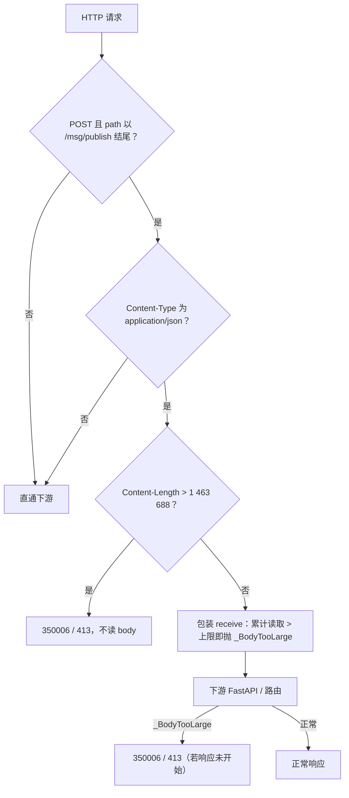
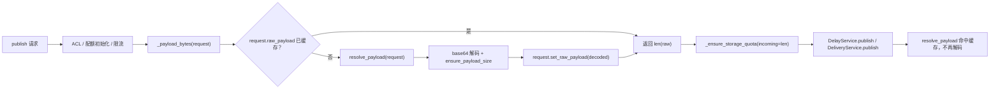
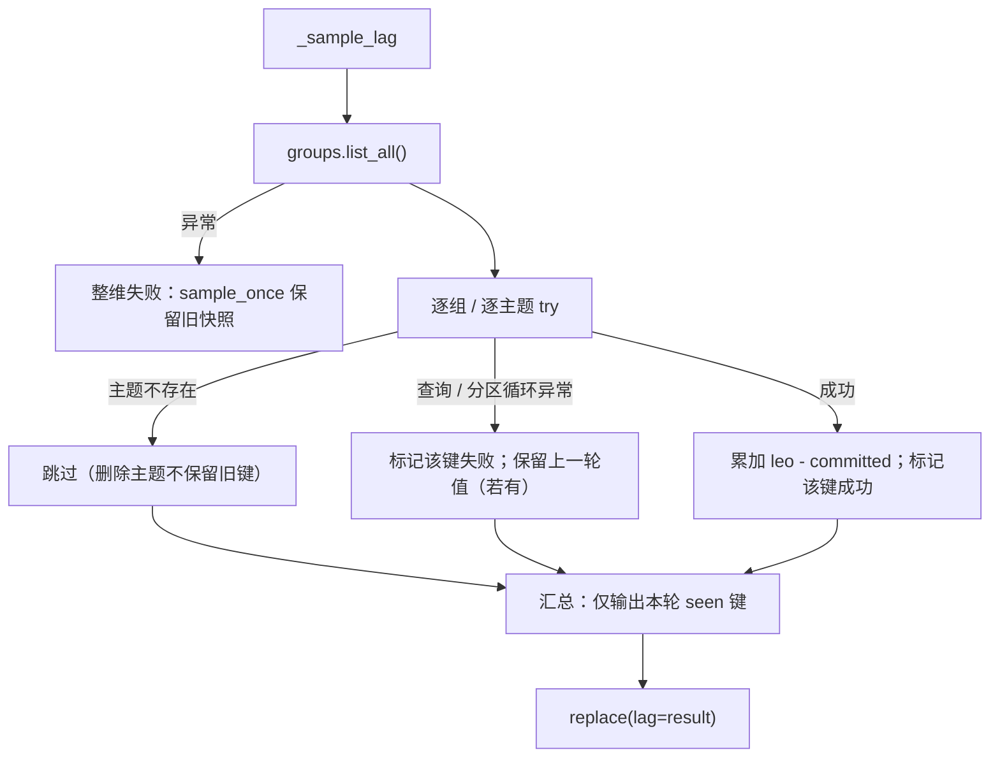
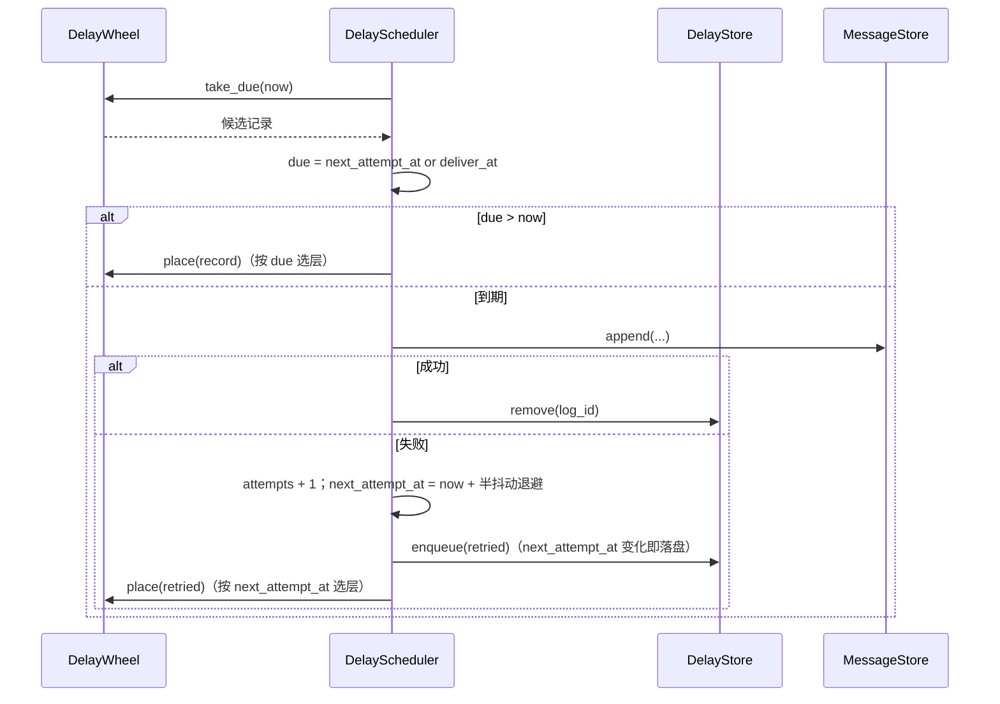
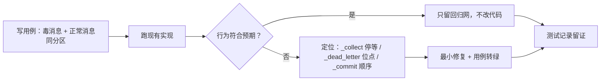

# 存储配额与可靠性详细设计

> 命名空间单点校验 × 发布载荷 / headers 提前拦截 × 配额字节精确化 × 采样隔离 × 延迟转投退避 × 毒消息续消费证据

[文档首页](../../../../../../../文档首页.md) › [消息平台规划](../../../../../../../规划/01_规划_消息平台.md) › [阶段计划](../../../../../计划/01_计划_消息平台.md) › [02 存储与复制](../../../02_存储与复制.md) › [02-6 存储水位与拒绝策略](../../02_存储与复制_06_存储水位与拒绝策略.md) › [02-6-1 存储配额与可靠性](../02_存储与复制_06_存储水位与拒绝策略_01_存储配额与可靠性.md) › 详细设计

---

## 1. 概述 <a id="overview"></a>

### 1.1 目标

把 02-6 收口后仍留在「已交付范围」内的六处边缘缺陷一次收干净，不扩大系统边界：

1. **命名空间只有一个判定入口**：形态（`NAMESPACE_PATTERN`）与可用性（已启用 `module_key`）合并为 `validate_namespace`，配额端点不再有绕过形态校验的路径。
2. **大请求体在进入业务之前被拒**：JSON 发布的 `payload` 上限在契约层可见，发布路径另有请求体大小早闸；`headers` 有明确四重上限，不再依赖记录层 1 MiB 的「最后一道 ValueError」。
3. **配额按真实字节算**：发布入口解码一次、缓存一次，`_payload_bytes` 不再用 base64 长度估算。
4. **采样单点故障不再拖垮整维**：未绑定主题只影响自己的快照键，失败键保留上一轮值，日志按 60s 窗口抑制。
5. **延迟转投失败有退避**：失败时刻写入 `next_attempt_at` 并落盘，按 1/2/5/10/30/60s + 半抖动重试；重启后继续退避而不是立即风暴。
6. **毒消息续消费有仓内证据**：先用自动化用例钉住「转死信后同分区后续消息可消费 / 复跑仍可消费」，再决定是否改停等逻辑。

### 1.2 边界与承接

| 项 | 本任务 | 归口 |
| --- | --- | --- |
| 命名空间形态 + allowlist 单点校验 | ✅ 交付 | 02-6-1 |
| JSON 发布 payload / headers 提前拦截 | ✅ 交付 | 02-6-1 |
| 存储配额 payload 字节精确化 | ✅ 交付 | 02-6-1 |
| 指标采样按主题隔离与日志抑制 | ✅ 交付 | 02-6-1 |
| 延迟转投失败退避与落盘 | ✅ 交付 | 02-6-1 |
| 毒消息转死信后同分区续消费用例与修复 | ✅ 交付 | 02-6-1（原 02-3-1 并入） |
| 多实例租约 / 跨实例日志去重 / 广播 | ❌ 不做 | 8B_05 |
| 延迟改期 / 取消 / 丢弃端点 | ❌ 不做 | 06 域 |
| 备份恢复 / 真机部署演练 | ❌ 不做 | 部署域（已剥离，待重建） |
| 数据库表 / 列变更 | ❌ 不做 | 零变更 |
| 新错误码 | ❌ 不做 | 沿用 `10001` / `350006` / `350010` |

### 1.3 口径来源

| 问题 | 定稿 | 出处 |
| --- | --- | --- |
| 命名空间形态 | `^[a-z0-9_-]{1,64}$` + 已启用 `module_key` | `core/config.NAMESPACE_PATTERN`、需求 02-6 §2 |
| payload 上限 | 1 MiB（解码后字节）；JSON base64 上限 1 398 104 字符 | 03-2 / 03-3 既有口径 |
| headers 四重上限 | 32 / 64 / 1024 / 8 KiB | 本设计 §6（2026-11-13 拍板） |
| 配额字节 | 解码后 payload 字节，不含 headers / 记录开销 | 05-2 既有口径；本次只改算法 |
| 采样日志抑制 | 同键 60s 一条 | 本设计 §8（2026-11-13 拍板） |
| 延迟退避 | 1/2/5/10/30/60s 封顶 + 半抖动 | 本设计 §9（2026-11-13 拍板） |
| F10 归口 | 并入 02-6-1，计划表 02-3-1 标注并入 | 2026-11-13 拍板 |
| Kiwi 用例 | 2498（平台回读最大 2497） | 2026-11-13 回读 |

## 2. 现状与差距 <a id="gap"></a>

| # | 现状 | 差距 | 本任务处置 |
| --- | --- | --- | --- |
| B15 | `TopicService._ensure_namespace` 做形态 + allowlist；`CurrentTenant.ensure_namespace` 只做 allowlist；配额端点直接调后者 | 形态校验只覆盖建主题 / 改主题，配额等路径靠 allowlist「碰巧」拦住；后续若 allowlist 含非规范键即漏 | 抽 `validate_namespace`，`CurrentTenant.ensure_namespace` 单点升级；主题服务去重 |
| B17 | `PublishRequest.payload` 无上限；`headers` 无任何上限；`resolve_payload` 在业务链路末段才判 1 MiB | 大 JSON 先被完整缓冲；headers 可写到记录层 1 MiB 才抛 `ValueError`（500） | 契约层 payload 上限 + 发布路径请求体早闸；headers 四重上限（10001） |
| B18 | `_payload_bytes` 用 `len(base64)*3//4` | `YQ==` 估 3 实 2；非 ASCII / padding 偏差；随后还要再解码一次 | 入口解码一次并缓存，`_payload_bytes` 取真实长度 |
| B21 | `_sample_lag` / `_sample_dlq` 整维一个 try；单个 `PartitionNotBoundError` 让整轮维度失败 | 一个未绑定主题使全租户积压 / 死信停止更新 | 按主题逐项隔离、失败键保留旧值、日志 60s 抑制 |
| F3 | `_defer` 只 `attempts + 1`，记录 `deliver_at` 仍在过去 → 下一 tick 立即重试 | 盘满 / 主题停用等持续失败时每秒重试，重启后继续风暴 | `next_attempt_at` 落盘 + 退避 + 半抖动；时间轮按它判到期 |
| F10 | 01-2 单测覆盖「转死信 + 位点前移」，但无「同分区后续消息可消费 / 复跑」用例；证据只在仓外 `tmp/` | 「毒消息不阻塞分区」缺仓内回归网 | 新增用例先证明行为；有缺陷再修停等 / 位点 / 死信顺序 |

## 3. 交付物清单 <a id="deliverables"></a>

```text
backend/services/msg/src/bms_msg/
├── tenant/context.py                  # 改：抽 validate_namespace（形态 + allowlist），CurrentTenant 单点升级
├── tenant/__init__.py                 # 改：导出 validate_namespace（替换 ensure_namespace）
├── tenant/scope_rule.py               # 改：改用 validate_namespace
├── services/topic.py                  # 改：_ensure_namespace 只委托 CurrentTenant；删重复形态判断
├── api/admin/quota.py                 # 零代码改动：查询 / 调整端点经单点升级自动获得形态校验
├── core/config.py                     # 改：payload base64 上限 / 发布体上限 / headers 四重常量 / 采样日志窗口 / 退避序列
├── schemas/message.py                 # 改：payload max_length + 超限 350006；headers 四重校验（10001）
├── api/publish_body_limit.py          # 新增：发布路径请求体大小早闸（纯 ASGI，JSON 专用）
├── main.py                            # 改：注册 PublishBodyLimitMiddleware
├── api/data/messages.py               # 改：_payload_bytes 解码一次并缓存；发布链路复用
├── broker/delivery.py                 # 改：set_raw_payload / resolve_payload 文档口径（缓存语义）
├── broker/delay.py                    # 改：DelayRecord.next_attempt_at；with_attempt 接受退避时刻；视图剩余时间
├── broker/record.py                   # 改：DelayStamp.next_attempt_at_us（新键、缺省 None、不升版本）
├── broker/delay_file.py               # 改：_put_header / _to_record / _throttled 写读退避时刻
├── broker/scheduler.py                # 改：时间轮按 next_attempt_at 判到期；失败计算退避 + 半抖动
├── metrics/sampler.py                 # 改：积压 / 死信按主题隔离、失败键保留旧值、日志 60s 抑制
└── api/data/messages.py / broker/*    # 不改：其余端点、停等规则、记录格式版本、位点语义

backend/services/msg/tests/
├── api/test_namespace_validation_0261.py       # 新增（Kiwi 2498）：B15
├── api/test_publish_limits_0261.py             # 新增（Kiwi 2498）：B17 payload / headers / 早闸
├── api/test_quota_bytes_0261.py                # 新增（Kiwi 2498）：B18
├── metrics/test_sampler_isolation_0261.py      # 新增（Kiwi 2498）：B21
├── broker/test_delay_backoff_0261.py           # 新增（Kiwi 2498）：F3
└── broker/test_poison_continuation_0261.py     # 新增（Kiwi 2498）：F10

deploy/contracts/msg.json              # 改：重导（payload maxLength 等契约差异）
frontend/packages/api-types/src/msg.ts # 改：生成器重跑（若 schema 差异传导）
```

**零变更清单**：数据库表 / 列 / 迁移；`MsgErrorCode` 枚举与 `deploy/registry/msg.toml` 错误码段；`MessageStore` / `OffsetStore` / `DelayStore` 端口签名；01-2 / 01-3 的停等与 ack 语义；01-5 的 `deliver_at` 业务语义；02-7 记录格式版本；05-2 配额维度与阈值；06-3 指标名与快照结构。

## 4. B15：命名空间单点校验 <a id="namespace"></a>

### 4.1 函数与调用关系

```text
tenant/context.py
├── validate_namespace(namespace: str | None, allowlist) -> None   # 唯一实现
│   ├── namespace is None            → 放行（调用方未指定范围）
│   ├── not NAMESPACE_PATTERN.match  → MsgNamespaceInvalidError("命名空间形态非法：…")
│   └── namespace not in allowlist   → MsgNamespaceInvalidError("命名空间未登记或未启用…")
├── CurrentTenant.ensure_namespace(namespace) -> validate_namespace(namespace, self.namespace_allowlist)
└── enabled_namespaces() 不变

services/topic.py
└── _ensure_namespace(tenant, namespace) -> tenant.ensure_namespace(namespace)   # 删除本地 NAMESPACE_PATTERN 判断

tenant/scope_rule.py
└── validate_namespace(scope.module_key, enabled_namespaces())
```

| 项 | 定稿 | 理由 |
| --- | --- | --- |
| 形态优先级 | 先形态、后 allowlist | 形态是请求契约前提；先报「形态非法」比「未登记」更可定位 |
| `None` | 放行 | 管理面「不指定命名空间」是合法语义（租户级） |
| 空串 | 不进入本函数 | 调用方以 `if namespace:` 判空（配额租户级）；空串不是命名空间 |
| 错误码 | `350010` | 与建主题 / ACL / 消费守卫同码，不新增码 |
| 配额端点 | 不改代码 | `get_quotas` / `update_quotas` 已调 `tenant.ensure_namespace`，自动获得形态校验 |

### 4.2 失败分支

| 输入 | 结果 |
| --- | --- |
| `None` | 放行 |
| `"msg"`（已启用） | 放行 |
| `"Bad.Name"` | `350010`（形态非法） |
| `"not-a-module"` | `350010`（未登记 / 未启用） |
| `""`（调用方传入） | 形态非法 → `350010`；调用方应避免传空串 |

## 5. B17：JSON payload 提前拦截 <a id="payload"></a>

### 5.1 常量与契约

| 常量 | 值 | 说明 |
| --- | --- | --- |
| `MAX_FRAME_PAYLOAD_BYTES` | 1 048 576（既有） | 解码后业务字节上限，帧 / JSON 共用 |
| `PAYLOAD_BASE64_MAX_LENGTH` | `(MAX + 2) // 3 * 4` = **1 398 104** | 1 MiB 的 base64 字符上限（含 padding 余量） |
| `MAX_PUBLISH_BODY_BYTES` | `PAYLOAD_BASE64_MAX_LENGTH + 64 KiB` = **1 463 688** | 发布 JSON 请求体早闸上限；64 KiB 余量覆盖 headers（≤8 KiB）、trace 四字段与 JSON 结构 |

`PublishRequest.payload` 字段声明 `max_length=PAYLOAD_BASE64_MAX_LENGTH`（契约可见）；另加 `field_validator("payload", mode="before")`：字符串长度超过上限即抛 `MsgPayloadTooLargeError`（**350006 / 413**），保持 03-2 既有错误码，不退化成 `10001`。

> 为什么不在 `Field(max_length=…)` 上直接吃 `10001`：03-2 已把「消息体过大」定为 `350006`，契约用例 `test_payload_limit.py` 钉住 413 / 350006；`max_length` 只作 OpenAPI 声明与兜底，超限判定由前置校验器给出产品码。

### 5.2 请求体早闸

新增 `api/publish_body_limit.py::PublishBodyLimitMiddleware`（纯 ASGI，继承基座 `BaseMiddleware`）：



| 项 | 定稿 | 理由 |
| --- | --- | --- |
| 匹配范围 | `POST` + 路径后缀 `/msg/publish` + JSON | 覆盖 `/api/v1/msg/publish` 与 `/msg/publish`；帧路径不套 JSON 早闸（帧有自己的 64 KiB header / 1 MiB payload 判据） |
| 响应 | `build_error_response(scope, MsgPayloadTooLargeError(...))` | 与既有 413 同源；frame 路径不经过此中间件，不会破坏 error frame 语义 |
| chunked | `receive` 包装累计字节，超限抛内部异常，中间件捕获后回 413 | 不只信 Content-Length；避免无长度的大 body 绕过 |
| 响应已开始 | 重新抛出，不二次写响应 | ASGI 协议不允许二次 `http.response.start` |
| 装配 | `main.py` 在既有中间件之后 `add_middleware(PublishBodyLimitMiddleware, max_body_bytes=MAX_PUBLISH_BODY_BYTES)` | 最后注册即最外层，尽早拒绝 |

### 5.3 错误与优先级

| 情形 | 结果 |
| --- | --- |
| payload 恰好 1 MiB | 通过（1398104 base64 字符） |
| payload 1 MiB + 1 字节 | 校验器 `350006`（413） |
| 请求体 > 1 463 688 字节 | 中间件 `350006`（413），不进入 JSON 解析 |
| payload 短但非法 base64 | 仍由 `decode_payload` 给 `10001` |
| 帧 payload 超 1 MiB | 既有 `decode_frame` / `ensure_payload_size` 给 `350006`，不受本中间件影响 |

## 6. B17：headers 四重上限 <a id="headers"></a>

### 6.1 口径

| 维度 | 上限 | 判定 | 超限码 |
| --- | --- | --- | --- |
| 对数 | 32 | `len(headers)` | `10001` |
| 单键长度 | 64 字符 | `len(key)` | `10001` |
| 单值长度 | 1024 字符 | `len(value)` | `10001` |
| 序列化总量 | 8 KiB | `Σ(len(key.encode)+len(value.encode)+8)` | `10001` |

- 8 KiB 是「近似序列化字节」：每条加 8 字节结构开销（长度前缀 / 分隔），**远低于**记录头 1 MiB 硬顶，给 trace / 业务头留足空间；记录层 `_pack_header` 的 1 MiB 检查原样保留，作为最后防线。
- 校验落 `PublishRequest` 的 `model_validator(mode="after")`：JSON 与帧两条路径都构造同一个模型，天然同源。
- 超限用 `ValueError`（消息写清维度与实测值），由基座契约错误收敛为 `10001`；不新增错误码。
- 不把「单值 1024」做成 `Field(max_length=…)` 的字典值约束（pydantic 对 `dict[str, str]` 无逐值约束），统一在模型校验器内做，避免契约元数据与 `CONTRACT_COLLECTION` 冲突。

### 6.2 边界用例

| 输入 | 结果 |
| --- | --- |
| 32 对、每键 64、每值 1024、总量 ≤8 KiB | 通过 |
| 33 对 | `10001` |
| 键 65 字符 | `10001` |
| 值 1025 字符 | `10001` |
| 总量 8 KiB + 1 字节 | `10001` |

> 「32 × 64 + 32 × 1024」已超 8 KiB，因此四重上限不是并列可达的极端组合——总量上限优先约束实际载荷。用例分别验证单维边界，不要求四维同时打满。

## 7. B18：配额字节精确化 <a id="quota-bytes"></a>

### 7.1 解码一次并缓存



- `_payload_bytes` 从「估算函数」升级为「解析并缓存」：无缓存时调 `resolve_payload`（非法 base64 → `10001`；超 1 MiB → `350006`），成功后写回 `PublishRequest` 的私有 bytes 通道。
- `PublishRequest.set_raw_payload` 文档改为「帧路径原始字节 **或** JSON 路径已解码字节」；`resolve_payload` 的「raw 优先」语义不变。
- 错误优先级变化：非法 base64 从「存储配额之后」提前到「存储配额之前」（ACL / 限流之后）。这是契约错误先于业务配额的合理顺序；实施记录登记。
- `_track_data_plane` 成功后的 `size=_payload_bytes(req)` 命中缓存，不重复解码。

### 7.2 验收算式

| payload | base64 | 旧估算 | 新精确 |
| --- | --- | --- | --- |
| `b"a"` | `YQ==` | 3 | 1 |
| `b"ab"` | `YWI=` | 3 | 2 |
| 空 | `""` | 0 | 0 |
| 1 MiB | 1 398 104 字符 | 1 048 578 | 1 048 576 |

> 旧估算在 1 MiB 边界会多算 2 字节，配额「刚好卡线」时误判 507；新口径与 `ensure_payload_size` 同一份字节。

## 8. B21：采样按主题隔离 <a id="sampler"></a>

### 8.1 算法



- **隔离粒度**：积压按 `(组, 主题)` 一项 try（分区循环在该 try 内）；死信按主题一项 try。任何一个失败不终止整维。
- **键缓存**：`MetricsSampler` 增 `_topic_keys: ConcurrentStableDict[int, str]`，成功解析后记 `topic_id → (tenant, topic)`；失败时用它定位上一轮键并恢复旧值。主题已删（`get_by_id_unscoped` 返回 `None`）不恢复旧键，避免快照永久残留。
- **旧值语义**：失败键若上一轮有值则沿用；上一轮没有则不写入（不伪造 0，避免「采样失败 = 积压归零」误恢复告警）。
- **日志**：`msg_metrics_sample_failed` 增 `key` / `error` 字段；同键 60s 内只一条 warning；恢复后记一条 `msg_metrics_sample_recovered`（info）并清失败标记。常量 `METRICS_SAMPLE_FAILURE_LOG_WINDOW_SECONDS = 60`。
- **外层失败**：`groups.list_all()` / `dead_letters.list_all()` 本身失败仍由 `sample_once` 按维度保留旧快照——这是「整维不可用」而非「单主题坏数据」，语义正确。

### 8.2 死信维度

- 逐条 `letter` 处理：`status` 非活跃跳过；主题解析失败按上述规则恢复旧键；成功按 `topic_key` 累加。
- 死信增长 `dlq_growth` 计算不变（基于新旧快照差值），失败键沿用旧值不会产生虚假增长。

## 9. F3：延迟转投退避 <a id="backoff"></a>

### 9.1 数据契约

| 载体 | 字段 | 缺省 | 说明 |
| --- | --- | --- | --- |
| `DelayRecord` | `next_attempt_at: datetime \| None` | `None` | 下次重试时刻；`None` = 按 `deliver_at` 判定（旧记录 / 首次投递） |
| `DelayStamp` | `next_attempt_at_us: int \| None` | `None` | 落盘键 `next_attempt_at`；只在非空时写，旧记录字节不变 |
| `RecordHeader.delay` | 同上 | `None` | 不升 `RECORD_FORMAT_VERSION`；旧解码器按 `.get()` 缺省忽略新键 |

### 9.2 退避序列与半抖动

```text
失败次数（attempts）  1     2     3     4      5      6+
基础退避              1s    2s    5s    10s    30s    60s（封顶）
实际等待 = base/2 + random(0, base/2)
```

| 项 | 定稿 |
| --- | --- |
| 序列 | `DELAY_RETRY_BACKOFF_MS = (1000, 2000, 5000, 10000, 30000, 60000)` |
| 索引 | `attempts` 为**加一后**的失败次数；`index = min(attempts - 1, len(seq) - 1)` |
| 抖动 | 半抖动：`base/2 + random.uniform(0, base/2)`；保留退避下界，避免「0 等待」 |
| 注入 | `DelayScheduler(..., jitter: Callable[[float, float], float] | None = None)`；缺省 `random.uniform`，用例注入确定性函数 |
| 时钟 | 以调度器 `_now()` 为基准写 `next_attempt_at`；与 `deliver_at` 同为 UTC |

### 9.3 推进与落盘



| 落点 | 改动 |
| --- | --- |
| `DelayWheel.layer_of` / `place` | 统一用 `_due_at(record) = record.next_attempt_at or record.deliver_at` 选层与判过期 |
| `DelayScheduler.run_once` | 同上；未到 `due_at` 则重新装填 |
| `DelayScheduler._defer` | `with_attempt(record, next_attempt_at=...)`；日志仍带 `reason` / `errno`，窗口抑制不变 |
| `DelayStore.enqueue` | 覆盖写按 `log_id`；`next_attempt_at` 随记录整条替换 |
| `DelayFileStore._put_header` / `_to_record` | 写 / 读 `next_attempt_at_us` |
| `DelayFileStore._throttled` | 比较时忽略 `attempts` 与 `next_attempt_at`；`next_attempt_at` 变化**立即落盘**（退避本身是重启后的正确性依据）；仅 `attempts` 变化时沿用原节流 |
| `_remaining_ms`（只读视图） | 取 `next_attempt_at or deliver_at`，避免退避期显示「剩余 0」却仍不投 |

### 9.4 失败与恢复

| 情形 | 行为 |
| --- | --- |
| 首次失败（attempts=1） | 1s 半抖动后重试 |
| 持续失败 | 序列递增，60s 封顶；不丢弃、不跳过 |
| 重启重建 | `next_attempt_at` 从 `.delay` 读出；未来时刻进对应层，不立即重试 |
| 旧记录无 `next_attempt_at` | 按 `deliver_at` 判定；若已过期立即重试一次，失败后进入退避 |
| 成功转投 | 删除延迟记录；`next_attempt_at` 随记录消失 |
| 高水位 / 主题停用 | 与既有语义一致：保留记录、按退避重试；日志窗口抑制 |

## 10. F10：毒消息同分区续消费 <a id="poison"></a>

### 10.1 先证后修



### 10.2 用例场景

| 步 | 动作 | 断言 |
| --- | --- | --- |
| 1 | 同分区发布毒消息（offset 0）与正常消息（offset 1） | LEO=2 |
| 2 | 连续 consume + 推进可见性超时 `MAX_DELIVERY_ATTEMPTS` 次 | 毒消息 `delivery_count` 1→5 |
| 3 | 第 6 次 consume | 毒消息转死信（`attempts=5`）；**同批或下一批**返回正常消息（offset 1，`delivery_count=1`） |
| 4 | ack 正常消息 | `committed_offset=2` |
| 5 | ack 毒消息 | `350007`（已死信不可确认） |
| 6 | 用同一存储 / 位点 / 死信重建 `DeliveryService` 再 consume | 空批；复跑不重复投递、不重复入死信 |
| 7 | 死信列表 | 仅 offset 0 一条，`reason=delivery_exhausted` |

- 若第 3 步当前实现因 `retried` 标志停批（返回空批），则第 4 步改为「下一批返回正常消息」；用例按实际语义断言「最终可在同分区继续消费」，不强行要求同批。
- 若发现 `_dead_letter` 位点未推进导致正常消息永不可见，则修复 `_commit` / `_collect` 的连续前缀处理；修前先在实施记录登记缺陷。

## 11. 装配与接线 <a id="assembly"></a>

| 落点 | 动作 | 注意 |
| --- | --- | --- |
| `core/config.py` | 增 `PAYLOAD_BASE64_MAX_LENGTH` / `MAX_PUBLISH_BODY_BYTES` / `MAX_HEADER_COUNT` / `MAX_HEADER_KEY_LENGTH` / `MAX_HEADER_VALUE_LENGTH` / `MAX_HEADER_TOTAL_BYTES` / `HEADER_ENTRY_OVERHEAD_BYTES` / `METRICS_SAMPLE_FAILURE_LOG_WINDOW_SECONDS` / `DELAY_RETRY_BACKOFF_MS` | 从 `bms_core.msgclient.frame` 取 `MAX_FRAME_PAYLOAD_BYTES`，不复制 1 MiB 数字 |
| `main.py` | `add_middleware(PublishBodyLimitMiddleware, max_body_bytes=MAX_PUBLISH_BODY_BYTES)` | 最后注册即最外层；不新增后台任务 |
| `tenant/context.py` | `validate_namespace` + `CurrentTenant.ensure_namespace` | 所有调用点一次生效 |
| `schemas/message.py` | payload 上限 + headers 模型校验 | 帧 / JSON 同源 |
| `api/data/messages.py` | `_payload_bytes` 解析并缓存 | 不改变 ACL / 限流顺序 |
| `broker/scheduler.py` | 退避 + 时间轮 due 口径 | 不改变 `_transfer` 先写后清的偏序 |
| `broker/delay_file.py` | 新键写读 + 节流 | 不升格式版本 |
| `metrics/sampler.py` | 隔离 + 旧值 + 日志抑制 | 快照结构与指标名不变 |

**无新增后台任务**：B21 仍由既有采样循环驱动；F3 仍由既有推进循环驱动；B17 早闸是纯 ASGI 中间件。关闭偏序与 02-2 / 02-3 / 02-7 既有约定不变。

## 12. 测试设计 <a id="tests"></a>

全部新增用例标 `@pytest.mark.kiwi_id(2498)`；按领域拆文件，避免与既有文件的 Kiwi 编号混标。

| # | 文件 / 用例 | 判据 |
| --- | --- | --- |
| T1 | `test_namespace_validation_0261.py`：`validate_namespace` 形态优先 | allowlist 含非法键时仍 `350010`；`None` 放行；合法键放行 |
| T2 | 同上：配额查询非法 namespace | GET 配额返回 `350010`；服务层未被调用（不产生读取） |
| T3 | 同上：配额调整非法 namespace | PUT 返回 `350010`，库中无新增 / 修改行，审计不写 |
| T4 | `test_publish_limits_0261.py`：payload 1 MiB 边界 | 恰好 1 MiB 通过；1 MiB + 1 字节 `350006` / 413 |
| T5 | 同上：请求体早闸 Content-Length | 构造 > 1 463 688 的 JSON，返回 `350006`，存储 append 未被调用 |
| T6 | 同上：chunked 累计早闸 | 无 Content-Length 的超大 body 同样 `350006`，不进入解析 |
| T7 | 同上：headers 四重边界 | 32 / 64 / 1024 / 8 KiB 通过；33 / 65 / 1025 / 超 1 字节各 `10001` |
| T8 | 同上：帧路径 headers 同源 | 帧 header 超限返回 error 帧 `10001`（复用既有帧测试装置） |
| T9 | `test_quota_bytes_0261.py`：精确字节 | `YQ==` 计 1、`YWI=` 计 2、空 0、1 MiB 计 1 048 576 |
| T10 | 同上：只解码一次 | monkeypatch `decode_payload` 计数：发布一次只调一次；投递 / 延迟复用缓存 |
| T11 | 同上：配额边缘 | 配额 2 字节时 `YWI=` 通过（旧估算会误判 507），3 字节时拒绝 |
| T12 | `test_sampler_isolation_0261.py`：单主题未绑定 | 主题 A 抛 `PartitionNotBoundError`，主题 B 积压照常更新；A 保留上一轮值 |
| T13 | 同上：无旧值不伪造 0 | 首次采样即失败的主题不出现在快照中（不是 0） |
| T14 | 同上：死信维度隔离 | 单主题失败不影响其它主题死信存量与增长 |
| T15 | 同上：日志 60s 抑制 | 同键连续失败 60s 内只一条 warning；窗口外再一条 |
| T16 | 同上：恢复日志 | 失败后成功记一条 `msg_metrics_sample_recovered` 并清标记 |
| T17 | `test_delay_backoff_0261.py`：退避序列 | 连续失败 attempts=1..6 的 `next_attempt_at` 落在 0.5~1 / 1~2 / 2.5~5 / 5~10 / 15~30 / 30~60s 区间 |
| T18 | 同上：时间轮不早投 | `next_attempt_at` 未到前 `run_once` 不 append；到点后成功 |
| T19 | 同上：落盘与重建 | 失败后重建 `FileDelayStore`，`next_attempt_at` 读回一致；未到期不立即重试 |
| T20 | 同上：旧记录兼容 | 无 `next_attempt_at` 的旧记录按 `deliver_at` 判定；首次失败后进入退避 |
| T21 | 同上：格式版本不升 | 新旧记录同版本；旧解码器忽略新键（用 `DelayStamp` 构造断言） |
| T22 | 同上：节流让位于退避 | `next_attempt_at` 变化即落盘；仅 attempts 变化按原窗口节流 |
| T23 | 同上：视图剩余时间 | 退避期 `remaining_ms` 取 `next_attempt_at`，不显示 0 |
| T24 | `test_poison_continuation_0261.py`：同分区续消费 | 见 §10.2 第 1~4 步 |
| T25 | 同上：复跑 | 重建服务后空批、不重复死信、位点仍为 2 |
| T26 | 同上：死信语义 | 仅 offset 0 入死信；ack 毒消息 `350007`；正常消息可确认 |

**既有用例影响**：`test_quota_enforcement.py::test_payload_bytes_from_raw_and_base64` 的「估算」断言需改为精确值；`test_payload_limit.py` 应继续全绿（350006 / 413 不变）；`test_delay_scheduler.py` / `test_delay_file_store.py` / `test_delay_recovery.py` 的 `DelayRecord` 构造需补缺省字段（`next_attempt_at=None` 默认，无需改）；`test_sampler.py` 的维度失败用例语义保持。

## 13. 验收映射 <a id="accept-map"></a>

| 任务 §3 完成标准 | 用例 / 门禁 |
| --- | --- |
| 配额端点非法命名空间 `350010` 且不写入 | T1 / T2 / T3 |
| 1 MiB 边界保持 350006；大请求体早拒；headers 四重上限 | T4 / T5 / T6 / T7 / T8 |
| 配额按真实字节、只解码一次 | T9 / T10 / T11 |
| 单主题故障不拖垮整维、旧值保留、日志抑制 | T12~T16 |
| 延迟退避、落盘、重启续退避、`deliver_at` 不变 | T17~T23 |
| 毒消息同分区续消费、复跑、死信语义 | T24 / T25 / T26 |
| 覆盖率与静态 / 文档 / 契约零漂移 | 推送环模块级 100% + `ruff` / `pyright` / `engkit links|docs-scope|eol` + 契约重导 |

## 14. 风险与开放项 <a id="risk"></a>

| # | 项 | 处置 |
| --- | --- | --- |
| 1 | 中间件按路径后缀匹配，未来新增发布别名路径可能漏 | 数据面路径由 `DATA_PLANE_ROUTES` 单点维护；新增别名时同步检查后缀；用例钉住两条现有路径 |
| 2 | chunked 早闸在响应已开始后无法改写 | 响应前读取 body；若已开始则重新抛出，由基座兜底；用例覆盖正常路径 |
| 3 | 契约层 `BizError` 校验器是否被 pydantic 包装 | T4 钉住 350006；若发现被包装为 10001，则把超限判定下移到发布端点依赖（仍保持 350006），并回写设计 |
| 4 | `_payload_bytes` 提前解码改变错误优先级 | 契约错误先于业务配额；实施记录登记，契约用例补一条「非法 base64 + 超配额仍 10001」 |
| 5 | B21 键缓存随主题数增长 | 上限与快照键同阶（主题数），无额外无界增长；主题删除后不恢复旧键 |
| 6 | F3 每次退避变化都落盘 | 退避间隔拉长后写放大可控；`DELAY_ATTEMPT_FLUSH_*` 节流仍覆盖「仅计数」场景 |
| 7 | F10 现有实现可能已正确 | 先证后修：若全绿则只留回归网，不改 01-3 语义；实施记录写明「无代码缺陷」 |
| 8 | 配置常量仍是模块常量（基座 `Settings` 不可扩） | 沿用 02-6 / 01-5 既有取舍；数值调整随发版，登记为既有遗留 |

## 15. 决策确认与对齐记录 <a id="align"></a>

### 15.1 决策（2026-11-13 逐项确认）

| # | 事项 | 定稿 | 与我推荐 |
| --- | --- | --- | --- |
| 1 | B15 校验归属 | 抽 `validate_namespace`，`CurrentTenant.ensure_namespace` 单点升级 | 一致 |
| 2 | B17 payload 拦截 | 契约声明 + 发布路径请求体早闸 | 一致 |
| 3 | B17 headers 上限 | 对数 32 / 键 64 / 值 1024 / 总量 8 KiB（10001） | 一致 |
| 4 | B18 字节口径 | 解码一次并缓存复用；不含 headers / 记录开销 | 一致 |
| 5 | B21 容错 | 按主题隔离 + 保留旧值 + 日志 60s 抑制 | 一致 |
| 6 | F3 退避载体 | `DelayRecord.next_attempt_at` 落盘，不升格式版本 | 一致 |
| 7 | F3 抖动 | 半抖动（base/2 + random(0, base/2)） | 一致 |
| 8 | F10 顺序 | 先补用例证明行为，暴露缺陷再修 | 一致 |
| 9 | F10 归口 | 并入 02-6-1，计划表 02-3-1 标注并入 | 一致 |
| 10 | Kiwi | 平台回读最大号 +1（2497 → 2498） | 一致 |

### 15.2 与既有设计的对齐

| 相邻任务 | 既有口径 | 本任务处置 |
| --- | --- | --- |
| 01-2 投递语义 | 毒消息转死信、位点前移、不阻塞后续 | F10 只补证据；若失败按最小修复，不改语义 |
| 01-3 顺序性 | 分区内停等；死信是唯一破例 | 不改停等规则；F10 用例按「同批或下一批」断言最终可消费 |
| 01-5 延迟消息 | `deliver_at` 是业务到期时刻 | 新增 `next_attempt_at` 只表重试，不改 `deliver_at` |
| 02-7 延迟持久化 | `.delay` 记录 `delay` 子结构只增不删、不升版本 | 新增 `next_attempt_at` 键，旧记录 / 旧解码器兼容 |
| 03-2 / 03-3 | 1 MiB 上限、350006 / 413、headers 64 KiB 帧头上限 | JSON 与帧同源；headers 业务四重上限更严，不动帧格式 |
| 05-2 配额 | `storage_bytes` 按 payload 字节 | 只把估算改精确；维度、阈值、错误码不变 |
| 06-3 指标 | 采样失败保留上一轮快照 | 从「整维保留」细化为「按主题保留」，快照结构不变 |
| 02-6 | 水位闸门、507、转投失败日志抑制 | 退避只改重试节奏，日志字段与窗口不变 |

## 16. 登记与回写 <a id="writeback"></a>

| 落点 | 内容 |
| --- | --- |
| 02-6 父任务 | §1 增「子任务」行；§5 子任务清单登记 02-6-1 |
| 阶段计划 02-6 行 | 状态 / 完成日期 / 偏差与遗留按实施结果回写（进度只在计划表承载） |
| 阶段计划 §6 台账 #16 / #36 | 原 02-3-1 标注「并入 02-6-1」；F3 / F10 闭环 |
| 需求 02-6 | 不新增需求；必要时在需求注块补「配额字节精确 / 退避」说明 |
| 契约 | `export` 重导；前端类型生成器重跑；差异只在 payload `maxLength` 等声明 |
| 测试记录 | Kiwi 2498、T1~T26、覆盖率与文档三项结果 |
| 实施记录 | 交付物、关键命令、问题与处置、偏差与遗留 |
