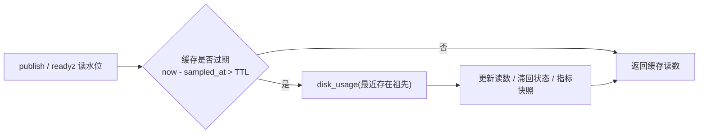
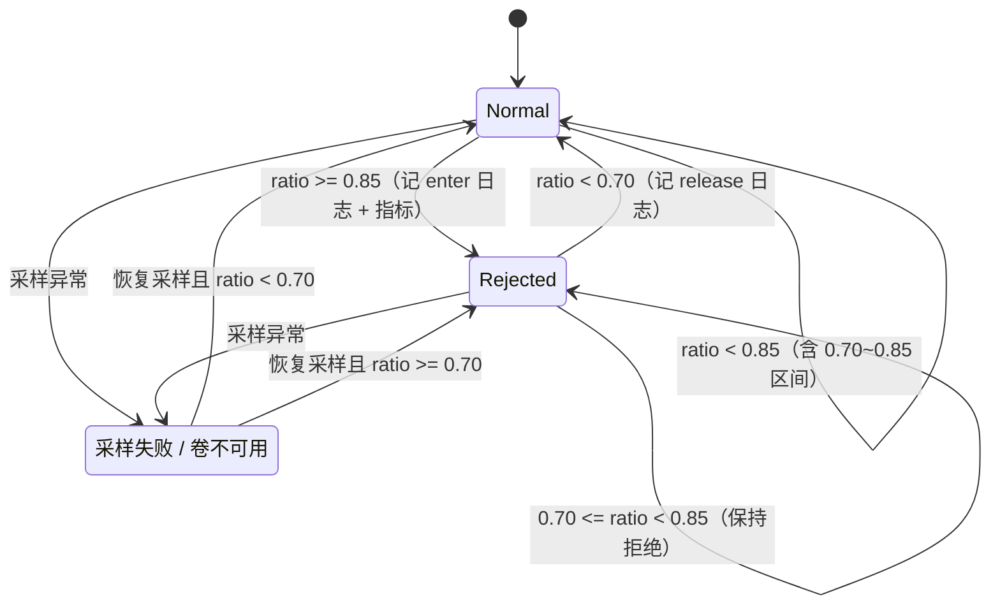
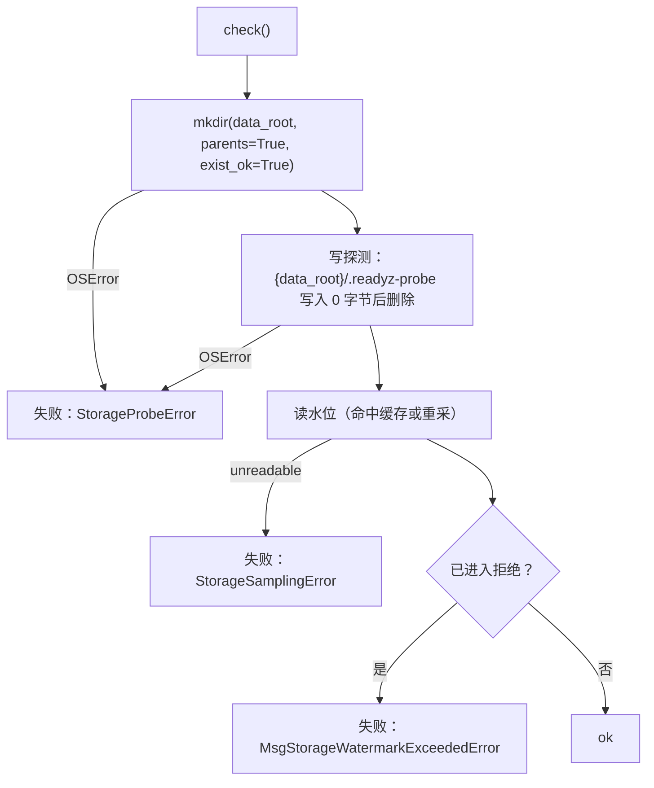

# 存储水位与拒绝策略详细设计

> 卷级水位 × 采样与滞回 × 350022 闸门（507）× `/readyz` 两个检查项 × 指标采集点

[文档首页](../../../../../../文档首页.md) › [消息平台规划](../../../../../../规划/01_规划_消息平台.md) › [阶段计划](../../../../计划/01_计划_消息平台.md) › [02-6 存储水位与拒绝策略](../02_存储与复制_06_存储水位与拒绝策略.md) › 详细设计

---

## 1. 概述 <a id="overview"></a>

### 1.1 目标

把「磁盘写满」从**未定义的故障**收敛成**一条可预期的拒绝路径**，并把「能不能写」变成可被探针判定的状态：

1. **水位有口径**：以消息数据根所在**卷**的使用率为唯一判据（`shutil.disk_usage`），不是「我们写了多少」。
2. **阈值有滞回**：低水位 70% 只告警、高水位 85% 开始拒绝；**必须降到 70% 以下才解除**，阈值附近不抖动。
3. **拒绝有码**：高水位拒绝新消息并返回 `350022` / **HTTP 507**，`data` 带当前水位、阈值、数据卷与剩余字节；**不允许静默丢弃**；延迟发布同样拒绝。
4. **就绪判能写**：`/readyz` 增加 `msg_storage`（目录可写 + 水位）与 `msg_recovery`（02-2 交接的恢复期截断 / 段损坏，非必需项），落实架构 08 §8「就绪探针必须检查能写」。
5. **指标留采集点**：`StorageMetrics.snapshot()` 提供水位与拒绝计数，**出口归 06-3**（与 03-5 同一口径）。
6. **清理即恢复**：复用 02-1 `truncate_before()` 的既有清理能力，清理后**无需重启**（下一个采样窗口自动解除），进入 / 解除各一条日志。

### 1.2 边界与承接

| 项 | 本任务 | 归口 |
| --- | --- | --- |
| 卷级水位采样、阈值与滞回、`350022` 拒绝、`/readyz` 两个检查项 | ✅ 交付 | 02-6 |
| 采样缓存失效钩子（`force_refresh`）、恢复台账聚合 | ✅ 交付 | 02-6 |
| 错误码枚举 + `msg.toml` 声明 + 端点 `x-error-codes` | ✅ 交付 | 02-6 |
| 缩短保留期 / 清理过期段 / 扩容的**操作入口**（端点 / 权限 / 二次确认） | ❌ 不做（提供能力与口径） | 06-2 |
| 指标出口（Prometheus 暴露、命名与标签治理、告警分级） | ❌ 不做（只做采集点） | 06-3 |
| 租户级配额与用量 | ❌ 不做 | 05-3 |
| 传输层背压与流控（限流 `350005`、inflight 双阈值） | ❌ 不做（已由 03-5 交付） | 03 域 |
| 段删除实现（整段删除语义与向下取整） | ❌ 不做（复用 02-1） | 02-1 |
| 多实例共享卷的一致判定、跨实例状态 | ❌ 不做（首期单实例假设） | 8B_05 |
| 启动期全量扫描全部分区 | ❌ 不做（保 02-2 懒加载取舍） | 02-2 既定 |

### 1.3 口径来源

| 问题 | 定稿 | 出处 |
| --- | --- | --- |
| 水位对象 | `MSG_DATA_DIR` 所在**卷**使用率；预留空间 10%~15% | 需求 02-6 §2、架构 08 §4 |
| 阈值 | 告警 70% / 拒绝 85%；预留空间 = 1 − 拒绝阈值 | 需求 02-6 §1、任务 §2.2 |
| 拒绝码 | `350022` 存储水位拒绝；与 `350005`（限流）、`350015`（延迟区满）分立 | 任务 §2.3（2026-11-05 定）、架构 05 §5 |
| 错误分层 | 系统层 + `retryable=true`（清理后即可恢复） | 架构 05 §5 |
| 就绪判据 | 元数据可达 + 日志可写 + 水位未超高水位 | 任务 §2.4、架构 08 §8 |
| 运维手段 | 缩短保留期、清理过期段（复用 `truncate_before`）、扩容；入口归 06-2 | 任务 §2.5、架构 04 §6 |
| 指标 | `msg_disk_used_ratio` 等；命名 / 标签 / 暴露归 06-3 | 需求 02-6 §4、需求 06-3 |
| 采样频率 | 惰性 TTL 1s（可配） | 本设计 §5（决策 #5） |
| 多实例 | 首期单实例；共享卷边界写明，归 8B_05 | 本设计 §16（决策 #20） |

## 2. 现状与差距 <a id="gap"></a>

| 现状 | 差距 | 本任务处置 |
| --- | --- | --- |
| `publish` 直接 `store.append`，磁盘满时抛 `OSError` | 客户端拿到不可分类的 500，且延迟发布先把消息收进延迟区再丢 | 服务层加闸门，`350022` 拒绝；延迟发布同样拒 |
| 无水位概念，`msg_disk_used_ratio` 未采集 | 需求 02-6 的告警与拒绝都无处落地 | 新增 `StorageWatermark` + `StorageMetrics` |
| msg 的 `[health_check_registry]` **未配置** → `NullHealthCheckRegistry`（`checks()` 恒空） | `/readyz` 只判「启动完成 + 未摘流」，磁盘满的实例仍被判就绪 | 新增 msg 自持注册表插件（`provider = "msg"`），登记两个检查项 |
| 基座 `local` 注册表无条件登记 `redis` 检查项 | msg 不用 redis，切 `local` 即「redis 未配 → 恒 503」 | 自持注册表：只登记 `msg_storage` / `msg_recovery` / `database` |
| `RecoveryReport` 是**单分区、最近一次**的结论，且分区懒加载 | 02-2 交接的「恢复告警不降级 `/ready`」没有聚合入口 | 新增 `RecoveryLedger`（进程级台账）+ 非必需检查项 |
| `_RETRYABLE_SYSTEM = {10006, 10007}` | 架构 05 §5 要求 `350022` 为系统层且 `retryable=true` | 追加 `350022` |
| 延迟转投失败日志只有 `delay_deliver_failed` | 分不清「磁盘满」与「主题停用」；高水位期每 tick 记一行 | 补 `reason` / `errno`，同分区同原因按窗口抑制 |

## 3. 交付物清单 <a id="deliverables"></a>

```text
backend/services/msg/src/bms_msg/
├── broker/watermark.py       # 新增：StorageReading / StorageWatermark（采样 + TTL + 滞回 + 闸门）/ StorageMetrics
├── broker/recovery.py        # 改：+RecoveryLedger 与 RecoverySummary（进程级恢复台账数据契约）
├── broker/file_store.py      # 改：_load() 把恢复结论写入台账 + recovery_ledger() 只读出口
├── broker/delivery.py        # 改：publish 注入闸门（默认 None，既有用例行为不变）
├── broker/delay.py           # 改：延迟发布注入同一闸门（排在水位判定之后、配额之前）
├── broker/scheduler.py       # 改：转投失败日志补 reason / errno + 同分区同原因窗口抑制
├── health.py                 # 新增：MsgHealthCheckRegistry + MsgStorageCheck / MsgRecoveryCheck + 登记函数
├── errors.py                 # 改：+STORAGE_WATERMARK_EXCEEDED(350022) + MsgStorageWatermarkExceededError(507)
├── core/config.py            # 改：水位阈值 / 采样 TTL / 探测文件名 / 检查项键 / 日志抑制窗口
├── api/deps.py               # 改：+StorageGateDep（缺省 None，未装配即不判）
├── api/data/messages.py      # 改：PUBLISH_ERROR_CODES +350022；两处服务组装传入闸门
├── api/frame/responses.py    # 改：_RETRYABLE_SYSTEM +350022
└── main.py                   # 改：装配 StorageWatermark / StorageMetrics + 登记健康检查插件

backend/config.toml / config.dev.toml / config.test.toml / config.prod.toml
                              # 改：+[health_check_registry] provider = "msg"

deploy/registry/msg.toml      # 改：+[[errcodes]] 350022（507）
deploy/contracts/msg.json     # 改：重导快照（publish 两端点 x-error-codes 追加 350022）

backend/services/msg/tests/broker/test_watermark.py   # 新增（Kiwi 2430）：T1~T22
backend/services/msg/tests/health/test_health_checks.py  # 新增：健康检查项与注册表插件（同 Kiwi 2430）
```

**零变更清单**：`MessageStore` / `OffsetStore` 端口签名与语义、01-2 ~ 01-7 的投递 / 顺序 / 延迟 / 保留 / 节流语义、02-1 记录格式与段布局、02-2 恢复点与扫描判据、02-3 位点文件格式、数据库表结构、`Settings` 配置段（不改基座）、`deploy/registry/msg.toml` 的其余段。

> **唯一的跨任务口径变化**：`/readyz` 从此对 msg **真的会 503**（此前恒 200）。这正是任务 §2.4 的目的，但属于运维可见行为变更，须在实施记录中登记。

## 4. 水位口径与阈值 <a id="watermark-source"></a>

### 4.1 采样对象与卷标识

| 项 | 定稿 | 理由 |
| --- | --- | --- |
| 采样对象 | `shutil.disk_usage(<数据根最近存在祖先>)` | 卷级语义与架构 08 §4「预留空间」一致；`data/`、`offsets/`、恢复点同卷，且能覆盖「别的进程把卷写满」 |
| 数据根 | `data_root()`（`MSG_DATA_DIR`，缺省 `var/lib/msg`） | 与 02-1 / 02-3 同一函数，不另立来源 |
| 卷标识 `volume` | **最近存在祖先的绝对路径**（如 `/var/lib/msg`、`D:\var\lib\msg`） | 可直接排障、可做指标分键；不用 `st_dev`（跨平台的设备号不可读） |
| 分母 | `disk_usage.total` | `total == 0` 视为不可用（容器 quota 异常场景） |
| 使用率 | `used / total`（0~1，**保留 4 位小数**再比较） | 避免浮点尾差让「正好 85%」在两侧抖动 |

### 4.2 阈值与预留空间

```text
使用率 0 ──────── 70% ──────────────── 85% ──────── 100%
        正常     告警（只记指标）      拒绝写      写索引都可能失败
                  └── 预留空间 = 1 − 85% = 15% ──┘
```

| 常量 | 环境变量 | 缺省 | 含义 |
| --- | --- | --- | --- |
| `STORAGE_WARN_RATIO` | `MSG_STORAGE_WARN_RATIO` | `0.70` | 低水位：只记告警指标，不拒绝 |
| `STORAGE_REJECT_RATIO` | `MSG_STORAGE_REJECT_RATIO` | `0.85` | 高水位：开始拒绝写 |

**预留空间不单设参数**：`1 − REJECT_RATIO`（缺省 15%，落在架构要求的 10%~15% 区间）。两个参数并存时必须额外定义「冲突时听谁」，长期极易误配。

取值校验（启动即失败，不静默降级，与 02-1 的 fsync 档位同口径）：`0 < WARN < REJECT < 1`，否则抛 `ValueError`。

### 4.3 不可用判定

| 情形 | 处置 |
| --- | --- |
| 数据根不存在 | **向上取最近存在的祖先**算卷（目录懒创建是常态） |
| 连祖先都取不到（盘符不存在 / 卷未挂载 / 权限拒绝 / `OSError`） | `StorageReading.unreadable = True`，**判不可用**：`/readyz` 503，发布返回 `350022`（`reason = "sampling_failed"`） |
| `total == 0` | 同上（无法计算比例） |

**为什么不按「水位 0」放行**：磁盘真坏时 `append` 会抛 `OSError`，客户端拿到不可分类的 500 —— 「磁盘类故障只有一个码」的口径即被破坏，且探针会误判就绪。

## 5. 采样、缓存与滞回 <a id="sampling"></a>

### 5.1 惰性 TTL（无后台任务）



| 项 | 定稿 | 理由 |
| --- | --- | --- |
| 触发方式 | **读时惰性**（首次读或过期读才采样） | 无后台循环、无停机偏序（02-3 已踩过关闭顺序的坑）；无流量时不空转 |
| TTL | `STORAGE_SAMPLE_TTL_MS`，缺省 **1000ms** | 「磁盘满」不是毫秒级事件；1s 内复用足够，且 publish 热路径只做一次时间比较 |
| 一致性 | publish 与 `/readyz` **读同一份缓存** | 同一时刻只有一个结论（现取会让探针说就绪、发布被拒） |
| 采样线程模型 | **同步**（`shutil.disk_usage` 是一次 `statvfs`，微秒级） | 与 02-1 的同步文件 IO 一致，不引入线程池 |
| 缓存失效 | `force_refresh()`（= 立即重采并覆盖读数） | 06-2 清理 / 扩容后调用；本任务只留口 |

### 5.2 滞回状态机



| 口径 | 定稿 |
| --- | --- |
| 状态载体 | **进程内**：`_rejected: bool` + 最近读数（重启后重采即得真值，不落盘） |
| 进入判据 | `used_ratio >= REJECT_RATIO`（含等于） |
| 解除判据 | `used_ratio < WARN_RATIO`（**严格小于**） |
| 中间区间 | 保持原状态（滞回的全部意义） |
| 不可用 | 等价「拒绝」但 `reason = "sampling_failed"`；恢复采样后按上表重新判定 |

> **收紧水位的成对约束**：演练把 `REJECT` 调到极低以模拟「卷将满」时，`WARN` 必须按当前基线成对给出（`WARN` 落在基线与 `REJECT` 之间）；否则进入拒绝后读数永远高于 `WARN`，拒绝态无法解除。07-6-2 磁盘满场景的「清理后恢复」判据依赖此约束。

### 5.3 日志事件

| 事件 | 级别 | 字段 | 时机 |
| --- | --- | --- | --- |
| `msg_storage_watermark_enter` | warning | `volume` / `used_ratio` / `threshold` / `free_bytes` | 由「未拒绝」进入「拒绝」（每次跨越一条，不重复） |
| `msg_storage_watermark_release` | info | 同上 | 由「拒绝」回到「未拒绝」 |
| `msg_storage_watermark_unreadable` | warning | `volume` / `reason` | 采样异常（状态从可读变为不可读时一条） |

## 6. 拒绝闸门与四路径 <a id="gate"></a>

### 6.1 端口与注入

```text
class StorageGate(Protocol):
    def ensure_writable(self) -> None: ...   # 不满足即抛 MsgStorageWatermarkExceededError
```

- 实现：`StorageWatermark.ensure_writable()`（读缓存 → 命中拒绝或不可用即抛，抛前计一次拒绝指标）。
- 注入：`DeliveryService(..., gate=None)` / `DelayService(..., gate=None)`；`None` = 不判（既有用例与内存实现直连场景行为不变）。
- 生产装配：`main.py` 构造一个 `StorageWatermark`，经 `api/deps.py` 的 `StorageGateDep` 传给两个服务。

**为什么不是存储层**：`store.append` 同时服务延迟转投与重放（`scheduler._transfer` / `ReplayRunner._append` 直接调 `append`），在存储层判会连带拒掉「已收下的消息」与「运维恢复动作」。

**为什么不是中间件**：中间件要按路径识别「发布」并豁免 consume / ack / 管理面，路径一改就漏判；且延迟发布与普通发布共用同一路径，仍要进服务层分支。

### 6.2 判定顺序

| 路径 | 顺序 |
| --- | --- |
| 普通发布 | 租户 → 命名空间（`350010`）→ 主题（`350001`）→ 分区 → **水位（`350022`）** → 保留清理 → `append` |
| 延迟发布 | 租户 → 命名空间 → 主题 → 分区 → **水位（`350022`）** → 配额（`350015`）→ 入延迟区 |

**水位排在主题校验之后**：非法请求的错误码优先级不变（既有契约用例不动）；与 01-5 的配额判定位置同构。**水位排在延迟配额之前**：盘满时配额已无意义（系统性故障优先）。

### 6.3 四路径矩阵

| 写入路径 | 入口 | 受闸门约束 | 理由 |
| --- | --- | --- | --- |
| 普通发布 | `DeliveryService.publish` | **拒** | 外部生产 |
| 延迟发布 | `DelayService.publish` | **拒** | 外部生产；任务 §2.3「不得先收进延迟区再丢」 |
| 延迟转投 | `DelayScheduler._transfer` → `store.append` | **放**（不经闸门） | 已收下的消息必须兑现；拒转投＝丢消息或延迟区爆 |
| 重放 | `ReplayRunner._append` → `store.append` | **放**（不经闸门） | 运维显式动作；拒了就无法在故障后恢复 |

### 6.4 转投受阻的现实口径

放行不等于写得进去：转投走 `store.append`，盘真满时抛 `OSError`，`_transfer` 捕获后 `_defer`（记录保留、`attempts + 1`、下一 tick 重试，**不丢弃**）。本任务只补**可观测性**：

| 项 | 定稿 |
| --- | --- |
| 日志事件 | 沿用 `delay_deliver_failed`，补 `reason`（异常类名）与 `errno`（有则记） |
| 抑制 | 同 `(topic_id, partition_no, reason)` 在 `DELAY_FAILURE_LOG_WINDOW_MS`（缺省 1000ms，即一个 tick）内只记一条 |
| 行为 | 不改：仍是 1s 一轮重试，不丢、不跳过 |

## 7. `350022` 契约 <a id="code"></a>

### 7.1 码位与状态

| 项 | 值 | 说明 |
| --- | --- | --- |
| 业务码 | `350022` | `MsgErrorCode.STORAGE_WATERMARK_EXCEEDED`，枚举与 `msg.toml` `[[errcodes]]` 逐条对齐 |
| HTTP | **507** Insufficient Storage | 语义精确；与 429（限流）、503（临时不可用）监控可分；网关不会自动重试 |
| 分层 | `system` + `retryable=true` | 架构 05 §5 已定（清理后即可恢复）；`_RETRYABLE_SYSTEM` 追加 |
| 文案键 | `msg.error.storage_watermark_exceeded` | 前端按键映射；`message` 仍带数字便于直读 |
| 码位分工 | `350005` 生产限流（退避即可）/ `350015` 延迟区满 / `350022` 存储水位（须介入清理） | 三种处置不同 |

### 7.2 `data` 结构

```json
{
  "used_ratio": 0.8623,
  "threshold": 0.85,
  "volume": "/var/lib/msg",
  "free_bytes": 1374389534,
  "reason": "watermark"
}
```

| 字段 | 类型 | 说明 |
| --- | --- | --- |
| `used_ratio` | float | 当前卷使用率（4 位小数）；不可用时为 `null` |
| `threshold` | float | 本次触发的阈值（拒绝阈值；不可用时为拒绝阈值同样给出，便于前端统一渲染） |
| `volume` | string | 卷标识（最近存在祖先绝对路径）；取不到时为空串 |
| `free_bytes` | int / null | 剩余字节 |
| `reason` | string | `watermark`（超高水位）/ `sampling_failed`（不可用） |

`message` 形态（同时带数字，供日志与无 `data` 解析能力的客户端直读）：

- `watermark`：`磁盘水位超过拒绝阈值：已用 86.23% ≥ 85.00%（卷 /var/lib/msg，剩余 1.3 GiB），请清理过期段或扩容后重试`
- `sampling_failed`：`消息数据卷不可用（采样失败：OSError），请检查挂载与权限后重试`

> 结构里**不放租户**：水位是卷级事实，按租户拆既无意义也会误导（拿不到按租户占用）。

### 7.3 帧形态

`error_frame(code=350022, message=<同上>, detail=<data 同结构>)` —— 帧头 `detail` 字段已在 03-3 落地（对应 JSON 的 `data`），`layer` / `retryable` 由 `classify()` 按码自动给出。

### 7.4 端点声明

`PUBLISH_ERROR_CODES` 追加 `350022`（`DATA_PLANE_ROUTES` 唯一出处）→ `/api/v1/msg/publish` 与 `/msg/publish` 两处 `x-error-codes` 自动同源；契约快照重导一次。

## 8. 就绪探针 <a id="readyz"></a>

### 8.1 注册表插件（`provider = "msg"`）

| 项 | 定稿 | 理由 |
| --- | --- | --- |
| 形态 | 新增 `bms_msg/health.py`：`MsgHealthCheckRegistry(BaseHealthCheckRegistry)` + `MsgHealthCheckRegistryFactory`（`plugin_key = "health_check_registry"`, `plugin_name = "msg"`） | 与 `tenant_guard` / `error_mapper` 同一「产品自持插件」形态，不动基座 |
| 登记 | `configure_plugins()` 内 `register_msg_health_registry(app)` | 插件注册表冻结前登记 |
| 配置 | 四份 `config.*.toml` 加 `[health_check_registry] provider = "msg"` | 缺省 `""` → `NullHealthCheckRegistry`（当前空转的原因） |
| 端点 | **`/readyz`**（基座统一挂载，自动聚合） | 不新增端点；任务 §2.4 与架构 08 §8 的 `/ready` 措辞回写为 `/readyz` |
| 检查项 | `msg_storage`（`required=True`）、`msg_recovery`（`required=False`）、`database`（基座 `DatabaseHealthCheck`，必需） | 元数据判定与基座同源，不另写一套 |
| 超时 | 基座默认（单项 2s / 整体 5s） | 本项是 statvfs + 一次写探测，毫秒级 |
| 命名 | `msg_storage` / `msg_recovery` | `storage` 不在基座 `DEPENDENCIES`（那份清单是「可降级依赖」，磁盘满不可降级）；`msg_` 前缀防撞名 |

### 8.2 `msg_storage`（必需）



- **写探测是真实写**（`os.open(..., O_WRONLY|O_CREAT|O_TRUNC|O_BINARY)` → close → `unlink`），不是 `os.access`：磁盘满时 `access` 仍返回真，恰好漏掉最需要拦的场景。
- `mkdir` 在探测前做（幂等）：数据根懒创建，启动早期可能还不存在；写探测因此同时验证「能建目录」。
- 失败时**抛异常**而非直接返回结果：基座 `aggregate()` 统一把异常收敛成 `error = <异常类名>`，与「`error` 仅异常类名」的契约一致。
- 失败**不影响**「进程是否存活」：`/healthz` 仍 200（架构 08 §8 的分工）。

### 8.3 `msg_recovery`（非必需，02-2 交接项）

| 项 | 定稿 |
| --- | --- |
| 数据来源 | `FileMessageStore.recovery_ledger()`：进程级台账，`_load()` 每次恢复写入一条（`topic_id` / `partition_no` / `truncated_bytes` / `trailing_records` / `corrupted_segments`） |
| 判据 | 台账中任一条 `truncated_bytes > 0` 或 `corrupted_segments` 非空 → 失败（`error = MsgRecoveryDegradedError`） |
| `required` | `False`：数据有损但服务仍可读写，摘实例不能修复，只做降级可见 + 告警（06-3 接） |
| 启动期 | 台账为空（分区懒加载，尚未打开任何分区）→ 通过；**不改变 02-2 的懒加载取舍** |
| 局限 | 只覆盖「已经打开过的分区」；未访问的分区在首次访问时才进台账（写成已知边界） |

### 8.4 响应形态（无变更）

`/readyz` 仍返回 `{"status", "checks": {name: {ok, error}}, "service", "version"}`；新增的只是 `checks` 里多两项（`msg_storage` / `msg_recovery`）与 `database`。基座 `bms_dependency_up{dependency=...}` 指标自动带上新名字。

## 9. 指标采集点 <a id="metrics"></a>

**只做采集点，出口归 06-3**（与 03-5 `BackpressureMetrics` 同口径）。

| 指标 | 类型 | 分键 | 说明 |
| --- | --- | --- | --- |
| `msg_disk_used_ratio` | gauge（覆盖式） | `volume` | 最近一次采样的使用率；不可用时不写（保留上次值，避免把故障读成「0% 空闲」） |
| `msg_storage_free_bytes` | gauge（覆盖式） | `volume` | 剩余字节（排障与容量趋势） |
| `msg_storage_rejected_total` | counter | `reason` | `watermark` / `sampling_failed` |

| 口径 | 定稿 |
| --- | --- |
| 写入时机 | 采样成功时覆盖写两个 gauge（TTL 内不重复写）；闸门拒一次计一次 counter |
| 异常 | 采集器**纯内存**，不写外部系统、不抛异常（`snapshot()` 只做拷贝） |
| 分键上限 | `volume` 键数上限 8（越界归 `__other__`），与 03-5 的「分键有界」一致；实际一台机极难超过 |
| 只读 | 读快照与写快照都不触碰磁盘与数据库；`/readyz` 与 publish 可安全调用 |

## 10. 装配与接线 <a id="assembly"></a>

| 落点 | 动作 | 注意 |
| --- | --- | --- |
| `main.py :: configure_service` | 构造 `StorageMetrics()` 与 `StorageWatermark(root=root, metrics=...)`，落 `app.state.storage_metrics` / `app.state.storage_watermark` | 在 `root = data_root()` 之后（与 02-1 / 02-3 同一 `root` 实例值） |
| `main.py :: configure_plugins` | `register_msg_health_registry(app)` | 插件注册表冻结前 |
| `api/deps.py` | `get_storage_gate(request) -> StorageGate \| None`（`getattr(app.state, "storage_watermark", None)`）+ `StorageGateDep` | 未装配返回 `None`（最小测试应用与内存实现直连不受影响） |
| `api/data/messages.py` | `publish` 取 `gate: StorageGateDep`，传给 `delivery_service(..., gate=gate)` 与 `_delay_service(..., gate=gate)` | 两个组装函数各加一个可选参数 |
| `broker/delivery.py` | `publish()` 在 `route()` 之后、`append` 之前 `self._gate.ensure_writable()` | 闸门 `None` 即跳过 |
| `broker/delay.py` | `publish()` 在 `route()` 之后、配额判定之前同上 | 顺序见 §6.2 |

**无新增后台任务**：采样惰性、台账随恢复写入、健康检查随探针请求。因此**不触碰 02-2 / 02-3 的关闭偏序**（这是本任务刻意避开的风险点）。

## 11. 运维能力 <a id="ops"></a>

| 动作 | 本任务提供 | 端点 / 权限 |
| --- | --- | --- |
| 清理过期段（按主题保留口径） | 复用 `RetentionService.apply` + `truncate_before`（整段删除、向下取整到段边界） | 归 06-2 |
| 缩短保留期 | 改主题 `retention_ms`（已有字段与端点） | 归 06-2 |
| 扩容 | 运维动作，无需代码；扩容后下一次采样自动生效 | — |
| 清理后立即恢复 | 惰性 TTL 到期即重采（≤1s）；06-2 若需立即，调 `force_refresh()` | 本任务留口 |

**不做 `StorageReclaimer`（按比例自动删最老段）**：「删哪些数据」是业务决策，自动按比例删会删掉未消费数据，与 01-6「宁可超配额也不删空」、02-3「位点不归零」的取舍冲突。

## 12. 测试设计 <a id="tests"></a>

用例文件：`tests/broker/test_watermark.py`（T1~T18）、`tests/health/test_health_checks.py`（T19~T22）。全部标 `@pytest.mark.kiwi_id(2430)`。

| # | 用例 | 判据 |
| --- | --- | --- |
| T1 | 正常水位采样 | `used_ratio` 与注入的 `disk_usage` 一致；`volume` 为数据根绝对路径 |
| T2 | 数据根不存在 → 向上取祖先 | 注入不存在的深层路径，采样落在已存在祖先上，不抛错 |
| T3 | 祖先都取不到 / 抛 `OSError` | 读数 `unreadable`，`ensure_writable` 抛 `350022` 且 `reason=sampling_failed` |
| T4 | `total == 0` | 同上（不可用） |
| T5 | 阈值边界：正好 `REJECT_RATIO` | 进入拒绝（含等于） |
| T6 | 滞回：0.90 → 0.80（中间区间） | 仍拒绝（不解除） |
| T7 | 滞回：0.90 → 0.69 | 解除 |
| T8 | 连续采样 0.84 / 0.85 / 0.84 / 0.86 | 状态只在 0.85 那次翻转，不抖动（断言翻转次数） |
| T9 | TTL 内不重采 | 注入计数器：两次读取只调一次 `disk_usage`；推进时钟后调第二次 |
| T10 | `force_refresh()` | 立即重采并覆盖读数（不等 TTL） |
| T11 | 配置校验 | `WARN >= REJECT` / 越界 → `ValueError`（启动即失败） |
| T12 | 闸门缺省 `None` | `DeliveryService(gate=None).publish` 不受水位影响（既有语义） |
| T13 | 普通发布命中高水位 | `350022` / 507；`data` 五字段齐全；`message` 含水位与卷 |
| T14 | 延迟发布命中高水位 | 同上，且延迟区**没有**新增记录（不得先进延迟区） |
| T15 | 错误码对账 | `MsgErrorCode.STORAGE_WATERMARK_EXCEEDED == 350022`；`MsgStorageWatermarkExceededError().http_status == 507`；`msg.toml` 声明一致（既有 `test_error_codes.py` 覆盖） |
| T16 | 帧分层 | `classify(350022) == ("system", True)` |
| T17 | 指标快照 | 采样写 gauge（按 `volume`）；拒绝计数按 `reason`；`__total__` 正确；分键超限归 `__other__` |
| T18 | 日志：进入 / 解除各一条 | `capture_logs()` 中 `msg_storage_watermark_enter` / `_release` 各一次，重复采样不再记 |
| T19 | `msg_storage` 检查项：正常 | `ok=True`；探测文件**被清理**（不留残留文件） |
| T20 | `msg_storage`：高水位 / 目录不可写 | 分别抛对应异常；注册表聚合后 `ok=False`、`error` 为异常类名 |
| T21 | `msg_recovery`（非必需） | 台账有截断 → `ok=False` 但整体 `ok=True`（不产生 503） |
| T22 | 注册表插件解析 | `provider="msg"` 能解析出 `MsgHealthCheckRegistry`，`checks()` 顺序 `msg_storage` → `msg_recovery` → `database` |

补充：`tests/broker/test_delay_scheduler.py` 增补「转投失败日志带 reason + 抑制」（同 Kiwi 2430）；`tests/api/test_data_messages.py` 增补 T13/T14 的端点级断言（同 Kiwi 2430）。

## 13. 实施步骤 <a id="steps"></a>

1. `core/config.py`：常量与环境变量名。
2. `broker/watermark.py`：读数 / 采样 / 滞回 / 闸门 / 指标采集器。
3. `errors.py` + `deploy/registry/msg.toml` + `api/frame/responses.py`：`350022` 三处对齐。
4. `broker/delivery.py` / `broker/delay.py` / `api/deps.py` / `api/data/messages.py`：闸门接线。
5. `broker/recovery.py` / `broker/file_store.py`：恢复台账。
6. `health.py` + `main.py` + 四份配置：注册表插件与装配。
7. `broker/scheduler.py`：转投失败日志（原因 + 抑制）。
8. 用例 T1~T22 + 端点 / 调度器增补；契约快照重导。
9. 门禁：改动模块行 + 分支 100%、静态全绿、文档三项。

## 14. 验收映射 <a id="accept-map"></a>

| 任务 §3 完成标准 | 用例 |
| --- | --- |
| 注入「磁盘将满」后发布被拒并返回 `350022`，服务不崩溃；延迟发布不例外 | T13 / T14 |
| 清理后无需重启即可恢复写入；进入与解除均有日志 | T7 / T9 / T18（`force_refresh` → T10） |
| `/readyz` 在水位超高或目录不可写时失败，恢复后自动通过 | T19 / T20 |
| 滞回有效：阈值附近连续探测不产生抖动 | T5~T8 |
| 水位指标可被 06-3 采集（联调用例） | T17 |
| 变更模块行 + 分支覆盖率 100%，静态检查全绿 | 门禁（§13 第 9 步） |

## 15. 风险与开放项 <a id="risk"></a>

| # | 项 | 处置 |
| --- | --- | --- |
| 1 | `/readyz` 对 msg 从「恒 200」变为「可能 503」 | 意图正确（架构 08 §8），但属运维可见变更：实施记录登记；上线需确认探针已配 `failureThreshold`，避免瞬时空闲期摘流 |
| 2 | `disk_usage` 在容器 quota 下读的是宿主卷 | 已知局限：容器若有独立 quota，读数偏乐观；归档平台级容量实测 |
| 3 | `msg_recovery` 只覆盖已打开分区 | 写明边界；启动期为空不误报 |
| 4 | 采样 TTL 1s 内的状态滞后 | 后果是「最多 1s 内仍按旧状态判」，与清洗窗口同量级；需要即时可用 `force_refresh()` |
| 5 | 多实例共享卷各判各的 | 首期单实例；8B_05 重做 |
| 6 | 转投在高水位期持续重试 | 不丢消息；日志按窗口抑制；延迟区可能堆满 → `350015`（既有语义） |
| 7 | 写探测每 10s 一次（k8s） | 一次 0 字节写 + 删除，可忽略；探测文件名固定，不会累积 |

## 16. 决策确认与对齐记录 <a id="align"></a>

### 16.1 决策（2026-11-05 逐项确认）

| # | 事项 | 定稿 | 与我推荐 |
| --- | --- | --- | --- |
| 1 | 探针落点 | msg 自持 `health_check_registry:msg` 插件；就绪走基座 `/readyz`，不新增端点；文档措辞回写 | 一致 |
| 2 | 元数据 / 可写判据 | 基座 `DatabaseHealthCheck` + 真实写探测 | 一致 |
| 3 | 水位来源 | 数据根所在**卷**使用率 | 一致 |
| 4 | 数据根缺失 | 向上取最近存在祖先；仍不可得即不可用 | 一致 |
| 5 | 采样与缓存 | 惰性 TTL 1s（可配），readyz 与 publish 共用 | 一致 |
| 6 | 采样失败 | 判不可用（fail-closed） | 一致 |
| 7 | 滞回载体 | 进程内状态（布尔 + 最近读数），重启重采 | 一致 |
| 8 | 拒绝层次 | 服务层闸门（`DeliveryService.publish` + `DelayService.publish`） | 一致 |
| 9 | 拒 / 放矩阵 | 发布拒 / 延迟发布拒 / 转投放 / 重放放 | 一致 |
| 10 | 状态码 | 507 | 一致 |
| 11 | 响应体 | `data` 五字段 + message 带数字；帧走 `detail` | 一致 |
| 12 | 阈值落点 | 常量 + `MSG_STORAGE_*`；预留空间 = 1 − 拒绝阈值，不单设参数 | 一致 |
| 13 | 检查项命名 | `msg_storage`（必需）/ `msg_recovery`（非必需）；超时用基座默认 | 一致 |
| 14 | 指标范围 | **只做采集点**（`StorageMetrics.snapshot()`），不写基座 collector、不切 `[metrics].provider` | 一致（曾选 collector，经确认改回采集点） |
| 15 | 指标写入 | 采样成功覆盖写快照；拒绝按 reason 计数；纯内存不抛异常 | 一致 |
| 16 | 指标分键 | `volume`（+ 拒绝按 `reason`）；不带租户 | 一致 |
| 17 | 02-2 交接项 | `msg_recovery` 非必需项，只覆盖已打开分区 | 一致 |
| 18 | 运维能力 | 复用 `RetentionService` / `truncate_before`；只加 `force_refresh()` | 一致 |
| 19 | 转投受阻 | 保持重试不丢；日志补 `reason` / `errno` + 窗口抑制 | 一致 |
| 20 | 多实例口径 | 首期单实例假设；共享卷边界写明，归 8B_05 | 一致 |
| 21 | 指标名登记 | msg 自持常量（不进基座 `METRIC_NAMES`） | 一致 |

### 16.2 与既有设计的对齐

| 相邻任务 | 交接内容 | 本任务处置 |
| --- | --- | --- |
| 02-1 | 「存储水位 → 02-6」 | §4~§7 |
| 02-2 | 「恢复告警不降级 `/ready` → 02-6」 | §8.3（非必需项，不改懒加载） |
| 01-6 | 保留清理能力（`RetentionService` / `truncate_before`） | §11（复用，不新增清理 API） |
| 03-5 | 「指标出口 06-3」「限流 350005」 | §9（只做采集点）；水位与限流两条独立判据，不合并 |
| 06-2 / 06-3 | 运维入口 / 指标出口 | §11 / §9（本条只留能力与口径） |
| 06-1-1 | `350022` 的 `data` 序列化缺陷 | 见 §16.3 |

### 16.3 拒绝响应的序列化边界 <a id="payload-boundary"></a>

`ApiResponse.data` 经 pydantic 序列化，自定义 Mapping 会抛 `PydanticSerializationError`，把 507 退化成 500（02-7 实测发现）。本设计的 `350022` 响应体因此固定用普通 `dict[str, object]`；`_fields()` 属于结构化日志字段、不进 HTTP，不受该约束。

2026-11-09 由 06-1-1 闭环：`broker/watermark.py::_payload()` 改普通 dict 并补端点级 507 回归，判定顺序、错误码与阈值零改动。详见[06-1-1 实施记录](../../../06_管理与运维/06_管理与运维_01_管理模块只读视图/06_管理与运维_01_管理模块只读视图_01_只读视图后端接口/实施/01_实施记录_06-1-1_只读视图后端接口.md)。
