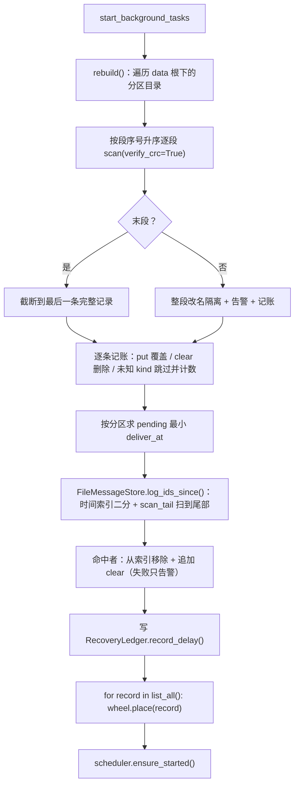
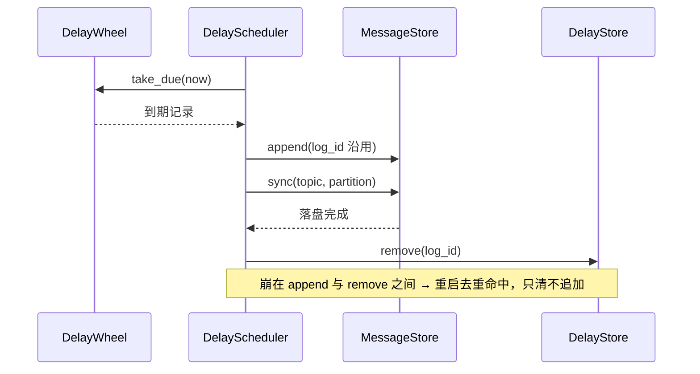

# 延迟消息持久化与到期恢复详细设计

> `.delay` 独立序号段 × 记录头延迟子结构 × tombstone 段回收 × 启动全量重建与 `log_id` 时间锚点去重 × 损坏隔离进恢复台账

[文档首页](../../../../../../文档首页.md) › [消息平台规划](../../../../../../规划/01_规划_消息平台.md) › [阶段计划](../../../../计划/01_计划_消息平台.md) › [02-7 延迟消息持久化与到期恢复](../02_存储与复制_07_延迟消息持久化与到期恢复.md) › 详细设计

---

## 1. 概述 <a id="overview"></a>

### 1.1 目标

把 01-5 定义的延迟区从「进程内字典」换成**落盘实现**，使「某个时刻一定被投递」这条承诺在**重启与崩溃后仍然成立**：

1. **落盘**：延迟消息写该分区的 `.delay` 段（与 `.log` 同目录、同 `[length][crc][header_len][header][payload]` 框架），**不占 offset 空间**。
2. **重建**：启动时全量扫 `.delay`，未到期按**剩余时间**装填时间轮，已到期进待重试队列并受既有批量节流；重建完成后由启动钩子调 `ensure_started()`。
3. **不丢**：转投严格「append → 该分区日志段**显式 fsync** → 再清 `.delay`」——偏序与 fsync 档位解耦，`os` 档下同样成立；转投失败不删记录（`attempts + 1`，下一轮重试）。
4. **不重**：恢复期以 `.delay` 的 `log_id` 集合为查询集，按「`.delay` 最小 `deliver_at`」在 `.log` 时间索引上二分定位后扫到尾部，命中者只清不再 `append`；运行期由单进程串行转投 + 立即清保证。
5. **不静默丢**：段损坏按「末段截断 / 非末段整段隔离」处置并告警（段路径 + 有效条数 + 丢失字节），同时写进程级恢复台账，`/readyz` 的 `msg_recovery` 直接可见。
6. **容量可判**：沿用每租户软上限（`350015`）并补**全局软上限**；延迟区条数 / 段数 / 拒绝数 / 超期未投数均可查（指标出口归 06-3）。

### 1.2 边界与承接

| 项 | 本任务 | 归口 |
| --- | --- | --- |
| `.delay` 段落盘、重建、去重、损坏隔离、两级上限、指标采集点 | ✅ 交付 | 02-7 |
| 以文件实现替换 `InMemoryDelayStore`（端口签名不变） | ✅ 交付 | 02-7 |
| 延迟语义（固定档位、到期才分配 offset、不计积压 / 停等 / 位点） | ❌ 不改 | 01-5 |
| 改期 / 取消 / 延迟区运维入口（清空、导出） | ❌ 不做 | 06 域 |
| 指标暴露（Prometheus、标签治理、告警分级） | ❌ 不做（只做采集点） | 06-3 |
| 转投失败的**退避**策略（当前固定 1s 一轮） | ❌ 不做（只保证不丢 + 日志抑制） | 06 域 |
| 多副本重复转投的收敛（单写者 / fencing） | ❌ 不做（首期单副本） | 8B_05 |
| 后台清理与主题删除钩子（`.delay` 随目录清理） | ❌ 不做 | 06 域 |
| 字节级配额（延迟区占用字节） | ❌ 不做（只做条数） | 05-3 / 8B_12 |

### 1.3 口径来源

| 问题 | 定稿 | 出处 |
| --- | --- | --- |
| 落盘位置 | 与 `.log` 同分区目录、同记录框架、**不占 offset** | 任务 §2.1、需求 02-7 §1、架构 04 §2.4 |
| 去重判据 | `log_id`（发布即分配、转投沿用）；**不用 `message_id`** | 需求 02-7 §3、架构 04 §2.2 |
| 转投偏序 | 先 `append` 并刷盘、再清 `.delay` | 架构 04 §2.4 / §2.6 #2 |
| 启动重建 | 未到期按剩余时间装填、已到期立即转投（限速） | 架构 04 §2.6 #3、§5 步骤 6 |
| 损坏处置 | CRC 校验 → 隔离（改名 + 告警），不静默丢 | 架构 04 §2.6 #5 |
| TTL | 延迟区另设 TTL 兜底，只防极端积压 | 需求 01-5 §4、架构 04 §11 #6 |
| 段轮转默认值 | 8 MiB / 10 000 条 | 本设计 §4.5（回填架构 04 §11 #6） |
| 去重扫描范围 | `.log` 按 `.delay` 最小 `deliver_at` 时间锚点扫到尾部 | 本设计 §7.3（回填架构 04 §11 #7） |
| 容量拒绝码 | `350015`（租户 / 全局共用，`data.scope` 区分）；与 `350005` / `350022` 分立 | 任务 §2.8、2026-11-05 三码分立 |
| 转投不受生产限流 | 转投只受本任务追赶节流（批上限 + tick） | 任务 §2「03 域收口回写」 |

## 2. 现状与差距 <a id="gap"></a>

| 现状 | 差距 | 本任务处置 |
| --- | --- | --- |
| `InMemoryDelayStore` 是进程内字典 | 重启即清空 → 「某时刻一定投递」静默失效 | 新增 `FileDelayStore` 落盘实现，装配点不变 |
| `.delay` 文件只在架构图里 | 段格式、轮转、清扫、损坏隔离全无实现 | 新增 `DelaySegment`（追加 / 扫描 / 截断 / 取证） |
| `RecordHeader` 只有消息字段 | 延迟记录需要 `deliver_at` / `delay_level` / `attempts` / 展示名 | 增**可选** `delay` 子结构（`.log` 记录不写该键，版本不升） |
| 转投成功只 `await store.remove()` | 清记录早于日志落盘时，`os` 档崩溃即丢消息 | 转投改为 append → **显式 fsync 该分区** → 清；`DurationPoint` 注入 |
| 恢复期无 `log_id` 去重 | 崩溃窗口内已 append 未清 → 重启后重复追加 | 新增 `.log` 时间锚点扫描 + `log_id` 查询集 |
| `RecoverySummary` 只记 `.log` 截断与段损坏 | `.delay` 损坏无处可见 | 增 `delay_truncated_bytes` / `delay_isolated_segments` / `delay_lost_records` |
| 每租户软上限，无全局 | 多租户合计可打爆内存与磁盘 | `DELAY_QUOTA_GLOBAL` + 在 `enqueue()` 内判（端口不变） |
| 延迟区无指标 | 需求 02-7「容量与拒绝计数可查」无落点 | `DelayMetrics` 采集点 + `count_stale()` |
| 关闭无 `.delay` 刷盘 | 优雅关闭可能丢最近未刷的延迟记录 | `DelayCloser`（注册在 `OffsetFlusher` 之后、`StorageCloser` 之前） |

## 3. 交付物清单 <a id="deliverables"></a>

```text
backend/services/msg/src/bms_msg/
├── broker/delay_segment.py   # 新增：DELAY_SUFFIX / 枚举 / DelayScan / DelaySegment（追加 / 扫描 / 截断 / 隔离 / 清扫）
├── broker/delay_file.py      # 新增：FileDelayStore（索引 + 两级上限 + tombstone + 段回收 + rebuild + count_stale）
├── broker/delay.py           # 改：DelayMetrics / 全局上限常量接线 / 350015 data（scope·limit·count）
├── broker/record.py          # 改：DelayStamp + RecordHeader.delay（可选子结构，版本不升）
├── broker/scheduler.py      # 改：转投 append → durable.sync() → remove（新增可选 durable 参数）
├── broker/recovery.py        # 改：RecoverySummary 增三个延迟字段 + record_delay()（合并写）+ degraded 纳入
├── broker/file_store.py      # 改：log_ids_since()（时间锚点扫段头）与 sync()（分区 fsync + 恢复点）
├── broker/lifecycle.py       # 改：DelayCloser + start_background_tasks 内「重建 → 装填 → ensure_started」
├── health.py                 # 改：msg_recovery 描述纳入延迟区（判据仍读台账，不新增检查项）
├── core/config.py            # 改：DELAY_SUFFIX / 段阈值 / 全局上限 / TTL / attempts 节流 / 指标分键上限
├── main.py                   # 改：装配 FileDelayStore（替换 InMemory）+ 注册 DelayCloser + 注入 durable / metrics
└── api/deps.py               # 无需改（DelayStoreDep 不变；类型仍为端口）

backend/services/msg/tests/broker/
├── test_delay_segment.py     # 新增（Kiwi 2432）：D1~D5
├── test_delay_file_store.py  # 新增（Kiwi 2432）：D6~D12
├── test_delay_contract.py    # 新增（Kiwi 2432）：D13（memory / file 参数化）
├── test_delay_recovery.py    # 新增（Kiwi 2432）：D14~D18
└── test_lifecycle.py         # 改：D19~D20（重建先于 ensure_started / DelayCloser 位置 / 指标）
```

**零变更清单**：`DelayStore` 端口签名与四个方法的语义、`MessageStore` / `OffsetStore` 端口、01-2 ~ 01-7 的投递 / 顺序 / 延迟档位 / 保留 / 节流语义、02-1 的 `.log` 段格式与三种索引、02-2 的恢复点格式与扫描判据、02-3 的位点文件格式、02-6 的水位口径与两个检查项、数据库表结构、`Settings` 配置段、`deploy/registry/msg.toml`（**零新错误码**）、契约快照（端点 docstring 一字不改）。

## 4. 段与记录格式 <a id="segment"></a>

### 4.1 段落点与命名

```text
data/{tenant_id}/{namespace}/{topic}.{topic_id}/{partition}/
├── 00000000000000000000.log            # 消息追加（offset 空间）
├── 00000000000000000000.index          # 稀疏 offset 索引
├── 00000000000000000000.timeindex      # 时间索引
├── 00000000000000000000.delay          # 延迟段 0（**独立序号**，与 offset 无关）
├── 00000000000000000001.delay          # 延迟段 1（轮转后）
├── 00000000000000000000.delay.corrupt-20261105T101500123456   # 隔离副本（保留 8 份）
└── recovery-point.json                 # 分区恢复点（只覆盖 .log 段）
```

| 项 | 定稿 | 理由 |
| --- | --- | --- |
| 后缀 | `.delay` | 与 `.log` / `.index` / `.timeindex` / `.json` 互不重叠 |
| 文件名 | `{seq:020d}.delay`，`seq` 为**独立延迟段序号** | 20 位零填充使字典序 = 序号序，与 `.log` 的段枚举同构 |
| 序号空间 | 0 起、**只增不复用**（删空段不回收序号） | 复用序号会让「重建按序号判写入先后」失效（后写胜出的判据） |
| 是否占 offset | **不占** | 延迟区记录无 offset（01-5 口径）；用 offset 命名会造出一个没有记录占用的 base offset |
| 与保留期的关系 | 保留期只删 `.log/.index/.timeindex`，`.delay` 不参与 | `.delay` 生命周期由「转投 + tombstone + TTL 告警」管，不由保留期管 |

**互不误读的四条机器保证**（都在现有代码里，无需改动即可成立）：

1. `segment._SEGMENT_PATTERN = ^(\d{20})\.log$` → `list_segment_bases()` 不会把 `.delay` 当段；
2. `truncate_before()` 只 `delete()` 段对象持有的三个 `.log/.index/.timeindex` 文件；
3. 恢复点的 `segments` 清单由 `_segments`（`.log` 段对象）生成，不含 `.delay`；
4. `prune_corrupt_tails()` 的前缀是 `{base:020d}.log.corrupt-`，与 `.delay.corrupt-` 不冲突。

反向也成立：`list_delay_segment_seqs()` 只匹配 `^(\d{20})\.delay$`，不会把 `.delay.corrupt-*` 与 `.log` 当延迟段。

### 4.2 记录结构

复用 02-1 的框架与 CRC 口径，**不改一字节**：

```text
record = [length][crc][header_len][header][payload]
header = msgpack map（键名固定、只增不删）
  ├── format_version / topic_id / partition_no / tenant_id
  ├── message_id / log_id / key / trace_id / published_at
  ├── headers / content_type / compression / uncompressed_len
  └── delay: { kind, deliver_at, delay_level, attempts, namespace, topic }   # 仅延迟段写入
```

| 字段 | 类型 | 说明 |
| --- | --- | --- |
| `kind` | `"put"` / `"clear"` | `put` 为待投记录；`clear` 为 tombstone（转投成功后追加） |
| `deliver_at` | epoch 微秒 | 到期时刻（UTC 整数，与 `published_at` 同工具函数互转） |
| `delay_level` | 档位名 | 存名不存毫秒（档位表只增不删） |
| `attempts` | int | 转投失败次数（只计数与告警，不作丢弃依据） |
| `namespace` / `topic` | 展示名 | 主题停用 / 删除后仍能报出「哪条延迟消息没能投出去」 |

**四条格式纪律**：

1. **`.log` 记录不写 `delay` 键**：`_pack_header` 仅在 `header.delay is not None` 时写出该键 → 普通消息零体积开销，`.log` 与 `.delay` 共用同一解码器。
2. **版本不升**（保持 `RECORD_FORMAT_VERSION = 1`）：新增键属「只增不删」，旧解码器按 `.get()` 取缺省即可读新记录；升版本会让**旧二进制拒读新记录**（`UnsupportedRecordVersionError`），是不可回滚的动作。
3. **未知 `kind` 不判损坏**：重建时跳过该条并计数告警（`delay_unknown_kind`）——将来加 `kind` 时旧实现不会把整段隔离掉（段级隔离 = 丢一片记录）。跳过一条是安全的：该 `log_id` 保留上一次已知状态。
4. **`clear` 记录不带 payload**：`payload = b""`，`delay` 子结构里 `deliver_at = 0`、`delay_level = ""`、`attempts = 0`（tombstone 只需要 `log_id` 与 `kind`）。

### 4.3 `DelayStamp` 与 `RecordHeader`

| 项 | 定稿 |
| --- | --- |
| 数据契约 | `record.py` 新增 `DelayStamp(kind, deliver_at_us, delay_level, attempts, namespace, topic)` |
| 挂载点 | `RecordHeader.delay: DelayStamp \| None = None`（**带缺省的末位字段**，既有构造点零改动） |
| 编码 | `_pack_header`：`if header.delay is not None: raw["delay"] = {...}` |
| 解码 | `_unpack_header`：`data.get("delay")` 非 dict → `None`；是 dict → 逐字段取缺省（`kind="put"`、数字取 0、字符串取 `""`） |
| 版本 | 写入仍写 `format_version = 1`；读取仍按 `> RECORD_FORMAT_VERSION` 拒绝 |

### 4.4 `DelaySegment`

只做「一个不可变追加文件」需要的事，**不带索引**（延迟区重建靠全量扫，稀疏索引无收益）：

| 方法 | 行为 |
| --- | --- |
| `append(blob)` | `os.open(O_WRONLY\|O_CREAT\|O_APPEND\|O_BINARY)` 追加（短写循环补齐），返回段内字节偏移；`size_bytes` / `record_count` 内存累加 |
| `scan(verify_crc)` | 从 0 顺序扫到段尾，产出 `(position, header, payload)`；遇不完整 / CRC 不符即停，给出 `complete_bytes` 与 `corrupted_position` |
| `truncate(size)` | 关写句柄 → 截到 `complete_bytes`（末段崩溃恢复用） |
| `isolate(timestamp)` | 把整段改名 `{seq:020d}.delay.corrupt-{ts}`（非末段损坏用），返回新路径 |
| `prune_corrupts(limit)` | 按文件名（含时间戳）删最早的隔离副本，只留最近 `limit` 份（复用 `CORRUPT_TAIL_KEEP = 8`） |
| `fsync()` / `close()` / `delete()` | 与 `SegmentFile` 同名同义 |

**为什么必须带 `O_BINARY`**：Windows 上 `os.open` 默认文本模式会把 `0x0A` 译成 `0x0D 0x0A`——msgpack 头里极易撞上 `0x0A`，落盘后长度对不上（02-1 已踩过，见 02-1 实施记录 §5.1）。

### 4.5 轮转默认值（回填架构 04 §11 #6）

| 常量 | 缺省 | 说明 |
| --- | --- | --- |
| `DELAY_SEGMENT_MAX_BYTES` | 8 MiB | 比 `.log` 的 64 MiB 小一个量级：延迟区写入稀疏，段小才便于「空段即回收」 |
| `DELAY_SEGMENT_MAX_RECORDS` | 10 000 条 | 条数上限兜住「小记录写满大段」的实际形态（400 字节/条时 8 MiB ≈ 20 000 条，条数先到） |

轮转在 `append` 前判定（与 02-1 同法）：满足任一阈值即关闭当前段、以 `max_seq + 1` 开新段，并顺带删除「有效条目为 0 的非活动段」。

## 5. 写入路径 <a id="write"></a>

### 5.1 端口实现（签名不变）

| 端口方法 | 文件实现 |
| --- | --- |
| `enqueue(record)` | 先 `ensure_delay_span(record)`（10001）→ 判**全局**软上限 → 落盘（`put` 记录，或节流的 attempts 更新）→ 更新索引与计数 |
| `count_for_tenant(tenant_id)` | 租户计数器 O(1)（重建时算出，之后 enqueue / remove 增减） |
| `list_for_tenant(tenant_id)` | 租户索引过滤 + `(deliver_at, log_id)` 升序 |
| `list_all()` | 全量索引 `(deliver_at, log_id)` 升序（重建装填时间轮的入口） |
| `remove(log_id)` | 追加 `clear` tombstone + 索引删除 + 该段有效条目 −1（归零且非活动段即删段）；不存在即无操作 |

`quota` 属性保留（每租户软上限，发布侧据此判 `350015`）；新增 `global_quota` 属性与 `stale_count()` / `rebuild()` 等**非端口**方法（不新增端口方法，符合任务 §2.9）。

### 5.2 幂等覆盖：追加 + 后写胜出

同 `log_id` 再入队（含转投失败后的 `attempts + 1`）**追加一条新记录**，重建时按「段序号 + 段内位置」后者覆盖前者：

| 方案 | 结论 |
| --- | --- |
| 追加（采用） | CRC 覆盖整条记录的前提不破；崩溃最多留下一条坏记录由末段截断吸收 |
| 原地改写（否决） | 半写即整条作废（= 丢一条延迟消息），且改 `attempts` 必须重算 CRC（CRC 在框架里，与记录体分离） |

**写放大与其治理**：每次失败追加一条 → 由「`attempts` 落盘节流 + 段轮转 + 空段删除 + TTL 告警」四道闸限制，不在原地堵洞。

### 5.3 `attempts` 落盘节流

| 项 | 定稿 |
| --- | --- |
| 内存 | **每次** `enqueue` 都替换内存记录（日志 / 指标 / 视图立即准确） |
| 落盘 | 仅在满足任一条件时追加：距上次落盘 ≥ `DELAY_ATTEMPT_FLUSH_MS`（缺省 **30 000ms**）或 `attempts - 上次落盘值 ≥ DELAY_ATTEMPT_FLUSH_ATTEMPTS`（缺省 **10**） |
| 关闭 | `aclose()` 对「待写」条目补写一次（优雅关闭不丢计数） |
| 崩溃 | 可能少记若干次 `attempts`（只影响告警阈值判据，不影响投递与不丢） |
| 依据 | 与 02-3 位点「内存为准 + 后台刷 + 关闭强刷」同一口径；阈值只在「仅 `attempts` 变化」时生效，`deliver_at` / 档位变化一律立即落盘 |

### 5.4 两级软上限

| 级 | 常量 | 判定位置 | 拒绝 |
| --- | --- | --- | --- |
| 每租户 | `DELAY_QUOTA_PER_TENANT = 100 000`（既有） | `DelayService.publish`（计数 O(1)） | `350015`，`data.scope = "tenant"` |
| 全局 | `DELAY_QUOTA_GLOBAL = 500 000`（新增） | **实现侧 `enqueue()`**（`len(索引) >= 上限` 且是**新** `log_id`） | `350015`，`data.scope = "global"` |

**为什么全局判定在存储层**：端口不新增方法（任务 §2.9）就只能在 `enqueue` 内判；且新记录的判定与写入在同一原子步里，不会出现「判过之后被别的并发入队挤爆」。覆盖写（同 `log_id`）不增总量，因此不受全局上限约束。

```json
{
  "scope": "global",
  "limit": 500000,
  "count": 500000,
  "tenant_limit": 100000
}
```

`message` 按 scope 分写：

- `tenant`：`延迟区已满（每租户上限 100000 条），请稍后重试或缩短延迟：{topic}`
- `global`：`延迟区已满（全局上限 500000 条），请稍后重试或缩短延迟：{topic}`

### 5.5 刷盘

| 路径 | 策略 |
| --- | --- |
| 延迟发布写入 | 沿用 `MSG_FSYNC_MODE` 四档 + `FSYNC_BATCH_RECORDS` / `FSYNC_INTERVAL_MS`（与 `.log` 同一开关、同一语义，运维只记一个数） |
| tombstone 写入 | 同上（它是「可以安全丢」的写：丢了只是下次重建多扫一次、多一条命中） |
| **转投** | **与档位无关**：`append` → `durable.sync(topic_id, partition_no)` → `remove` |

**为什么转投必须显式 fsync**：偏序的语义是「日志已落盘」而不是「日志已调用 append」。`os` 档下 `append` 只进页缓存，此时清掉 `.delay` 后崩溃 → 既没有日志记录也没有延迟记录 = 丢消息；这与任务 §3「转投崩溃窗口内不丢消息」直接冲突。转投是兜底路径（每轮 ≤ `DELAY_BATCH_LIMIT` = 500 条），一次 fsync 的代价可接受。

## 6. 索引与驻留 <a id="index"></a>

### 6.1 内存结构

| 结构 | 内容 | 规模上界 |
| --- | --- | --- |
| `_entries: dict[str, _DelayEntry]` | `log_id` → 完整记录（含 payload）+ 所在段 + 上次落盘的 `attempts` / 时刻 | 全局软上限（50 万） |
| `_tenant_counts: dict[int, int]` | 租户 → 条数（`count_for_tenant` O(1)） | 租户数 |
| `_logs: dict[(topic_id, partition_no), _PartitionDelayLog]` | 分区 → 段列表 + 活动段 + 写锁 + 每段有效条目数 | 分区数 |

### 6.2 为什么全量驻留（payload 也在内存）

| 方案 | 结论 |
| --- | --- |
| 全量驻留（采用） | `list_all()` 忠于端口语义（返回**完整**记录）；时间轮与内存实现行为完全一致，契约用例可对两实现参数化；转投零读盘 |
| 索引驻留 + 转投读盘（否决） | 会让 `list_all()` 返回 payload 置空的记录（端口语义打折），且启动重建仍要读一次全量才能填索引——稳态省下的内存换来「两条读取路径 + 调度器新参数」 |

**边界与代价**：内存 ≈ 延迟区全部字节，由两级条数上限兜住；单条 payload 上限 1 MiB（帧契约），字节级配额与容量实测归 05-3 / 8B_12。**这是本任务明示的取舍**：落盘解决的是「重启不丢」，不是「内存占用」。

### 6.3 复杂度

| 操作 | 复杂度 | 说明 |
| --- | --- | --- |
| `enqueue` | O(1) + 一次追加 | 索引与计数增量维护 |
| `count_for_tenant` | O(1) | 计数器（内存实现是 O(n)，此处更优） |
| `list_for_tenant` / `list_all` | O(n log n) | 排序；租户视图按租户过滤后排序 |
| `remove` | O(1) + 一次 tombstone | 段有效计数 −1，必要时删段 |

## 7. 启动重建与去重 <a id="rebuild"></a>

### 7.1 流程



### 7.2 全量扫（不用尾部扫描）

`.delay` 段的写入顺序与到期顺序**无关**（长延迟记录先进，短延迟后进；tombstone 随时追加），因此「只扫末段」会丢掉其它段里全部未到期记录（直接丢消息）。全量扫的读量由全局软上限封顶，且**本来就要读 payload 装进时间轮**（§6.2），CRC 校验因此是顺手完成的。读量经 `RecoveryProbe` 上报，进恢复日志与实施记录。

### 7.3 `log_id` 去重（回填架构 04 §11 #7）

| 项 | 定稿 |
| --- | --- |
| 查询集 | 当前 `.delay` 的 `log_id` 集合（**有界**：≤ 延迟区条数），不是「整个日志的 `log_id` 集合」 |
| 下界 | 该分区 pending 记录的**最小 `deliver_at`**——转投时 `published_at` 取 `deliver_at`（01-5 定），故已转投记录在 `.log` 里的发布时间必然 ≥ 该值 |
| 定位 | 用 `.log` 时间索引（`timestamp_us` 升序）二分出第一个 ≥ 下界（减 1s 余量）的 `relative_offset`，再 `position_of()` 换字节位置作锚点 |
| 扫描 | `SegmentFile.scan_tail(verify_crc=False, anchor=...)`（02-2 原语，只读头），逐条判是否命中查询集 |
| 命中处置 | 从索引移除（**不再 append**）+ 追加 `clear`（让下次重建不必再扫一遍；写失败只告警，幂等可重做） |
| 不用 LRU | `FileMessageStore._log_ids` 重启后为空、且只覆盖已加载分区与最近 10 万条，作判据会漏判 → 重复投递 |



### 7.4 损坏处置

| 位置 | 处置 | 判据 |
| --- | --- | --- |
| 末段（最大序号） | **截断**到 `complete_bytes`（崩溃常态：最后一条写一半） | 截断字节数、坏记录后疑似完整条数进日志 |
| 非末段 | **整段隔离**：改名 `{seq:020d}.delay.corrupt-{ts}`，保留最近 8 份，其余段照常加载 | 告警带段路径 / 已扫出有效条数 / 丢失字节（段内剩余长度） |
| 为什么不能逐条跳过 | 记录变长，一条坏记录后无法可靠重同步；强行试探只会把垃圾当记录 | 与 02-2 对 `.log` 的处置同构 |

**台账**：三种事件都写同一张 `RecoveryLedger`（`RecoverySummary` 增三个默认值字段），`msg_recovery`（非必需项）判据不变——`degraded` 现在也包含延迟区有损，因此 `/readyz` 能看到 `msg_recovery: false`，但**不摘实例**（数据有损仍可读写，摘实例修不了）。

## 8. 转投偏序与关闭偏序 <a id="lifecycle"></a>

### 8.1 转投（含唤醒核对）

| 项 | 定稿 |
| --- | --- |
| 顺序 | `append` → `durable.sync()` → `store.remove()`；任一步失败进 `_defer`（记录保留、`attempts + 1`、下一轮重试） |
| durable 注入 | `DelayScheduler(..., durable: DurabilityPoint \| None = None)`；`FileMessageStore` 结构满足（`sync()`）；`None` = 内存实现 / 用例路径，跳过 fsync |
| 唤醒 | 转投写的是**最外层** `NotifyingMessageStore`（`app.state.message_store`），唤醒自动发生，延迟区实现不必另做通知 ✅ |
| 生产限流 | 转投直调 `append`，不经 03-5 的两级令牌桶，只受 `DELAY_BATCH_LIMIT` 与 tick 节流 ✅ |

### 8.2 重建接线

| 项 | 定稿 |
| --- | --- |
| 时机 | `start_background_tasks(app)` 内、`ensure_started()` **之前** `await rebuild()` + 装填 |
| 幂等 | 惰性 `ensure_started()` 保留（首个延迟发布仍会调）；重建只在启动钩子里做一次 |
| 内存实现 | 无 `rebuild()` 方法 → 启动钩子跳过「重建 + 装填」（用 `getattr` 探测，不引入第二个端口方法） |

### 8.3 关闭偏序

`ResourceManager` **逆序**释放，注册顺序决定实际顺序：

| 注册顺序 | 资源 | 释放时动作 | 释放次序 |
| --- | --- | --- | --- |
| ① `configure_service` | `OffsetFlusher` | 停位点刷盘循环 + 无条件刷位点 | ⑤（最后） |
| ② `configure_service` | **`DelayCloser`（新增）** | 补写待落盘 attempts + 刷 `.delay` 当前段 + 关句柄 | ④ |
| ③ `configure_service` | `StorageCloser` | 刷 `.log` + 写恢复点 + 关句柄 | ③ |
| ④ `startup_hooks` | `OffsetFlushLoop` | 停位点刷盘循环 | ② |
| ⑤ `startup_hooks` | `BackgroundLoops` | 停延迟推进器 + 停重放执行器 | ①（最先） |

**两条推导**（与 02-2 / 02-3 同源）：

1. **清 `.delay` 依赖日志已落盘** → `.delay` 刷盘必须晚于 `.log` 刷盘 → `DelayCloser` 注册在 `StorageCloser` **之前**。
2. **位点值必须 ≤ 已落盘 LEO** → 位点刷盘必须晚于日志刷盘；且「先刷日志 → 再刷延迟 → 最后刷位点」的次序不引入新的反向依赖（延迟区写入不影响 LEO），故 `OffsetFlusher` 仍是最早注册（最晚释放）。

## 9. 容量与 TTL <a id="capacity"></a>

| 项 | 定稿 | 理由 |
| --- | --- | --- |
| `DELAY_STUCK_TTL_MS` | 7 天（远大于延迟跨度上限一天） | 保证不会误判正常长延迟 |
| TTL 命中处置 | **只告警 + 计指标**（`msg_delay_stuck`、`delay_stuck` 日志带租户 / 主题 / 条数 / 最长超期），**不删、不提前投** | 架构 04 §2.6 #1「只能拒绝进、不能静默清」；删除 = 平台单方面撕毁承诺，提前投 = 违反「不早投」 |
| 计数方式 | `stale_count(now)`：O(n) 遍历内存索引，**只由采集出口与重建后调用**（不进每 tick 热路径） | 与「延迟区条数」同一数据源，天然一致 |
| 空间回收 | tombstone + 空段删除 + 段轮转 | 与 D39（不做 compaction）一致 |
| 运维手段 | 清理 / 扩容 / 主题恢复 → 归 06 域 | 本任务只提供判据 |

## 10. 装配与接线 <a id="assembly"></a>

| 落点 | 动作 | 注意 |
| --- | --- | --- |
| `main.py :: configure_service` | `delay_metrics = DelayMetrics()`；`delay_store = FileDelayStore(directory=..., metrics=..., dedupe=file_store, fsync 参数=...)`；`DelayScheduler(..., durable=file_store, failures 参数不变)` | `FileMessageStore` 必须在之前构造（去重源 + durable） |
| `main.py :: configure_service` | 注册顺序：`OffsetFlusher` → **`DelayCloser`** → `StorageCloser` | 直接决定 §8.3 的释放次序 |
| `main.py :: configure_plugins` | 不改（`msg_recovery` 判据仍读台账） | 不允许起第二个注册表 |
| `broker/lifecycle.py :: start_background_tasks` | 先 `await rebuild()`（有则做）→ `for record in await store.list_all(): wheel.place(record)` → `scheduler.ensure_started()` | 重建必须在 `ensure_started()` 之前，否则首轮扫到空轮 |
| `api/deps.py` | 不改 | `DelayStoreDep` 取的是端口，实现替换对端点透明 |
| `api/admin/delayed.py` | 不改 | 只读视图走 `DelayInspector`，无需感知实现 |

**不新增后台任务**：重建在启动钩子里跑一次、TTL 计数按需调用、指标纯内存。因此不新增关闭偏序上的第三类循环（`BackgroundLoops` 仍是唯一停循环处）。

## 11. 可观测 <a id="metrics"></a>

| 指标 | 类型 | 分键 | 写入时机 |
| --- | --- | --- | --- |
| `msg_delay_pending` | gauge（覆盖式） | `tenant`（有界，越界归 `__other__`）+ `__total__` | enqueue / remove |
| `msg_delay_segments` | gauge（覆盖式） | 无 | 轮转 / 删段 / 重建结束 |
| `msg_delay_rejected_total` | counter | `scope`（`tenant` / `global`） | 拒绝一次计一次 |
| `msg_delay_stuck` | gauge | 无 | `stale_count()` 由采集出口取数（06-3），重建结束记一条告警日志 |

- 采集器**纯内存、不抛异常**（`snapshot()` 只做拷贝），与 03-5 `BackpressureMetrics` / 02-6 `StorageMetrics` 同构。
- 分键上限 `DELAY_METRICS_KEY_LIMIT = 200`（租户数极难超过，越界归 `__other__`）。
- 损坏数不进指标：它已通过台账进 `msg_recovery`，同一条事实不定义两遍。

## 12. 测试设计 <a id="tests"></a>

用例号 **Kiwi 2432**（全文件共用）。文件分工：`test_delay_segment.py`（D1~D5）、`test_delay_file_store.py`（D6~D12）、`test_delay_contract.py`（D13）、`test_delay_recovery.py`（D14~D18）、`test_lifecycle.py` 增补（D19~D20）。

| # | 用例 | 判据 |
| --- | --- | --- |
| D1 | 段命名与枚举互不误读 | `list_segment_bases()` 不返回 `.delay`；`list_delay_segment_seqs()` 不返回 `.log` / `.delay.corrupt-*` |
| D2 | `DelayStamp` 往返 | `put` / `clear` 两形态逐字段回读；`.log` 记录不含 `delay` 键（编码后长度与旧口径一致） |
| D3 | 兼容性 | 未知键被忽略；未知 `kind` 跳过并计数，不隔离不抛错；版本高于实现仍拒绝 |
| D4 | 段追加与扫描 | 顺序扫出全部记录、位置与条数正确；`verify_crc=True` 遇到损坏停在 `complete_bytes` |
| D5 | 末段截断 / 非末段隔离 | 末段截到完整区间且写取证副本；非末段整段改名、其余段照常读出；副本保留 8 份 |
| D6 | 后写胜出 | 同 `log_id` 两次 enqueue（`attempts` 递变）→ `list_all()` 只有一条且为后者 |
| D7 | 两级上限 | 租户满 → `350015` 且 `data.scope="tenant"`；全局满 → `scope="global"`；`data` 四字段齐全 |
| D8 | 隔离与排序 | 跨分区互不影响；`list_for_tenant` / `list_all` 按 `(deliver_at, log_id)` 升序 |
| D9 | `remove` | 幂等（不存在无操作）；写 `clear` 记录；段有效条目归零后该段被删 |
| D10 | 轮转与序号 | 8 MiB / 10 000 条任一触发轮转；段序号只增；删空段不回收序号 |
| D11 | attempts 节流 | 窗口内不追加（段大小不变）、超窗口 / 跨阈值追加、`aclose()` 补写 |
| D12 | 端口义务 | 跨度超上限 → `ParamError(10001)`；边界值放行 |
| D13 | 契约参数化 | 同一组断言对 `InMemoryDelayStore` 与 `FileDelayStore` 全绿（四方法语义一致） |
| D14 | 重建装填 | 未到期按剩余时间落对应层；已到期进待重试队列（`take_due` 首轮即取出） |
| D15 | 去重 | 已转投未清的 `.delay` 记录：重建后从索引消失、`.log` 无第二条同 `log_id` |
| D16 | 重建损坏 | 末段截断 + 非末段隔离均写 `RecoveryLedger`，`msg_recovery` 判失败（非必需项，不产生 503） |
| D17 | 转投偏序 | `append` → `sync` → `remove` 调用序（`sync` 收到正确 `(topic_id, partition_no)`）；`append` 失败不 `remove` |
| D18 | 关闭偏序 | 资源注册顺序为 `OffsetFlusher → DelayCloser → StorageCloser`；`DelayCloser.aclose()` 补写并刷盘 |
| D19 | 装配 | `DelayStore` 端口签名未变（`inspect.signature` 断言四方法）；装配后 `app.state.delay_store` 为文件实现 |
| D20 | 指标与超期计数 | `snapshot()` 三项正确（分键 / `__total__` / 计数）；`stale_count()` 按 TTL 正确统计 |

补充断言：`test_delay_scheduler.py` 的既有用例需注入 `durable=替身`（否则 `None` 路径不覆盖 fsync 分支）；`tests/api` 中发布路径的契约断言不改（零漂移）。

## 13. 实施步骤 <a id="steps"></a>

1. `core/config.py`：段阈值、全局上限、TTL、attempts 节流、指标分键上限。
2. `broker/record.py`：`DelayStamp` + `RecordHeader.delay` + 编解码（可选键）。
3. `broker/delay_segment.py`：`DelaySegment`（追加 / 扫描 / 截断 / 隔离 / 清扫）。
4. `broker/delay_file.py`：`FileDelayStore`（索引 / 两级上限 / tombstone / 段回收 / `rebuild` / `stale_count` / `aclose`）。
5. `broker/recovery.py`：`RecoverySummary` 三字段 + `record_delay()`（合并写）+ `degraded` 纳入；`broker/file_store.py`：`log_ids_since()` / `sync()`。
6. `broker/delay.py`：`DelayMetrics` + `350015` 的 `data`；`broker/scheduler.py`：`durable` 注入与顺序调整。
7. `broker/lifecycle.py`：`DelayCloser` + 重建接线；`main.py`：装配与注册顺序；`health.py`：描述纳入延迟区。
8. 用例 D1~D20；`test_delay_scheduler.py` 适配 `durable`。
9. 门禁：变更模块行 + 分支 100%、`ruff check` / `ruff format --check` / `pyright` 全绿、契约快照 `check`。

## 14. 验收映射 <a id="accept-map"></a>

| 任务 §3 完成标准 | 用例 |
| --- | --- |
| 重启后未到期延迟消息按剩余时间投递（不提前、不丢） | D14 |
| 已到期未转投的启动后补投完成（限速） | D14（`take_due` 首轮取出）+ 调度器既有批量断言 |
| 转投崩溃窗口内不丢消息 | D17（顺序断言：fsync 之后才 `remove`） |
| 重启后同一 `log_id` 在日志中只出现一条（单副本） | D15 |
| `.delay` 段损坏可隔离并告警（段路径 + 损坏条数），其他分区不受影响 | D5 / D16 |
| 优雅关闭后重启无丢失 | D11 / D18 |
| 延迟区容量与拒绝计数可查 | D7 / D20 |
| `DelayStore` 契约用例全绿 | D13 |
| 变更模块行 + 分支 100%，静态全绿 | 门禁（§13 第 9 步） |

## 15. 风险与开放项 <a id="risk"></a>

| # | 项 | 处置 |
| --- | --- | --- |
| 1 | 全量驻留 = 内存 ≈ 延迟区字节 | 由两级条数上限兜住；字节口径配额归 05-3，容量实测归 8B_12；单条 payload ≤ 1 MiB |
| 2 | 启动期读全量 `.delay`（含 payload） | 读量经 `RecoveryProbe` 可见；受全局上限封顶；不接受「只扫末段」（会丢记录） |
| 3 | 去重依赖「已转投记录仍在保留期内」 | 崩溃窗口（append→clear）远小于保留期（≥1 天）；超保留期的极端场景退化为**重复投递**（不丢），写进边界 |
| 4 | 重建会提前加载「有未清延迟记录的分区」（02-2 原本懒加载） | 影响面受延迟区涉及分区数约束；换来的是重启后无需外部请求即可转投 |
| 5 | 段内中间损坏 = 该段剩余记录丢失 | 已是最细粒度（变长记录无法重同步）；告警给段路径与丢失字节，并进 `/readyz` 降级可见 |
| 6 | `attempts` 节流导致崩溃后计数回退 | 只影响告警阈值判据，不影响投递；优雅关闭补写 |
| 7 | 多副本重复转投 | 首期单副本；8B_05 用单写者 / fencing 收敛 |
| 8 | `DelayCloser` 与 `StorageCloser` 顺序写错会丢消息 | 用例 D18 直接断言注册顺序（不是靠注释）；实施记录登记推导 |
| 9 | 非法 `kind` / 未来新 `kind` | 跳过并计数，不隔离（段级隔离 = 丢一片） |

## 16. 决策确认与对齐记录 <a id="align"></a>

### 16.1 决策（2026-11-05 逐项确认）

| # | 事项 | 定稿 | 与我推荐 |
| --- | --- | --- | --- |
| 1 | `.delay` 段落点与命名 | 同分区目录 `{seq:020d}.delay`，独立延迟段序号（只增不复用） | 一致 |
| 2 | 记录格式 | 复用框架 + `RecordHeader` 可选 `delay` 子结构；`.log` 不写该键；版本不升 | 一致 |
| 3 | 段实现 | 新增 `DelaySegment`，不参数化 `SegmentFile` | 一致 |
| 4 | 刷盘 | `.delay` 复用四档；转投 append → 显式 fsync → 清（与档位无关） | 一致 |
| 5 | 幂等覆盖 | 追加写、后写胜出 | 一致 |
| 6 | 删除 | tombstone + 段内有效条目归零即删段 | 一致 |
| 7 | `attempts` 落盘 | 内存每次增、落盘节流（30s / 10 次）+ 关闭补写 | 一致 |
| 8 | 内存驻留 | 全量驻留（含 payload），容量归 8B_12 / 05-3 | 一致 |
| 9 | 重建扫描 | 全量扫 `.delay`，逐条校验 CRC | 一致 |
| 10 | 去重集合 | `.delay` 的 `log_id` 为查询集；`.log` 按最小 `deliver_at` 时间锚点扫到尾部 | 一致 |
| 11 | 损坏处置 | 末段截断 / 非末段整段隔离；进同一 `RecoveryLedger` | 一致 |
| 12 | 接线与偏序 | 启动钩子里重建（`ensure_started` 之前）；`OffsetFlusher → DelayCloser → StorageCloser` | 一致 |
| 13 | TTL 与轮转 | TTL 只告警不删不提前投；段 8 MiB / 10 000 条 | 一致 |
| 14 | 全局上限 | 500 000 条，判定在 `enqueue()` 内 | 一致 |
| 15 | 与 02-6 水位 | `.delay` 写盘不再单独判闸门；转投被拒保持 `_defer` | 一致 |
| 16 | 可观测 | 只做采集点；损坏走 `msg_recovery` | 一致 |
| 17 | 关闭恢复点 | 不写延迟区恢复点，重启全量扫 | 一致 |
| 18 | 契约 | 零新码零新端点；`350015` 补 `data.scope/limit/count/tenant_limit` | 一致 |

### 16.2 与既有设计的对齐

| 相邻任务 | 交接内容 | 本任务处置 |
| --- | --- | --- |
| 01-5 | 「延迟区与时间轮进程内 → 8B_02 落 `.delay` + 启动重建 + 按 `log_id` 去重」 | §4~§7 |
| 01-5 | 「恢复出的存量记录需 B 段自 `ensure_started()`」 | §8.2（启动钩子里先重建再启动） |
| 01-5 | 「配额计数全量扫描 → 8B_02 索引」 | §6.3（租户计数 O(1)） |
| 01-6 | `.delay` 不参与 `.log` 保留期 | §4.1（保留期只删三个日志文件） |
| 01-6 | 重放分配新 `log_id` → 去重不会误杀重放记录 | §7.3（判据是 `log_id` 而非 `message_id`） |
| 02-1 | 「`.delay` 落盘与 `log_id` 去重 → 02-7」 | §4 / §7.3 |
| 02-1 | `segment.py` 的 `.log` 段枚举与取证前缀 | §4.1（`.delay` 后缀与 `{seq}.delay.corrupt-` 均不冲突） |
| 02-2 | 「`.delay` 恢复期去重复用 `scan_tail` 的 `entries`」 | §7.3（`scan_tail(verify_crc=False, anchor=...)`） |
| 02-2 | 恢复台账 `RecoveryLedger` 与 `msg_recovery` 检查项 | §7.4（合并写三个延迟字段） |
| 02-3 | 关闭偏序：先刷日志、后刷位点 | §8.3（插入 `DelayCloser`，保持两条推导） |
| 02-6 | 闸门只管外部生产；转投由 `_defer` 兜 | §5.5 / §1.2（不在 `.delay` 写入上重复判闸门） |
| 02-6 | 构造签名变更：`DelayService(..., gate=None)`、`DelayScheduler(..., failure_log_window_ms, clock)` | §8.1（新增 `durable` 用关键字参数，不改位置参数） |
| 03 域 | 转投自动唤醒（最外层 `NotifyingMessageStore`）、转投不过限流桶、三码分立 | §8.1 / §9（均已满足，装配时核对） |
| 06-3 | 指标出口与阈值 | §11（只做采集点） |
| 8B_05 | 多副本重复转投 | §15 #7（单副本假设） |
