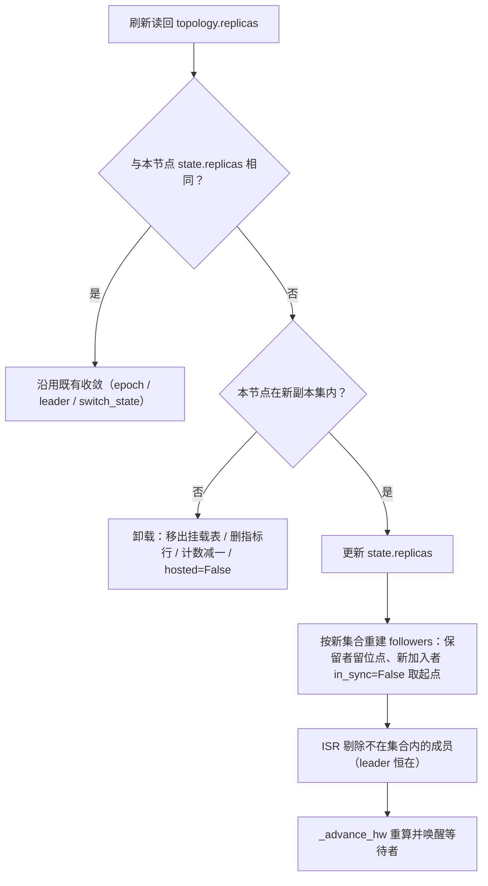

# 副本集变更收敛详细设计

> 刷新循环读回分配事实 × 成员增删收敛 × 卸载不删数据 × 扩缩容真机复跑

[文档首页](../../../../../../../文档首页.md) › [消息平台规划](../../../../../../../规划/01_规划_消息平台.md) › [阶段计划](../../../../../计划/01_计划_消息平台.md) › [02 存储与复制](../../../02_存储与复制.md) › [02-8 多实例部署与故障切换验收](../../02_存储与复制_08_多实例部署与故障切换验收.md) › [02-8-3 副本集变更收敛](../02_存储与复制_08_多实例部署与故障切换验收_03_副本集变更收敛.md) › 详细设计

---

## 1. 概述 <a id="overview"></a>

### 1.1 目标

让**运行态副本集跟随分配事实收敛**：`msg_partition.replicas` 变更后，各节点在刷新周期内更新 `state.replicas`，leader 重建 `followers` 与 ISR，被移出的节点卸载该分区并停止拉取。

1. **缩容**：被移出者停止拉取、卸载（移出挂载表 / 删指标行 / 已挂载数减一）；leader 侧剔除该成员并重算 HW。
2. **扩容**：leader 侧为新成员建进度（`in_sync=False`、位点取日志起点），追平后由既有扫描路径重入 ISR；新成员由 02-10 挂载循环接上。
3. **本节点被移出**：运行态标记非承载（`hosted=False`），不拉取、不进 ISR 推导。
4. **幂等**：先扩后缩两次变更各收敛一次，不出现中间态误卸；重复观察同一副本集不做任何动作。
5. **不删数据**：卸载只做运行态与指标清理，段 / 索引 / 偏移保留在盘上。
6. **单实例零变化**：复制关闭时刷新循环不启动，本路径不触达。

### 1.2 边界与承接

| 项 | 本任务 | 归口 |
| --- | --- | --- |
| 运行态副本集更新、`followers` / ISR 收敛、卸载与非承载标记 | ✅ 交付 | 02-8-3 |
| 刷新节拍、2s 超时与逐分区异常隔离、epoch / leader / 切换状态收敛 | ✅ 复用（零改动） | 02-5（已交付） |
| 分配落库、迁移台账 `expand → shrink`、`ops.rebalance` | ✅ 复用（零改动） | 02-8-1（已交付） |
| 挂载侧（分配事实驱动、`hosted` 守卫、已挂载数指标） | ✅ 复用（零改动） | 02-10（已交付） |
| 本地数据删除与磁盘回收 | ❌ 不做 | 后续清理任务（06-2 清理链路） |
| 按台账状态做「是否已收口」的二次确认 | ❌ 不做（幂等收敛足够） | — |
| 迁移预检（副本数 / leader 合法性） | ❌ 不改 | 02-8-1 |

### 1.3 口径来源与确认结果

| # | 事项 | 定稿 | 出处 |
| --- | --- | --- | --- |
| 1 | 归属 | **02-8 嵌套子任务 02-8-3**（需求仍为 02-8，不新增需求、不改需求总数） | 2026-11-13 确认 |
| 2 | 本地数据 | 卸载**保留**数据（分配误配 / 回切可恢复），磁盘回收另立 | 2026-11-13 确认 |
| 3 | 触发方式 | 仅拓扑刷新（复用 02-5 的 1s 刷新循环），不加迁移回调与节点广播 | 2026-11-13 确认 |
| 4 | 真机验证 | 做 `ops.rebalance` 缩容 → 扩容复跑 | 2026-11-13 确认 |
| 5 | 规模 | 单日窗口；02-8 行合计随之上调（详见阶段计划 §3） | 2026-11-13 确认 |
| 6 | 用例登记 | Kiwi 新增一条（平台自增，登记后回读核对） | 2026-11-13 确认 |

## 2. 现状与差距 <a id="gap"></a>

| 现状（代码事实） | 差距 | 本任务处置 |
| --- | --- | --- |
| `_observe_topology` 只收敛 `switch_state` / `epoch` / `leader`，**从不更新 `state.replicas`** | 分配变了运行态不变 | 比对副本集，变化即收敛 |
| `followers` 只在 `_build_state`（挂载）与 `_apply_leader_change`（升主）时按 `state.replicas` 重建 | 成员增删不会重建进度表 | 新增「成员变更收敛」：按新副本集重建 `followers` |
| 缩容后旧成员仍在 `followers` 与 ISR 中 | ISR 与 `msg_replication_mounted_partitions` 虚高；`acks=all` 的 `|ISR| ≥ min.insync` 可能被一个按库已不属于副本集的成员满足 | 剔除成员并 `_advance_hw` 重算 |
| 旧成员继续拉取、继续写入本地段 | 无效复制流量 + 多占磁盘 | 卸载该分区、停止拉取（数据保留） |
| 02-8 设计 §6.2 只写「leader 变更 → 重建 `followers`」，台账 `succeeded` 对缩容只要求「已从副本集移除」（DB 层） | 设计与验收口径都没有运行态收敛要求 | **回写设计 §6.2**，并把收敛纳入本子任务完成标准 |
| 重启后 `_build_state` 读库 | 缺口可自愈，但只在重启时 | 保留该行为作为兜底，不依赖重启 |

## 3. 交付物清单 <a id="deliverables"></a>

```text
backend/services/msg/src/bms_msg/
└── broker/replication.py         # 改：_observe_topology 比对副本集
                                  #     _apply_replica_change（本节点被移出 → 卸载；仍在 → 更新集合）
                                  #     _rebuild_followers（按新集合重建进度，保留仍存在者的位点）
                                  #     detach_partition（卸载：移出挂载表 / forget 指标 / 计数减一）
                                  #     ReplicationMetrics.unrecord_mount + mounted 计数自减
backend/services/msg/tests/
└── broker/test_replication_membership.py   # 新增：缩容 / 扩容 / 本节点被移出 / 脏 leader / 幂等 / 中间态
deploy/…                           # 零改动（无新键位、无新端点）
```

## 4. 收敛模型 <a id="model"></a>

### 4.1 触发与成员分类

刷新循环每 `epoch_refresh_ms`（缺省 1s）强制重载已挂载分区的拓扑，进入 `_observe_topology` 后先比对新旧副本集：



| 成员状态 | 动作 |
| --- | --- |
| 被移出（旧集合有、新集合无） | 从 `followers` 丢弃、从 ISR 剔除；若被移出的是本节点 → 卸载 |
| 新加入（新集合有、旧集合无） | 建进度 `leo=start` / `last_fetch_ms=now` / `in_sync=False`，不进 ISR，等拉取追平 |
| 仍在（交集） | 保留原进度（位点与新鲜度都不重置，避免把健康成员踢出 ISR） |
| 本节点被移出 | `hosted=False`、从 `_partitions` 移除、`metrics.forget`、`mounted_partitions` 减一；后续请求路径再挂载时会按 DB 重建为非承载态（02-10 守卫） |
| `leader` 不在新集合 | 保留现 leader + `msg_replication_leader_outside_replicas` 告警，不自动改主（交迁移预检） |

### 4.2 为什么只靠刷新、不做台账回调

迁移的两次写库（`expand` 加成员、`shrink` 减成员）本身就是分配事实的变更点；收敛以「当前 DB 副本集」为准，天然幂等——**中间态（已加未减）会被当作合法副本集短暂收敛一次**，减完再收敛一次，不需要读台账判断「迁移是否结束」。这样做的收益是零新增协议、零节点广播，且 `ops.rebalance` 之外的手工改库也会被收敛。

### 4.3 与 ISR / HW 的关系（判据零改动）

- 剔除成员后 `ISR` 只可能变小，`HW = min(leader LEO, ISR follower LEO)` 只可能不变或变大（成员减少不会拉低 min），因此 `_advance_hw` 的「只在推进时通知」语义不变。
- 新成员 `in_sync=False` 不入 ISR，`acks=all` 不会因为「新成员还没追上」而受阻（`min.insync.replicas` 仍按现有口径判）。
- 卸载本节点后其本地 `hw` / `leo` 不再参与任何判定；本节点仍是 leader 时不可能被移出（迁移预检要求先切主），若真发生按脏数据告警处理。

## 5. 失败与告警 <a id="failure"></a>

| 场景 | 处置 | 影响 |
| --- | --- | --- |
| 刷新读库失败 / 超时 | 既有处置（跳过本轮、下轮重试），不触发任何收敛 | 维持旧副本集，行为与现状一致 |
| 同一副本集重复观察 | 无动作（先比对再收敛） | 无 |
| 迁移中间态（先扩后缩） | 各收敛一次；新成员短暂进 `followers` 但 `in_sync=False` | 无数据影响 |
| 本节点被移出后仍收到写请求 | 非 leader → 既有 `350033`；若仍是 leader → 按脏数据告警 | 与现状一致 |
| `leader` 不在新集合 | 保留 + 告警，不改主 | 分配错误需人工修正 |
| 卸载时该分区正在拉取 | 由 `state.op_lock` 串行；卸载先置 `hosted=False` 并移出表，在飞的拉取完成后不再被调度 | 最多多一次空拉 |

## 6. 可观测 <a id="observability"></a>

| 事件 | 级别 | 字段 |
| --- | --- | --- |
| `msg_replication_membership_changed` | info | `topic_id` / `partition` / `from` / `to` / `role` / `isr_size` |
| `msg_replication_partition_detached` | info | `topic_id` / `partition` / `reason="not_in_replicas"` / `local_leo` |
| `msg_replication_leader_outside_replicas` | warning（60s 窗口抑制） | `topic_id` / `partition` / `leader` / `replicas` |

指标沿用：`msg_replication_mounted_partitions` 随卸载减少；`msg_isr_size` 行由 `metrics.forget` 删除（不再输出旧值，避免判据把已卸载分区算进去）。

## 7. 单实例零变化 <a id="single"></a>

复制关闭时 `refresh_once` 提前返回、`_observe_topology` 不可达；`detach` 仅在成员变更时调用。既有 02 / 03 域用例零改动。

## 8. 测试设计 <a id="tests"></a>

| 组 | 覆盖点 |
| --- | --- |
| G1 缩容 | 三节点 → 两节点：被移出节点 `mounted_partition_keys()` 少一项、`mounted_partitions` 减一、指标行删除；leader 的 `followers` / ISR 剔除该成员、ISR=2 |
| G2 扩容 | 两节点 → 三节点：leader 为新成员建进度 `in_sync=False`、ISR 暂不含；新成员拉取后 `scan_isr_once` 重入、ISR=3 |
| G3 本节点被移出 | 非承载态：`hosted=False`、`pull_once` / `pull_round` 返回 0、不再出现在探活集合（`mounted_partition_keys`） |
| G4 幂等与中间态 | 同一副本集重复刷新无动作；先扩后缩两次各收敛一次、ISR 轨迹 3→3→2 |
| G5 脏 leader | `leader` 不在新集合：保留 leader + 告警，`state.leader` 不变 |
| G6 交集成员保进度 | 仅新增成员时，原成员 `FollowerProgress`（位点 / `last_fetch_ms`）不被重置，ISR 不抖动 |
| G7 HW 重算 | 剔除落后成员后 HW 推进并唤醒等待者 |
| G8 单实例 | 复制关闭：`refresh_once` 不触达收敛路径 |
| 真机 | `ops.rebalance` 把演练主题某分区副本 3 → 2 再 2 → 3，断言被移除实例不再拉取（日志无该分区拉取）、ISR 回到 2 → 3、挂载数减一再加一 |

## 9. 门禁 <a id="gates"></a>

- 变更模块行 + 分支 100%（`bms_msg.broker.replication` 等）；
- 静态：`ruff check` / `ruff format --check` / `pyright`（`uv run --project backend pyright`）；
- 文档：`links` / `docs-scope` / `eol`；
- 回归：复制关闭路径与既有 02 域用例全绿；提交环改动行 100%。

## 10. 实施步骤 <a id="steps"></a>

| # | 步骤 | 产物 |
| --- | --- | --- |
| 1 | 副本集比对与成员分类 | `_observe_topology` + `_apply_replica_change` |
| 2 | 卸载路径 | `detach_partition` + `ReplicationMetrics.unrecord_mount` |
| 3 | `followers` 重建与 ISR 剔除、HW 重算 | `_rebuild_followers` |
| 4 | 告警与日志 | 三条事件 |
| 5 | Kiwi 登记 → 用例 G1~G8 | 用例文件 + `kiwi_id` |
| 6 | 真机 `ops.rebalance` 缩容 → 扩容 | 记录归档 |
| 7 | 门禁 → 两次提交 → 文档回写（含 02-8 设计 §6.2） | 门禁结果 + 记录 |

## 11. 验收映射 <a id="accept-map"></a>

| 完成标准（任务 §3） | 本设计落点 | 用例 |
| --- | --- | --- |
| 缩容后停止拉取并卸载、leader 侧剔除 | §4.1 | G1 / G3 |
| 扩容后新成员无写请求即挂载、追平重入 | §4.1 | G2 |
| 先扩后缩各收敛一次、不误卸 | §4.2 | G4 / G6 |
| 脏 leader 不改主且有告警 | §4.1 / §5 | G5 |
| 单实例零变化 | §7 | G8 |
| 真机缩容 → 扩容复跑有记录 | §8 | 真机 |
| 覆盖率与静态、文档校验通过 | §9 | 门禁 |

## 12. 风险与开放项 <a id="risk"></a>

| # | 项 | 处置 |
| --- | --- | --- |
| 1 | 卸载不删数据，磁盘不随缩容回收 | 有意的安全权衡；回收归后续清理任务（06-2 链路） |
| 2 | 收敛依赖刷新周期，最坏 1s 生效 | 与 epoch / leader 收敛同节拍，口径一致 |
| 3 | 手工改库造成的非法副本集（如 leader 被移出） | 只告警不改主，交迁移预检与人工 |
| 4 | 大量分区同时缩容时的收敛开销 | 逐分区一次比对，无额外查询（复用已加载拓扑） |

## 13. 对齐记录 <a id="align"></a>

| 文档 | 口径 | 本设计关系 |
| --- | --- | --- |
| 02-8 详细设计 §6.2 | 只写「leader 变更 → 重建 `followers`」 | **回写**：补「副本集变更 → 重建 `followers` / ISR 收敛 / 卸载」一行 |
| 02-8 详细设计 §7.1 | 缩容成功 = 已从副本集移除（DB 层） | 本任务补运行态口径：DB 移除后运行态须在刷新周期内收敛 |
| 02-10 详细设计 §4.3 | 挂载成员判定与 `hosted` 守卫 | 卸载复用同一份副本集解析，不另立算法 |
| 02-5 详细设计 §9 | 刷新循环 2s 超时 + 逐分区隔离 | 收敛挂在同一路径，不改节拍与失败处置 |
| 02-9 详细设计 §4.1 | 看护循环遍历 `mounted_partition_keys()` | 卸载后自动退出探活集合，02-9 零改动 |

---

> 依《[文档生成规范](../../../../../../../../bms文档/规范/文档生成规范.md)》编写 · 决策确认见 §1.3
