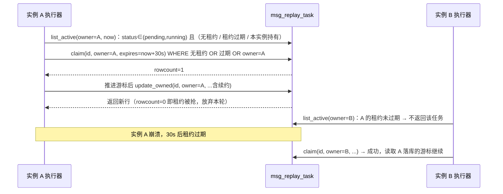

# 多实例一致性补齐详细设计

> 消息平台 · 02 存储与复制 · 02-8 多实例部署与故障切换验收 · 02-8-4 · 详细设计

[文档首页](../../../../../../../文档首页.md) › [消息平台规划](../../../../../../../规划/01_规划_消息平台.md) › [阶段计划](../../../../../计划/01_计划_消息平台.md) › [02 存储与复制](../../../02_存储与复制.md) › [02-8 多实例部署与故障切换验收](../../02_存储与复制_08_多实例部署与故障切换验收.md) › [02-8-4 多实例一致性补齐](../02_存储与复制_08_多实例部署与故障切换验收_04_多实例一致性补齐.md) › 详细设计

## 1. 概述 <a id="overview"></a>

- **目标**：把「已交付但只在单实例成立」的六处状态补成多实例可用——重放租约、死信索引、主题缓存、概览快照、入口速率、`log_id` 索引。
- **口径（2026-11-13 拍板）**：

| # | 子项 | 拍板口径 |
| --- | --- | --- |
| 1 | 重放租约 | **DB 租约列 + 续约**（`lease_owner` / `lease_expires_at`，CAS 抢占与续约） |
| 2 | 死信索引 | **DB 权威 + 本地 5s 缓存**（有界，正负结果都缓存） |
| 3 | 主题缓存 | **进程内 TTL 5s + 写操作主动失效** |
| 4 | 概览快照 | **每租户一行** |
| 5 | 入口速率 | **落 DB 计数**（租户 × 时间窗，增量累加） |
| 6 | `log_id` 索引 | **每分区独立索引文件**（哈希 + offset 定长条目） |

- **依据**：任务 [02-8-4](../02_存储与复制_08_多实例部署与故障切换验收_04_多实例一致性补齐.md)；质量盘点 盘点2 / 盘点3 / 盘点4 / 盘点5 / 盘点9。

## 2. 现状与差距 <a id="gap"></a>

| 项 | 现状（实测） | 差距 |
| --- | --- | --- |
| 重放执行器 | 每实例 `list_active` 直接推进同一张任务表，`update` 无持有者校验 | 同任务被多实例重复 `append`，进度互相覆盖；重启后 `running` 卡死 |
| 死信索引 | `DatabaseDeadLetterQueue` 启动全量载入 `_keys`，`contains` 只查内存 | 其他节点转入的死信本节点永远不知道，继续重投 |
| 主题缓存 | `TopicCache` 无 TTL，只在写操作本地失效 | 其他实例停用 / 删主题后仍按旧快照放行写入 |
| 概览 | `OverviewInspector` 只读进程内 `MetricsSnapshotStore` | 各实例数字不同；重启归零；入口速率只含本实例 |
| `log_id` | LRU（10 万）+ 扫已加载分区的段头 | 冷记录 / 重启后 / 未加载分区查不到 |

## 3. 交付物清单 <a id="deliver"></a>

| # | 交付物 | 落点 |
| --- | --- | --- |
| 1 | 租约两列 | `models/replay.py` |
| 2 | 租约仓储方法 | `repositories/replay.py`（`list_active` 加持有条件、`claim` / `update_owned`） |
| 3 | 执行器持有者 | `broker/replay.py`（`owner` / `lease_seconds` / 抢租约 / 续约 / 丢失即让出） |
| 4 | 死信 DB 权威 | `broker/deadletter.py`（`contains` 查库 + 5s 有界缓存） |
| 5 | 主题缓存 TTL | `broker/topic_cache.py`、`core/config.py` |
| 6 | 概览快照表 | `models/overview.py`、`repositories/overview.py`、`services/overview_snapshot.py` |
| 7 | 入口计数表 | 同上（`msg_ingress_counter`） |
| 8 | 采样器落库 | `metrics/sampler.py`（每租户快照 + 入口增量） |
| 9 | 概览读库 | `api/admin/overview.py`（DB 优先、进程内兜底） |
| 10 | `log_id` 索引 | `broker/file_store.py`（每分区 `log_id.idx`） |
| 11 | 登记 | `models/__init__.py`、`services/table_registry.py`、`tests/conftest.py` 建表清单 |
| 12 | 清理 | 入口计数按保留期自动清理（采样器每拍）；概览行随租户数覆盖写。租户清理不追加本轮改动（观测数据量级与租户数同阶，后续随 05-5 扩展） |

## 4. 重放租约 <a id="lease"></a>

### 4.1 数据模型

`msg_replay_task` 增两列（additive）：

| 列 | 类型 | 说明 |
| --- | --- | --- |
| `lease_owner` | `VARCHAR(128)`，可空 | 当前持有实例标识（`node_id`；单实例为 `local`） |
| `lease_expires_at` | `DATETIME`，可空 | 租约到期（UTC）；空或过期即可被抢占 |

索引：`idx_msg_replay_task_lease (status, lease_expires_at)`，供 `list_active` 过滤。

### 4.2 抢占与续约



- **租约时长 30s**（`REPLAY_LEASE_SECONDS`），每拍（缺省 1s）随进度更新续约，等价于「心跳即续约」。
- **CAS 语义**：`claim` 与 `update_owned` 都带 `WHERE lease_owner = :owner`（抢占时放宽到「无租约 / 已过期」）；`rowcount=0` 表示已易主，本实例立即丢弃令牌状态并跳过该任务。
- **终态释放**：进度更新同时把 `lease_owner` / `lease_expires_at` 置空，其他实例下一拍即可不再选中（终态本身已被 `status` 过滤）。
- **重启续跑**：实例重启后自身租约自然过期，下一拍重新抢到并从已落库游标继续——`pending` / `running` 均纳入，不新增恢复任务表。

### 4.3 失败分支

| 场景 | 语义 |
| --- | --- |
| 抢租约失败 | 跳过（其他实例在跑），不记错误 |
| 续约失败（被接管） | 丢弃本轮写入，`_forget` 令牌，下一拍重新判断 |
| DB 不可用 | `run_once` 单轮异常只记日志（既有语义），下一拍重试 |
| 终态更新冲突 | 让出，不覆盖他人终态 |

## 5. 死信索引 <a id="dlq"></a>

- **DB 权威**：`contains` 查 `msg_dead_letter` 的 `(topic_id, partition_no, msg_offset)` 唯一三元组（仓储已有 `exists_key`）。
- **本地短期缓存**：`ConcurrentStableDict[DeadLetterKey, tuple[bool, float]]`——结果 + 到期时刻（`monotonic` 秒）；TTL `DEAD_LETTER_CACHE_SECONDS = 5`。
  - 正负结果都缓存：投递主链路每条消息都会问一次，负缓存是必须的；
  - 有界：上限 `DEAD_LETTER_CACHE_LIMIT = 20_000`，超限先剔过期项，再按插入序淘汰最老；
  - `add` 成功后直接写入正缓存（本节点立即可见）；`purge_topics` 删除对应键。
- **启动预热取消全量载入**：`load()` 保留为显式预热入口（只填缓存，不改变正确性），生产启动不再依赖它。
- 代价：每条**未命中缓存**的消息一次主键类查询（唯一键索引），命中率由 5 秒窗口决定；相对「跨实例继续重投已死信消息」是必要成本。

## 6. 主题缓存 TTL <a id="topic-cache"></a>

- `TopicCache(ttl_ms=TOPIC_CACHE_TTL_MS)`，`get` 时判 `now - snapshot.loaded_at_ms >= ttl_ms` → 视为未命中并删除条目。
- **写操作主动失效不变**：本实例停用 / 删除 / 扩分区 / 改保留期仍立即 `invalidate`。
- **跨实例收敛**：其他实例最长 5 秒后重新查库，看到新状态。
- 负结果仍不缓存（避免「刚建的主题 5 秒内解析不到」）。

## 7. 概览快照与入口计数 <a id="overview"></a>

### 7.1 `msg_overview_snapshot`（每租户一行）

| 列 | 类型 | 说明 |
| --- | --- | --- |
| `tenant_id` | 雪花，唯一 | 租户主键（唯一键 `uq_msg_overview_snapshot_tenant`） |
| `messages_in_per_second` | `Float` | 入口速率（最近窗口换算） |
| `consumer_lag` | `BigInteger` | 当前积压（该租户所有主题所有组求和） |
| `dlq_total` | `BigInteger` | 死信存量（活跃状态） |
| `disk_used_ratio` | `Float` | 磁盘使用率（跨实例取采样节点观察到的最大值） |
| `sampled_at` | `DateTime` | 采样时刻（UTC；超过 3 个周期视为过期，概览回退进程内快照） |

- 写入：采样器每拍（15s）按租户覆盖写（先查后 insert/update，方言中立）。
- 读取：`/admin/overview` 先查当前租户行且未过期 → 用之；否则回退 `OverviewInspector`（单实例 / 冷启动 / 采样器未启用时行为与现状一致）。

### 7.2 `msg_ingress_counter`（租户 × 时间窗）

| 列 | 类型 | 说明 |
| --- | --- | --- |
| `tenant_id` | 雪花 | 租户主键 |
| `window_start` | `BigInteger` | 窗口起点（epoch 秒，按采样周期取整） |
| `count` | `BigInteger` | 该窗口累计入口条数（多实例增量累加） |

- 唯一键 `uq_msg_ingress_counter_window (tenant_id, window_start)`。
- **累加语义**：采样器把本实例本拍增量 `delta` 写入当前窗口（`count = count + delta`）；多实例各写各的增量，读侧求和天然不重复。
- **读取**：概览取最近 4 个窗口（1 分钟内）求和，除以「窗口跨度」（`latest_start - earliest_start + interval`，至少一个窗口），得到每秒速率。
- **清理**：采样器每拍删除 `window_start < now - 3600` 的行（幂等）。
- 为什么不是「每次发布一次 DB 写」：发布是热路径，15 秒批量合并已足以让概览在一个采样周期内收敛，且显著降低写放大。

## 8. `log_id` 持久化索引 <a id="log-index"></a>

### 8.1 文件形态

- 位置：分区目录下 `log_id.idx`（与 `.log` / `.index` / `.timeindex` 并列，段名正则不匹配，不会被当作段）。
- 条目：16 字节定长 `>QQ`——`hash64(log_id)` + `offset`。
  - 哈希只用于快速筛选，命中后**必须回读原记录比对完整 `log_id`**（防哈希碰撞）；
  - offset 用无符号 64 位（分区内序号足够）。
- 写入：`_PartitionLog.append` 成功写记录后追加一条（`O_APPEND | O_BINARY`）；失败只告警（索引可重建，不阻断写入）。
- 重建：索引文件缺失 / 损坏时，按段扫描一次性补齐（`rebuild_log_index()`），并在下次启动懒加载时触发。
- 清理：段被保留期删除后，索引条目指向的 offset 已不可读，`locate` 返回 `None`——不影响正确性，随分区删除 / 主题清理一起删文件。

### 8.2 查找顺序

```text
LRU 命中                     → 直接返回
已加载分区（内存索引 dict）    → 命中并校验 → 回填 LRU
磁盘上已绑定主题的分区索引文件 → 命中并校验 → 打开分区、回填 LRU
都没有                        → None
```

- 每个分区的索引在首次查找时整文件载入内存（`hash → offset`），后续查找 O(1)；追加时同步更新已载入的 dict。
- 磁盘扫描上限 `LOG_ID_INDEX_SCAN_LIMIT = 4096` 个分区，超出记 warning 并只查已加载分区（防单次排障拖垮进程）。

## 9. 配置项 <a id="config"></a>

| 常量 | 缺省 | 说明 |
| --- | --- | --- |
| `REPLAY_LEASE_SECONDS` | 30 | 重放任务租约时长 |
| `DEAD_LETTER_CACHE_SECONDS` | 5 | 死信判定本地缓存 TTL |
| `DEAD_LETTER_CACHE_LIMIT` | 20_000 | 死信缓存条数上限 |
| `TOPIC_CACHE_TTL_MS` | 5_000 | 主题快照 TTL |
| `OVERVIEW_SNAPSHOT_STALE_SECONDS` | 45 | 概览快照过期阈值（3 个采样周期） |
| `INGRESS_COUNTER_RETAIN_SECONDS` | 3_600 | 入口计数保留时长 |

## 10. 失败分支 <a id="fail"></a>

| 场景 | 语义 |
| --- | --- |
| 重放抢租约 / 续约冲突 | 让出，不覆盖他人进度 |
| 死信查库失败 | 上抛（投递路径按 500），不静默当「未死信」 |
| 主题缓存过期重查失败 | 上抛（既有解析路径语义） |
| 概览快照写失败 | warning，保留上一份（不把采样失败表现成 0） |
| 概览读库失败 | 回退进程内快照（降级但不 500） |
| `log_id` 索引追加失败 | warning；查找回退段扫描 |
| `log_id` 索引文件损坏 | 丢弃并重建，`warning` 记录 |

## 11. 测试设计 <a id="test"></a>

| # | 用例 | 断言 |
| --- | --- | --- |
| 1 | 租约抢占 | A 持租约时 B 的 `list_active` 不含该任务；过期后 B 可抢 |
| 2 | 续约 / 让出 | 持租约推进后续约时间前进；被抢后 `update_owned` 返回 None 且不写进度 |
| 3 | 重启续跑 | 新执行器实例（不同 owner）抢到过期任务并从游标继续 |
| 4 | 终态释放 | 完成 / 失败后 `lease_owner` 为空 |
| 5 | 死信跨实例 | A `add` 后 B（新队列实例）`contains` 为真；TTL 内重复查询不重复打库 |
| 6 | 死信负缓存 | 未死信查询缓存命中；`add` 后本节点立即为真 |
| 7 | 死信清理 | `purge_topics` 后 `contains` 为假 |
| 8 | 主题 TTL | 超过 TTL 后 `get` 返回 None；写操作失效立即生效 |
| 9 | 概览快照 | 采样器写入后读库得到同值；过期行回退进程内 |
| 10 | 入口计数 | 两个实例增量累加，速率按窗口换算；旧窗口被清理 |
| 11 | `log_id` 索引 | 重启（新 store 实例）后 `find_by_log_id` 命中；未加载分区也可定位 |
| 12 | 索引容错 | 索引文件缺失时重建；损坏条目不返回错误记录 |

## 12. 实施步骤 <a id="steps"></a>

1. 模型 / 仓储 / 登记（租约两列 + 两张新表）；
2. 重放租约（执行器 + 用例）；
3. 死信 DB 权威 + 缓存；
4. 主题缓存 TTL；
5. 概览快照 + 入口计数（采样器 + 端点 + 用例）；
6. `log_id` 分区索引（写入 / 查找 / 重建 + 用例）；
7. 契约重导、门禁、实施 / 测试记录、计划与数据库设计回写。

## 13. 边界与开放项 <a id="open"></a>

| # | 项 | 归口 |
| --- | --- | --- |
| 1 | 跨实例失效广播（比 TTL 更快） | 未来接入消息总线时评估 |
| 2 | 位点文件多实例共享（盘点6） | 存储层改造，另行立项 |
| 3 | inflight / 投递状态跨实例（盘点7） | 02-8 后续或 02-4 扩展 |
| 4 | RPC 幂等去重跨实例（盘点8） | 04 域 |
| 5 | 多实例并发 `create_all`（盘点10） | 部署层 / 迁移链 |
| 6 | `log_id` 索引内存占用 | 单分区百万级约 16 MB 上限，冷路径可按需不加载 |
