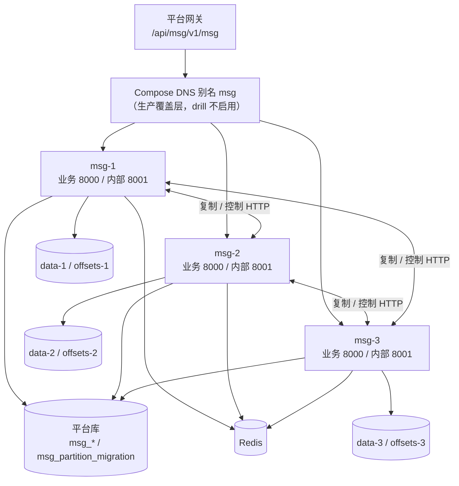
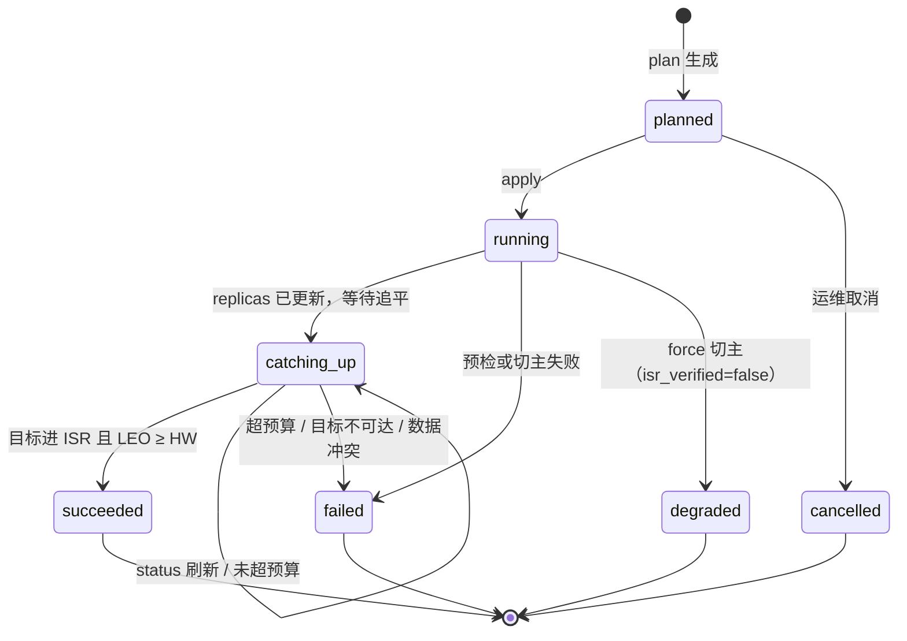
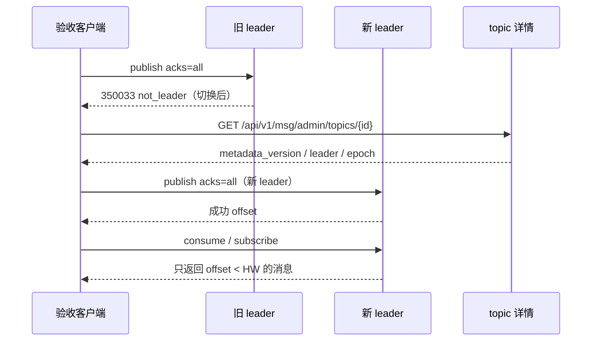

# 多实例部署与故障切换验收详细设计

> 多实例编排 × 真实网络复制 / 控制通道 × 分区分配与迁移 × 三类故障演练 × 客户端刷新

[文档首页](../../../../../../文档首页.md) › [消息平台规划](../../../../../../规划/01_规划_消息平台.md) › [阶段计划](../../../../计划/01_计划_消息平台.md) › [02 存储与复制](../../02_存储与复制.md) › [02-8](../02_存储与复制_08_多实例部署与故障切换验收.md) › 详细设计

---

## 1. 概述 <a id="overview"></a>

### 1.1 目标

把 02-4 的 ISR 复制与 02-5 的手动切主从「进程内机制」落成**多实例可部署、单节点故障可恢复、不丢已提交**的端到端验收：

1. **多实例拓扑**：三实例（按副本数 N 可调）真实容器编排，每实例独立数据卷与位点卷，节点标识与地址一一对应。
2. **真实网络复制与控制**：实现 `ReplicaTransport.fetch` 与 `LeaderControlTransport.snapshot / demote / apply_switch` 的网络版本，生产装配替换进程内实现；协调器与切换服务判定逻辑零改动。
3. **分区分配与迁移**：分配结果持久化到 `msg_partition.replicas`；新实例加入、旧实例下线有可核对的迁移动作、进度与结果台账。
4. **三类故障演练**：进程崩溃、网络分区、脑裂各至少一次真容器实跑；判据覆盖已提交不丢、ISR 收缩 / 重入、leader / epoch 推进、无双主写入、客户端可刷新。
5. **客户端刷新验收**：用真实 HTTP 客户端验证 `350033` → 读 `metadata_version` / `leader` / `epoch` → 改投新 leader；不实现 SDK（归 8B_03）。
6. **可观测与操作入口**：切主结果、迁移进度、传输错误有指标 / 日志 / 台账；提供 `ops.rebalance`、`ops.failover`、`ops.cluster_drill` 三个可重复执行的运维入口。
7. **单实例零变化**：复制关闭时行为与 8B_02 / 02-4 / 02-5 完全一致，单实例编排与 07-1 资产保留。

### 1.2 边界与承接 <a id="boundary"></a>

| 项 | 本任务 | 归口 |
| --- | --- | --- |
| 多实例编排、独立卷、8001 内部端口、节点地址映射 | ✅ 交付 | 02-8 |
| 网络 `ReplicaTransport` / `LeaderControlTransport` 实现 | ✅ 交付 | 02-8 |
| 分区分配持久化、`ops.rebalance`、迁移台账 | ✅ 交付 | 02-8 |
| 三类真容器故障演练与客户端刷新验收 | ✅ 交付 | 02-8 |
| 切主 / 迁移 / 传输错误指标 | ✅ 交付 | 02-8 |
| ISR / HW / 副本拉取 / 两阶段切主机制 | 依赖，不改语义 | 02-4 / 02-5（已交付） |
| 自动选举（心跳超时 + 多数派投票 + 稳定期） | ❌ 不做 | 后续任务 |
| 管理端点、二次确认、操作权限、前端页面 | ❌ 不做 | 06-2 后续 |
| 客户端 SDK 按 `metadata_version` / `epoch` 主动刷新 | ❌ 不做 | 8B_03 |
| 生产迁移、网关真实联调、真盘故障注入 | ❌ 不做 | 07-8 |
| 容量模型与性能基线 | ❌ 不做 | 8B_12（07-5） |
| 跨机房强一致、Raft 多数派 | ❌ 不做 | 架构 04 §7 |
| 备份与恢复（副本不是备份） | ❌ 不做 | 07 域 |
| 保留期已裁剪后的全量重同步 | ❌ 不做（拒绝迁移并登记遗留） | 后续任务 |

### 1.3 口径来源与确认结果 <a id="decisions"></a>

| # | 事项 | 定稿 | 出处 |
| --- | --- | --- | --- |
| 1 | 解搁置与范围 | 解搁置；02-8-1 + 02-8-2 一次推进，完整一条龙至推送 | 2026-11-12 确认 |
| 2 | 计划回写 | 解搁置、执行态与窗口按计划表回写（数值只在计划表） | 2026-11-12 确认 |
| 3 | 多实例编排 | `msg-1/2/3` 三个显式服务，每实例独立 data / offsets 卷，同平台网络，容器内 8000 不映射宿主 | 2026-11-12 确认 |
| 4 | 节点标识与地址 | `node_id=msg-N`，节点地址 `http://msg-N:8001`，网关 `msg:8000` 口径不变 | 2026-11-12 确认 |
| 5 | 单实例回退 | 同一 compose 用 profiles：默认 `msg` 单实例，`cluster` 起三实例；07-1 资产与用例零改 | 2026-11-12 确认 |
| 6 | 内部传输通道 | 独立内部端口 8001，仅平台网络，不注册网关；服务令牌鉴权 | 2026-11-12 确认 |
| 7 | 网络实现边界 | 保留进程内传输供单测；生产装配网络传输；两个协议与判定逻辑零改 | 2026-11-12 确认 |
| 8 | 分区分配 | 分配结果写 `msg_partition.replicas`；确定性算法、可核对；分区数只增不减 | 2026-11-12 确认 |
| 9 | 副本迁移 | 受控加入 / 下线、先扩后缩；新副本追平进 ISR；leader 起点 > 0 时拒绝迁移并登记遗留 | 2026-11-12 确认 |
| 10 | 重平衡入口 | 运维 CLI `python -m ops.rebalance plan\|apply\|status`；不新增管理 API | 2026-11-12 确认 |
| 11 | 迁移台账 | 新增 `msg_partition_migration` 表，记录计划 / 进度 / 结果，重启可查 | 2026-11-12 确认 |
| 12 | 三类场景 | 进程崩溃 / 网络分区 / 脑裂三类真容器实跑 | 2026-11-12 确认 |
| 13 | 演练环境 | 开发服务器真容器；独立 compose 项目 / 网络 / 卷 / 演练库前缀；演练后清理 | 2026-11-12 确认 |
| 14 | force 判据 | 只记「降级」，不计通过；须给 `isr_verified=false`、`retained_tail`、不可达证据与风险说明 | 2026-11-12 确认 |
| 15 | 客户端刷新 | 真实 HTTP 客户端脚本：350033 → 读 topic 详情 → 改投新 leader；不做 SDK | 2026-11-12 确认 |
| 16 | 相邻任务边界 | 复用 07-6 `deploy/drill/scenarios.toml` 判据单源，增补多实例场景；07-8 / 8B_12 边界不变 | 2026-11-12 确认 |
| 17 | 可观测 | 补 `msg_leader_switch_total{result}` 与迁移 / 传输错误指标 | 2026-11-12 确认 |
| 18 | Kiwi | 02-8-1 / 02-8-2 各登记一条用例 | 2026-11-12 确认 |
| 19 | 全量 CI | 本任务不触发；msg 仓流水线接入另立任务并登记遗留 | 2026-11-12 确认 |
| 20 | switching 卡住 | 沿用「重试同 target」；补带审计的人工复位脚本与操作文档；不新增服务入口 | 2026-11-12 确认 |
| 21 | 演练执行器 | 07-6 场景单源扩 `target`；`ops.drill` 保留本地六类，新增 `ops.cluster_drill` 执行多实例场景 | 本设计派生 |

**本设计不写计划数值**：任务状态、窗口与数值只落[阶段计划](../../../../计划/01_计划_消息平台.md)。

## 2. 现状与差距 <a id="gap"></a>

| 现状 | 差距 | 本任务处置 |
| --- | --- | --- |
| 02-4 / 02-5 只有 `InProcessReplicaTransport` / `InProcessLeaderControlTransport` | 跨容器不可达；节点只是标识串，无地址 | 新增网络传输与节点地址映射；协议与判定逻辑复用 |
| 无内部复制端点 | follower 无法跨实例拉取；切换服务无法跨实例 probe / demote / apply | 新增 8001 内部端点与独立 ASGI 服务 |
| `msg_partition.replicas` 只读，副本集按 `topic_id / partition_no` 从配置节点推导 | 多节点配置变化时分配不可核对；无迁移入口 | 新增分配器并在建主题 / 增分区时持久化；新增 `ops.rebalance` |
| 无迁移台账与进度 | 迁移结果重启即丢，无法回答「迁到哪了」 | 新增 `msg_partition_migration` 表与 `status` 命令 |
| compose 只有单服务 `msg` | 无法三实例部署；卷与端口未按实例隔离 | 增加 `cluster` profile 与三实例服务；保留单实例默认 |
| 07-1 compose 只 `expose 8000` | 内部复制无专用端口 | 增加 8001（仅平台网络） |
| 切主结果只在审计 / 日志 / 结果列 | 演练与 07-9 无法机器判读 | 补 `msg_leader_switch_total` 与迁移 / 传输错误指标 |
| 07-6 六类场景全是本机隔离实例 | 无多实例选主 / 分区迁移 / 脑裂演练 | 场景单源扩 `target`，新增三类 docker 场景与执行器 |
| msg 仓无 `.gitlab-ci.yml`，`trigger.py` 未登记 msg | 无可触发的全量 CI | 本任务按推送环定向档收口；CI 接入登记遗留 |
| 07-1 单实例资产与用例只认 `services["msg"]` | 多实例服务不得破坏既有断言 | compose 用 profiles 保留 `msg`；新增服务面单独断言 |

## 3. 交付物清单 <a id="deliverables"></a>

### 3.1 代码与配置 <a id="code"></a>

```text
backend/services/msg/src/bms_msg/
├── api/internal/
│   ├── __init__.py                     # 新增：内部路由聚合
│   ├── app.py                          # 新增：内部 ASGI 应用（共享主应用 state）
│   ├── replication.py                  # 新增：fetch / snapshot / demote / apply-switch / healthz
│   └── schemas.py                      # 新增：内部请求 / 响应与协议版本
├── broker/
│   ├── network.py                      # 新增：HttpReplicaTransport / HttpLeaderControlTransport / 端点映射 / 错误映射
│   ├── internal_server.py              # 新增：8001 监听生命周期（启动 / 关闭 / 存活）
│   ├── replication.py                  # 改：snapshot 增 start_offset；导出分配算法入口
│   └── election.py                     # 改：切主结果指标注入（可选 sink）
├── services/
│   ├── partition_assignment.py         # 新增：确定性分配器（建主题 / 增分区 / 迁移共用）
│   ├── partition_migration.py          # 新增：迁移编排（预检 / 执行 / 等候 / 收口）
│   ├── migration_ledger.py             # 新增：台账仓储（CAS / 状态迁移 / 进度）
│   └── topic.py                        # 改：注入分配器，建主题 / 增分区写 replicas
├── repositories/topic.py               # 改：add_partitions 支持每分区 replicas
├── models/
│   ├── partition.py                    # 改：replicas 由 02-8 写入（语义说明）
│   ├── partition_migration.py          # 新增：迁移台账模型与状态常量
│   └── __init__.py                     # 改：模型模块清单
├── metrics/
│   ├── names.py                        # 改：新增指标名与帮助文本
│   ├── collector.py                    # 改：切主 / 迁移 / 传输错误指标出口
│   └── sampler.py                      # 改：台账状态与剩余条数采样
├── audit/trail.py                      # 改：msg:partition.rebalance 动作
├── health.py                           # 改：多实例时新增 msg_internal_replication 检查项
├── core/config.py                      # 改：内部端口 / 节点地址 / 超时 / 抓取上限常量
├── api/deps.py                         # 改：PartitionAssignerDep
└── main.py                             # 改：网络传输 / 内部服务 / 分配器 / 指标 / 审计装配

backend/ops/
├── cluster_runtime.py                  # 新增：CLI 共用的 Settings / 引擎 / 审计 / 控制传输装配
├── rebalance.py                        # 新增：plan / apply / status
├── failover.py                         # 新增：switch / status（仅运维入口，非管理 API）
└── cluster_drill/
    ├── __init__.py
    ├── __main__.py                     # 新增：plan / run / verify / cleanup
    ├── config.py                       # 新增：远程 Docker / 隧道 / 端口 / 预算 / 记录目录
    ├── remote.py                       # 新增：SSH 执行、镜像构建、compose 起停、隧道
    ├── inject.py                       # 新增：kill / stop / network disconnect / reconnect
    ├── probe.py                        # 新增：readyz / 指标 / 分区快照 / 消费读取
    ├── data.py                         # 新增：acks=all / acks=1 生产与完整性核对
    ├── client.py                       # 新增：350033 → 元数据刷新 → 改投
    ├── scenarios.py                    # 新增：三类多实例场景的判据组装
    └── report.py                       # 新增：复用 ops.drill 记录契约写 JSON / Markdown

backend/services/msg/tests/             # 新增 / 适配用例，见第 12 节

deploy/
├── compose/msg.yml                     # 改：cluster profile、msg-1..3、8001、每实例卷
├── compose/msg-cluster.gateway.yml     # 新增：生产网关别名 msg（drill 不启用）
├── compose/msg-drill.override.yml      # 新增：独立容器名 / 宿主回环端口 / 演练库前缀
├── compose/README.md                   # 改：单实例 / 集群 / 演练命令与排障
├── .env.example                        # 改：每实例卷目录、集群开关、内部端口键位
├── drill/scenarios.toml                # 改：target 字段 + 三类多实例场景
├── drill/README.md                     # 改：单源新增字段与执行器分工
├── drill/RELEASE_CHECKLIST.md          # 改：多实例场景与证据要求
└── drill/cluster.env.example           # 新增：远程 Docker / 隧道 / 演练库 / 记录目录模板
```

**零变更**：记录格式版本、消息记录头、`acks` 档位语义、既有 01 / 02 / 03 / 04 / 05 / 06 域端口与端点；复制关闭时不启动 8001、不产生 `350033`、行为与 8B_02 一致。

### 3.2 文档 <a id="docs"></a>

| 文档 | 动作 |
| --- | --- |
| `msg文档/设计/架构设计/04_架构设计_数据面_存储与复制.md` | 回填 §7：网络复制 / 控制通道、分配与迁移语义、多实例故障边界 |
| `msg文档/设计/架构设计/08_架构设计_部署与运维.md` | 回填 §1 / §2 / §7 / §10：三实例拓扑、独立卷、8001、单实例回退、扩缩容与迁移 |
| `msg文档/设计/架构设计/05_架构设计_接入面_协议与客户端.md` | 回填 §8.1：多实例寻址、`350033` 刷新、网关别名口径 |
| `msg文档/设计/数据库设计/数据表设计/msg_partition_migration.md` | 新增表文件 |
| `msg文档/设计/数据库设计/数据表设计/msg_partition.md` | 补 `replicas` 由 02-8 写入的语义说明（不改结构） |
| `msg文档/设计/数据库设计/01_数据库设计_总览.md` | 新增表登记与文档地图 |
| `本任务 设计/` | 本文件 |
| `本任务 实施/`、`测试/` | 实施记录、测试记录、三类演练记录 |
| `02-8 / 02-8-1 / 02-8-2 任务文档` | 交付结果与记录链接（实施完成后回写） |
| `msg文档/项目/08B_消息平台/计划/01_计划_消息平台.md` | 解搁置、状态、窗口、门禁 10、§6.1 遗留归口 |
| `deploy/compose/README.md`、`deploy/drill/README.md` | 运维命令与场景字段说明 |

### 3.3 测试与演练资产 <a id="test-assets"></a>

- 用例：第 12 节分组，新增文件 + 存量适配；
- 演练：`deploy/drill/scenarios.toml` 三类 docker 场景；`ops.cluster_drill` 记录 JSON / Markdown；
- Kiwi：02-8-1 / 02-8-2 各一条，登记后回填 `kiwi_id`。

## 4. 多实例部署模型 <a id="deploy"></a>

### 4.1 拓扑与编排 <a id="topology"></a>



| 项 | 单实例（默认） | 三实例（cluster profile） |
| --- | --- | --- |
| 服务 | `msg` | `msg-1` / `msg-2` / `msg-3` |
| 容器内端口 | `8000` | `8000` + `8001` |
| 宿主端口 | 无（`expose`） | 无（`expose`）；drill 覆盖层仅绑 `127.0.0.1` |
| 数据卷 | `MSG_DATA_HOST_DIR` / `MSG_OFFSETS_HOST_DIR` | `MSG_DATA_HOST_DIR_1..3` / `MSG_OFFSETS_HOST_DIR_1..3` |
| 节点标识 | `MSG_REPLICATION_NODE_ID=local`（复制关闭） | `MSG_REPLICATION_NODE_ID=msg-N` |
| 复制 | `MSG_REPLICATION_ENABLED=false` | `true`，`NODES=msg-1,msg-2,msg-3`，`FACTOR=3`，`MIN_INSYNC=2` |
| 网关 | 上游 `msg:8000` | 生产覆盖层给三实例加网络别名 `msg`，上游口径不变；drill 不启用别名 |
| 声明上报 | `BMS_REGISTRY__REGISTER_ON_STARTUP=true`（07-1 口径） | 默认 `false`（避免三实例重复登记）；生产由 07-8 决定 |

**为什么用三个显式服务而不是 `--scale`**：Compose 缩放后的副本没有稳定 DNS 名，无法把 `node_id` 与内部地址一一对应；网络复制要求「节点 → 可寻址地址」，显式服务是唯一不引入额外服务发现的形态。

**为什么网关别名放覆盖层**：drill 与平台生产集群共用平台网络时，三实例直接加别名 `msg` 会与既有 `msg` DNS 冲突；把别名放进 `msg-cluster.gateway.yml`，生产/网关场景启用，drill 只用 `msg-1..3` 直连。网关上游仍是 `msg:8000`，口径不变。

### 4.2 端口、卷与节点标识 <a id="ports"></a>

| 项 | 约定 |
| --- | --- |
| 业务端口 | 容器内 8000；镜像 `HEALTHCHECK` 仍打 `/readyz`；不映射宿主 |
| 内部端口 | 容器内 8001；仅 `expose`，不注册网关、不写产品路由；drill 覆盖层可绑 `127.0.0.1:<宿主端口>` 供本机隧道 |
| 数据卷 | 每实例独立 `data` / `offsets` 两个绑定卷；宿主目录变量 `:?` 必填；卷属主仍为镜像运行用户 |
| 节点标识 | `msg-1` / `msg-2` / `msg-3`；与 Compose 服务名、内部 DNS 名一致 |
| 节点地址 | `MSG_REPLICATION_NODE_ENDPOINTS=msg-1=http://msg-1:8001,...`；本节点可省略（本地快路径） |
| 容器名 | 生产 `msg-1..3`；drill 覆盖为 `msg-drill-1..3`，避免与生产同名 |
| 停机 | `stop_grace_period: 45s` 三实例同值；内部服务先停、后台循环再停 |

**卷隔离的验收**：三实例的 `data-1..3` / `offsets-1..3` 宿主目录互不相同；任一实例重建不触碰其他实例数据；`docker inspect` 的挂载来源可核对。

### 4.3 单实例回退 <a id="fallback"></a>

| 操作 | 命令 | 结果 |
| --- | --- | --- |
| 单实例（默认） | `docker compose -f compose/msg.yml up -d` | 只起 `msg`；复制关闭；07-1 行为不变 |
| 三实例 | `docker compose -f compose/msg.yml --profile cluster up -d msg-1 msg-2 msg-3` | 只起三实例；`msg` 不启动（显式列服务） |
| 回退单实例 | 先 `ops.rebalance` 收敛副本集 / 切主，再停三实例，最后 `up -d` 起 `msg` | 分配结果保留在 DB；单实例按 `replicas` 首元素或自身标识运行 |

**显式列服务的原因**：`--profile cluster` 会连带启动无 profile 的 `msg`；显式列 `msg-1..3` 可避免「四实例同时占别名」。

### 4.4 部署校验与兼容 <a id="deploy-check"></a>

- `test_compose_assets.py` 继续断言 `services["msg"]` 的端口 / 网络 / 双卷 / 停机 / 镜像契约；
- 新增断言：`cluster` profile 存在、三实例 `expose` 含 8000/8001、每实例卷变量互异、节点标识与地址键齐备、单实例默认不被 profile 排除；
- `ops.check_deployment` 继续校验声明七段、健康探针与编排不重复声明 healthcheck；新增 8001 不走网关的静态断言；
- `.env.example` 新增键位，`[rules.env_example].required_keys` 不新增必填项（复制默认关闭，缺省即合法）。

## 5. 网络复制与控制通道 <a id="network"></a>

### 5.1 内部端口与进程内边界 <a id="internal-port"></a>

| 项 | 约定 |
| --- | --- |
| 监听 | 独立 ASGI 应用 + hypercorn，`MSG_REPLICATION_INTERNAL_HOST:MSG_REPLICATION_INTERNAL_PORT` |
| 启用条件 | `MSG_REPLICATION_ENABLED=true` 且节点数 > 1 且端口 > 0；其余情况不监听 |
| 与主应用关系 | 共享 `app.state`（settings / 引擎 / 复制协调器 / 控制传输 / 健康注册表），不是主应用的第二个端口 |
| 关闭 | `ResourceManager` 释放：先停内部服务（不再接新拉取 / 控制），再停后台循环、刷日志 / 位点 |
| 健康 | 多实例时 `/readyz` 增 `msg_internal_replication`（必需）：服务任务存活且端口已绑；失败即摘流 |
| 失败语义 | 端口占用 / 绑定失败 / 多实例缺端点或服务令牌密钥 → **启动失败**，不静默退回单实例 |

**为什么单独 ASGI 应用**：内部面与业务面鉴权、路由、暴露面完全不同；独立应用可在 8001 上只挂内部路由，业务 8000 完全看不到 `/internal/*`。

### 5.2 内部端点契约 <a id="internal-api"></a>

| 方法 | 路径 | 请求 | 成功响应 | 失败 |
| --- | --- | --- | --- | --- |
| GET | `/internal/replication/healthz` | — | `{status, node_id, protocol_version}` | — |
| POST | `/internal/replication/fetch` | `ReplicaFetchRequest` JSON | `ReplicaFetchResult` JSON | 409 stale / 410 diverged / 503 unavailable |
| GET | `/internal/replication/partitions/{topic_id}/{partition_no}/snapshot` | — | `ReplicationSnapshot` JSON | 404 未挂载 |
| POST | `/internal/replication/partitions/{topic_id}/{partition_no}/demote` | `{to_leader, to_epoch}` | 204 | 404 / 503 |
| POST | `/internal/replication/partitions/{topic_id}/{partition_no}/apply-switch` | `SwitchApplyCommand` JSON | `SwitchApplyResult` JSON | 404 / 409 / 503 |

**响应版本**：所有数据 / 控制响应带 `protocol_version=1`；调用方遇到未知版本按 `ReplicaUnavailableError` 处理并记错误日志，不做「尽力解析」。

**错误体**：`HTTPException(status_code, detail={reason, ...})`，不新增产品错误码；`reason` 闭集：

| reason | 状态 | 触发 | 调用方处置 |
| --- | --- | --- | --- |
| `stale_epoch` | 409 | 请求 epoch 高于本节点 | 抛 `StaleLeaderError`；协调器停止本轮 |
| `diverged` | 410 | follower 位点早于日志起点 / 超过 leader LEO | 抛 `ReplicationDivergedError(leader_leo=...)` |
| `not_leader` | 503 | 本节点不是该分区 leader | 抛 `ReplicaUnavailableError`；下一轮重试 |
| `switching` | 503 | 分区切换窗口 | 暂停拉取，下一轮再试 |
| `unavailable` | 503 | 未挂载 / 传输内部错误 | 抛 `ReplicaUnavailableError` |
| `auth` | 401 / 403 | 缺令牌 / 非 `msg` 服务身份 | 记错误日志；不重试到其他节点 |

### 5.3 序列化与上限 <a id="serialization"></a>

| 项 | 约定 |
| --- | --- |
| 编码 | JSON；`payload` 用 base64（与 `/msg/publish` 既有口径一致）；`headers` 原样字典；`trace` 四字段；`published_at` UTC ISO8601 |
| 记录字段 | `StoredMessage` 全字段（`message_id` / `log_id` / `topic_id` / `partition_no` / `offset` / `key` / `payload` / `headers` / `trace` / `published_at` / `content_type` / `compression` / `uncompressed_len` / `epoch`） |
| 快照字段 | `ReplicationSnapshot` 全字段 + **新增 `start_offset: int = 0`**（迁移预检判断能否追平；additive，既有构造不破） |
| 抓取上限 | `MSG_REPLICATION_FETCH_BATCH` 条 + `MSG_REPLICATION_FETCH_MAX_BYTES`（缺省 8 MiB）；至少返回 1 条，单条超限记 warning 并照常返回 |
| 超时 | 连接 `MSG_REPLICATION_INTERNAL_CONNECT_TIMEOUT_MS`（缺省 500ms）；读 `MSG_REPLICATION_INTERNAL_TIMEOUT_MS`（缺省 2000ms）；控制命令用读超时 |
| 重试 | 传输层不重试；由协调器拉取循环 / 切换服务重试与退避负责，避免双重重试放大 |
| 连接池 | 每节点一个 keep-alive 连接池；上限 = 节点数 + 1；关闭时统一 `aclose` |

**为什么首期用 JSON 而不是 MessagePack**：内部面首期流量远低于数据面，JSON 可读、排错成本低；协议版本字段为后续切 MessagePack 留位，切换只改内部端点与客户端，不影响记录格式与业务契约。容量归 8B_12。

### 5.4 鉴权与安全 <a id="auth"></a>

- 入站：除 `healthz` 外全部依赖基座 `require_service("msg")`（`aud=service` 全校验 + 调用方服务标识白名单）；网关代发的用户 JWT 非 `msg` 服务身份，即使能到达 8001 也被拒；
- 出站：用基座服务令牌签发器签发短时 JWT（`service=msg`），按 80% TTL 缓存；密钥缺失时多实例启动即失败（fail-closed），不静默退化为无复制；
- 8001 不注册产品路由、不写网关声明、不映射公网；容器内仅平台网络可达；
- 容器内 TLS 仍按架构 08 §11 待定项，本期内部面明文，边界靠平台网络 + 服务令牌；
- 日志不打印令牌、密钥、消息正文；只记录节点标识、操作、状态码、耗时、reason。

### 5.5 启动、关闭与失败语义 <a id="lifecycle"></a>

| 阶段 | 动作 | 失败处理 |
| --- | --- | --- |
| 配置校验 | 多实例必须有端口、端点覆盖除自身外全部节点、业务端口 ≠ 内部端口、超时 / 上限为正 | `ConfigError` 拒启 |
| 装配 | 网络传输替换进程内；内部应用共享 state；注册控制传输到切换服务 | 异常向上抛，服务拒启 |
| 启动 | `startup_hooks` 最后启动内部服务；绑定成功后登记健康项 | 绑定失败 / 任务异常 → 启动失败 |
| 运行 | 内部服务任务存活；`/readyz` 检查通过 | 任务退出 → 健康失败 → 摘流；协调器拉取失败记指标与日志 |
| 关闭 | 先置内部服务停机事件并等待在途；再停后台循环；最后刷日志 / 位点 | 超时记 warning；不阻塞主停机 |

## 6. 分区分配 <a id="assignment"></a>

### 6.1 分配算法与持久化 <a id="algorithm"></a>

- 节点列表 `nodes` 为插入序；副本数 `count = min(replication_factor, len(nodes))`；
- 起始下标 `start = (topic_id * 31 + partition_no) % len(nodes)`，按 `nodes` 顺序取 `count` 个（与 02-4 现有推导一致，保证升级不改变既有分配）；
- leader：已有 `msg_partition.leader` 且仍在副本集内则保留；否则取副本集首个；
- 复制关闭：`replicas=[]`、`leader=node_id`，与 02-4 / 8B_02 单实例行为一致；
- 持久化时机：建主题、增分区、`ops.rebalance` 应用；三处共用同一 `PartitionAssigner`，禁止各写一套；
- 旧主题 `replicas=[]` 时仍由协调器按同一算法兜底，`ops.rebalance plan` 可一次性补齐。

**为什么保留现有轮转算法**：02-4 已按该算法推导并落运行态；换算法会让升级瞬间全部分区副本集变化，触发不必要的迁移。02-8 只把「推导结果」持久化，不改推导规则。

### 6.2 拓扑加载与缓存收敛 <a id="topology-cache"></a>

| 机制 | 口径 |
| --- | --- |
| 加载 | `DbReplicaTopologyLoader.load(force=)` 读 `msg_partition`；分配变更后无需手工清缓存 |
| 收敛 | 02-5 刷新循环对已挂载分区每 `MSG_REPLICATION_EPOCH_REFRESH_MS` 强制重载（缺省 1s） |
| 失效 | `ops.rebalance` 改分配后，运行实例 1s 内看到新副本集；未挂载分区在下一次挂载时读取 |
| 一致性 | 分配结果只认 DB；配置节点列表只用于「候选节点」与校验，不直接决定已持久化副本集 |
| 抗卡死（演练回写） | 单分区拉取套 2s 超时 + 逐分区异常隔离；断网期间刷新失败只记 `msg_replication_topology_failed`，循环不停摆，恢复后 1s 内自动续约。缺此保护时，断网恢复后 leader 租约永不续期，只能重启进程（真机实测 414s 未续约） |
| 角色收敛（演练回写） | 刷新发现 leader 变更时按副本集重建 `followers` 进度表并收敛 ISR（本节点除外），否则升主后原 leader 的拉取会被以「follower 不在副本集内」永久拒绝，`acks=all` 卡在 `350032` |
| 副本集变更收敛（02-8-3 回写，2026-11-13） | 刷新读回 `replicas` 与本节点运行态不同即收敛：被移出者从 `followers` 丢弃、从 ISR 剔除；本节点被移出则卸载该分区并停止拉取（数据保留）；新加入者建进度 `in_sync=False`、追平后由扫描重入；`leader` 不在新集合只告警不改主。**收敛以当前 DB 副本集为准、天然幂等**，不读迁移台账判断是否收口 |

## 7. 副本迁移 <a id="migration"></a>

### 7.1 迁移状态机 <a id="migration-state"></a>



**状态语义**：

| 状态 | 含义 | 后续动作 |
| --- | --- | --- |
| `planned` | 只生成动作，未改任何运行态 | `apply --plan-id` 或取消 |
| `running` | 正在切主 / 写 replicas | 等待本轮结束；进程中断后可 `--resume` |
| `catching_up` | 分配已生效，目标副本在追平 | `status` 刷新；写入不中断 |
| `succeeded` | 目标进 ISR 且达到 leader HW（扩容）/ 已从副本集移除（缩容；**运行态在刷新周期内自行收敛并卸载，02-8-3**） | 无 |
| `degraded` | force 切主或 `isr_verified=false` | 不计通过；人工复核后决定继续或回退 |
| `failed` | 预检 / 切主 / 写分配失败 | 读台账 `error`，修正后重新 plan |
| `cancelled` | 运维取消未执行项 | 无 |

### 7.2 `ops.rebalance` 命令 <a id="rebalance-cli"></a>

```text
python -m ops.rebalance plan   --nodes msg-1,msg-2,msg-3 --factor 3 --min-insync 2 [--topic-id N ...] [--json]
python -m ops.rebalance apply  --plan-id <id> --operator <人> --reason <原因> [--wait-ms 60000] [--allow-force] [--allow-degraded] [--resume]
python -m ops.rebalance status [--plan-id <id>] [--json]
```

| 子命令 | 行为 | 退出码 |
| --- | --- | --- |
| `plan` | 只读运行态：计算每个分区目标副本集 / leader，写 `planned` 台账；输出动作表 | 0 有动作或无动作；2 预检有阻断项 |
| `apply` | 串行执行 `planned` / 可续跑项；写 `running` → `catching_up` → `succeeded` | 0 全部成功 / noop；2 存在 `catching_up` 或 `degraded`；1 存在 `failed` |
| `status` | 读台账 + 通过控制通道取实时快照，刷新 `catching_up` 进度 | 0 |

**串行执行的理由**：逐分区迁移避免同一时刻大量 epoch 推进与 ISR 抖动；单分区失败不回滚其他分区，调用方按台账逐项重试。

**台账粒度**：一个计划内「一个分区一行」；替换类动作在同一行内按 `expand`（新副本追平）→ `shrink`（移除旧副本）两步执行，不拆成两行，避免唯一约束冲突与进度分裂。

### 7.3 预检与失败分支 <a id="preflight"></a>

| # | 预检项 | 失败语义 |
| --- | --- | --- |
| 1 | `factor` / `min_insync` 合法，`min_insync ≤ factor ≤ len(nodes)` | 参数错误，不生成计划 |
| 2 | 目标节点可达（控制通道 snapshot 非 None） | `target_unreachable`，阻断该分区 |
| 3 | leader snapshot 可取；`start_offset` 已知 | `leader_unreachable`，阻断 |
| 4 | 新副本本地 LEO < leader `start_offset` | `needs_full_resync`：拒绝迁移（保留期已裁剪，全量重同步不在本任务） |
| 5 | 新副本本地 LEO > leader LEO | `stale_data`：拒绝（避免覆盖更高位点） |
| 6 | 缩容后剩余副本数 ≥ `min_insync` 且 ≥ 1 | `insufficient_replicas`，阻断 |
| 7 | 缩容 / 替换需移走 leader 时，目标在剩余副本集内且 LEO ≥ 水位 | `no_leader_candidate`，阻断 |
| 8 | `switch_state=idle` 或同 target 的 `switching` 可续跑 | `switch_in_progress`，阻断不同 target |
| 9 | 同一分区无 `running` 台账（除非同 plan `--resume`） | `migration_in_progress`，阻断 |

**force 的处置**：默认 `force=False`；仅 `apply --allow-force` 显式开启。目标不在最后已知 ISR 时，切换结果 `isr_verified=false` → 台账 `degraded`，`apply` 退出码 2，**不计通过**；数据完整性硬判据仍须全过。

### 7.4 迁移台账 <a id="ledger"></a>

新增 `msg_partition_migration` 表（字段级事实源为表文件，本节只列评审要点）：

| 字段组 | 内容 |
| --- | --- |
| 身份 | `plan_id` / `topic_id` / `partition_no` / `attempt` |
| 动作 | `action`（`expand` / `shrink` / `replace` / `leader_move` / `noop`） |
| 副本集 | `from_replicas` / `to_replicas`（JSON） |
| leader | `from_leader` / `to_leader` |
| 结果 | `status` / `result`（`truncated` / `retained` / `noop`）/ `isr_verified` / `retained_tail` |
| 进度 | `progress_leo` / `progress_hw` / `remaining_records` |
| 留痕 | `operator` / `reason` / `error` / `started_at` / `finished_at` |
| 公共列 | 雪花 `id`、审计列、`version` |

索引：`(plan_id)`、`(topic_id, partition_no)`、`(status)`；不物理外键；不自动清理（保留策略归后续运维任务）。

### 7.5 迁移可观测 <a id="migration-observability"></a>

| 事件 | 级别 | 字段 |
| --- | --- | --- |
| `msg_partition_rebalance_planned` | info | `plan_id` / `topic_id` / `partition` / `action` / `from_replicas` / `to_replicas` |
| `msg_partition_rebalance_started` | info | 同上 + `operator` / `reason` |
| `msg_partition_rebalance_step` | info | `step`（`leader_switch` / `update_replicas`）/ `result` |
| `msg_partition_rebalance_caught_up` | info | `progress_leo` / `progress_hw` / `remaining_records` |
| `msg_partition_rebalance_failed` | error | `reason` / `detail` |
| `msg_partition_rebalance_finished` | info | `plan_id` / `succeeded` / `degraded` / `failed` |
| `msg_partition_migration_ledger` | warning（60s 抑制） | `status` / `count`（采样器汇总） |

审计：`msg:partition.rebalance`（敏感 / 强审计），字段 `plan_id` / `action` / `topic` / `partition` / `from_replicas` / `to_replicas` / `from_leader` / `to_leader` / `operator` / `reason` / `result`；begin 失败即拒绝执行，finished 失败只记错误日志、不回滚已生效分配。

## 8. 故障切换与客户端刷新验收 <a id="faults"></a>

### 8.1 三类场景与注入 <a id="scenarios"></a>

| 场景 | `target` | 注入 | 期望 |
| --- | --- | --- | --- |
| `replica_crash` | `docker` | SIGKILL / SIGTERM 两档终止 leader 容器，随后以同一数据根重启 | 切主成功；已提交不丢；旧 leader 重启降 follower 并重入 ISR |
| `network_partition_multi` | `docker` | 对 leader / follower 分别做整容器断网（`docker network disconnect`），再恢复 | 断网 leader 租约过期拒写；切主不双写；ISR 收缩后重入；客户端可刷新 |
| `split_brain_multi` | `docker` | 整容器隔离旧 leader（DB 与对端均不可达）但进程存活，另一侧切主并持续写 | 双主认知期间只有一侧可写；旧 leader 恢复后降 follower 并截断发散尾部 |

**场景单源扩展**：`deploy/drill/scenarios.toml` 增可选 `target`（缺省 `local`），新增 `container_kill` / `network_disconnect` / `split_brain` 三个注入方式；既有六类保持 `target=local`，`ops.drill` 的 plan / criteria / checklist 一并渲染九类，`run` 只执行本地类。

**为什么整容器断网就能演脑裂**：旧 leader 与 DB、对端同时失联，仍持本地租约并自认 leader；另一侧在 DB 侧完成切主。判据只看「是否出现双写」与「已提交是否丢失」，不依赖更细的 iptables 选择性阻断。

**演练如何触发切主**：自动选举不在本任务范围，三类场景统一用运维入口触发：

```text
python -m ops.failover switch --topic-id <id> --partition <no> --target <node> --operator system:drill --reason <场景> [--force]
python -m ops.failover switch --topic-id <id> --all-partitions --operator system:drill --reason <场景> [--force]
python -m ops.failover status --topic-id <id>
```

`ops.failover` 只做「调用 02-5 切换服务 + 打印结果」，不新增管理端点；`--force` 仅在显式允许时透传，结果按 §8.3 判降级。

### 8.2 判据与数据完整性 <a id="criteria"></a>

| 场景 | 判据键 | 级别 | 判定 |
| --- | --- | --- | --- |
| 共用 | `committed_not_lost` | hard | 故障前 `acks=all` 成功且 `offset < 故障前 HW` 的消息，切换后全部可消费 |
| 共用 | `no_double_write` | hard | 任意采样时刻最多一个节点 `writable=true`；旧 leader 超租约写返回 `350033` |
| 共用 | `client_refresh` | hard | 写旧 leader 得 `350033` → `metadata_version` 增大 → 改投新 leader 成功 |
| 共用 | `rto_within_budget` | degradable | 注入开始到恢复判据通过的时长在配置预算内；超预算记降级，不伪造通过 |
| `replica_crash` | `leader_switched` | hard | DB `leader` 变为目标，`epoch` 递增；切换结果字段可查 |
| `replica_crash` | `old_leader_fenced` | hard | 旧 leader 重启后为 follower；对旧 leader 写返回 `350033` 或由客户端改投 |
| `replica_crash` | `isr_shrink_rejoin` | hard | 故障期 ISR 收缩；重启后重新入 ISR |
| `network_partition_multi` | `leader_lease_expired` | hard | 断网 leader 在租约后写返回 `350033 lease_expired` |
| `network_partition_multi` | `follower_isr_shrink` | hard | 断网 follower 被踢出 ISR；恢复后重新入 ISR |
| `network_partition_multi` | `retained_tail_documented` | hard | 旧 leader 不可达时切换结果 `retained`，`retained_tail` 与风险可读；`isr_verified=true` |
| `split_brain_multi` | `stale_leader_rejected` | hard | 隔离侧超租约后不再接受写；恢复后降 follower |
| `split_brain_multi` | `rejoin_demotes` | hard | 旧 leader 重新加入后为 follower；本地 LEO > 新 leader 时截断发散尾部 |
| 三类 | `isr_verified` | degradable | `force` 或无法验证 ISR 时记 `degraded`；此项非 `ok` 时结论最多「降级通过」 |

**数据完整性取证**：

1. 故障前：建主题（3 分区 / `factor=3` / `min_insync=2`），用 `acks=all` 发布 N 条唯一消息，记录每条 ID / offset；读取 leader 分区快照，记录 `hw`、`leo`、`isr`。
2. 注入：按场景终止 / 断网；等待租约与切换窗口；`ops.failover switch` 指定目标（不指定时由服务自动选 ISR 内 LEO 最大）。
3. 恢复：重启 / 重连容器；等待 `/readyz` 与 ISR 重入。
4. 核对：从新 leader 消费全部 topic 分区，断言「已提交 ID 集合」是「消费集合」的子集；缺失仅允许出现在 `offset ≥ 故障前 HW` 的未提交尾部，并逐条记录。
5. `data_loss` 字段：只有出现 `offset < 故障前 HW` 的缺失才置 `true` 并判失败；未提交尾部缺失记 `retained_tail` / 说明，不置 `data_loss`。

**`acks=1` 对照**：并行跑一条 `acks=1` 生产流，记录成功 ID；切换后缺失的 `acks=1` 消息若在旧 HW 之前 → 失败；在 HW 之后 → 属未提交回退，写入记录与风险说明。`acks=all` 与 `acks=1` 的差异在记录中成对呈现。

### 8.3 force / 降级判定 <a id="force"></a>

| 情况 | 切换结果 | 场景结论 |
| --- | --- | --- |
| 旧 leader 可达，目标在 ISR，按真实 HW 截断 | `truncated` / `noop`，`isr_verified=true` | 可判通过 |
| 旧 leader 不可达，目标在最后已知 ISR 且新鲜 | `retained`，`isr_verified=true` | 可判通过（保留尾部记录风险） |
| 旧 leader 不可达，无法验证 ISR，显式 `force` | `retained`，`isr_verified=false` | **最多「降级通过」**，不计通过 |
| 旧 leader 不可达，无法验证 ISR，未 `force` | 拒绝切换 | 失败 / 阻断，人工处置 |

**纪律**：演练默认不用 `force`；若某场景只能用 `force` 才能推进，记录 `degraded` 并写明原因、`retained_tail`、数据完整性结论与后续动作，不得把「降级通过」写成「通过」。

### 8.4 客户端刷新流程 <a id="client-refresh"></a>



| 步骤 | 断言 |
| --- | --- |
| 写旧 leader | `350033`，`data.reason` ∈ `{not_leader, lease_expired, stale_epoch}`，`data.leader` / `data.epoch` 为新值 |
| 读元数据 | `metadata_version` 比切换前大；目标分区 `leader` / `epoch` 与 DB 一致 |
| 改投 | 写新 leader 成功；`acks=all` 等待 HW；`acks=1` 立即返回 |
| 消费 | 位点不越过 HW；切换后重连从已提交位点继续；重复只允许出现在未确认窗口 |
| 流式 | 长驻流在旧 leader 降级后结束或停更；客户端重连新 leader 并从已提交位点续读，不跳读越过 HW |

### 8.5 演练执行与隔离 <a id="drill-env"></a>

| 项 | 约定 |
| --- | --- |
| 执行位置 | 开发服务器 Docker；编排器在开发机运行，经 SSH 调 Docker、开本机端口隧道访问实例 |
| 源码同步 | `git archive` / rsync 到服务器临时工作区（bms + msg 平级），构建镜像后演练；不携带 `.env` / `.git` / 依赖目录 |
| 镜像 | 标签含 msg 提交短号；记录镜像 digest；演练后按标签清理 |
| 项目隔离 | 独立 compose 项目 `msg-drill`；容器名 `msg-drill-1..3`；独立数据卷；独立宿主机目录 |
| 数据隔离 | 演练库前缀 `msgdrill`；独立 Redis 逻辑库 / 键前缀；`BMS_REGISTRY__REGISTER_ON_STARTUP=false`，不写平台产品登记 |
| 网络 | 复用平台网络访问 DB / Redis；节点间用 `msg-1..3` DNS；**不启用 `msg` 网关别名**，避免与生产 DNS 冲突 |
| 端口 | 生产不映射宿主；drill 覆盖层仅把容器 8000 绑到服务器 `127.0.0.1` 的高位端口，供本机 SSH 隧道 |
| 环境守卫 | `--env prod` 硬拒绝；注入前必须 `--confirm <scenario>`；未识别环境拒绝执行 |
| 清理 | 停容器、删演练卷与临时工作区、清 `msgdrill_*` 库与 Redis 键、删演练镜像、关隧道；清理失败登记 `issues` |
| 清理实现（2026-11-12 回写） | `ops.cluster_drill cleanup` 一条命令：容器 / 卷 → `{前缀}_*` 库（`DROP DATABASE`）→ 演练 Redis 库 flush（一次性容器接同一网络）→ 自建网络 → 工作区与宿主数据目录 → `drill/msg:drill-*` 镜像；`--keep-data` 只保留库与 Redis。安全守卫：库前缀不得为空 / `msg`、Redis 指向 0 号库拒绝、宿主路径只删环境文件给出的绝对路径（拒绝系统目录）；工作区不存在时按已清理处理（幂等） |
| 冲突守卫 | 启动前检查平台网络是否已有 `msg-1..3` / `msg` 容器或 DNS；有则拒绝并提示维护窗口，不抢占生产 |

**实跑口径（2026-11-12 回写，已按此在开发服务器跑通三类）**：

| 项 | 落地口径 |
| --- | --- |
| 网络 | 三实例直接接入平台网络 `compose_default`（直连 DB / Redis）；`cleanup` 只删自建 `msg-drill-net`，共享网络禁删 |
| 断网重连 | 必须 `docker network connect --alias msg-N <网络> <容器>`；少了别名则 `MSG_REPLICATION_NODE_ENDPOINTS` 的 `msg-N` 解析失败、复制停摆 |
| 建表 | 首实例 `BMS_DATABASE__AUTO_CREATE=true`；`msg-2/3` 置 `false` 且 `depends_on: service_healthy`，规避并发 `create_all` 撞表 |
| 镜像 | 构建与 compose 共用 `drill/msg:drill-<commit>`；编排注入 `MSG_REGISTRY_IMAGE_PREFIX` / `MSG_TAG` |
| 端口 | 宿主回环端口统一 `MSG_CLUSTER_DRILL_PORT_N`；`restart: "no"` 防容器被自动拉起干扰注入 |
| 每轮重置 | 上一轮副本拉取态 / epoch 会残留，先 `docker restart` 三实例回到健康基线 |
| 每轮主题 | `drill.replica.probe.<场景>.<时间戳>`；不复用脏主题，也不要求人工清理 |
| 采集链 | `ops/cluster_drill/chain.py`：真实 HTTP 发布（`350033` 改投、`350032` 等待且轮次间留间隔）+ 预热 + 平台库直读分区状态 + 判据推导；分区状态不依赖管理面主题接口 |
| 容器内 CLI | `PATH=/opt/msg/backend/.venv/bin:$PATH BMS_APP__SERVICE=msg python -m ops.failover ...`；日志与 `--json` 同走 stdout，用 `last_json_object()` 取最后一个 JSON |
| 注入期探针 | 只写**被隔离实例**判「是否被拒」；集群级发布会因新 leader 可写而恒成功 |
| ISR 判据 | 按分区取各节点自报 ISR 的最大值再求和（降主节点旧指标行不再更新，直接求和会误判） |

**为什么不直接在生产集群上演练**：本任务只验收 8B_05 退出条件；生产真实链路、网关、真盘注入归 07-8。专用演练项目可随时清理，不污染平台数据。

**编排命令（开发机执行，凭据 / 主机只落不入库的演练环境文件）**：

```text
python -m ops.cluster_drill plan
python -m ops.cluster_drill run replica_crash --confirm replica_crash
python -m ops.cluster_drill run network_partition_multi --confirm network_partition_multi
python -m ops.cluster_drill run split_brain_multi --confirm split_brain_multi
python -m ops.cluster_drill verify --records <记录目录> [--records ...]
python -m ops.cluster_drill cleanup
```

退出码与 07-6 同口径：`0` 通过 / `1` 失败 / `2` 降级（含 `force` 或可降级项）。`run` 前必须有隔离环境与冲突守卫；`cleanup` 幂等，失败登记 `issues`。

### 8.6 记录与证据 <a id="records"></a>

- 复用 07-6 记录契约（`DrillReport` → JSON + Markdown），`target=docker`；
- `injection` 写注入方式、容器 / 网络、恢复动作；`commands` 写命令轨迹（不含令牌 / 正文）；`artifacts` 写 compose 配置摘要、容器日志摘要、指标快照、镜像 digest；
- `deviations` 逐条写：无生产网关、演练库前缀、共享平台网络、未做真盘注入等；
- `issues` / `leftovers` 写执行期问题与归口；
- 记录落 `本任务 测试/记录/`；原始大日志落 `tmp/`，记录只留大小 / sha256 / 尾部摘要；
- **证据矩阵必填项**：`environment.config_digest`（生效配置摘要，G2）与 `backup={mode: not_applicable, reason: <非空>}`（隔离环境，G7）；`verify` 缺任一项即判失败。

## 9. 可观测 <a id="observability"></a>

### 9.1 指标 <a id="metrics"></a>

| 指标 | 类型 | 标签 | 说明 |
| --- | --- | --- | --- |
| `msg_leader_switch_total` | counter | `result`（`truncated` / `retained` / `noop` / `degraded` / `failed`） | 切主结果；`degraded` 表示 `isr_verified=false` |
| `msg_partition_migration_tasks` | gauge | `status` | 台账各状态任务数（采样器读 DB） |
| `msg_partition_migration_remaining_records` | gauge | — | 所有 `catching_up` 任务剩余条数之和 |
| `msg_replication_transport_errors_total` | counter | `operation`（fetch / snapshot / demote / apply）/ `reason`（timeout / connect / http / auth / protocol） | 网络传输失败分类 |
| `msg_isr_size` / `msg_replication_lag_records` / `msg_isr_shrink_total` | 既有 | 沿用 02-4 | 不另立口径 |

**基数控制**：迁移指标不按 `partition` 打标签；传输错误不按节点打标签（节点明细走日志）。

### 9.2 管理与运维可查 <a id="admin"></a>

- 既有 `GET /api/v1/msg/admin/partitions` 的 `leader` / `epoch` / `hw` / `isr` / lag 继续可用；
- 迁移进度通过 `ops.rebalance status`、台账表、指标与日志四路可查；
- 本任务**不新增管理 API**：迁移列表 / 二次确认页面归 06-2 后续，避免扩管理面契约。

### 9.3 日志 <a id="logs"></a>

| 事件 | 级别 | 关键字段 |
| --- | --- | --- |
| `msg_internal_server_started` / `stopped` | info | `node_id` / `host` / `port` |
| `msg_internal_server_failed` | error | `reason` |
| `msg_replication_transport_error` | warning（同节点同操作 60s 抑制） | `operation` / `peer` / `reason` / `status` |
| `msg_partition_rebalance_*` | 见 §7.5 | — |
| `msg_cluster_drill_started` / `finished` | info | `scenario` / `target` / `conclusion` |
| `msg_cluster_drill_step` | info | `step` / `detail` |

## 10. 配置与部署资产 <a id="config"></a>

### 10.1 新增环境变量 <a id="env"></a>

| 键 | 缺省 | 说明 |
| --- | --- | --- |
| `MSG_REPLICATION_INTERNAL_PORT` | `0` | 内部端口；0 = 不启用（单实例 / 仅进程内） |
| `MSG_REPLICATION_INTERNAL_HOST` | `0.0.0.0` | 内部监听地址 |
| `MSG_REPLICATION_NODE_ENDPOINTS` | 空 | `node_id=http://host:port` 逗号分隔；多实例必填（可省略自身） |
| `MSG_REPLICATION_INTERNAL_TIMEOUT_MS` | `2000` | 内部读超时 |
| `MSG_REPLICATION_INTERNAL_CONNECT_TIMEOUT_MS` | `500` | 内部连接超时 |
| `MSG_REPLICATION_FETCH_MAX_BYTES` | `8388608` | 单次拉取响应软上限 |
| `MSG_DATA_HOST_DIR_1..3` / `MSG_OFFSETS_HOST_DIR_1..3` | 空 | 三实例卷目录（compose `:?` 必填，仅 cluster profile） |

### 10.2 校验规则 <a id="config-validate"></a>

| 条件 | 处理 |
| --- | --- |
| 多实例（`enabled && len(nodes) > 1`）但 `INTERNAL_PORT <= 0` | `ConfigError` |
| 多实例但 `NODE_ENDPOINTS` 未覆盖除自身外全部节点 | `ConfigError` |
| 端点非法（非 http/https、无 host、带 path/query、重复节点） | `ConfigError` |
| 内部端口等于业务端口 | `ConfigError` |
| 三个超时 / 上限非正 | `ConfigError` |
| 多实例但服务令牌密钥 / active kid 为空 | `ConfigError`（fail-closed，不静默无复制） |
| 单实例（未开启或单节点） | 忽略端点与端口；沿用 02-4 / 02-5 校验 |

### 10.3 部署资产 <a id="deploy-assets"></a>

- `deploy/compose/msg.yml`：新增 `x-cluster-env` 锚点、`msg-1..3` 服务（`profiles: ["cluster"]`）、每实例卷与 8001；
- `deploy/compose/msg-cluster.gateway.yml`：生产覆盖层，给三实例加 `platform` 网络别名 `msg`；
- `deploy/compose/msg-drill.override.yml`：容器名 `msg-drill-1..3`、宿主回环端口、演练库前缀、`REGISTER_ON_STARTUP=false`；
- `deploy/.env.example`：新增每实例卷键与集群开关占位；既有必填键不动；
- `deploy/drill/cluster.env.example`：远程主机 / 临时工作区 / 镜像标签 / 隧道端口 / 演练库前缀 / 预算 / 记录目录；
- `Dockerfile`：补 `EXPOSE 8001`（仅文档性；容器网络内端口本就可达）；
- `ops.check_deployment` 与 `test_compose_assets.py` 同步断言。

## 11. 数据库变更 <a id="database"></a>

### 11.1 新增表 <a id="new-table"></a>

新增 `msg_partition_migration`（平台库，归属 `msg`），字段级结构以实施阶段创建的表文件为准。评审要点：

| 项 | 约定 |
| --- | --- |
| 主键 / 公共列 | 继承 `BaseModel`（雪花 ID、审计列、软删除列、`version`）；业务上不使用软删除 |
| 唯一性 | `(plan_id, topic_id, partition_no)` 唯一，防重复计划项 |
| 索引 | `plan_id`、`(topic_id, partition_no)`、`status` |
| 外键 | 不建物理外键；`topic_id` 逻辑引用 `msg_topic.id` |
| 归档 | 不归档；不自动清理，保留策略归后续运维任务 |
| 建表 | 随 `msg:platform` 表集派生，启动期幂等建表；本阶段无迁移脚本 |

### 11.2 `msg_partition` 语义变更 <a id="partition-change"></a>

- 结构不变；`replicas` 从「02-4 只读 / 配置兜底」变为「02-8 分配结果写入」；
- `leader` 仍由 02-5 切主与 02-8 分配共同维护：分配只在新分区或 leader 不在副本集时改写，不覆盖正在切换的 leader；
- 表文件补语义说明与变更记录（不新增列）。

### 11.3 变更顺序 <a id="db-order"></a>

1. 表文件 `msg_partition_migration.md`；
2. 模型 `models/partition_migration.py` 与 `models/__init__.py` 模块清单；
3. 表归属清单 `backend/services/table_registry.py` 与《数据库设计总览》登记；
4. 建表落地（开发 / 测试库启动期自动建表；生产随 07-8）；
5. `msg_partition.md` 语义回写。

## 12. 测试设计 <a id="tests"></a>

### 12.1 用例分组 <a id="test-groups"></a>

| 组 | 文件 | 覆盖 |
| --- | --- | --- |
| T1 内部端点 | `tests/api/internal/test_replication_api.py` | 鉴权 401 / 403；fetch 200 / 409 / 410 / 503；snapshot 404；demote；apply；协议版本不匹配；请求字段校验 |
| T2 序列化 | 同上 | base64 payload、headers、trace 四字段、时间、空 key / 空 trace、单条超上限、批次截断 |
| T3 网络传输 | `tests/broker/test_replication_network.py` | 端点映射解析 / 校验；httpx mock：成功、超时、连接失败、409 / 410 / 503 / 401；自身节点本地快路径；错误映射 |
| T4 内部服务生命周期 | `tests/api/internal/test_internal_server.py` | 端口 / 地址校验；复制关闭不启动；启动 / 关闭 / 幂等；绑定失败拒启；健康项失败 |
| T5 分配算法 | `tests/services/test_partition_assignment.py` | 轮转确定性；factor / min_insync；复制关闭空副本集；leader 保留；旧主题兜底 |
| T6 建主题 / 增分区持久化 | `tests/services/test_topic_assignment.py`、`tests/api/test_admin_topics.py` | 建主题写 replicas；增分区只给新分区写；单实例零变化 |
| T7 台账 | `tests/services/test_migration_ledger.py` | 计划项唯一；状态迁移；CAS / 版本冲突；进度更新；重启可读 |
| T8 迁移编排 | `tests/services/test_partition_migration.py` | 预检九项；扩容追平；缩容先切主；替换先扩后缩；`catching_up` / 超预算；force 降级；部分失败 |
| T9 rebalance CLI | `tests/deploy/test_rebalance.py` | plan / apply / status；JSON 输出；退出码；`--resume`；`--allow-degraded`；审计 |
| T10 failover CLI | `tests/deploy/test_failover.py` | 单分区 / 主题批量；目标校验；force；结果输出；审计 |
| T11 切主指标 | `tests/broker/test_election_metrics.py` | 结果计数；失败计数；降级标签；采集器输出 |
| T12 迁移指标 | `tests/metrics/test_migration_metrics.py` | 台账状态计数；剩余条数；采样失败保留上轮 |
| T13 部署资产 | `tests/deploy/test_compose_assets.py`、`tests/deploy/test_cluster_compose.py` | 单实例不变；三实例服务 / 卷 / 端口 / 节点键；profiles；网关覆盖层；drill 覆盖层；env 模板 |
| T14 场景单源 | `tests/deploy/test_drill.py`、`test_drill_evidence.py`、`test_drill_runtime.py` | `target` 解析；三类新场景；六类 + 三类齐备；plan / criteria / checklist 渲染；`ops.drill run` 拒绝 docker 场景 |
| T15 集群演练单元 | `tests/deploy/test_cluster_drill.py` | 远程命令构造；隧道；三实例重启；DNS 别名与网络兜底接入；注入 / 恢复；发布改投与轮次间隔；`last_json_object`；ISR 按分区取最大；定向探针；数据核对；记录组装（配置摘要 / 备份证据）；生产拒绝；清理 |
| T16 客户端刷新 | `tests/deploy/test_cluster_client.py` | 350033 → 元数据 → 改投；acks=all / 1；位点不越 HW；流式重连 |
| T17 回归 | 既有 02-4 / 02-5 / 03 / 04 / 05 / 06 用例 | 复制关闭、单实例发布 / 消费 / 位点 / 管理面行为不变 |
| T18 复制缺陷回归 | `tests/broker/test_replication.py` | 升主按副本集重建 `followers`（原 leader 拉取不被拒）；刷新循环单分区超时被放弃、下一轮照常续约 |

### 12.2 覆盖率与门禁 <a id="coverage"></a>

**新增 / 变更模块行 + 分支 100%**（模块清单，实施时以实际 diff 为准）：

- `bms_msg.api.internal.app` / `replication` / `schemas`
- `bms_msg.broker.network` / `internal_server` / `replication` / `election`
- `bms_msg.services.partition_assignment` / `partition_migration` / `migration_ledger` / `topic`
- `bms_msg.repositories.topic`
- `bms_msg.models.partition_migration` / `partition`
- `bms_msg.metrics.names` / `collector` / `sampler`
- `bms_msg.audit.trail`
- `bms_msg.health`
- `bms_msg.core.config`
- `bms_msg.api.deps`
- `bms_msg.main`
- `ops.rebalance` / `ops.failover` / `ops.cluster_runtime` / `ops.cluster_drill.*`
- `ops.drill.model` / `env` / `engine`（仅 `target` 相关改动）

**门禁**：

- 静态：`ruff check` / `ruff format --check` / `pyright` 全绿；
- 文档：`engkit links` / `docs-scope` / `eol` 全绿；
- 契约：本任务不新增产品错误码与公开端点，`contract_snapshot check` 零漂移；若内部端点不进契约快照，须在测试中说明；
- 演练：三类场景记录可复跑，`ops.cluster_drill verify` 全过；`force` / `degraded` 项单列且不计通过；
- 全量 CI：本任务不触发，登记遗留。

### 12.3 Kiwi 登记 <a id="kiwi"></a>

| 用例 | 覆盖 | 自动化文件 |
| --- | --- | --- |
| 02-8-1 | 多实例部署 / 内部 8001 / 分区分配 / rebalance / 台账 | T1~T10、T13 |
| 02-8-2 | 三类真容器演练 / 客户端刷新 / 指标 | T11、T12、T14~T16 |

登记字段：分类「平台骨架」、Priority `P2`、状态 `CONFIRMED`、Tag「自动化」；`text` 写覆盖范围与自动化文件路径；登记后回读用例号并回填代码 `kiwi_id`。**不复用 / 不改派既有编号**。

## 13. 实施步骤 <a id="steps"></a>

| # | 步骤 | 产物 |
| --- | --- | --- |
| 1 | 表文件、模型、表归属、总览登记 | `msg_partition_migration.md` + 模型 + 清单 |
| 2 | 配置键与校验：内部端口 / 端点 / 超时 / 抓取上限 | `core/config.py` + 配置用例 |
| 3 | 内部应用：路由 / 序列化 / 鉴权 / 生命周期 / 健康项 | `api/internal/*` + `broker/internal_server.py` |
| 4 | 网络传输：`HttpReplicaTransport` / `HttpLeaderControlTransport` / 错误映射 / 装配 | `broker/network.py` + `main.py` |
| 5 | 分配器与持久化：建主题 / 增分区 / 拓扑加载 | `services/partition_assignment.py` + `topic.py` |
| 6 | 迁移台账与编排：仓储 / 状态机 / 预检 / 追平 | `services/partition_migration.py` + `migration_ledger.py` |
| 7 | 运维 CLI：`ops.rebalance` / `ops.failover` / 共用运行时 | `backend/ops/*.py` |
| 8 | 编排资产：profiles / 三实例 / 8001 / 每实例卷 / 覆盖层 / env | `deploy/compose/*` + `.env.example` |
| 9 | 场景单源与集群演练：`target` / 三类场景 / `ops.cluster_drill` / 客户端刷新 | `deploy/drill/*` + `ops/cluster_drill/*` |
| 10 | 指标与审计：切主 / 迁移 / 传输错误 / `msg:partition.rebalance` | `metrics/*` + `audit/trail.py` |
| 11 | Kiwi 登记 → 用例 → 覆盖率补口 | 用例文件 + 编号 |
| 12 | 门禁：单文件 pytest / ruff / pyright → 提交环 → 推送环（模块级） | 门禁结果 |
| 13 | 服务器演练：构建镜像 → 起三实例 → 三类场景 → 记录 → 清理 | 演练记录与证据 |
| 14 | 回写：架构 04 / 05 / 08、表文件、07-6 资产、计划、任务、遗留 | 文档一致 |

## 14. 验收映射 <a id="accept-map"></a>

| 完成标准（任务 §4 / 需求 §9） | 本设计落点 | 用例 / 证据 |
| --- | --- | --- |
| N 实例拓扑可部署、可回退单实例，端口与卷隔离正确 | §4 / §10 | T13；`docker inspect` 记录 |
| 分区分配与副本迁移结果可核对，迁移期间不丢已提交 | §6 / §7 | T5~T9；迁移台账与演练记录 |
| 客户端实例列表可配置，地址变更不改代码 | §5.1 / §10 | T3 / T13；端点配置用例 |
| ISR / HW / leader / 副本延迟 / 迁移进度可观测 | §7.5 / §9 | T11 / T12；指标与 `status` 输出 |
| 单节点故障后已提交消息不丢、消费可继续；未提交回退可说明 | §8.2 | T15 / T16；三类记录 |
| 网络分区不产生双主写入，恢复后 ISR 正常重入 | §8.1 / §8.2 | T15；`no_double_write` / `follower_isr_shrink` |
| 进程崩溃重启后不丢已确认、未确认可重投、分区不重排 | §8.2 | T15；`committed_not_lost` / `old_leader_fenced` |
| 客户端在切换期间可重连，位点不越过 HW，不产生重复副作用 | §8.4 | T16；`client_refresh` |
| 三类演练记录齐全，结论不默认通过 | §8.2 / §8.6 | 三类记录 + `verify`；`force` 不计通过 |
| 变更模块行 + 分支覆盖率达标，静态与文档校验通过 | §12.2 | 覆盖率报告 + 静态 / 文档门禁 |

## 15. 风险、开放项与遗留归口 <a id="risk"></a>

| # | 风险 / 开放项 | 处置 / 归口 |
| --- | --- | --- |
| 1 | 保留期已裁剪（leader `start_offset > 0`）时新副本无法追平 | 迁移预检拒绝并登记遗留；全量重同步另立任务 |
| 2 | 8001 内部面明文 HTTP | 仅平台网络 + 服务令牌；容器内 TLS 归架构 08 §11 / 07-8 |
| 3 | `force` 切换无法证明目标在 ISR | 默认禁用；显式 `--allow-force`，台账 `degraded`，演练不计通过 |
| 4 | `acks=1` 在切换窗口可能丢未提交尾部 | 演练成对记录 `acks=1` 缺失范围；已提交不丢为硬判据 |
| 5 | 三实例与生产集群共享平台网络时 DNS / 容器名冲突 | drill 用独立容器名与项目；启动前冲突守卫；必要时维护窗口 |
| 6 | 迁移进度依赖 CLI 轮询，进程退出后停在 `catching_up` | `status` 可随时刷新；台账持久化；不引入后台迁移 worker |
| 7 | `ops.rebalance` 并发执行 | 台账唯一约束 + `version` CAS + `running` 阻断；运维单入口 |
| 8 | 07-6 六类假设被 `target` 扩展打破 | 同步改场景单源、plan / criteria / checklist 与既有用例；`ops.drill` 只跑本地类 |
| 9 | 迁移指标 / 传输错误标签基数 | 只按 `status` / `operation` / `reason`；节点与分区明细走日志 / 台账 |
| 10 | msg 仓无 CI 流水线 | 本任务按推送环定向档 + 模块级覆盖率收口；CI 接入登记遗留 |
| 11 | 生产网关 / 真实链路 / 真盘注入未验 | 07-8；本任务只验 8B_05 退出条件 |
| 12 | `switching` 卡住没有服务级取消入口 | 沿用重试同 target；带审计的人工复位脚本 + 操作文档；取消 / 强制改目标归 06-2 后续 |
| 13 | 自动选举未实现，leader 故障需人工 / 演练触发 | 本任务用 `ops.failover` 触发；自动选举另立任务 |
| 14 | 客户端 SDK 未按 `metadata_version` 主动刷新 | 本任务用真实 HTTP 客户端验证服务端语义；SDK 归 8B_03 |
| 15 | 迁移台账无自动清理 | 保留策略归后续运维任务；本任务不扩范围 |
| 16 | 多实例同时启动并发 `create_all` 撞表 | 演练用「首实例建表 + 其余 `depends_on`」规避；产品级并发建表控制另立任务 |
| 17 | 副本需被写请求「碰一次」才建拉取态，空闲主题 ISR 停在 1 | 演练预热向每个实例各写一轮；拉取态初始化归 02-4 后续 |
| 18 | 管理面 `GET /api/v1/msg/admin/topics` 500（`MissingGreenlet`） | 演练判据改直读平台库；管理面读模型修复另立任务 |
| 19 | `ops.failover switch` 后旧 leader 可能未主动 demote | 依赖刷新循环收敛；主动 demote 归 02-5 后续 |
| 20 | 断网恢复后刷新循环卡死，leader 租约永不续期（真机 414s 未续约，只能重启） | **已修**：单分区刷新超时 + 逐分区隔离；回归 T18 |
| 21 | 降主节点残留 `msg_isr_size` 旧指标行，ISR 判据误判 | **已修**：判据按分区取各节点最大值；回归用例 `_isr_total_of` |

---

> 依《[文档生成规范](../../../../../../../bms文档/规范/文档生成规范.md)》编写 · 实施与测试记录见同级 `实施/`、`测试/`

