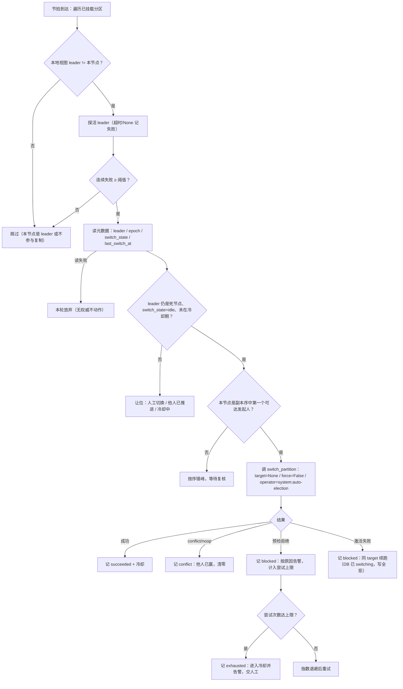
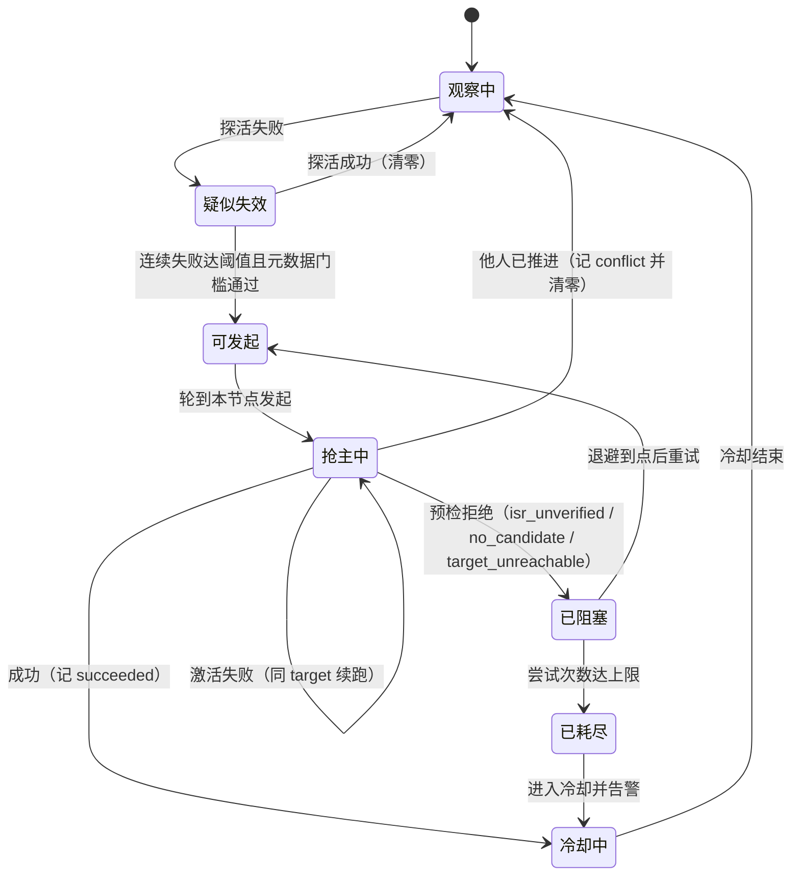

# 自动选举详细设计

> 控制通道探活 × epoch CAS 抢主 × 复用两阶段切主 × 退避与冷却 × 无人工恢复演练

[文档首页](../../../../../../文档首页.md) › [消息平台规划](../../../../../../规划/01_规划_消息平台.md) › [阶段计划](../../../../计划/01_计划_消息平台.md) › [02-9 自动选举与无人工切主恢复](../02_存储与复制_09_自动选举.md) › 详细设计

---

## 1. 概述 <a id="overview"></a>

### 1.1 目标

在 02-5 的「手动两阶段切主」与 02-8 的「多实例网络控制通道」之上，补**自动触发**这一缺环，消掉 02-8 遗留第 7 条（kill leader 后 DB `leader` 不变、写请求持续 `350033`、只能人工切）：

1. **判活**：进程内看护循环按节拍探活「DB 侧 leader」，连续失败到阈值才判失效；判据只看控制通道，不看数据库。
2. **抢主**：发起人调用 02-5 的 `LeaderSwitchService.switch_partition`，由 `msg_partition` 的 `epoch` 条件更新决出唯一赢家；**不新增切主实现、不新增数据表**。
3. **安全**：自动路径永不 `force`、不绕过 `switch_state` 互斥、不改租约与 fencing 语义；候选不可达时在条件更新**之前**失败。
4. **不失控**：尝试上限 + 指数退避 + 跨节点冷却 + 单轮并发上限 + 按副本序错峰；不做自动回切。
5. **可查**：结果计数、结构化日志、沿用审计动作（`operator=system:auto-election`）三处可追溯。
6. **单实例零变化**：独立开关缺省关闭，复制关闭时不装配、不启动。

### 1.2 边界与承接

| 项 | 本任务 | 归口 |
| --- | --- | --- |
| 判活、发起资格与错峰、退避与冷却、自动触发装配、结果计数 | ✅ 交付 | 02-9 |
| 两阶段切主、候选选择（ISR ∩ LEO 最大）、尾部截断 / 保留、审计、`msg_leader_switch_total` | ✅ 复用（零改动） | 02-5（已交付） |
| 内部控制通道 `/snapshot` / `demote` / `apply-switch`、多实例编排、演练框架 | ✅ 复用（零改动） | 02-8（已交付） |
| ISR / HW 口径、最后已知视图字段 | ✅ 复用（零改动） | 02-4（已交付） |
| 客户端 SDK 按 `metadata_version` 主动改投 | ❌ 不做（沿用 02-8 已验路径） | 8B_03 |
| 从未被写过的空闲分区的拉取态初始化 | ❌ 不做（只能 `blocked`） | 02-4 后续 |
| Raft 多数派、跨机房强一致、自动回切策略 | ❌ 不做 | 架构 04 §7 |
| 管理面「自动选举」开关与二次确认端点 | ❌ 不做（开关走配置） | 06-2 后续 |

### 1.3 口径来源与确认结果

| # | 事项 | 定稿 | 出处 |
| --- | --- | --- | --- |
| 1 | 任务归属 | 新父任务 **02-9**（需求顺延 02-9，归 8B_05）；02-5 保持已交付，仅作前置契约引用 | 2026-11-12 确认 |
| 2 | 故障判据 | 控制通道探活（`LeaderControlTransport.snapshot`），连续 3 次失败判失效；DB 抖动不参与判活 | 2026-11-12 确认 |
| 3 | 选择算法 | 发起人 ≠ 新 leader；新 leader 由 02-5 `_pick_target` 选「最后已知 ISR ∩ LEO 最大」 | 2026-11-12 确认 |
| 4 | 当选资格 | 只判「在最后已知 ISR 内 + 自身视图新鲜」；`min.insync.replicas` 不作为资格 | 2026-11-12 确认 |
| 5 | 抢主原子性 | 复用 `begin_switch` 的 `switch_state='idle' AND epoch=expected` 条件更新；数据库零变更 | 2026-11-12 确认 |
| 6 | 防脑裂与互斥 | 沿用租约 + `switching` + demote + 宽限 ≥ 租约；自动永不 `force`，人工切换优先 | 2026-11-12 确认 |
| 7 | 退避与风暴 | 阈值 3 / 尝试上限 5 / 冷却 60s / 并发 4 / 错峰 200ms（平衡档） | 2026-11-12 确认 |
| 8 | 可观测 | 新增 `msg_auto_election_total{result}`；切主结果复用 `msg_leader_switch_total`；审计沿用 | 2026-11-12 确认 |
| 9 | 开关与缺省 | `MSG_AUTO_ELECTION_ENABLED` 缺省关闭；节拍 / 阈值 / 上限 / 冷却 / 并发 / 错峰见 §11.1；配置不一致拒启 | 2026-11-12 确认 |
| 10 | 演练落点 | 改造 `replica_crash`（等自动切主，人工切主降为超预算兜底）；九类场景 schema 不变 | 2026-11-12 确认 |
| 11 | 任务边界 | 不修 02-4「拉取态初始化」；空闲分区记 `blocked` + 告警，遗留回 02-4 | 2026-11-12 确认 |

## 2. 现状与差距 <a id="gap"></a>

| 现状 | 差距 | 本任务处置 |
| --- | --- | --- |
| 02-5 `LeaderSwitchService` 已能完成两阶段切主、候选选择、截断 / 保留、审计与结果列 | 只能被人工 / 脚本调用，没有触发方 | 新增看护循环，只作触发方；服务本身零改动 |
| 02-5 刷新循环每 1s 重载拓扑，发现 `leader` 变化即切角色 | 只跟随 DB，不判「DB 里的 leader 是否活着」 | 判活独立于刷新循环：探活控制通道，判死后才发 DB 请求 |
| 02-8 内部控制通道已有 `/snapshot`（含 `last_known_isr` / `last_known_hw` / `last_known_at`） | 只被切换服务预检与演练脚本使用 | 复用为探活与「候选可达」判据，不新增端点 |
| `msg_partition` 有 `leader` / `epoch` / `switch_state` / `last_switch_at` / `last_switch_by` | 冷却需要「跨节点可见的最近一次切换时刻」 | 直接复用 `last_switch_at` / `last_switch_by`，不新增列 |
| `msg_leader_switch_total{result}` 已采集 | 无法区分「自动触发了几次、被什么挡住」 | 新增 `msg_auto_election_total{result}`，切主结果仍记旧指标 |
| 02-8 `replica_crash` 场景杀 leader 后调 `ops.failover switch` | 证明的是人工切主可用，不是自动恢复 | 改为「等自动切主」，人工切主降为兜底 |
| 02-8 §5 第 7 条已登记「无自动选举」 | 无人承接 | 本任务闭环 |

## 3. 交付物清单 <a id="deliverables"></a>

### 3.1 代码与配置

```text
backend/services/msg/src/bms_msg/
├── broker/
│   ├── auto_election.py                  # 新增：AutoElectionConfig / AutoElectionTracker / AutoElectionMetrics / AutoElectionWatchdog
│   ├── replication.py                    # 改：只读视图 mounted_partition_keys()（键快照，无副作用）
│   └── lifecycle.py                      # 改：启动看护循环 + AutoElectionCloser 登记（逆序释放）
├── metrics/
│   ├── names.py                          # 改：登记 msg_auto_election_total（COUNTER_NAMES + METRIC_HELP）
│   └── collector.py                      # 改：_collect_auto_election + 采集器可选注入
├── core/config.py                        # 改：MSG_AUTO_ELECTION_* 键位与缺省常量
└── main.py                               # 改：装配看护循环与指标（复制开启且开关开启时才装配）

backend/services/msg/tests/
├── broker/test_auto_election.py          # 新增：判活 / 资格 / 错峰 / 冷却 / 退避 / 装配
├── broker/test_auto_election_faults.py   # 新增：不双主 / 永不 force / 无权威不动作 / 开关关闭 / 风暴抑制
├── broker/test_auto_election_config.py   # 新增：键位校验与拒启
├── broker/test_lifecycle.py              # 改：看护循环启停与逆序释放
├── metrics/test_collector.py             # 改：msg_auto_election_total 采集
└── deploy/test_drill_scenarios.py        # 改：replica_crash 判据与自动切换事实采集

backend/ops/cluster_drill/
├── __main__.py                           # 改：replica_crash 编排改为「等自动切主 + 预算判定」
└── chain.py                              # 改：自动切换事实采集（轮询 status 轨迹与耗时）

deploy/
├── .env.example                          # 改：追加自动选举键位（空值 = 代码缺省）
├── compose/msg.yml                       # 改：x-service-env 同步键位
└── drill/cluster.env.example             # 改：演练环境显式开启自动选举
```

> 相对仓根的实际路径为 `backend/services/msg/tests/` 与 `backend/ops/cluster_drill/`；上表按包内视角缩写测试子目录。

### 3.2 文档

| 文档 | 动作 |
| --- | --- |
| `msg文档/设计/架构设计/04_架构设计_数据面_存储与复制.md` | 已随本设计同步回写 §7.2：自动触发改为「控制通道探活 + epoch CAS 抢主」，补 02-9 定稿段 |
| `msg文档/项目/08B_消息平台/计划/01_计划_消息平台.md` | 新增 02-9 行（状态 / 窗口 / 依赖 / 遗留）、计划内图表条目、8B_05 门禁现状、§6.1 遗留台账 |
| `msg文档/项目/08B_消息平台/任务/02_存储与复制/02_存储与复制.md` | 子任务清单增 09、域说明与实施口径同步 |
| `msg文档/项目/08B_消息平台/任务/02_存储与复制/02_存储与复制_08_.../实施/01_实施记录_02-8_...md` | §5 第 7 条标注「02-9 承接」 |
| 本任务 `实施/`、`测试/` | 实施记录与测试记录各一份 |

## 4. 自动选举模型 <a id="model"></a>

### 4.1 判活语义

| 项 | 口径 |
| --- | --- |
| 判活对象 | 本节点**已挂载**、且本地视图里 `leader != 本节点` 的分区所指向的 leader |
| 判活手段 | `LeaderControlTransport.snapshot(node_id=leader, topic_id, partition_no)`；超过 `probe_timeout_ms` 或返回 `None` 记一次失败 |
| 判死阈值 | 连续 `failure_threshold`（缺省 3）次失败；任意一次成功即清零 |
| 探测节拍 | `detect_interval_ms`（缺省 1000）；单轮总并发受 `concurrency`（缺省 4）限制，避免突发请求 |
| 不看数据库 | 判活期间**不查库**：DB 抖动 / 慢查询不得被解释为 leader 失效；只有判死后才读一次元数据（§4.2 第 3 步） |
| 不看进程指标 | 不读 CPU / GC / 健康端点：`/snapshot` 需要真实处理请求，比 `/healthz` 更能反映「能不能服务复制与控制」 |

**为什么不用心跳表**：每分区每秒写一行会带来与分区数成正比的 DB 写入，而 DB 抖动本身又会污染「谁还活着」的判断；控制通道探活是零写入、且与 02-5 的 `demote` / `apply_switch` 走同一路径，故障域一致。

**为什么不用 follower 拉取失败计数**：拉取态依赖「分区被写过一次」（02-8 §5 第 6 条），空闲分区永远没有拉取失败，也永远判不出 leader 已死。

### 4.2 六步流水线



| 步 | 动作 | 失败处置 |
| --- | --- | --- |
| 1 遍历 | 取已挂载分区键快照与本地视图（内存，无 DB） | 键在遍历中卸载则跳过 |
| 2 探活 | 对 `leader` 探活，维护连续失败计数 | 单次超时只记 1 次失败；成功清零 |
| 3 读权威 | 判死后读 `msg_partition` 一行 | 读失败 → 本轮放弃（**不得**凭本地视图抢主） |
| 4 门槛 | `leader` 仍是死节点、`switch_state='idle'`、距 `last_switch_at` ≥ 冷却、本节点在副本集内 | 不满足 → 跳过：`switching` 时**保留**计数等人工结束后复核，其余情形清计数（他人已处理）。**唯一放行例外**：`switch_state='switching'` 且 `epoch` 等于本进程记录的 `pending_epoch`（自己上一手没走完）时允许续跑，见 §6.3 |
| 5 错峰 | 以「死 leader 后继副本序」定 rank，等 `rank × stagger_ms` 后复核第 3~4 步 | 复核不通过 → 放弃本轮（说明别人先动手） |
| 6 抢主 | 调 `switch_partition(target=None, expected_epoch=DB epoch, force=False, operator=..., reason=...)` | 按 §5.2 分类计数与退避 |

### 4.3 发起资格与错峰

- **发起人不等于新 leader**：发起人只负责「按一次按钮」，新 leader 由 02-5 的 `_pick_target` 从「最后已知 ISR ∩ LEO 最大」里选。这样选择算法只有一处实现，后续换选举算法（例如按机架分散）只改 02-5。
- **谁是发起人**：`replicas` 列表中「死 leader 之后」的第一个可达节点。例如 `replicas=[a,b,c]`、死的是 `b`，顺序为 `c, a`；`c` 能探活到至少一个候选副本，就由 `c` 发起；`c` 也不可达时轮到 `a`。rank 差 1 就多等 `stagger_ms`（缺省 200）。
- **为什么要错峰**：三节点同时判死时，若都立刻发起，会给 DB 带来三次 `switch_partition` 预检（每次都要探活所有副本）；错峰让第一个发起人先完成，其余在复核时看到 `epoch` 已推进即退出。
- **落败不重试**：`switch_conflict` / `epoch_conflict` / `switch_in_progress` 一律视为「别人赢了」，清计数、不进入退避计数。

### 4.4 状态机



**说明**：状态是**每分区**的进程内跟踪，不跨节点共享；跨节点的一致性由 DB 的 `epoch` / `switch_state` / `last_switch_at` 保证。节点重启后跟踪清零，等价于「从观察中开始」。

### 4.5 运行态结构

```python
AutoElectionConfig:      # 值对象（from_env + validate）
    enabled: bool
    detect_interval_ms / probe_timeout_ms / failure_threshold: int
    max_attempts / backoff_base_ms / backoff_cap_ms / cooldown_ms: int
    concurrency / stagger_ms: int

AutoElectionTracker:     # 每分区一份（进程内）
    failures: int            # 连续探活失败次数
    attempts: int            # 当前一轮内的发起次数
    next_attempt_at: float   # 单调毫秒：下次允许发起
    cooldown_until: float    # 单调毫秒：成功切换后的冷却截止
    last_success_at: float   # 单调毫秒：本节点最近一次成功切换

AutoElectionWatchdog:    # 进程级
    run_once()               # 单轮（用例可直接驱动，不依赖真实睡眠）
    ensure_started() / stop()# 循环启停（幂等）
    snapshot()               # 跟踪状态投影（排障与用例断言）
```

## 5. 安全论证与失败分支 <a id="safety"></a>

### 5.1 四条论证

| 目标 | 论证 |
| --- | --- |
| **不双主** | 抢占点是 `begin_switch` 的单条条件更新（`switch_state='idle' AND epoch=expected`），同一分区同一时刻只有一个成功并推进 `epoch`。旧 leader 若仍连得上 DB，刷新循环 1s 内看到 `switching` 或更高 `epoch` 即停写；若连不上 DB，租约 5s 过期后 `350033(lease_expired)`。切换的宽限 `switch_grace_ms ≥ leader_lease_ms` 保证「目标节点激活」晚于「旧 leader 停写」。 |
| **已提交不丢** | HW 只由 ISR 收敛推进（`min(leader LEO, 各 ISR follower LEO)`），因此**任何 ISR 成员的 LEO 恒 ≥ HW**；候选被要求在旧 leader 的最后已知 ISR 内、且自身视图新鲜（≤ `lag_time_max_ms`），故其 `LEO ≥ 死前 HW`。自动路径 `force=False`：验证不了就 `blocked`，不赌。 |
| **不放大故障** | 候选不可达 / 无候选 / ISR 无法验证，全部在 `begin_switch` **之前**抛错，DB 不会被改成 `switching`，写路径不受影响。控制面整体故障（令牌签发失败、内部端口不可达）因此只会让自动选举「不动」，不会把「复制通道坏了」升级成「全集群写不可用」。 |
| **不震荡** | 成功切换后 60s 冷却（读 `last_switch_at`，跨节点生效）+ 尝试上限 + 指数退避 + 不做自动回切；冷却期内新 leader 再次失效只告警，不再自动切——连续故障意味着环境性问题，交人工判断比自动反复切更安全。 |

### 5.2 失败分支矩阵

| # | 场景 | 判据 | 处置 | 结果计数 |
| --- | --- | --- | --- | --- |
| 1 | leader 进程崩溃 | 探活连续失败 + DB `leader` 未变 | 发起切主（旧 leader 不可达 → 保留尾部） | `triggered` → `succeeded` |
| 2 | leader 网络分区（连不上 DB 也连不上副本） | 探活失败 + 该节点租约过期 | 同上；旧 leader 侧写已停 | `succeeded` |
| 3 | 控制通道整体不可用 | 所有副本探活失败 | `no_candidate` / `target_unreachable`，DB 不动 | `blocked` |
| 4 | 元数据库抖动 | 探活失败但读库失败 | 本轮放弃，计数保留 | 不计（下轮重试） |
| 5 | 元数据库正常、leader 已换 | 读库发现 `leader != 死节点` 或 `epoch` 更大 | 清零、跳过 | 不计 |
| 6 | 人工正在切主 | `switch_state='switching'` | 跳过（人工优先） | 不计 |
| 7 | 与另一节点同时发起 | CAS 落败（0 行） | 视为他人已赢，清零 | `conflict` |
| 8 | 目标节点在预检后宕机 | `apply_failed`（DB 已 `switching`） | 同 target 续跑，直到成功或达上限 | `blocked` → 重试 |
| 9 | 无法验证 ISR（视图过期 / 空闲分区） | `isr_unverified` | 不切，告警 | `blocked` |
| 10 | 冷却期内新 leader 再次失效 | 距 `last_switch_at` < 冷却 | 不切，告警 | `blocked`（原因 `cooldown`） |
| 11 | 尝试次数达上限 | `attempts ≥ max_attempts` | 进入冷却，告警交人工 | `exhausted` |
| 12 | 复制关闭 | 配置 | 看护循环不装配、不启动 | 无 |

### 5.3 预算与写不可用窗口

| 阶段 | 缺省时长 | 说明 |
| --- | --- | --- |
| 判死 | 3 × 1s ≈ 3s | 阈值 × 节拍 |
| 错峰 | 0 ~ 400ms | rank × 200ms（三副本最多两档） |
| 停写宽限 | 5s | `switch_grace_ms`，须 ≥ 租约 5s |
| 激活与收口 | < 1s | 目标节点截断 / 保留 + phase 2 CAS |
| **合计** | **≈ 8 ~ 9s** | 期间该分区写返回 `350033(switching)` |

- 单分区写不可用窗口目标 **≤ 10s**；同一节点承载多个分区时按并发 4 分批推进，分区之间互不阻塞。
- 窗口内 `acks=all` 的发布可能因 `commit_timeout_ms`（缺省 5s）失败，客户端按 02-8 已验的「`350033` → 读 `metadata_version` → 改投」路径重试。
- 窗口上限与「最后已知视图新鲜窗口」（`lag_time_max_ms` 缺省 10s）必须留余量：配置校验强制 `节拍 × 阈值 + 宽限 ≤ 新鲜窗口`，否则拒启（§11.2）。

## 6. 接口与复用 <a id="interface"></a>

### 6.1 调用面（全部为既有接口）

| 调用 | 用途 | 失败语义 |
| --- | --- | --- |
| `ReplicationCoordinator.mounted_partition_keys()` | 取已挂载分区键快照 | 新增只读方法，无副作用、无 DB |
| `ReplicationCoordinator.snapshot(topic_id, partition_no)` | 本地视图（`leader` / `epoch` / `last_known_isr` / `last_known_at`） | 挂载失败返回 `None` → 跳过 |
| `LeaderControlTransport.snapshot(node_id, ...)` | 探活 + 候选可达 | 超时 / `None` = 不可达 |
| `LeaderSwitchStore.load_partition(topic_id, partition_no)` | 元数据权威（`leader` / `epoch` / `switch_state` / `last_switch_at`） | 异常 → 本轮放弃；`SwitchPartitionState` 为此**增设 `last_switch_at` 字段（additive，缺省 None）**，02-5 既有构造不受影响 |
| `LeaderSwitchService.switch_partition(SwitchPartitionRequest)` | 两阶段切主 | `LeaderSwitchError.reason` 分类见 §5.2 |

**不新增协议**：`LeaderControlTransport` 与 `LeaderSwitchService` 的方法签名本任务零改动；看护循环只是一个新的调用方。

### 6.2 请求参数定值

| 字段 | 取值 | 理由 |
| --- | --- | --- |
| `target` | `None` | 交给 `_pick_target` 选「最后已知 ISR ∩ LEO 最大」，不复制选择算法 |
| `expected_epoch` | 读库得到的当前 `epoch` | 与 DB 对齐，避免用本地陈旧值误判 |
| `force` | `False`（硬编码，不开放配置） | 自动路径不降级；无法验证 ISR 就停 |
| `operator` | `"system:auto-election"` | 审计与 `last_switch_by` 可区分自动 / 人工 |
| `reason` | `f"leader_unreachable:{failures}"` | 排障时能看出判死依据 |

### 6.3 幂等与重入

- 同一分区同一轮只允许一个发起动作在飞（进程内 `in_flight` 标记）；跨节点的重复由 CAS 收敛。
- **成功判据看返回值**：`SwitchResult.applied=True` 记 `succeeded`；`applied=False`（已是目标 leader 的 no-op）记 `conflict` —— 说明另一个节点刚完成同一件事，不能重复计成功。
- 节点重启后跟踪清零：若 DB 仍是死 leader，最多再走一遍判死（≈3s），不会重复切换（`epoch` 已推进时读库即发现）。
- 上一轮停在 `switching`（激活失败）时，下一轮读库看到 `switch_state='switching'` 会跳过——**这是有意的反面**：卡住的分区需要人工确认，自动流程不去猜目标；只有本进程上一手发起的、且未达上限的同一轮允许续跑。续跑判据：发起前先把 `pending_epoch` 记为 `expected_epoch + 1`（phase 1 的递增规则，确定可算），失败后读库 `epoch == pending_epoch` 且 `switch_state='switching'` 时才继续同 target 的切换（`target=None` 在 `_resume` 里是允许的）。

## 7. 防脑裂与互斥 <a id="fencing"></a>

### 7.1 与租约 / 切换状态的关系

自动选举**不新增任何锁**，完全落在 02-5 已验的三层闸门上：

| 闸门 | 作用点 | 自动选举如何遵守 |
| --- | --- | --- |
| `epoch` 条件更新 | phase 1 CAS | 唯一抢占点；落败即退出 |
| `switch_state='switching'` | 全部分区写 + `serve_fetch` + `pull_once` | 自动流程不绕过；观察到即跳过 |
| 租约 `leadership_confirmed_at` | leader 写前校验 | 不改；旧 leader 断 DB 后自愈性拒写 |

### 7.2 与人工切换的优先级

| 情形 | 行为 |
| --- | --- |
| 人工切换进行中（`switching`） | 自动跳过，不清零计数（人工结束后复核） |
| 人工刚完成（`last_switch_at` 在冷却内） | 自动跳过，记 `blocked(cooldown)` |
| 自动刚完成、人工随后要换目标 | 人工按「读当前 `epoch` 为预期」重试即可；`epoch_conflict` 提示重新确认，不覆盖 |
| 自动与人工同时发起 | CAS 决出唯一赢家；输者按 §5.2 #7 处理 |

### 7.3 与元数据库不可用的关系

- **读不到库 = 不动作**：没有权威 `epoch` 就无法证明自己不是旧 leader，抢主会让状态更乱。
- **写不进库 = 抢主失败**：`begin_switch` 抛错 → `blocked`，退避重试；DB 恢复后自然收敛。
- **本节点自己是 leader 但租约过期**：读库失败 → 不动作；读库成功且 `leader == 本节点` → 跳过（等刷新续租）。

## 8. 误判与退避 <a id="backoff"></a>

### 8.1 抖动与无权威

| 风险 | 处置 |
| --- | --- |
| DB 抖动 | 判活不看 DB；只有判死后才读一次库，读失败本轮放弃 |
| 网络闪断 1~2 次 | 阈值 3 次连续失败（≈3s）才判死；任意成功清零 |
| 内部通道整体故障 | 预检阶段就失败（`no_candidate` / `target_unreachable`），DB 不被改成 `switching` |
| 元数据落后 | 以读库结果为准；本地视图只用于「谁值得探活」 |

### 8.2 退避、上限与冷却

| 参数 | 缺省 | 作用 |
| --- | --- | --- |
| `backoff_base_ms` | 2000 | 第一次失败后的等待；随后 ×2 |
| `backoff_cap_ms` | 60000 | 退避上限 |
| `max_attempts` | 5 | 一轮内的发起次数上限，达上限记 `exhausted` |
| `cooldown_ms` | 60000 | 成功切换后的冷却（跨节点按 `last_switch_at` 判定） |

- 退避只作用于「预检拒绝 / 激活失败」，不作用于「他人已赢」。
- `exhausted` 后进入冷却，且**不在冷却结束时自动重来**：只有再次观察到「连续探活失败」才重新计数（避免对已死环境做无意义循环）。

### 8.3 风暴抑制与不回切

- 单轮并发上限 4：一个节点承载数十个分区时按批推进，避免同时向 DB 打数十次预检。
- 冷却跨节点生效：任一节点完成切换后，其余节点读 `last_switch_at` 即知「刚换过」，不会接力再切。
- **不做自动回切**：旧 leader 恢复后由刷新循环降为 follower，保持在 follower，避免 A/B 来回切。
- 同一分区在一轮内最多切换一次：成功后 `epoch` 推进，跟踪清零；再次故障属于新的一轮。

## 9. 可观测 <a id="observability"></a>

### 9.1 指标

| 指标 | 类型 | 标签 | 说明 |
| --- | --- | --- | --- |
| `msg_auto_election_total` | counter | `service` / `result` | `result` 闭集：`triggered`（发起）/ `succeeded`（收口成功）/ `blocked`（预检或激活被挡）/ `conflict`（他人已赢）/ `exhausted`（达上限进冷却） |
| `msg_leader_switch_total` | counter | `service` / `result` | 沿用 02-5：真实切主结果（`truncated` / `retained` / `noop` / `degraded` / `failed`） |

`blocked` 的细分原因（`isr_unverified` / `no_candidate` / `target_unreachable` / `cooldown` / `apply_failed`）只进日志与审计字段，**不进标签**（防基数膨胀）。

### 9.2 日志事件

| 事件 | 级别 | 字段 |
| --- | --- | --- |
| `msg_auto_election_suspect` | warning（60s 窗口抑制） | `topic_id` / `partition` / `leader` / `failures` |
| `msg_auto_election_triggered` | info | 同上 + `proposer` / `rank` / `epoch` |
| `msg_auto_election_succeeded` | info | `from_leader` / `to_leader` / `from_epoch` / `to_epoch` / `duration_ms` / `retained_tail` / `isr_verified` |
| `msg_auto_election_blocked` | warning | `reason` / `detail` / `failures` / `attempts` |
| `msg_auto_election_conflict` | info | `reason`（`switch_conflict` / `epoch_conflict` / `switch_in_progress`） |
| `msg_auto_election_exhausted` | error | `attempts` / `cooldown_ms` / `last_reason` |

### 9.3 审计

沿用 `msg:partition.failover`（02-5 已登记为强审计），**不新增动作**：

- `phase=begin` / `phase=finished` 的字段全部由切换服务产出；
- `operator="system:auto-election"`、`reason="leader_unreachable:<n>"` 由本任务传入，审计链上因此可区分「谁切的」；
- `msg_partition.last_switch_by` 同值，管理面直接可查。

### 9.4 管理面、健康与告警

- 管理面：无新增字段（`switch_state` / `last_switch_*` 已由 02-5 暴露）。
- 健康探针：**不参与** `/readyz`——自动选举是「修补」而不是「服务能力」，把它挂进就绪会让一次选举失败连带摘掉整实例。
- 告警规则：`msg_auto_election_total{result="exhausted"}` 增长、以及 `blocked` 持续增长，建议在 06-3-2 规则集后续补两条（本任务不改规则文件，登记遗留）。

## 10. 数据库变更 <a id="database"></a>

**本任务零数据库变更**：不新增表、不新增列、不改索引。复用的既有列：

| 列 | 用途 | 读写方 |
| --- | --- | --- |
| `leader` | 判「DB 侧 leader 是否还是死节点」 | 读（本任务）/ 写（02-5） |
| `epoch` | 抢占 CAS 的预期值、`pending_epoch` 续跑判据 | 读 / 写（02-5） |
| `switch_state` | 互斥闸门（`idle` / `switching`） | 读 / 写（02-5） |
| `last_switch_at` | 冷却判据（跨节点） | 读 / 写（02-5 的 `finish_switch`） |
| `last_switch_by` | 审计可读性（`system:auto-election`） | 读 / 写（02-5） |
| `replicas` | 发起人排序（死 leader 后继序） | 读 |

> 表文件与《数据库设计总览》无需改动；实施记录中登记「零变更」结论。

## 11. 配置与部署 <a id="config"></a>

### 11.1 环境变量

| 键 | 缺省 | 说明 |
| --- | --- | --- |
| `MSG_AUTO_ELECTION_ENABLED` | `false` | 总开关；复制关闭时即使为 `true` 也不装配 |
| `MSG_AUTO_ELECTION_DETECT_INTERVAL_MS` | `1000` | 判活节拍 |
| `MSG_AUTO_ELECTION_PROBE_TIMEOUT_MS` | `800` | 单次探活超时（须 < 节拍） |
| `MSG_AUTO_ELECTION_FAILURE_THRESHOLD` | `3` | 连续失败几次判失效 |
| `MSG_AUTO_ELECTION_MAX_ATTEMPTS` | `5` | 一轮内发起次数上限 |
| `MSG_AUTO_ELECTION_BACKOFF_BASE_MS` | `2000` | 退避基数 |
| `MSG_AUTO_ELECTION_BACKOFF_CAP_MS` | `60000` | 退避上限 |
| `MSG_AUTO_ELECTION_COOLDOWN_MS` | `60000` | 成功切换后的冷却 |
| `MSG_AUTO_ELECTION_CONCURRENCY` | `4` | 单轮并发探活 / 并发切换上限 |
| `MSG_AUTO_ELECTION_STAGGER_MS` | `200` | 按副本序错峰的步长 |

### 11.2 校验（拒启）

| 条件 | 处理 |
| --- | --- |
| 任一数值键 ≤ 0（`ENABLED` 除外） | `ValueError` |
| `probe_timeout_ms ≥ detect_interval_ms` | `ValueError`（单次探活跨节拍会让计数抖动） |
| `backoff_base_ms > backoff_cap_ms` | `ValueError` |
| `cooldown_ms < switch_grace_ms` | `ValueError`（冷却比切换窗口还短，等于没有冷却） |
| `detect_interval_ms × failure_threshold + switch_grace_ms > lag_time_max_ms` | `ValueError`（自动路径会落在最后已知视图新鲜窗口之外，必然 `isr_unverified`） |
| `ENABLED=true` 但复制关闭 | 不报错；装配期跳过并记 info（单实例零变化） |

其中「节拍 × 阈值 + 宽限 ≤ 新鲜窗口」是本次设计的关键自洽约束：把「判死 + 宽限」压进「视图新鲜窗口」，否则自动路径会稳定地失败在 `isr_unverified` 上，表现为「永远不动」。

### 11.3 部署资产

- `deploy/.env.example`：运行旋钮段追加 10 个键（空值 = 代码缺省，不设必填）；
- `deploy/compose/msg.yml` 的 `x-service-env`：同步同名键位；
- `deploy/drill/cluster.env.example`：演练环境显式 `MSG_AUTO_ELECTION_ENABLED=true`；
- `engkit.toml` 的 `[rules.env_example].templates.required_keys`：**不新增必填键**。

## 12. 测试设计 <a id="tests"></a>

### 12.1 用例分组

| 组 | 文件 | 覆盖 |
| --- | --- | --- |
| G1 判活 | `tests/broker/test_auto_election.py` | 单次失败不触发、连续失败达阈值触发、成功清零、超时计入失败、卸载分区跳过 |
| G2 资格与错峰 | 同上 | 本节点是 leader 跳过、不在副本集跳过、rank 计算、错峰到点前不发起、复核发现他人已赢即退出 |
| G3 请求参数 | 同上 | `target=None` / `force=False` / `expected_epoch` 取读库值 / `operator` / `reason` 格式 |
| G4 退避与冷却 | 同上 | 失败退避递增与封顶、尝试上限后 `exhausted`、成功后冷却、冷却期内跳过、冷却期后恢复 |
| G5 安全 | `tests/broker/test_auto_election_faults.py` | 读库失败不动作、控制通道整体不可达不写 DB、`switching` 期间让位、本节点 leader 跳过、永不 force、副本全不可达记 `blocked` |
| G6 装配与配置 | `tests/broker/test_auto_election_config.py` + `tests/broker/test_lifecycle.py` | 五个拒启条件、开关关闭不装配、复制关闭不装配、循环启停幂等、closer 逆序释放 |
| G7 指标与日志 | `tests/metrics/test_collector.py`（扩） | `msg_auto_election_total` 五类结果、`service` 标签、未登记名不出现 |
| G8 演练判据 | `tests/deploy/test_drill_scenarios.py`（扩） | `replica_crash` 判据含自动切换、事实键映射、缺证据降级 |

### 12.2 用例清单（Kiwi 登记后回填编号）

1. 复制关闭：看护循环不装配、不产生指标与日志，写路径行为不变；
2. 开关关闭（复制开启）：同样不装配；
3. 探活失败 1 / 2 次不触发；第 3 次触发一次 `switch_partition`；
4. 探活成功后计数清零，不触发；
5. 探活超时按失败计；返回 `None` 按失败计；
6. 本节点是 DB leader：跳过且不探活自己；
7. 本节点不在 `replicas`：跳过；
8. `switch_state='switching'`：跳过（人工优先），不计入尝试；
9. 距 `last_switch_at` 在冷却内：记 `blocked(cooldown)`，不发起；
10. 读库异常：本轮不发起，计数保留；
11. 读库发现 `leader` 已变 / `epoch` 更大：清零并跳过；
12. 发起人顺序：死 leader 后继副本序；非第一个可达节点不发起；
13. 错峰等待期内他人完成切换 → 复核退出，不重复发起；
14. 请求参数：`target=None`、`force=False`、`expected_epoch` 等于读库值、`operator=system:auto-election`；
15. 成功：记 `succeeded`，进入冷却，跟踪清零；
16. 并发两节点同时发起：一个 `succeeded`，另一个 `conflict`（不重试、不累计尝试）；
17. `isr_unverified`：记 `blocked`，DB 保持 `idle`，前后 `epoch` 不变；
18. `no_candidate` / 目标不可达：记 `blocked`，DB 不变；
19. 激活失败（预检通过后目标宕机）：记 `blocked` 并在冷却窗口内按同 target 续跑成功；
20. 尝试达上限：记 `exhausted`，进入冷却且不自动重来；
21. 退避：`backoff_base × 2^n` 且不超过上限；
22. 单轮并发上限：超过上限的分区留到下一轮；
23. 指标：五类 `result` 各计一次，`service` 标签正确；
24. 配置：五个拒启条件逐条触发；`ENABLED=true` + 复制关闭不报错；
25. 生命周期：启动幂等、停止后不再探活、closer 逆序释放；
26. 演练：`replica_crash` 场景 `criteria` 含「自动切换完成」，事实缺失时记降级。

### 12.3 演练改造（`replica_crash`）

| 项 | 现状 | 改造后 |
| --- | --- | --- |
| 编排 | 杀 leader 容器 → 调 `ops.failover switch` | 杀 leader 容器 → **等待自动切换**（`_wait_auto_switch` 轮询库内 `leader`，预算 30s）→ 超预算才经 `_manual_switch` 兜底（`commands` 记 `auto_switch` / `failover_fallback`） |
| 判据 | `leader_switched`（DB `leader` 变化 + `epoch` 递增） | 保留，新增 `auto_switch_within_budget`：不借助人工切主，在预算内 `leader` 变化且 `epoch` 递增 |
| 事实 | `leader_switched` / `client_refresh` / `no_double_write` / `committed_not_lost` / `old_leader_fenced` | 增加 `auto_switch_within_budget`（来源：轮询轨迹 `from` / `to` 与耗时）；兜底路径命中时该判据记 `degraded` |
| 场景 schema | `schema_version = 2`，九类齐备 | **不变**：只改 `replica_crash` 的判据与编排步骤，不新增场景、不改校验规则 |
| 记录 | `测试/记录/replica_crash.{json,md}` | 记录增加自动切换耗时与探活轨迹（复用记录契约，不新增字段名） |

**为什么替换而不是新增场景**：新增第 10 类会牵动 `scenarios.toml` 校验、`ops.drill plan` 输出与「九类」表述的多处文档；而人工切主的覆盖已由 02-5 用例与 `ops.failover` CLI 用例承担，保留一条人工兜底路径即可。

### 12.4 覆盖率与门禁

- 新增 / 变更模块**行 + 分支 100%**：`bms_msg.broker.auto_election`、`bms_msg.broker.replication`（新增视图方法）、`bms_msg.broker.lifecycle`、`bms_msg.core.config`、`bms_msg.metrics.names`、`bms_msg.metrics.collector`、`bms_msg.main`、`ops.cluster_drill.__main__`、`ops.cluster_drill.chain`；
- 静态：`ruff check` / `ruff format --check` / `pyright` 全绿；
- 文档：`engkit links` / `docs-scope` / `eol` 全绿；
- 回归：复制关闭路径与既有 02 域用例全绿（提交前定向 + 推送环）；
- 装配冒烟：`pytest services/*/tests -k "plugin_assembly or plugin_registration or storage or shape"`（改了装配与配置）。

## 13. 实施步骤 <a id="steps"></a>

| # | 步骤 | 产物 |
| --- | --- | --- |
| 1 | 配置：键位、缺省常量、`AutoElectionConfig` 与六条校验规则 | `core/config.py` / `broker/auto_election.py` |
| 2 | 只读视图：`mounted_partition_keys()` | `broker/replication.py` |
| 3 | 判活与跟踪：`AutoElectionTracker` + `run_once()` 单轮 | `broker/auto_election.py` |
| 4 | 抢主接线：调用 `switch_partition` + 结果分类 + 退避 / 冷却 | `broker/auto_election.py` |
| 5 | 指标：`msg_auto_election_total` 登记与采集 | `metrics/names.py` / `metrics/collector.py` |
| 6 | 装配与生命周期：`main.py` / `lifecycle.py` / closer | 服务可启动、可回收 |
| 7 | 部署资产：`.env.example` / compose / 演练环境 | 三处键位一致 |
| 8 | Kiwi 登记 → 用例 G1~G8 → 覆盖率补口 | 用例文件 + `kiwi_id` |
| 9 | 演练改造：`replica_crash` 编排与判据 + 真容器复跑 | `ops/cluster_drill` + 记录 |
| 10 | 门禁：单文件 pytest / ruff / pyright → 提交环 → 推送环（模块级） | 覆盖率与静态结果 |
| 11 | 回写：架构 04 §7.2、计划表、域总览、02-8 §5、实施与测试记录 | 文档一致 |

## 14. 验收映射 <a id="accept-map"></a>

| 完成标准（任务 §3） | 本设计落点 | 用例 |
| --- | --- | --- |
| leader 不可用后在预算内自动选出新 leader，客户端改投后可继续写 | §4.2 / §5.3 / §12.3 | G1 / G2 / 3~5、12~15、26 |
| 不出现双主可写；已提交不丢，尾部处理可说明 | §5.1 / §5.2 | G5 / 16~19 |
| 数据库抖动、控制通道整体不可用、冷却期二次故障不触发风暴 | §8 | G4 / G5 / 9~11、20~21 |
| 单实例零变化 | §1.1 / §11.2 | 1~2、24~25 |
| 演练「不人工切主也能恢复」有记录、可复跑、降级不计通过 | §12.3 | 26 |
| 变更模块行 + 分支覆盖率达标，静态与文档校验通过 | §12.4 | 门禁 |

## 15. 风险与开放项 <a id="risk"></a>

| # | 风险 / 开放项 | 处置 / 归口 |
| --- | --- | --- |
| 1 | 探活请求量与分区数线性相关（每分区每秒 1 次） | 单轮并发 4；分区规模上量后评估内部批量探活端点，归平台级容量观测 |
| 2 | 空闲分区（从未被写过）无最后已知视图，只能 `blocked` | 本任务不修；依赖 02-4 拉取态初始化，已登记遗留 |
| 3 | 控制通道整体故障时自动选举不动，仍表现为写不可用 | 有意为之（§5.1 不放大故障）；此类故障应通过 02-8 的通道健康告警处置 |
| 4 | 目标在预检后宕机导致停在 `switching`（写全拒） | 同 target 续跑 + 上限；到上限告警交人工，取消 / 强制改目标归 06-2 |
| 5 | 冷却用 `last_switch_at`（墙钟）跨节点比较，存在秒级时钟偏差 | 冷却只用于抑制风暴，±5s 容差可接受；错峰与租约仍用单调时钟 |
| 6 | 自动选举与告警规则未打通（`exhausted` 目前只有指标与日志） | 06-3-2 规则集后续补两条，登记遗留 |
| 7 | 客户端改投仍依赖 8B_03 SDK | 服务端已给 `350033` / `metadata_version`；SDK 归 8B_03 |
| 8 | 不做自动回切，旧 leader 恢复后长期单侧承载 | 有意权衡（防震荡）；回切策略另立决策 |
| 9 | 节点重启后判死计数清零，最坏情况下多等一个阈值周期 | 可接受（≈3s）；重启用例覆盖 |

## 16. 对齐记录 <a id="align"></a>

### 16.1 决策确认

见 §1.3（2026-11-12 逐项确认，11 项均按推荐项定稿）。

### 16.2 与既有设计的对齐

| 文档 | 口径 | 本设计关系 |
| --- | --- | --- |
| 02-5 详细设计 §4.2 / §7.3 | 手动切换、切换四问、失败场景矩阵 | 全部沿用；本设计只补「谁触发」与「何时触发」 |
| 02-5 §1.2 边界 | 「自动选举不在首期，接口按可复用设计」 | 复用点即 `LeaderSwitchService`，服务零改动 |
| 02-4 详细设计 | HW 只由 ISR 收敛推进 | 作为「已提交不丢」的论证基础（§5.1），不改判据 |
| 架构 04 §7.3（02-8 控制通道） | `/snapshot` 返回 `last_known_*` 与 `writable` | 探活直接复用该端点，不新增协议 |
| 架构 04 §7.2 | 「后续：心跳超时 + 多数派投票 + 最小稳定期」 | **已回写**（2026-11-12）：改为「控制通道探活 + epoch CAS 抢主」，不做多数派、不引入心跳表 |
| 06-3-2 指标与告警 | 指标名集中登记、标签闭集 | 新指标登记在 `metrics/names.py`；`result` 为闭集，原因不进标签 |
| 02-8 §5 第 7 条 | 「无自动选举」归口独立任务 | 由本任务闭环 |
| 02-5 §5.1 `SwitchPartitionState` | 只带 `leader` / `epoch` / `switch_state` / `switch_from_*` | **additive 增设 `last_switch_at`**（跨节点冷却判据），由 `DbLeaderSwitchStore._state` 映射，旧构造走缺省 None |

### 16.3 与下游接口

| 下游 | 可依赖的接口 | 需要补的内容 |
| --- | --- | --- |
| 07-6 / 平台级验收演练与验收 | `replica_crash` 的自动切换判据、`ops.failover status` 轮询轨迹 | 引用本任务演练记录；预算按 §5.3 |
| 平台级生产部署架构生产联调 | `MSG_AUTO_ELECTION_*` 键位与缺省、`blocked` / `exhausted` 语义 | 生产开启前确认 `lag_time_max_ms` 与宽限的组合（§11.2） |
| 06-2 管理面 | `operator=system:auto-election`、`last_switch_by` | 若要「一键关闭自动选举」，走配置或补端点 |
| 06-3-2 告警 | `msg_auto_election_total{result}` | 补 `exhausted` / `blocked` 两条规则 |
| 8B_03 SDK | `350033.data.leader/epoch`、`metadata_version` | 自动切换后客户端改投路径不变 |

---

> 依《[文档生成规范](../../../../../../../bms文档/规范/文档生成规范.md)》编写 · 决策确认见 §1.3
