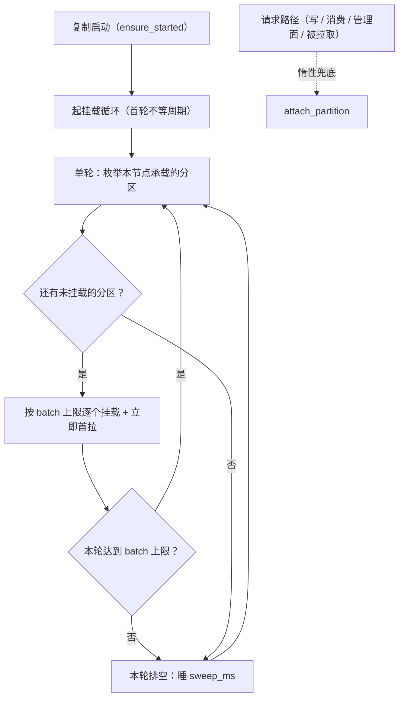

# 拉取态初始化详细设计

> 分配事实驱动挂载 × 启动首轮与周期追赶 × 空拉心跳 × 空闲降频与有界并发 × 演练去绕行

[文档首页](../../../../../../文档首页.md) › [消息平台规划](../../../../../../规划/01_规划_消息平台.md) › [阶段计划](../../../../计划/01_计划_消息平台.md) › [02-10 拉取态初始化](../02_存储与复制_10_拉取态初始化.md) › 详细设计

---

## 1. 概述 <a id="overview"></a>

### 1.1 目标

把「分区在本节点建立复制运行态（挂载）」从**惰性副作用**改为**分配事实驱动的周期动作**，消掉「副本必须被某个写请求碰过一次才建拉取态」这一前置条件：

1. **挂载**：按 `msg_partition` 的副本分配枚举本节点承载的分区并挂载，不依赖该分区是否收到过请求。
2. **首拉**：挂载后立即拉取一次，让 leader 侧「挂载时的乐观 ISR 初值」在毫秒级被真实拉取证实。
3. **收敛**：空闲分区（从未被写）在无写请求情况下 ISR 收敛到副本集大小，follower 侧获得新鲜的最后已知视图。
4. **节拍**：空闲分区连续空拉后降频，有记录立即回落；follower 拉取由串行改为有界并发。
5. **守卫**：非副本集成员不挂载、不拉取、不参与 ISR 推导。
6. **可查**：已挂载分区数可观测，轮次 / 失败 / 跳过均有结构化日志。
7. **演练去绕行**：`replica_crash` 删除「向每个实例各写一轮」的预热，判据集保持不变。
8. **单实例零变化**：复制关闭时不装配、不启动、零 DB 查询，行为与既有版本逐项一致。

### 1.2 边界与承接

| 项 | 本任务 | 归口 |
| --- | --- | --- |
| 挂载编排（枚举 / 成员判定 / 批量 / 追赶）、空闲降频、有界并发、非成员守卫 | ✅ 交付 | 02-10 |
| 复制运行态、ISR 判据、HW 语义、`acks=all`、`ReplicationView` 契约 | ✅ 复用（零改动） | 02-4（已交付） |
| 分区分配落库（`replicas` / `leader` / `epoch`）、多实例编排、控制通道、演练框架 | ✅ 复用（零改动） | 02-8（已交付） |
| 自动选举判活与抢主、`blocked(isr_unverified)` 语义 | ✅ 复用（零改动，仅输入改善） | 02-9（已交付） |
| 分区卸载、副本集变更（迁移后降为观察者）收敛 | ❌ 不做 | 02-8 迁移流程 |
| 非承载节点的消费读语义（分区路由） | ❌ 不做 | 8B_03 |
| 批量心跳端点（把「分区数/秒」压成「个位数/秒」） | ❌ 不做（登记容量治理） | 8B_12 |
| ISR 持久化、跨机房强一致、Raft 多数派 | ❌ 不做 | 架构 04 §7 |

### 1.3 口径来源与确认结果

| # | 事项 | 定稿 | 出处 |
| --- | --- | --- | --- |
| 1 | 任务归属 | 顺延新编号立父任务 **02-10**（需求 02-10，归 8B_05）；不重开已收口的 02-4 | 2026-11-12 确认 |
| 2 | 8B_05 门禁表述 | 保持「达成（2026-11-12）」+ 显式限定「空闲分区自动恢复的可用性缺口由 02-10 闭环」，并登记 §6.1 台账 | 2026-11-12 确认 |
| 3 | 需求优先级 | 2（高） | 2026-11-12 确认 |
| 4 | 投入规模与窗口 | 单日窗口 2026-11-13；投入数值与任务域合计登记在阶段计划 §1 / §3（本设计不复述） | 2026-11-12 确认 |
| 5 | 触发时机 | 启动首轮（不等待）+ 周期追赶（有 backlog 立即续轮）+ 惰性挂载保留 | 2026-11-12 确认 |
| 6 | 空闲拉取 | 纳入降频，缺省 1000ms（`MSG_REPLICATION_IDLE_FETCH_INTERVAL_MS`） | 2026-11-12 确认 |
| 7 | 拉取并发 | 纳入有界并发，缺省 8（`MSG_REPLICATION_PULL_CONCURRENCY`） | 2026-11-12 确认 |
| 8 | 首拉时机 | 挂载成功后立即拉取一次 | 2026-11-12 确认 |
| 9 | 非成员守卫 | 纳入：不挂载、不拉取、不参与 ISR 推导 | 2026-11-12 确认 |
| 10 | 批量心跳端点 | 不做，登记 8B_12（与「探活量随分区数线性」同批治理） | 2026-11-12 确认 |
| 11 | 可观测 | gauge `msg_replication_mounted_partitions{service}` + 三条日志（轮次 / 失败 / 非成员跳过），不加 `result` 标签 | 2026-11-12 确认 |
| 12 | 架构回写 | 回写架构 04 §7.1 一句语义（分配事实驱动挂载） | 2026-11-12 确认 |
| 13 | 演练 | 去掉预热，判据集不变（02-8 / 02-9 归档不替换） | 2026-11-12 确认 |
| 14 | 演练范围 | 只复跑 `replica_crash` | 2026-11-12 确认 |
| 15 | 用例登记 | Kiwi 新增一条（平台自增，登记后回读核对，不复用既有编号） | 2026-11-12 确认 |

## 2. 现状与差距 <a id="gap"></a>

| 现状（代码事实） | 差距 | 本任务处置 |
| --- | --- | --- |
| `ReplicationCoordinator.attach_partition` 是挂载的**唯一入口**（`replication.py`），只被 `ensure_writable` / `visible_limit` / `snapshot` / `on_append` / `serve_fetch` / `pull_once` / `apply_switch` / `demote` 调用 | 无「按分配批量挂载」入口，挂载变成请求的副作用 | 新增挂载循环 + `ReplicaMountSource` 枚举 |
| `_build_state` 挂载 leader 时把副本集全员置入 ISR，`FollowerProgress.last_fetch_ms = now`、`in_sync=True` | 乐观初值在 `lag_time_max_ms` 到期后必然收缩——副本未挂载就没人拉取 | 挂载后立即首拉，把「收缩→重入」窗口压到毫秒级 |
| `_pull_loop` 只遍历 `self._partitions`（已挂载） | 未挂载 = 永不拉取，自愈无门 | 挂载循环保证「承载即挂载」 |
| `refresh_once` 同样只刷已挂载分区 | 未挂载分区的 epoch / leader 变化无从感知 | 挂载循环先补齐，刷新循环随后接管 |
| `serve_fetch` 每次请求都更新 follower 的 `leo` 与 `last_fetch_ms` | 空批请求即心跳：只要有人拉，ISR 就不收缩 | 保持不改，作为「空闲心跳」的基础 |
| `pull_once` 每次成功（含空批）刷新 `last_known_isr` / `last_known_at` | 02-9 的候选资格完全依赖这两个字段 | 保持不改；由挂载 + 首拉让字段自然就绪 |
| `AutoElectionWatchdog.run_once` 遍历 `mounted_partition_keys()` | 未挂载 → 不探活；挂载但未拉过 → `last_known_isr` 为空 → `blocked(isr_unverified)` | 本任务让空闲分区具备挂载与视图，选举侧零改动 |
| `_build_state` 不校验本节点是否在副本集内 | 非承载节点被请求触碰后变「伪 follower」，每轮被 `follower 不在副本集内` 拒绝并刷日志 | 新增 `hosted` 标记与拉取守卫 |
| `_pull_loop` 逐分区串行 `await` | 分区规模上升后单轮耗时超过间隔，持续落后被 `lag_time_max_ms` 踢出 | 有界并发 + 空闲降频 |
| `ops.cluster_drill` 用 `drill.warmup()` 向每个实例各写一轮 | 预热是缺口的证据侧绕行，掩盖真实产品行为 | 去掉预热，改为等 ISR 收敛 |
| 计划 §6.1 台账缺该遗留行（只写在 02-8 §5 第 6 条与 02-9 §7 第 1 条） | 跨阶段遗留没有唯一可查清单 | 本任务补台账行并在交付时回填闭环 |

## 3. 交付物清单 <a id="deliverables"></a>

### 3.1 代码与配置

```text
backend/services/msg/src/bms_msg/
├── broker/
│   └── replication.py            # 改：ReplicaMountSource / PartitionAssignment / 挂载循环
│                                 #     mount_once（枚举 + 成员判定 + 批量 + 首拉）
│                                 #     PartitionReplication.hosted 与拉取守卫
│                                 #     _pull_loop 有界并发 + 空闲降频
│                                 #     ReplicationMetrics.mounted_partitions
├── services/replication_topology.py
│                                 # 改：DbReplicaTopologyLoader 同时实现 ReplicaMountSource
├── repositories/topic.py         # 改：PartitionRepository.list_assignments()
├── core/config.py                # 改：4 个键位、缺省常量、校验
├── metrics/
│   ├── names.py                  # 改：GAUGE_NAMES + HELP 增 msg_replication_mounted_partitions
│   └── collector.py              # 改：_mounted_family（仿 _isr_family，未装配时输出 0）
├── main.py                       # 改：装配挂载源（与拓扑加载器同对象）
└── api/internal/…                # 零改动

backend/services/msg/tests/
├── broker/test_replication_mount.py      # 新增：G1~G8
├── broker/test_replication.py            # 改：拉取循环节拍 / 并发相关存量断言适配
├── metrics/test_collector.py             # 改：新 gauge 采集
└── test_skeleton.py                      # 改：装配断言（挂载源注入）

backend/ops/cluster_drill/
├── __main__.py                   # 改：_ensure_isr 去掉 warmup，改为纯等待收敛
└── chain.py                      # 改：publish_batch 缺省 warm=False

deploy/
├── .env.example                  # 改：4 个键位（空值 = 代码缺省）
└── compose/msg.yml               # 改：x-service-env 同步键位
```

### 3.2 文档

| 文档 | 动作 |
| --- | --- |
| `msg文档/设计/架构设计/04_架构设计_数据面_存储与复制.md` | §7.1 补一句语义：分区挂载由分配事实驱动，挂载即建立拉取态 |
| `msg文档/项目/08B_消息平台/需求/00_需求_消息平台.md` | 增行 02-10，需求总数 54 → 55 |
| `msg文档/项目/08B_消息平台/需求/02_需求_存储与复制.md` | 新增 §11「需求 02-10」 |
| `msg文档/项目/08B_消息平台/任务/02_存储与复制/02_存储与复制.md` | 子任务清单增 10、域说明与实施口径同步 |
| `msg文档/项目/08B_消息平台/计划/01_计划_消息平台.md` | §1 段、§3 行（8 列）、§4 图表注释、§5 门禁 10 限定句、§6.1 台账 |
| 02-8 实施记录 §5 第 6 条 / 02-9 实施记录 §7 第 1 条 | 交付时标注「02-10 承接并闭环」 |
| 本任务 `实施/`、`测试/` | 实施记录与测试记录各一份 |

## 4. 挂载模型 <a id="model"></a>

### 4.1 触发时机



| 触发 | 时机 | 作用 | 失败影响 |
| --- | --- | --- | --- |
| T1 启动首轮 | 挂载循环任务启动后**立即**执行第一轮，不睡周期；排在拉取 / 扫描 / 刷新循环之前创建 | 重启、扩容后立刻补齐拉取态，不等写请求 | 失败仅记日志，下一轮重试 |
| T2 周期追赶 | 每轮结束：本轮未排空则立即续轮；排空则睡 `mount_sweep_ms` | 承接运行期新建主题、新增分区、迁移新增副本 | 同上 |
| T3 惰性挂载 | 请求路径继续调 `attach_partition`（幂等） | 兜底：即便枚举暂时失败，热点分区仍可用 | 与原行为一致 |

**为什么「未排空就立即续轮」**：固定周期 + 批量上限会让「1024 分区 / 批量 64」的节点等 16 个周期才排空，这段时间空闲分区仍在 `blocked`；「有 backlog 立即续轮」既保住单轮突发上限（不让启动期把所有分区日志同时打开），又能分钟级内排空。

### 4.2 单轮流水线

| 步 | 动作 | 失败处置 |
| --- | --- | --- |
| 1 枚举 | `ReplicaMountSource.list_assignments()`：一次读全部分区行（`topic_id` / `partition_no` / `replicas`），按 `(topic_id, partition_no)` 升序 | 查询异常 / 超时（`asyncio.timeout(2s)`）→ 本轮放弃，记 `msg_replication_mount_failed`，下一轮重试 |
| 2 差分 | 与 `self._partitions` 做差集，得到未挂载候选 | — |
| 3 成员判定 | `node_id in (row.replicas or _derive_replicas(topic_id, partition_no))`；不在 → 跳过并记 `msg_replication_mount_skipped` | — |
| 4 截断 | 候选超过 `mount_batch` 只取前 N 个（保持升序稳定，避免每轮挑同一批） | — |
| 5 挂载 | 逐个 `attach_partition`（内部已有 `_attach_lock` 与二次检查） | 单分区异常（`PartitionNotBoundError` / IO / 存储异常）→ 记 `msg_replication_mount_failed`（带 `topic_id` / `partition` / `reason`），继续下一个 |
| 6 首拉 | 挂载成功且本节点是 follower → 立即 `pull_once`；失败走既有 `_on_fetch_failure` 退避 | 首拉失败不影响挂载结果（挂载已生效，下一轮拉取重试） |
| 7 收口 | 记 `msg_replication_mount_round`（`mounted` / `skipped` / `remaining` / `elapsed_ms`），返回本轮挂载数 | — |

### 4.3 成员判定的单一来源

- **枚举只读**：`list_assignments()` 只做 `select`，不写库、不加锁、不做业务判断。
- **成员判定在协调器**：`node_id in (row.replicas or self._derive_replicas(topic_id, partition_no))`——`replicas` 为空的历史行走与 `_build_state` **同一个**轮转函数（`(topic_id*31 + partition_no) % len(nodes)`），因此不会出现「枚举说该挂、挂载时算出另一个副本集」的分裂。
- **挂载结果复核**：`_build_state` 计算出的 `replicas` 与 `role` 仍是唯一事实；`hosted = node_id in chosen` 落进运行态，供拉取守卫使用。
- **不做卸载**：挂载集合只增不减（分区删除由既有 `drop_topic` 路径清理存储；副本集变更后的降级 / 卸载归 02-8 迁移流程）。

### 4.4 空闲节拍与有界并发

| 机制 | 规则 | 常量 / 键 |
| --- | --- | --- |
| 节拍 | 循环 tick 固定为 `fetch_interval_ms`（缺省 200ms），每个分区按「到期时间」判定是否本轮拉取 | `MSG_REPLICATION_FETCH_INTERVAL_MS`（既有） |
| 正常间隔 | 上一轮拉到记录（`count > 0`）→ 下次到期 = `now + fetch_interval_ms`，连续空拉计数清零 | — |
| 空闲降频 | 连续空拉达 `REPLICATION_IDLE_FETCH_ROUNDS`（5）→ 下次到期 = `now + idle_fetch_interval_ms`（缺省 1000ms） | `MSG_REPLICATION_IDLE_FETCH_INTERVAL_MS` |
| 回落 | 任一轮拉到记录 → 立即回到正常间隔 | — |
| 并发 | 单轮用 `asyncio.Semaphore(pull_concurrency)` 包住各分区的 `pull_once`，同分区仍由 `state.op_lock` 串行 | `MSG_REPLICATION_PULL_CONCURRENCY` |
| 失败退避 | 沿用既有 `_fetch_backoff` / `_fetch_backoff_delay`（翻倍封顶 5s），与降频互不覆盖 | `REPLICATION_FETCH_BACKOFF_CAP_MS`（既有） |

**为什么两个机制都要**：全量挂载把空拉量从「少数热分区」变成「分区数 × follower 数 × 5/s（1024 分区约 5k rps/节点）」，降频把量压到 1/5；而串行循环在 1024 分区 × 约 2ms 下每轮约 2s > 1s 间隔，会持续落后并被 `lag_time_max_ms` 踢出 ISR——并发把单轮压到约 0.26s。缺任一项，全量挂载都会在规模上失效。

### 4.5 运行态结构（增量）

```python
PartitionAssignment:          # 值对象：枚举结果（只读）
    topic_id: int
    partition_no: int
    replicas: ConcurrentStableFrozenList[str]

ReplicaMountSource(BaseFrameworkObject, ABC):
    async def list_assignments() -> ConcurrentStableList[PartitionAssignment]

ReplicationCoordinator:
    _mount_source: ReplicaMountSource | None
    _fetch_due_at:  ConcurrentStableDict[ReplicaKey, float]   # 下次到期（单调毫秒）
    _idle_streak:   ConcurrentStableDict[ReplicaKey, int]     # 连续空拉轮数
    async def mount_once() -> int                             # 单轮；用例可直接驱动
    async def _mount_loop() -> None                           # 首轮不等待 + 追赶

PartitionReplication:
    hosted: bool                                             # 本节点是否在副本集内（拉取守卫）
```

## 5. 与既有判据的关系 <a id="safety"></a>

### 5.1 ISR / HW（判据零改动）

| 判据 | 现状 | 本任务后 | 是否改动 |
| --- | --- | --- | --- |
| `lag_time_max_ms`（10s，时间） | 距最近一次成功拉取超过阈值即踢出 | 空闲分区每 ≤1s 拉一次（空批也算），不再被踢 | 否 |
| `lag_records_max`（10 000，条数） | `leader_leo − follower_leo` 超阈值即踢出 | 空闲分区两者同为 `start`，永不触发 | 否 |
| HW | `min(leader LEO, 各 ISR follower LEO)` | 空闲分区 `HW = LEO = start`，消费不受影响 | 否 |
| 重入 | `leo ≥ leader_leo` 且拉取新鲜 | 仍在既有扫描 / `serve_fetch` 路径 | 否 |
| leader 挂载时的乐观 ISR | 全副本 `in_sync=True` | 保留：由首拉在毫秒级证实；副本真宕机时按 10s 收缩（预期行为不变） | 否 |

### 5.2 对 02-9 自动选举的影响

- **输入改善**：空闲分区的 follower 在挂载后 ≤1s 内获得 `last_known_isr`（全副本）与 `last_known_at`，探活与 `_pick_target` 都有输入；`blocked(isr_unverified)` 退化为「视图真过期」。
- **安全论证不变**：候选须在最后已知 ISR 内且视图新鲜；空闲分区 `LEO = HW = start`，「候选 LEO ≥ 死前 HW」恒成立，因此「已提交不丢」不依赖本任务。
- **代价登记**：探活量从「已挂载分区」变「全部分区」（每分区 1/`detect_interval`），与 02-9 风险 #1 同源，登记 8B_12 容量观测；批量探活 / 批量心跳端点不在本任务范围。

### 5.3 对 02-8 演练的影响

| 项 | 现状 | 改造后 |
| --- | --- | --- |
| `_ensure_isr` | `drill.warmup()`（向每个实例各写一轮）+ `_wait_isr` | 只 `_wait_isr`；失败仍落 `recover` / 前置 issue |
| 恢复后 | `drill.warmup()` + `_wait_isr` | 只 `_wait_isr`（重启实例在启动首轮自行挂载） |
| `publish_batch` | 缺省 `warm=True` | 缺省 `warm=False`（调用方显式要求才预热） |
| 判据集 | `schema_version = 2` 九类 | **不变**：不新增判据键 → 02-8 / 02-9 归档记录不缺键，无需替换 |
| 证据 | 预热掩盖缺口 | `isr_before` 事实 = 9、`_ensure_isr` 失败即落 issue，直接体现「无写入也收敛」 |

## 6. 接口与复用 <a id="interface"></a>

| 调用 | 用途 | 归属 | 失败语义 |
| --- | --- | --- | --- |
| `ReplicaMountSource.list_assignments()` | 枚举全部分区分配（只读） | 本任务新增（`broker/replication.py` 协议 + `services/replication_topology.py` 实现） | 异常 → 本轮放弃，下一轮重试 |
| `PartitionRepository.list_assignments()` | 一次取全部分区行（`topic_id` / `partition_no` / `replicas`） | 本任务新增（`repositories/topic.py`） | 异常上抛给挂载源 |
| `ReplicationCoordinator.attach_partition()` | 幂等挂载 | 02-4 既有 | 存储异常 → 跳过该分区 |
| `ReplicationCoordinator.pull_once()` | 首拉 / 周期拉取 | 02-4 既有 | 走 `_on_fetch_failure` 退避 |
| `ReplicationCoordinator.mounted_partition_keys()` | 02-9 看护循环遍历 | 02-9 既有 | — |
| `ReplicationMetrics.mounted_partitions` | 已挂载分区数 | 本任务新增只读属性 | — |

**不新增协议端点**：内部通道（`/snapshot` / `demote` / `apply-switch`）、`LeaderControlTransport`、`LeaderSwitchService` 全部零改动。

## 7. 失败与退避 <a id="failure"></a>

| # | 场景 | 判据 | 处置 | 影响 |
| --- | --- | --- | --- | --- |
| 1 | 元数据库不可用 / 查询超时 | 枚举抛错或超 2s | 本轮放弃，记 `msg_replication_mount_failed`（60s 窗口抑制），下一轮重试 | 已挂载分区照常拉取，服务不拒启 |
| 2 | 单分区挂载失败 | `attach_partition` 抛错 | 跳过该分区并记录，继续本轮其它分区 | 该分区退化为「需请求触碰」的旧行为 |
| 3 | 首拉失败 | `pull_once` 抛错 | 走既有 `_on_fetch_failure`（翻倍封顶 5s）；挂载结果保留 | ISR 内该副本 10s 后被收缩，恢复后重入 |
| 4 | leader 暂不可达（对端未起） | `ReplicaUnavailableError` | 同上；周期拉取自然重试 | 该分区 ISR=1，就绪后自动恢复 |
| 5 | 分区行 `replicas` 为空（历史行） | 行内副本集为空 | 按轮转算法推导后判定成员 | 与 `_build_state` 结果一致 |
| 6 | 非成员分区被请求触碰 | `hosted = False` | 挂载但不拉取、不进 ISR 推导 | 消除「伪 follower」噪声 |
| 7 | 复制关闭 | 配置 | 循环不装配、不启动、零 DB 查询 | 单实例零变化 |
| 8 | 本轮达到批量上限 | 候选 > `mount_batch` | 立即续轮（不睡周期） | 排空期间 CPU / IO 受批量约束 |

## 8. 可观测 <a id="observability"></a>

### 8.1 指标

| 指标 | 类型 | 标签 | 说明 |
| --- | --- | --- | --- |
| `msg_replication_mounted_partitions` | gauge | `service` | 本节点已挂载分区数；复制未装配时输出 0（与 `msg_isr_shrink_total` 同口径） |
| `msg_isr_size` / `msg_replication_lag_records` | gauge | `service` / `topic_id` / `partition` | 沿用 02-4；空闲分区由此从 1 变为副本集大小 |
| `msg_isr_shrink_total` | counter | `service` | 沿用 02-4；本任务应使其在空闲分区上**停止增长** |

> 采集位置：`metrics/collector.py` 新增 `_mounted_family()`（仿 `_isr_family`）。**不得塞进 `_collect_replication`**——该方法在无行时提前返回，会把「0 个已挂载分区」也一并吞掉。

### 8.2 日志

| 事件 | 级别 | 字段 |
| --- | --- | --- |
| `msg_replication_mount_round` | info（仅本轮有动作时） | `mounted` / `skipped` / `remaining` / `elapsed_ms` |
| `msg_replication_mount_failed` | warning（60s 窗口抑制） | `topic_id`（枚举失败时为 0）/ `partition` / `reason` / `detail` |
| `msg_replication_mount_skipped` | debug | `topic_id` / `partition` / `detail="not_in_replica_set"` |

不加「结果」维度的 counter 标签（原因与 02-9 一致：防基数膨胀，明细走日志）。

## 9. 配置与单实例零变化 <a id="config"></a>

### 9.1 新增键位

| 键 | 缺省 | 校验 |
| --- | --- | --- |
| `MSG_REPLICATION_MOUNT_SWEEP_MS` | 30000 | > 0 |
| `MSG_REPLICATION_MOUNT_BATCH` | 64 | ≥ 1 |
| `MSG_REPLICATION_IDLE_FETCH_INTERVAL_MS` | 1000 | ≥ `fetch_interval_ms`；`lag_time_max_ms > 0` 时须满足 `idle × 2 ≤ lag_time_max_ms` |
| `MSG_REPLICATION_PULL_CONCURRENCY` | 8 | ≥ 1 |

三处键位同名同序：`core/config.py` 常量、`deploy/.env.example`、`deploy/compose/msg.yml` 的 `x-service-env`；不新增 `env_example` 必填键（缺省即合法）。

**校验口径的理由**：`idle × 2 ≤ lag_time_max_ms` 给 02-9 的「判死节拍 × 阈值 + 切主宽限」留出另一半窗口（缺省 1s × 2 = 2s ≤ 10s，余量充足）；不满足即拒启，避免「降频把副本降出 ISR」这类只在生产规模下才暴露的配置错误。

### 9.2 单实例零变化

| 项 | 关闭复制时 |
| --- | --- |
| 后台任务 | 无挂载 / 拉取 / 扫描 / 刷新任务（`ensure_started` 提前返回） |
| DB 查询 | 不枚举、不加载拓扑（挂载源不装配） |
| 指标 | `msg_replication_mounted_partitions` 输出 0；`msg_isr_size` 仍为 1（`isr=[本节点]`） |
| 行为 | 请求路径、HW=LEO、`acks=all` 与 `acks=1` 一致，既有 02 / 03 域用例零改动 |

## 10. 测试设计 <a id="tests"></a>

| 组 | 覆盖点 | 落点 |
| --- | --- | --- |
| G1 配置 | 4 键缺省值、非法值拒启、`idle × 2 ≤ lag_time_max_ms` 组合、`idle < fetch_interval` 拒绝 | `test_replication_mount.py` |
| G2 枚举与成员 | 成员挂载；非成员跳过（`skipped`）；`replicas` 为空走轮转推导；已挂载幂等（不重复首拉）；批量上限与续轮 | 同上 |
| G3 空闲收敛 | 两节点簇 + 空分区 + **不写入**：`mount_once` 后两端 `pull_once` 一次，`scan_isr_once` 后 `ISR=2`、`msg_isr_size=2`、`HW=start` | 同上 |
| G4 视图与联动 | 空拉后 `snapshot().last_known_isr` 为全副本、`last_known_at` 新鲜；`AutoElectionWatchdog.run_once` 对该分区**不**记 `blocked(isr_unverified)` | 同上 |
| G5 空闲降频 | 连续 5 次空拉后下次到期 = `idle`；拉到记录立即回落；`last_fetch` 仍 < `lag_time_ms` | 同上 |
| G6 失败隔离 | 枚举抛错 → 本轮返回 0 且循环继续；单分区 `attach` 抛错 → 其余分区仍挂载 | 同上 |
| G7 并发 | 脚本化 transport 记录并发峰值 = `pull_concurrency`；同分区不并发（`op_lock`） | 同上 |
| G8 单实例 | 复制关闭：`ensure_started` 不建任务、`mount_once` 直接返回 0、无枚举调用 | 同上 |
| 存量适配 | `test_replication.py` 拉取循环节拍断言（由固定 sleep 改为驱动式）；`metrics/test_collector.py` 新 gauge；`test_skeleton.py` 装配断言 | 存量文件 |
| 真容器 | `ops.cluster_drill run replica_crash`（去预热）复跑一次，记录归档本任务 `测试/记录/` | `测试/记录/` |

**用例驱动方式**：所有新用例直接调 `mount_once()` / `pull_once()` / `scan_isr_once()` / `AutoElectionWatchdog.run_once()`，不依赖真实睡眠；仅「循环启停」用例用极短间隔验证任务创建与回收。

**Kiwi**：新增一条（平台自增，登记后回读核对编号），代码统一标注同一 `kiwi_id`；`text` 写覆盖范围（G1~G8）与自动化文件路径。

## 11. 覆盖率与门禁 <a id="coverage"></a>

- 变更模块**行 + 分支 100%**：`bms_msg.broker.replication`、`bms_msg.services.replication_topology`、`bms_msg.repositories.topic`、`bms_msg.core.config`、`bms_msg.metrics.names`、`bms_msg.metrics.collector`、`bms_msg.main`；
- 提交前先按模块本地采集（`pytest <新增与适配用例> -p engkit.coverage_plugin --cov=<模块> --cov-branch`），避免推送环才暴露分支缺口；
- 静态：`ruff check` / `ruff format --check` / `pyright`（单文件走 `uv run pyright`）；
- 文档：`engkit links` / `docs-scope` / `eol`；
- 装配冒烟：`pytest services/*/tests -k "plugin_assembly or plugin_registration or storage or shape"`（改了装配与配置）；
- 回归：复制关闭路径与既有 02 域用例全绿（提交环定向 + 推送环）。

## 12. 实施步骤 <a id="steps"></a>

| # | 步骤 | 产物 |
| --- | --- | --- |
| 1 | 配置：4 键位、缺省常量、校验规则 | `core/config.py` |
| 2 | 仓储：`PartitionRepository.list_assignments()` | `repositories/topic.py` |
| 3 | 协议与枚举实现：`PartitionAssignment` / `ReplicaMountSource` / `DbReplicaTopologyLoader` 实现 | `broker/replication.py` / `services/replication_topology.py` |
| 4 | 挂载循环：`mount_once` + 首拉 + 成员判定 + 批量续轮 + `hosted` 守卫 | `broker/replication.py` |
| 5 | 节拍：有界并发 + 空闲降频 + 回落 | `broker/replication.py` |
| 6 | 指标与日志：新 gauge 与三条日志 | `metrics/names.py` / `metrics/collector.py` |
| 7 | 装配：挂载源注入、任务启动 | `main.py`（`lifecycle.py` 零改动） |
| 8 | 部署资产：`.env.example` / `compose/msg.yml` | 键位一致 |
| 9 | 演练去预热：`_ensure_isr` / `publish_batch` | `ops/cluster_drill` |
| 10 | Kiwi 登记 → 用例 G1~G8 → 覆盖率补口 | 用例文件 + `kiwi_id` |
| 11 | 真容器复跑 `replica_crash` 并归档 | `测试/记录/` |
| 12 | 门禁：单文件 pytest / ruff / pyright → 模块覆盖率 → 提交环 → 推送环 | 门禁结果 |
| 13 | 回写：架构 04 §7.1、需求、任务、计划（行 / 门禁 / 台账）、02-8 与 02-9 记录标注、本任务记录 | 文档一致 |

## 13. 验收映射 <a id="accept-map"></a>

| 完成标准（任务 §3） | 本设计落点 | 用例 |
| --- | --- | --- |
| 空闲分区无写请求即收敛 ISR 到副本集大小 | §4.1 / §4.2 / §5.1 | G2 / G3 |
| 空闲分区具备新鲜最后已知视图，02-9 不再 `blocked(isr_unverified)` | §4.2 步 6 / §5.2 | G4 |
| 运行期新建主题 / 新增分区在周期内被挂载 | §4.1 T2 / §4.2 | G2 |
| 批量上限 + 自动续轮；失败逐分区隔离、不拒启 | §4.2 / §7 | G2 / G6 |
| 单实例零变化 | §9.2 | G8 |
| `replica_crash` 去预热后可复跑、判据集不变 | §5.3 | 真容器复跑 |
| 变更模块行 + 分支覆盖率达标，静态与文档校验通过 | §11 | 门禁 |

## 14. 风险与开放项 <a id="risk"></a>

| # | 风险 / 开放项 | 处置 / 归口 |
| --- | --- | --- |
| 1 | 全量挂载后空拉量随「分区数 × 副本数」线性增长 | 空闲降频（1s）+ 有界并发（8）压到可接受量级；真实拐点与批量心跳端点归 8B_12 |
| 2 | 挂载即打开分区日志（段与索引加载），启动期 IO 与内存随分区数上升 | 单轮批量上限 + 续轮排空；规模结论归 8B_12 容量观测 |
| 3 | 02-9 探活量随分区数线性（本任务使其从「少数」变「全体」） | 与 02-9 风险 #1 合并登记 8B_12 |
| 4 | 非承载节点的消费读返回空（分区路由缺失） | 本任务只消除无效拉取与日志噪声；读语义归 **8B_03** 路由 |
| 5 | 副本集变更后旧成员仍保持挂载（只增不减） | 卸载 / 降级归 **02-8 迁移流程**；本任务登记开放项 |
| 6 | 枚举每轮全表读（分区行数增长后查询变重） | 行窄（三列为主）+ 周期复查；增量枚举（按 `metadata_version`）登记 8B_12 |
| 7 | 空闲降频使 `last_known_at` 最多滞后 1s | 校验 `idle × 2 ≤ lag_time_max_ms`，为 02-9 判死与宽限留一半窗口 |

## 15. 对齐记录 <a id="align"></a>

### 15.1 决策确认

见 §1.3（2026-11-12 逐项确认，15 项均按推荐项定稿）。

### 15.2 与既有设计的对齐

| 文档 | 口径 | 本设计关系 |
| --- | --- | --- |
| 02-4 详细设计 §4 / §9 | ISR 收缩 / 重入判据、拉取退避、`acks=all` | 全部沿用；本设计只补「谁来挂载、多久拉一次」 |
| 02-9 详细设计 §4.1 / §12 | 判活遍历已挂载分区、`blocked(isr_unverified)`、风险 #1 探活量 | 输入改善、语义不变；容量项合并登记 |
| 02-8 实施记录 §5 第 6 条 | 「副本需被写一次才建拉取态」归 02-4 后续 | 由本任务闭环 |
| 02-9 实施记录 §7 第 1 条 | 空闲分区无最后已知视图归 02-4 后续 | 由本任务闭环 |
| 架构 04 §7.1 | ISR 半同步与 HW 可见性语义 | **回写**：补「挂载由分配事实驱动、挂载即建立拉取态」 |
| 02-8 演练设计 §「每轮重置 / 预热」 | 预热用于绕开拉取态缺口 | 缺口的绕行删除，判据集不变 |

---

> 依《[文档生成规范](../../../../../../../bms文档/规范/文档生成规范.md)》编写 · 决策确认见 §1.3
