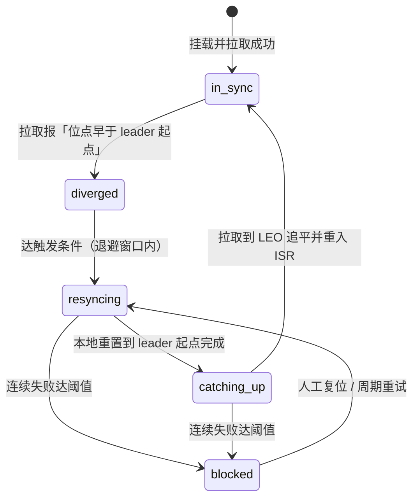

# 全量重同步详细设计（02-11）

> 保留期裁剪后按 leader 起点重建副本：触发判据、重建步骤、新存储原语、可见性与失败处置

[文档首页](../../../../../../文档首页.md) › [阶段计划](../../../../计划/01_计划_消息平台.md) › [02 存储与复制](../../02_存储与复制.md) › [02-11 全量重同步](../02_存储与复制_11_全量重同步.md) › 详细设计

---

## 1. 现状事实 <a id="facts"></a>

| # | 事实 | 位置 | 后果 |
| --- | --- | --- | --- |
| 1 | 拉取发现「follower 位点早于日志起点」时抛 `ReplicationDivergedError`，注释直接写「需要重同步」 | `replication.py` 拉取与 `leader_leo` 修复分支 | 异常一路上抛到拉取循环，分区停拉 |
| 2 | 迁移预检遇到同一情形记 `needs_full_resync` 并拒绝整条迁移计划 | `services/partition_migration.py` 预检 | 扩容 / 迁机在裁剪过的分区上直接卡住 |
| 3 | 存储端口只有两个改边界的原语：`truncate_before`（改起点，要求 `offset <= LEO`）与 `truncate_to`（改末端，要求 `offset >= start`） | `broker/log.py` 端口定义 | **没有任何原语能把「起点与末端同时置到某个位点」**，即无法丢弃本地已有数据并空降到 leader 起点 |
| 4 | 复制运行态有 `role` / `switch_state` / `isr` / `followers`，没有「重建中」状态 | `PartitionReplication` | 重建过程对本节点的读请求不可见，会暴露半初始化数据 |
| 5 | 快照已带 `start_offset`（leader 起点） | `ReplicationSnapshot` | 触发判据所需输入现成，无需扩协议 |
| 6 | 裁剪侧无归档：被裁掉的段直接删除 | `broker/file_store.py` 保留清理 | 历史补不回来，重建只能以 leader 起点为界 |

## 2. 目标行为 <a id="behavior"></a>



| 状态 | 读 | 写 | 拉取 | 说明 |
| --- | --- | --- | --- | --- |
| `in_sync` | 允许 | 仅 leader | 正常 | 现状 |
| `diverged` | 允许（本地历史） | 拒绝（非 leader） | 停 | 刚发现落后，等退避窗口 |
| `resyncing` | **拒绝（未就绪）** | 拒绝（非 leader） | 停 | 重置存储中，禁止暴露半初始化视图 |
| `catching_up` | 允许（按本地 LEO 截断可见） | 拒绝（非 leader） | 正常 | 追赶期，可见范围随拉取增长 |
| `blocked` | 允许 | 拒绝 | 停 | 连续失败，交人工 |

## 3. 触发点 <a id="triggers"></a>

| # | 触发点 | 判据 | 动作 |
| --- | --- | --- | --- |
| 1 | 拉取路径 | 本地 `LEO < leader 快照 start_offset`（`ReplicationDivergedError` 的新 reason `behind_start`） | 进入 `diverged`，按退避窗口到期后自动重建 |
| 2 | 迁移预检 | 同一判据（`needs_full_resync`） | 不再拒绝整条计划：对该副本触发重建并将该项标 `resyncing`，追平后再继续迁移 |
| 3 | 人工 | `ops` 侧显式复位（本轮只留入口与状态查询，不扩 CLI 子命令） | 直接把 `blocked` 拉回 `diverged` |

**为什么不在发现时立刻重建**：重建要删段重来，多副本同时抖动会形成 IO 风暴。退避窗口（首个窗口为一次拉取间隔，最长不超过空闲拉取间隔的两倍）能把抖动摊平，且不影响「最终一定收敛」。

## 4. 重建步骤 <a id="steps"></a>

1. **判定**：取 leader 快照 `start_offset`，与本地 `LEO` 比较；`LEO >= start_offset` 时为 no-op（幂等）。
2. **加锁与标记**：持分区运行态锁，置 `role = follower`、`isr = {leader}`、`followers` 清空、状态置 `resyncing`；读路径据此拒绝。
3. **停拉取**：置标志使本轮拉取循环跳过该分区。
4. **重置存储**：调用新原语 `reset_to(offset=leader_start)`（§5），删段与索引、起点与末端同置 `leader_start`、重建恢复点。
5. **清进度**：本地 `local_leo = leader_start`、`leader_leo = 0`、`hw = 0`、发散标记清空。
6. **留痕**：结构化日志 + 审计（分区、leader 起点、丢弃范围、触发原因）+ 指标计数。
7. **恢复拉取**：状态置 `catching_up`，回到普通拉取路径；拉取到 `LEO == leader LEO` 后由既有扫描路径重入 ISR，状态回 `in_sync`。

**不新增拉取协议**：重建后的追赶完全走既有 `fetch`，不改帧格式、不改版本号。

## 5. 存储原语 `reset_to` <a id="primitive"></a>

端口 `MessageStore` 新增抽象方法：

```python
async def reset_to(self, *, topic_id: int, partition_no: int, offset: int) -> int:
    """把分区重置为「从 offset 起的空日志」（02-11 全量重同步）。

    与 truncate_before / truncate_to 的分工：前者只推起点、后者只退末端，
    本方法同时把起点与末端置到 offset，并删除此前的段与索引。
    """
```

| 实现 | 改法 |
| --- | --- |
| `InMemoryMessageStore` | `_logs[key] = []`、`_starts[key] = offset`、清该分区 `_deleted` |
| `FileMessageStore` | 持分区锁：关闭并删除该分区段文件与索引文件 → 以 `start = offset` 重建空分区 → 重建恢复点与 `log_id` 索引 → 清 LRU |
| `ReplicatedMessageStore`（协调器门面） | 透传；透传前要求调用方已置 `resyncing`（否则拒绝，避免写入竞态） |
| `NotifyingMessageStore`（唤醒包装） | 透传后唤醒等待中的消费者（可见范围变化） |

**为什么加在端口而不是只改文件实现**：协调器只认端口；若只改实现，内存实现与用例替身会静默走旧语义，覆盖率与用例都发现不了。

**失败原子性**：删除段与重建空分区之间若进程崩溃，下一次挂载走 02-2 的恢复流程即可自愈（空目录 + 起点丢失按 0 处理），不需要两阶段提交。

## 6. 可见性 <a id="visibility"></a>

| 入口 | `resyncing` 期间 |
| --- | --- |
| `read_range` / `visible_limit` | 返回空 / 0（按「未就绪」语义） |
| 消费位点推进 | 不变（保持原位点，重建后可继续；位点早于新起点时按既有「位点早于起点」语义处置） |
| 管理面分区详情 | 返回 `role=follower`、`resync_state=resyncing`（新增只读字段，不改既有字段） |
| 写路径 | 本就拒绝（非 leader，`350033`） |

## 7. 失败与退避 <a id="failure"></a>

| 情形 | 处置 |
| --- | --- |
| 重建过程抛错（删除失败 / 恢复点重建失败） | 记 `result=error`，状态回 `diverged`，退避窗口翻倍（上限两倍空闲拉取间隔） |
| 连续失败达阈值（缺省 5 次） | 状态置 `blocked`，告警一次（不刷屏），停止自动重试，等人工或周期复位 |
| 重建成功但追赶超时 | 保持 `catching_up`，不判失败（数据量决定耗时），由 ISR 收敛判据判定 |
| leader 在重建中切换 | 下一次拉取用新 leader 快照重算 `start_offset`；若新起点更高则重新触发一次重建（幂等） |

## 8. 观测与审计 <a id="observe"></a>

| 出口 | 内容 |
| --- | --- |
| 指标 | `msg_replica_resync_total{result}`：`created` / `succeeded` / `error` / `blocked`（闭集，不按分区 / 节点分键） |
| 日志 | `msg_replica_resync_started` / `_succeeded` / `_failed`（分区、leader 起点、丢弃段数、耗时） |
| 审计 | 动作 `msg:partition.resync`：分区、leader 起点、丢弃范围、触发原因（`fetch_diverged` / `migration_precheck`）、结果 |
| 管理面 | 分区视图新增只读字段 `resync_state`（`in_sync` / `diverged` / `resyncing` / `catching_up` / `blocked`） |

## 9. 迁移联动 <a id="migration"></a>

| 现行为 | 新行为 |
| --- | --- |
| `needs_full_resync` → 整条计划拒绝并登记 | 该项转 `resyncing`：触发重建 → 追平 → 继续迁移；重建失败才拒绝该项并保留原因 |
| 台账只记「拒绝」 | 台账记「重建中 / 重建成功 / 重建失败」，可查重建耗时与丢弃范围 |

## 10. 用例矩阵 <a id="cases"></a>

| # | 场景 | 期望 |
| --- | --- | --- |
| 1 | 本地 LEO < leader 起点，退避到期 | 触发重建：存储被重置到起点、状态经 `resyncing` → `catching_up` → `in_sync`，ISR 收敛 |
| 2 | 本地 LEO ≥ leader 起点 | no-op（幂等），不删任何段 |
| 3 | 重建期间读 | 返回空 / 未就绪，不返回半初始化数据 |
| 4 | 重建抛错 | `result=error`、回 `diverged`、退避翻倍 |
| 5 | 连续失败达阈值 | 置 `blocked`、告警一次、停止自动重试 |
| 6 | 重建后拉取 | 从 leader 起点起连续、无空洞，数据与 leader 逐条一致 |
| 7 | 迁移预检遇同判据 | 走重建而非拒绝；重建成功后迁移继续 |
| 8 | 复制关闭 | 不装配、不产生 DB 查询（单实例零变化） |
| 9 | 重建中 leader 换代 | 用新快照重算起点，必要时再重建一次（幂等） |

## 11. 不变量与风险 <a id="invariants"></a>

| # | 不变量 / 风险 | 对策 |
| --- | --- | --- |
| 1 | 重建不产生「可读的空洞」 | 重建期读全拒；追赶期按本地 LEO 截断可见 |
| 2 | 不误删未过期的数据 | 只在本节点**非 leader** 且判据成立时重建；重建目标位点只取 leader 快照的 `start_offset` |
| 3 | 两个重建并发 | 分区运行态锁串行 + 状态机前置校验（非 `diverged` 拒绝） |
| 4 | 删段 IO 抖动影响同节点其它分区 | 单轮只允许一个分区重建（节点级令牌），其余按退避排队 |
| 5 | 位点早于新起点导致消费者报错 | 按既有「位点早于起点」语义返回，由消费侧重置（本任务不改位点语义） |
| 6 | 段删除后索引残留导致读到已删数据 | 复用 02-2 的索引重建与残条修复，不手写第二套清理 |

---

> 依《[文档生成规范](../../../../../../../bms文档/规范/文档生成规范.md)》编写 · 实施与测试记录见同级 `实施/`、`测试/`
