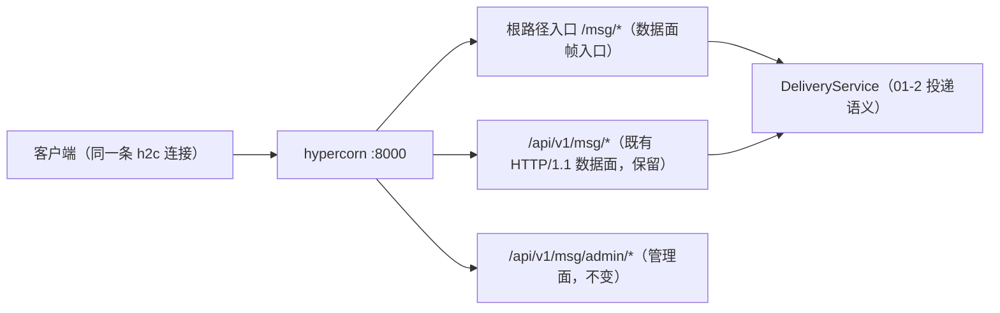
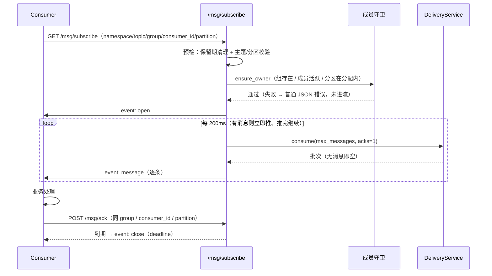
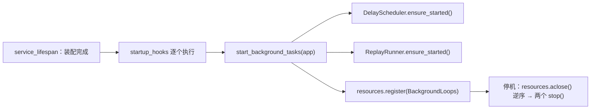
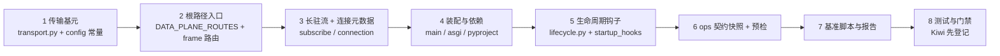

# HTTP/2 传输详细设计

> 08B / 任务 03-1 · 任务级详细设计（可落地、可逐条验收）

[文档首页](../../../../../../文档首页.md) › [03 传输与协议](../../03_传输与协议.md) › [03-1 HTTP/2 传输](../03_传输与协议_01_HTTP2传输.md) › 详细设计

---

## 1. 概述 <a id="overview"></a>

本文档是任务 [03-1 HTTP/2 传输](../03_传输与协议_01_HTTP2传输.md) 的**详细设计**，粒度到「按序落地、逐条验收」。与架构层不一致时以《架构设计》为准，实现细节以本文档为准。

**上游依据**：

- [需求 03-1 HTTP/2 传输](../../../../需求/03_需求_传输与协议.md#r03-1)
- [架构设计 · 接入面：协议与客户端](../../../../../../设计/架构设计/05_架构设计_接入面_协议与客户端.md#layers) 第 2 节（协议分层）、第 6 节（连接管理）、第 7 节（背压）
- [架构设计 · 总体架构](../../../../../../设计/架构设计/03_架构设计_总体架构.md#paths) 第 2 节（四条请求路径）
- [架构设计 · 部署与运维](../../../../../../设计/架构设计/08_架构设计_部署与运维.md#container) 第 2 节（容器与端口）
- bms《[协议与传输](../../../../../../../bms文档/资料/知识档案/消息与事件驱动/07_事件驱动_协议与传输.md)》第 5 节
- bms《[uvicorn 技术介绍](../../../../../../../bms文档/资料/知识档案/后端核心/uvicorn技术介绍.md)》（HTTP/2 现状与 hypercorn 迁移口径）

**前置契约（已交付，非待办）**：bms 基座 hypercorn 启动器已于 2026-11-04 交付（bms 任务
`02_多服务骨架与仓库_04_HTTP2服务运行时`，Kiwi 2419）——`core/run.py` 以 hypercorn 承载、第一次 SIGTERM
先 `start_drain()` 再停机、`[server].certfile/keyfile` 同给同空、明文 h2c **prior knowledge** 与 TLS ALPN `h2`
均实测可握手。本任务**不重复实现服务器**，只在其上落 msg 的传输入口、长驻流与基准；任务文档 §5 原写
「待交付」已在本次一并回写。

**与前后任务的关系**：

| 方向 | 任务 | 关系 |
| --- | --- | --- |
| 前置 | [01-2 投递语义](../../../01_消息模型与投递/01_消息模型与投递_02_投递语义/01_消息模型与投递_02_投递语义.md) | 帧入口与长驻流**只做协议适配**，复用 `DeliveryService` 的 publish / consume / ack 语义，不改错误码 |
| 前置 | [01-4 消费组](../../../01_消息模型与投递/01_消息模型与投递_04_消费组/01_消息模型与投递_04_消费组.md) | 长驻流沿用成员制（`GroupCoordinator.ensure_owner`），不新增成员语义 |
| 嵌套子任务 | [03-2 二进制帧协议与版本演进](../../03_传输与协议_02_二进制帧协议与版本演进/03_传输与协议_02_二进制帧协议与版本演进.md) | 只把 `/msg/*` 的 body 换成二进制帧，**路由与网关口径不再改** |
| 后继 | [03-3 序列化与内容类型](../../03_传输与协议_03_序列化与内容类型/03_传输与协议_03_序列化与内容类型.md) | MessagePack 侧基准在本任务之后补跑（判据口径不变，见 §8.2） |
| 后继 | [03-4 连接管理](../../03_传输与协议_04_连接管理/03_传输与协议_04_连接管理.md) | 心跳 / GOAWAY / `MAX_CONCURRENT_STREAMS` 在其落地；本任务只交付可被其扩展的连接元数据与流登记 |
| 后继 | [03-5 背压与流控](../../03_传输与协议_05_背压与流控/03_传输与协议_05_背压与流控.md) | 本任务的「200ms 短间隔拉取」届时换成长轮询挂起，流形态不变 |

**口径基线（2026-11-04 确认，不再变更）**：

1. `/msg/*` 为**根路径**数据面入口（不经 `/api/v1`），与现有 `/api/v1/msg/*` **同 handler、同语义、同 JSON 契约**；03-2 只换 body 编解码。
2. 新增 `GET /msg/subscribe`（SSE 长驻流）与 `GET /msg/connection`（连接元数据只读自报）。
3. 长驻流**完全复用** `consume` 语义（成员制 + inflight + 可见性超时重投 + 分区内停等）。
4. 流内无消息时按固定短间隔（缺省 200ms）重试拉取；真正的长轮询归 03-5。
5. 流结束条件三选一：客户端断开 / `RST_STREAM`、时长上限（缺省 60s）、成员撤销或分区易主。
6. 连接元数据 = 结构化日志 + `GET /msg/connection` 只读端点。
7. 用基座 `startup_hooks()` 启动延迟推进器与重放执行器（闭环 01-5 / 01-6 两条遗留）。
8. 移除 msg 的 `uvicorn[standard]` 依赖，服务器只由 `bms-core` 传递的 hypercorn 提供。
9. 只落 `ops/contract_snapshot.py`（导出 + 零漂移校验）并接入预检；`check_modules` / 事件契约 / 域布局渲染不在本任务。
10. 基准脚本自写 `asyncio + httpx`（两侧同客户端）；默认并发 32 / 10000 条 / 1 KiB 载荷 / 预热 1000 条。
11. 本任务只出「HTTP/1.1+JSON vs h2c+JSON」报告；MessagePack 侧等 03-3 落地后补跑并回写 8B_01 门禁。
12. 启动验证走本机全套（`platform` + `msg`）真起，实测探针 / HTTP/1.1 / h2c / SSE / 优雅停机。

## 2. 现状与差距 <a id="gap"></a>

2026-11-04 复核（msg 仓 `8e3b996`；bms 仓 `ff581ef07`）：

| 项 | 现状 | 本任务目标 | 动作 |
| --- | --- | --- | --- |
| 服务器 | msg 依赖仍声明 `uvicorn[standard]>=0.30`；`asgi.py` docstring 仍写 uvicorn | 与基座一致：hypercorn（h2c + TLS 由基座提供） | 修改 |
| 数据面路径 | 仅 `/api/v1/msg/{publish,consume,ack}` | 增根路径 `/msg/{publish,consume,ack}`（同 handler） | 新建 |
| 长驻流 | 无（`/msg/subscribe` 在 01-2 设计里预留给 8B_01） | SSE 长驻流，复用 `consume` 语义 | 新建 |
| 连接元数据 | 无；`http_version` 未取用 | 结构化日志 + `GET /msg/connection` | 新建 |
| 流登记 | 无 | `StreamRegistry`（进程级；供用例断言「断开即释放」与 03-4 扩展） | 新建 |
| 后台任务启动 | 延迟推进器 / 重放执行器均**惰性**启动（首个请求触发），进程停机无回收点 | 基座 `startup_hooks()` 启动，并登记到 `ResourceManager` 逆序回收 | 新建 |
| 契约快照 | `deploy/contracts/msg.json` 人工重导，未接预检（01-1 起挂了 3 轮） | `ops/contract_snapshot.py` 导出 + `check`，接入 `engkit.toml` 预检 | 新建 |
| 基准 | 无脚本、无报告 | `scripts/bench/http2_vs_http1.py` + 报告落测试记录 | 新建 |
| 域声明 | `[[domains]].paths` 已含 `api/**/*.py`、`broker/**/*.py` | 不变（新代码落在既有域内） | 不变 |

**关键事实**：hypercorn 在明文下**不发 `Upgrade: h2c`**，客户端必须 **prior knowledge** 直发 HTTP/2 preface——
`httpx` 只有 `http2=True, http1=False` 才会走 h2c（仅 `http2=True` 仍协商 HTTP/1.1）。bms 冒烟已实测，
本任务的用例与基准脚本一律按此写（见 §9.3、§8.1）。

## 3. 目标目录与交付物清单 <a id="tree"></a>

```text
msg/backend/
├── services/msg/src/bms_msg/
│   ├── broker/
│   │   ├── transport.py                        # 新建：连接元数据 + 流登记 + 流参数 + SSE 编码
│   │   └── lifecycle.py                        # 新建：后台任务启动钩子（推进器 / 执行器）
│   ├── schemas/
│   │   └── transport.py                        # 新建：连接元数据 / 流事件契约模型
│   ├── api/
│   │   ├── router.py                           # 修改：多挂一条根路径聚合（frame_router）
│   │   ├── data/
│   │   │   └── messages.py                     # 修改：路由规格单点化 + 复用出口改名
│   │   └── frame/
│   │       ├── __init__.py                     # 新建
│   │       └── routes.py                       # 新建：/msg/* 三端点复用 + /msg/subscribe + /msg/connection
│   ├── core/
│   │   └── config.py                           # 修改：流参数常量（4 个）
│   ├── main.py                                 # 修改：stream_registry / uow_factory 注入 + startup_hooks()
│   └── asgi.py                                 # 修改：docstring 改 hypercorn
├── ops/
│   ├── __init__.py                             # 新建
│   └── contract_snapshot.py                    # 新建：export / check（与 mdm 同构）
└── services/msg/pyproject.toml                 # 修改：移除 uvicorn[standard]

msg/scripts/bench/http2_vs_http1.py              # 新建：参数化基准（两侧同客户端）
msg/deploy/contracts/msg.json                    # 修改：重导（+5 路径）
msg/engkit.toml                                  # 修改：启用「契约：contract_snapshot check」预检步骤
```

交付物清单：

| 文件 | 类型 | 说明 |
| --- | --- | --- |
| `broker/transport.py` | 新建 | `ConnectionMeta` / `connection_meta()` / `StreamRegistry` / `StreamTuning` / `sse_event()` |
| `broker/lifecycle.py` | 新建 | `BackgroundLoops`（`start()` + `aclose()`）与 `start_background_tasks()` 启动钩子 |
| `schemas/transport.py` | 新建 | `ConnectionInfo`（只读自报契约） |
| `api/frame/routes.py` | 新建 | 根路径 `/msg/*` 聚合：三端点复用 + SSE 长驻流 + 连接元数据 |
| `api/data/messages.py` | 修改 | 端点规格单点化（`DATA_PLANE_ROUTES` + `mount_data_plane()`），两处挂载共用一个定义 |
| `api/router.py` | 修改 | `api_router`（`/api/v1`）+ `frame_router`（根路径）两条聚合 |
| `main.py` | 修改 | `stream_registry` / `uow_factory` 注入；`startup_hooks()` 启动后台任务 |
| `core/config.py` | 修改 | `SUBSCRIBE_*` 四个常量 |
| `asgi.py`、`pyproject.toml` | 修改 | docstring 与依赖口径（uvicorn → hypercorn） |
| `ops/contract_snapshot.py` | 新建 | `export` / `check`（内存构建应用取 OpenAPI，不启 lifespan） |
| `scripts/bench/http2_vs_http1.py` | 新建 | 参数化基准，输出 JSON + Markdown 摘要 |
| `deploy/contracts/msg.json`、`engkit.toml` | 修改 | 契约重导 + 启用零漂移预检步骤 |
| `tests/**` | 新建 / 扩 | 见 §9 |

## 4. 数据结构设计 <a id="data"></a>

> 本任务**不建表、不改表**：流登记与连接元数据都是进程内、随连接生灭的瞬态数据；改表与落盘分别归
> 8B_02（消息段 / 位点）与 06 域（连接与积压指标）。

### 4.1 `ConnectionMeta`（连接元数据，`broker/transport.py`）

| 字段 | 类型 | 来源 | 说明 |
| --- | --- | --- | --- |
| `http_version` | `str` | `scope["http_version"]` | `"HTTP/2"` / `"HTTP/1.1"`——**排障第一问**（需求 03-1） |
| `scheme` | `str` | `scope["scheme"]` | `http` / `https`（TLS 与否由 `scheme` 判定） |
| `client_host` | `str` | `scope["client"][0]` | 客户端地址；缺省 `""`（Unix socket 等无地址场景） |
| `client_port` | `int` | `scope["client"][1]` | 客户端端口；缺省 `0` |
| `is_tls` | `bool` | `scheme == "https"` | 是否 TLS 承载（ALPN 协商 h2 的前提） |

`connection_meta(scope)` 为**纯函数**（不读应用状态、不抛异常），空值一律给缺省而不报错——元数据是本任务
的排障输出，不能反过来成为故障源。

### 4.2 `StreamRegistry`（流登记，同文件）

| 成员 | 签名 | 职责 |
| --- | --- | --- |
| `open` | `(*, namespace, topic, group, consumer_id, partition) -> str` | 登记一条流，返回 `stream_id`（`s<n>`，进程内自增） |
| `close` | `(stream_id: str, *, reason: str) -> StreamSession \| None` | 注销并回传会话快照（已注销返回 `None`，幂等） |
| `active` | `() -> int` | 当前活跃流数（**用例据此断言「断开即释放」**） |
| `sessions` | `() -> ConcurrentStableList[StreamSession]` | 活跃流快照（03-4 连接视图与 06 域指标的输入） |

`StreamSession`（`frozen=True`）：`stream_id` / `namespace` / `topic` / `group` / `consumer_id` / `partition` /
`opened_at`（`monotonic` 秒）/ `reason`（关闭原因，`open` 时为 `""`）。

> **为什么流登记不能省**：`RST_STREAM` 取消时协程会被 `CancelledError` 打断，若没有登记表，服务端无法
> 自证「流已释放」——用例只能靠「后续请求还能通」间接猜。有了 `active` 才能把完成标准写成可断言的一条。

### 4.3 `StreamTuning`（流参数，同文件 + `core/config.py`）

| 常量 | 缺省 | 含义 |
| --- | --- | --- |
| `SUBSCRIBE_POLL_INTERVAL_MS` | `200` | 无消息时的重试拉取间隔（03-5 换成长轮询挂起） |
| `SUBSCRIBE_MAX_SECONDS` | `60` | 单条流时长上限（到期发 `close(deadline)` 正常结束） |
| `SUBSCRIBE_MAX_SECONDS_LIMIT` | `600` | 请求 `max_seconds` 的上界（越界 `10001`，防「无限流」） |
| `SUBSCRIBE_KEEPALIVE_MS` | `15_000` | 空闲期 SSE 注释行心跳间隔（保活代理 / 网关，非应用层心跳；应用层心跳归 03-4） |

`StreamTuning`（`frozen=True`）把四个常量打包成值对象，由依赖 `get_stream_tuning()` 提供；用例经
`app.dependency_overrides` 注入毫秒级参数，**不 sleep 秒级**，也不改全局常量。

**为什么不进 `Settings`**：基座 `Settings` 为 `extra="forbid"`，产品无法新增配置段（01-2 / 01-5 同一约束）；
「可配」已登记为需基座扩具名字段的遗留，本任务沿用模块常量口径。

### 4.4 SSE 线格式（同文件 `sse_event()`）

```text
event: open
data: {"stream_id":"s1","max_seconds":60,"poll_interval_ms":200}

event: message
data: {"message_id":"...","topic":"audit.operation","partition":2,"offset":17,"payload":"<base64>",
       "delivery_count":1,"published_at":"2026-11-04T10:00:00Z"}

event: close
data: {"reason":"deadline"}

: keepalive
```

| 事件 | 何时 | 说明 |
| --- | --- | --- |
| `open` | 流建立后立刻 | 客户端据此确认「流已生效、参数是多少」，不必等第一条消息 |
| `message` | 每拉到一条 | 载荷与 `/msg/consume` 响应中的 `MessageItem` **同一结构**（base64 payload） |
| `error` | 流内出现业务错误 | `{"code":350014,"message":"..."}`；随后紧跟 `close` 并断开（错误响应头已发出，不能再改状态码） |
| `close` | 正常到期 / 出错 | `reason ∈ {deadline, member_lost, error}`；`client_closed` 无事件（客户端已走） |
| 注释行 | 空闲期 | `: keepalive`——SSE 规范内的空注释，客户端忽略，只为保活 |

`data` 一律单行 JSON（`separators=(",", ":")`、`ensure_ascii=False`），**不跨行**——跨行 `data:` 会引入
「空行即事件结束」的歧义，客户端解析实现各异。

## 5. 传输与流设计 <a id="transport"></a>

### 5.1 单端口、两套路径



- **一个进程、一个端口**（8000）：基座 hypercorn 单实例，管理面与数据面共用连接，按 path 分配（需求 03-1 内容 4）。
- **根路径 `/msg/*` 是「帧入口」的固定位置**：03-2 把 body 换成二进制帧、03-3 定 `content_type`，**路径不再动**；
  现有 `/api/v1/msg/*` 保留作基准对照与回退路径（任务内容 2）。
- 对外仍走网关 `/api/msg/v1/msg/*`（管理面与既有数据面）；根路径的网关透传由 07-1 验证，PoC 阶段直连 8000。

### 5.2 同连接多 stream 并发

| 能力 | 依赖 | 本任务如何证明 |
| --- | --- | --- |
| publish / consume / ack 并发互不阻塞 | hypercorn 多路复用 | 真 h2c 连接上**开一条长驻流的同时**跑 publish → consume → ack，断言三者均在阈值内完成且流仍开（§9.3） |
| 长驻流不独占连接 | HTTP/2 stream 独立 | 同上：流打开期间其它请求 `http_version` 仍为 `HTTP/2` 且成功 |
| 取消不拖累同连接其它 stream | `RST_STREAM` → `CancelledError` | 取消流后同连接立即发 publish，断言成功且 `stream_registry.active` 归零 |

**不做**：`MAX_CONCURRENT_STREAMS` 定值与超限拒绝归 03-4；本任务不设上限（hypercorn 缺省行为）。

### 5.3 长驻流生命周期



| 阶段 | 规则 |
| --- | --- |
| 预检 | 与 `/msg/consume` **同一套**：`apply_retention()` → `ensure_member()`。失败即普通 JSON 错误响应（**尚未开始流式输出**，状态码与错误码与拉取完全一致） |
| 开流 | 预检通过后登记 `StreamRegistry.open()`，先发 `open` 事件；此后状态码已定 200，不能再改 |
| 推送 | 每轮开一个**短会话**（`uow_factory()`）拉一批；批内逐条 `message` 事件；`acks=1` 语义不变 |
| 等待 | 空批次：空闲未到 `SUBSCRIBE_KEEPALIVE_MS` 则 `sleep(poll_interval)`，到了则先发注释行再睡 |
| 到期 | `monotonic` 比较 `max_seconds`，发 `close(deadline)` 并正常结束（客户端按需重连） |
| 易主 / 成员失效 | 守卫抛 `350014` / `350001` → `error` + `close(member_lost)`；**不静默继续**（否则客户端会以为还在消费） |
| 客户端断开 | `CancelledError`：`close(client_closed)` 后**原样抛出**（取消语义不能被吞） |

**每轮开短会话而不是整条流复用一个会话**：一条流可能活 60s，独占平台库会话会把连接池拖死；短会话
（毫秒级）与 01-6 重放执行器同一口径（`platform_uow_factory`）。

### 5.4 取消与资源释放

`RST_STREAM` / 客户端断开 → ASGI 侧关闭生成器 → `CancelledError`：

1. `finally` 里 `stream_registry.close(stream_id, reason)`（**唯一释放动作**）；
2. 会话在 `async with` 内，异常路径自动归还；
3. **不动已投递的在途登记**：`DeliveryState.inflight` 属消息语义——已投未 ack 的消息必须仍可 ack / 超时重投，
   跟着流一起清会把「已送达但未确认」的消息变成丢失。这一条写进用例断言（取消后 ack 仍成功）。

> 需求「`RST_STREAM` 取消后服务端释放对应资源」的准确含义是**释放流级资源**（协程、会话、推送循环），
> 不是丢弃消息状态。两者的边界写在 §5.4 与测试用例里，避免以后被理解成「取消即放弃消息」。

### 5.5 与相邻任务的接缝

| 接缝 | 本任务留的口子 | 谁来接 |
| --- | --- | --- |
| 帧编解码 / 版本 | `/msg/*` 路径与 handler 已定，body 仍是 JSON | 03-2（只换 body，不改路由） |
| 序列化 / `content_type` | 事件 `data` 已单行 JSON，`open` 事件回传参数 | 03-3 |
| 心跳 / GOAWAY / 并发流上限 | `connection_meta` 与 `StreamRegistry` 已可扩字段 | 03-4 |
| 长轮询 / inflight 双阈值 | `StreamTuning.poll_interval_ms` 是唯一的等待策略出口 | 03-5（换实现不换形态） |

## 6. 接口设计 <a id="api"></a>

### 6.1 端点

| 方法 | 路径 | 权限码 | 语义 | 与本任务关系 |
| --- | --- | --- | --- | --- |
| POST | `/msg/publish` | `msg:publish` | 发布（含 `delay_level` 延迟发布） | 复用 `/api/v1/msg/publish` 同一 handler |
| POST | `/msg/consume` | `msg:consume` | 拉取一批 | 同上 |
| POST | `/msg/ack` | `msg:consume` | 确认 | 同上 |
| GET | `/msg/subscribe` | `msg:consume` | **新增**：SSE 长驻流 | 本任务 |
| GET | `/msg/connection` | 无（只读自报） | **新增**：连接元数据 | 本任务 |

- **根路径三端点与 `/api/v1` 三端点共用同一份路由规格**（`DATA_PLANE_ROUTES` + `mount_data_plane()`）：
  路径字符串、方法、权限依赖、`x-error-codes` **各只写一处**，避免两套路径漂移。
- `/msg/connection` 不加权限码：它只回本连接自身的协议版本与地址，不含租户数据；05 域的认证落地后
  再由 03-4 决定是否收紧（已登记为开放项）。

### 6.2 `GET /msg/subscribe`

查询参数（全部必填，除标注缺省）：

| 参数 | 规则 |
| --- | --- |
| `namespace` | 1~64，`[a-z0-9_-]+`，须为已启用 `module_key`（`350010`） |
| `topic` | 1~200，`[a-zA-Z0-9._-]+`（`350001`） |
| `group` | 1~128，`[a-zA-Z0-9._-]+`（`350013`） |
| `consumer_id` | 1~128（`350014`） |
| `partition` | `0 ~ partition_count-1`（`350009`） |
| `max_messages` | 1~100，缺省 20（同 `consume`） |
| `max_seconds` | 1~600，缺省 60 |

响应：`200`，`Content-Type: text/event-stream`，事件见 §4.4。**不是** `ApiResponse` 包裹——SSE 的每一条
`data` 是独立 JSON 对象。

**为什么用 GET**：流式订阅在架构 05 §3 已定为「GET + 流」；且 h2c 下同一个 `GET` 可被浏览器
`EventSource` 直连（联调与排障成本最低）。

**为什么不用 `POST` + body**：`EventSource` 不支持自定义 body；03-2 引入帧后由帧入口承担复杂元数据，
流端点保持「纯查询参数」反而更稳。

### 6.3 `GET /msg/connection`

```json
{ "http_version": "HTTP/2", "scheme": "http", "is_tls": false,
  "client_host": "127.0.0.1", "client_port": 51234 }
```

契约模型 `ConnectionInfo`（`schemas/transport.py`）。用途：排障第一问、用例断言「协商到 HTTP/2」、
03-4 的连接视图底座。

### 6.4 错误码与 `x-error-codes`

**不新增错误码**（码段 `350004` 超时 / `350005` 背压 / `350006` 消息过大仍由架构预留）：

| 端点 | 声明 | 说明 |
| --- | --- | --- |
| `/msg/subscribe` | `350001` / `350009` / `350010` / `350013` / `350014`（+ `350011` / `350012` 经租户出口） | 预检失败走普通 JSON 错误；进流后的错误走 `error` 事件且**码值相同** |
| `/msg/connection` | 无 | 纯读取，不触达业务判定 |
| `/msg/publish` `/msg/consume` `/msg/ack` | 与 `/api/v1` 同名端点**逐条相同** | 同一 `RouteSpec`，天然一致 |

`max_seconds > 600` 等参数越界由契约层拒绝（`10001`），不占产品码——与 01-2「位点负值归契约」同一口径。

### 6.5 契约与网关口径

| 项 | 口径 |
| --- | --- |
| 契约快照 | `deploy/contracts/msg.json` 重导，新增 5 条路径（根路径 3 + `subscribe` + `connection`） |
| 网关 | 对外仍 `/api/msg/v1/msg/*`；根路径不经网关直连 8000（PoC 口径），网关 h2c 透传归 07-1 |
| 版本 | `CONTRACT_VERSION` 不变（`0.1.0`，预发布阶段无外部调用方）；破坏性变更由 03-2 起再评估 |

## 7. 装配与登记 <a id="assembly"></a>

### 7.1 路由挂载（两聚合）

| 聚合 | 前缀 | 内容 | 登记位置 |
| --- | --- | --- | --- |
| `api_router` | `/api/v1` | 管理面 + `/msg/{publish,consume,ack,join,heartbeat,leave}` | 不变 |
| `frame_router` | 空 | `/msg/{publish,consume,ack}`（复用）+ `/msg/subscribe` + `/msg/connection` | `api/router.py` 新增 |

`service_routers()` 返回 `[api_router, frame_router]`（原为 1 条，`test_skeleton` 的断言随之改 2）。
两条聚合各自 `mount_service_routers()`，路由 `key` 不同（`msg_data_messages` vs `msg_frame`），不撞登记表。

### 7.2 启动钩子（后台任务）



- `startup_hooks()` 覆写返回 `[start_background_tasks]`；钩子在装配完成后、`startup_complete` 前执行。
- `BackgroundLoops` 实现基座 `BaseAsyncResource`（`aclose()` → 两个 `stop()`），登记进 `app.state.resources`，
  **停机随生命周期释放**——这是「hypercorn lifespan 与基座应用工厂集成」的落地形态。
- 两个 `ensure_started()` 均幂等（内部 `running` 判定），重复钩子不会起两个循环。
- **不改**惰性启动入口：首个延迟发布 / 首个重放任务仍会调 `ensure_started()`，现在只是「更早起」。

### 7.3 依赖与文档口径

| 项 | 动作 |
| --- | --- |
| `services/msg/pyproject.toml` | 删 `uvicorn[standard]>=0.30`；服务器由 `bms-core` 传递的 hypercorn 提供 |
| `asgi.py` docstring | `uvicorn bms_msg.asgi:app` → hypercorn（`python -m bms_msg`；`asgi:app` 仅调试挂载用） |
| `api/data/messages.py` | `_item` → `message_item`、`_apply_retention` → `apply_retention`、`_guard` → `ensure_member`（跨模块复用，去掉下划线私有性） |
| `main.py` | `configure_service()` 增 `stream_registry` / `uow_factory`；`startup_hooks()` 覆写 |

### 7.4 ops：契约快照零漂移

`backend/ops/contract_snapshot.py`（与 mdm 同构，单服务简化版）：

| 命令 | 行为 |
| --- | --- |
| `python -m ops.contract_snapshot export` | 内存构建 `ApplicationFactory().create(None)`（**不启 lifespan、不连库**）→ `render_contract_json` → 覆盖写 `deploy/contracts/msg.json` |
| `python -m ops.contract_snapshot check` | 文件缺失 / 多余 / 内容漂移 / 契约校验失败 → 退出码 1 并打印明细 |

- 服务映射**写死一处**：本产品只有一个在运服务，包名 `bms_msg`（`package_prefix = "bms"` + 服务 `msg`），
  不走 mdm 的 `service_package()` 推导；理由写进模块 docstring。
- `engkit.toml` 追加预检步骤：

  ```toml
  [[preflight.steps]]
  label = "契约：contract_snapshot check（公开契约零漂移）"
  cmd = ["{python}", "-m", "ops.contract_snapshot", "check"]
  cwd = "backend"
  ```

  用 `{python}`（engkit 占位符，取当前解释器）而非 `uv run`：msg 仓没有 `uv.lock` 与仓内 `.venv`，
  `uv run` 会在预检里临时解析依赖，既慢又会与本地实测口径分叉。

### 7.5 常量（`core/config.py`）

见 §4.3 四个 `SUBSCRIBE_*`。口径：**只读模块常量 + `StreamTuning` 值对象 + 依赖注入**，不改全局常量、
不进 `Settings`。

### 7.6 登记回写清单

| 落点 | 内容 |
| --- | --- |
| 《[架构设计 · 接入面](../../../../../../设计/架构设计/05_架构设计_接入面_协议与客户端.md)》§12 待定项 #2 | 「订阅是否用长轮询还是长驻流」→ **两者都要**：本任务落长驻流（SSE），长轮询归 03-5 |
| 任务文档 §5 前置契约 | bms hypercorn 启动器 `待交付` → **已交付**（Kiwi 2419） |
| 计划表 | 03-1 的状态与进度类字段（唯一落点，本文件不承载） |
| `deploy/contracts/msg.json` | 重导（+5 路径） |
| `deploy/registry/msg.toml` | **不改**：`[[domains]].paths` 已覆盖 `api/**`/`broker/**`，且不新增错误码 / 表 / 服务行 |
| `engkit.toml` | 启用契约快照预检步骤 |

## 8. 基准设计 <a id="bench"></a>

### 8.1 脚本与参数

`scripts/bench/http2_vs_http1.py`（Python 3.14，依赖 `httpx[http2]`，与基线同一个客户端库）：

| 参数 | 缺省 | 含义 |
| --- | --- | --- |
| `--base-url` | `http://127.0.0.1:8000` | 目标实例（PoC 直连 8000） |
| `--tenant` | `demo` | `X-Tenant-ID` 头（dev 租户） |
| `--topic` | `bench.http2` | 目标主题（`--ensure-topic` 时自动建） |
| `--total` | `10000` | 每档测量的发布条数 |
| `--concurrency` | `32` | 并发在途请求数 |
| `--payload-bytes` | `1024` | 载荷字节数（base64 后传输） |
| `--warmup` | `1000` | 预热条数（两档各跑，不计入结果） |
| `--json` | 无 | 落一份原始结果 JSON（供复现比对） |

两档定义：

| 档 | 客户端 | 路径 | 编码 |
| --- | --- | --- | --- |
| 基线 | `httpx.AsyncClient(http2=False)` | `/api/v1/msg/publish` | JSON |
| 对比 | `httpx.AsyncClient(http2=True, http1=False)` | `/msg/publish` | JSON（MessagePack 侧 03-3 后补跑） |

指标：吞吐（条/秒）、p50 / p95 / p99 延迟（毫秒）、失败数；输出 Markdown 表 + 结论行
（`吞吐比 = 对比档 / 基线档`，`p99 是否 ≤ 50ms`）。

### 8.2 判据与处置

- **判据**：吞吐 ≥ 基线 **2 倍**，且 p99 ≤ **50ms**（8B_01 go/no-go）。
- **口径**：同机、同数据量、同并发、同预热；两侧**同一个脚本、同一台机器、同一进程内不同时刻**，减少环境噪声。
- **不达标处置**：**不调参硬凑**——按规划 §7 / §9 触发刹车评审，结论回写阶段计划 §5 门禁 2；备选方案
  （独立 h2 服务 / Granian / 网关侧 h2 终结）须另行拍板。
- **本任务的结论边界**：本任务只出「传输层」对比；MessagePack 侧由 03-3 补跑后，两次结果合并才构成
  完整的 8B_01 门禁结论。写清楚是为了避免把「传输层达标」误读成「门禁已过」。

### 8.3 报告落点

`测试/01_测试_01_HTTP2传输.md` 的「基准结果」节：机器与版本、参数、两档数字表、结论、原始 JSON 路径。

## 9. 测试设计 <a id="tests"></a>

### 9.1 Kiwi 用例

先登记后编码（`ssh minjian@192.168.0.107 "docker exec -i bms-kiwi /Kiwi/manage.py shell"`），分类「平台骨架」、
优先级 `P2`、状态 `CONFIRMED`、标签「自动化」；用例号回填代码 `@pytest.mark.kiwi_id(...)` 与记录。

### 9.2 用例清单

| 层 | 文件 | 用例 |
| --- | --- | --- |
| 传输基元 | `tests/broker/test_transport.py` | `connection_meta` 取 `http_version` / `scheme` / `client`；缺字段给缺省不抛；`StreamRegistry` 自增 id、`close` 幂等、`active` 增减、`sessions` 快照；`sse_event` 单行 `data`（含中文不转义）、注释行格式 |
| 根路径入口 | `tests/api/test_frame_entry.py` | `/msg/{publish,consume,ack}` 与 `/api/v1` 同名端点**同响应结构与同错误码**（含延迟发布、`acks=0`）；无 `msg:publish` 时 403（`30001`）；`/msg/connection` 回 `HTTP/1.1` 与 `client_host`；契约含 5 条新路径 |
| 长驻流 | `tests/api/test_subscribe_stream.py` | 预检失败即普通 JSON 错误（`350001` / `350013` / `350014` / `350009`）；`open` 事件参数回显；发消息后收到 `message` 事件且结构同 `MessageItem`；无消息时 `keepalive` 注释行 + 不忙等；`max_seconds` 到期 `close(deadline)`；流内成员失效 → `error(350014)` + `close(member_lost)`；客户端断开后 `stream_registry.active == 0` 且已投消息仍可 ack；`max_seconds` 越界 `10001` |
| 真 h2c | `tests/api/test_frame_transport_h2c.py` | 起真实 hypercorn（空闲端口）→ HTTP/1.1 走 `/api/v1` 正常、`http2=True, http1=False` 协商 `HTTP/2`；**同一连接**开流 + publish/consume/ack 并发完成且流未断；取消流后同连接请求仍成功且 `active` 归零；`/msg/connection` 在有 TLS 配置时 `is_tls=true`（自签证书，仅验元数据口径） |
| 生命周期 | `tests/broker/test_lifecycle.py` | `start_background_tasks` 启动两循环并登记资源；重复执行幂等；`aclose()` 停止两循环；钩子从 `startup_hooks()` 暴露 |
| 装配 | `tests/test_skeleton.py`（扩） | 路由聚合 2 条；新路径在 `openapi()` 中；`app.state.stream_registry` 存在 |
| ops | `tests/ops/test_contract_snapshot.py` | `export` 生成文件与 `render_contract_json` 一致；`check` 通过；改一字节后 `check` 退出 1 并报漂移；缺件 / 多余件各报一条 |

`tests/`（backend 根）当前不存在，本任务新建 `backend/tests/ops/`（`pyproject` 的 `testpaths` 已含 `tests`）。

### 9.3 真 h2c 用例的构造方式

沿用 bms `test_http2_runtime.py` 的做法，但应用换成**最小装配**（不起基座 lifespan、不连库）：

1. 用与 API 用例同款的「最小应用」构造器：真实模块路由 + 租户中间件 + 统一错误渲染 + 内存库会话替身 +
   内存存储 / 组 / 延迟区挂 `app.state`；
2. `serve_service(app, settings)` 起在 `127.0.0.1:<空闲端口>`（`asyncio.create_task` + 就绪轮询）；
3. `httpx.AsyncClient(http2=True, http1=False)` 发请求，断言 `response.http_version == "HTTP/2"`；
4. 结束后 `task.cancel()`。

**为什么不用 `ASGITransport`**：ASGI 直调没有连接概念，`http_version` 恒 `"1.1"`，多 stream 与取消都验不了。

### 9.4 覆盖率

变更模块行 + 分支 100%（`engkit` 门禁，口径见《AI开发规范》「覆盖率要求」节）。已知需要专门照顾的分支：

| 分支 | 覆盖方式 |
| --- | --- |
| `connection_meta` 的 `scope["client"] is None` | 直接构造 scope 调用 |
| 流 `error` 分支（`350014` / `350001`） | 流内撤销成员 / 停用主题（夹具直接改组存储或主题状态） |
| 流 `client_closed` 分支 | 真 h2c 用例里关闭流（`aclose()` 生成器） |
| `close` 重复调用返回 `None` | 单测直接连调两次 |
| ops `check` 的缺件 / 多余件 / 漂移 | 临时目录构造三态 |

## 10. 实施步骤 <a id="steps"></a>



| 步 | 内容 | 产出 |
| --- | --- | --- |
| 1 | `broker/transport.py` + 四个常量 | 元数据 / 流登记 / SSE 编码可用 |
| 2 | `api/data/messages.py` 规格单点化 + `api/frame/routes.py` 三端点复用 + `api/router.py` 两聚合 | 根路径可调 |
| 3 | `/msg/subscribe`（SSE）+ `/msg/connection` + `schemas/transport.py` | 流与元数据可用 |
| 4 | `main.py` 注入 `stream_registry` / `uow_factory`；`asgi.py` / `pyproject.toml` 口径 | 装配可启动、依赖干净 |
| 5 | `broker/lifecycle.py` + `startup_hooks()` | 后台任务随生命周期 |
| 6 | `ops/contract_snapshot.py` + 契约重导 + `engkit.toml` 步骤 | 零漂移门禁可用 |
| 7 | 基准脚本 → 本机全套真启取数 → 报告 | 两档数字与结论 |
| 8 | Kiwi 登记 → 用例 → 覆盖率 / 静态 → 实施与测试记录 → 计划回写 → 提交 | 交付闭环 |

## 11. 验收映射 <a id="accept-map"></a>

| 任务完成标准 | 验证方式 |
| --- | --- |
| h2c 同连接多 stream 并发可用，publish / subscribe / ack 互不阻塞 | 真 h2c 用例：开流 + 三端点并发，全部成功且延迟在阈值内（§9.2） |
| `RST_STREAM` 取消后无资源泄漏 | 取消流后 `stream_registry.active == 0`，且同连接请求正常、已投消息仍可 ack |
| server streaming 可长驻推送，客户端断开后连接与流均被释放 | 流用例：逐条收到 `message`；断开后 `active` 归零、`close(client_closed)` 记入日志 |
| 相对 HTTP/1.1+JSON 基线吞吐 ≥ 2 倍且 p99 ≤ 50ms，脚本与报告可复现 | `scripts/bench/http2_vs_http1.py` 两档数字 + 测试记录「基准结果」节（不达标走刹车评审） |
| 基座 hypercorn 启动器已交付；msg 可启动，`/health` `/ready` 正常 | 前置契约已交付（Kiwi 2419）；本机全套真启 platform+msg 实测 `/healthz` `/readyz` |
| 管理面与既有数据面行为不变；连接元数据能看到协议版本 | 回归：既有 306 条用例全绿；`/msg/connection` 与结构化日志回 `HTTP/2` / `HTTP/1.1` |
| 8B_01 五项验证中的 1 / 2 / 4 / 5 项通过 | 1 / 4 本任务实测；2 的「帧端到端」归 03-2；5 本任务出传输层部分、03-3 后合并结论 |
| 变更模块行 + 分支覆盖率 100%，静态全绿 | `coverage_report.py --module ...` + `ruff` / `pyright` |

## 12. 风险与开放项 <a id="risk"></a>

| # | 项 | 影响 | 处置 |
| --- | --- | --- | --- |
| 1 | hypercorn 明文吞吐可能低于 uvicorn httptools | 2 倍判据吃紧 | 先实测再判断；不达标按刹车评审，不调参硬凑（备选方案另拍板） |
| 2 | Python 压测客户端可能先成瓶颈 | 两档同时被客户端压平，比值失真 | 两侧同客户端保证公平；必要时降并发并记录「客户端 CPU 是否打满」 |
| 3 | 长驻流依赖进程内成员状态 | 多副本下另一副本不认识该成员 | 首期单副本（`workers=1`），多副本归 8B_05；错误码 `350014` 会显式暴露 |
| 4 | 200ms 轮询有发现延迟 | 消息到达至推送最多 200ms | 已拍板接受（03-5 换长轮询后消失）；基准只用 publish 档，不受影响 |
| 5 | 流内错误无法改状态码 | 客户端可能把 200 当成功 | `error` 事件 + `close` 双写，码值与拉取端点相同；SDK 侧约定由 8B_03 固化 |
| 6 | `/msg/connection` 无鉴权 | 泄露客户端地址（仅本连接） | 只回自身连接信息、不含租户数据；05 域认证落地后由 03-4 收紧 |
| 7 | 根路径与 `/api/v1` 双份契约条目 | 契约体积与核对成本翻倍 | 规格单点化（`DATA_PLANE_ROUTES`）保证语义不分叉；03-2 起只维护一套 |
| 8 | 启动即跑两个后台循环 | 空载时每秒一次的推进开销 | 均幂等且周期固定（1s / 200ms）；对无延迟 / 无任务场景是空转，可接受 |

## 13. 对齐记录 <a id="align"></a>

| # | 事项 | 结论（2026-11-04 确认） |
| --- | --- | --- |
| 1 | `/msg/*` 帧入口范围 | 根路径新增，publish / consume / ack 与 `/api/v1` **同语义同 JSON 契约**；03-2 只换 body |
| 2 | 基准取证范围 | 本任务只做「HTTP/1.1+JSON vs h2c+JSON」；MessagePack 侧 03-3 后补跑并合并回写门禁 |
| 3 | 长驻流形态 | SSE（`text/event-stream`） |
| 4 | 连接元数据 | 结构化日志 + `GET /msg/connection` |
| 5 | lifespan 集成 | `startup_hooks()` 启动延迟推进器与重放执行器，登记 `ResourceManager` 逆序回收 |
| 6 | uvicorn 残留 | 移除依赖，同步 `asgi.py` 与文档 |
| 7 | ops 门禁 | 只落契约快照（导出 + check）并接入预检 |
| 8 | 基准脚本 | 自写 asyncio + httpx，默认 32 并发 / 10000 条 / 1 KiB / 预热 1000 |
| 9 | 启动验证 | 本机全套真启 `platform,msg` |
| 10 | 流内消费语义 | 完全复用 `consume`（成员制 + inflight + 停等） |
| 11 | 无消息等待 | 固定 200ms 短间隔（参数化），03-5 换长轮询 |
| 12 | 流结束条件 | 客户端断开 / 时长上限 60s / 成员撤销或分区易主 |
| 13 | 前置契约事实 | bms hypercorn 启动器**已交付**（02_04，Kiwi 2419），任务文档 §5 一并回写 |
| 14 | 错误码 | **不新增**；`350004` / `350005` / `350006` 继续留给超时 / 背压 / 消息过大 |
| 15 | 参数越界 | `max_seconds` 等越界归契约层 `10001`，不占产品码（同 01-2 位点负值口径） |

---

> 依《[文档生成规范](../../../../../../../bms文档/规范/文档生成规范.md)》与《[任务文档规范](../../../../../../../bms文档/规范/任务文档规范.md)》编写
