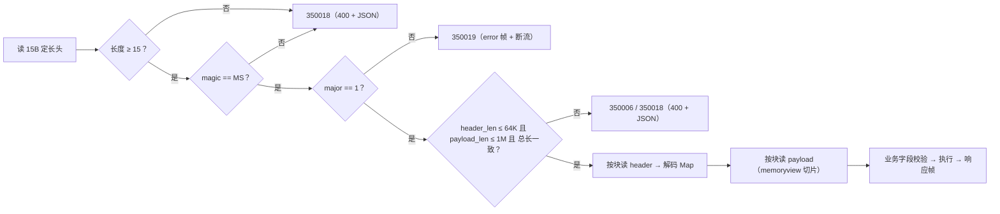
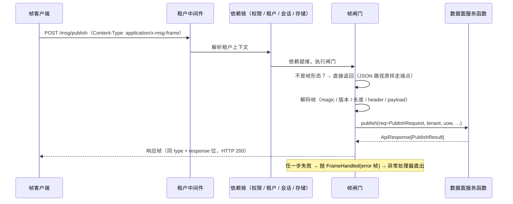

# 二进制帧协议与版本演进详细设计

> 08B / 任务 03-2 · 任务级详细设计（可落地、可逐条验收）

[文档首页](../../../../../../文档首页.md) › [03 传输与协议](../../03_传输与协议.md) › [03-2 二进制帧协议与版本演进](../03_传输与协议_02_二进制帧协议与版本演进.md) › 详细设计

---

## 1. 概述 <a id="overview"></a>

本文档是任务 [03-2 二进制帧协议与版本演进](../03_传输与协议_02_二进制帧协议与版本演进.md) 的**详细设计**，粒度到「按序落地、逐条验收」。与架构层不一致时以《架构设计》为准，实现细节以本文档为准。

**上游依据**：

- [需求 03-2 二进制帧协议与版本演进](../../../../需求/03_需求_传输与协议.md#r03-2)
- [架构设计 · 接入面：协议与客户端](../../../../../../设计/架构设计/05_架构设计_接入面_协议与客户端.md#frame) 第 4 节（帧与版本）、第 5 节（错误码）、第 10 节（演进纪律）、第 12 节 #1（字节序与编码）
- [03-1 HTTP/2 传输详细设计](../../03_传输与协议_01_HTTP2传输/设计/01_详细设计_01_HTTP2传输.md)（承接面：`/msg/*` 根路径、`ConnectionInfo`、`DATA_PLANE_ROUTES` 单点化）
- bms《[协议与传输](../../../../../../../bms文档/资料/知识档案/消息与事件驱动/07_事件驱动_协议与传输.md)》第 2~3 节

**与前后任务的关系**：

| 方向 | 任务 | 关系 |
| --- | --- | --- |
| 前置 | [03-1 HTTP/2 传输](../../03_传输与协议_01_HTTP2传输/03_传输与协议_01_HTTP2传输.md) | 复用 `/msg/*` 根路径、`DATA_PLANE_ROUTES` 与 `ConnectionInfo`；**不新增路径**，只给三端点加帧形态 |
| 后继 | [03-3 序列化与内容类型](../../03_传输与协议_03_序列化与内容类型/03_传输与协议_03_序列化与内容类型.md) | 本任务只定「帧信封 + header 的 MessagePack」；**payload 的语义（`content_type` / 压缩）归 03-3** |
| 后继 | [03-4 连接管理](../../03_传输与协议_04_连接管理/03_传输与协议_04_连接管理.md) | 心跳端点、`GOAWAY`、并发流上限归 03-4；本任务只登记 `heartbeat` 类型编号与回显语义 |
| 后继 | [03-5 背压与流控](../../03_传输与协议_05_背压与流控/03_传输与协议_05_背压与流控.md) | 帧式订阅推送（逐条消息 / 批量 / inflight）归 03-5；本任务 `subscribe` 只登记编号 |

**口径基线（2026-11-05 逐项确认，不再变更）**：

| # | 事项 | 结论 |
| --- | --- | --- |
| 1 | 帧头布局 | 显式 payload 长度，帧头 **15B**（见 §4.1） |
| 2 | magic | ASCII `b"MS"`（0x4D 0x53） |
| 3 | 字节序 / flags | 全字段大端；flags 16 位 5 个位定义；**不做 crc32** |
| 4 | header 编解码 | 官方 `msgpack>=1.1`（新增运行时依赖） |
| 5 | 版本编码 | `ver` 2B = `major(1B) + minor(1B)` |
| 6 | 不兼容处置 | 服务端只认主版本同号；不兼容回 `error` 帧并结束该 stream，**客户端负断开义务**；`GOAWAY` 归 03-4 |
| 7 | 版本可见 | 响应帧 header + `/msg/connection` 扩字段 + 结构化日志（三处） |
| 8 | 入口形态 | `Content-Type: application/x-msg-frame` 协商；缺省 / JSON 保持 03-1 行为 |
| 9 | 帧类型编号 | 分组区间（数据面 1~15 / 控制面 16~31 / admin 32~47 / rpc 48~63） |
| 10 | 请求-响应配对 | 响应复用请求 `type` + `flags.response`，header 回显 `request_id` |
| 11 | 错误帧 | `code / message / retryable / layer / request_id / detail? / retry_after_ms?`；新占 `350018`（帧格式非法）、`350019`（版本不支持），超大 `350006` |
| 12 | 1 MiB 校验 | 先读 15B 头再判上限，按块流式读、不预分配；**JSON 路径同判** |
| 13 | 未知忽略 | 未知帧类型按 `payload_len` 滑过（`need_response` 置位才回 `error(350018)`）；未知 header 字段不解析不报错 |
| 14 | subscribe 范围 | 只接 publish / consume / ack + error / heartbeat；`subscribe` 只登记编号、回「暂不支持」 |
| 15 | 代码落点 | 新包 `bms_msg/protocol/`（`frame.py` / `codec.py` / `contract.py`） |
| 16 | 契约与向量 | `x-msg-frame` 由 `ops.contract_snapshot` 导出时注入 `msg.json`；向量入库 `tests/data/frames/` |
| 17 | 租户 / trace | HTTP 中间件为准；帧 header 的 `tenant` 仅一致性断言（不一致 `350012`） |
| 18 | header 必填 | 必填 `request_id`，业务字段按端点必填；header ≤ 64 KiB；缺必填 → `350018` |
| 19 | 出错状态码 | 帧可解析 → HTTP 200 + `error` 帧；`magic` 不符 / 长度溢出 → 400 + JSON 错误体 |

## 2. 现状与差距 <a id="gap"></a>

2026-11-05 复核（msg 仓 `4a3e0e3`）：

| 项 | 现状 | 本任务目标 | 动作 |
| --- | --- | --- | --- |
| 帧编解码 | 无（`/msg/*` body 是 JSON） | `protocol/` 包：帧头 / 编解码 / 契约 | 新建 |
| 帧入口 | `/msg/*` 三端点与 `/api/v1` 共用 JSON handler | 同路径按 `Content-Type` 分派帧形态 | 修改 |
| 版本 | 无协议版本概念 | `ver` 字段 + 兼容判据 + 三处可见 | 新建 |
| 大小上限 | 无（JSON 路径也无） | 1 MiB + header 64 KiB，先判后分配 | 新建 |
| 错误帧 | 无（错误走统一 JSON） | `error` 帧 + `layer` / `retryable` | 新建 |
| 错误码 | `35` 段 14 个在用，`350004/005/006` 预留 | 启用 `350006`，新占 `350018` / `350019` | 修改 |
| 契约 | `deploy/contracts/msg.json` 为 OpenAPI 快照 | 顶层注入 `x-msg-frame`（导出期） | 修改 |
| 依赖 | 仅 `bms-core` + `fastapi` | 新增 `msgpack>=1.1`（+`uv.lock` 重同步） | 修改 |

**关键事实（决定实现形态，均经本机实测）**：

1. **不能再加一条隐藏路由**：基座 `service_contract.hidden_route_violations()` 按**路径集合**判定，
   路径 `/msg/publish` 只要有一条 `include_in_schema=False` 的实现路由，就会被判「隐藏路由超白名单」
   ——白名单只有 `/docs` / `/metrics` 等框架端点，业务路径不得加入。
2. **不能给同路径挂两条可见路由**：`app.openapi()` 的 `paths` 以路径为键，后者覆盖前者，
   帧路由没有 `requestBody`，会把公开契约里的请求体 schema 抹掉（03-1 的「两处挂载逐字段同源」用例立刻红）。
3. **FastAPI 依赖先于请求体校验执行**：路由级依赖解析完成前不会解析 `body`，因此依赖里可以做
   「帧形态判定 → 自己处理 → 用异常短路掉端点」。

**据此选定实现形态**：单路由 + **依赖闸门**（§6.1 给出与另两种做法的对比与排除理由）。

## 3. 目标目录与交付物清单 <a id="tree"></a>

```text
msg/backend/
├── services/msg/src/bms_msg/
│   ├── protocol/                               # 新建：协议层（架构 05 §2 的「消息层 + 编码层」）
│   │   ├── __init__.py                         # 包导出（帧类型 / 上限 / 编解码 / 契约）
│   │   ├── frame.py                            # 帧头常量、FrameType / FrameFlags、Frame、编解码与校验
│   │   ├── codec.py                            # header 的 MessagePack 编解码（Map[str, Any] 强约束）
│   │   └── contract.py                         # 协议契约单一事实源（frame_contract()）
│   ├── api/frame/
│   │   ├── gate.py                             # 新建：数据面帧闸门（判定 / 解码 / 调用 / 编码 / 短路）
│   │   ├── responses.py                        # 新建：结果帧与错误帧的装配（layer / retryable 映射）
│   │   └── routes.py                           # 修改：gate 装配、ConnectionInfo 扩字段、契约声明
│   ├── api/data/messages.py                    # 修改：DataPlaneRoute 增帧元数据；mount_data_plane 增 frame 开关
│   ├── schemas/transport.py                    # 修改：ConnectionInfo 增 protocol_version / supported_protocol_version
│   ├── core/config.py                          # 修改：FRAME_* 口径常量（content-type / 上限）
│   ├── errors.py                               # 修改：350006 / 350018 / 350019 三个异常类
│   ├── broker/delivery.py                      # 修改：decode_payload 加 1 MiB 上限（JSON 路径同判）
│   └── main.py                                 # 修改：登记帧响应异常处理器
├── ops/contract_snapshot.py                    # 修改：导出期注入 x-msg-frame
├── deploy/contracts/msg.json                   # 修改：重导（新增 x-msg-frame + publish 增 350006）
├── deploy/registry/msg.toml                    # 修改：3 条 errcodes + domains.paths 增 protocol/**
├── services/msg/pyproject.toml（+backend/uv.lock）# 修改：msgpack 依赖
└── services/msg/tests/                         # 新建 / 扩（见 §8）
    └── data/frames/*.json                      # 测试向量（hex + 期望）
```

交付物清单：

| 文件 | 类型 | 说明 |
| --- | --- | --- |
| `protocol/frame.py` | 新建 | `FRAME_MAGIC` / `PROTOCOL_VERSION` / `FrameType` / `FrameFlags` / `Frame` / `encode_frame` / `decode_frame` / `decode_frames` |
| `protocol/codec.py` | 新建 | `decode_header` / `encode_header`（msgpack，Map 且 key 为 str） |
| `protocol/contract.py` | 新建 | `frame_contract()`（导出为 `x-msg-frame`） |
| `api/frame/gate.py` | 新建 | `FrameGate` 依赖工厂、`FrameHandled` 异常与处理器注册 |
| `api/frame/responses.py` | 新建 | `result_frame()` / `error_frame()` / `classify()`（码 → layer / retryable） |
| `api/frame/routes.py` | 修改 | 三端点挂 gate；`connection` 增版本字段；`x-error-codes` 补 `350006` |
| `api/data/messages.py` | 修改 | `DataPlaneRoute` 增 `frame_type`；`mount_data_plane(frame=True)` 挂 gate |
| `errors.py` | 修改 | `MsgPayloadTooLargeError`(350006) / `MsgFrameInvalidError`(350018) / `MsgVersionUnsupportedError`(350019) |
| `broker/delivery.py` | 修改 | `decode_payload` 增加 1 MiB 上限 |
| `ops/contract_snapshot.py` | 修改 | `build_openapi()` 注入 `x-msg-frame` |
| `deploy/contracts/msg.json`、`deploy/registry/msg.toml` | 修改 | 重导 + 3 条错误码 + 域路径 |
| `tests/**`、`tests/data/frames/**` | 新建 / 扩 | 见 §8 |

## 4. 协议数据结构 <a id="data"></a>

> 本任务**不建表、不改表**：帧是无状态线格式，版本与上限都是常量。

### 4.1 帧布局 <a id="layout"></a>

```text
+--------+---------+--------+---------+--------------+--------------+
| magic  | ver     | type   | flags   | header_len   | payload_len  |
| 2B     | major1B | 1B     | 2B      | 4B (uint32)  | 4B (uint32)  |
|        | minor1B |        |         |              |              |
+--------+---------+--------+---------+--------------+--------------+
| header（MessagePack Map[str, Any]，长度 = header_len）             |
+--------------------------------------------------------------------+
| payload（原始字节，长度 = payload_len；broker 不解析内容）          |
+--------------------------------------------------------------------+
```

| 字段 | 宽度 | 含义 | 设计要点 |
| --- | --- | --- | --- |
| `magic` | 2B | 固定 `b"MS"` | 先比 magic 再解析其余字段：非本协议流量一次比较即拒 |
| `ver.major` | 1B | 主版本（当前 `1`） | 不等即 `350019` + 结束该 stream（客户端断开） |
| `ver.minor` | 1B | 次版本（当前 `0`） | 任高任低都接受：只增可选字段，老端忽略未知字段 |
| `type` | 1B | 帧类型编号 | 区间见 §4.2；与路径不匹配即 `350018` |
| `flags` | 2B | 位标记 | 见 §4.3；未定义位一律忽略（为后续留位） |
| `header_len` | 4B | header 字节数 | ≤ 64 KiB；**先判再读**，不按声明长度预分配 |
| `payload_len` | 4B | payload 字节数 | ≤ 1 MiB（`350006`）；同上 |
| `header` | 变长 | MessagePack Map | key 必须为 str；未知 key 忽略；业务字段见 §4.4 |
| `payload` | 变长 | 消息体原始字节 | 内容语义归 03-3（`content_type` / 压缩）；本任务只搬运 |

**为什么帧头带 `payload_len`**：一条 HTTP/2 stream 上可以连续拼多帧（03-5 批量推送、03-3 批压缩）。
长度自描述让解码器能逐帧滑走（`decode_frames` 支持不完整尾包），不必靠 `Content-Length` 或流结束来
切分——后者一旦引入批量帧就要改布局，等于升主版本。

**为什么不做 crc32**：HTTP/2 自带帧校验，生产切 TLS 后链路完整；逐帧 CRC 要在流式解码里多一份缓冲，
而真正需要完整性保护的是 8B_02 的落盘段（那里已有段级 CRC）。

### 4.2 帧类型编号 <a id="types"></a>

| 区间 | 用途 | 已用 | 说明 |
| --- | --- | --- | --- |
| 1~15 | 数据面 | 1 `publish`、2 `consume`、3 `ack`、4 `subscribe` | `subscribe` 只登记编号，服务端回「暂不支持」（§6.6） |
| 16~31 | 控制面 | 16 `error`、17 `heartbeat` | `heartbeat` 只登记编号与回显语义，端点归 03-4 |
| 32~47 | admin 预留 | — | 管理面帧化（如需）在此区间取号 |
| 48~63 | rpc 预留 | — | RPC 帧化在此区间取号 |
| 0、64~255 | 未定义 | — | 收到即按「未知类型」处理（§4.7） |

**为什么用分组区间而不是连续小整数**：`admin` / `rpc` 的「预留」必须是**一段可扩展区间**，否则后续
新增预留类型时只能插空，容易出现两个任务抢同一个号；区间让「谁归哪个面」一眼可判。

**`consume` 补充说明**：任务 §2 第 3 条的清单只列了 `publish` / `ack` / `subscribe` / `error` / `heartbeat`，
但数据面拉取端点在 03-1 已交付（`/msg/consume`），帧形态必须有对应类型——本任务补 `2 consume` 并在
任务文档 §2 回写（§12 对齐记录 #3）。

### 4.3 flags 位定义 <a id="flags"></a>

| 位 | 名 | 语义 | 本任务是否使用 |
| --- | --- | --- | --- |
| bit0 | `compressed` | payload 已压缩（算法由 03-3 的 `content_type` / header 决定） | 否（只透传，03-3 启用） |
| bit1 | `end_of_stream` | 本帧是该 stream 的最后一帧 | 否（单帧请求恒为最后帧，不置位） |
| bit2 | `need_response` | 请求方等一个响应帧 | 是（未知类型时据此决定是否回 `error`） |
| bit3 | `batch` | payload 为多条消息的批（03-5） | 否 |
| bit4 | `response` | 本帧是响应帧（与请求同 `type`） | 是（所有响应帧置位） |

未定义位（bit5~bit15）**一律忽略**：客户端置了也不报错，为将来留位且不破坏兼容。

### 4.4 header 字段 <a id="header"></a>

**信封字段（所有帧通用）**：

| 键 | 类型 | 必填 | 说明 |
| --- | --- | --- | --- |
| `request_id` | str(1~64) | 是（请求帧） | 客户端生成；响应帧原样回显（同一 stream 也可能多帧，故不用隐式配对） |
| `protocol_version` | str | 否（响应帧必有） | 服务端据以解析本次请求的版本，如 `"1.0"` |
| `tenant` | str | 否 | 仅一致性断言：与 HTTP 中间件解析结果不一致即 `350012`（§6.4） |
| `trace_id` | str | 否 | HTTP 头缺失时的补位（§6.4） |
| `content_type` | str | 否 | 消息体类型，**03-3 启用**；本任务只做存在性透传 |

**业务字段（按端点，键名与 JSON 请求体同名）**：

| 端点 | 必填 | 可选 |
| --- | --- | --- |
| `publish`（1） | `namespace`、`topic` | `key`、`headers`（Map[str,str]）、`trace_id`、`delay_level` |
| `consume`（2） | `namespace`、`topic`、`group`、`consumer_id`、`partition` | `max_messages`、`acks` |
| `ack`（3） | `namespace`、`topic`、`group`、`consumer_id`、`partition`、`offset` | — |

- **payload 只在 `publish` 上有内容**：即消息体原始字节（JSON 路径的 `payload` base64 字段在帧路径不存在）。
  `consume` / `ack` 的 `payload_len` 必须为 0，否则 `350018`。
- **键名与 JSON 同名的理由**：一个语义只在一个 Pydantic 模型里定义，帧路径只做「Map → 模型」的搬运，
  不另造一套字段名（否则同一字段两处命名，长期必漂）。
- **必填判定**：缺**键**→ `350018`（协议层：帧不完整）；键在但**值形态非法**→ `10001`（契约层，与 JSON 同口径）。

### 4.5 错误帧 <a id="errors"></a>

`type = 16(error)`、`flags.response` 置位、`payload_len = 0`：

| 键 | 类型 | 说明 |
| --- | --- | --- |
| `request_id` | str \| null | 能从请求帧取到就回显；解码前失败为 null |
| `protocol_version` | str | 服务端版本（`"1.0"`） |
| `code` | int | 产品码 / 平台码（与 JSON 路径同一码表） |
| `message` | str | 可读提示（与 JSON 路径同一文案来源；无文案时给码说明） |
| `retryable` | bool | 客户端能否原样重试 |
| `layer` | str | `transport` / `protocol` / `business` / `system` |
| `detail` | Map \| null | 随附数据（对应 JSON 的 `data`，如契约校验明细） |
| `retry_after_ms` | int \| null | 建议重试间隔（限流 / 系统繁忙时给） |

**层 → 客户端动作**：

| layer | 含义 | 客户端应做什么 | 是否继续用这条连接 |
| --- | --- | --- | --- |
| `transport` | 帧不可继续解析（版本不支持 / 帧超限） | 停止发送、关闭连接 | **否**（`350019` 必须断开） |
| `protocol` | 帧可解析但内容不合法（缺必填头 / 类型不支持） | 修请求后重试 | 是 |
| `business` | 业务拒绝（主题不存在 / 成员失效 / 延迟区满） | 按 `retryable` 决定重试或放弃 | 是 |
| `system` | 服务端内部（库不可用 / 未预期异常） | 退避后重试 | 是 |

**码 → layer / retryable（唯一映射表，落在 `api/frame/responses.py`）**：

| 码 | layer | retryable | 备注 |
| --- | --- | --- | --- |
| `350006` | transport | false | 帧或消息体超 1 MiB（帧路径只在解码期出现） |
| `350018` | protocol | false | 帧格式非法 / 缺必填头 / 类型与路径不匹配 / 类型暂不支持 |
| `350019` | transport | false | 主版本不支持 |
| `350005` | business | true + `retry_after_ms` | 限流 / 背压（03-5 启用，本任务先映射） |
| `350015` | business | true | 延迟区已满（堆满会缓解，重试有意义） |
| `350001` `350002` `350003` `350007` `350008` `350009` `350010` `350011` `350012` `350013` `350014` `350016` `350017` | business | false | 业务拒绝，原样重试无意义 |
| `10001` | protocol | false | 契约层参数非法 |
| `10006` `10007` | system | true | 库繁忙 / 下游不可用（`retry_after_ms` 由异常自带时透传） |
| 其他 | system | false | 兜底：不鼓励盲重试 |

### 4.6 上限与校验顺序 <a id="limits"></a>

| 常量 | 值 | 落点 |
| --- | --- | --- |
| `FRAME_HEADER_BYTES` | 15 | 帧头定宽 |
| `MAX_HEADER_BYTES` | 64 KiB | `header_len` 上限 |
| `MAX_PAYLOAD_BYTES` | 1 MiB | `payload_len` 上限；也是**单条消息**上限 |
| `MAX_FRAME_BYTES` | 15 + 64 KiB + 1 MiB（派生） | 整帧上限，由前两者派生，不单独判 |

**校验顺序（先判后分配，任何一步失败都不读后续字节）**：



- **不预分配**：`payload_len` 在校验通过前不用于 `bytearray(n)` / `read(n)`；实现上直接对已读 body 做
  `memoryview` 切片（body 由 ASGI 交给应用，本身已是完整字节），因此「声明 4GB 但只发 10B」不会有内存放大。
- **整帧一致性**：`len(body) != 15 + header_len + payload_len` → `350018`（截断或追加都拒绝，不留歧义）。
- **JSON 路径同判**：`broker/delivery.py::decode_payload` 在 base64 解码后判 `len > 1 MiB` → `350006`（413）。
  普通发布与延迟发布共用该函数，因此两条分支同时生效（闭环计划风险 8「只靠传输层拒绝」）。

### 4.7 版本规则 <a id="version"></a>

| 项 | 规则 |
| --- | --- |
| 编码 | `ver = major(1B) + minor(1B)`，当前 `1.0`；文本表示 `"1.0"`（日志 / 响应帧 / 连接元数据统一用它） |
| 兼容判据 | 服务端只要求 `major == 1`；`minor` 任高任低都接受，未知字段忽略（只增可选字段） |
| 不兼容处置 | `350019` + `error` 帧（layer=transport, retryable=false）后**结束该 stream**；客户端据 `layer=transport` 必须断开连接 |
| 为什么不是服务端断连 | ASGI 不提供「按连接关闭」的标准入口，`scope` 里没有连接标识；服务端能做的只有结束 stream。`GOAWAY` 是连接级动作，归 03-4。需求 §3 内容 4 的「断连」措辞按此回写（§12 对齐记录 #1） |
| 次版本何时升 | 只在「新增一类客户端必须理解的字段/行为」时升；纯新增可选字段**不必**升（铁律 1） |

**三条演进铁律的机器化落点**：

| 铁律 | 落点 |
| --- | --- |
| 只增可选字段，不删不改语义 | `x-msg-frame.required` 与 `optional` 两组清单进契约；用例逐条比对已知键集（新增键必须进 optional） |
| 未知帧类型 / 未知字段必须忽略 | 用例：未知 type 滑过、未知 header 键不报错、未知 flags 位不报错 |
| 版本必须可见 | 响应帧 `protocol_version` + `/msg/connection` + 结构化日志 `event=msg.frame` |

## 5. 编解码设计 <a id="codec"></a>

### 5.1 `protocol/frame.py`

| 成员 | 签名 | 职责 |
| --- | --- | --- |
| `FRAME_MAGIC` | `b"MS"` | 协议识别 |
| `PROTOCOL_MAJOR` / `PROTOCOL_MINOR` | `1` / `0` | 当前版本 |
| `PROTOCOL_VERSION` | `"1.0"` | 文本表示（避免调用方各拼一遍） |
| `FrameType` | `IntEnum` | `PUBLISH=1` / `CONSUME=2` / `ACK=3` / `SUBSCRIBE=4` / `ERROR=16` / `HEARTBEAT=17` |
| `FrameFlags` | `IntFlag` | `COMPRESSED=1` / `END_OF_STREAM=2` / `NEED_RESPONSE=4` / `BATCH=8` / `RESPONSE=16` |
| `Frame` | `frozen dataclass` | `type` / `flags` / `header: Mapping[str, Any]` / `payload: memoryview` / `version` |
| `encode_frame()` | `(*, frame_type, flags, header, payload=b"") -> bytes` | 编码（校验上限，超限抛 `MsgPayloadTooLargeError`） |
| `decode_frame()` | `(data: bytes \| memoryview) -> Frame` | 解码单帧（要求恰好一帧，尾部多余即 `350018`） |
| `decode_frames()` | `(data: bytes \| memoryview) -> tuple[list[Frame], int]` | 解码多帧，返回 `(完整帧列表, 已消费字节数)`；尾包不完整时保留剩余（流式解码） |

- `Frame.payload` 是 `memoryview`（对 body 的切片），**不复制**；调用方按需 `bytes(...)`。
- `encode_frame` 不校验业务字段（那是 Pydantic 的事），只校验结构上限。

### 5.2 `protocol/codec.py`

```python
def decode_header(raw: bytes | memoryview) -> ConcurrentStableDict[str, Any]
def encode_header(header: Mapping[str, Any]) -> bytes
```

- `msgpack.unpackb(raw, raw=False, strict_map_key=False, use_list=True)`：`raw=False` 让 `str` 直出
  （而不是 `bytes`），`strict_map_key=False` 允许非 str 键**解出来**再由我们判——解不出来就分不清
  「格式坏」与「键类型非法」，错误码会含糊。
- **强约束**：结果必须是 `Mapping` 且**所有键为 str**；否则 `350018`（附键类型说明）。
- `encode_header` 用 `msgpack.packb(..., use_bin_type=True)`：二进制与字符串分开编码，跨语言不歧义。

### 5.3 响应帧装配（`api/frame/responses.py`）

| 端点 | header | payload |
| --- | --- | --- |
| `publish` | `request_id`、`protocol_version`、`message_id`、`log_id`、`topic`、`partition`、`offset`（可 null）、`deliver_at`（ISO，可 null） | 空 |
| `consume` | `request_id`、`protocol_version`、`count`、`messages`：`[{message_id, topic, partition, offset, key, trace_id, delivery_count, published_at, headers, length}]` | **各消息体原始字节按序拼接**；第 i 段 = `messages[i].length` 字节 |
| `ack` | `request_id`、`protocol_version`、`committed_offset` | 空 |

- `consume` 用「元数据进 header + 消息体进 payload」的分段布局：`length` 是切分表，客户端用一次
  `payload[pos:pos+length]` 取消息体，**不发生整包重排**。
- 本任务中消息体来自 `MessageItem.payload`（base64），装配时**解码一次**还原为原始字节；03-3 定
  `content_type` 后可省掉这次 base64 往返（登记为遗留，不阻塞本任务）。

### 5.4 未知帧类型 / 未知字段 <a id="unknown"></a>

| 场景 | 行为 | 理由 |
| --- | --- | --- |
| 未知 `type`（0、5~15、18~255） | 按 `payload_len` 精确滑过该帧继续解析；若该帧 `need_response` 置位 → 回 `error(350018, layer=protocol)` | 「忽略」不等于「静默」：同步调用方在等响应，不给响应会挂到超时，比报错更难定位 |
| `subscribe`（4）/ `heartbeat`（17） | 已登记但本任务不服务 → `error(350018)`，`message` 写「该帧类型将在后续任务开放」 | 与「未知类型」区分：这是**已知但未实现**，报错能给出准确指引 |
| 未知 header 键 | 不解析、不报错；业务字段按已知键白名单取用 | 铁律 2 |
| 已知键类型不符 | `10001`（契约层） | 与 JSON 路径同口径 |
| 未知 flags 位 | 忽略 | 为后续位留扩展空间 |

## 6. 帧入口接入设计 <a id="entry"></a>

### 6.1 为什么是「依赖闸门 + 异常短路」 <a id="why-gate"></a>

| 方案 | 做法 | 结论 |
| --- | --- | --- |
| A 第二条隐藏路由 | 同路径再挂一条 `include_in_schema=False` 的帧路由 | **排除**：基座 `hidden_route_violations()` 按路径集合判违规，`/msg/publish` 会被判「隐藏路由超白名单」 |
| B 第二条可见路由 | 两条路由都进契约，靠 `matches()` 按 `Content-Type` 分派 | **排除**：`paths` 以路径为键，后挂者覆盖前者，帧路由没有 `requestBody`，公开契约的请求体 schema 被抹掉 |
| C 依赖闸门（选用） | 路由仍是 03-1 那一条；新增路由级依赖，命中帧形态时自行处理并用异常短路端点 | 单路由、契约零变化、JSON 路径零改动；依赖先于 body 校验执行（§2 关键事实 3） |

**控制流**：



- **闸门放在权限依赖之后**：`dependencies=[_PUBLISH, Depends(gate)]`。权限拒绝时客户端拿到的是标准
  403 JSON（与 JSON 路径一致）——鉴权发生在「请求身份未定」阶段，此时还不该按协议帧回应（§6.5）。
- **闸门不做业务判定**：它只做「解码 → 组装入参模型 → 调 `api/data/messages.py` 的同一批函数 →
  编码结果」。业务语义（保留清理 / 成员守卫 / 投递 / 停等）仍然只有一份。
- **异常短路**：`FrameHandled(response)` 由 `register_frame_handlers(app)` 注册的处理器直出；
  该处理器同时挂在 `ApplicationFactory.configure_service()` 与测试用最小装配上。

### 6.2 与 `/api/v1` 的关系

| 路径 | 形态 | 本任务动作 |
| --- | --- | --- |
| `/api/v1/msg/{publish,consume,ack}` | 纯 JSON | **不动**（基准对照与回退路径） |
| `/msg/{publish,consume,ack}` | 帧（`application/x-msg-frame`）或 JSON（缺省） | 加闸门；JSON 分支行为与 03-1 完全一致 |
| `/msg/subscribe`、`/msg/connection` | SSE / JSON | 不动（`connection` 只扩两个字段） |

**为什么不硬切**：03-1 的基准脚本、`test_frame_entry.py`、SSE 订阅、冒烟脚本都走 `/msg/*` 的 JSON 形态；
硬切等于把「帧不可用」变成「只能回退发版」，与「8B_01 可刹车」的基调冲突。

### 6.3 租户与 trace（确认 #17）

| 项 | 口径 |
| --- | --- |
| 租户 | 以 HTTP 中间件 + `frame_tenant()` 解析结果为准；帧 header 的 `tenant` 只做一致性断言，不一致 → `350012`（不泄露租户是否存在） |
| trace | HTTP 头 / 中间件为主；帧 header 的 `trace_id` 仅在 HTTP 侧为空时补位，并回写到消息记录 |
| 为什么不以帧为准 | 会让帧成为鉴权的第二个入口：绕过中间件的身份链等于开一个后门 |

### 6.4 大小上限的实现位置

| 层 | 位置 | 行为 |
| --- | --- | --- |
| 帧解码 | `protocol/frame.py::decode_frame` | `header_len` / `payload_len` / 总长越界 → `350006` / `350018` |
| 单条消息（JSON） | `broker/delivery.py::decode_payload` | 解码后 > 1 MiB → `350006`（413） |
| 单条消息（帧） | 同上（帧 payload 也走 base64 → 模型 → 同一函数） | 同码 |

> 帧路径的消息体最终仍经 `PublishRequest.payload`（base64）进入服务层，因此上限只在 `decode_payload`
> 一处判——**两条路径、一个判据**。等 03-3 让 payload 直通二进制后，判据位置不变、只是少一次编解码。

### 6.5 出错时的 HTTP 状态码（确认 #19）

| 情形 | HTTP | body | 理由 |
| --- | --- | --- | --- |
| 帧解码成功，后续任何失败（含业务 / 契约 / 版本） | **200** | `error` 帧 | 帧可解析即「协议内失败」，客户端一条解析路径；与 SSE 流内错误同哲学 |
| `magic` 不符 / 长度越界 / 帧被截断 | 400 | JSON 错误体 | 这不是本协议流量，回帧对方也读不懂；用统一 JSON 让误发方看得懂 |
| 鉴权 / 租户解析失败（发生在闸门之前） | 401 / 403 / 404 | JSON 错误体 | 身份未定阶段，与 JSON 路径完全一致 |
| 未预期异常 | 500 | JSON 错误体 | 走基座兜底（含完整日志），不在协议层吞异常 |

> 网关与监控若按状态码统计成功率，帧路径会呈现「全 200」——这是**有意为之**，排障要看业务码。
> 该口径登记进实施记录，供 06 域做指标时对齐。

### 6.6 版本可见的落点（确认 #7）

| 落点 | 内容 |
| --- | --- |
| 响应帧 header | `protocol_version`（服务端据以解析本次请求的版本） |
| `GET /msg/connection` | `protocol_version`（本请求为帧形态时非空；JSON 形态为 null）+ `supported_protocol_version`（服务端当前版本，恒有值） |
| 结构化日志 | `event=msg.frame`，字段含 `protocol_version` / `frame_type` / `request_id` / `http_version` / `outcome` |

> **为什么不做「连接级协商」**：ASGI 不暴露 HTTP/2 连接标识，服务端无法在连接维度存版本；版本是
> **每帧**自描述的，服务端逐帧判定。因此「连接元数据能看到版本」落在「本次请求所用版本 + 服务端支持
> 版本」两处——这正是排障要问的两件事。

## 7. 契约登记 <a id="contract"></a>

`ops/contract_snapshot.py::build_openapi()` 在 `app.openapi()` 之后**注入**顶层 `x-msg-frame`：

```json
{
  "x-msg-frame": {
    "protocol_version": "1.0",
    "content_type": "application/x-msg-frame",
    "magic": "4D53",
    "byte_order": "big-endian",
    "frame_header_bytes": 15,
    "fields": [
      {"name": "magic", "width": 2, "type": "bytes"},
      {"name": "ver", "width": 2, "type": "major(1)+minor(1)"}
    ],
    "limits": {"header_bytes": 65536, "payload_bytes": 1048576},
    "frame_types": {"1": "publish", "2": "consume", "3": "ack", "4": "subscribe", "16": "error", "17": "heartbeat"},
    "reserved_types": [{"range": "32-47", "name": "admin"}, {"range": "48-63", "name": "rpc"}],
    "flags": {"0": "compressed", "1": "end_of_stream", "2": "need_response", "3": "batch", "4": "response"},
    "error_frame": ["code", "message", "retryable", "layer", "request_id", "detail", "retry_after_ms"],
    "version_rule": {"accept_major": [1], "minor": "any", "incompatible": "350019 + end stream, client disconnects"}
  }
}
```

- **单一事实源**：`protocol/contract.py::frame_contract()`；导出与校验都经 `build_openapi()`，因此
  「契约快照与实现一致」由 `ops.contract_snapshot check` **自动**保证，不新增预检步骤。
- **为什么不单独开一个 `msg_frame.json`**：跨仓装载校验只认 `msg.json`；新开文件要多一处漂移点与一步
  预检，且仍需有人手工对账。
- **为什么不在 `app.openapi()` 里注入**：运行时 OpenAPI 是「HTTP 接口文档」，帧是**同路径的另一形态**，
  混进 `/openapi.json` 会让所有生成式客户端（含前端 SDK）尝试按 JSON 解析帧端点。快照是「对外承诺的
  全量契约」，注入在导出层最贴合语义。

## 8. 测试设计 <a id="tests"></a>

### 8.1 Kiwi 用例

先登记后编码（`ssh minjian@192.168.0.107 "docker exec -i bms-kiwi /Kiwi/manage.py shell"`），分类
「平台骨架」、优先级 `P2`、状态 `CONFIRMED`、标签「自动化」；**新登记一条，不复用 2420**（03-1 的编号
不得改派）。`text` 写覆盖范围（帧结构 / 版本 / 上限 / 错误帧 / 未知忽略 / 帧端到端）与自动化文件路径。

### 8.2 用例清单

| 层 | 文件 | 用例 | 覆盖的关键分支 |
| --- | --- | --- | --- |
| 帧基元 | `tests/protocol/test_frame.py` | 编码→解码往返；帧头 15B 与字节序断言（hex 前缀）；`decode_frames` 多帧与不完整尾包；短包 / magic 错 / 总长不一致 / header 超限 / payload 超限；主版本不支持；次版本高/低都接受；`needs_response` 位解析 | 全部结构校验分支 |
| header 编解码 | `tests/protocol/test_codec.py` | Map 往返（含中文、二进制用户头）；非 Map（数组 / 字符串）→ `350018`；键非 str → `350018`；空 header | 类型判定分支 |
| 契约 | `tests/protocol/test_contract.py` | `frame_contract()` 与 `x-msg-frame` 注入一致；类型表覆盖 1/2/3/4/16/17 与两段预留；上限与常量同值 | 契约一致性 |
| 响应装配 | `tests/api/test_frame_responses.py` | publish / consume / ack 三种结果帧的 header 与 payload 分段（`length` 切片取回原文）；错误帧字段齐全；码 → layer / retryable 映射逐条 | 映射表全覆盖（含兜底分支） |
| 帧入口（JSON 不变） | `tests/api/test_frame_entry.py`（扩） | 既有 6 条不改仍绿；新增：帧形态 publish / consume / ack 端到端；错误帧 `350001`（200 + layer=business）；缺 `request_id`（`350018`）；类型与路径不匹配（`350018`）；magic 错（400 + JSON）；超大 payload（400 + `350006`）；`connection` 两个版本字段 | 闸门「非帧直接返回」分支 |
| 版本与忽略 | `tests/api/test_frame_version.py` | 主版本 2 → `350019` + 200；次版本 9 → 正常；未知 type 且 `need_response` → `350018`；未知 type 无 `need_response` → 200 空帧（滑过）；`subscribe` / `heartbeat` → `350018` 且 `message` 含「后续任务」；未知 header 键 → 正常；未知 flags 位 → 正常 | 未知处理分支 |
| JSON 上限 | `tests/api/test_data_messages.py`（扩） | base64 解码后 > 1 MiB → `350006`（413）；恰好 1 MiB 通过；延迟发布同码 | `decode_payload` 两条调用路径 |
| 契约快照 | `tests/ops/test_contract_snapshot.py`（扩） | 快照含 `x-msg-frame` 且 `protocol_version` / 上限与常量同值；`check` 在帧契约漂移时红（改快照一个字节已被原用例覆盖） | 注入分支 |
| 测试向量 | `tests/protocol/test_vectors.py` | 回放 `tests/data/frames/*.json`：合法 / 边界 / 非法 / 未知类型 / 未知字段 / 超大六组 | 向量与实现一致 |

**不做的测试**：帧式订阅推送（03-5）、心跳超时与 `GOAWAY`（03-4）、容量与吞吐（8B_12）。

### 8.3 测试向量清单（入库 `tests/data/frames/`）

| 文件 | 组 | 内容 | 期望 |
| --- | --- | --- | --- |
| `legal_publish.json` | 合法 | publish 帧，header 5 键，payload `cGF5bG9hZA==` | 解码成功，`payload == b"payload"` |
| `legal_ack_min.json` | 边界 | 最小合法帧：空 payload、header 仅必填键 | 解码成功 |
| `boundary_max_header.json` | 边界 | `header_len == 64 KiB`（填充 unknown 键） | 解码成功（未知键忽略） |
| `boundary_max_payload.json` | 边界 | `payload_len == 1 MiB` | 解码成功 |
| `invalid_short.json` | 非法 | 10 字节 | `350018` |
| `invalid_magic.json` | 非法 | magic `b"XX"` | `350018`（400） |
| `invalid_length_mismatch.json` | 非法 | 声明 payload 16B、实送 8B | `350018` |
| `oversize_header.json` | 超大 | `header_len = 64 KiB + 1` | `350006` |
| `oversize_payload.json` | 超大 | `payload_len = 1 MiB + 1` | `350006` |
| `version_major_2.json` | 非法 | `major=2` | `350019` |
| `version_minor_9.json` | 合法 | `1.9` | 解码成功（次版本任意） |
| `unknown_type.json` | 未知类型 | `type=200`、`need_response` 置位 | `350018`（protocol） |
| `unknown_header_key.json` | 未知字段 | header 含 `future_field` | 解码成功、字段被忽略 |

- 向量文件格式：`{"name": ..., "note": ..., "hex": "<完整帧十六进制>", "expect": "ok|350018|350006|350019", "assert": {...}}`。
  用 hex 而非二进制：Git 可读、评审能逐字节看、跨平台无行尾问题；解码后逐字段断言用 `assert` 段。
- **生成方式**：先用编码器生成、再人工核对 hex 后**冻结**入库；用例只**读**向量，不再生成（防止「用实现
  验证实现」）。`boundary_*` 用脚本一次生成后入库（生成脚本不入库，避免二次事实源）。

### 8.4 覆盖率照顾点

| 分支 | 覆盖方式 |
| --- | --- |
| `decode_frame` 各结构校验（短包 / magic / 总长 / header 超限 / payload 超限 / 版本） | `test_frame.py` 逐条构造 |
| `decode_frames` 尾包不完整 | 一帧 + 半帧输入 |
| `decode_header` 非 Map / 键非 str | `test_codec.py` |
| `classify()` 的每个码与兜底 | `test_frame_responses.py` 参数化 |
| 闸门「非帧形态直接返回」 | 既有 JSON 用例（`test_frame_entry.py` 6 条） |
| 闸门「解码失败 → 400」与「业务失败 → 200 错误帧」 | `test_frame_entry.py` 新增两条 |
| 未知类型有/无 `need_response` | `test_frame_version.py` 两条 |
| `decode_payload` 超限 / 未超限 | `test_data_messages.py` 扩两条 |
| 契约注入 | `test_contract_snapshot.py` 扩一条 |

## 9. 实施步骤 <a id="steps"></a>


| 步 | 内容 | 产出 |
| --- | --- | --- |
| 1 | Kiwi 登记 1 条并回读编号 | 用例编号 |
| 2 | `msgpack` 依赖 + `core/config.py` 的 `FRAME_*` 常量 | 可导入 |
| 3 | `protocol/` 三个模块 | 编解码与契约可用 |
| 4 | `errors.py` 三个异常类 + registry 三条 + `x-error-codes` | 码表一致 |
| 5 | `api/frame/responses.py` + `api/frame/gate.py` | 帧端到端可用 |
| 6 | `api/frame/routes.py` / `api/data/messages.py` / `main.py` 装配 | 入口可用 |
| 7 | `decode_payload` 上限 + `ops.contract_snapshot` 注入 + 重导 | 门禁口径一致 |
| 8 | 向量入库 + 用例 | 用例全绿 |
| 9 | 覆盖率 / 静态 / 文档三项 / 记录 / 计划回写 | 交付闭环 |

## 10. 验收映射 <a id="accept-map"></a>

| 任务完成标准（§3） | 验证方式 |
| --- | --- |
| 新增可选 header 字段后，旧客户端 / 旧服务端仍能正常收发 | `unknown_header_key.json` 向量 + `test_frame_version.py`：未知键被忽略、业务正常；`x-msg-frame.optional` 清单断言 |
| 未知帧类型被忽略而非报错；未知 header 字段被忽略 | 未知 type 无 `need_response` → 200；未知键 → 成功；未知 flags 位 → 成功 |
| 超大帧 / 超长 header 被拒绝并返回 `350006`，无内存放大 | `oversize_*` 向量 + 400 + `350006`；解码前不按声明长度分配（实现审查 + `boundary_max_*` 证明上限可通过） |
| 主版本不兼容时明确断连；连接元数据能读到协商版本 | `version_major_2` → `350019` + `layer=transport`（契约写死客户端断开义务）；响应帧 `protocol_version` + `/msg/connection` 两字段 + 日志 |
| 帧测试向量全绿；契约快照与实现一致 | `test_vectors.py` 13 条向量；`ops.contract_snapshot check`（含 `x-msg-frame`） |
| 变更模块行 + 分支覆盖率 100%，静态检查全绿 | `coverage_report.py --module ...`（9 个模块）；`ruff` / `pyright` |

## 11. 风险与开放项 <a id="risk"></a>

| # | 项 | 影响 | 处置 |
| --- | --- | --- | --- |
| 1 | 帧路径消息体经 base64 往返一次 | 大消息多一次编解码与内存拷贝 | 03-3 定 `content_type` 后直通；本任务先保证语义正确（性能不作门禁） |
| 2 | `msgpack` 是新增第三方依赖 | 依赖面扩大、需 `uv.lock` 重同步 | 官方库、跨语言通用；已在设计期确认源可达（清华镜像） |
| 3 | 「断连」由客户端执行 | 不守约的客户端会继续用这条连接 | 服务端对该 stream 已结束并记 `outcome=version_rejected` 日志；03-4 落 `GOAWAY` 后改为连接级关闭 |
| 4 | 帧路由不出现在 `/openapi.json` | 生成式客户端看不到帧形态 | 契约快照有 `x-msg-frame` 全量描述；03-2 之后如需 SDK，从快照取 |
| 5 | 权限 / 租户失败仍回 JSON | 帧客户端要多一条按状态码分支的判断 | 属「身份未定」阶段，与 JSON 路径一致；SDK 归 8B_03 统一封装 |
| 6 | 帧式订阅未落地 | 帧路径无法长驻消费 | 03-5 落（需新增 `message` 类帧，届时升次版本即可，不需主版本） |
| 7 | 心跳帧只登记不服务 | 半开连接探测仍靠 03-1 的 SSE 注释行 | 03-4 落心跳端点与超时判定 |
| 8 | `subscribe` / `heartbeat` 回 `350018` | 客户端可能误以为「协议不支持」 | `message` 明确写「将在后续任务开放」，并把这两个类型写进契约的 `known_unsupported` |

## 12. 对齐记录 <a id="align"></a>

| # | 事项 | 结论 |
| --- | --- | --- |
| 1 | 需求 §3 内容 4「主版本不兼容即断连」 | 改为「服务端结束 stream + 客户端负断开义务；`GOAWAY` 归 03-4」，需回写需求 03-2 与架构 05 §5 |
| 2 | 任务 §2 第 1 条帧结构 | 补 `payload_len`（第 6 条已提「`length` 字段」，两处口径统一为 `payload_len`） |
| 3 | 任务 §2 第 3 条帧类型清单 | 补 `2 consume`（数据面拉取）；注明 `subscribe` / `heartbeat` 只登记编号 |
| 4 | 架构 05 §5 错误码表 | 补 `350018` / `350019`；`350006` 上限回填 1 MiB（§12 待定项 #5 由本任务回填） |
| 5 | 架构 05 §12 待定项 #1（帧字节序与字段编码） | 由本任务定稿（§4.1~§4.3），回填「已定稿」 |
| 6 | 知识档案 07 §2 帧草图（ver 1B、crc32 可选） | **不回写**：资料类文档不具强制力（规范 §6），与定稿的差异在实施记录登记；定稿以本文档 §4.1~§4.3 为准 |
| 7 | 计划表 §3 03-2 行 | 进度类字段完成时在计划表回写（唯一落点，本文档不承载） |
| 8 | `deploy/registry/msg.toml` | 3 条 `[[errcodes]]` + `[[domains]].paths` 增 `protocol/**/*.py` |
| 9 | 计划风险 8（上限只靠传输层拒绝） | `decode_payload` 同判 1 MiB，闭环 |

---

> 依《[文档生成规范](../../../../../../../bms文档/规范/文档生成规范.md)》与《[任务文档规范](../../../../../../../bms文档/规范/任务文档规范.md)》编写
