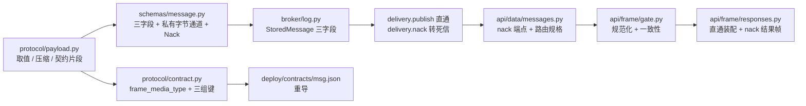
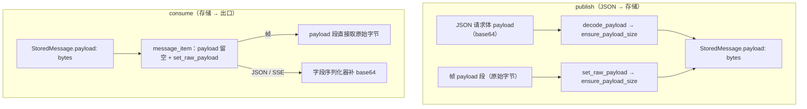

# 序列化与内容类型实施记录

> 08B · 03 传输与协议 · 03-3 序列化与内容类型 · 实施记录

[文档首页](../../../../../../文档首页.md) › [03-3 序列化与内容类型](../03_传输与协议_03_序列化与内容类型.md) › 实施　|　[详细设计](../设计/01_详细设计_03_序列化与内容类型.md) · [测试记录](../测试/01_测试记录_03_序列化与内容类型.md)

## 1. 实施信息 

| 项 | 值 |
| --- | --- |
| 任务 | [03-3 序列化与内容类型](../03_传输与协议_03_序列化与内容类型.md) |
| 详细设计 | [序列化与内容类型详细设计](../设计/01_详细设计_03_序列化与内容类型.md)（2026-11-05 定稿，提交 `f3874bb`） |
| Kiwi 用例 | **2423**（先登记后编码；任务级一条，多组断言共用） |
| 实施日期 | 2026-11-05 |
| 提交 | `f3874bb`（详细设计）、`ce49c62`（代码 + 用例 + 契约重导） |
| 环境 | 开发机（Windows，Python 3.14.4）；`msgpack 1.2.4`；用例 `-n 0` 串行 |

## 2. 实施概览 

| 类别 | 内容 |
| --- | --- |
| 新建模块 | `protocol/payload.py`（内容类型 / 压缩口径）、`protocol/validation.py`（校验器端口 + 注册表） |
| 新建用例 | `test_payload.py`、`test_validation.py`、`test_frame_payload.py`、`test_nack.py`、`tests_support/frame_client.py`、3 条测试向量 |
| 修改（源码） | 15 个文件：帧类型 / 契约 / 消息契约 / 消息记录 / 投递 / 死信 / 延迟 / 转投 / 重放 / 数据面端点 / 帧闸门 / 响应装配 / 协议包出口 |
| 修改（用例与契约） | 7 个用例文件 + `deploy/contracts/msg.json` 重导 |
| 新增端点 | `POST /msg/nack`（帧 / JSON 同路径；权限码 `msg:consume`） |
| 新增帧类型 | `nack = 5`（数据面；预留区间回写为 `6-15`） |
| 错误码 | **不新增**（值形态非法 `10001`、标记矛盾 `350018`、未投递 `350003`） |

## 3. 实施过程 

按详细设计 §9 九步推进，每步一次成型（不重复改—跑循环）：

| 步 | 内容 | 结果 |
| --- | --- | --- |
| 1 | Kiwi 登记 1 条并回读 | **2423**（分类平台骨架 / P2 / CONFIRMED / 标签自动化，回读一致） |
| 2 | `protocol/payload.py` | 五个取值（含 `reserved`）、五个算法、三个纯函数、契约片段 |
| 3 | `protocol/validation.py` | `PayloadValidator` 协议 + `ValidatorRegistry`（默认空 = 不校验） |
| 4 | 消息契约与记录 | `PublishRequest` / `MessageItem` / `StoredMessage` / `DelayRecord` 各增三字段；两个模型各带私有字节通道 |
| 5 | 服务层 | `publish` 走 `resolve_payload`（原始字节优先）、新增 `nack`、`ensure_payload_size` 单点判上限、死信原因枚举 + detail |
| 6 | 入口 | `/msg/nack` 端点 + 路由规格；闸门做规范化与「标记一致」校验；`nack` 帧发错路径给专门提示 |
| 7 | 契约 | `FrameType.NACK`、`contract.py` 改名与三组键、快照重导、`check` 通过 |
| 8 | 用例与向量 | 4 个新文件 + 7 个既有文件扩充 + 3 条冻结 hex 向量 |
| 9 | 门禁与回写 | 485 passed / 21 模块 100% / 静态全绿 / 文档三项全绿 |

**直通的两处落点**（详细设计 §4.7）：

## 4. 问题与处置 

| 问题 | 现象 | 处置 |
| --- | --- | --- |
| 03-2 用例把 bit0 当「未知位」 | `test_unknown_header_key_and_flag_ignored` 用 `flags=0xFFFF`；`compressed` 自本任务起是**已定义位**，置位却不给算法 → `350018` | 用例改为只置未定义位 `0xFFE0`（bit5~15），并在 docstring 写明「bit0 由 `test_frame_payload.py` 覆盖」。属**用例随语义变化修正**，实现未让步 |
| Windows 写文件把行尾改成 CRLF | 用 `Path.write_text()` 批量补 `append` 参数后，两个测试文件 diff 从 7 行变成 1100+ 行 | 二进制把 `\r\n` 换回 `\n`（576 / 633 处），`engkit eol` 复核 0 违规。**批量改文件必须显式 `newline="\n"`** |
| `DeadLetter.detail` 默认值类型推断不出 | pyright `reportUnknownVariableType`：`field(default_factory=ConcurrentStableDict)` 的泛型参数为空 | 改 `field(default_factory=lambda: ConcurrentStableDict[str, str]())` |
| ACK / NACK 结果装配两分支体相同 | ruff `SIM114`；自动修复后合并成一行超 120 列 | 合并为 `frame_type in (ACK, NACK)` + `isinstance(result, (AckResult, NackResult))`，注释说明「两种确认类结果同构（只有一个 `committed_offset`）」 |
| JSON 路径的错误载体与帧不同 | 帧路径 `10001` 走错误帧（HTTP 200）；JSON 路径 `10001` 走统一响应体（也 200） | 用例按**码**断言而非状态码（与既有 `test_data_messages.py` 同口径），载体的差异属既有设计 |
| `MessageItem.payload` 仍是必填字段 | 若给默认值会让契约从 `required` 变可选（快照漂移） | 装配时传空串、原始字节走私有通道、序列化时由 `_payload_text` 补 base64；**契约零漂移**（快照 diff 只有新增可选字段） |
| 覆盖率两处缺口 | `broker/delivery.py` 367→368（in-flight 有、记录已不可读）与 `schemas/message.py` 242→243（已有 base64 值原样返回） | 补「保留清理后仍报 `350003`」用例 + 「已有值原样输出」断言，两处一次补齐 |
| 00-1 的 `append` 抽象签名扩展 | 新增三个关键字参数（带缺省）后，两处测试替身 `reportIncompatibleMethodOverride` | 替身同步补参数并透传（`test_delay_scheduler.py` / `test_replay_runner.py`） |

## 5. 验证结果 

| 验证项 | 命令 / 方式 | 结果 |
| --- | --- | --- |
| 定向选测 | `engkit run-selected --jobs off`（54/54 文件，1 轮，未退化） | **485 passed** |
| 覆盖率 | 同上（21 个变更模块，行 + 分支） | **100.00%**（缺行 0 / 缺分支 0） |
| 静态检查 | `ruff check` / `ruff format --check`（src / tests / tests_support / ops） | 全通过 |
| 类型检查 | `pyright`（strict，范围 `services`） | 0 error / 0 warning |
| 契约 | `ops.contract_snapshot export` + `check` | 通过（`frame_media_type` + 三组键 + `5: nack`） |
| 文档 | `engkit links` / `docs-scope` / `eol` | 断链 0 / 违规 0 / 行尾违规 0 |
| 提交前预检 | `.git/hooks/pre-commit`（`ce49c62`） | 全通过（17 文件改动行均被执行） |

**真机 h2c**：本任务未新增真机场景；03-2 的 `tests/api/test_frame_transport_h2c.py`（真 hypercorn + h2c）在本轮选测内仍全绿，帧入口链路未回退。

## 6. 登记回写 

| 落点 | 内容 |
| --- | --- |
| `deploy/contracts/msg.json` | 重导：`x-msg-frame.frame_media_type`（原 `content_type`）+ `payload_content_types` / `compressions` / `payload_rules`；`frame_types` 含 `5: nack`；预留区间 `6-15`；`envelope.optional` 增 `compression` / `uncompressed_len`；`endpoint_fields.nack`；`/msg/nack` 端点与 `NackRequest` / `NackResult` / `MessageItem` 三字段 |
| `deploy/registry/msg.toml` | **未改**：无新增错误码；`domains.paths` 已含 `protocol/**/*.py`（03-2 登记） |
| 任务文档 | 新增 §5「前置契约（已交付）」 |
| 需求 03-3 | 内容 5「按批进行」→「按 payload 段（批帧落地后即按批）」；补 `nack` 与校验失败上报口径 |
| 架构 05 | §4 帧草图下方补压缩与内容类型定稿口径；§12 待定项无新增 |
| 计划表 | 03-3 行迁入已完成表（唯一进度落点） |
| Kiwi TCMS | 用例 **2423** |

## 7. 偏差与遗留 

| # | 事项 | 归口 |
| --- | --- | --- |
| 1 | 压缩粒度由任务 §2.5「按批」落为「payload 段整体」 | 已回写设计 §4.5 与任务 / 需求措辞；`flags.batch` 落地（03-5）后同一语义自然成为按批，协议不改 |
| 2 | 校验失败的**判定点**在消费端（broker 不解 payload），broker 只提供 `nack` 通道与死信归口 | 已回写设计 §5.1；投递路径未改（01-2 / 01-3 语义零变动） |
| 3 | 不新增错误码（原任务 §2.7 措辞易读成「要新码」） | 已回写设计 §5.4 与对齐记录 #3：值形态非法 `10001`、标记矛盾 `350018`、未投递 `350003` |
| 4 | `x-msg-frame.content_type` 改名 `frame_media_type`（03-2 契约键调整） | 快照已重导；改名理由记设计 §7（帧怎么编码 vs 消息体是什么） |
| 5 | 媒体类型规范化补充：统一小写、`;` 之后参数丢弃（设计 §4.1 只写「语法校验」） | 实施期细化，已在本记录 §3 与用例 docstring 说明；参数不参与判定 |
| 6 | per-topic 默认 `content_type`（`msg_topic` 加字段）未做 | **8B_02** 存储与表设计 / **06 域**管理台；本任务不改表 |
| 7 | 压缩 / 解压的真实实现（zstd / snappy / lz4）与校验器调用方 | **8B_03** SDK；本任务只交付白名单与端口 |
| 8 | `nack` 无法拒绝 `acks=0` 的消息（该档位不登记在途，落 `350003`） | 设计 §5.4 已登记；`acks=0` 本就是「可能丢」的档位 |
| 9 | 未登记 `content_type` 只打点不拦截 | 06 域可按 `event=msg.payload` 的 `outcome=unknown_content_type` 聚合；入口不拒收（broker 不解 payload） |
| 10 | `uncompressed_len` 只透传不校验 | 消费端 SDK 按自身上限兜底（防解压炸弹）；broker 不校验 |

> 依《文档生成规范》编写 · 与《[测试记录](../测试/01_测试记录_03_序列化与内容类型.md)》配套
