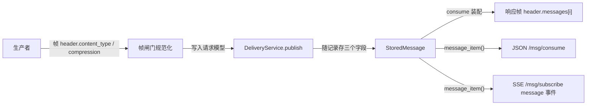
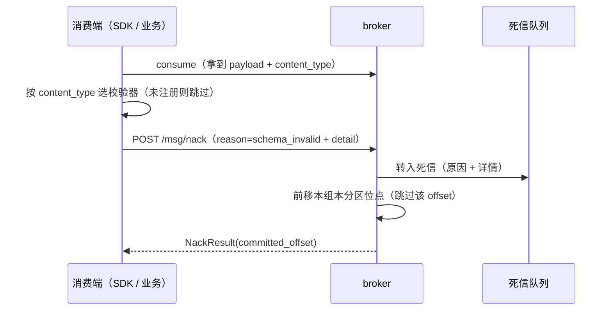

# 序列化与内容类型详细设计

> 08B / 任务 03-3 · 任务级详细设计（可落地、可逐条验收）

[文档首页](../../../../../../文档首页.md) › [03 传输与协议](../../03_传输与协议.md) › [03-3 序列化与内容类型](../03_传输与协议_03_序列化与内容类型.md) › 详细设计

---

## 1. 概述 <a id="overview"></a>

本文档是任务 [03-3 序列化与内容类型](../03_传输与协议_03_序列化与内容类型.md) 的**详细设计**，粒度到「按序落地、逐条验收」。与架构层不一致时以《架构设计》为准，实现细节以本文档为准。

**上游依据**：

- [需求 03-3 序列化与内容类型](../../../../需求/03_需求_传输与协议.md#r03-3)
- [架构设计 · 接入面：协议与客户端](../../../../../../设计/架构设计/05_架构设计_接入面_协议与客户端.md#frame) 第 4 节（编码层与头体分离）、第 10 节（协议演进纪律）
- bms《[序列化与 Schema](../../../../../../../bms文档/资料/知识档案/消息与事件驱动/08_事件驱动_序列化与Schema.md)》第 2~5 节（格式对比 / 演进规则 / 压缩）
- [03-2 二进制帧协议详细设计](../../03_传输与协议_02_二进制帧协议与版本演进/设计/01_详细设计_02_二进制帧协议与版本演进.md)（承接面：帧布局、`header.content_type` 透传位、`flags.compressed` 位、1 MiB 上限、响应装配）

**与前后任务的关系**：

| 方向 | 任务 | 关系 |
| --- | --- | --- |
| 前置 | [03-2 二进制帧协议与版本演进](../../03_传输与协议_02_二进制帧协议与版本演进/03_传输与协议_02_二进制帧协议与版本演进.md) | 复用帧布局与闸门；本任务**启用**它预留的 `header.content_type` 与 `flags.compressed`，并消掉它登记的 base64 往返遗留 |
| 前置 | [01-2 投递语义](../../../01_消息模型与投递/01_消息模型与投递_02_投递语义/01_消息模型与投递_02_投递语义.md) | 死信队列端口与「转死信 + 位点前移」语义；本任务只扩原因枚举与详情，不改投递判定 |
| 后继 | [03-5 背压与流控](../../03_传输与协议_05_背压与流控/03_传输与协议_05_背压与流控.md) | `flags.batch` 落地后，本文档 §4.5 的压缩语义自然成为「按批压缩」，协议不改 |
| 后继 | 8B_03 RPC 与 SDK | 消费端解压、schema 校验器的**调用方**；本任务只交付端口与注册表 |

**口径基线（2026-11-05 逐项确认，不再变更）**：

| # | 事项 | 结论 |
| --- | --- | --- |
| 1 | `content_type` 落点 | 帧 header 携带 → 随消息持久化 → 消费响应回显（§4.2） |
| 2 | 取值语法 | 媒体类型字符串；缺省 `application/msgpack`（§4.1） |
| 3 | 帧媒体类型命名 | 契约键改名 `frame_media_type`，与消息体 `content_type` 消歧（§7） |
| 4 | payload 顶层结构 | 必须是 `Map[str, Any]`（§4.3） |
| 5 | schema 版本口径 | 与 header 同一套演进铁律，不引入 `schema_version`（§4.4） |
| 6 | Protobuf 留口 | 只登记取值（`status=reserved`），不做 Schema Registry（§4.1） |
| 7 | 未知 `content_type` | 入口只校验语法，未登记取值透传 + 打点（§4.1） |
| 8 | 压缩粒度 | 作用于 payload 段整体；批帧落地后语义扩展为按批（§4.5） |
| 9 | 压缩标记 | `flags.compressed` 表「是否」，header `compression` 表算法（§4.5） |
| 10 | 压缩算法实现 | 只登记白名单，不引压缩库；验收用标准库 `gzip` 模拟两端（§4.5） |
| 11 | 标记一致性与上限 | 不一致 `350018`；上限判压缩后字节（§4.6） |
| 12 | 校验失败通道 | 新增帧类型 `nack=5` + `/msg/nack` 端点（§5） |
| 13 | 死信原因 | 枚举 `delivery_exhausted` / `schema_invalid` / `processing_failed` + `detail`（§5.3） |
| 14 | 校验器端口 | `protocol/validation.py`，默认不启用，投递路径不改（§6） |
| 15 | base64 往返 | 双侧直通（`publish` / `consume`），公开 JSON 契约不变（§4.7） |
| 16 | 契约登记 | 扩 `x-msg-frame` 四组键，不新开文件（§7） |
| 17 | per-topic 默认格式 | 本任务不改表，登记遗留（§12） |
| 18 | SSE 长驻流 | 纳入：`message` 事件带 `content_type` / `compression`（§4.2） |
| 19 | 错误码 | 不新增；值形态非法用 `10001`，标记矛盾用 `350018`（§5.4） |

## 2. 现状与差距 <a id="gap"></a>

2026-11-05 复核（msg 仓 `f933736`）：

| 项 | 现状 | 本任务目标 | 动作 |
| --- | --- | --- | --- |
| 消息体格式 | 无 `content_type` 概念，消费端只能假设 MessagePack | 帧头可带、随消息存、消费回显 | 修改（记录 / 契约 / 装配） |
| 帧 header | `content_type` 登记为可选键但**未启用**（03-2 只透传） | 启用并规范化 | 修改（闸门） |
| 压缩标记 | `flags.compressed` 位定义但无算法语义 | `flags.compressed` + `compression` 白名单 + 一致性校验 | 新建（`protocol/payload.py`） |
| 校验失败 | 只有「重投超限」一条死信路径 | 消费端可上报校验失败 → 死信 | 新建（`nack` 帧 + 端点） |
| 校验器 | 无 | 端口 + 按 `content_type` 注册表（默认空） | 新建（`protocol/validation.py`） |
| 消息体编解码 | 帧路径 base64 往返两次（`_model_input` 编码 / 响应装配解码） | 双侧直通，只保留 JSON 契约必需的 base64 | 修改 |
| 契约 | `x-msg-frame.content_type` 指帧媒体类型 | 改名 `frame_media_type`；增 payload 三组键 | 修改 + 重导 |

**关键事实（决定实现形态，均已核对源码 / 实测）**：

1. **内部存储本来就是二进制**：`StoredMessage.payload: bytes`，`broker/log.py` 明文「不解析 payload」。base64 只发生在**模型层**（`PublishRequest.payload: str` 与 `MessageItem.payload: str`），所以直通不需要动存储与公开契约。
2. **Pydantic 私有属性不进契约**：`PrivateAttr` 既不进 `model_json_schema()` 也不进 `model_dump()`（本机实测），可用它承载「原始字节」这条内部通道，公开字段仍保持 `str`。
3. **`BaseSchema` 非 frozen**（`model_config = ConfigDict(from_attributes=True, str_strip_whitespace=True, extra="forbid")`），私有属性可赋值；`extra="forbid"` 不影响私有属性。
4. **`message_item()` 是两个消费出口的唯一装配点**：`/msg/consume` 与 `/msg/subscribe`（SSE）都经它，因此新增字段天然覆盖 SSE，不需要另写装配。

## 3. 目标目录与交付物清单 <a id="tree"></a>

```text
msg/backend/
├── services/msg/src/bms_msg/
│   ├── protocol/
│   │   ├── payload.py                          # 新建：content_type / 压缩口径与校验
│   │   ├── validation.py                       # 新建：payload 校验器端口 + 注册表
│   │   ├── frame.py                            # 修改：NACK=5、reserved 区间回写
│   │   ├── contract.py                         # 修改：frame_media_type + payload 三组键
│   │   └── __init__.py                         # 修改：导出新模块
│   ├── schemas/message.py                      # 修改：PublishRequest / MessageItem / NackRequest / NackResult
│   ├── broker/log.py                           # 修改：StoredMessage 三个字段 + append 签名
│   ├── broker/delivery.py                      # 修改：publish 直通、nack 语义、ensure_payload_size
│   ├── broker/delay.py                         # 修改：DelayRecord 三个字段 + 转投透传
│   ├── broker/scheduler.py                     # 修改：转投时带上三个字段
│   ├── broker/replay.py                        # 修改：重放沿用原记录的三字段
│   ├── broker/deadletter.py                    # 修改：原因枚举 + detail
│   ├── api/data/messages.py                    # 修改：nack 端点 + 路由规格 + message_item
│   ├── api/frame/gate.py                       # 修改：content_type / 压缩标记校验、nack 路径
│   ├── api/frame/responses.py                  # 修改：consume 直通装配 + nack 结果帧
│   └── errors.py                               # 不新增码（复用 10001 / 350018 / 350003）
├── ops/contract_snapshot.py                    # 不变（注入点已存在）
├── deploy/contracts/msg.json                   # 修改：重导
└── services/msg/tests/                         # 新建 / 扩（见 §8）
    └── data/frames/*.json                      # 测试向量（新增 3 条）
```

交付物清单：

| 文件 | 类型 | 说明 |
| --- | --- | --- |
| `protocol/payload.py` | 新建 | `CONTENT_TYPE_*` / `COMPRESSION_*` 常量、`normalize_content_type`、`normalize_compression`、`ensure_compression_flag`、`payload_contract()` |
| `protocol/validation.py` | 新建 | `PayloadValidator` 协议、`PayloadValidationError`、`ValidatorRegistry`（`register` / `get` / `validate`） |
| `protocol/frame.py` | 修改 | `FrameType.NACK = 5`；`FrameFlags.COMPRESSED` 文档改为「本任务启用」 |
| `protocol/contract.py` | 修改 | `content_type` → `frame_media_type`；增 `payload_content_types` / `compressions` / `payload_rules`；`reserved_types` 的 `5-15` → `6-15`；`endpoint_fields` 增 `nack` |
| `schemas/message.py` | 修改 | `PublishRequest` 增 `content_type` / `compression` / `uncompressed_len` + 私有字节通道；`MessageItem` 增同样三字段 + 私有字节通道 + 序列化补位；新增 `NackReason` / `NackRequest` / `NackResult` |
| `broker/log.py` | 修改 | `StoredMessage` 增 `content_type` / `compression` / `uncompressed_len`；`append` 增同名关键字参数（带缺省，向后兼容） |
| `broker/delivery.py` | 修改 | `publish` 走直通通道；新增 `nack()`；`decode_payload` 拆出 `ensure_payload_size` |
| `broker/deadletter.py` | 修改 | `DeadLetterReason` 枚举；`DeadLetter.reason` 类型改为枚举、增 `detail` |
| `broker/delay.py` / `scheduler.py` / `replay.py` | 修改 | 三个字段随延迟转投 / 重放原样传递 |
| `api/data/messages.py` | 修改 | `nack` 端点、`NACK_ERROR_CODES`、`DATA_PLANE_ROUTES` 增一项、`message_item` 直通 |
| `api/frame/gate.py` | 修改 | 规范化 + 一致性校验；nack 类型不匹配提示 |
| `api/frame/responses.py` | 修改 | consume 直通装配（`raw_payload`）、`nack` 结果帧、错误帧不变 |
| `tests/**`、`tests/data/frames/**` | 新建 / 扩 | 见 §8 |

## 4. 消息体契约 <a id="payload"></a>

> 本任务**不建表、不改表**：`content_type` / `compression` 是消息记录上的字段，记录本身是进程内结构（8B_02 落盘时随记录格式一并持久化）。

### 4.1 `content_type` 取值与校验 <a id="content-type"></a>

| 取值 | 状态 | 说明 |
| --- | --- | --- |
| `application/msgpack` | `default` | 缺省值：生产者不传时生效，响应帧回显该值 |
| `application/json` | `known` | 已登记（文本 JSON，便于调试与跨语言） |
| `text/plain` | `known` | 已登记（纯文本） |
| `application/octet-stream` | `known` | 已登记（不承诺格式的原始字节） |
| `application/x-protobuf` | `reserved` | **预留**：登记在册但当前无生产 / 消费方；SDK 可提前实现解码 |

- **状态语义**：`default` = 不传时的生效值；`known` = 已登记、broker 透传；`reserved` = 预留位（契约可见、无实现）。
- **语法校验（唯一判据）**：形如 `type/subtype`，两段均为 1~128 位的 RFC 6838 token（字母 / 数字 / `!#$&^_.+-`）；允许 `;` 之后带参数，**参数不解析**（broker 不解释媒体类型参数）。
- **未登记取值**：语法合法即**透传**，不拒收；同时记一条结构化日志（`event=msg.payload`，`content_type` / `outcome=unknown_content_type`）。理由：broker 不解 payload，无从判断「支不支持」；白名单拒绝会把「新增格式」变成「先改 broker 再上线」。
- **语法非法**：契约层 `10001`（键在、值形态非法，与 03-2 的分工一致）。

### 4.2 落点与回显 <a id="carrier"></a>



| 落点 | 字段 | 说明 |
| --- | --- | --- |
| 帧请求 header | `content_type` / `compression` / `uncompressed_len` | 均为可选；缺省按 §4.1 / §4.5 规范化 |
| JSON 请求体 | 同名三字段 | 与帧同口径（同一个 `PublishRequest`），JSON 路径同样可声明格式 |
| 消息记录 | `StoredMessage` 三字段 | 随记录长期保留（重投 / 重放 / 延迟转投均不变） |
| 消费响应（帧） | `header.messages[i]` 三个键 | 与 `length` 同层，客户端按它选解法器 |
| 消费响应（JSON / SSE） | `MessageItem` 三字段 | 缺省值也显式给出（`application/msgpack` / `none` / `null`） |

- **为什么必须持久化**：不落记录则消费端永远拿不到格式，任务 §2.2 的「透传与展示」无从落地；且滚动升级期新旧消息并存，只能按条判断。
- **为什么响应回显生效值而不是原值**：生产者不传时消费端需要知道「按什么解」，回显 `application/msgpack` 才能自解释。

### 4.3 payload 顶层结构 <a id="shape"></a>

| 约束 | 内容 | 谁来判 |
| --- | --- | --- |
| 顶层必须是 Map | `Map[str, Any]`（MessagePack 的 map 类型） | 消费端校验器（`PayloadValidator`），broker 不判 |
| 键名 | 字符串；约定为小写下划线（与 bms 事件契约同名口径） | 消费端校验器 |
| 字段演进 | 只增可选字段、不删、不改名、不改语义 | 契约文档 + 校验器 |
| 空消息体 | `payload_len = 0` 合法（不等于非法 Map） | 解码层 |

- **为什么必须 Map**：《知识档案 08》§3 的兼容矩阵以「字段」为单位，数组 / 标量没有字段可增，一旦允许就相当于对该部分数据放弃演进铁律。
- **为什么不放 broker 里判**：判 Map 需要解 MessagePack，等于 broker 解 payload，直接破零拷贝与任务 §2.2。

### 4.4 schema 版本口径 <a id="version"></a>

| 项 | 规则 |
| --- | --- |
| 版本载体 | **不引入 `schema_version`**；payload 的演进规则与帧 header 是同一套三条铁律 |
| 兼容方向 | 必须做到「完全兼容」（旧消费者读新消息、新消费者读旧消息），滚动升级期必然新旧混跑 |
| 与协议版本的关系 | 协议 `ver` 管**帧结构**（主版本不兼容即 `350019`）；payload 的字段增删**不影响** `ver` |
| 何时才需要独立版本 | 出现「跨团队 / 跨语言、需要集中分发 schema」时才考虑 Schema Registry（本任务范围外，见 §12） |

- **为什么不用两个版本号**：两个版本号就是两个真相，滚动升级期会出现「header 1.0 + schema 3」的组合爆炸；而 payload 的兼容判据（字段只增）与 header 完全一致，多一个号只增加协调成本。

### 4.5 压缩 <a id="compression"></a>

| 项 | 口径 |
| --- | --- |
| 粒度 | **payload 段整体**：一条消息一帧时即单条整段压缩；`flags.batch` 落地后同一语义变成「批内多条一起压」，协议不改 |
| 标记 | `flags.compressed`（bit0）表「是否压缩」；header `compression` 表算法名 |
| 算法白名单 | `none`（缺省，未压缩）/ `gzip` / `zstd` / `lz4` / `snappy` |
| 谁压 / 谁解 | **生产者压、消费者解**；broker 不理解压、原样存储与转发（零拷贝） |
| 实现范围 | 只登记与校验白名单，**不引入压缩库**；验收用标准库 `gzip` 分别扮演两端 |
| 上限 | 仍判**压缩后字节**（线上字节，与 03-2 一致）；`uncompressed_len` 可选声明、不参与判定 |

- **为什么算法名放 header 而不是 flags 高位**：flags 只有 16 位且已被 5 个语义占位，算法名进高位会不可读（抓包看不到）且新增算法要抢位；header 键可读、可扩展，新增算法只是加一个白名单值。
- **为什么 broker 不提供压缩 / 解压工具**：broker 全程不解压，工具函数的调用方只有 SDK（8B_03）；现在引入 `zstd` / `snappy` 依赖是为零调用方扩大依赖面（03-2 为 `msgpack` 已扩一次）。
- **`uncompressed_len` 的定位**：给消费端防「解压炸弹」的**声明位**——生产者可选填，broker 只做形态校验（非负整数）与透传，不强制、不校验一致性。缺失时消费端只能用自身上限兜底。

### 4.6 压缩标记的一致性与上限 <a id="compress-rule"></a>

| 场景 | 判定 | 码 |
| --- | --- | --- |
| `flags.compressed` 置位 + `compression` 缺省 | 矛盾（说压了却没给算法） | `350018` |
| `flags.compressed` 置位 + `compression = none` | 矛盾 | `350018` |
| `flags.compressed` 未置位 + `compression` 非 `none` | 矛盾（给了算法却说没压） | `350018` |
| `compression` 不在白名单（如 `br`） | 值形态非法 | `10001` |
| 压缩后 payload > 1 MiB | 超限 | `350006`（413） |

- **为什么严校**：放过去会变成消费端解压失败、且无法定位是谁写错（生产者说压了、broker 说没压）。
- **为什么不判压缩前大小**：判压缩前必须先解压，broker 一旦解压就破零拷贝；解压后的膨胀风险由消费端按 `uncompressed_len` 与自身上限兜底。

### 4.7 base64 往返的消除（03-2 遗留 #4） <a id="direct"></a>

| 路径 | 现状 | 本任务 |
| --- | --- | --- |
| 帧 publish | `_model_input` 把 payload 段 `b64encode` 成 `PublishRequest.payload` → `decode_payload` 再解回 | 闸门把原始字节放进私有通道（`raw_payload`），`payload` 字段留空串；服务层**优先用原始字节** |
| 帧 consume | `result_frame` 对 `MessageItem.payload` 做 `b64decode` | 装配时 `MessageItem` 直接携带原始字节（`raw_payload`），响应装配**优先用原始字节** |
| JSON publish / consume | base64 字符串（契约要求） | **不变**（JSON 是文本载体，base64 是必需编码，不是浪费） |
| SSE | base64 字符串（JSON 事件） | **不变** |

```python
class PublishRequest(BaseSchema):
    payload: str = Field(default="", description="消息体（base64；帧路径由原始字节通道替代）")
    _raw_payload: bytes | None = PrivateAttr(default=None)

    @property
    def raw_payload(self) -> bytes | None:
        """原始字节（仅内部装配设置；JSON 路径为 None，由 payload 的 base64 解码）。"""
```

- **私有属性不是第二份契约**：它不进 JSON Schema、不进 `model_dump()`（本机实测），外部调用方拿不到，也不会被序列化出去。
- **回落分支只服务「非本装配构造」的模型**：`result_frame` 在 `raw_payload` 为 `None` 时回落 base64 解码（例如测试直接构造 `MessageItem`、或将来内部转发的反序列化模型）。运行期两条入口都由统一装配函数设置原始字节。
- **上限判据仍一处**：`ensure_payload_size(bytes)`，`decode_payload(str)` 内部复用它——两条路径一个判据（与 03-2 §6.4 的口径一致）。

## 5. 校验失败与死信 <a id="nack"></a>

### 5.1 判定点与通道 <a id="nack-channel"></a>



- **判定点在消费端**：broker 不解 payload，无法判断字段是否缺失 / 类型错误；因此「校验失败」只能由消费端发起。
- **broker 侧职责**：提供上报通道（`nack`）、把消息转入死信、前移位点、保证幂等——即 01-2 已有的「转死信 + 位点前移」路径，只是触发方从「重投超限」换成「消费端拒绝」。
- **投递路径不改**：`consume` / `ack` 的停等、重投、顺序语义一行不动（01-2 / 01-3 的设计不变）。

### 5.2 `nack` 帧与端点 <a id="nack-api"></a>

| 项 | 内容 |
| --- | --- |
| 帧类型 | `FrameType.NACK = 5`（数据面 1~15 区间；老客户端不会发 5，忽略即可） |
| 路径 | `POST /msg/nack`（帧 / JSON 同路径，与 publish / consume / ack 同构） |
| 权限码 | 复用 `msg:consume`（拿消息的人才能拒消息，权限面不扩大） |
| 请求字段（必填） | `namespace` / `topic` / `group` / `consumer_id` / `partition` / `offset` / `reason` |
| 请求字段（可选） | `detail`（`Map[str, str]`，如 `{"field": "order_id", "expected": "str", "actual": "int"}`） |
| 结果字段 | `committed_offset`（与 `ack` 同口径：下一条待消费的 offset） |
| 响应 | 结果帧 `type=5` + `flags.response`；错误走 `error` 帧（HTTP 200） |

- **为什么独立帧类型而不是扩 `ack`**：同一个帧既表「处理成功」又表「拒绝」，会让 01-3 的停等 / 位点推进按 `outcome` 分叉、`ack` 幂等语义也要重定义；独立类型是「只增」，老端不受影响。
- **为什么独立路径而不是复用 `/msg/ack`**：03-2 定「帧类型与路径严格匹配」，复用途径会让「类型不匹配」这条判据失效（发错类型无法暴露）。

### 5.3 死信原因与详情 <a id="deadletter"></a>

| 原因 | 产生方 | 含义 |
| --- | --- | --- |
| `delivery_exhausted` | broker | 重投达上限（01-2 现有路径，不变） |
| `schema_invalid` | 消费端（`nack`） | payload 字段缺失 / 类型错误 / 不是合法 Map |
| `processing_failed` | 消费端（`nack`） | 业务处理失败且确认不可重试 |

- `DeadLetter` 增 `detail: Map[str, str]`（缺省空）；`reason` 类型改为 `DeadLetterReason(StrEnum)`（`str` 子类，既有比较与日志不变）。
- `nack` 只接受 `schema_invalid` / `processing_failed`；上报 `delivery_exhausted` → `10001`（该原因由 broker 独占，外部指定会污染统计）。
- **06 域可直接按原因筛选与展示**（`list_all()` 已含原因与详情，不需另建通道）。

### 5.4 `nack` 的边界与失败分支 <a id="nack-edge"></a>

| 情形 | 行为 | 码 / 状态 |
| --- | --- | --- |
| 命名空间未启用 | 拒绝 | `350010` |
| 主题不存在 / 非本租户 / 未启用 | 拒绝 | `350001` |
| 组不存在 | 拒绝 | `350013` |
| 成员失效 / 分区不在其分配内 | 拒绝 | `350014` |
| `offset >= LEO` | 拒绝 | `350002` |
| 该 offset 已死信 | **幂等**：不重复入队，返回当前 `committed_offset` | 200 |
| 该 offset 不在投递中（从未投递 / 已确认） | 拒绝 | `350003` |
| `reason` 非枚举值 / `detail` 值非字符串 | 契约层拒绝 | `10001` |
| 无 `msg:consume` 权限 | 拒绝（发生在闸门之前，回标准 403 JSON） | 403 |

- **为什么幂等**：至少一次语义下消费端可能重复上报（重试 / 超时重发），重复转入会污染死信统计。
- **`acks=0` 的消息无法 `nack`**：该档位不登记在途（01-2 口径），`nack` 会落 `350003`——这是设计上的取舍，登记为已知限制（§12）。

## 6. 校验器端口 <a id="validator"></a>

```python
class PayloadValidator(Protocol):
    """按内容类型校验消息体（消费端使用；broker 不调用）。"""

    content_type: str
    """本校验器负责的媒体类型（与 content_type 取值一一对应）。"""

    def validate(self, payload: bytes) -> None:
        """校验消息体；不合法即抛 PayloadValidationError。"""

class ValidatorRegistry:
    """按 content_type 注册的校验器表（默认空：未注册即不校验）。"""

    def register(self, validator: PayloadValidator) -> None: ...
    def get(self, content_type: str) -> PayloadValidator | None: ...
    def validate(self, content_type: str, payload: bytes) -> None: ...
```

| 项 | 口径 |
| --- | --- |
| 落点 | `bms_msg/protocol/validation.py`（与 `payload.py` 同层，属协议层而非业务层） |
| 默认状态 | 注册表为空 → 任何 `validate` 调用都直接通过（不校验 = 不阻断） |
| 重复注册 | 同 `content_type` 重复注册直接覆盖（后注册优先），不报错——便于测试与插件式扩展 |
| 失败形态 | `PayloadValidationError(message, detail)`；消费端捕获后取 `detail` 直接作为 `nack` 的 `detail` |
| 本任务调用方 | **无**（消费端 SDK 归 8B_03）；本任务只交付端口 + 注册表 + 用例，证明「注册生效 / 未注册跳过 / 失败可取值」 |

- **为什么不放 broker 里默认启用**：解密 payload 需要业务 schema（broker 没有），且会破零拷贝；端口的价值是「接口先定，调用方后到」，符合 `AI开发规范` §3.1「现在能定接口 / 占位」。
- **为什么不建 Schema Registry**：见 §4.1 与 §12；注册表按 `content_type` 索引，不存 schema 文本，属「解法器注册」而非「schema 中心」。

## 7. 协议契约登记 <a id="contract"></a>

`protocol/contract.py::frame_contract()` 调整（仍是单一事实源，导出期注入 `deploy/contracts/msg.json`）：

| 变更 | 内容 |
| --- | --- |
| 改名 | 顶层 `content_type` → `frame_media_type`（值仍 `application/x-msg-frame`） |
| 新增 `payload_content_types` | `[{value, status, note}]`，五个取值与 §4.1 一一对应 |
| 新增 `compressions` | 算法白名单（`none` / `gzip` / `zstd` / `lz4` / `snappy`） |
| 新增 `payload_rules` | `top_level` / `default_content_type` / `compression_flag` / `limit` / `uncompressed_len` 五项口径 |
| 帧类型 | `frame_types` 自动含 `"5": "nack"`（由 `FrameType` 生成） |
| 预留区间 | `reserved_types` 的 `5-15` → `6-15`（否则与 `nack` 自相矛盾） |
| 端点字段 | `endpoint_fields` 增 `nack`（必填 / 可选 / payload 必须为空） |
| 信封字段 | `envelope.optional` 增 `compression` / `uncompressed_len` |

- **为什么扩 `x-msg-frame` 而不是新开 `x-msg-payload`**：跨仓装载校验只认 `msg.json`，新开键要多一处漂移点与一步对账（03-2 已下同一结论）。
- **为什么改名 `frame_media_type`**：同一份契约里两个 `content_type` 语义不同（帧怎么编码 / 消息体是什么），歧义会一路带到 SDK 与排障。

## 8. 测试设计 <a id="tests"></a>

### 8.1 Kiwi 用例

先登记后编码（`ssh minjian@192.168.0.107 "docker exec -i bms-kiwi /Kiwi/manage.py shell"`），分类「平台骨架」、优先级 `P2`、状态 `CONFIRMED`、标签「自动化」；**新登记一条，不复用 2420 / 2421**。`text` 写覆盖范围（内容类型 / 压缩 / 校验失败死信 / 直通 / 契约）与自动化文件路径。

### 8.2 用例清单

| 层 | 文件 | 用例 | 覆盖的关键分支 |
| --- | --- | --- | --- |
| 口径 | `tests/protocol/test_payload.py`（新建） | `normalize_content_type` 缺省 / 已登记 / 未登记透传 / 语法非法（大小写、缺 subtype、空串、参数带 `;`）；`normalize_compression` 缺省 / 白名单 / 非法；`ensure_compression_flag` 四种组合 | 全部判定分支 |
| 校验器 | `tests/protocol/test_validation.py`（新建） | 未注册跳过；注册后校验通过；失败抛错并带 detail；重复注册覆盖；空注册表 | 端口与注册表全分支 |
| 契约 | `tests/protocol/test_contract.py`（扩） | `frame_media_type` 存在且旧键已删；`payload_content_types` 五值状态；`compressions` 与常量同值；`payload_rules` 五项；`frame_types` 含 5；预留区间不含 5 | 契约一致性 |
| 直通 | `tests/protocol/test_frame.py`（扩） | `NACK=5` 的编码 / 解码往返；`decoded.frames` 中 5 不被当未知类型 | 类型编号 |
| 响应装配 | `tests/api/test_frame_responses.py`（扩） | consume 直通：`raw_payload` 给定 → payload 分段与 `length` 一致；未给定 → 回落 base64；`nack` 结果帧头字段 | 两条装配分支 + nack |
| 帧入口 | `tests/api/test_frame_payload.py`（新建） | 帧 publish 带 `content_type` + `compression` → 记录与响应回显；置位无算法 / 有算法未置位 → `350018`；未知 content_type 透传；语法非法 → `10001`；`uncompressed_len` 透传；压缩消息 broker 转发字节不变（gzip 两端） | 闸门规范化 + 一致性 |
| nack | `tests/api/test_nack.py`（新建） | JSON / 帧两种形态 nack → 死信 + 位点前移；已死信幂等；未投递 → `350003`；`offset >= LEO` → `350002`；`reason=delivery_exhausted` → `10001`；非成员 → `350014`；无权限 403 | 端点全失败分支 |
| 死信 | `tests/broker/test_deadletter.py`（扩） | 原因枚举三值；`detail` 保存与缺省；幂等；`list_all` 带原因 | 枚举与详情 |
| 投递 | `tests/broker/test_delivery.py`（扩） | `ensure_payload_size` 边界（恰 1 MiB 过 / +1 拒）；`decode_payload` 复用同判据；发布时三字段落记录 | 上限单一判据 |
| 延迟 / 重放 | `tests/broker/test_delay.py`、`test_replay_runner.py`（扩） | 延迟发布保留三字段、到期转投原样带入；重放沿用原记录三字段 | 三条传递路径 |
| 数据面 | `tests/api/test_data_messages.py`（扩） | JSON 路径 `content_type` / `compression` 透传与回显；非法值 `10001` | JSON 与帧同口径 |
| SSE | `tests/api/test_subscribe_stream.py`（扩） | `message` 事件带三字段 | 第二个消费出口 |
| 向量 | `tests/protocol/test_vectors.py`（扩） | 回放新增 3 条向量 | 向量与实现一致 |

**不做的测试**：真实压缩库（zstd / snappy）的压缩比与性能（SDK / 8B_12）、Schema Registry、帧式订阅推送（03-5）、心跳与 `GOAWAY`（03-4）。

### 8.3 测试向量（入库 `tests/data/frames/`）

| 文件 | 组 | 内容 | 期望 |
| --- | --- | --- | --- |
| `legal_publish_content_type.json` | 合法 | publish 帧，header 带 `content_type=application/json` + `compression=gzip` + `uncompressed_len=32`，payload 为 gzip 压缩后的 JSON | 解码成功，三字段可读，payload 字节与压缩前不等 |
| `invalid_compression_flag.json` | 非法 | `flags.compressed` 置位但 header 无 `compression` | 结构可解，闸门判 `350018` |
| `legal_nack.json` | 合法 | `type=5`、`need_response` 置位、header 含 nack 必填键 + `reason` | 解码成功，类型 5 |

- 向量仍是**冻结 hex**（先用编码器生成、人工核对后入库），用例只读不生成。
- `invalid_compression_flag` 的「非法」在闸门层而非解码层：解码只做结构校验，一致性判定属入口语义——因此它的 `expect` 写 `ok`，由闸门用例断言 `350018`。

### 8.4 覆盖率照顾点

| 分支 | 覆盖方式 |
| --- | --- |
| `normalize_content_type` 缺省 / 合法 / 非法 / 带参数 | `test_payload.py` 参数化 |
| `normalize_compression` 缺省 / 白名单 / 非法 | 同上 |
| `ensure_compression_flag` 四种组合 | 同上 |
| 校验器注册 / 未注册 / 失败 / 覆盖注册 | `test_validation.py` 四条 |
| `raw_payload` 有值 / 无值（回落） | `test_frame_responses.py` 两条 |
| `ensure_payload_size` 超限 / 未超限 | `test_delivery.py` 两条 |
| `nack` 幂等 / 未投递 / 越界 / 原因非法 | `test_nack.py` 四条 |
| `_ensure_frame_type` 的 nack 提示分支 | `test_frame_payload.py` 一条（nack 帧发到 `/msg/publish`） |
| SSE / JSON 装配 | 扩既有两条用例 |

## 9. 实施步骤 <a id="steps"></a>


| 步 | 内容 | 产出 |
| --- | --- | --- |
| 1 | Kiwi 登记 1 条并回读编号 | 用例编号 |
| 2 | `protocol/payload.py`（常量 / 规范化 / 一致性 / `payload_contract()`） | 口径可用 |
| 3 | `protocol/validation.py`（协议 + 注册表） | 端口可用 |
| 4 | `StoredMessage` / `DelayRecord` / `PublishRequest` / `MessageItem` / `NackRequest` 字段与私有通道 | 数据面契约 |
| 5 | `delivery.publish`（直通）、`delivery.nack`、`ensure_payload_size`、死信枚举与 detail | 语义可用 |
| 6 | `api/data/messages.py`（nack 端点 + 路由规格）、`api/frame/gate.py`（规范化 + 一致性） | 入口可用 |
| 7 | `FrameType.NACK` + `contract.py` + 重导快照 | 契约一致 |
| 8 | 向量入库 + 用例 | 用例全绿 |
| 9 | 覆盖率 / 静态 / 文档三项 / 记录 / 计划回写 | 交付闭环 |

## 10. 验收映射 <a id="accept-map"></a>

| 任务完成标准（§3） | 验证方式 |
| --- | --- |
| 新增可选字段后，旧消费者仍可读取 | `legal_publish_content_type.json` 向量 + `test_frame_payload.py`：老客户端不传三字段 → 缺省 `application/msgpack` / `none` / `null`；`unknown_header_key` 向量仍绿 |
| 字段缺失 / 类型错误时消息进死信且原因可见 | `test_nack.py`：`nack(schema_invalid, detail)` → 死信记录含原因与字段详情；`list_all()` 可读 |
| 压缩消息由生产者压缩、消费者解压，broker 转发字节不变 | `test_frame_payload.py`：`gzip.compress` → publish → consume 取回字节与压缩前逐字节相同，`compression=gzip` 回显；broker 不解压（实现审查 + 用例） |
| `content_type` 可随消息透传，broker 不解析 payload（有护栏用例） | 帧 / JSON / SSE 三条出口回显；`test_payload.py` 证明未登记取值透传；broker 代码路径无 `msgpack.unpackb(payload)`（实现审查） |
| 兼容性与压缩用例全绿；变更模块行 + 分支覆盖率 100%，静态全绿 | `coverage_report.py --module ...`；`ruff` / `pyright`；`ops.contract_snapshot check`；文档三项 |

## 11. 风险与开放项 <a id="risk"></a>

| # | 项 | 影响 | 处置 |
| --- | --- | --- | --- |
| 1 | 私有属性通道绕过 Pydantic 校验 | 误用时可能把未校验字节写进记录 | 只由两处装配函数设置（闸门 / `message_item`）；`raw_payload` 为只读 property；用例覆盖两条分支 |
| 2 | `MessageItem` 新增三字段 | 契约快照变化（新增可选字段，兼容） | 重导快照；无前端消费方（msg 无前端）；老客户端忽略未知字段 |
| 3 | 压缩算法只有标记没有实现 | 消费端拿到 `zstd` 消息时无现成解法器 | 算法白名单是「声明」，实现归 SDK（8B_03）；验收用 `gzip` 证明链路 |
| 4 | `nack` 无法拒绝 `acks=0` 的消息 | 该档位不登记在途，`nack` 落 `350003` | 登记为已知限制；`acks=0` 本就是「可能丢」的档位 |
| 5 | 未登记 `content_type` 透传 | 生产者写错格式串不会被入口拦住 | 入口打点 `outcome=unknown_content_type`；06 域可按日志聚合 |
| 6 | 死信原因枚举扩展 | 存量比较依赖字符串 | `StrEnum` 是 `str` 子类，`==` 与日志输出不变；用例断言三值 |
| 7 | per-topic 默认格式未落表 | 「按 topic 切格式」只能靠约定 | 登记遗留，归 8B_02 存储 / 06 域（§12） |

## 12. 遗留与归口 <a id="backlog"></a>

| # | 事项 | 归口 |
| --- | --- | --- |
| 1 | per-topic 默认 `content_type`（`msg_topic` 加字段） | 8B_02 存储与表设计 / 06 域管理模块；本任务不改表 |
| 2 | 压缩 / 解压的真实实现（zstd / snappy / lz4） | 8B_03 SDK；本任务只登记白名单 |
| 3 | 校验器的真实调用方（按 content_type 选解法器 + schema 定义） | 8B_03 SDK；本任务只交付端口与注册表 |
| 4 | Schema Registry（schema 版本化 / 兼容性校验 / 跨团队分发） | 范围外（任务 §2.8）；出现跨团队消费方时另立项 |
| 5 | 帧式订阅推送携带 content_type | 03-5（届时随 `message` 类帧一并带） |
| 6 | `uncompressed_len` 的强制校验（防解压炸弹） | 消费端 SDK；broker 只透传 |

## 13. 对齐记录 <a id="align"></a>

| # | 事项 | 结论 |
| --- | --- | --- |
| 1 | 任务 §2.5「按批压缩」 | 落为「payload 段整体压缩」；`flags.batch` 落地后语义自然成为按批，协议不改（§4.5） |
| 2 | 任务 §2.4「校验失败进死信」 | 判定点在**消费端**（broker 不解 payload）；broker 提供 `nack` 通道与死信归口，投递路径不改（§5.1） |
| 3 | 任务 §2.7「校验失败错误码登记进契约快照」 | 本任务**不新增码**：值形态非法 `10001`、标记矛盾 `350018`、未投递 `350003`；契约里登记的是判定口径而非新码（§5.4、§7） |
| 4 | 03-2 契约键 `x-msg-frame.content_type` | 改名 `frame_media_type`（与消息体 `content_type` 消歧），快照重导（§7） |
| 5 | 03-2 遗留 #4（base64 往返） | 本任务闭环：双侧直通，JSON 路径保留 base64（§4.7） |
| 6 | 03-2 §4.3 `flags.compressed`「本任务只透传，03-3 启用」 | 已启用：位表「是否压缩」+ header `compression` 表算法（§4.5） |
| 7 | 架构 05 §4 帧草图「`flags` 压缩」 | 回填：压缩语义由本任务定稿（§4.5、§4.6） |
| 8 | 架构 05 §10 演进纪律「新增帧类型 = 兼容，直接发」 | `nack=5` 按此登记；协议版本仍 `1.0`（新增类型与可选字段都不升次版本） |
| 9 | 需求 03-3 内容 5「按批压缩」 | 同对齐 #1；需求措辞在任务收口时回写为「按 payload 段（批帧落地后即按批）」 |

---

> 依《[文档生成规范](../../../../../../../bms文档/规范/文档生成规范.md)》与《[任务文档规范](../../../../../../../bms文档/规范/任务文档规范.md)》编写
