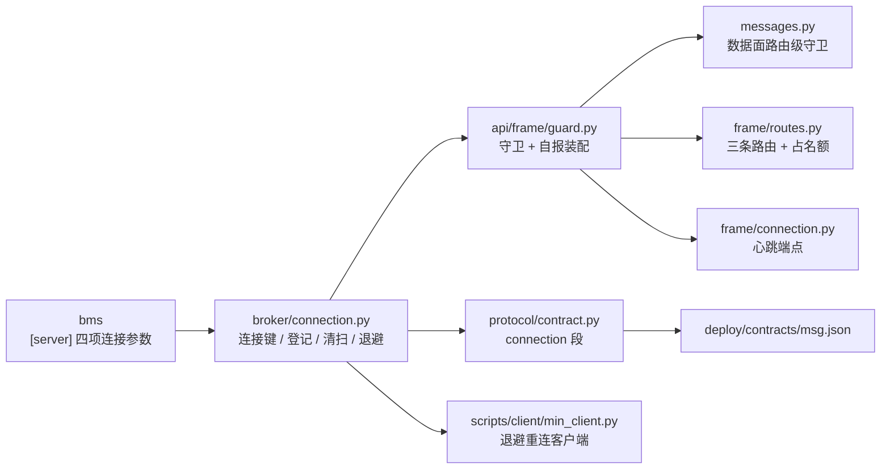

# 连接管理实施记录

> 08B · 03 传输与协议 · 03-4 连接管理 · 实施记录

[文档首页](../../../../../../文档首页.md) › [03-4 连接管理](../03_传输与协议_04_连接管理.md) › 实施　|　[详细设计](../设计/01_详细设计_04_连接管理.md) · [测试记录](../测试/01_测试记录_04_连接管理.md)

## 1. 实施信息 

| 项 | 值 |
| --- | --- |
| 任务 | [03-4 连接管理](../03_传输与协议_04_连接管理.md) |
| 详细设计 | [连接管理详细设计](../设计/01_详细设计_04_连接管理.md)（2026-11-05 定稿，提交 `7127132`；实施回写 5 条见其 §13 第 21~25 行） |
| Kiwi 用例 | **2424**（先登记后编码；登记前回读最大号为 2423，未复用 2420 / 2421 / 2423） |
| 实施日期 | 2026-11-05 |
| 提交 | bms `4b82f1924`（`[server]` 连接层参数）；msg `7127132`（设计）、`9529d10`（代码 + 用例 + 契约重导）、`73162d8`（行尾统一 LF）、`5ffd5d9`（最小客户端补成员心跳与轮次超时） |
| 环境 | 开发机（Windows，Python 3.14.4）；hypercorn 0.18.0；用例串行 `-n 0` |

## 2. 实施概览 

| 类别 | 内容 |
| --- | --- |
| 新建模块 | `broker/connection.py`（连接键 / 登记表 / 半开清扫 / 名额 / 退避纯函数）、`api/frame/guard.py`（连接守卫 + 自报装配）、`api/frame/media.py`（帧形态判定）、`api/frame/connection.py`（心跳端点） |
| 新建脚本 | `scripts/client/min_client.py`（最小测试客户端：join / 双心跳 / 退避重连 / 时间线） |
| 修改（msg 源码） | 12 个文件：数据面路由挂守卫、闸门提示、响应装配、长驻流占名额、连接依赖出口、两处路由聚合、`StreamSession` 补连接键、连接常量、两条错误码、契约 `connection` 段、`ConnectionInfo` 补字段、装配注入 |
| 修改（bms 源码） | `core/config.py`（4 字段）、`core/run.py`（4 行映射）、两份用例、三处文档 |
| 新增端点 | `POST /msg/connection/heartbeat`（帧 17 / JSON 双形态；无权限码） |
| 新增错误码 | `350020`（连接数超限）、`350021`（单连接长驻流超限） |
| 契约 | `x-msg-frame.connection` 段新增；`heartbeat` 移出 `known_unsupported`；`deploy/contracts/msg.json` 重导（+1 路径、+15 字段、+1 段） |

## 3. 实施过程 

按详细设计 §10 八步推进；代码一次成型后按预检清单批量修正（未做「改一处跑一次」）：

| 步 | 内容 | 结果 |
| --- | --- | --- |
| 1 | Kiwi 登记 1 条并回读 | **2424**（分类平台骨架 / P2 / CONFIRMED / 标签自动化；回读与代码标注一致） |
| 2 | bms `[server]` 四字段 + `build_config` 映射 + 两份用例 + 三处文档 | 默认值与 hypercorn 缺省一致（100 / 65536 / 5s / 1000），不配即行为不变；`test_config` 32 passed、`test_run` 12 passed |
| 3 | `broker/connection.py` + 9 个常量 + `ConnectionInfo` 补字段 | 派生连接键、两段式清扫、名额、`next_backoff_ms` 可用 |
| 4 | 连接守卫 + 心跳端点 + 三条路由 | 帧 / JSON 两形态、两码 × 两承载 |
| 5 | 长驻流占名额 + `StreamSession.connection_key` | 预检失败归还名额（用例断言） |
| 6 | 契约 `connection` 段 + `[[errcodes]]` 两条 + 快照重导 | `contract_snapshot check` 通过 |
| 7 | 最小客户端 + 真机演练 | 退避序列 197ms → 347ms（±20% 抖动），drain 每轮可见 |
| 8 | 门禁 / 记录 / 回写 / 提交 | 523 passed、变更模块覆盖率 100%、静态全绿 |

## 4. 问题与处置 

| # | 问题 | 根因 | 处置 |
| --- | --- | --- | --- |
| 1 | 日志调用抛 `TypeError: info() got multiple values for argument 'event'` | 基座 `info(event, **fields)` 的第一个位置参数就是事件名，不能再传 `event=` 关键字 | 事件名定型为 `msg_connection_<子事件>`（设计 §6.6 已回写） |
| 2 | 守卫要「帧感知」，直接 import `gate.py` 会成环 | `gate` → 数据面模块 → 守卫（路由级依赖）→ `gate` | 把纯判定 `is_frame_request` 下移到 `api/frame/media.py`；只有 `FrameHandled` 用函数内局部导入（唯一环点） |
| 3 | 24 个改动文件被写成 CRLF 并提交 | Windows 上 `Path.write_text` 默认把 `\n` 写成 `\r\n`；msg 仓**没有 `.gitattributes`**，`engkit eol` 在本仓实际空转 | 以二进制方式统一回 LF，单独 `style` 提交 `73162d8`；缺 `.gitattributes` 登记遗留（见 §7） |
| 4 | 变更行覆盖率报 `guard.py:71` 未执行（本地复查两次仍报） | 本地读的是**旧 pid 数据文件**（`engkit coverage` 合并结果是上一次会话的），实际预检全跑时该行已覆盖 | 以提交环预检结果为准（`missing_lines=0 partial_branches=0 percent=100.00`）；缺口排查只认预检输出 |
| 5 | 最小客户端首版一轮跑了 45s，且「不重连」 | 到期判断挂在 SSE 事件循环里，而空闲期服务端只发**注释行**（不进事件流），条件永不被求值 | 改为「读任务 + 200ms 轮询看三条件（完成 / draining / 到期）」 |
| 6 | 客户端第二轮起被 `350014` 拒绝 | 只发了连接心跳，成员会话 30s 超时——**连接存活 ≠ 成员存活** | 心跳任务同时发成员心跳（`POST /api/v1/msg/heartbeat`）与自助 `join`；演练随后三轮均 `drain` 正常重连 |
| 7 | 27 个既有用例失败（`State object has no attribute connection_registry`） | 各用例自建最小应用没有注入连接登记表，而数据面路由现在带路由级守卫 | 5 个用例文件的应用装配补 `app.state.connection_registry`；同时新增「租户缺省归 anonymous」用例覆盖守卫的租户读取分支 |
| 8 | 03-2 两条断言与新口径冲突 | `known_unsupported` 少了 `heartbeat`；心跳帧提示由「后续任务开放」改为「请发到心跳端点」 | 按 03-4 口径更新（`test_contract.py` 期望只剩 `subscribe`；`test_frame_data_plane.py` 断言提示指向新端点） |
| 9 | 行宽 / 未使用导入导致 ruff 红 | 表格化文档字符串超 120 列；守卫里多余的 `ConnectionRegistry` 导入 | 拆表为条目、删导入；`ruff format` 统一 |

## 5. 验证结果 

| 项 | 结果 |
| --- | --- |
| 后端用例（提交环选测） | **523 passed**（含 03-4 新增 38 条），0 failed |
| 变更模块覆盖率 | `files=17 missing_lines=0 partial_branches=0 percent=100.00` |
| 静态 | `ruff check` / `ruff format --check` / `pyright`（严格）全绿；bms 侧改动文件同口径全绿 |
| 契约 | `contract_snapshot check` 通过（新增 1 条路径 + `connection` 段） |
| 文档 | `links` 断链 0 / `docs-scope` 违规 0 / `eol` 违规 0 |
| 真机演练 | 见[测试记录 §6](../测试/01_测试记录_04_连接管理.md#drill)：drain 每轮可见，退避 197ms → 347ms |

## 6. 登记回写 

| 落点 | 内容 |
| --- | --- |
| 详细设计 | 实施回写 5 条（§13 第 21~25 行）：守卫形态、判定下移、事件名、客户端补两条、行尾 |
| 任务文档 §5 | 03-2 的「心跳只登记」「GOAWAY 归 03-4」两条收口为已交付；新增本任务交付内容行 |
| 架构设计 §12 | 待定项 #3 旁补「连接 / 心跳阈值已定值（03-4）」 |
| 计划表 | 03-4 行迁入已完成；§5 门禁 2 补第五条功能项；偏差与遗留登记 |
| 契约与登记 | `deploy/contracts/msg.json` 重导；`deploy/registry/msg.toml` 两条 `[[errcodes]]` |
| bms 文档 | 后端基类清单 / 后端基类实现契约 / 02_04 详细设计（§4.1 字段表、§4.4 h2 默认值） |

## 7. 偏差与遗留 

**偏差（设计 → 实施，均已回写设计）**：

1. 守卫从「`mount_data_plane(connection_guard=...)` 传参」改为**路由级依赖 + 三条路由**：豁免不判上限用独立路由表达，比在守卫里判路径更结构化；`GET /msg/connection` 因此单列一条路由。
2. `is_frame_request` 从 `gate.py` 下移到 `api/frame/media.py`（破环）。
3. 应用层并发流只计长驻流（已确认项 #6/#7 的口径），短请求并发仍由协议层 SETTINGS 约束。
4. 最小客户端增加自助 `join` 与成员心跳、轮次到期改轮询（演练暴露的两个缺陷，属交付物内部完善）。

**遗留（归口）**：

| # | 遗留 | 影响 | 归口 |
| --- | --- | --- | --- |
| 1 | **msg 仓缺 `.gitattributes`**，`engkit eol` 在本仓实际不生效 | 行尾违规无人拦（本次已实际踩到：24 文件被写成 CRLF 并提交，事后单独 `style` 提交修正） | 工程化（下一任务或 8B_01 收尾）；建议按 bms 同款加 `* text=auto eol=lf` |
| 2 | 连接登记表为进程内状态 | 多副本各算各的连接数；drain 信号只对本实例连接可见 | 8B_05（多副本）；连接指标聚合归 06 域 |
| 3 | 连接元数据无鉴权 | 可被用来刷连接登记（无业务副作用，受连接数上限约束） | 05 域（认证落地后评估收紧） |
| 4 | 不提供连接列表端点 | 排障只能看本连接 + 日志 | 06 域（只读视图一并设计分页 / 租户过滤 / 地址脱敏） |
| 5 | 全栈演练（platform + msg 全套 + 真 SIGTERM）未做 | 本次演练用「最小装配 + 真 hypercorn + 置 `draining`」替代；真信号路径由 bms 02_04 用例覆盖 | 07 域联调 / 平台级容量实测 |
| 6 | `next_backoff_ms` 的封顶仍保留抖动（上限 × (1±20%)） | 客户端最长等待可达 36s 而非 30s | 有意为之（否则封顶后所有客户端同步重连形成脉冲），已写进契约外的设计 §4.5 |
| 7 | 连接空闲阈值依赖 bms 新字段 | 基座未升级的部署仍按默认 `keep_alive_timeout=5s` 计算 | bms 已同批提交（`4b82f1924`），发布需两仓同步 |
