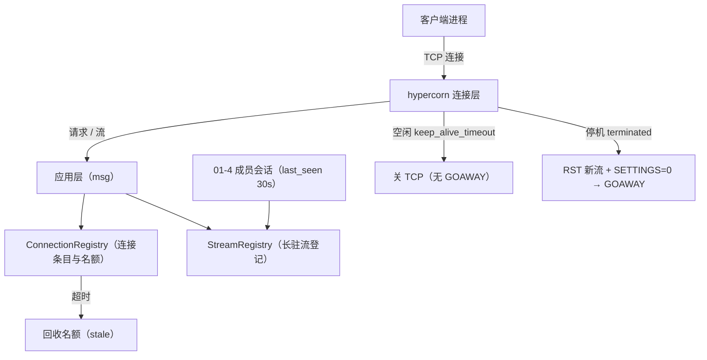
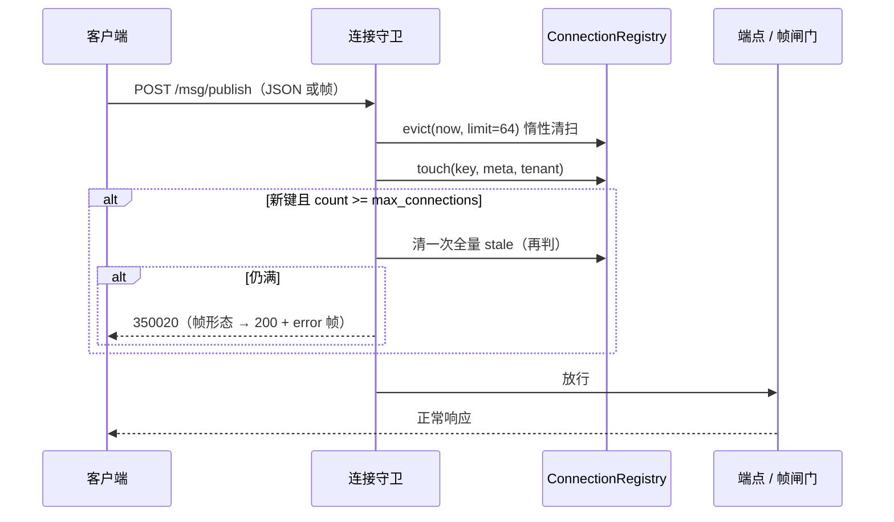
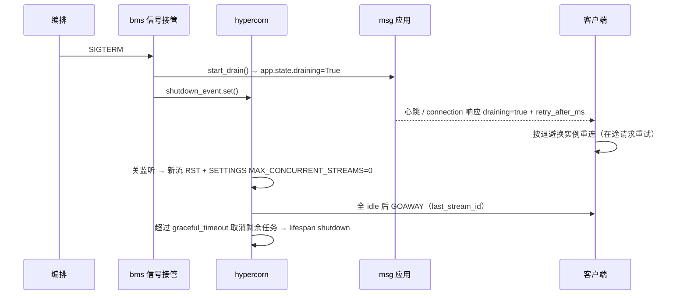
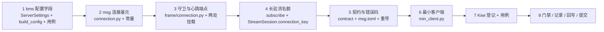

# 连接管理详细设计

> 08B / 任务 03-4 · 任务级详细设计（可落地、可逐条验收）

[文档首页](../../../../../../文档首页.md) › [03 传输与协议](../../03_传输与协议.md) › [03-4 连接管理](../03_传输与协议_04_连接管理.md) › 详细设计

---

## 1. 概述 <a id="overview"></a>

本文档是任务 [03-4 连接管理](../03_传输与协议_04_连接管理.md) 的**详细设计**，粒度到「按序落地、逐条验收」。与架构层不一致时以《架构设计》为准，实现细节以本文档为准。

**上游依据**：

- [需求 03-4 连接管理](../../../../需求/03_需求_传输与协议.md#r03-4)
- [架构设计 · 接入面：协议与客户端](../../../../../../设计/架构设计/05_架构设计_接入面_协议与客户端.md#connection) 第 6 节（连接管理）、第 8 节（客户端形态）
- [架构设计 · 部署与运维](../../../../../../设计/架构设计/08_架构设计_部署与运维.md#upgrade) 第 5 节（先 GOAWAY 再停）
- bms《[协议与传输](../../../../../../../bms文档/资料/知识档案/消息与事件驱动/07_事件驱动_协议与传输.md)》第 6 节
- bms《[HTTP2 服务运行时详细设计](../../../../../../../bms文档/项目/02_后端基座与服务化地基/任务/02_多服务骨架与仓库/02_多服务骨架与仓库_04_HTTP2服务运行时/设计/04_详细设计_01_HTTP2服务运行时.md)》§4.3（信号摘流）、§4.4（h2 默认值）

**与前后任务的关系**：

| 方向 | 任务 | 关系 |
| --- | --- | --- |
| 前置 | [03-1 HTTP/2 传输](../../03_传输与协议_01_HTTP2传输/03_传输与协议_01_HTTP2传输.md)（Kiwi 2420） | 复用 `connection_meta()` / `StreamRegistry` / `StreamTuning` / `GET /msg/connection`；本任务给 `StreamSession` 补 `connection_key`、给 `ConnectionInfo` 补字段 |
| 前置 | [03-2 二进制帧协议](../../03_传输与协议_02_二进制帧协议与版本演进/03_传输与协议_02_二进制帧协议与版本演进.md)（Kiwi 2421） | `heartbeat = 17` 编号只登记、`350019` 后「由客户端断开」——本任务把心跳落地，并把「连接级 GOAWAY 不可由应用发起」写进契约 |
| 前置 | [03-3 序列化与内容类型](../../03_传输与协议_03_序列化与内容类型/03_传输与协议_03_序列化与内容类型.md)（Kiwi 2423） | 控制面取号从 18 起；本任务**不新增帧类型**（17 已登记），只启用其语义 |
| 后继 | [03-5 背压与流控](../../03_传输与协议_05_背压与流控/03_传输与协议_05_背压与流控.md) | 长轮询替换 `StreamTuning.poll_interval_ms`；本任务的「长驻流按连接键计数」是其 inflight 阈值之外的另一层 |
| 跨仓前置 | bms 服务运行时基座（`core/run.py`、`core/config.py`） | 本任务**同批改 bms**：`[server]` 暴露 4 个连接相关 hypercorn 参数（§7.4） |

**口径基线（2026-11-05 确认，不再变更）**：

1. 心跳形态：**帧类型 17 + `GET /msg/connection` 双入口**，共用同一登记与响应模型；心跳端点路径定为 **`POST /msg/connection/heartbeat`**（避开 `/api/v1/msg/heartbeat` 的成员心跳，两者同名不同义）。
2. 心跳阈值：间隔 **10s**、超时 **30s**，独立常量 + `ConnectionTuning` 值对象，响应回传服务端口径。
3. 半开判据：**派生理连接键 + `last_seen` 惰性清扫**（非 ASGI 保证，换服务器须复验）。
4. 释放边界：判定过期只释放**连接登记与名额**，不动流登记与消息状态。
5. GOAWAY：应用层只做 **drain 协商**，GOAWAY 由 hypercorn 停机路径发送；**空闲回收不发 GOAWAY**。
6. 上限：**双落点**——协议层 hypercorn `h2_max_concurrent_streams`，应用层按连接键判连接数（`350020`）与长驻流数（`350021`）。
7. 应用层并发流只计**长驻流**（唯一有精确开/关时机的流类型），短请求并发由协议层 SETTINGS 判。
8. 连接守卫**两处都挂**（`/msg/*` 与 `/api/v1/msg/*` 的数据面四端点），管理面不受影响。
9. 最小客户端：`scripts/client/min_client.py`（人可跑）+ `broker/connection.py::next_backoff_ms`（机可测）。
10. `ConnectionInfo` 补 11 项自适应参数；连接级日志统一 `event=msg.connection`；**不开连接列表端点**（归 06 域）。
11. `x-msg-frame` 增 `connection` 段，`heartbeat` 从 `known_unsupported` 移除。
12. bms `[server]` 一次配齐四项：`h2_max_concurrent_streams` / `keep_alive_timeout_seconds` / `h2_max_header_list_size` / `keep_alive_max_requests`；后两项默认取现默认值（`65536` / `1000`），**行为不变**。
13. 应用层空闲阈值 = `max(2 × keep_alive_timeout, heartbeat_timeout)`，两个输入都从配置读。

## 2. 现状与差距 <a id="gap"></a>

2026-11-05 复核（msg 仓 `a9cd502`；bms 仓 `ff581ef07` 之后未推提交；hypercorn `0.18.0` 源码实测）：

| 项 | 现状 | 本任务目标 | 动作 |
| --- | --- | --- | --- |
| 心跳 | `FrameType.HEARTBEAT = 17` 只登记编号；闸门对 17 回 `350018`「后续任务开放」 | 帧 17 端点 + `GET /msg/connection` 双入口，登记与阈值回传 | 新建 |
| 半开连接 | 无连接概念：只有流登记（`StreamRegistry`，按流不按连接） | 派生理连接键 + `last_seen` + 惰性清扫 | 新建 |
| 空闲回收 | 由 hypercorn `keep_alive_timeout`（**默认 5s**）执行；**不发 GOAWAY**，直接关 TCP | 应用层名额回收跟随该配置，不抢口径 | 新建（读配置） |
| GOAWAY | 仅 hypercorn 停机路径会发（`terminated` + 全 idle → `close_connection()` → GOAWAY）；ASGI 无入口 | 应用层 drain 协商（`draining` + `retry_after_ms`），GOAWAY 分工写进契约 | 新建（协商）+ 文档 |
| 并发流上限 | hypercorn `h2_max_concurrent_streams = 100`（SETTINGS 下发），`[server]` **未暴露** | bms 暴露 + 应用层按连接键判长驻流数 | 跨仓 + 新建 |
| 连接数上限 | 无 | `max_connections`（默认 1024）超限 `350020` | 新建 |
| 连接元数据 | `ConnectionInfo` 7 字段（协议版本 / 承载 / 地址 / 帧版本） | 补 11 项（连接键 / 活跃流 / 三类阈值 / 两个上限 / drain 相关 / 时间） | 修改 |
| 客户端 | 无；03-1 的基准脚本只发请求不复连 | 最小测试客户端（退避 + 抖动，打印重连时间线） | 新建 |
| 连接日志 | 无连接级事件（帧日志有 `http_version`，无连接维度） | `event=msg.connection` 五类事件 | 新建 |

**三个必须写进设计的实测事实**（读 hypercorn 0.18.0 源码得到，不是推测）：

| # | 事实 | 源码位置 | 对设计的影响 |
| --- | --- | --- | --- |
| 1 | **GOAWAY 只有停机路径会发**：`terminated` 置位后新流回 `RST_STREAM` + `SETTINGS MAX_CONCURRENT_STREAMS=0`，待全 idle 才 `close_connection()`（hyper-h2 在该调用里发 GOAWAY） | `protocol/h2.py::_handle_events` / `stream_send` | 应用层无法主动发 GOAWAY；`350019` 的「客户端断开」只能靠契约约束 + 客户端动作，本任务不改这条 |
| 2 | **空闲回收不发 GOAWAY**：`Updated(idle=True)` 只重启 `_idle_timeout`，到点 `protocol.handle(Closed())` 后直接关 writer | `asyncio/tcp_server.py::_idle_timeout` / `_close` | 客户端必须容忍「连接无预告消失」，这正是重连退避要覆盖的主路径；不能把「收到 GOAWAY」当唯一断线信号 |
| 3 | **`scope["client"]` 是 TCP 对端地址**（`socket.getpeername()` 由连接层传给每个 stream），同一 h2 连接上恒定 | `asyncio/tcp_server.py` / `protocol/http_stream.py` | 派生连接键成立；但这是**服务器实现行为**、非 ASGI 保证，设计须标注复验条件 |

## 3. 目标目录与交付物清单 <a id="tree"></a>

```text
msg/backend/services/msg/src/bms_msg/
├── broker/
│   ├── connection.py                     # 新建：连接键 / 登记表 / 半开判定 / 名额 / 退避纯函数
│   └── transport.py                      # 修改：ConnectionMeta 复用；StreamSession 补 connection_key；open() 增参
├── api/
│   ├── deps.py                           # 修改：连接登记表 / 连接参数两个依赖出口
│   ├── data/messages.py                  # 修改：数据面路由级挂连接守卫（两处挂载同口径）
│   └── frame/
│       ├── guard.py                      # 新建：连接守卫（清扫 / 登记 / 上限 / drain）+ 自报装配
│       ├── media.py                      # 新建：帧形态判定（从 gate 下移，断守卫→闸门的环）
│       ├── connection.py                 # 新建：心跳端点（JSON / 帧 17 双形态）
│       ├── routes.py                     # 修改：三条路由（数据面 / 连接自报不判上限）+ 占流名额
│       └── gate.py                       # 修改：心跳帧类型提示改指心跳端点
├── schemas/transport.py                  # 修改：ConnectionInfo 补字段
├── protocol/
│   ├── contract.py                       # 修改：增 connection 段、heartbeat 移出 known_unsupported
│   └── frame.py                          # 修改：HEARTBEAT docstring（编号已启用）
├── core/config.py                        # 修改：连接阈值 / 上限 / 退避常量
├── errors.py                             # 修改：350020 / 350021
├── main.py                               # 修改：注入 connection_registry
└── api/frame/responses.py                # 修改：心跳结果帧装配 + 两码归 business/retryable

msg/scripts/client/min_client.py          # 新建：最小测试客户端（退避 + 抖动 + 重连时间线）
msg/deploy/registry/msg.toml              # 修改：两条 [[errcodes]]
msg/deploy/contracts/msg.json             # 修改：契约重导
msg/backend/services/msg/tests/**         # 新建 / 扩（见 §9）

bms/backend/libs/bms_core/src/bms_core/core/config.py   # 修改：ServerSettings +4 字段
bms/backend/libs/bms_core/src/bms_core/core/run.py      # 修改：build_config 映射
bms/backend/libs/bms_core/tests/core/test_config.py     # 修改：边界与默认值
bms/backend/libs/bms_core/tests/core/test_run.py        # 修改：映射断言
bms/bms文档/后端基类清单.md                              # 修改：服务运行时基座行
bms/bms文档/设计/基类体系/后端基类实现契约.md             # 修改：同名行
bms/bms文档/项目/…/02_多服务骨架与仓库_04_HTTP2服务运行时/设计/04_详细设计_01_HTTP2服务运行时.md  # 修改：§4.1 / §4.4
```

交付物清单：

| 文件 | 类型 | 说明 |
| --- | --- | --- |
| `broker/connection.py` | 新建 | `connection_key()` / `ConnectionRecord` / `ConnectionRegistry` / `ConnectionTuning` / `default_connection_tuning()` / `connection_tuning_from_settings()` / `next_backoff_ms()` |
| `api/frame/connection.py` | 新建 | `build_connection_guard()`（两处挂载共用）、`POST /msg/connection/heartbeat` |
| `broker/transport.py` | 修改 | `StreamSession.connection_key`；`StreamRegistry.open(..., connection_key=...)` |
| `schemas/transport.py` | 修改 | `ConnectionInfo` 补 11 字段 |
| `core/config.py` | 修改 | 9 个常量（§4.3） |
| `errors.py` / `deploy/registry/msg.toml` | 修改 | `350020` / `350021` |
| `protocol/contract.py` | 修改 | `connection` 段 + `known_unsupported` 收敛 |
| `scripts/client/min_client.py` | 新建 | 最小测试客户端 |
| `tests/**` | 新建 / 扩 | 见 §9 |

## 4. 数据结构设计 <a id="data"></a>

> 本任务**不建表、不改表**：连接与名额都是进程内、随连接生灭的瞬态数据。落库 / 跨副本归 8B_05；
> 连接指标归 06 域（本任务只出日志与响应字段）。

### 4.1 派生连接键（`broker/connection.py::connection_key`）

```text
connection_key = f"{tenant}|{client_host}:{client_port}"
```

| 组成 | 来源 | 说明 |
| --- | --- | --- |
| `tenant` | 租户解析结果（`CurrentTenant.code`）；缺失为 `anonymous` | 同一 NAT 后的两个租户不会被算成一条连接 |
| `client_host` | `scope["client"][0]` | 空串（Unix socket 等无地址场景）归一为 `-` |
| `client_port` | `scope["client"][1]` | `0` 归一为 `0` |

**为什么可用**：hypercorn 把 TCP 对端的 `getpeername()` 传给每个 stream，同一 h2 连接上的所有请求 `client` 恒定（§2 事实 3）。

**边界（写进契约）**：

- 这不是 ASGI 规范保证，换服务器实现须复验（否则连接键可能按请求变化，连接数上限会误判）；
- 反向代理 / NAT 后 `client_host` 相同、`client_port` 是代理侧端口：连接数上限退化为「代理端口数」，语义仍成立（统计的是入口连接，不是最终用户）；
- 端口被操作系统复用给新连接时，旧条目可能被「复活」——`opened_at` 会因此偏大；本轮接受（清扫按 `last_seen`，不影响超时判定）。

### 4.2 `ConnectionRecord`（连接快照）

| 字段 | 类型 | 语义 |
| --- | --- | --- |
| `key` | `str` | 派生连接键 |
| `tenant` | `str` | 租户编码或 `anonymous` |
| `client_host` / `client_port` | `str` / `int` | 对端地址（与键同源，冗余存放便于日志与视图） |
| `http_version` / `scheme` | `str` | 首次登记时协商结果（同连接不变） |
| `opened_at` | `float` | 建立时刻（`time.monotonic()`，算存活时长） |
| `opened_wall` | `float` | 建立时刻（`time.time()`，供响应与日志给人看） |
| `last_seen` | `float` | 最近一次请求时刻（monotonic，**超时判定的唯一依据**） |
| `last_seen_wall` | `float` | 同上（wall clock，供 `ConnectionInfo.last_seen_at`） |
| `last_heartbeat_wall` | `float \| None` | 最近一次心跳时刻（wall clock；None 表示从未心跳） |
| `streams` | `int` | 该连接上**长驻流**数（应用层并发流判据） |
| `requests` | `int` | 累计请求数（观测，不判上限） |
| `drain_signaled` | `bool` | 是否已向该连接下发过 drain 信号（防日志刷屏） |
| `stale` | `bool` | 已被清扫标记（供响应区分「复活」与「新建」） |

`ConnectionRecord` 用 `dataclasses.replace()` 产出新快照（frozen），登记表内部只在锁内替换引用——与
`StreamRegistry` 同一手法，避免「半更新」被读到。

### 4.3 `ConnectionTuning`（连接参数值对象）与常量

`core/config.py` 新增（**只读模块常量 + 值对象 + 依赖注入**，不进 `Settings`；基座 `extra="forbid"` 同 03-1 约束）：

| 常量 | 缺省 | 含义 |
| --- | --- | --- |
| `CONNECTION_HEARTBEAT_INTERVAL_MS` | `10_000` | 建议心跳间隔（与 01-4 成员心跳同数值、独立常量） |
| `CONNECTION_HEARTBEAT_TIMEOUT_MS` | `30_000` | 无心跳即判半开的阈值（间隔 3 倍，容忍两次丢包） |
| `MAX_CONNECTIONS` | `1_024` | 单副本连接数上限（进程级） |
| `MAX_STREAMS_PER_CONNECTION` | `100` | 单连接长驻流上限（与 hypercorn `h2_max_concurrent_streams` 默认同值） |
| `CONNECTION_EVICT_SCAN_LIMIT` | `64` | 单次惰性清扫最多检查的条目数 |
| `CONNECTION_RETRY_AFTER_MS` | `1_000` | drain 提示与限流拒绝给出的建议重试间隔 |
| `RECONNECT_BASE_MS` | `200` | 重连退避基数 |
| `RECONNECT_MAX_MS` | `30_000` | 重连退避上限 |
| `RECONNECT_JITTER_RATIO` | `0.2` | 抖动比例（±20%） |

`ConnectionTuning`（`frozen=True`）：

| 字段 | 来源 | 说明 |
| --- | --- | --- |
| `heartbeat_interval_ms` | 常量 | 回传客户端 |
| `heartbeat_timeout_ms` | 常量 | 判半开 |
| `idle_timeout_ms` | **计算**：`max(2 × keep_alive_timeout_seconds × 1000, heartbeat_timeout_ms)` | 名额回收阈值（跟随服务器，不抢口径） |
| `max_connections` | 常量 | 连接数上限 |
| `max_streams_per_connection` | 常量 | 长驻流上限 |
| `evict_scan_limit` | 常量 | 惰性清扫批量 |
| `retry_after_ms` | 常量 | drain / 限流建议间隔 |

- `default_connection_tuning()`：按常量构造（不读配置，供纯单测）；
- `connection_tuning_from_settings(settings)`：读 `settings.server.keep_alive_timeout_seconds` 算 `idle_timeout_ms`——**这是「本任务同批改 bms」的直接理由**。

### 4.4 `ConnectionRegistry`（进程级连接登记表）

| 成员 | 签名 | 职责 |
| --- | --- | --- |
| `touch` | `(*, key, meta, tenant, now, wall, heartbeat: bool) -> ConnectionRecord` | 登记或刷新；`stale` 条目就地复活（`stale=False`、`last_seen` 刷新、`streams` 归零）；`heartbeat=True` 时更新 `last_heartbeat_wall` |
| `update_meta` | `(*, key, meta)` | 同键重建时按新协商结果刷新协议版本 / 地址（不复位计时） |
| `release` | `(key, *, reason) -> ConnectionRecord \| None` | 注销（幂等，未登记返回 None） |
| `open_stream` | `(key) -> None` | 长驻流占位；超 `max_streams_per_connection` 抛 `MsgStreamLimitExceededError`（`350021`） |
| `close_stream` | `(key) -> None` | 长驻流释放（幂等；未登记连接忽略） |
| `evict` | `(*, now, limit) -> ConcurrentStableList[ConnectionRecord]` | 惰性清扫：扫至多 `limit` 条，`now - last_seen > idle_timeout_ms` 即标 `stale` 并释放名额（条目保留为 stale 以支持复活，超过 `idle_timeout_ms × 2` 才真正删除） |
| `count` | `() -> int` | 非 stale 连接数（连接数上限的判据） |
| `get` | `(key) -> ConnectionRecord \| None` | 单条查询（响应与用例断言） |
| `records` | `() -> ConcurrentStableList[ConnectionRecord]` | 快照（日志与用例） |
| `note_drain` | `(*, now) -> bool` | 首次观察到 draining 时记一次 `drain_started` 日志并返回 True（幂等） |

**为什么 stale 条目要留、而不是立刻删**：端口复用时新连接会拿到同一个键；留一条 stale 记录让
`touch` 能识别「复活」，日志也能区分「新开」与「复用」。真正删除放在清扫的第二段（`2 × idle`），
保证条目不会无限堆积。

**为什么名额按记录算而不是按 `len(dict)`**：stale 条目还留着，直接数长度会让上限被已死连接永久占用。

### 4.5 退避纯函数（`next_backoff_ms`）

```text
raw    = min(max_ms, base_ms × 2^attempt)
factor = 1 + jitter_ratio × (2 × r - 1)          # r ∈ [0,1) 注入，缺省 random.random()
delay  = max(0, round(raw × factor))
```

| 参数 | 缺省 | 说明 |
| --- | --- | --- |
| `attempt` | 必填 | 第几次重连（从 0 起） |
| `base_ms` / `max_ms` / `jitter_ratio` | `200` / `30_000` / `0.2` | 常量 |
| `rand` | `random.random` | 注入点：用例传固定值断言抖动上下界，脚本用真随机 |

- 纯函数、无 IO、无全局态 → 100% 覆盖由单测保证；
- **不让脚本承担这道逻辑**：脚本不在覆盖率包内，写在那里等于无门禁（§8）。

## 5. 连接生命周期设计 <a id="lifecycle"></a>

### 5.1 三层分工（本任务最重要的一张图）



| 层 | 判据 | 超时值 | 释放什么 | 归属 |
| --- | --- | --- | --- | --- |
| 成员会话 | 成员 `last_seen` | 30s（`SESSION_TIMEOUT_MS`） | 关长驻流（`member_lost`）、再均衡 | 01-4（已交付） |
| 连接 | 连接 `last_seen`（含心跳） | `max(2 × keep_alive, 30s)` | 连接条目名额（stale） | **本任务** |
| TCP | 无活跃流 | `keep_alive_timeout`（默认 5s） | 关连接（**不发 GOAWAY**） | hypercorn |

**为什么必须是三层而不是一层**：ASGI 拿不到连接标识与关闭句柄——应用层能精确管的是「自己记的账」，
能精确关的是「自己的流」。把三层的判据与动作写在同一张表里，避免以后被简化成「心跳超时就关连接」
（应用层做不到）或「靠服务器就够了」（长驻流不空闲，服务器永远不回收，半开连接会一直推）。

**半开连接的真实形态**：客户端网络静默中断，TCP 未 FIN，长驻流仍在（`idle=False`）→ hypercorn 不回收；
此时应用层的连接 `last_seen` 停在断网时刻，`evict` 在 `idle_timeout_ms` 后回收名额，而流由 01-4 的
成员会话超时关闭。两条路径互为兜底，缺一条就会「长期占用资源」。

### 5.2 请求路径上的连接守卫



| 规则 | 口径 |
| --- | --- |
| 挂载范围 | `/msg/{publish,consume,ack,nack}`、`/msg/subscribe`、`/msg/connection/heartbeat`、`/msg/connection`(GET，不判上限)、以及 `/api/v1/msg/{publish,consume,ack,nack}`——**数据面两处挂载都挂**，网关路径不构成绕过口 |
| 不挂 | 管理面（`/api/v1/msg/admin/*`）、成员路由（`join` / `heartbeat` / `leave`）、探针 |
| 判定顺序 | 清扫 → 登记/刷新 → 连接数上限（`350020`）→ 端点自己的判定（主题/成员/长驻流名额） |
| 错误形态 | 帧请求回 **200 + `error` 帧**（与 03-2 §6.5 一致）；JSON 请求回 **429 + 统一错误体** |
| 幂等 | 同一 `key` 重复 `touch` 只刷新时间与计数，不新增条目 |

**为什么守卫放在「依赖」而不是中间件**：中间件会套到全部请求（含管理面与探针），且帧请求的错误要
在中间件里自己编帧；依赖只在数据面路由上生效，帧错误仍由既有的 `FrameHandled` 处理器直出，改动面最小。

**实现定型（实施回写）**：守卫挂在**路由级依赖**上，豁免用「独立路由」表达而不是在守卫里判路径——
`/msg/*` 拆三条路由：`msg_frame`（数据面 + 长驻流）、`msg_connection`（`GET /msg/connection`，守卫
`enforce_limit=False`）、`msg_heartbeat`（心跳，`heartbeat=True`）。这样「不判上限」是结构上的声明，
不是藏在函数里的 `if path == ...`。

**为什么不是「进流才算连接」**：连接在第一条请求到达时就存在了。只按流算会让 publish-only 客户端
不占名额，连接数上限失去意义。

### 5.3 长驻流名额

| 时点 | 动作 |
| --- | --- |
| `subscribe` 预检前 | `open_stream(key)`；超 `max_streams_per_connection` → `350021`（普通 JSON 错误，尚未进流） |
| 预检失败 | `close_stream(key)`（名额必须先还回去，否则一次失败会永久占一个名额） |
| 流结束（`finally`） | `close_stream(key)`（`client_closed` / `deadline` / `member_lost` / `error` 四条路径统一） |
| 连接 stale | **不动**流（§1 基线 4）；流由 01-4 成员会话或 03-1 时长上限收口 |

### 5.4 drain 协商与 GOAWAY 协同



| 项 | 口径 |
| --- | --- |
| 应用层做什么 | 读 `app.state.draining`（bms 已交付），在 `ConnectionInfo` 里回 `draining` / `retry_after_ms`；首次下发记 `drain_signal_sent`，首次观察到 draining 记 `drain_started` |
| 应用层不做什么 | 不主动发 GOAWAY（ASGI 无入口）、不关连接、不改 hypercorn 内部 |
| GOAWAY 的发送方 | hypercorn 停机路径（§2 事实 1）；`last_stream_id` 以内的在途流正常完成 |
| 空闲回收 | 不发 GOAWAY（§2 事实 2）——客户端必须把「连接直接消失」当普通断线，走同一套退避重连 |
| 客户端动作约束 | 收到 `draining=true` 或连接消失 → 换实例 + 退避重连；`350019` 属 transport 层错误 → 断开并重连（不重发同一帧） |

## 6. 接口设计 <a id="api"></a>

### 6.1 端点总表

| 方法 | 路径 | 权限 | 守卫 | 语义 | 变更 |
| --- | --- | --- | --- | --- | --- |
| GET | `/msg/connection` | 无 | 有（登记连接，不判上限：见下） | 连接元数据自报 + 刷新保活 | 修改（补字段、兼作保活） |
| POST | `/msg/connection/heartbeat` | 无 | 有 | **新增**：心跳（JSON 或帧 17），回同一 `ConnectionInfo` | 新建 |
| POST | `/msg/{publish,consume,ack,nack}` | `msg:publish` / `msg:consume` | 有 | 数据面（帧 / JSON 双形态不变） | 修改（挂守卫） |
| GET | `/msg/subscribe` | `msg:consume` | 有 + 占流名额 | SSE 长驻流 | 修改（名额 + `connection_key`） |
| POST | `/api/v1/msg/{publish,consume,ack,nack}` | 同根路径 | 有 | 既有数据面 / 基准回退路径 | 修改（挂守卫） |

**`GET /msg/connection` 为什么不判连接数上限**：它是打满时的排障入口，判上限会让「满」变成「连查都查不了」。
它仍然 `touch`（刷新 `last_seen`），因此**可以**作为无帧能力客户端的保活入口——这正是双入口的另一半。

### 6.2 `ConnectionInfo`（`schemas/transport.py`）

| 字段 | 类型 | 新增 | 说明 |
| --- | --- | --- | --- |
| `http_version` / `scheme` / `is_tls` | `str` / `str` / `bool` | 否 | 03-1 已有 |
| `client_host` / `client_port` | `str` / `int` | 否 | 03-1 已有 |
| `protocol_version` / `supported_protocol_version` | `str \| None` / `str` | 否 | 03-1 已有（帧版本可见） |
| `connection_key` | `str` | **是** | 派生连接键（与日志同值） |
| `tenant` | `str` | **是** | 租户编码或 `anonymous` |
| `active_streams` | `int` | **是** | 该连接上长驻流数 |
| `requests` | `int` | **是** | 该连接累计请求数 |
| `uptime_ms` | `int` | **是** | 连接存活时长 |
| `idle_ms` | `int` | **是** | 距最近一次请求的时长（判半开的可见值） |
| `last_heartbeat_at` | `datetime \| None` | **是** | 最近心跳时刻（从未心跳为 null） |
| `heartbeat_interval_ms` | `int` | **是** | 服务端建议间隔（客户端据此定周期） |
| `heartbeat_timeout_ms` | `int` | **是** | 服务端判半开阈值 |
| `idle_timeout_ms` | `int` | **是** | 名额回收阈值（= 服务器空闲超时与心跳超时的较大者） |
| `max_streams_per_connection` | `int` | **是** | 应用层长驻流上限（`350021`） |
| `max_connections` | `int` | **是** | 应用层连接数上限（`350020`） |
| `draining` | `bool` | **是** | 本实例是否在摘流 |
| `retry_after_ms` | `int` | **是** | 建议重试间隔（drain / 限流时用） |
| `server_time` | `datetime` | **是** | 服务端当前时间（客户端校时 / 判断漂移） |

**为什么一次补齐而不是分批**：客户端 SDK（8B_03）与运维脚本都靠这份自报定参数；分批等于让客户端先硬编码
一轮再改。字段只增不删，后续新增仍走同一模型。

### 6.3 心跳（帧 17 与 JSON 双形态）

**请求**（`POST /msg/connection/heartbeat`）：

| 形态 | 判定 | 要求 |
| --- | --- | --- |
| 帧 | `Content-Type: application/x-msg-frame` | 帧类型必须 `17`；`header.request_id` 必填；`payload_len` 必须为 0（否则 `350018`） |
| JSON | 缺省 | 空体；不允许携带字段（无请求模型） |

**响应**：

| 形态 | 响应 | 说明 |
| --- | --- | --- |
| 帧 | 帧类型 `17` + `flags.response`，header = `ConnectionInfo` 全字段（时间用 ISO 文本） | HTTP 200；错误仍走 `error` 帧（`350020` / `350018` 等） |
| JSON | `ApiResponse[ConnectionInfo]` | HTTP 200；错误走统一错误体（429 等） |

**帧 header 字段（响应）**：`request_id`（回显）、`protocol_version`、`server_time`、`connection_key`、`tenant`、
`active_streams`、`requests`、`uptime_ms`、`idle_ms`、`last_heartbeat_at`、`heartbeat_interval_ms`、
`heartbeat_timeout_ms`、`idle_timeout_ms`、`max_streams_per_connection`、`max_connections`、`draining`、
`retry_after_ms`。

**为什么心跳不需要业务字段**：心跳只回答「这条连接还活着吗、服务端参数是多少」；带业务字段就会变成
第二个鉴权入口（帧不作为鉴权第二入口，03-2 §6.3 已定）。

### 6.4 错误码

| 码 | 名称 | HTTP | 触发 | layer / retryable |
| --- | --- | --- | --- | --- |
| `350020` | `CONNECTION_LIMIT_EXCEEDED` | 429 | 新连接键且非 stale 连接数 ≥ `max_connections`（清扫后仍满） | business / true（`retry_after_ms` 随帧给出） |
| `350021` | `STREAM_LIMIT_EXCEEDED` | 429 | 单连接长驻流数 ≥ `max_streams_per_connection` | business / true |

- 两码进 `deploy/registry/msg.toml` 的 `[[errcodes]]`（`severity = "warning"`，`message_key` 分别为
  `msg.error.connection_limit_exceeded` / `msg.error.stream_limit_exceeded`）；
- `api/frame/responses.py::classify()` 的 `_BUSINESS_CODES` 与 `_RETRYABLE_BUSINESS` 同步登记两码——
  未登记会兜底进 `system`（不鼓励重试），这是 03-2 定下的「新增码必须在此登记」纪律；
- `x-error-codes` 声明：`/msg/connection/heartbeat` 声明 `[350018, 350020]`；`/msg/subscribe` 追加 `350021`；
  数据面四端点各追加 `350020`（两处挂载共用同一份声明，不会漂移）。

**为什么不复用 `350005`**：`350005` 是「平台过载 / 背压」，与「这条连接打满 / 这条流打满」处置不同
（前者等，后者换实例或降并发）。03-3 复用码只发生在「形态非法归契约层」这类同因场景，不适用于上限。

### 6.5 `x-msg-frame.connection` 契约段

```json
{
  "connection": {
    "identity": "tenant|client_host:client_port（同一 HTTP/2 连接恒定；服务器实现行为，非 ASGI 保证）",
    "heartbeat": {
      "frame_type": 17,
      "endpoint": "POST /msg/connection/heartbeat",
      "interval_ms": 10000,
      "timeout_ms": 30000,
      "payload": "必须为空"
    },
    "idle_timeout": "max(2 × keep_alive_timeout, heartbeat_timeout)",
    "limits": {
      "max_connections": 1024,
      "max_streams_per_connection": 100,
      "protocol_layer": "hypercorn h2_max_concurrent_streams（SETTINGS 下发，客户端自限）",
      "app_layer": "长驻流按连接键计数（350021）；连接数 350020"
    },
    "drain": {
      "signal_fields": ["draining", "retry_after_ms"],
      "goaway": "由 hypercorn 停机路径发送；空闲回收不发 GOAWAY，客户端按普通断线处理"
    },
    "close_reasons": ["client_closed", "deadline", "member_lost", "error"]
  }
}
```

- 单一事实源仍是 `protocol/contract.py::frame_contract()`，导出期注入 `deploy/contracts/msg.json`；
- `known_unsupported` 只剩 `subscribe`（帧式推送归 03-5）；
- `frame_types` 由 `FrameType` 自动生成，17 的语义说明从 `known_unsupported` 挪到 `connection.heartbeat`。

### 6.6 连接级日志

事件名**由基座日志约定定型为 `msg_connection_<子事件>`**（基座 `info(event, **fields)` 的第一个参数就是事件名，
不接受 `event=` 关键字；由 `msg.connection` + 子事件拼接而来）。字段：`connection_key` / `tenant` /
`http_version` / `active_streams` / `requests` / `reason` / `duration_ms` / `retry_after_ms`。

| 事件名 | 何时 | 关键字段 |
| --- | --- | --- |
| `msg_connection_opened` | 新连接键首次登记（含 stale 复活，`reason=revived`） | `http_version` / `tenant` |
| `msg_connection_evicted` | 清扫判定过期 | `active_streams` / `duration_ms` / `reason=heartbeat_timeout` |
| `msg_connection_limit_rejected` | 连接数超限 `350020` | `reason=connection_limit` |
| `msg_connection_stream_limit_rejected` | 单连接长驻流超限 `350021` | `active_streams` / `reason=stream_limit` |
| `msg_connection_drain_started` | 进程首次观察到 `draining` | 无 |
| `msg_connection_drain_signal_sent` | 向某连接首次下发 drain 信号 | `retry_after_ms` |
| `msg_connection_released` | 显式注销（用例 / 内部收尾） | `reason` / `duration_ms` |

**为什么不并入 `event=msg_frame`**：帧日志是每请求一条的高频流，连接事件是低频生命周期；混在一起
会让「按事件采样 / 聚合」失效（06 域指标直接消费这一条）。

## 7. 装配与登记 <a id="assembly"></a>

### 7.1 依赖注入

| 出口 | 位置 | 说明 |
| --- | --- | --- |
| `get_connection_registry` / `ConnectionRegistryDep` | `api/deps.py` | 取 `app.state.connection_registry`（`configure_service()` 注入） |
| `get_connection_tuning` / `ConnectionTuningDep` | `api/deps.py` | `connection_tuning_from_settings(get_settings())`；用例经 `dependency_overrides` 注入毫秒级参数 |
| `build_connection_guard()` | `api/frame/connection.py` | 返回可 `Depends` 的守卫；数据面两处挂载共用同一工厂 |

`main.py::configure_service()` 增 `app.state.connection_registry = ConnectionRegistry()`（与 `stream_registry` 并列）。

### 7.2 路由挂载

| 路由 | 变更 |
| --- | --- |
| `api/data/messages.py::mount_data_plane(target, *, frame_gate=None, connection_guard=None)` | 增守卫参数，与既有 `frame_gate` 同一手法（规格仍只写一处） |
| `api/router.py` | `messages.router`（`/api/v1` 内）与 `frame_routes` 各自挂载时传守卫；`/api/v1` 传 `connection_guard`、不传 `frame_gate`（保持纯 JSON） |
| `api/frame/routes.py` | `mount_data_plane(router, frame_gate=…, connection_guard=…)`；新增 `POST /connection/heartbeat`；`GET /connection` 与 `GET /subscribe` 挂守卫 |
| `api/frame/gate.py` | `_ensure_frame_type` 不再把 17 当「未开放」；心跳走自己的端点，不经过数据面闸门 |

**心跳为什么不复用数据面闸门**：闸门的职责是「同路径两个形态、复用数据面四个端点」；心跳没有业务语义、
不碰存储，用一个独立端点更直白，也避免把「无 payload / 无租户依赖」的特例塞进闸门。

### 7.3 契约与登记回写

| 落点 | 内容 |
| --- | --- |
| `deploy/contracts/msg.json` | 重导（新增 1 条路径 + `connection` 段 + 两条错误码声明） |
| `deploy/registry/msg.toml` | 两条 `[[errcodes]]` |
| 《[架构设计 · 接入面](../../../../../../设计/架构设计/05_架构设计_接入面_协议与客户端.md)》§12 | 待定项 #3 的「`maxWait` / `inflight` 默认值」旁补「连接 / 心跳阈值已定值（03-4）」 |
| 任务文档 §5 前置契约 | 03-2 的「心跳只登记」「GOAWAY 归 03-4」两条在本任务收口，回写为**已交付** |
| 计划表 | 03-4 行的进度类字段（唯一落点，本文件不承载） |

### 7.4 bms 侧改动（同批提交、不推送）

`ServerSettings`（`bms_core/core/config.py`）新增：

| 字段 | 类型 / 默认 | 边界 | 语义 |
| --- | --- | --- | --- |
| `h2_max_concurrent_streams` | `int = 100` | `ge=1, le=10_000` | 单连接并发流上限（SETTINGS 下发） |
| `h2_max_header_list_size` | `int = 65_536` | `ge=1_024, le=1_048_576` | 单连接头部列表上限 |
| `keep_alive_timeout_seconds` | `int = 5` | `ge=1, le=600` | 空闲连接回收（无活跃流时） |
| `keep_alive_max_requests` | `int = 1_000` | `ge=1, le=1_000_000` | 单连接请求数退休阈值 |

`build_config()` 增四行映射：`config.h2_max_concurrent_streams = settings.server.h2_max_concurrent_streams` 等。

- 后两项默认取 hypercorn 现默认值（`65536` / `1000`），**行为不变**；前两项同理（`100` / `5s`）；
- 环境变量沿用 `BMS_SERVER__` + 段双下划线（`BMS_SERVER__H2_MAX_CONCURRENT_STREAMS` 等）；
- 用例：`test_config.py` 覆盖默认值与四个边界（下界 / 上界 / 越界）；`test_run.py` 覆盖四项映射；
- 文档回写：`后端基类清单` 与 `后端基类实现契约` 的「服务运行时基座」行补「连接相关 h2 参数」；
  `02_04 详细设计` §4.1 字段表追加四行、§4.4 的「h2 默认值」段改为「默认值可由 `[server]` 覆盖」。

**为什么放在本任务而不是另立 bms 任务**：`idle_timeout_ms` 的算法（§4.3）直接依赖
`keep_alive_timeout_seconds`；只在 msg 侧硬编码一个常量，就会与服务器实际回收时机脱钩（用户已拍板）。

## 8. 最小测试客户端设计 <a id="client"></a>

`msg/scripts/client/min_client.py`（Python 3.14，`httpx[http2]`，与基准脚本同依赖口径）：

| 参数 | 缺省 | 含义 |
| --- | --- | --- |
| `--base-url` | `http://127.0.0.1:8000` | 目标实例 |
| `--tenant` | `demo` | `X-Tenant-ID` |
| `--namespace` / `--topic` / `--group` / `--consumer-id` | `msg` / `audit.operation` / `audit` / `min-client` | 订阅目标（需预先建主题并 join） |
| `--partition` | `0` | 分区 |
| `--protocol` | `h2c` | `h2c`（`http2=True, http1=False`）或 `h1` |
| `--heartbeat-interval` | 取 `/msg/connection` 自报值 | 心跳周期（秒）；服务端回多少就用多少 |
| `--attempts` | `5` | 最多重连次数 |
| `--duration` | `30` | 总时长上限（秒） |

**一轮的行为**：

1. `POST /api/v1/msg/join` 自助加入消费组（同 `consumer_id` 幂等；不 join 就没有分区分配）；
2. `GET /msg/connection` 取参数（心跳间隔 / 超时 / 上限）并**打印**，不硬编码；
3. 打开 `GET /msg/subscribe` 流，读事件（`open` / `message` / `close`）；
4. 起一个心跳任务，每 `interval` 发**两类**心跳：连接心跳（帧 17，刷新保活并读 `draining`）与
   成员心跳（`POST /api/v1/msg/heartbeat`，维持 01-4 的成员会话）；
5. 流结束 / 连接错误 / `draining=true` / 轮次到期 → 结束本轮，按 `next_backoff_ms(attempt)` 退避后重连；
6. 每轮打印一行：`attempt / reason / messages / delay_ms`；退出时打印汇总（重连次数、退避序列、
   抖动区间、是否形成脉冲）。

**两条实测教训（已写进脚本注释）**：

- **只发连接心跳会丢成员**：连接存活 ≠ 成员存活。演练跑到 30s 时成员会话超时，`/msg/subscribe` 开始回
  `350014`——最小客户端必须两类心跳都发，否则「自动重连」在第二轮就退化成「连上也订阅不了」。
- **到期判断不能挂在 SSE 事件循环里**：空闲期服务端只发注释行，注释行不进事件流，挂在那里的到期判断
  永远不被求值（演练首版一轮跑了 45s）。定型为「读任务 + 200ms 轮询看三个条件」。

**验收方式**：

- 真机演练（写进测试记录）：起服务 → 跑 `min_client.py --attempts 3` → 中途 `SIGTERM` 服务进程 →
  客户端应打印 `drain` 或连接错误、按退避重连；重启服务后恢复推送；
- 单测覆盖的只是 `next_backoff_ms`（§4.5）——脚本本身不进覆盖率包（`coverage_packages` 不含 `scripts`），
  因此**判据是「纯函数单测 + 脚本可复现演练」两层**，不靠脚本的覆盖率。

## 9. 测试设计 <a id="tests"></a>

### 9.1 Kiwi 用例

先登记后编码（`ssh <账号>@<开发服务器> "docker exec -i bms-kiwi /Kiwi/manage.py shell"`），分类「平台骨架」、
优先级 `P2`、状态 `CONFIRMED`、标签「自动化」；**新登记一条**，登记前回读平台最大号（2420 / 2421 / 2423 已被占用，
不得复用或改派）。用例号回填代码 `@pytest.mark.kiwi_id(...)` 与记录。

### 9.2 用例清单

| 层 | 文件 | 用例 | 覆盖的关键分支 |
| --- | --- | --- | --- |
| 连接基元 | `tests/broker/test_connection.py`（新建；含 `StreamSession.connection_key`，故不扩 03-1 的 `test_transport.py` 以免 Kiwi 编号混标） | `connection_key` 三种组成（正常 / 空地址 / anonymous 租户）；`touch` 新建 / 刷新 / stale 复活；`open_stream` 达上限 → `350021`、`close_stream` 幂等；`evict` 过期标记与二次删除；`count` 只数非 stale；`records` 快照；`note_drain` 幂等；`next_backoff_ms` 递增 / 上限封顶 / 抖动上下界 / `attempt=0` | 登记表全部分支 + 退避函数 |
| 连接参数 | 同上 | `default_connection_tuning()` 取常量；`connection_tuning_from_settings()` 的 `idle = max(2×keep_alive, timeout)` 两侧（keep_alive 大 / 超时大） | 阈值计算两支 |
| 心跳与元数据 | `tests/api/test_connection_heartbeat.py`（新建） | `GET /msg/connection` 新旧字段齐全且与 registry 一致；帧 17 心跳端到端（header 全字段 + `request_id` 回显）；JSON 形态心跳；心跳后 `last_heartbeat_at` 非空；心跳帧带 payload → `350018`；缺 `request_id` → `350018`；主版本 2 → `350019`；`draining=true` 时回 `draining` 且记一次 `drain_signal_sent` | 双形态 + 帧校验分支 |
| 上限 | `tests/api/test_connection_limits.py`（新建） | `max_connections=2` 时第三条连接键 `350020`（JSON 429 / 帧 200 + error 帧 `layer=business, retryable=true`）；清扫后放行；`GET /msg/connection` 满额仍可查；`max_streams_per_connection=2` 时第三条长驻流 `350021`；预检失败后名额归还（失败后仍能再开两条）；`/api/v1/msg/publish` 同样受限（不构成绕过） | 两码 × 两形态 + 名额回收 |
| 流与连接键 | `tests/api/test_subscribe_stream.py`（扩；沿用 03-1 的 Kiwi 2420，只改装配不新增编号） | 直调生成器的用例改为先登记连接，流结束归还名额 | 03-1 用例适配 03-4 的签名变化 |
| 真机 drain | `tests/api/test_drain_signal.py`（新建） | 起真实 hypercorn：置 `app.state.draining=True` → 心跳回 `draining=true`；`keep_alive_max_requests` 设小值触发连接退休 → 客户端收到 GOAWAY 后同连接新请求失败、按退避重连到同一实例成功；停机后 `/readyz` 503 先于连接关闭 | 真 h2c + 退休边界（03-1 遗留闭环） |
| 契约 | `tests/protocol/test_connection_contract.py`（新建；同上，不扩 03-2 的 `test_contract.py`） | `connection` 段字段与常量同值；`known_unsupported` 只剩 `subscribe`；`frame_types["17"] == "heartbeat"` | 契约一致性 |
| 错误码 | `tests/test_error_codes.py`（自动） | 两码在 `msg.toml` 与枚举双向对齐 | 既有护栏 |

**不做的测试**：多副本连接共享（8B_05）、连接指标上报（06 域）、连接列表端点（06 域）、吞吐与容量（平台级容量实测）。

### 9.3 覆盖率照顾点

| 分支 | 覆盖方式 |
| --- | --- |
| `connection_key` 的三条归一（空地址 / 端口 0 / anonymous） | 直接构造 `scope` / 租户调纯函数 |
| stale 复活与二次删除 | 注入 `now` 推进时间，两次 `evict` |
| 连接数上限「清扫后仍满」 | 先塞满 + 全部置过期但未到二次删除窗口 |
| 帧形态拒绝（`FrameHandled`）与 JSON 形态拒绝（429） | 同一用例两形态各发一次 |
| `subscribe` 预检失败归还名额 | 名额上限设 1，连开两次非法订阅，第三次合法仍成功 |
| drain 首次/再次下发 | 连发两次心跳，断言只记一次 `drain_signal_sent` |
| `next_backoff_ms` 抖动上下界 | 注入 `rand=lambda: 0.0 / 0.999` |

## 10. 实施步骤 <a id="steps"></a>



| 步 | 内容 | 产出 |
| --- | --- | --- |
| 1 | bms 四字段 + 映射 + 两份用例 + 文档回写 | 基座可配、行为不变 |
| 2 | `broker/connection.py` + 9 个常量 + `main.py` 注入 | 登记 / 判据 / 退避可用 |
| 3 | 连接守卫 + 心跳端点 + 两处挂载 + `ConnectionInfo` 补字段 | 心跳与限额可用 |
| 4 | `subscribe` 占名额 + `StreamSession.connection_key` | 长驻流上限可用 |
| 5 | `contract.py` 的 `connection` 段 + 两条 `[[errcodes]]` + 契约重导 | 契约零漂移 |
| 6 | `scripts/client/min_client.py` | 真机演练工具 |
| 7 | Kiwi 登记 → 用例 → 覆盖率 / 静态 | 交付闭环 |
| 8 | 实施记录 / 测试记录 / 计划回写 / 偏差遗留 / 提交 | 收口 |

## 11. 验收映射 <a id="accept-map"></a>

| 任务完成标准 | 验证方式 |
| --- | --- |
| 网络中断后连接在超时内被识别并释放；不会长期占用资源 | `test_connection.py`（`evict` 判据与名额回收）+ `test_drain_signal.py`（真机断连后名额归零）+ §5.1 三层分工表 |
| 滚动重启（GOAWAY）不丢在途请求，客户端能自动重连 | `test_drain_signal.py`：drain 信号可见 + 连接退休（GOAWAY）后 `min_client` 按退避重连成功；在途流按 `last_stream_id` 完成 |
| 重连带指数退避 + 抖动，不形成连接脉冲 | `next_backoff_ms` 单测（递增 / 封顶 / 抖动区间）+ 真机演练时间线（测试记录） |
| 单连接并发流 / 连接数超限时返回明确错误 | `test_connection_limits.py`：`350020` / `350021` × JSON / 帧两形态 |
| 连接元数据可查 | `test_connection_heartbeat.py`：`ConnectionInfo` 18 字段 + 帧 header 同源 |
| 心跳与业务处理互不阻塞（慢业务不触发误判） | 心跳端点不触库、不取 uow（只读 `app.state`）；`test_connection_heartbeat.py` 在慢业务（延迟发布）进行时发心跳仍即时返回 |
| 变更模块行 + 分支覆盖率 100%，静态全绿 | `coverage_report.py --module bms_msg.broker.connection` 等 + `ruff` / `pyright` |

## 12. 风险与开放项 <a id="risk"></a>

| # | 项 | 影响 | 处置 |
| --- | --- | --- | --- |
| 1 | 派生连接键依赖服务器实现（`scope["client"]` 恒定性） | 换服务器（Granian / uvicorn h2）后连接数上限可能误判 | 契约与设计显式标注「非 ASGI 保证、须复验」；连接数上限只用于防单点狂占，误判后果是「多算几条连接」而非错误拒绝 |
| 2 | 反向代理 / NAT 后连接键退化 | 连接数上限统计的是入口连接数 | 语义上正确（防代理侧狂占）；排障时 `connection_key` 已是代理地址，配合网关日志定位 |
| 3 | 应用层只计长驻流并发 | 短请求并发不受应用层约束 | 由 hypercorn SETTINGS 约束（契约写清两层分工）；如需应用层全量并发，需引入 ASGI 中间件，属后续按需 |
| 4 | 空闲回收不发 GOAWAY | 客户端可能把「连接消失」当异常 | 明确纳入重连退避主路径（`min_client` 与 SDK 8B_03 同口径）；不把 GOAWAY 当唯一信号 |
| 5 | `draining` 只在响应里回，服务端无法主动推送 | 空闲客户端要等下一次心跳才知道 | 心跳间隔 10s 即最坏延迟；`/readyz` 503 让编排先摘流，缩短窗口 |
| 6 | bms 同批改动跨仓 | 两仓需同步提交与验证 | 本任务内完成 bms 提交（不推送），bms 走自身提交环；msg 侧只依赖配置字段，无代码耦合 |
| 7 | 连接数上限 1024 为经验值 | 单副本连接过多时（>1024）会开始拒绝 | 默认值取「单副本 + 网关一跳」量级；容量定参归平台级容量实测 |
| 8 | 心跳端点无鉴权 | 可能被用来刷连接登记 | 无业务副作用；连接数上限本身就是防刷；05 域认证落地后再评估收紧（与 03-1 `/msg/connection` 同一开放项） |

## 13. 对齐记录 <a id="align"></a>

| # | 事项 | 结论（2026-11-05 确认） |
| --- | --- | --- |
| 1 | 心跳承载 | 帧 17 + `GET /msg/connection` 双入口，共用登记与模型 |
| 2 | 心跳路径 | `POST /msg/connection/heartbeat`（避开 `/api/v1/msg/heartbeat` 成员心跳的同名歧义） |
| 3 | 心跳阈值 | 10s / 30s，独立常量 + `ConnectionTuning` |
| 4 | 半开判据 | 派生连接键 + `last_seen` + 惰性清扫 |
| 5 | 释放边界 | 只释放连接登记与名额，不动流与消息状态 |
| 6 | GOAWAY | 应用层 drain 协商；发送方是 hypercorn；空闲回收不发 GOAWAY |
| 7 | 上限落点 | 双落点（协议层 SETTINGS + 应用层判定） |
| 8 | 应用层并发流 | 只计长驻流；短请求由协议层判 |
| 9 | 错误码 | 新占 `350020` / `350021` |
| 10 | 守卫范围 | `/msg/*` 与 `/api/v1/msg/*` 两处都挂；管理面与成员路由不挂 |
| 11 | 客户端形态 | 脚本 + 退避纯函数 |
| 12 | 连接字段 | `ConnectionInfo` 补 11 项 |
| 13 | 日志 | `event=msg.connection` 五类事件 |
| 14 | 连接列表端点 | 不开，归 06 域 |
| 15 | 清扫方式 | 惰性（请求驱动，单批上限） |
| 16 | 心跳鉴权 | 不走权限，租户可缺 |
| 17 | bms 字段 | 一次配齐四项，后两项默认值保持行为不变 |
| 18 | idle 阈值 | `max(2 × keep_alive_timeout, heartbeat_timeout)` |
| 19 | bms 文档 | 同步回写（基类清单 / 实现契约 / 02_04 设计） |
| 20 | bms 提交 | 本任务内单独提交，不推送 |
| 21 | 守卫形态（实施回写） | 路由级依赖 + 三条路由（数据面 / 连接自报不判上限 / 心跳）；豁免用独立路由表达，不在守卫里判路径 |
| 22 | 帧形态判定下移（实施回写） | `is_frame_request` 从 `gate.py` 下移到 `api/frame/media.py`：守卫要帧感知，而守卫 → 闸门 → 数据面 → 守卫会成环 |
| 23 | 日志事件名（实施回写） | 基座 `info(event, **fields)` 首个参数即事件名，不接受 `event=` 关键字 → 定型 `msg_connection_<子事件>` |
| 24 | 最小客户端（实施回写） | 增加自助 join 与**成员心跳**（只发连接心跳会在 30s 后丢成员，演练实测）；轮次到期改为「读任务 + 轮询」，不再依赖 SSE 事件触发（空闲期只有注释行，不进事件流） |
| 25 | 行尾（实施回写） | Windows 写盘把 24 个文件写成 CRLF，已统一回 LF（单独 `style` 提交）；msg 仓缺 `.gitattributes`，`engkit eol` 在本仓实际不生效（登记遗留） |

---

> 依《[文档生成规范](../../../../../../../bms文档/规范/文档生成规范.md)》与《[任务文档规范](../../../../../../../bms文档/规范/任务文档规范.md)》编写
