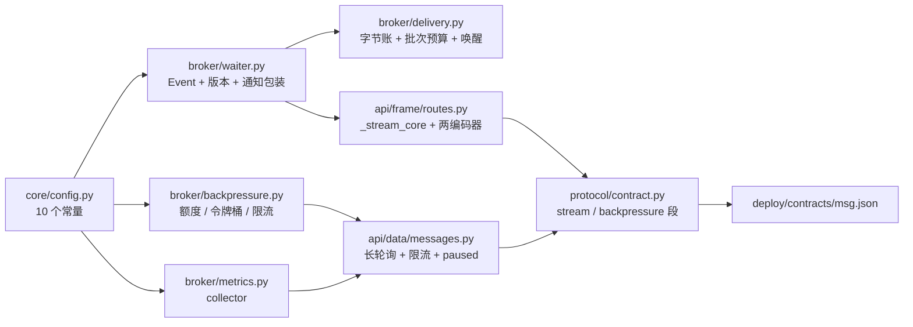

# 背压与流控实施记录

> 08B · 03 传输与协议 · 03-5 背压与流控 · 实施记录

[文档首页](../../../../../../文档首页.md) › [03-5 背压与流控](../03_传输与协议_05_背压与流控.md) › 实施　|　[详细设计](../设计/01_详细设计_05_背压与流控.md) · [测试记录](../测试/01_测试记录_05_背压与流控.md)

## 1. 实施信息 

| 项 | 值 |
| --- | --- |
| 任务 | [03-5 背压与流控](../03_传输与协议_05_背压与流控.md) |
| 详细设计 | [背压与流控详细设计](../设计/01_详细设计_05_背压与流控.md)（2026-11-05 定稿，提交 `48b1393`；实施回写 6 条见其 §19） |
| Kiwi 用例 | **2425**（先登记后编码；登记前回读最大号为 2424，未复用 2420~2424） |
| 实施日期 | 2026-11-05 |
| 提交 | msg `48b1393`（设计）、`6b9e356`（代码 + 用例 + 契约重导 + 错误码登记） |
| 环境 | 开发机（Windows，Python 3.14.4）；hypercorn 0.18.0；用例并发 `-n auto`（586 passed） |

## 2. 实施概览 

| 类别 | 内容 |
| --- | --- |
| 新建模块 | `broker/waiter.py`（`DeliveryWaiter` + `NotifyingMessageStore`）、`broker/backpressure.py`（额度 / 令牌桶 / 两级限流）、`broker/metrics.py`（`BackpressureMetrics`） |
| 新建端点 | `POST /msg/subscribe`（帧流：open 帧 + message 帧 + error 帧 + EOF） |
| 新增错误码 | `350005`（`RATE_LIMITED`，429 + `Retry-After`） |
| 新增帧类型 | `MESSAGE = 6`（数据面 6-15 首位；预留顺延 `7-15`，`known_unsupported` 清空） |
| 修改（后端） | 12 个文件：等待与预算进 `DeliveryService`/`DeliveryState`、`consume` 长轮询、`publish` 限流、`_stream_core` 拆核心 + 两个编码器、`responses` 两个帧装配、契约两段、装配注入、4 个依赖出口 |
| 契约 | `deploy/contracts/msg.json` 重导（+1 路径、`stream` / `backpressure` 两段、`frame_types` +1、`reserved_types` 顺延） |
| 登记 | `deploy/registry/msg.toml` 追加 `[[errcodes]] 350005` |

## 3. 实施过程 

按详细设计 §15 八步推进；代码一次成型后按预检清单批量修正（未做「改一处跑一次」）：

| 步 | 内容 | 结果 |
| --- | --- | --- |
| 1 | Kiwi 登记 1 条并回读 | **2425**（分类平台骨架 / P2 / CONFIRMED / 标签自动化）；回读与代码标注一致 |
| 2 | 常量 + `waiter.py` + `backpressure.py` + `metrics.py` | 24 条单测（等待三态 / 令牌桶补给 / 桶清理 / 指标分键有界） |
| 3 | `DeliveryState` 字节账 + `_collect` 批次预算 + ack/nack 唤醒 | 条数与字节双阈值生效；`acks=0` 不受约束 |
| 4 | `ConsumeRequest.max_wait_ms` + `ConsumeResult` 三字段 + `consume` 长轮询 | 立即返回 / 发布唤醒 / 到期返空 / 等待者超限四态可验 |
| 5 | `_stream_core` 重构 + SSE / 帧流两个编码器 + `POST /msg/subscribe` | 两形态共用一套等待与背压，编码各写一遍 |
| 6 | 限流 + `350005` + 专属异常处理器 + 登记表 | JSON 429 + `Retry-After`；帧 error 帧带 `retry_after_ms` |
| 7 | 契约两段 + 重导 + 依赖注入装配 | `contract_snapshot check` 通过 |
| 8 | 门禁 / 记录 / 回写 / 提交 | **586 passed**、17 个改动模块覆盖率 100%、静态全绿 |

## 4. 问题与处置 

| # | 问题 | 根因 | 处置 |
| --- | --- | --- | --- |
| 1 | `test_stream_keeps_alive_when_idle` 失败：流已结束但 `stream_registry.active() == 1` | 外层 SSE 编码器被 `aclose()` 时，`async for` 只结束循环，**不会关闭内层** `_stream_core`；其 `finally`（注销登记 / 归还名额）要等 GC | 两个编码器 `finally` 里 `await core.aclose()`；用例与「断开即释放」判据同时恢复 |
| 2 | 既有「空批」用例真等 30s，随后成员会话超时返回 409（`350014`） | `max_wait_ms` 缺省 30000，语义用例不关心等待，却按新缺省挂满 | 语义用例显式 `max_wait_ms: 0`（`test_data_messages` / `test_data_delay` / `test_data_groups` / `test_nack` / `test_frame_payload` 五处请求构造 + h2c 收尾请求一处） |
| 3 | 限流用例首版永不触发（第二次发布也 200） | 依赖覆盖写成 `lambda: _limiter(...)`——**每请求新建一个满桶**，等于不限速 | 用例先建单实例再 `lambda: limiter`；这条写进测试记录，避免后人再踩 |
| 4 | 预取用例只收到 1 条（`max_messages=1` + `prefetch=1`） | 分区内停等：头未 ack 时下一轮拉取本就为空，预取不能越过停等 | 用例改为「收全不丢、顺序不变」；把「预取不越过停等」写进设计 §6.3 与本文 §7 遗留（批 ack 后预取才有吞吐收益） |
| 5 | 帧流预检抛非业务异常时长驻流名额不归还 | 设计只写了 `MsgError` 分支，未覆盖取消 / 未预期异常 | `except BaseException` 先归还名额再原样抛出；用例用 `raise_app_exceptions=False` 断言 500 与「记录的 streams 归零」 |
| 6 | `test_error_codes` 遍历构造全部错误码时崩 | `MsgRateLimitedError(retry_after_ms=...)` 为必填关键字参数 | 给缺省（回落 `RATE_LIMIT_RETRY_AFTER_MS`），桶给出等待时仍以桶为准 |
| 7 | 管理面 / 数据面多处夹具报 `State object has no attribute 'rate_limiter'` | 新依赖读 `app.state`，而各用例文件自建应用未注入 | `tests_support.frame_app.install_backpressure_state(app)` 统一注入（frame_app 内建 + 3 个数据面 + 3 个管理面夹具各一行） |
| 8 | `_prune` 触发 pyright 报错（异构 dict 联合键） | `for table in (tenant_buckets, topic_buckets)` 让键类型退化成 `str \| TopicKey` | 拆成两段循环（租户 / 主题各一段），类型与语义都更直白 |
| 9 | 两条 03-2 契约断言与 `contract` 口径冲突 | `reserved_types` 顺延 `7-15`、`known_unsupported` 清空 | 按新口径更新断言（并在测试记录登记「既有断言更新」） |

## 5. 验证结果 

| 项 | 结果 |
| --- | --- |
| 后端用例（提交环选测，全量目录） | **586 passed**，0 failed（其中 03-5 新增 63 条） |
| 模块覆盖率 | `files=17 missing_lines=0 partial_branches=0 percent=100.00` |
| 改动行覆盖率 | `[diff-coverage] 通过：17 个文件的改动行均已被执行` |
| 静态 | `ruff check` / `ruff format --check` / `pyright`（严格）全绿 |
| 契约 | `contract_snapshot check` 通过（+1 路径、`stream` / `backpressure` 两段） |
| 文档 | `links` 断链 0 / `docs-scope` 违规 0 / `eol` 违规 0 |

## 6. 登记回写 

| 落点 | 内容 |
| --- | --- |
| 详细设计 | 实施回写 6 条（§19）：预取不越停等、`wait_timeout_ms` 公开、`DeliveryService` 两个可选参数、`Retry-After` 走专属处理器、帧流 EOF 结束、既有用例适配口径 |
| 任务文档 §5 | 三条前置契约（03-2 / 03-4 / 03-3）标注「本任务已承接」，新增本任务交付行 |
| 架构设计 §12 | 待定项 #2（长轮询 / 长驻流）与 #3（`maxWait` / `inflight` 默认值）回填「已定值（03-5）」 |
| 计划表 | 03-5 行迁入已完成；§5 门禁 2 补「三/四项背压证据」；偏差与遗留登记 |
| 契约与登记 | `deploy/contracts/msg.json` 重导；`deploy/registry/msg.toml` 追加 `350005` |
| Kiwi | 用例 2425 已登记并回读核对 |

## 7. 偏差与遗留 

**偏差（设计 → 实施，均已回写设计）**：

1. `wait_timeout_ms` 由 `_wait_timeout_ms` 改为公开名——用例要直接验「三者取最小 + 至少 1ms」这一纯函数边界，私有命名会让 `reportPrivateUsage` 拦住。
2. `DeliveryService` 增两个**可选**参数（`backpressure` / `waiter`）：默认 `None` 保证 01-2 / 01-3 的既有用例与语义一行不改，只有数据面装配传值。
3. 预取**不能越过分区内停等**：`max_messages=1` 时 look-ahead 必为空。预取的价值在「批未满」与「批 ack 后」，不是绕过顺序性。
4. 帧流**不发 close 帧**（EOF 即正常结束）：少一种状态机，代价是 `deadline` / `client_closed` 的原因不下发；异常仍走 `error` 帧。
5. `Retry-After` 由 msg 为 `MsgRateLimitedError` 注册专属异常处理器写入（基座 `build_error_response` 已支持该参数，全局 `BizError` 处理器不传），**未改基座**。
6. 长轮询的等待放在 API 层而非 `DeliveryService`：服务层不感知「等待」，`_collect` 的停等规则保持原样。

**遗留（归口）**：

| # | 遗留 | 影响 | 归口 |
| --- | --- | --- | --- |
| 1 | 等待器 / 令牌桶 / 指标均为进程内状态 | 多副本各算各的，唤醒不跨进程 | 8B_05（多副本）；指标聚合归 06 域 |
| 2 | 限速数值缺省关闭 | 生产忘开则无限速 | 05-3（租户配额）+ 8B_12（容量定参）；契约与实施记录双写「必须开启」 |
| 3 | 预取在停等下的吞吐收益有限 | 需客户端批 ack 才能体现 | 8B_03（SDK 批处理 + 批量 ack） |
| 4 | 帧流无 close 帧 | SDK 需以 EOF 判正常结束、以 `error` 帧判异常 | 8B_03（写进客户端契约） |
| 5 | 指标只有 collector，无 HTTP / Prometheus 出口 | 运维看不到曲线 | 06-3 |
| 6 | `WINDOW_STALL_THRESHOLD_MS = 50ms` 为经验值 | 阈值过小会误记、过大漏记 | 8B_12（容量与压测时定参） |
| 7 | 既有用例以 `max_wait_ms: 0` 显式关闭长轮询 | 语义用例与等待语义分离是对的，但散布 6 处 | 8B_03 SDK 需按「空批 + paused」与「到期返空」区分退避策略 |
| 8 | 长轮询挂起数 × 时长的内存影响未实测 | 上限 1024 是估值 | 8B_12（知识档案 06 §11 待实测第 1 项） |
