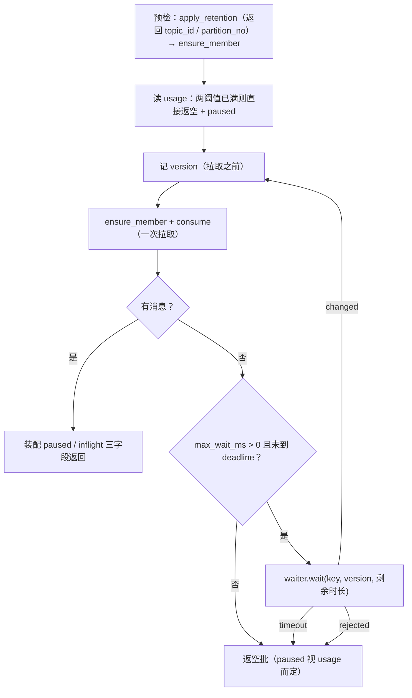

# 背压与流控详细设计

> 08B / 任务 03-5 · 任务级详细设计（可落地、可逐条验收）

[文档首页](../../../../../../文档首页.md) › [03 传输与协议](../../03_传输与协议.md) › [03-5 背压与流控](../03_传输与协议_05_背压与流控.md) › 详细设计

---

## 1. 概述 <a id="overview"></a>

本文档是任务 [03-5 背压与流控](../03_传输与协议_05_背压与流控.md) 的**详细设计**，粒度到「按序落地、逐条验收」。与架构层不一致时以《架构设计》为准，实现细节以本文档为准。

**上游依据**：

- [需求 03-5 背压与流控](../../../../需求/03_需求_传输与协议.md#r03-5)
- [架构设计 · 接入面：协议与客户端](../../../../../../设计/架构设计/05_架构设计_接入面_协议与客户端.md#backpressure) 第 7 节（背压两层 + 磁盘水位）、第 12 节 #3（`maxWait` / `inflight` 默认值）
- bms《[背压与流控](../../../../../../../bms文档/资料/知识档案/消息与事件驱动/06_事件驱动_背压与流控.md)》第 2~7 节

**与前后任务的关系**：

| 方向 | 任务 | 关系 |
| --- | --- | --- |
| 前置 | [03-1 HTTP/2 传输](../../03_传输与协议_01_HTTP2传输/03_传输与协议_01_HTTP2传输.md)（Kiwi 2420） | `StreamTuning` 是**唯一的等待策略出口**（§4.3 原话「03-5 换实现不换形态」）；本任务把固定 200ms 轮询换成事件等待，接口形态不变 |
| 前置 | [03-2 二进制帧协议与版本演进](../../03_传输与协议_02_二进制帧协议与版本演进/03_传输与协议_02_二进制帧协议与版本演进.md)（Kiwi 2421） | `FrameType` 6-15 预留、`flags.batch` 已定义；本任务取 6 号 `message` |
| 前置 | [03-4 连接管理](../../03_传输与协议_04_连接管理/03_传输与协议_04_连接管理.md)（Kiwi 2424） | 连接守卫（路由级依赖）与单连接长驻流上限 `350021` 不动；本任务的流同样占名额 |
| 前置 | [03-3 序列化与内容类型](../../03_传输与协议_03_序列化与内容类型/03_传输与协议_03_序列化与内容类型.md)（Kiwi 2423） | `content_type` / `compression` / `uncompressed_len` 三字段随 `message` 帧回显；⚠️ 不复用 `frame_media_type` 命名 |
| 前置 | [01-2 投递语义](../../../01_消息模型与投递/01_消息模型与投递_02_投递语义/01_消息模型与投递_02_投递语义.md) / [01-3 顺序性](../../../01_消息模型与投递/01_消息模型与投递_03_顺序性/01_消息模型与投递_03_顺序性.md) | 投递语义、停等、`acks` 两档**一行不改**；本任务只在批次外层加预算与等待 |
| 后继 | 06-3（指标暴露）、02-6（磁盘水位）、05-3（租户配额） | 本任务只提供 collector 与两级限流骨架，数值来源与暴露归各自任务 |
| 后继 | 8B_03 SDK | 帧流协议本任务定型，SDK 按此实现（不再以 SSE 为默认） |

**口径基线（2026-11-05 确认，共 22 项，逐条落在 §18）**：

1. 范围含**帧式推送**（`message` 帧 6 + `POST /msg/subscribe` 帧流），`flags.batch` 只留位不启用。
2. 长轮询落 **`/msg/consume` 的 `max_wait_ms`**（缺省 30s / 上界 60s / 0=不等待），SSE 与帧流**同步切换**事件唤醒。
3. 挂起用 **`asyncio.Event` + 单调版本号**；等待者超全局上限（1024）立即返空。
4. inflight **双阈值按 `(group, topic_id, partition_no)`** 计，落在进程内 `DeliveryState`；字节按 `len(payload)`。
5. 超限**不返错误**：`consume` 返空批 + `paused` 字段；SSE / 帧流只等不推。
6. 预取默认 **0（零缓冲）**，可配时预取的消息**计入 inflight**。
7. 生产限速 **两级令牌桶**（租户 + 主题），**默认关闭**（rate=0），超限 `350005` + 429 + `Retry-After`；延迟发布同样受限。
8. 慢消费者隔离**只保证应用层**不受影响；h2 连接级窗口共享写进契约，不假装能消除。

## 2. 现状与差距 <a id="gap"></a>

2026-11-05 复核（msg 仓 `8ff4c9d`）：

| 项 | 现状 | 本任务目标 | 动作 |
| --- | --- | --- | --- |
| 长轮询 | `DeliveryService.consume` 空批立即返回；SSE 用 `asyncio.sleep(poll_interval_ms)`（200ms）空转 | 事件等待 + `max_wait_ms` 到期返空 | 新建等待器 + 改三处调用 |
| inflight 阈值 | `DeliveryState` 只有 `(group,topic,partition) → {offset: InflightDelivery(attempts, deadline)}`，**无字节、无阈值** | 条数 + 字节双阈值，超限停推、归还恢复 | 扩 `DeliveryState` + 批次预算 |
| 预取 | 无（拉到即发） | 默认 0，可配时流水线预取 | 新建（流内 look-ahead） |
| 传输层背压 | 仅依赖 hypercorn 窗口，**无任何观测** | 窗口暂停可观测、可证明不忙等 | 新建度量 + 真机实验 |
| 生产限速 | 全仓无令牌桶/漏桶 | 两级令牌桶 + `350005` | 新建 + 新增错误码 |
| 慢消费者 | 生成器阻塞（天然零缓冲），但无指标 | 明示零缓冲/预取两种形态 + 指标 | 设计口径 + 度量 |
| 指标 | 只有结构化日志 | collector（5 类指标，06-3 暴露） | 新建 |
| 帧式推送 | `known_unsupported = {subscribe}`，订阅帧只登记编号 | `message` 帧 + `POST /msg/subscribe` 帧流 | 新建 |
| 错误码 | `350005` 只在 `responses.py` 的分类表出现，**枚举与登记表都没有** | 正式启用 | 修改三处 |
| 契约 | `x-msg-frame` 有 `connection` 段 | 增 `stream` / `backpressure` 段，`known_unsupported` 清空 | 修改 + 重导 |

**关键事实（读代码得出，不在文档里凭印象）**：

1. `_collect` 的停等判定是「扫描遇未过期在途队头即停」——**预算限制只能加在「投出前」，不能改停等规则**，否则 01-3 的顺序性用例会以另一种方式通过（顺序对了但语义变了）。
2. `message_item()` 已把原始字节放私有通道（`set_raw_payload`），帧装配可直接取原始字节——**帧流不需要 base64 往返**。
3. `frame_contract()` 的 `frame_types` 由 `FrameType` 枚举自动生成，新增 `MESSAGE = 6` 后契约自动多一项；但 `reserved_types` 的 `"6-15"` 是**手写常量**，必须同步改成 `"7-15"`。
4. 基座统一错误响应的 `build_error_response(scope, exc, *, retry_after=None)` **已支持 `Retry-After`**，只是全局 `BizError` 处理器没传；产品侧为具体异常注册处理器即可，不需要改基座。
5. `DeliveryState._inflight` 的覆盖语义（`track` 对同 offset 覆盖）意味着字节账必须在覆盖时**先减旧值**，否则重投会虚增。

## 3. 目标目录与交付物清单 <a id="tree"></a>

```text
msg/backend/services/msg/src/bms_msg/
├── broker/
│   ├── waiter.py                               # 新建：DeliveryWaiter（Event + 版本）+ NotifyingMessageStore
│   ├── backpressure.py                         # 新建：BackpressureTuning / InflightUsage / TokenBucket / RateLimiter
│   ├── metrics.py                              # 新建：BackpressureMetrics（collector，不暴露）
│   ├── delivery.py                             # 修改：DeliveryState 字节账 + _collect 预算 + 唤醒通知
│   └── transport.py                            # 修改：StreamTuning 增 max_wait_ms / prefetch
├── schemas/
│   ├── message.py                              # 修改：ConsumeRequest.max_wait_ms / ConsumeResult.paused 等三字段
│   └── transport.py                            # 修改：StreamEvent / StreamOpened / StreamChunk（流事件值对象）
├── api/
│   ├── deps.py                                 # 修改：4 个新依赖（waiter / metrics / rate_limiter / backpressure tuning）
│   ├── data/
│   │   └── messages.py                         # 修改：长轮询等待 + 预检返回 topic_id + 限流 + paused 装配
│   └── frame/
│       ├── routes.py                           # 修改：GET /msg/stream 拆编码器 + POST 帧流 + 共用核心
│       ├── responses.py                        # 修改：message_frame / stream_open_frame / paused 三键
│       └── gate.py                             # 修改：限流错误的 retry_after_ms 透出
├── protocol/
│   └── contract.py                             # 修改：MESSAGE 帧、reserved_types 7-15、stream / backpressure 段
├── core/
│   └── config.py                               # 修改：10 个常量
├── errors.py                                   # 修改：350005（RateLimitedError）
└── main.py                                     # 修改：waiter / metrics / rate_limiter 注入 + 存储包装

msg/deploy/registry/msg.toml                    # 修改：[[errcodes]] 350005
msg/deploy/contracts/msg.json                   # 修改：重导
msg/backend/services/msg/tests/**               # 新建 8 个用例文件（见 §14）
```

交付物清单：

| 文件 | 类型 | 说明 |
| --- | --- | --- |
| `broker/waiter.py` | 新建 | `DeliveryWaiter`（版本 + Event + 等待者计数）、`NotifyingMessageStore`（append 即唤醒，单点覆盖发布 / 延迟转投 / 重放） |
| `broker/backpressure.py` | 新建 | `InflightUsage` / `BackpressureTuning` / `RateLimitTuning` / `TokenBucket` / `RateLimiter` |
| `broker/metrics.py` | 新建 | `BackpressureMetrics`（计数 + 有界分键 + `snapshot()`） |
| `broker/delivery.py` | 修改 | `usage()` / `track(size=)` / `forget` 归还字节 / `drop_partition` 清字节 / `_collect` 预算 / `ack`+`nack` 唤醒 |
| `broker/transport.py` | 修改 | `StreamTuning` 增 `max_wait_ms` / `prefetch`（带缺省，既有构造不受影响） |
| `api/frame/routes.py` | 修改 | `_stream_core` 产出 `StreamEvent`；SSE 与帧流两个编码器；`POST /msg/subscribe` |
| `api/frame/responses.py` | 修改 | `message_frame()` / `stream_open_frame()`；`consume` 响应头补三键 |
| `schemas/transport.py` | 修改 | `StreamEvent` / 事件载荷值对象（SSE 与帧流共用） |
| `protocol/contract.py` | 修改 | `stream` / `backpressure` 两段 + `MESSAGE` 自动登记 |
| `errors.py` + `deploy/registry/msg.toml` | 修改 | `350005` 枚举、`[[errcodes]]`、分类表（已存在，补枚举即可） |
| `tests/**` | 新建 | 8 个文件，模块级 `kiwi_id(2425)` |

## 4. 数据结构设计 <a id="data"></a>

> 本任务**不建表、不改表**：等待器、inflight 账、令牌桶、指标全是进程内瞬态；持久化归 8B_02 / 8B_05。

### 4.1 `DeliveryWaiter`（等待器，`broker/waiter.py`）

| 成员 | 签名 | 职责 |
| --- | --- | --- |
| `key` | `WaitKey = tuple[int, int]` | `(topic_id, partition_no)`——**与存储桶同键**，发布/转投/重放都有它，无需再解析命名空间 |
| `version` | `(key) -> int` | 当前版本号（未出现过的键为 0） |
| `notify` | `(key) -> None` | 版本 +1 并唤醒该键上所有等待者（无等待者时只加版本，不留 Event） |
| `waiting` | `() -> int` | 当前挂起的等待者总数（指标与用例断言） |
| `wait` | `async (key, *, version, timeout_ms) -> WaitOutcome` | 见下 |

`WaitOutcome`（`StrEnum`）：`changed` / `timeout` / `rejected`。

```text
wait(key, version, timeout_ms):
  if 当前版本 != version:            → changed      # 拉取期间已有新消息，不必等
  if 等待者数 >= max_waiters:        → rejected     # 立即返空（不排队、不报错）
  取 / 建该键的 Event；等待者数 += 1
  try:    await wait_for(event.wait(), timeout_ms)
          → changed
  except TimeoutError:
          → timeout
  finally: 等待者数 -= 1
            if event.is_set(): 丢弃该 Event（下次重建，避免把别人的唤醒吃掉）
```

**为什么版本号不能省**：Event 只在 `set()` 之后为真，若「拉取 → 建 Event → 等待」之间存在一次 `notify`，等待者会睡满整个超时才醒——长轮询的延迟就退化成 `max_wait_ms`。版本号把「已发生变化」与「正在等变化」分开。

**为什么不用 `asyncio.Condition`**：Condition 要持锁，同分区多消费组会互相串行化唤醒；且它同样解决不了跨进程（本就不跨）。

**为什么跨进程不通知**：消息存储本身是进程内实现（`InMemoryMessageStore`），另一个副本收不到这条消息，通知它也没有意义；多副本归 8B_05。

### 4.2 `NotifyingMessageStore`（同文件）

`MessageStore` 的**装饰器实现**：六个方法原样委托，只在 `append` 成功后 `waiter.notify((topic_id, partition_no))`。

| 为什么是装饰器而不是在三个写入点各加一行 | 说明 |
| --- | --- |
| 写入点有三处 | `DeliveryService.publish`（普通发布）、`DelayScheduler`（到期转投）、`ReplayRunner`（重放）——各加一行就漏一处，且 8B_02 换存储实现时还要再找一遍 |
| 端口不变 | 8B_02 把 `InMemoryMessageStore` 换成文件段实现，包装器不动、通知点不动 |

### 4.3 inflight 账（扩 `DeliveryState`，`broker/delivery.py`）

| 成员 | 签名 | 说明 |
| --- | --- | --- |
| `usage` | `(key: PartitionKey) -> InflightUsage` | 当前条数与字节（`(group, topic_id, partition_no)`） |
| `track` | `(key, offset, delivery, *, size: int = 0)` | 覆盖同 offset 时**先减旧 size 再加新值** |
| `forget` | `(key, offset)` | 同时清在途记录与字节（ack / nack / 死信 / 重投超限共用） |
| `drop_partition` | `(key)` | 易主时清在途，**同时清字节账**（不清则新持有者一上来就超限） |

`InflightUsage`（`frozen` 值对象）：`messages` / `bytes`，另有 `remaining(limit: InflightUsage) -> InflightUsage`（逐项 `max(0, limit - usage)`）。

内部实现：`_sizes: dict[PartitionKey, dict[int, int]]`（offset → payload 字节），与 `_inflight` 同生命周期、同一把锁。

### 4.4 `BackpressureTuning`（`broker/backpressure.py`）

| 字段 | 缺省 | 含义 |
| --- | --- | --- |
| `inflight_messages` | `100` | 单分区持有者的在途条数上限（与 `max_messages` 上界同值，便于解释） |
| `inflight_bytes` | `16 MiB` | 在途字节上限（`16 × 1024 × 1024`） |

`budget_for(usage) -> InflightUsage` 返回剩余额度；`enabled` 属性（任一阈值 > 0）供 `acks=0` 分支与用例短路。

**为什么是独立值对象而不是并进 `StreamTuning`**：`StreamTuning` 是「一条流怎么等」的参数（间隔 / 时长 / 心跳），`BackpressureTuning` 是「一个分区持有者能压多少」的参数（跨流、跨请求存续）——两者生命周期不同（一个随请求，一个随进程语义）。

### 4.5 令牌桶与两级限流（同文件）

| 类型 | 成员 | 说明 |
| --- | --- | --- |
| `TokenBucket` | `can(count, now) -> int` / `consume(count, now)` / `is_full(now)` | `can` 返 0 表示够、>0 为「还需等待的毫秒」；分离「看」与「扣」是为了两级先都判够再一起扣，避免租户桶被白白扣掉 |
| `RateLimitTuning` | `tenant_per_second` / `topic_per_second` / `burst_seconds` | 两级速率；`0` 表示该级不限；桶容量 = 速率 × `burst_seconds` |
| `RateLimiter` | `check(*, tenant, topic_key, now=None) -> int` | 0 = 放行；>0 = 建议重试毫秒（取两级中较大的等待） |

**桶数有界**：`_tenant_buckets` / `_topic_buckets` 超过 `RATE_LIMIT_BUCKET_LIMIT`（4096）时，先清掉「已满且无负债」的桶；仍超则按插入序淘汰最旧的一个（进程内单线程，无并发问题）。

### 4.6 `BackpressureMetrics`（`broker/metrics.py`）

| 指标 | 类型 | 维度 |
| --- | --- | --- |
| `msg_inflight_messages` | gauge | 全局 + `(tenant, topic)` |
| `msg_inflight_bytes` | gauge | 全局 + `(tenant, topic)` |
| `msg_window_stall_total` | counter | 全局 + `(tenant, topic)` |
| `msg_rate_limit_rejected_total` | counter | 全局 + `scope=tenant` / `scope=topic` 分键 |
| `msg_long_poll_waiters` | gauge | 全局 |
| `msg_long_poll_changed_total` / `_timeout_total` / `_rejected_total` | counter | 全局 |

- **gauge 语义**：`observe_inflight()` 每次投递 / 归还时**覆盖**该键的值，而不是累加；`__total__` 由分键求和得出（读时算，避免维护两份）。
- **分键有界**：主题键超过 `METRICS_TOPIC_KEY_LIMIT`（500）时归入 `__other__`，防高基数打爆内存。
- **出口**：`snapshot() -> ConcurrentStableDict[str, Any]`，由 06-3 拉取 / 转成 Prometheus；本任务**不加 HTTP 端点**（避免与 06-3 重复定义指标面）。

## 5. 长轮询与等待 <a id="longpoll"></a>

### 5.1 端点形态与参数

`/msg/consume` 请求体（帧形态为同名 header 键）新增：

| 字段 | 规则 |
| --- | --- |
| `max_wait_ms` | `0 ~ 60000`，缺省 `30000`；`0` = 不挂起（等价当前行为）；越界归契约层 `10001` |

`GET /msg/subscribe` 的等待时长取 `StreamTuning.max_wait_ms`（不开放成查询参数：流的时长已由 `max_seconds` 控制，再开一个等待参数会让客户端要理解两个超时）。

**与连接保活的关系**：挂起的请求本身是一条**活跃 stream**，hypercorn 的空闲回收判据是「连接上无活跃流」，因此 `max_wait_ms=30s` 不会被 `keep_alive_timeout=5s` 回收；30s 也小于常见网关的 60s 空闲超时，不需要额外心跳。

**与 `max_seconds` 的关系**：`max_seconds` 是**一条流的总时长**（到期发 `close(deadline)`），`max_wait_ms` 是**单次无消息等待的时长**（到期再拉一轮，直到总时长耗尽）。两者独立，都写在契约里。

### 5.2 `consume` 的等待循环



| 规则 | 说明 |
| --- | --- |
| 预检只做一次 | 保留期清理按请求跑一次（等待期间不重复扫描）；成员校验每轮都跑（成员可能在这 30s 内超时） |
| 版本号取自拉取之前 | 否则「拉空 → 发消息 → 建 Event」会丢掉这次唤醒 |
| `changed` 后立即重拉 | 不 sleep（这是长轮询的全部价值） |
| `timeout` 返空 | 200 + 空批，不是错误；`350004` 继续留给 8B_03 远程调用deadline |
| `rejected` 立即返空 | 挂起数到上限，不排队；计数进 `msg_long_poll_rejected_total` |
| 单请求最大挂起 | `max_wait_ms` 上界 60000，且不跨请求累计 |

### 5.3 SSE / 帧流的等待段

`_stream_core` 把「无消息」的等待从 `sleep(poll_interval_ms)` 改为：

```text
timeout = min(max_wait_ms, keepalive_ms - 距上次发送, 剩余总时长)
outcome = await waiter.wait(key, version=version, timeout_ms=timeout)
changed  → 立即重拉
timeout  → 若距上次发送 >= keepalive_ms 则发一行注释（SSE）/ 不发（帧流），再重拉
rejected → 与 timeout 同处置（但计数进 rejected；不把「挂起太多」变成错误）
```

`SUBSCRIBE_POLL_INTERVAL_MS` 保留但**降级为兜底**：仅当 `max_wait_ms == 0` 时用它做固定间隔重试（用例可注入毫秒级值，既有 SSE 用例因此不用改语义）。

## 6. inflight 双阈值与预取 <a id="inflight"></a>

### 6.1 预算怎么算

| 步骤 | 位置 | 规则 |
| --- | --- | --- |
| ① 判「已满」 | `api/data/messages.py::consume` | `usage.messages >= limit.messages or usage.bytes >= limit.bytes` → 不拉，直接返空 + `paused=true` |
| ② 限批大小 | `DeliveryService._collect` | 本轮有效条数 = `min(request.max_messages, 剩余条数)`；投出前逐条判 `剩余字节 >= len(payload)`，不足即停批 |
| ③ 记账 | `DeliveryService._deliver` | `track(..., size=len(message.payload))`；重投覆盖时先减旧值 |
| ④ 归还 | `ack` / `nack` / 死信 / `drop_partition` | `forget` 同时清字节；随后 `waiter.notify(partition)` 唤醒被暂停的流 |
| ⑤ 装配 | `api/data/messages.py::consume` | 读一次 `usage`，填 `paused` / `inflight_messages` / `inflight_bytes` |

**为什么 `paused` 由调用方算而不是 `_collect` 返回**：`_collect` 只回答「这一批投了哪些」，把「是否已达上限」留给调用方，可以让 `DeliveryService.consume` 的签名与返回值保持原样（01-2 / 01-3 的用例一行不改）。

**`acks=0` 不参与**：该档位不登记在途（01-2 口径），`usage` 恒不增长；`BackpressureTuning.enabled` 为假时跳过①②，行为与改动前一致。

**字节口径是 `len(payload)`**：broker 不解压（03-3 口径），这是真实内存占用，也是 1 MiB 上限的同一把尺；`uncompressed_len` 是生产者可选声明，用它等于把硬背压降成可谎报的软约束。

### 6.2 三个出口的表现

| 出口 | 达阈值时 | 归还后 |
| --- | --- | --- |
| `/msg/consume`（JSON / 帧） | `200` + 空批 + `paused=true` + 当前用量（**不是错误码**） | 下一次拉取立即恢复（无需重启、无需等超时） |
| `GET /msg/subscribe`（SSE） | 不推消息，只发注释行保活；**不发 `error`** | `ack` 到达即唤醒，继续推 |
| `POST /msg/subscribe`（帧流） | 不推帧（连接保持打开，无空帧） | 同上 |
| 生产侧 | **完全不受影响**（背压是消费侧的事） | — |

### 6.3 预取（默认 0）

| 形态 | 行为 | 代价 |
| --- | --- | --- |
| `prefetch = 0`（缺省） | 拉到即发，发完再拉 | 零缓冲；发一条的这段时间内不发拉取 |
| `prefetch = N`（1~100） | 发当前批的**同时**发起下一批拉取（`asyncio.Task`）；下一批条数 = `min(N, max_messages)` | 预取的 N 条**立即计入 inflight**（决策 16）；流被取消时要取消未完成的拉取任务 |

约束：`prefetch <= inflight_messages`（校验在 `default_stream_tuning()` 与用例注入处），否则「预取自己把阈值占满」，一条也发不出去。

> **实施期实测（2026-11-05）**：预取**不能越过分区内停等**——头未 ack 时下一轮拉取本就为空，`max_messages=1` 时 look-ahead 必空。因此预取的收益在「批未满」与「客户端批 ack」两个场景，不是绕过顺序性；用例据此改为验「不丢、不重、顺序不变」。

## 7. 传输层窗口即信用 <a id="credit"></a>

### 7.1 能观测到什么（ASGI 边界内）

| 事实 | 说明 |
| --- | --- |
| ASGI **不暴露**流控窗口 | 没有 API 能读「发送窗口还剩多少字节」 |
| 窗口由 hypercorn 执行 | 应用 `await send({"body": ...})` 时，底层在窗口不足处**挂起**，窗口更新后继续 |
| 因此「暂停」表现为 `send` 变慢/不动 | 应用侧可测的是**等待时长**，不是窗口数值 |
| 连接级窗口是**共享**的 | 慢 stream 停读会吃光连接的发送窗口，连带同连接其它 stream 停——协议语义 |

### 7.2 度量：`window_stall`

`_stream_core` 在「yield 之后到下一轮继续」之间记一次耗时；超过 `WINDOW_STALL_THRESHOLD_MS`（缺省 50ms）即记 `msg_window_stall_total` 一次（按 `(tenant, topic)` 分键）。

- 为什么阈值判定而不是直接测窗口：应用只能看到「这次写/推进等了多久」，等得久就是窗口（或客户端处理）在起作用。
- 与「忙等」的区别：忙等会表现为**CPU 高 + 循环次数暴涨**，而窗口挂起是**协程睡眠**；§7.3 的实验同时测两者。

### 7.3 证明方法（真机停读实验）

`tests/api/test_window_stall.py`：

1. 起真 hypercorn（最小装配 + 空闲端口），客户端 `httpx.AsyncClient(http2=True, http1=False)`；
2. 建主题 / 组 / 成员，开 `GET /msg/subscribe` 并发 `send(stream=True)`；
3. 让客户端**停止读取**响应体（拿到 `response` 后不迭代），服务端持续发布大消息（如 8 KiB × 200 条）；
4. 断言：`metrics.snapshot()` 在窗口耗尽后 `chunk 速率`（服务端「已发出的事件数」用生成器自增计数观测）**在 1s 内不再增长**；同时 `time.process_time()` 增量 < 阈值（**不忙等**）；
5. 恢复读取（迭代响应体），断言事件继续到达、总条数补齐；
6. 用例结束 `aclose()` 并取消服务任务。

> 这不是性能判据（容量归 8B_12），只是**机制判据**：窗口耗尽 ⇒ 应用侧停住 ⇒ 不烧 CPU ⇒ 恢复后继续。

### 7.4 边界：慢消费者与同连接其它 stream

| 层 | 是否受影响 | 依据 |
| --- | --- | --- |
| 应用层资源（协程 / CPU / inflight 配额 / 全局锁） | **不受影响** | 每条流独立协程、独立预取上限、`DeliveryState` 分键记账 |
| 同连接其它 stream 的**应用层**调度 | **不受影响** | 无全局锁；生成器只在自身 await 点挂起 |
| 同连接其它 stream 的**传输层**发送 | **会受影响** | h2 连接级窗口共享，一条流停读会把连接窗口吃光 |

最后一条写进契约 `x-msg-frame.stream.connection_window`，并在测试记录里注明「验收口径 = 应用层」，避免以后被理解成「实现缺陷」。

## 8. 生产限速 <a id="ratelimit"></a>

### 8.1 判定点与算法

| 项 | 口径 |
| --- | --- |
| 判定点 | `api/data/messages.py::publish` 的**最前面**（延迟发布与普通发布共用一处，覆盖 `delay_level` 分支） |
| 维度 | 租户桶 `tenant` + 主题桶 `(tenant, namespace, topic)`；**两级都判、都扣**，任一不足即拒 |
| 速率 | `RATE_LIMIT_TENANT_PER_SECOND` / `RATE_LIMIT_TOPIC_PER_SECOND`，**缺省 0 = 不限** |
| 桶容量 | 速率 × `RATE_LIMIT_BURST_SECONDS`（1s）；进程停摆不攒额度（与 01-6 重放 `REPLAY_BURST_SECONDS` 同手法） |
| 算法 | 令牌桶（允许短突发，长期速率受控） |

### 8.2 拒绝形态

| 承载 | 形态 |
| --- | --- |
| JSON | `429` + 统一错误体（`350005`）+ 响应头 `Retry-After: <秒，向上取整>` |
| 帧 | `200` + `error` 帧（`layer=business`、`retryable=true`、`retry_after_ms`） |

- `Retry-After` 由 msg 为 `MsgRateLimitedError` 注册**专属异常处理器**调用 `build_error_response(..., retry_after=ceil(ms/1000))`（基座已支持该参数，不改基座）。
- `350005` 与相邻码分工：`350015` 延迟区满（容量）、`350020` 连接数满、`350021` 单连接流满、`350006` 消息过大；`350005` 只表示「生产速率超出配额」。

### 8.3 默认关闭的理由

不改变既有行为：523 条既有用例与 03-1 的 publish 基准都不受节流影响；数值由 05-3（租户配额）与 8B_12（容量定参）给，本任务只保证「一开就生效、超限可验收」。用例经依赖覆盖注入小速率（如 2 条/秒）验证拒绝路径。

## 9. 慢消费者隔离 <a id="slow"></a>

| 手段 | 本任务做法 |
| --- | --- |
| 零缓冲（缺省） | 生成器直接推，慢消费者只阻塞自己（`await send` 挂起），不排队、不占额外内存 |
| 预取（可配） | 只给自己那条流加 look-ahead，条数受 `prefetch` 与 inflight 阈值双重限制 |
| 不占他人配额 | inflight 按 `(group, topic, partition)` 记账，慢消费者只耗自己的额度 |
| 不加全局锁 | 等待器 / 令牌桶 / 指标都是无锁或单点同步调用，流之间没有共享临界区 |
| 可见性超时兜底 | 长期不 ack 的消息按 01-2 规则重投、超限转死信（**不改**） |
| 指标 | `msg_inflight_*` + `msg_window_stall_total` 可看出「谁在拖」 |

## 10. 帧式推送 <a id="framestream"></a>

### 10.1 帧类型与流协议

| 帧 | 类型 | flags | 说明 |
| --- | --- | --- | --- |
| 订阅请求 | `SUBSCRIBE` 4 | （按需 `NEED_RESPONSE`） | header 带订阅参数；payload 必须为空 |
| 订阅生效 | `SUBSCRIBE` 4 | `RESPONSE` | 首帧，回 `stream_id` / 两个超时 / 三个阈值（等价 SSE `open`） |
| 消息 | `MESSAGE` 6 | — | header 带元数据，payload = 消息体**原始字节**（不 base64） |
| 错误 | `ERROR` 16 | `RESPONSE` | 流内错误（成员失效等），随后结束 |
| 正常结束 | —— | —— | **正文 EOF**：不发结束帧（HTTP 流结束即最强信号） |

**为什么取 6 号**：数据面区间 6-15 的第一位，语义是「投递给订阅方」，与 1-5 的请求类帧分开；7-15 继续预留。

**为什么没有 close 帧**：SSE 需要 `close` 事件是因为 `EventSource` 不暴露 EOF 原因；帧客户端自己读流，EOF 就是最明确的结束信号。少一种帧 = 少一处状态机。

### 10.2 端点

| 方法 | 路径 | 权限 | 说明 |
| --- | --- | --- | --- |
| GET | `/msg/subscribe` | `msg:consume` | SSE（不变，仅等待段换实现） |
| **POST** | `/msg/subscribe` | `msg:consume` | **新增**：帧流。参数在帧 header，响应 `application/x-msg-frame` |

**为什么同路径双方法**：与数据面「同路径 JSON/帧双形态」同一心智——SDK 只需记一个资源名「订阅」，载体由方法决定；语义声明只有一处（同路径同 handler 家族）。不用「新路径 `/msg/stream`」是为了避免「订阅」两个名字、两套错误码声明。

**帧流请求头必填**：`request_id` / `namespace` / `topic` / `group` / `consumer_id` / `partition`；可选 `max_messages` / `max_seconds`。缺键 `350018`，值形态非法 `10001`（与数据面闸门同口径）。

### 10.3 预检失败与流内错误

| 时机 | 形态 |
| --- | --- |
| 进流之前（保留清理 / 成员校验 / 帧解析） | `200` + **单帧 error**（帧可解析即协议内失败）；连接数 / 流数超限同 03-4 口径 |
| 进流之后 | `error` 帧 + 立即 EOF（状态码已定 200，不能再改） |

### 10.4 与 SSE 的共用

`_stream_core` 产出 `StreamEvent`（`open` / `message` / `error` / `close`），两个编码器分别映射：

| 事件 | SSE | 帧流 |
| --- | --- | --- |
| `open` | `event: open` + 单行 JSON | `SUBSCRIBE`+`RESPONSE` 帧 |
| `message` | `event: message`（payload base64） | `MESSAGE` 帧（payload 原始字节 + 三个内容字段） |
| `error` | `event: error` | `ERROR` 帧 |
| `close` | `event: close` | **不发**（EOF） |
| `keepalive` | `: keepalive` 注释行 | **不发**（h2 心跳承担保活） |

## 11. 指标埋点口径 <a id="metrics"></a>

| 指标 | 何时更新 | 维度 | 用途 |
| --- | --- | --- | --- |
| `msg_inflight_messages` / `msg_inflight_bytes` | 每次投递后与每次归还后覆盖 | 全局 + `(tenant, topic)` | 看谁在压、压多少 |
| `msg_window_stall_total` | 生成器两次推进间隔 > 50ms | 全局 + `(tenant, topic)` | 看传输层是否在等客户端 |
| `msg_rate_limit_rejected_total` | 每次 350005 | `scope=tenant` / `scope=topic` | 看限流是租户级还是主题级触发 |
| `msg_long_poll_waiters` | 等待者增 / 减 | 全局 | 看挂起规模 |
| `msg_long_poll_{changed,timeout,rejected}_total` | 每次等待结束 | 全局 | 看长轮询命中率与上限拒绝 |

**不做的**：不加 `/metrics` 端点、不产出 Prometheus 文本（归 06-3）；不按分区 / 消费组分键（基数爆炸）。

## 12. 接口与契约 <a id="api"></a>

### 12.1 请求 / 响应字段（只增）

| 模型 | 新字段 | 说明 |
| --- | --- | --- |
| `ConsumeRequest` | `max_wait_ms: int`（缺省 30000，0~60000） | 长轮询挂起上限 |
| `ConsumeResult` | `paused: bool`（缺省 false） | 是否因 inflight 达阈值而暂停 |
| `ConsumeResult` | `inflight_messages: int` / `inflight_bytes: int` | 当前用量（客户端可据此自适应） |
| `StreamTuning` | `max_wait_ms` / `prefetch` | 流侧等待与预取（带缺省，既有构造不变） |

帧形态：`consume` 响应头补 `paused` / `inflight_messages` / `inflight_bytes`；`open` 帧头补 `max_wait_ms` / `prefetch` / `inflight_messages` / `inflight_bytes`。

### 12.2 错误码

| 码 | 名称 | HTTP | 层 | 可重试 | 触发 |
| --- | --- | --- | --- | --- | --- |
| `350005` | `RATE_LIMITED` | 429 | business | 是（带 `retry_after_ms`） | 生产速率超出租户 / 主题配额 |

`350004` **不启用**（长轮询到期返空，不是超时错误）。

### 12.3 契约段

`x-msg-frame` 新增/修改：

| 键 | 内容 |
| --- | --- |
| `frame_types` | 自动多出 `"6": "message"` |
| `reserved_types` | `"6-15"` → `"7-15"` |
| `known_unsupported` | **清空**（`subscribe` 已开放） |
| `stream`（新） | 请求类型 4、open 帧（4+RESPONSE）、消息帧 6、错误帧 16、EOF 结束、header 字段清单、`connection_window` 共享说明 |
| `backpressure`（新） | `max_wait_ms` 缺省/上界、inflight 双阈值、prefetch、两级限流与默认关闭、`350005`、指标名清单 |

## 13. 装配与登记 <a id="assembly"></a>

| 落点 | 动作 |
| --- | --- |
| `api/deps.py` | 新增 `WaiterDep` / `BackpressureMetricsDep` / `RateLimiterDep` / `BackpressureTuningDep` |
| `main.py::configure_service` | `message_store` 包一层 `NotifyingMessageStore`；注入 `waiter` / `backpressure_metrics` / `rate_limiter` |
| `api/frame/routes.py` | `POST /msg/subscribe` 挂在既有 `router`（路由级守卫与权限码复用） |
| `api/frame/gate.py` | `_invoke` 与 `gate()` 增三个依赖；`350005` 的错误帧带 `retry_after_ms` |
| `deploy/registry/msg.toml` | `[[errcodes]]` 350005（`msg.error.rate_limited`、429、warning） |
| `deploy/contracts/msg.json` | 重导（`ops.contract_snapshot export`） |
| 架构 05 §12 | 待定项 #2 / #3 回填「已定值（03-5）」 |
| 任务文档 §5 | 三行前置契约改「已交付」，新增本任务交付行 |

> **装配期状态键必须带产品前缀**：基座 `PluginWiring` 会按通用键写 `app.state`；msg 的限流器若沿用 `rate_limiter` 会被基座实现覆盖（真实启动后发布恒 500）。本任务注入的限流器状态键用 `msg_rate_limiter`，依赖按此键取；07-6-2 演练实测。

## 14. 测试设计 <a id="tests"></a>

### 14.1 Kiwi 用例

**2425**（2026-11-05 登记，分类「平台骨架」/ P2 / CONFIRMED / 标签「自动化」；登记前回读最大号 2424，未复用 2420~2424）。用例文件模块级统一 `pytestmark = pytest.mark.kiwi_id(2425)`。

### 14.2 用例清单

| 层 | 文件 | 覆盖 |
| --- | --- | --- |
| 等待器 | `broker/test_waiter.py` | 版本递增；`wait` 三结果（changed / timeout / rejected）；等待者计数增减；同键多等待者同时被唤醒；notify 无等待者只加版本；`NotifyingMessageStore` 六方法委托 + append 唤醒 |
| 背压账 / 令牌桶 | `broker/test_backpressure.py` | `usage` 条数+字节；重投覆盖不虚增；`forget` / `drop_partition` 归还；`remaining` 下限 0；令牌桶 refill / 突发 / 等待毫秒；两级限流「主题拒则租户不扣」；桶数上限清理 |
| 指标 | `broker/test_metrics.py` | 分键覆盖而非累加；`__total__` 求和；分键超限归 `__other__`；等待计数三态 |
| 长轮询 | `api/test_long_poll.py` | 有消息立即返回；无消息到期返空（毫秒级注入）；发布后 < 50ms 唤醒；`max_wait_ms=0` 立即返空；等待者超限返空 + 计数；成员在等待中失效 → `350014` |
| inflight | `api/test_inflight_limits.py` | 条数阈值 → 空批 + `paused`；字节阈值（两条 8 MiB 载荷）→ 停批；ack 归还后恢复；nack / 死信归还；`acks=0` 不受限；`drop_partition` 清字节 |
| 限流 | `api/test_rate_limit.py` | 主题桶超限 → 429 + `350005` + `Retry-After`；租户桶超限；两级同时超限取较大等待；延迟发布同样受限；默认关闭不拒绝；帧形态 → error 帧带 `retry_after_ms` |
| SSE / 帧流 | `api/test_frame_stream.py` | SSE `open` 回显 `max_wait_ms`；`prefetch=0/2` 都能收全；`POST /msg/subscribe` → open 帧 + message 帧（payload 原始字节 + 三字段）+ EOF；帧流预检失败 → 单帧 error；帧流成员失效 → error 帧 + EOF；单连接流上限仍生效（`350021`） |
| 窗口 | `api/test_window_stall.py` | 真机 h2c：停读 → 服务端发出速率归零、CPU 不升；恢复 → 继续；`window_stall` 计数 > 0 |

### 14.3 覆盖率

变更模块行 + 分支 100%（提交环判改动行、推送环判模块级）。需要专门照顾的分支：

| 分支 | 覆盖方式 |
| --- | --- |
| `wait` 的 `rejected` | 注入 `max_waiters=1` + 两个并发等待 |
| 预取的取消分支 | 生成器发两条后 `aclose()`，断言无未回收任务 |
| 令牌桶 `is_full` 清理 | 桶数压到上限后注入新租户 |
| 指标 `__other__` 归并 | 注入 `topic_key_limit=1` |
| 帧流 `_ensure_frame_type` 失败 | 发 consume 帧到 subscribe |

## 15. 实施步骤 <a id="steps"></a>

| 步 | 内容 | 产出 |
| --- | --- | --- |
| 1 | 常量 + `waiter.py` + `metrics.py` + `backpressure.py` | 三个新模块可单测 |
| 2 | `DeliveryState` 字节账 + `_collect` 预算 + ack/nack 唤醒 | inflight 生效 |
| 3 | `ConsumeRequest` / `ConsumeResult` / `StreamTuning` 字段 + `consume` 长轮询 | 长轮询生效 |
| 4 | `_stream_core` 重构 + SSE 编码器 + 等待段 | SSE 换事件唤醒 |
| 5 | `message` 帧 + `POST /msg/subscribe` + `responses` 装配 | 帧流可用 |
| 6 | 限流 + `350005` + 异常处理器 + 登记表 | 限流可验收 |
| 7 | 契约段 + 重导 + 依赖注入装配 | 契约零漂移 |
| 8 | 用例 + 门禁 + 记录 + 回写 + 提交 | 交付闭环 |

## 16. 验收映射 <a id="accept-map"></a>

| 任务完成标准 | 验证方式 |
| --- | --- |
| 消费停止时积压上涨但服务不崩；恢复后继续推送 | `test_inflight_limits` 停读用例 + 积压读 `GroupInspector`（lag 增长）+ 恢复后继续收 |
| inflight 超条数 / 字节阈值时暂停推送，归还后恢复 | 两条用例分别打条数与字节；ack / nack / 死信三种归还 |
| h2 窗口耗尽自动暂停、窗口恢复继续、不忙等 | `test_window_stall`：停读后速率归零 + CPU 不升；恢复后补齐 |
| 生产超限 `350005`；长轮询到期返空 | `test_rate_limit` / `test_long_poll` |
| 慢消费者不影响其它 stream / 消费者 | `test_window_stall` 中并发一条正常流：其应用层吞吐不降（CPU / 事件速率），并注明连接窗口共享边界 |
| 变更模块行 + 分支覆盖率 100%，静态全绿 | 预检 + 推送门禁 |
| 三层背压不被单层冒充 | 用例分别只开一层（只 inflight / 只限流 / 只窗口）验证另一层不会被误判为已生效 |

## 17. 风险与开放项 <a id="risk"></a>

| # | 项 | 影响 | 处置 |
| --- | --- | --- | --- |
| 1 | 等待器与 inflight 均为进程内 | 多副本各算各的，唤醒不跨进程 | 单副本（`workers=1`）成立；多副本归 8B_05，契约已写「进程内」 |
| 2 | 预取的 look-ahead 拉取在流取消时 | 未完成的拉取任务泄漏 / 消息白白在途 | `finally` 取消并 `gather(return_exceptions=True)`；在途消息按可见性超时重投（至少一次允许） |
| 3 | 「窗口不忙等」的证明依赖真机与时序 | CI 环境慢时可能抖动 | 阈值取 50ms 并允许 1s 观测窗；判据是「速率归零 + CPU 不升」，不比绝对值 |
| 4 | 两级限流默认关闭 | 生产忘开则无限速 | 契约与实施记录双写「默认关闭，05-3 / 生产必须开启」；`ConnectionInfo` 不变（不在自报里加限流值，避免契约膨胀） |
| 5 | 长轮询挂起占用协程 | 挂起数 × 30s 放大内存 | 全局上限 1024 + `rejected` 计数；8B_12 压测定参 |
| 6 | 帧流协议是本任务新定 | SDK 需按此实现，改起来贵 | 契约 `stream` 段一次写全；三条演进铁律适用（只增字段 / 未知忽略 / 版本可见） |
| 7 | `paused` 是新增可选字段 | 老客户端忽略 → 空转 | 缺省 false 不破坏；SDK 侧（8B_03）要求读取并按 `max_wait_ms` 退避 |

## 18. 对齐记录 <a id="align"></a>

| # | 事项 | 结论（2026-11-05 确认） |
| --- | --- | --- |
| 1 | 任务范围 | 落 `message` 帧 + 帧式订阅，`flags.batch` 只留位 |
| 2 | 长轮询落点 | `/msg/consume` 增 `max_wait_ms`（帧 / JSON 继承） |
| 3 | 挂起机制 | `asyncio.Event` + 版本号 |
| 4 | SSE 等待 | 同步切换事件唤醒，固定间隔降为兜底 |
| 5 | 挂起上限 | 全局 1024，超限立即返空（不报错） |
| 6 | inflight 落点 | 进程内扩 `DeliveryState` |
| 7 | inflight 键 | 与在途登记同键 `(group, topic_id, partition_no)` |
| 8 | 字节口径 | `len(payload)` 线上字节 |
| 9 | inflight 缺省 | 100 条 / 16 MiB |
| 10 | 超限表现 | 空批 + `paused` 三字段；不返 350005 |
| 11 | 窗口证明 | 真机停读 + `window_stall` 度量 |
| 12 | 限流算法 | 令牌桶（容量 = 速率 × 1s） |
| 13 | 限流键 | 两级：租户 + 主题，都判都扣 |
| 14 | 限流缺省 | 关闭（rate=0） |
| 15 | 慢消费者缓冲 | 预取可配，缺省 0 |
| 16 | 预取计入 | 计入 inflight |
| 17 | 连接级窗口 | 只保证应用层不受影响，边界入契约 |
| 18 | 指标维度 | 全局 + `(tenant, topic)`，键数上限 500 |
| 19 | 指标名 | 5 类（见 §11） |
| 20 | 帧流端点 | 同路径 `POST /msg/subscribe` |
| 21 | `message` 帧号 | 6 |
| 22 | `Retry-After` | JSON 429 加头（向上取整） |
| 23 | 长轮询到期 | 返空，`350004` 不启用；上界 60000ms |
| 24 | 限速范围 | 覆盖延迟发布 |

## 19. 实施回写（2026-11-05） <a id="impl-writeback"></a>

| # | 事项 | 结论 |
| --- | --- | --- |
| 1 | 预取与停等 | 预取不越过停等（`max_messages=1` 时 look-ahead 必空）；收益在批未满 / 批 ack，已在 §6.3 补注 |
| 2 | `wait_timeout_ms` 命名 | 由 `_wait_timeout_ms` 改公开：用例要验「三者取最小 + 至少 1ms」的纯函数边界，私有名过不了 `reportPrivateUsage` |
| 3 | `DeliveryService` 参数 | 增 `backpressure` / `waiter` 两个**可选**参数（缺省 None），01-2 / 01-3 的既有用例与语义零改动 |
| 4 | `Retry-After` 落点 | 由 msg 为 `MsgRateLimitedError` 注册专属异常处理器写入（基座 `build_error_response` 已支持该参数），**未改基座** |
| 5 | 帧流结束语义 | 不发 close 帧，EOF 即正常结束；`deadline` / `client_closed` 的原因不下发，异常仍走 `error` 帧 |
| 6 | 内层生成器收尾 | 外层编码器被 `aclose()` 时 `async for` 不会关闭内层核心，两处 `finally` 显式 `await core.aclose()`（否则流登记与连接名额要等 GC） |
| 7 | 既有用例适配 | 语义用例显式 `max_wait_ms: 0`（6 处）；6 处应用装配补 `install_backpressure_state(app)`；3 条既有契约断言按新口径更新——均在[实施记录](../实施/01_实施记录_05_背压与流控.md) §4 登记 |

---

> 依《[文档生成规范](../../../../../../../bms文档/规范/文档生成规范.md)》与《[任务文档规范](../../../../../../../bms文档/规范/任务文档规范.md)》编写
