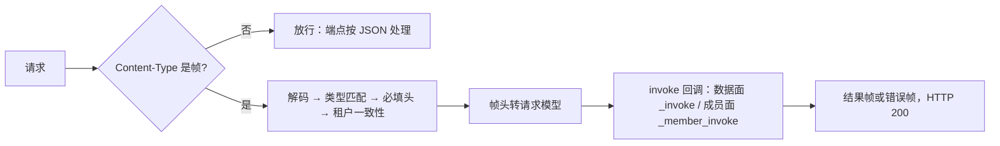

# 成员端点帧形态详细设计

> 帧类型 7 / 8 / 9 + 成员面根路径挂载 × 闸门抽回调复用 × 结果帧平铺还原 × SDK 收窄为「一律走帧」× 两通道参数化验收

[文档首页](../../../../../../../文档首页.md) › [消息平台规划](../../../../../../../规划/01_规划_消息平台.md) › [阶段计划](../../../../../计划/01_计划_消息平台.md) › [03 传输与协议](../../../03_传输与协议.md) › [03-6 客户端接入 SDK](../../03_传输与协议_06_客户端接入.md) › [03-6-2 成员端点帧形态](../03_传输与协议_06_客户端接入_02_成员端点帧形态.md) › 详细设计

---

## 1. 现状核对 <a id="facts"></a>

| # | 现状 | 位置 | 对本设计的影响 |
| --- | --- | --- | --- |
| 1 | 帧类型已用 1 发布 / 2 拉取 / 3 确认 / 4 订阅 / 5 拒收 / 6 推送；7~15 为数据面预留，契约里写死 `"7-15"`，`test_contract.py` 有断言 | `bms_core/msgclient/frame.py::FrameType`、`bms_msg/protocol/contract.py` | 新增 7 / 8 / 9 后预留段必须顺延为 `10-15`，契约与断言同批改，否则契约自相矛盾 |
| 2 | 成员三端点**只在 `/api/v1/msg/*`**：`api/router.py` 的 `api_router` 收了 `data_groups.router`，根路径聚合 `frame_router` 没收 | `bms_msg/api/router.py`、`deploy/contracts/msg.json` | 根路径 `/msg/join` 不存在——03-6-1 把 SDK 路径改成 `/msg/join` 后仍是 404。必须先补根路径挂载，帧形态才有落点 |
| 3 | 帧闸门 `build_frame_gate` 的依赖集写死为数据面 24 项，`_handle_frame` 直接把 24 项转发给 `_invoke` | `bms_msg/api/frame/gate.py` | 成员端点依赖集只有 8 项（不需要存储 / 限流 / 水位 / 延迟区），闸门核心必须先与依赖集解耦 |
| 4 | 结果帧按请求类型分派装配，未知组合直接 `TypeError` | `bms_msg/api/frame/responses.py::result_frame` | 需补成员分配与离开结果两支，否则帧形态在装配期就抛错 |
| 5 | SDK `ApiRequest.frame_type` 可空，`FrameTransport` 持有内部 `JsonTransport` 并在空值时委托 | `bms_core/msgclient/messaging/{transport.py,transport_frame.py,consumer.py}` | 成员端点走帧后，可空语义与委托分支都失去调用方，应删除 |
| 6 | 审计排除表只列 `/api/v1/msg/*`，基座审计中间件按「路径相等或前缀」匹配、`record_methods` 含 POST | `msg` 仓 `backend/config.toml::[audit_log]`、`bms_core/api/audit_middleware.py` | 成员心跳挂到根路径后每 6 秒一条审计，违反 05-6「普通读写不逐条留痕」 |

## 2. 决策（2026-11-16 逐项确认） <a id="decisions"></a>

| # | 事项 | 结论 |
| --- | --- | --- |
| 1 | 帧类型号 | 加入=7、离开=8、成员心跳=9，均取数据面 1~15 预留段；契约预留段顺延 `10-15` |
| 2 | 成员心跳 | 走帧，独立类型 9；连接心跳（类型 17）语义与实现一字不动 |
| 3 | 兼容分支 | 删除「帧类型为空则委托 JSON」：`ApiRequest.frame_type` 收窄为必填；网关非帧响应的 JSON 兜底保留（那是响应兜底） |
| 4 | 验收口径 | 两通道参数化（同一组用例跑两遍、断言相同）+ 帧专属用例；Kiwi 登记一条 |
| 5 | 挂载位置 | 新增成员面挂载：根路径 `/msg/{join,heartbeat,leave}` 双形态，`/api/v1` 保持纯 JSON；台账 #47 重开 |
| 6 | 闸门复用 | 把「调用业务函数」抽成参数，六段公共逻辑只写一遍；两族各自声明依赖集 |
| 7 | 审计排除 | 本次补 `/msg/join`、`/msg/heartbeat`、`/msg/leave` 三条；根数据面五条只报不动 |
| 8 | 提交拆分 | `bms` 一次 `feat`、`msg` 一次 `feat`（含契约快照与前端类型）、`msg` 一次 `docs`；不推送 |

## 3. 契约：帧类型与结果帧 <a id="contract"></a>

### 3.1 帧类型编号 <a id="types"></a>

| 号 | 名 | 端点 | 响应结果 |
| --- | --- | --- | --- |
| 7 | `join` | `POST /msg/join` | `MemberAssignment` |
| 8 | `leave` | `POST /msg/leave` | `LeaveResult` |
| 9 | `member_heartbeat` | `POST /msg/heartbeat` | `MemberAssignment` |

- 三者都在数据面预留段取号：成员端点本就是消费侧语义，与「数据面 1~15」分组一致；
- 与类型 17（`heartbeat`，连接保活、不触库、不解析租户）**不合并**：一个类型承载两种响应体（连接自报 vs 成员分配），客户端按类型校验响应帧就失去判别依据；
- 契约 `reserved_types` 的数据面预留段由 `7-15` 改为 `10-15`，`test_contract.py` 的断言同批改。

### 3.2 请求与响应帧字段 <a id="fields"></a>

**请求**：帧头就是 `MemberRequest` 的四个字段（`group` / `namespace` / `topic` / `consumer_id`）加 `request_id`；payload 必须为空（只有发布帧可带 payload）。

**响应（成功帧，与请求同类型 + `response` 位）**：

| 请求类型 | 帧头键 | 来源 |
| --- | --- | --- |
| 7 / 9 | `group` / `topic` / `consumer_id` / `generation` / `state` / `partitions` / `member_count` / `heartbeat_interval_ms` / `session_timeout_ms` | `MemberAssignment` 逐字段平铺 |
| 8 | `group` / `topic` / `consumer_id` / `generation` / `state` | `LeaveResult` 逐字段平铺 |

`partitions` 是整数列表，MessagePack 直接可编码；雪花 ID 不出现在这两个结果里，超 `uint64` / `int64` 的转字符串逻辑（`_frame_safe`）仍只服务错误帧的随附数据。

**错误**：沿用错误帧（`error` 类型 + 200），随附 `code` / `message` / `layer` / `retryable` / `category` / `detail` / `retry_after_ms`，与数据面同口径。

### 3.3 契约与前端类型 <a id="snapshot"></a>

| 落点 | 变化 |
| --- | --- |
| `deploy/contracts/msg.json` | `x-msg-frame.frame_types` 增 `7` / `8` / `9`；`reserved_types` 数据面预留段改 `10-15`；`paths` 新增 `/msg/join`、`/msg/heartbeat`、`/msg/leave` 三条（与 `/api/v1/...` 同 schema、同 `x-error-codes`） |
| `msg/frontend/packages/api-types` | 按快照重导（三条根路径会各多出一个方法类型） |

导出命令：`python -m ops.contract_snapshot export`（`msg/backend` 下、仓内 venv），前端 `node packages/api-types/scripts/generate.mjs`。

## 4. 服务端实现口径 <a id="server"></a>

### 4.1 模块划分 <a id="layout"></a>

```text
msg/backend/services/msg/src/bms_msg/
├── api/data/groups.py            # 增 MEMBER_ROUTES 规格 + mount_member_plane()（与数据面同构）
├── api/frame/gate.py             # _handle_frame 抽 invoke 参数；增 build_member_frame_gate()
├── api/frame/responses.py        # result_frame 增成员分配 / 离开两支
├── api/frame/routes.py           # 根路径聚合追加 mount_member_plane(router, frame_gate=_member_gate)
├── protocol/contract.py          # 数据面预留段 7-15 → 10-15
└── (bms 仓) bms_core/msgclient/
    ├── frame.py                  # FrameType 增 JOIN=7 / LEAVE=8 / MEMBER_HEARTBEAT=9
    └── messaging/
        ├── transport.py          # ApiRequest.frame_type 收窄为必填整数
        ├── transport_frame.py    # 删委托与内部 JSON 实现；_result 增成员两支
        └── consumer.py           # 三端点传帧类型；_request 签名收紧
```

### 4.2 成员面挂载 <a id="mount"></a>

`api/data/groups.py` 增一份端点规格表与挂载函数，形状与 `mount_data_plane` 一一对应：

| 项 | 口径 |
| --- | --- |
| 规格类型 | 复用 `DataPlaneRoute`（成员端点属数据面；再定义一份同构 dataclass 会让「路径 / 方法 / 权限 / 错误码」出现第二处出处） |
| 规格内容 | 三条：`/join`（类型 7）、`/heartbeat`（类型 9）、`/leave`（类型 8），权限码沿 `msg:consume`，错误码沿用既有三张清单 |
| 两处挂载 | `mount_member_plane(router)` 挂 `/api/v1/msg/*`（纯 JSON，模块级调用，行为不变）；`mount_member_plane(router, frame_gate=…)` 挂根路径（双形态） |
| 根路径守卫 | 成员面挂在根路径数据面聚合路由上，继承路由级连接守卫（登记 / 刷新连接、判连接数上限）——与 `/msg/publish` 等同一入口口径 |

根路径成员端的 JSON 形态与 `/api/v1` 完全同一实现，两处差异只有「是否挂帧闸门」。

### 4.3 帧闸门复用 <a id="gate"></a>



| 层 | 改动 |
| --- | --- |
| `_handle_frame` | 新增 `invoke: Callable[[BaseModel], Awaitable[object]]` 参数，删掉 24 项依赖形参与对 `_invoke` 的直连；解码 / 类型匹配 / 必填头 / 租户一致性 / 未知类型忽略 / 错误帧装配 / 日志六段保持唯一一份 |
| `build_frame_gate` | 保留原名与依赖集（数据面 24 项），内部把调用包成闭包传给 `_handle_frame` |
| `build_member_frame_gate` | 新增：依赖集 8 项（`request` / 租户 / 平台工作单元 / 组存储 / 投递状态 / 主题缓存 / 配额 / 主题 ACL），闭包按帧类型分派到 `join` / `heartbeat` / `leave` |
| `_ensure_frame_type` | 增三条提示分支：加入 → `/msg/join`、离开 → `/msg/leave`、成员心跳 → `/msg/heartbeat`（跨端点错发是客户端最常见错误） |

**为什么不用一份闸门包打全部**：成员端点用不到存储 / 限流 / 水位 / 延迟区，硬塞会让「数据面四端点」的规格含义与依赖集一起被稀释；抽回调后两族各声明依赖集，公共逻辑仍只有一份。

### 4.4 结果帧装配 <a id="responses"></a>

`result_frame` 增两支，装配口径与既有分支一致（平铺进帧头，不嵌套）：

| 帧类型 | 结果模型 | 装配 |
| --- | --- | --- |
| 7 / 9 | `MemberAssignment` | 九个字段逐项 `header.set` |
| 8 | `LeaveResult` | 五个字段逐项 `header.set` |

不匹配的组合仍走既有 `TypeError`（装配错误，不属协议错误）。

## 5. 客户端实现口径 <a id="sdk"></a>

| 项 | 口径 |
| --- | --- |
| `ApiRequest.frame_type` | 由 `int \| None` 收窄为 `int`（必填，无默认值）；删掉「空 = 无帧形态」的文档表述 |
| `FrameTransport` | 删 `self._json` 与 `post()` 里的委托分支，删「成员三端点没有帧形态」的模块说明；`close()` 不再有「共享 JSON 实现」的注意事项 |
| `FrameTransport._result` | 增两支：7 / 9 → 成员分配九个键；8 → 离开五个键（`consumer._assignment_of` 读的键名与之一致，不必二次映射） |
| `MsgConsumer` | `join` / `heartbeat` / `_leave` 传 `int(FrameType.JOIN / MEMBER_HEARTBEAT / LEAVE)`；`_request` 的 `frame_type` 形参去掉可空 |
| JSON 通道 | 不变（`JsonTransport` 不看 `frame_type`，仍可整体切换） |

**保留的兜底**：网关 / 反代拦截时响应不是帧，仍按「先帧后 JSON 统一响应体」解析——这是响应侧的兜底，与已删除的请求侧委托不是一回事。

## 6. 配置与审计 <a id="config"></a>

| 落点 | 改动 |
| --- | --- |
| `backend/config.toml::[audit_log].exclude_paths` | 追加 `/msg/join`、`/msg/heartbeat`、`/msg/leave`（根路径心跳高频，必须排除） |
| 根数据面五条（`/msg/publish`/`consume`/`ack`/`nack`/`subscribe`） | **只报不动**：同类缺口现在就在落审计，另立台账跟踪 |
| 网关白名单 | 不改（`/msg/*` 已在接入面；成员面挂载不新增路径前缀） |

## 7. 失败分支与边界 <a id="failures"></a>

| # | 场景 | 行为 |
| --- | --- | --- |
| 1 | 成员帧缺 `request_id` | `350018` 错误帧（200），提示缺哪个键 |
| 2 | 跨端点错发（离开帧发到 `/msg/join` 等） | `350018` 错误帧，提示应发往哪条路径 |
| 3 | 成员帧携带 payload | `350018`（只有发布帧可带 payload） |
| 4 | 帧头字段形态非法（如 `consumer_id` 超长） | `10001`（键在而值形态错，与 JSON 路径同码） |
| 5 | 租户头与请求身份不一致 | `350012`（不泄露租户是否存在） |
| 6 | 业务拒绝（主题不存在 `350001` / 组不存在 `350013` / 成员失效 `350014` / 组数配额 `350026`） | 错误帧 200，`code` 与 JSON 路径同码；SDK 照旧查本地码表分类 |
| 7 | 帧不可解析（magic / 长度 / 截断） | 4xx JSON（与数据面同口径，帧都没解出来就无从回帧） |
| 8 | 网关拦截返回非帧响应 | SDK 先按帧解码，失败再按统一响应体解析；都不成立判「对端不是本服务」 |
| 9 | 根路径 JSON 形态 | 与 `/api/v1` 同一实现，行为不变（回归断言覆盖） |
| 10 | 旧客户端仍在用 `/msg/groups/join` | 仍 404（该路径从未存在）；本任务不改兼容 |

## 8. 测试设计与验收映射 <a id="tests"></a>

用例编号**实施前登记**（平台自增，登记后回读核对）；两通道参数化，同一断言各跑一遍。

### 8.1 服务端（`msg` 仓）

| # | 场景 | 断言要点 |
| --- | --- | --- |
| 1 | 成员三端点帧往返 | 加入 → 心跳 → 离开，响应帧类型与请求一致、`partitions` / `generation` / `heartbeat_interval_ms` 与 JSON 形态逐字段相同 |
| 2 | 同路径 JSON 形态 | 根路径三端点不带帧媒体类型时按 JSON 返回统一响应体（回归「挂载不改变 JSON 行为」） |
| 3 | 类型错发提示 | 离开帧发 `/msg/join`、加入帧发 `/msg/leave`、成员心跳帧发 `/msg/join`，三条提示各一例 |
| 4 | 缺 `request_id` / 带 payload | `350018`，且响应是错误帧（200） |
| 5 | 业务拒绝 | 组不存在 `350013`、主题不存在 `350001` 各一例，`code` 与 JSON 路径同码 |
| 6 | 契约 | `frame_types` 含 `7`/`8`/`9`；`reserved_types` 数据面预留段为 `10-15`；快照含三条根路径 |
| 7 | 未知类型忽略 | 未登记类型且不要求响应 → 空 200（成员面回归） |

### 8.2 客户端（`bms` 仓）

| # | 场景 | 断言要点 |
| --- | --- | --- |
| 8 | 成员三端点请求形态 | `Content-Type` 为帧媒体类型、帧头含 `request_id`、payload 为空、路径为 `/msg/{join,heartbeat,leave}` |
| 9 | 结果还原 | 成员分配九键与离开五键还原进 `ApiOutcome.data`，`Assignment` 字段与 JSON 通道相同 |
| 10 | 无委托分支 | `FrameTransport` 不再持有 JSON 实现（服务端回非帧时走响应兜底，而不是请求改道） |
| 11 | 错误帧分类 | `350014` 在帧通道得到与 JSON 通道相同的类别与动作 |

**覆盖率**：`bms_core.msgclient.messaging`、`bms_msg.api.frame`、`bms_msg.api.data.groups` 全模块行 + 分支 100%。

### 8.3 真机

归部署阶段（台账 #43 同批），本轮不做。

## 9. 交付物清单 <a id="deliverables"></a>

| 落点 | 动作 |
| --- | --- |
| `bms_core/msgclient/frame.py` | `FrameType` 增 `JOIN` / `LEAVE` / `MEMBER_HEARTBEAT` 与注释 |
| `bms_core/msgclient/messaging/transport.py` | `ApiRequest.frame_type` 收窄必填 |
| `bms_core/msgclient/messaging/transport_frame.py` | 删委托分支与内部 JSON 实现；结果帧还原增成员两支 |
| `bms_core/msgclient/messaging/consumer.py` | 三端点传帧类型；`_request` 形参收紧 |
| `bms_msg/api/data/groups.py` | `MEMBER_ROUTES` + `mount_member_plane()`；模块级挂 `/api/v1` |
| `bms_msg/api/frame/gate.py` | `_handle_frame` 抽 `invoke`；`build_member_frame_gate`；类型错发提示 |
| `bms_msg/api/frame/responses.py` | `result_frame` 增成员两支 |
| `bms_msg/api/frame/routes.py` | 根路径聚合追加成员面 |
| `bms_msg/protocol/contract.py` | 数据面预留段改 `10-15` |
| `deploy/contracts/msg.json` | 重导（帧类型 + 三条根路径 + 预留段） |
| `msg/frontend/packages/api-types` | 重导前端类型 |
| `backend/config.toml` | 审计排除补三条根路径 |
| `bms/…/tests/msgclient/messaging/*` | 成员端点走帧、结果还原、委托分支删除后的用例调整 |
| `msg/…/tests/api/test_frame_member.py` | 新增：§8.1 全部场景 |
| 文档 | 本任务书 / 详细设计 / 实施记录 / 测试记录；03-2 设计 §4.2 表；03-6 任务书与设计 §13；计划表与台账 |

## 10. 登记回写 <a id="writeback"></a>

| 落点 | 内容 |
| --- | --- |
| 阶段计划 | 03-6 行改「已完成（含子任务 03-6-1 / 03-6-2）」并新增 03-6-2 行（状态 / 完成日期 / 偏差与遗留） |
| 台账 | #47 重开并二次闭环（路径修正目标此前不存在）；新增一行「根路径数据面五条未进审计排除表」并只登记不处置 |
| 03-2 设计 | §4.2 帧类型表补 7 / 8 / 9，预留段改 `10-15` |
| 03-6 任务书 | 交付结果补「成员端点已换帧」一句 |
| 03-6 设计 | §3.1 换帧表述补成员端点；§13 追加变更记录 |
| 03-6-1 实施记录 | §5 第 1 条改「已由 03-6-2 闭环」 |
| 基类清单 | `msgclient/messaging/` 行若新增对外名则补登（本次无新增对外名，仅收窄签名，登记说明即可） |

## 11. 边界与开放项 <a id="open"></a>

| # | 项 | 归口 |
| --- | --- | --- |
| 1 | 根路径数据面五条未进审计排除表 | 另立台账（本任务只报不动） |
| 2 | 服务端发布幂等 | 需新需求，03-6 风险 R3 延续 |
| 3 | 订阅长驻流消费（SSE / 帧流）的客户端封装 | 后续子任务 |
| 4 | 帧通道真机多实例复跑 | 部署阶段，台账 #43 同批 |
| 5 | 旧客户端兼容（`/msg/groups/*`） | 不做：该路径从未存在 |

## 12. 对齐记录 <a id="alignment"></a>

| 日期 | 变更 |
| --- | --- |
| 2026-11-16 | 立项与定稿：帧类型 7 / 8 / 9（数据面预留段顺延 10-15）；成员心跳走帧独立取号；删 SDK 请求侧委托分支；成员面补挂根路径（`/api/v1` 保持纯 JSON）；闸门抽回调复用；审计排除补三条根路径；验收两通道参数化 |
| 2026-11-16 | 相对 03-6-1 的口径变更：`ApiRequest.frame_type` 由可空改必填；`FrameTransport` 不再持有 JSON 实现（响应侧 JSON 兜底保留） |
