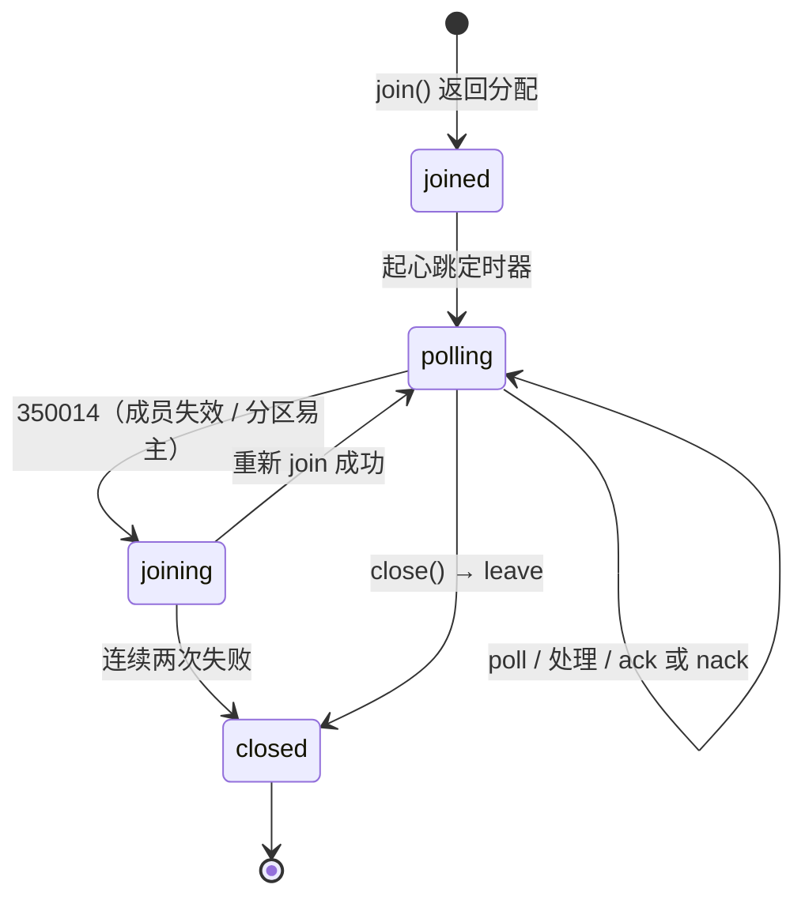

# 客户端接入 SDK 详细设计（03-6）

> 生产端完整、消费端最小集、错误三分类与元数据改投：语言无关接口口径 + Python 首发实现

[文档首页](../../../../../../文档首页.md) › [阶段计划](../../../../计划/01_计划_消息平台.md) › [03 传输与协议](../../03_传输与协议.md) › [03-6 客户端接入 SDK](../03_传输与协议_06_客户端接入.md) › 详细设计

---

## 1. 现状事实 <a id="facts"></a>

| # | 事实 | 位置 | 对设计的影响 |
| --- | --- | --- | --- |
| 1 | 数据面四端点（`publish` / `consume` / `ack` / `nack`）与成员三端点（`join` / `heartbeat` / `leave`）齐备；`/api/v1/msg/*` 与根路径 `/msg/*` 是同一实现 | `api/data/messages.py`、`api/data/groups.py`、`api/router.py` | SDK 只调这些端点，服务端零改动 |
| 2 | 请求 / 返回模型字段固定：`acks` 只收 `"1"` / `"all"`；`max_messages` 1~100；`max_wait_ms` 0~60000；`acks`（消费）只收 0 / 1 | `schemas/message.py`、`core/config.py` | 接口口径直接映射，不自造参数名 |
| 3 | `350033` 的 `data` 带 `reason` / `topic_id` / `partition` / `leader` / `epoch`；抛出点在落盘**之前**（先 `ensure_writable` 再 `store.append`） | `errors.py` `MsgNotLeaderError`、`broker/delivery.py` | 改投所需信息全在错误体里，不必再查元数据端点 |
| 4 | `errors.py` 对 `350033` 的注释写「不是确定未写入」，与事实 3 的代码顺序（落盘前判定）不一致 | `errors.py` vs `broker/delivery.py` | SDK 按「未写入」自动改投，但其张力登记为风险（§13 R1），不改服务端措辞 |
| 5 | 帧形态的业务错误帧**不携带 `detail`**：业务异常分支调 `error_frame(...)` 时未传 `exc.data`（**2026-11-16 已修**，`1ea1005`） | `api/frame/gate.py` | 首发**不走帧通道**，否则 `350033` 的 `leader` / `epoch` 丢失、改投无从谈起（§3.1）；前置解除后由 03-6-1 换成默认帧 |
| 6 | 没有批量发布端点；`FrameBatch` 只用于响应侧多帧解码，服务端每请求只 `decode_frame` 一次 | `api/data/messages.py`、`api/frame/gate.py` | 「批量」只能是客户端并发窗口，不能声明成服务端批量契约 |
| 7 | 发布路径无幂等去重：`InProcessIdempotencyStore` 只服务 RPC（04-4） | `rpc/idempotency.py`、`api/rpc/gate.py` | 幂等只能做客户端本地表，跨进程 / 跨重启失效（§13 R3） |
| 8 | JSON 错误体只有 `code` / `message` / `data`，**不带** `retryable`；只有帧错误帧头才有 `retryable` / `layer` / `category` | `bms_core/api/errors.py`、`api/frame/responses.py` | SDK 必须自带码表做三分类（§7），不能指望响应字段 |
| 9 | 位点 `commit` 只前进不后退；回退只有管理面 `POST /api/v1/msg/admin/offsets/reset`（`msg:manage`）；消费请求**无 offset 入参** | `broker/offset.py`、`api/admin/offsets.py`、`schemas/message.py` | 数据面没有「回退」；「重启从位点续跑」由服务端按已提交位点天然成立 |
| 10 | 消费是成员制：`join` 返回 `partitions` / `generation` / `heartbeat_interval_ms`（10s）/ `session_timeout_ms`（30s）；`consume` / `ack` 需成员活跃且分区在其分配内 | `api/data/groups.py`、`core/config.py`、`api/data/messages.py` | 消费最小集必须含 `join` / 心跳 / `leave`，否则第一次心跳超时就 350014 |

## 2. 范围 <a id="scope"></a>

| 做 | 不做（明确排除） |
| --- | --- |
| 生产端：单发、批量（客户端并发窗口）、`acks` 传参、幂等键本地去重、按错误分类重试、`350033` 改投 | 消费组再均衡算法（分配由服务端主导，客户端只跟随 `partitions`） |
| 消费端：`join` → 按分配逐分区拉取（`max_wait_ms` 长轮询）→ `ack` / `nack` → 心跳 → `leave` | 订阅长驻流（`GET`/`POST /msg/subscribe`）——后续独立子任务 |
| 错误三分类（可重试 / 需刷新元数据 / 需人工）+ 结果未知标记 | 位点回退（数据面无该能力，管理面需 `msg:manage`） |
| 语言无关接口口径文档 + Python 首发实现 | 本地缓冲落盘、跨分区事务、离线队列 |
| 客户端侧观测（计数与结构化日志，不含载荷） | 凭据管理与密钥落盘（调用方注入） |
| **msg 仓零改动**（能力并入基座 `bms_core.msgclient`，§4） | 改服务端协议 / 端点 / 错误码语义；在 msg 仓另建客户端包 |

## 3. 通道与寻址 <a id="transport"></a>

### 3.1 通道：首发 JSON，2026-11-16 换帧为默认 <a id="channel"></a>

| 项 | 口径 |
| --- | --- |
| 路径 | `/msg/publish`、`/msg/consume`、`/msg/ack`、`/msg/nack`、`/msg/join`、`/msg/heartbeat`、`/msg/leave` |
| 媒体类型 | 数据面四端点两条通道都支持（帧 `application/x-msg-frame` / JSON `application/json`）；成员三端点只有 JSON |
| 为什么不用 `/api/v1/msg/*` | 根路径是「帧入口」的固定位置，换帧形态时**路径不变**；两条路径同一实现，语义等价 |
| 首发为什么走 JSON | 当时帧错误帧不带 `detail`，`350033` 拿不到 `leader` / `epoch`，完成标准「切主后改投成功」直接落空 |
| 换帧（03-6-1，2026-11-16） | 前置已满足（`1ea1005`，Kiwi 2512）：三处错误帧均带 `detail`；客户端**默认走帧**，JSON 保留为可选中实现（`MessagingConfig.channel`），对外方法签名不变。详见 [03-6-1 详细设计](../03_传输与协议_06_客户端接入_01_客户端换帧通道/设计/01_详细设计_03-6-1_客户端换帧通道.md) |

### 3.2 寻址与改投 <a id="discovery"></a>

| 项 | 口径 |
| --- | --- |
| 地址来源 | `endpoints: list[str]`（≥1）；缺省单入口（生产走网关，见架构设计 §8.1） |
| 选路 | 轮询（确定性、易断言）；可选 `node_addresses: {node_id: url}` 供直连部署把 `data.leader` 解析成地址 |
| 改投触发 | 仅 `350033`；用错误体 `data.leader` / `data.epoch` 更新本地分区视图，随后按 §3.2.1 选路重发 |
| 改投上限 | 单条消息最多 3 次改投；同分区两次改投间隔 ≥ `refresh_min_interval_ms`（缺省 200ms），避免抖动打成循环 |
| `epoch` 的用法 | 只记录与透出（便于排障），**不参与任何本地判定**——任期比较属服务端语义，客户端自造规则会与 02-5 冲突 |
| `metadata_version` | **不使用**：它只出现在管理面主题详情（`GET /api/v1/msg/admin/topics/{id}`，需管理权限）；数据面无该字段，SDK 不为它引入管理面依赖 |
| 无 `node_addresses` 时 | 视为「网关后面有多个实例」：轮询换地址重发，命中 leader 即成功（最坏 3 次） |

#### 3.2.1 改投选路优先级

1. `data.leader` 在 `node_addresses` 中命中 → 用该地址；
2. 否则取 `endpoints` 中**下一个**地址（轮询游标前进一位）；
3. 同一分区在 `refresh_min_interval_ms` 内已有改投记录 → 不发请求，按退避睡眠后重试（计入改投次数）。

## 4. 落点与模块划分 <a id="layout"></a>

### 4.1 结论：并入基座 `bms_core.msgclient`，不在 msg 仓新建包 <a id="placement"></a>

**变更理由**（2026-11-16 拍板）：基座已有 `msgclient/adapter/event_publisher.py`（`MsgEventPublisher`）在做「发布」，
再建一个同功能的包会出现两份发布实现。并入基座后**只有一份**，且各产品仓经 `bms-core` 路径依赖天然获得，
不需要额外部署或跨仓装配——与 07B 06 域「协议链上移基座」的结论一致。

**边界必须说清**：`MsgEventPublisher` 是「只发不收、不看产品码、不重试、不带 `acks` / 幂等 / 批量」的事件适配器，
服务 bms 自己的 outbox 投递器；本次新增的是**消息收发客户端**（生产语义 + 消费端），两者职责不重叠，互不替换。

### 4.2 模块划分

```text
backend/libs/bms_core/src/bms_core/msgclient/messaging/
├── __init__.py        # 对外出口：MsgProducer / MsgConsumer / MessagingConfig / MsgClientError（03-6-1 补通道与传输实现）
├── config.py          # MessagingConfig：地址池、租户、超时、批量窗口、幂等表容量、承载形态 + 复用基座 RetryPolicy
├── codes.py           # msg 数据面码表：码 → （基座 ErrorCategory，本层动作）
├── errors.py          # MsgClientError（不新建枚举：类别复用基座 ErrorCategory，只加「动作」一维）
├── transport.py       # 通道契约与值对象（03-6-1：ApiRequest / ApiOutcome / MessagingTransport + 共用 httpx 父件）
├── transport_frame.py # 帧承载（03-6-1 新增，默认）
├── transport_json.py  # JSON 承载（03-6 首发实现迁入，保留）
├── transport_factory.py # 按配置造实现（03-6-1 新增）
├── producer.py        # publish / publish_many / 幂等表 / 改投
├── consumer.py        # join / poll / ack / ack_many / nack / heartbeat / close
└── stats.py           # 进程内计数器（不含载荷）
```

### 4.3 直接复用的基座能力（不重写）

| 基座件 | 位置 | 本层怎么用 |
| --- | --- | --- |
| `RetryPolicy` | `msgclient/retry.py` | 直接作为配置字段（`max_retries` / `base_ms` / `multiplier` / `cap_ms` / `jitter`），不再自造三个数字 |
| `compute_backoff_ms` | `msgclient/retry.py` | 算重试等待（指数基线 + full jitter + 封顶，恒 ≥ 1ms），与 04-4 同一条公式 |
| `parse_retry_after` | `msgclient/retry.py` | 解析 `Retry-After`（只认 delta-seconds，转毫秒），避免自己写第二套解析 |
| `ErrorCategory` | `msgclient/errors.py` | 作为「类别」一维（`transient` / `unknown` / `business_reject` / `param_error` / `server_bug`），不另立枚举 |
| `Clock` / `SystemClock`、`JitterSource` / `SystemJitter` | `msgclient/retry.py` | 用例注入确定性时钟与抖动，退避与幂等过期都可断言 |
| `BaseValueObject`、`ConcurrentStable*` | `core/` | 值对象与集合的既有归口，照基座口径写 |

**不复用的两处，理由要写下来**：

- **传输层**：基座 `msgclient/transport/` 是 HTTP/2 自持连接（为 RPC 的 `RST_STREAM` 精确取消而生，
  还要接连接登记 / 心跳 / 引用计数）。本层「一条消息 = 一次独立写入」，不需要流级取消；03-6-1 换帧后
  仍用 httpx 发二进制 POST，只借基座 `frame.py` 的帧编解码，不把这套连接生命周期绑进来。
- **RPC 的 `RetryBudget` 调用链预算**：消息发布没有「调用链」概念（一条消息就是一次独立写入），
  共享预算会让不同消息互相挤占；本层只用 `RetryPolicy` 的次数与退避，不接预算。

### 4.4 bms 仓的接线与登记（在 bms 仓提交，不在 msg 仓）

| 项 | 要求 |
| --- | --- |
| 模块清单 | bms《后端基类清单》里 `msgclient/` 那一行要补 `msgclient/messaging/`（新增模块必须登记，否则跨仓对账报缺） |
| 基类归属 | 值对象（配置、消息、回执、分配）继承 `BaseValueObject`；计数器是普通类；错误对象继承 `Exception`（与 `msgclient/errors.py` 既有 `RpcCallError` 同形态） |
| 覆盖率 | bms 仓口径：新增模块行 + 分支 100%，不设 omit |
| 提交前提 | bms 工作树必须干净（该仓预检有 `dirty_tree` 闸门）；2026-11-16 存在并行会话改动，故实施待其收口 |

### 4.5 护栏约束（写之前就要遵守，避免返工）

| 护栏 | 对本层的要求 |
| --- | --- |
| 集合声明 | 列表 / 字典一律 `ConcurrentStable*`；函数签名同样受检；JSON 序列化边界可标 `# bare-collections:allow` + 理由 |
| 基类体系 | 值对象继承 `BaseValueObject`；不新增插件 / 工厂（本层无装配态） |
| 依赖方向 | 只依赖 `bms_core` 自身与 `httpx`；**不 import msg 仓任何模块**（否则又是仓级循环依赖） |

## 5. 语言无关接口口径 <a id="api"></a>

命名用「中文说明 + 英文方法名」，其他语言照此实现（方法名、参数名、返回字段、错误分类都固定）。

### 5.1 配置 `ClientConfig` <a id="config"></a>

| 字段 | 类型 | 缺省 | 说明 |
| --- | --- | --- | --- |
| `endpoints` | 字符串列表 | — | 至少一个；`http(s)://host:port`，不带路径 |
| `tenant` | 字符串 | — | 租户标识（`X-Tenant-ID`，可传 code 或数字 id） |
| `auth_provider` | 无参函数 → 字符串 | 空 | 返回 `Authorization` 头值；空表示不带（内网 / 网关已鉴权） |
| `headers_provider` | 无参函数 → 字典 | 空 | 追加自定义头（网关签名等）；与 `auth_provider` 合并，同名以 `auth_provider` 为准 |
| `node_addresses` | 字典 node_id → url | 空 | 直连部署时用于把 `data.leader` 解析成地址 |
| `connect_timeout_ms` | 整数 | 3000 | 建连超时 |
| `request_timeout_ms` | 整数 | 10000 | 发布 / 确认 / 成员操作的单次总预算（含重试） |
| `retry` | 基座 `RetryPolicy` | 基座缺省 | **直接复用基座策略**（次数 / 基数 / 倍数 / 封顶 / 抖动），不自造三个数字 |
| `clock` / `jitter` | 基座 `Clock` / `JitterSource` | 系统实现 | 用例注入以确定性断言退避与幂等过期，生产用 `SystemClock` / `SystemJitter` |
| `refresh_min_interval_ms` | 整数 | 200 | 同分区两次改投的最小间隔 |
| `max_redirects` | 整数 | 3 | 单条消息改投上限 |
| `retry_ambiguous` | 布尔 | 假 | 结果未知（`350032` commit_timeout、读超时）是否自动重试；默认关闭 |
| `idempotency_ttl_ms` | 整数 | 300000 | 幂等表条目存活时长 |
| `idempotency_capacity` | 整数 | 1024 | 幂等表条数上限（超出按插入序淘汰） |
| `publish_concurrency` | 整数 | 8 | `publish_many` 的并发窗口 |

校验：`endpoints` 为空、URL 带路径、`tenant` 为空、超时 ≤ 0 → 构造期即报 `ParamError`（不自造码）。

### 5.2 生产端 <a id="producer"></a>

| 方法 | 入参 | 返回 | 主要错误 |
| --- | --- | --- | --- |
| `publish(message)` | `OutgoingMessage` | `PublishAck` | 按 §7.1 分类后抛出统一错误对象 |
| `publish_many(messages, fail_fast=False)` | 消息列表、是否快速失败 | `PublishBatchResult` | 不抛出（逐条结果里带错误）——只有配置类错误（参数非法）在入口抛 |

`OutgoingMessage` 字段：`namespace`、`topic`、`payload`（原始字节）、`key`（可选，同 key 恒同分区）、`headers`（可选）、`acks`（`"1"` / `"all"`，缺省 `"1"`）、`delay_level`（可选）、`content_type`（可选）、`idempotency_key`（可选）、`trace_id` / `span_id` / `trace_flags`（可选）。

`PublishAck` 字段：`message_id`、`log_id`、`topic`、`partition`、`offset`（延迟发布为 null）、`deliver_at`（延迟发布才有）、`deduplicated`（布尔，来自本地幂等表命中）。

`PublishBatchResult` 字段：`succeeded`（下标记号 + `PublishAck` 列表）、`failed`（下标记号 + 错误列表）；两者按原始下标可复原。

### 5.3 消费端 <a id="consumer"></a>

| 方法 | 入参 | 返回 | 主要错误 |
| --- | --- | --- | --- |
| `join()` | — | `Assignment`（`partitions` / `generation` / `heartbeat_interval_ms` / `session_timeout_ms`） | 350001 / 350010 / 350026 等 |
| `poll(max_messages=..., max_wait_ms=...)` | 条数、长轮询毫秒 | `PollResult` | 见 §7.2 |
| `ack(message_or_offset)` / `ack_many(offsets)` | 消息或位点 | `CommitResult`（`committed_offset`；与 msg 侧 `AckResult` 同名，故改名避让） | 见 §7.2 |
| `nack(offset, reason)` | 位点、原因（`schema_invalid` / `processing_failed`） | `NackResult` | 见 §7.2 |
| `heartbeat()` | — | `Assignment`（世代可能变化） | 350013 / 350014 |
| `close()` | — | 无 | 幂等：先 `leave`（失败只记日志）再关连接 |

| 项 | 口径 |
| --- | --- |
| 消费单位 | 单个分区：`poll` 一次只拉一个分区（与服务端 `partition` 必填一致），多分区由上层按分配轮转 |
| `Message` 字段 | 与服务端 `MessageItem` 同名同义；`payload` 在客户端解码为**原始字节**（服务端 JSON 给 base64，SDK 解一次，别让调用方再解） |
| 背压 | `PollResult.paused` 为真时不立即再拉，按 `inflight_messages` / `inflight_bytes` 回到阈值以下再继续；不自行放大 `max_messages` |
| 心跳 | 间隔取服务端 `heartbeat_interval_ms` × 0.6（缺省 10s → 6s），下限 1s；**不自造间隔** |
| 成员失效 | `350014` 触发一次重新 `join`（同一 `consumer_id` 视为重连，世代不递增）；连续两次失败上报调用方 |
| 位点 | 只做「确认即前进」；**不提供回退**（数据面无该能力，见事实 9） |

### 5.4 错误对象 <a id="error"></a>

字段：`code`（产品码 / 平台码）、`category`（**复用基座 `ErrorCategory`**：`transient` / `unknown` / `business_reject` / `param_error` / `server_bug`）、`action`（本层三分类：`retry` / `refresh` / `fatal`）、`message`、`data`（原样透传，含 `leader` / `epoch` / `reason`）、`outcome_unknown`（布尔）、`retry_after_ms`（可选，`Retry-After` 或错误体给值）。

**为什么是两维**：`category` 沿用 04-4 对「码本身性质」的判定（与帧错误帧、RPC 客户端同一套），
`action` 回答「这条消息该不该再发」——它把 `transient` 拆成「换地址重发」（改投）与「原地退避」，
这是消息语义特有的，基座枚举刻意不含。两维由 §7 的码表一次给出，不重复判定。

| `action` | 含义 | 调用方该做什么 |
| --- | --- | --- |
| `retry` | SDK 已按预算重试仍失败，或本次已超预算 | 稍后重试；携带同一幂等键 |
| `refresh` | 视图过期（改投次数用尽 / 成员失效） | 重建客户端或重新 `join`；SDK 已尽力自动处理 |
| `fatal` | 改参或人工介入才能继续 | 不要重试；按 `code` 定位（建主题 / 补权限 / 清盘 / 拆分载荷） |

`outcome_unknown` 为真时，`category` 仍是 `fatal`，但语义是「**结果未知**，可能已写入」——调用方若重试，需自带去重（服务端无发布幂等，事实 7）。

## 6. 关键流程 <a id="flows"></a>

### 6.1 单条发布 <a id="flow-publish"></a>

| 步 | 动作 | 说明 |
| --- | --- | --- |
| 1 | 查幂等表 `(namespace, topic, idempotency_key)` | 命中且未过期 → 直接返回 `PublishAck(deduplicated=True)`，不发请求 |
| 2 | 组装 JSON（`payload` 转 base64，`headers` 原样，幂等键额外写入 `headers["x-msg-idem-key"]`） | 写进 `headers` 是为了让消费侧与后续服务端去重都能看到，不改协议 |
| 3 | 按轮询游标选地址，发 `POST /msg/publish` | 记录「请求是否已发出」（发送前异常 = 未发出） |
| 4 | 解析响应：`code == 0` → 成功 | 写入幂等表（含 `PublishAck`），返回 |
| 5 | `refresh`（`350033`）→ 更新分区视图 → 退避 → 回到第 3 步 | 改投次数 +1；超 `max_redirects` 则抛 `category=refresh` |
| 6 | `retry` → 按 `retry_after_ms` 或指数退避 → 回到第 3 步 | 尝试次数 +1；超 `max_attempts` 则抛 `category=retry` |
| 7 | `fatal` → 直接抛 | `350032` / 读超时另置 `outcome_unknown=True` |

### 6.2 批量发布 <a id="flow-batch"></a>

- 用信号量把并发压在 `publish_concurrency`；每个任务独立走 §6.1（含各自的重试与改投）。
- 结果按原始下标归位；`fail_fast` 为真时，首个失败后**取消未开始**的任务（已在途的等其自然结束，不中途掐断，避免「取消 = 结果未知」）。
- 不做跨条去重：同一批里重复的幂等键仍走幂等表（第二条命中即返回，不发请求）。

### 6.3 消费生命周期 <a id="flow-consume"></a>



| 规则 | 口径 |
| --- | --- |
| 处理顺序 | 先业务处理、后 `ack`（至少一次）；`nack` 只在确定不可处理时用（转死信 + 位点前移） |
| 一条一确认 | 服务端无批量确认端点，`ack_many` 是客户端串行 / 有界并发封装，语义等价逐条 |
| `350003`（消息不存在 / 位点已被清理） | 不重试、不自动跳位点（无回退能力）→ 抛 `fatal`，调用方需联系管理员重置位点 |
| `350007`（重投超限已进死信） | 该条已不可确认 → 记日志、跳过该条继续，不抛（避免一条毒消息卡死整个分区） |
| `paused=true` | 本轮不再拉取，等 `inflight` 回落；退避从 `max(50ms, 剩余在途 / 吞吐)` 起算，不做紧循环 |

### 6.4 重启续跑 <a id="flow-resume"></a>

同 `group` + 同 `consumer_id` 再 `join` → 服务端把该成员视为重连（世代不递增、分配不变）→ `poll` 从**已提交位点**继续（消费请求没有 offset 入参，起点由服务端决定）。SDK 不需要本地位点文件；未 `ack` 的消息由服务端在可见性超时后重投。

## 7. 错误分类映射 <a id="codes"></a>

**为什么必须自带码表**：JSON 错误体只有 `code` / `message` / `data`（事实 8），`retryable` 只存在于帧通道。下表是本层唯一判定出处，给出「码 →（基座 `ErrorCategory`，本层 `action`）」，新增码必须在此登记。

**与基座的关系**：类别一维直接取基座 `ErrorCategory` 的语义（`transient` = 退避有意义、`unknown` = 结果未知、
`business_reject` / `param_error` = 改参后放弃、`server_bug` = 上报告警），与 `msgclient/errors.py` 和
msg 仓 `api/frame/responses.py::classify()` 同向，不另立一套；本层只额外给出 `action` 一维。

### 7.1 生产端 <a id="codes-publish"></a>

| 码 | 含义 | 类别 | 自动重试 | 备注 |
| --- | --- | --- | --- | --- |
| `0` | 成功 | — | — | |
| `350001` | 主题不存在 / 未启用 | `fatal` | 否 | 建主题或改参 |
| `350010` | 命名空间非法 | `fatal` | 否 | |
| `350027` | ACL 拒绝 | `fatal` | 否 | 权限未授予 |
| `350028` | 主题状态不接受该操作 | `fatal` | 否 | `disabled` / `deleting` |
| `350006` | 载荷超 1 MiB | `fatal` | 否 | 拆分或改走对象存储引用 |
| `350011` / `350012` | 租户停用 / 不存在 | `fatal` | 否 | |
| `350015` | 延迟区已满 | `retry` | 是 | 长退避（容量型，退避可从 1s 起） |
| `350022` | 存储水位拒绝 | `fatal` | 否 | 退避无用，需清理 / 扩容；告警而非重试 |
| `350005` | 生产限流 | `retry` | 是 | 优先用 `Retry-After` / `retry_after_ms` |
| `350032` | ISR 不足 / 提交超时 | `fatal` + `outcome_unknown` | 默认否 | `commit_timeout` 可能已落盘；`retry_ambiguous` 打开才自动重试 |
| `350033` | 非 leader / 过期任期 / 切换中 / 租约过期 | `refresh` | 是（改投） | 用 `data.leader` / `data.epoch` 更新视图 |
| `10001` | 参数非法（含 base64 非法、取值越界） | `fatal` | 否 | SDK 侧也做一次前置校验，正常不应出现 |
| `10006` / `10007` | 平台繁忙 / 依赖不可用 | `retry` | 是 | 系统层，指数退避 |

### 7.2 消费 / 成员 <a id="codes-consume"></a>

| 码 | 含义 | 类别 | 自动处理 |
| --- | --- | --- | --- |
| `350013` | 组不存在 | `fatal` | 未 `join` 就拉 / 组被回收；提示先 `join` |
| `350014` | 成员失效 / 分区不在分配 | `refresh` | 自动重新 `join` 一次；连续两次失败上报 |
| `350002` | 位点非法 | `fatal` | 位点越界；不可回退，交管理员 |
| `350003` | 消息不存在（位点已被清理） | `fatal` | 同上 |
| `350007` | 重投超限已进死信 | 跳过 | 记日志继续，不抛（毒消息不卡分区） |
| `350009` | 分区号非法 | `fatal` | 分配里的分区号与服务端不一致，通常为调用方传错 |
| `350005` | 限流 | `retry` | 按 `Retry-After` 退避 |
| `350001` / `350010` / `350011` / `350012` | 主题 / 命名空间 / 租户类 | `fatal` | |

### 7.3 传输层（无产品码） <a id="codes-transport"></a>

| 现象 | 判据 | 类别 | 说明 |
| --- | --- | --- | --- |
| 建连失败 / DNS 失败 / 连接被拒 | 发送前异常（`ConnectError` / `ConnectTimeout`） | `retry` | **请求未发出**，重试安全 |
| 读超时 / 连接在读中被重置 | 已发出、无完整响应 | `fatal` + `outcome_unknown` | 结果未知；`retry_ambiguous` 关闭时交调用方 |
| 响应不是合法 JSON / 缺 `code` | 解析失败 | `fatal` | 按「对端不是本服务」处理，不重试 |

## 8. 重试与退避 <a id="retry"></a>

**不在本层写退避公式**：一律走基座 `compute_backoff_ms(attempt, policy, jitter)`（指数基线 × 倍数，封顶 `cap_ms`，
full jitter，恒 ≥ 1ms）与 `parse_retry_after(headers)`（只认 delta-seconds，转毫秒）。本层只决定
「这条错误允不允许重试、算第几次」：

| 场景 | 次数上限 | 等待 | 说明 |
| --- | --- | --- | --- |
| `action=retry`（`transient`：限流、容量、系统繁忙、建连失败） | `RetryPolicy.max_retries` | `parse_retry_after` 优先（受 `cap_ms` 封顶）；否则 `compute_backoff_ms` | 与 04-4 同一条公式，不另设参数 |
| `action=refresh`（`350033`） | `max_redirects`（缺省 3） | `max(compute_backoff_ms, refresh_min_interval_ms)` | 改投不是「重试同一节点」，优先换地址；下限防止抖动打成循环 |
| 结果未知（`350032` commit_timeout / 读超时） | 0（默认） | — | `retry_ambiguous` 打开后并入 `retry` 预算，返回结果仍保留 `outcome_unknown` |

预算口径：`request_timeout_ms` 是**单次请求**预算，`RetryPolicy` 是**次数与间隔**预算，两者独立；
发布整体不设总时限（由调用方用 `asyncio.wait_for` 控制），避免 SDK 自造第二套超时语义。

## 9. 配置与安全 <a id="security"></a>

| 项 | 口径 |
| --- | --- |
| 租户 | `X-Tenant-ID`（code 或数字 id）。**生产走网关时该头会被边缘中间件剥除并由网关注入**，此时 `tenant` 只用于日志与断言，不构成授权；文档必须写明这一点，避免误以为可自选租户 |
| 凭据 | 只经 `auth_provider` / `headers_provider` 注入；SDK 不读环境变量、不写盘、不缓存到日志 |
| 载荷 | 日志与指标**不含** `payload` / `headers` 值（只记长度与键名），避免敏感数据落日志 |
| 传输 | 默认 `https` 亦支持 `http`（内网）；不做证书固定（交给 httpx 配置与调用方） |
| 权限 | 发布需 `msg:publish`，消费需 `msg:consume`；ACL 拒绝是 `350027`，属 `fatal` |

## 10. 观测 <a id="observe"></a>

| 项 | 口径 |
| --- | --- |
| 计数器（进程内，`stats()` 可读） | `requests_total{op,outcome}`、`errors_total{code}`、`retries_total{op,reason}`、`redirects_total{partition}`、`dedup_hits_total` |
| 日志 | 结构化，字段：`op` / `namespace` / `topic` / `partition` / `offset` / `code` / `attempt` / `elapsed_ms` / `endpoint_index`；不含载荷 |
| 错误日志级别 | `retry` → `warning`；`fatal` 且 `outcome_unknown` → `error`（可能重复）；其余 `fatal` → `error` 一条，不刷屏 |
| 与指标对齐 | 客户端计数只做本地排障；服务端指标（`msg_publish_*`）才是权威口径，两者不追求一一对应 |

## 11. 用例矩阵 <a id="cases"></a>

用例编号**实施前登记**（平台自增，登记后回读核对；本设计不预占号）。

| # | 场景 | 断言要点 |
| --- | --- | --- |
| 1 | 发布成功 | 请求体字段与服务端契约一致；返回 `PublishAck.offset` 有值；幂等表写入 |
| 2 | `350033` 改投 | 第一次返回 `350033`（`data.leader` / `epoch`）→ 按 §3.2.1 换地址 → 第二次成功；`redirects_total` +1 |
| 3 | 改投次数用尽 | 连续 `350033` 超 `max_redirects` → 抛 `category=refresh`，错误体保留最后一次 `data` |
| 4 | 同分区改投限流 | 两次改投间隔 < `refresh_min_interval_ms` → 不发请求、走睡眠分支 |
| 5 | `350005` 退避 | 首次 429 带 `Retry-After: 2` → 睡眠 ≥ 2s 后重发；用注入时钟断言，不真等 |
| 6 | `350032` 不重试 | 只发一次；抛错 `category=fatal` 且 `outcome_unknown=True`；`retry_ambiguous=True` 时才重试 |
| 7 | 幂等键命中 | 同键第二次调用不发请求、返回 `deduplicated=True`；不同键不命中 |
| 8 | 幂等表过期与淘汰 | 超 `idempotency_ttl_ms` 后重发；超 `idempotency_capacity` 按插入序淘汰 |
| 9 | 批量部分失败 | 3 条中 1 条 `fatal` → `succeeded` 2 条、`failed` 1 条且下标正确；不抛异常 |
| 10 | 批量快速失败 | `fail_fast=True` → 首个失败后未开始任务被取消，结果里标注 `cancelled` |
| 11 | 拉取与确认 | `join` 拿到分配 → `poll` 命中分区 → `ack` 后 `committed_offset` 前进 |
| 12 | 成员失效重连 | `poll` 返回 `350014` → 自动重新 `join` 一次；第二次仍失败则抛 `refresh` |
| 13 | 背压暂停 | `paused=true` → 本轮不再拉取；`inflight` 回落后续拉 |
| 14 | 重启续跑 | 同组同 `consumer_id` 重新 `join` → `poll` 从已提交位点开始（用服务端替身断言起始 offset） |
| 15 | 心跳间隔取服务端值 | 替身返回 `heartbeat_interval_ms=1000` → 定时器间隔 600ms；下限 1s |
| 16 | 码表完整性 | 码表对 §7 列出的每个码都有分类；未登记码落 `fatal` 且 `outcome_unknown=False`（兜底可断言） |
| 17 | 配置校验 | 空 `endpoints` / 带路径 URL / 空 `tenant` → 构造期 `ParamError` |
| 18 | 传输层分类 | 建连失败 → `retry`；读超时 → `fatal` + `outcome_unknown` |

## 12. 不变量与风险 <a id="invariants"></a>

| # | 不变量 |
| --- | --- |
| 1 | 服务端零改动：本层只调既有端点，不新增字段、不改错误语义 |
| 2 | 所有集合字段使用并发稳定集合类型；不出现裸 `dict` / `list` / `set` |
| 3 | 幂等表只在**成功**后写入；失败不写，避免把失败结果当成「已完成」 |
| 4 | `epoch` 只记录不判定；改投只看 `350033` 与 `data.leader` |
| 5 | 客户端不自建位点文件；起点恒由服务端已提交位点决定 |
| 6 | 日志与指标不含载荷与头值 |

| # | 风险 | 处置 |
| --- | --- | --- |
| R1 | `350033` 的「是否确定未写入」在服务端注释与代码顺序之间不一致 | SDK 按「未写入」自动改投，重复风险由幂等键 + 消费侧 `message_id` 兜底；口径张力登记为遗留，不擅自改服务端文案 |
| R2 | 帧通道错误帧缺 `detail` | **已解除（2026-11-16，`1ea1005`）**：错误帧随附异常 `data`（`350033` 的 `leader` / `epoch` 已在帧头可见），换帧无前置阻塞 |
| R3 | 服务端无发布幂等 | 本地表跨进程 / 跨重启失效；文档明确「至少一次」，跨重启去重需服务端能力（新需求） |
| R4 | 数据面无位点回退 | SDK 不封装回退；遇 `350003` 交管理员用 `msg:manage` 重置 |
| R5 | 网关单入口下改投可能仍落到非 leader | 靠 `max_redirects` 与退避兜底；直连部署可用 `node_addresses` 精确改投 |
| R6 | 消费分配由服务端主导，多消费者同组时世代会变 | SDK 只跟随 `partitions` 与 `generation`，不做本地再均衡；世代变化即按新分配重排 |
| R7 | 并入基座后，msg 的产品码表落在 `bms_core`（跨仓耦合：msg 加码要改基座） | 码表独立成 `messaging/codes.py` 一个文件、只被本层引用；新增码时 msg 侧 `errors.py` 与 `deploy/registry/msg.toml` 仍是权威源，基座只是「读表」的镜像 |
| R8 | 基座发布器 `MsgEventPublisher` 与本层都做「发布」，接入方可能选错 | 两者职责写进模块文档字符串：一个是事件投递（不看码、不重试），一个是消息收发（分类、改投、幂等）；后续版本可在 `MsgEventPublisher` 内委托本层，但不在本轮 |

## 13. 口径变更记录 <a id="changes"></a>

| 日期 | 变更 | 原因 | 影响面 |
| --- | --- | --- | --- |
| 2026-11-16 | 落点由「msg 仓新建 `services/msg-client` 包」改为「并入基座 `bms_core.msgclient/messaging/`」 | 基座已有 `MsgEventPublisher` 承担发布，再建同功能包会出现两份实现；并入后各产品仓经路径依赖天然获得，与 07B 06 域「协议链上移基座」一致 | §4 全节重写；§5.1 配置改复用 `RetryPolicy`；§7 类别复用基座 `ErrorCategory` 并新增 `action` 一维；§8 改复用 `compute_backoff_ms` / `parse_retry_after`；实施与提交转 bms 仓 |
| 2026-11-16 | 实施暂缓 | bms 仓工作树有并行会话的未提交改动（24 文件），该仓预检 `dirty_tree` 会拦提交；先改设计、待其收口再写代码 | 交付节奏，不影响口径 |
| 2026-11-16 | 换帧前置条件达成（§3.1、R2） | 服务端错误帧补 `detail` 并处理雪花 ID 越界（msg 仓 `1ea1005`，Kiwi 2512）；同时发现「126 位雪花 ID 超 MessagePack `uint64` 上限」会让错误帧装配溢出，一并以字符串下发 | 本层仅换 `transport` 实现即可走帧通道；`detail` 里 `topic_id` 为字符串，改投只读 `leader` / `epoch`，取值口径不变 |
| 2026-11-16 | 换帧落地（03-6-1）：默认帧、JSON 保留；§3.1 / §4.2 / §4.3 随之改写 | 前置已解除，帧形态可拿到 `350033` 的 `leader` / `epoch`；两形态并存便于回退与对拍 | 承载改为契约 + 两实现（`transport_frame` / `transport_json` + 工厂），`MessagingConfig.channel` 决定构造时用哪个；路径修正为服务端实际的 `/msg/join` 等；对外方法签名不变 |

---

> 依《[文档生成规范](../../../../../../../bms文档/规范/文档生成规范.md)》编写 · 实施与测试记录见同级 `实施/`、`测试/`
