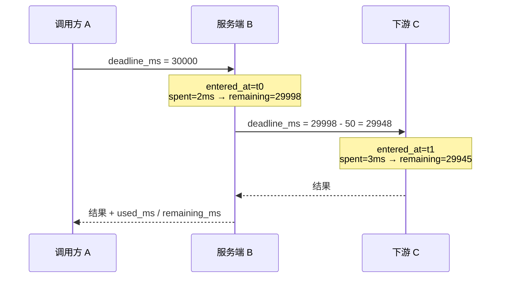

# RPC 超时传播与取消详细设计

> `deadline_ms` 相对剩余预算 × 进 handler 前预检 + `asyncio.timeout()` 硬兜底 × 逐跳扣服务端耗时 + 50ms 返回余量 × `350004`（business / 不重试 / 504 / `outcome=unknown`）× `RST_STREAM` 取消与「取消后不写响应」× 客户端 `deadline_ms` 与本地兜底统一 `350004`

[文档首页](../../../../../../文档首页.md) › [消息平台规划](../../../../../../规划/01_规划_消息平台.md) › [阶段计划](../../../../计划/01_计划_消息平台.md) › [04-2 超时传播与取消](../04_RPC_02_超时传播与取消.md) › 详细设计

---

## 1. 概述 <a id="overview"></a>

### 1.1 目标

把 04-1 交付的「能调用、能报错」补成「调用不会白跑」：预算随请求逐跳传播、耗尽即停、取消能传到下游且不留响应。

1. **预算头**：请求携带 `deadline_ms`（**相对剩余毫秒**，非绝对时间戳），帧头与 JSON 体同名字段；缺省 `30000`；合法区间 `0 ~ 600000`，越界 `10001`。
2. **进 handler 前预检**：预算已耗尽（`remaining <= 0`）**不调用 handler**，直接 `350004`——「没时间了就别开始」。
3. **执行期硬兜底**：`asyncio.timeout()` 包住 handler，到点取消协程并返回 `350004`；用 `Timeout.expired()` 区分「预算到点」与「handler 自己抛 `TimeoutError`」。
4. **逐跳扣减**：扣「收帧 → 进 handler」的**全部服务端耗时**（monotonic），传给下游的预算再减固定 `50ms` 返回余量；下游只拿剩余预算，拿不到原始总超时。
5. **取消**：以 `CancelledError` 为唯一「取消已发生」判据（`RST_STREAM` / 连接断开在 ASGI 下的表现）；取消即 `re-raise`，写响应前再复核 `Task.cancelling()`，**取消后不写响应**。
6. **超时 ≠ 失败**：`350004` 携带 `detail.outcome = "unknown"` 与已用 / 剩余时间，客户端据此知道「结果未知」而不是「确定失败」。
7. **客户端**：`deadline_ms` 为主参数（`timeout_ms` 留 deprecated 别名），预算写进帧头，本地 `httpx` 超时 = `预算 + 200ms`（守住「客户端超时 > 服务端预算」），本地兜底超时也抛 `350004`。
8. **可观测**：`msg_rpc` 日志事件扩为四态（`ok` / `business_error` / `deadline_exceeded` / `cancelled`），带 `used_ms` / `deadline_ms`；不新建指标收集器（出口归 06-3）。

### 1.2 边界与承接

| 项 | 本任务 | 归口 |
| --- | --- | --- |
| 预算头、逐跳扣减、预检、硬兜底、`350004`、取消传播、客户端预算 API | ✅ 交付 | 04-2 |
| 流式 deadline（`/stream` 的流内预算与流内超时帧） | ❌ 不做 | 04-3 |
| 重试 / 退避 / 熔断 / 幂等键；`retryable` 的完整分类；`outcome` 升为正式枚举 | ❌ 只给值、不做策略 | 04-4 |
| bms `BaseServiceClient` 适配（`ServiceCallPolicy.timeout` → 剩余毫秒） | ❌ 只保证 `bms_msg.client` 可直接换算 | 04-5 |
| 实例级失败重试、跨实例摘除 | ❌ 不做 | 04-6 |
| 认证 / 授权（服务令牌、调用方白名单） | ❌ 不做 | 05 域 |
| 指标出口（Prometheus / 快照段） | ❌ 只扩日志事件 | 06-3 |
| 帧编解码、连接管理、h2 窗口 | ❌ 复用 | 03 域 |

### 1.3 口径来源

| 问题 | 定稿 | 出处 |
| --- | --- | --- |
| 预算编码 | 相对剩余毫秒（跨机不要绝对时间） | 需求 04-2 §3.1、知识 09 §4 |
| 字段名 | 帧头与 JSON 体同名 `deadline_ms` | 本设计 §4.1（决策 1 / 3） |
| 缺省预算 | `30000`（沿用 `RPC_DEFAULT_TIMEOUT_MS`） | 本设计 §4.1（决策 2） |
| 合法区间 | `0 ~ 600000`，越界 `10001`；`0` 合法 = 立即耗尽 | 本设计 §4.1（决策 21） |
| 判定顺序 | 形态 → **预算预检** → 限流 → 参数上限 → 路由 → 执行 → 结果上限 | 本设计 §5.2（决策 23） |
| 预算耗尽的码与语义 | `350004`，business / `retryable=false` / 504 | 本设计 §7（决策 4） |
| 「结果未知」表达 | `detail`（帧）/ `data`（JSON）带 `outcome=unknown` | 本设计 §4.3（决策 15） |
| 扣减口径 | 扣全部服务端耗时；下游再减 50ms 返回余量 | 本设计 §6（决策 12 / 13） |
| 取消判据 | `CancelledError`（唯一判决） | 本设计 §5.4（决策 10） |
| 取消后不写响应 | `re-raise` + 写前复核 `Task.cancelling()` | 本设计 §5.4（决策 11） |
| 预算回传 | 响应头 / 结果帧头回传 `used_ms` / `remaining_ms` | 本设计 §4.2（决策 24） |
| 客户端参数 | `deadline_ms` 主 + `timeout_ms` deprecated 别名 | 本设计 §8.1（决策 16） |
| 客户端取消 | asyncio 原生取消，不新增句柄 | 本设计 §8.3（决策 17） |
| 客户端超时异常 | 统一 `350004` | 本设计 §8.4（决策 18） |
| 观测 | 扩 `msg_rpc` 日志事件四态 | 本设计 §5.5（决策 20） |
| 测试形态 | 进程内三跳 + 1 个真 h2c 取消 | 本设计 §10（决策 19） |

## 2. 现状与差距 <a id="gap"></a>

| 现状 | 差距 | 本任务处置 |
| --- | --- | --- |
| 客户端只有 30s `httpx` 兜底超时，超时抛 `RpcCallTimeoutError(code=0)` | 预算不传播，服务端不知情，客户端回了服务端还在跑 | 客户端写 `deadline_ms`；本地兜底超时统一 `350004` |
| `invoke_rpc` 判定顺序「形态 → 限流 → 上限 → 路由 → 执行 → 结果上限」 | 无预算判定，耗尽后仍进 handler | 插一档「预算预检」在限流之前（§5.2） |
| `350004` 只存在于架构 05 §5 与两处契约文案 | 无枚举 / 无异常类 / `classify()` 落 system（`_BUSINESS_CODES` 不含它） | 五处对齐 + 两处文案改写（§7 / §9.3） |
| `RpcCall` 冻结值对象无预算字段 | handler 无法自查、无法把预算传给下游 | 加可选 `deadline_ms`（§5.1） |
| 取消只有「协程被取消」的隐含语义 | 没写「取消后不写响应」，也没复核 handler 吞取消 | `ensure_not_cancelled()` + `re-raise`（§5.4） |
| 契约 `x-msg-frame.rpc` 无 deadline 段；`max_wait_ms.on_timeout` 与 `protocol/contract.py` 都写「350004 留给 RPC deadline」 | 启用后契约自相矛盾 | 改写 + 重导（§9） |
| 观测只有 `msg_rpc` 的 `ok` / `business_error` | 分不清超时与取消，看不到预算消耗 | 四态 + `used_ms`（§5.5） |
| 无用例覆盖多跳预算 | 验收「下游不会在上游超时后继续长跑」无从判 | 进程内三跳 + 真 h2c 取消（§10） |
| **无在途表**（04-1 决策 8：请求作用域收口） | 任务 §2.6 的「等待表在超时 / 取消 / 连接关闭时清理」没有对象 | 回写为「无表可清」+ 改断言（§5.6） |

## 3. 交付物清单 <a id="deliverables"></a>

```text
backend/services/msg/src/bms_msg/
├── rpc/
│   ├── deadline.py                     # 新增：Deadline 值对象 + validate_budget_ms + 扣减
│   ├── cancel.py                       # 新增：ensure_not_cancelled（写响应前复核取消）
│   ├── registry.py                     # 改：RpcCall 加 deadline_ms（可选）
│   └── service.py                      # 改：预算预检 + asyncio.timeout 硬兜底 + 取消日志
├── api/rpc/
│   ├── routes.py                       # 改：读 req.deadline_ms / 回传 used_ms / 写前复核取消
│   ├── gate.py                         # 改：读帧头 deadline_ms / 回传 / 写前复核取消 / 四态日志
│   └── responses.py                    # 改：rpc_result_frame 增 used_ms / remaining_ms
├── api/frame/responses.py              # 改：_BUSINESS_CODES 增 350004
├── client/rpc.py                       # 改：deadline_ms 主 + timeout_ms 别名 / 本地超时 350004 / 350004 映射
├── schemas/rpc.py                      # 改：RpcRequest 增 deadline_ms（带 ge / le）
├── protocol/contract.py                # 改：x-msg-frame.rpc 增 deadline 段 + on_timeout 文案
├── errors.py                           # 改：350004 枚举 + MsgRpcDeadlineExceededError
└── core/config.py                      # 改：预算头名 / 上限 / 返回余量 / 客户端冗余 / 回传头名
```

| 类别 | 文件 | 说明 |
| --- | --- | --- |
| 契约快照 | `deploy/contracts/msg.json` | 重导（`RpcRequest` +1 属性、`x-msg-frame.rpc` 增 deadline 段、`x-error-codes` +350004） |
| 声明 | `deploy/registry/msg.toml` | 新增 `[[errcodes]] 350004`；RPC 段注释改写 |
| 用例 | `tests/rpc/test_rpc_deadline.py`、`tests/api/test_rpc_deadline.py`、`tests/api/test_rpc_cancel_h2c.py`、`tests/client/test_rpc_client_deadline.py` | 见 §10 |
| 文档 | 本设计 + 实施记录 + 测试记录 + 架构 05 §5 + 任务前置契约状态 + 计划表回写 | — |

## 4. 协议扩展 <a id="protocol"></a>

### 4.1 `deadline_ms`：相对剩余毫秒

| 项 | 值 | 理由 |
| --- | --- | --- |
| 帧头键 | `deadline_ms` | 与 JSON 体字段**同名**；一个名字贯通两形态，文档与 SDK 不用写两遍 |
| 取值语义 | **进入本跳时的剩余预算**（整数毫秒） | 相对量，跨机不需要时钟同步（知识 09 §4 明确反对绝对时间） |
| 缺省 | 缺失 / `null` → `RPC_DEFAULT_TIMEOUT_MS`（`30000`） | 与 04-1 客户端行为一致，运维只记一个量级 |
| 区间 | `0 <= deadline_ms <= 600000` | 上限与 `max_seconds` 同尺；`0` 合法 = 立即耗尽（「只探活不执行」） |
| 越界 / 非整数 | `10001`（契约层，改参可解） | 与 `payload` 非法 base64 同码同口径 |
| 是否另加 HTTP 头 | **不加** | 帧头就是帧形态的请求头；再加 `X-Deadline-Ms` 会让「三处承载 + 优先序」变成新的解释成本 |

**为什么不是绝对时间戳**：多跳虽不必重算，但要求全链路 NTP 同步，偏差即误判；且 04-5 适配的 bms `ServiceCallPolicy.timeout` 本来就是「秒级时长」而非「时刻」。相对量在两端的换算都只有一次减法。

**为什么不缺省为「不限」**：任务 §2.3 要求「预算耗尽时停止处理」，没有预算就没有停止条件——那等于本任务没落地。

### 4.2 响应回传 `used_ms` / `remaining_ms`

| 形态 | 承载 | 键名 |
| --- | --- | --- |
| JSON | 响应头 | `X-Rpc-Used-Ms` / `X-Rpc-Remaining-Ms` |
| 帧 | 结果帧 `header` | `used_ms` / `remaining_ms` |

只读、不参与判定；与 04-1 回传 `X-Caller-Service` / `X-Trace-Id` 同口径（上游据此核对透传是否生效）。**不进 `RpcReply`**：结果帧不用回传预算，加字段会连带改 `_reply_of` 与 04-5 的适配面（决策 9）。

### 4.3 超时 = 结果未知：用既有 `detail` 承载

```jsonc
// 帧形态：ERROR(16) 帧 header.detail（既有可选字段）
{"code": 350004, "layer": "business", "retryable": false,
 "detail": {"outcome": "unknown", "used_ms": 30012, "remaining_ms": 0}}

// JSON 形态：统一错误体的 data
{"code": 350004, "message": "…", "data": {"outcome": "unknown", "used_ms": 30012, "remaining_ms": 0}}
```

`outcome` 现在只是一个字符串（`"unknown"`），**不改契约形状**；04-4 统一错误分类时把它升为正式枚举（`ok` / `unknown` / `failed`），届时只加取值不改形状。

### 4.4 RPC 不接受「无预算的帧」

帧形态下 `deadline_ms` 不是必填（缺省生效），但**给了就必须合法**：给了字符串 / 布尔 / 越界一律 `10001`，不静默回落缺省——静默回落会让「我明明传了 5s 却跑了 30s」变成排障悬案。

## 5. 服务端实现 <a id="server"></a>

### 5.1 `rpc/deadline.py`：值对象与唯一判据

```python
@dataclass(frozen=True)
class Deadline(BaseValueObject):
    budget_ms: int          # 本跳收到的剩余预算
    entered_at: float       # 收到时刻（monotonic）

    @classmethod
    def start(cls, raw: object | None, *, now: float | None = None) -> Deadline: ...
    def spent_ms(self, now: float | None = None) -> int: ...      # 已用（不夹取，可为负？不：锚点单调，恒 >= 0）
    def remaining_ms(self, now: float | None = None) -> int: ...  # max(0, budget - spent)
    def is_exhausted(self, now: float | None = None) -> bool: ... # spent >= budget
    def downstream_ms(self, now: float | None = None) -> int: ... # max(0, remaining - RESERVE)


def validate_budget_ms(raw: object | None, *, default: int = RPC_DEFAULT_TIMEOUT_MS) -> int: ...
```

| 规则 | 处置 |
| --- | --- |
| `raw is None` | 返回 `default` |
| `raw` 是 `bool` | `ParamError`（`10001`）——`bool` 是 `int` 子类，不单独排掉就会被当 `0/1` 静默接受 |
| `raw` 不是 `int` | `ParamError`（`10001`） |
| `raw < 0` 或 `raw > RPC_DEADLINE_MAX_MS` | `ParamError`（`10001`） |
| 其余 | 返回 `raw` |

**两端同一判据**：JSON 路径由 pydantic 的 `Field(ge=0, le=RPC_DEADLINE_MAX_MS)` 先拦（基座映射为 `10001`），帧路径在 `Deadline.start()` 里用同一函数判——`bool` 与越界在两侧结论一致，不出现「JSON 拒、帧放行」。客户端也调同一个 `validate_budget_ms`，所以「本地先拦」与「服务端拒」是同一套规则。

**锚点取在哪**：`Deadline.start()` 在端点函数体 / 闸门函数体的**最开头**调用，于是 `spent_ms` 覆盖「读 body → 解码 → 校验 → 限流 → 路由」的全过程。pydantic 的请求体解析发生在函数体之前，不计入（微秒级，且 JSON 形态本就多一次文本解析）。这条差异记在 §13 风险。

### 5.2 `invoke_rpc` 判定顺序（新增一档）

```text
1. 形态       service / method 正则（10001）
2. 预算预检   remaining <= 0 → 350004（不调 handler、不消耗配额）
3. 限流       (tenant, service) → 350005
4. 参数上限   > 1 MiB → 350006
5. 路由       未注册 → 350023
6. 执行       asyncio.timeout(remaining) 包住 handler
7. 结果上限   > 1 MiB → 350006（编码前判，否则帧编码抛错变 500）
```

**为什么预检排在限流之前**：预算耗尽是最便宜且结论确定的判定（一次减法），排在它后面的每一步都是浪费；更要紧的是**耗尽的请求不消耗配额**——否则客户端刷 `deadline_ms=0` 就能把 `(tenant, service)` 桶打穿，等于用「已放弃的请求」DoS 掉正常调用。04-1 的「限流先于路由」理由（打满时连注册表都不必查）在这里被同一取向吸收：越便宜、越前置。

**为什么不是「路由之后再判」**：那样能区分「方法不存在」与「方法存在但没时间」，但代价是白查一次注册表；而 `350023` 与 `350004` 对客户端是两种完全不同的动作（查对端能力 / 认命），先给哪一个都不算错——先给更便宜的那个。

### 5.3 硬兜底：`asyncio.timeout()` + `expired()`

```python
cm = asyncio.timeout(deadline.remaining_ms() / MS_PER_SECOND)
try:
    async with cm:
        reply = await handler(call)
except TimeoutError as exc:
    if not cm.expired():
        raise            # handler 自己抛的 TimeoutError：不是预算到点，原样上抛
    raise MsgRpcDeadlineExceededError(...) from exc
```

| 决策 | 理由 |
| --- | --- |
| 用 `asyncio.timeout()` 而不是 `wait_for` | 3.11+ 的上下文管理器不额外包一层 Task（`wait_for` 会 `ensure_future`），取消传播更直接，且能查 `expired()` |
| 用 `expired()` 区分来源 | handler 内部也可能抛 `TimeoutError`（调下游超时）；不区分就会把「下游 5s 超时」误报成「本跳预算耗尽」，错误码与 `used_ms` 全错 |
| 到点即取消协程 | 需求 §2.2「停止处理」。协程被取消后由 `async with` 抛出 `TimeoutError`，副作用不可回滚——这正是「取消尽为而为、不替代幂等」的落点（需求 §4） |

### 5.4 取消：判据、传播与「不写响应」

> **实施回写（2026-11-06）**：本节原定「`CancelledError` 单一判据」，实测后被推翻——`hypercorn 0.18.0` 收到 `RST_STREAM` 只 `app_put({"type": "http.disconnect"})`、**不取消任务**（`protocol/http_stream.py` 的 `StreamClosed` 分支）；03-1 验的「只给 `CancelledError`」属**流式响应**路径（写失败才取消生成器）。改为**两路并存**：`CancelledError` 作快速路径，执行期另加 50ms `is_disconnected()` 轮询。详见[实施记录 §6.1](../实施/01_实施记录_04_RPC_02_超时传播与取消.md#issues)。

| 环节 | 做法 | 理由 |
| --- | --- | --- |
| 判据（两路） | ① `CancelledError`——流式响应 / 连接整体断开时的快速路径；② 执行期按 `RPC_CANCEL_POLL_MS = 50` 轮询 `request.is_disconnected()`（Starlette 对该调用的实现是队列非阻塞探测），命中即取消 handler | 一元 handler 是纯计算、不写流，等不到 `CancelledError`；不轮询就是「客户端走了、服务端跑到预算耗尽」 |
| 传播 | `except asyncio.CancelledError: 记 outcome=cancelled; raise` | 取消必须继续往上走，否则框架认为请求还在跑，连接侧的清理也不会发生 |
| 收尾 | `_cancel_and_wait()`：`cancel()` 之后**等任务结束**再返回 / 抛 `350004` | 只 `cancel()` 不等待，错误先返回、handler 的 `finally` 还排在事件循环里——调用方以为停了、资源没放，测试也会时灵时不灵 |
| 不写响应 | `CancelledError` 直接上抛（不构造响应）；另在**写响应前**调 `ensure_not_cancelled()` | 正常取消时根本走不到 return；但 handler 若用 `suppress(CancelledError)` 吞掉取消并正常返回，就会写出一个不该有的 200——所以再复核一次 `Task.cancelling()` |
| 资源 | handler 自己的 `try/finally`（锁 / 游标 / 临时缓冲） | broker 不管 handler 内部资源，只在设计里要求 handler 遵守；本任务的 `demo.*` 无资源可释放 |
| 与超时区分 | `350004`（超时）vs `outcome=cancelled`（取消，不产生错误帧） | 取消没有「回给谁」——stream 已经没了。所以取消只落日志与清理，**不写错误帧**；超时才是要回给调用方的错误 |

**客户端侧的现实（同批实测）**：`httpx 0.28.1` / `httpcore 1.0.9` 在「等待响应头期间被取消」时**不发 `RST_STREAM`**，只是本地放弃；`http.disconnect` 要到连接关闭才到（三个最小实验的时间戳可证，见[实施记录 §6.2](../实施/01_实施记录_04_RPC_02_超时传播与取消.md#issues)）。因此本任务的可验证口径是：**客户端取消 = 不再等待；服务端由预算到点停止；连接关闭时断开兜底生效**。发送端能力立项为 **04-7**（[客户端精确取消](../../04_RPC_07_客户端精确取消/04_RPC_07_客户端精确取消.md)）——服务端接收侧（`invoke_rpc(disconnected=...)`）已就位，04-7 只需补发送端，服务端零改动。

```python
# rpc/cancel.py
def ensure_not_cancelled() -> None:
    task = asyncio.current_task()
    if task is None:  # pragma: no cover - 只可能在非任务上下文调用
        return
    if task.cancelling():
        raise asyncio.CancelledError
```

```python
# rpc/cancel.py
def ensure_not_cancelled() -> None:
    task = asyncio.current_task()
    if task is not None and task.cancelling():
        raise asyncio.CancelledError
```

调用点两处（两形态各一），位置在 `invoke_rpc` 返回之后、构造响应之前：

| 文件 | 位置 |
| --- | --- |
| `api/rpc/routes.py::invoke` | `await invoke_rpc(...)` 之后、写 `response.headers` 之前 |
| `api/rpc/gate.py::_handle_rpc_frame` | `await invoke_rpc(...)` 之后、`_frame_response(...)` 之前 |

**为什么不在 `invoke_rpc` 里判**：它返回给调用方之后才到「写响应」那一刻，判定必须紧贴写响应，否则中间又插了新代码就漏了。

### 5.5 日志事件 `msg_rpc` 扩为四态

| `outcome` | 何时 | 附带字段 |
| --- | --- | --- |
| `ok` | 正常返回 | `service` / `method` / `request_id` / `used_ms` / `deadline_ms` |
| `business_error` | 业务异常（`350023` / `350005` / `350006` …） | 上述 + `code` |
| `deadline_exceeded` | 预检或硬兜底命中 | 上述 + `code=350004` / `remaining_ms` |
| `cancelled` | `CancelledError` | 上述（无 `code`：取消不回错误帧） |

不新建指标收集器：`BackpressureMetrics` 按 `(tenant, topic)` 分键、类名与职责都是背压，塞 RPC 会让职责跑偏；出口统一归 06-3（04-1 遗留 #9 已登记）。

### 5.6 「等待表」：无表可清（任务 §2.6 回写）

04-1 决策 8 已定「请求作用域收口、不建在途表」。本任务复核后**仍不建**：

| 角色 | 等待状态在哪 | 超时 / 取消 / 断连时谁清 |
| --- | --- | --- |
| 服务端 | 无跨请求状态：一 stream 一请求，handler 协程随请求作用域生死 | ASGI 请求作用域退出即清；连接登记由 `CONNECTION_GUARD` 的 `touch` 续期、半开清扫回收 |
| 客户端 | `httpx` 每请求一个内部 future | `httpx` 在超时 / 取消 / 连接关闭时自己收口；`aclose()` 释放连接池 |

所以任务 §2.6 的「等待表在超时 / 取消 / 连接关闭时清理，不泄漏」回写为：**没有等待表可清**，验收断言改为三条可测事实：① 请求结束后 `ConnectionRegistry` 的该连接长驻流名额恒 `0`；② 连接数不随调用次数增长；③ 客户端 `aclose()` 后无遗留任务（`asyncio.all_tasks()` 不含本客户端的请求任务）。

## 6. 逐跳扣减算法 <a id="budget"></a>



| 量 | 公式 | 说明 |
| --- | --- | --- |
| 已用 | `spent = now - entered_at`（monotonic，毫秒） | 锚点在「收到请求」那一刻 |
| 剩余 | `remaining = max(0, budget - spent)` | 夹取到 0，避免响应头出现负数 |
| 下游预算 | `downstream = max(0, remaining - RPC_RETURN_RESERVE_MS)` | `RPC_RETURN_RESERVE_MS = 50` |
| 本跳硬兜底 | `remaining`（不是 `downstream`） | 余量是留给「返回给上游」的，不是留给 handler 挥霍的 |

三跳示意（**不进契约**，只用于用例断言「严格递减 + 余量生效」）：

| 跳 | 收到 | 本跳耗时 | 剩余 | 传给下游 |
| --- | --- | --- | --- | --- |
| A→B | 30000 | 2ms | 29998 | 29948 |
| B→C | 29948 | 3ms | 29945 | 29895 |
| C 超时 | 29895 | 29895 | 0 | —（`350004` 逐跳回传） |

**为什么扣「收帧到进 handler」的排队时间**：不扣的话，慢路径（大 body、限流命中、注册表大）白吃预算，下游拿到的余量虚高——「逐跳传播」就退化成「把同一个数转手两次」。

**为什么返回余量是固定 50ms 而不是比例**：小预算时比例扣出来是 0（12ms 的 10% 是 1ms，无意义），大预算时比例扣太多（30s 扣 3s 是浪费）。固定值只回答一个问题：「回程至少要多久」，与预算大小无关。

**为什么预算 < 50ms 时下游直接判耗尽**：`downstream = 0`，下游预检即 `350004`——这是**正确行为**：连回程都不够的时间，派下去只会白跑。

## 7. 错误码 `350004` <a id="error-code"></a>

### 7.1 五处对齐

| # | 落点 | 改动 |
| --- | --- | --- |
| 1 | `errors.py::MsgErrorCode` | 新增 `RPC_DEADLINE_EXCEEDED = 350004`（含与 `350005` / `350023` 的分工注释） |
| 2 | `errors.py::MsgRpcDeadlineExceededError` | 新增，`code_ = 350004`、`http_status_ = 504` |
| 3 | `deploy/registry/msg.toml` | 新增 `[[errcodes]] 350004`（`domain=msg`、504、`msg.error.rpc_deadline_exceeded`、`severity=warning`） |
| 4 | `api/frame/responses.py::_BUSINESS_CODES` | 增 `350004`（**不加就落 system 层**：`classify()` 对未登记产品码一律 system） |
| 5 | `api/rpc/routes.py::RPC_ERROR_CODES` | 增 `350004`（进端点 `x-error-codes`） |

不加 `_RETRYABLE_BUSINESS`：`350004` 不在其中 ⇒ `retryable=false`，与「超时不得当作失败直接重试」一致（需求 04-2 §3.5）。

### 7.2 为什么 business 而不是 transport

| 候选 | 判定 | 理由 |
| --- | --- | --- |
| **business**（采用） | 对 | 传输本身没坏（连接还在、stream 还在），是「这一次调用没在预算内完成」的语义层判定；客户端按 business 处理只会「放弃 / 记录」，不会误断连 |
| transport | 否 | 客户端对 transport 层的动作是「结束 stream、断开重连」——因为一次超时就断掉整条 h2 连接（上面还跑着别的 stream）是错的；且会与 `350018` / `350019`（协议不可继续）混为一谈 |
| system | 否 | 超时不是服务端 bug；归 system 会被 04-4 的「服务端 bug 不自动重试」覆盖，语义上对但排障方向错 |

### 7.3 为什么 HTTP 504

`504 Gateway Timeout` 的语义是「作为网关 / 代理没能在时限内从上游拿到响应」，与「本服务没能在预算内处理完」最贴；`408 Request Timeout` 表示「客户端迟迟不发请求」，会被网关与监控误读成客户端问题。

## 8. 客户端 <a id="client"></a>

### 8.1 参数：`deadline_ms` 主 + `timeout_ms` 别名

> **回写（2026-11-06，04-7-1）**：`timeout_ms` 别名已**删除**（构造与调用两处）——04-5 尚未适配、仓外无调用方，是唯一零成本窗口；`transport` 参数类型同时由 `httpx.AsyncBaseTransport` 改为 `RpcTransport`（传输层自持）。本节以下代码块为 04-2 交付时的形态，保留作变更留痕，现行签名见 [04-7-1 详细设计 §6.1](../../04_RPC_07_客户端精确取消/04_RPC_07_客户端精确取消_01_H2传输层/设计/01_详细设计_04_RPC_07_客户端精确取消_01_H2传输层.md#client)。

```python
class RpcClient:
    def __init__(self, instances, *, tenant=None,
                 deadline_ms: int = RPC_DEFAULT_TIMEOUT_MS,
                 transport=None,
                 timeout_ms: int | None = None) -> None: ...      # 别名，deprecated

    async def call(self, service, method, payload=b"", headers=None, *,
                   trace_id=None, caller=None,
                   deadline_ms: int | None = None,
                   tenant: str | None = None,
                   timeout_ms: int | None = None) -> RpcReply: ...  # 别名，deprecated
```

| 规则 | 处置 |
| --- | --- |
| 两个都给 | `ParamError`（`10001`）——不猜哪个优先 |
| 只给 `timeout_ms` | 取该值 + 记 `rpc_client_deprecated_param`（每次使用都记，不做一次性开关：少一处进程级状态，用例也好覆盖） |
| 两个都不给 | 构造期缺省 |
| 取值 | 一律过 `validate_budget_ms`（与服务端同一判据） |

改名而非并存两套语义：`timeout_ms` 表达的是「本地兜底」，而预算本来就要传播到下游——两个名字两个语义会让调用方只给一个，然后困惑「为什么服务端没按我给的 5s 停」。

### 8.2 本地超时 = 预算 + 200ms

```python
httpx_timeout = (budget_ms + RPC_CLIENT_TIMEOUT_SLACK_MS) / MS_PER_SECOND
```

守住知识 09 §4 的「客户端超时 > 服务端处理超时」：服务端先到点、先回 `350004`，客户端才能看到「结果未知」这个语义；反过来则是客户端先放弃、服务端白跑，且调用方拿不到任何错误码（只有本地超时）。

### 8.3 取消：asyncio 原生，不新增句柄

```python
task = asyncio.create_task(client.call("demo", "slow"))
task.cancel()          # → httpx 结束该请求 → h2 发 RST_STREAM → 服务端 CancelledError
```

| 决策 | 理由 |
| --- | --- |
| 不造 `RpcCallHandle` | 句柄要维护「未启动 / 运行中 / 已取消 / 已完成」四态与 `cancel`-`result` 竞态，而这些 asyncio 已经给全了；多一套 API 还会让 04-5 适配在两个形状里选 |
| 与需求 §2.6「取消令牌」的关系 | 落为「asyncio 原生取消」并在本节登记对齐：令牌 = 调用方持有的 `Task`，`cancel()` 即令牌置位 |
| 保证 | 用例固化三条：取消后任务以 `CancelledError` 结束、服务端 handler 不再继续、连接可继续复用 |

### 8.4 异常统一 `350004`

| 来源 | 异常 | `code` | `layer` / `retryable` |
| --- | --- | --- | --- |
| 本地 `httpx` 超时 | `RpcCallTimeoutError` | `350004` | business / false |
| 服务端 `350004` 错误帧 | `RpcCallTimeoutError`（`_reply_of` 按码映射） | `350004` | business / false |

一个类一种语义：「没在预算内拿到结果」。客户端不再区分「谁先到点」——那对调用方的决策没有区别（都只能记「结果未知」）。

## 9. 契约影响面 <a id="contract"></a>

### 9.1 变更清单

| 变化 | 内容 |
| --- | --- |
| `paths./rpc/{service}/{method}.x-error-codes` | +`350004` |
| `components.schemas.RpcRequest` | +`deadline_ms`（`integer`，`0 ~ 600000`，可空） |
| `x-msg-frame.rpc.request_optional` | +`deadline_ms` |
| `x-msg-frame.rpc.response_optional` | 新增：`["used_ms", "remaining_ms"]` |
| `x-msg-frame.rpc.deadline` | 新增子段（见 9.2） |
| `x-msg-frame.rpc.errors` | +`deadline_exceeded: 350004` |
| `x-msg-frame.backpressure.max_wait_ms.on_timeout` | 改写：不再说「350004 留给 RPC deadline」 |
| 错误码声明 | `deploy/registry/msg.toml` +1 条 `350004` |
| 契约版本 | 不变（`0.1.0`；新增可选字段与新增错误码都是兼容变更，架构 05 §10） |

### 9.2 `x-msg-frame.rpc.deadline`

```jsonc
"deadline": {
  "header": "deadline_ms",
  "encoding": "relative-remaining-ms",
  "default_ms": 30000,
  "range": [0, 600000],
  "deduction": "每跳扣实际服务端耗时（收帧 → handler 入口），传下游前再减 return_reserve_ms",
  "return_reserve_ms": 50,
  "on_exhausted": 350004,
  "response": ["used_ms", "remaining_ms"]
}
```

只写**算法与字段**，不写死每跳的具体毫秒序列——实现或部署一变就不会契约漂移（决策 14）。

### 9.3 两处矛盾文案的改写

| 位置 | 原文 | 改为 |
| --- | --- | --- |
| `protocol/contract.py`（生成 `x-msg-frame.backpressure.max_wait_ms.on_timeout`） | 「返回空批次（200），不是错误；350004 留给 RPC deadline」 | 「返回空批次（200），不是错误；350004 是 RPC 预算耗尽，与长轮询无关」 |
| `deploy/contracts/msg.json` | 同上（生成物，随重导更新） | 同上 |

同时改写措辞的地方（非契约，但同为「350004 预留」的表述）：`errors.py` 模块 docstring、`MsgRpcMethodNotFoundError` docstring、`core/config.py` 的 `SUBSCRIBE_MAX_WAIT_MS` 段、`client/rpc.py::RpcCallTimeoutError` docstring、`deploy/registry/msg.toml` RPC 段注释、架构 05 §5 码段。

## 10. 测试设计 <a id="tests"></a>

### 10.1 用例文件与覆盖点

| 文件 | 覆盖点 |
| --- | --- |
| `tests/rpc/test_rpc_deadline.py` | `validate_budget_ms`：缺省 / 合法边界 `0` 与 `600000` / 越界两侧 / `bool` / 非整数；`Deadline`：`spent` / `remaining` 夹取 / `is_exhausted` / `downstream` 减余量 / 预算 < 余量归零 |
| `tests/api/test_rpc_deadline.py` | JSON 形态：`deadline_ms=0` 预检 `350004`（504 + `data.outcome`）/ 缺省生效 / 越界 `10001` / handler 超预算被硬兜底（`350004`，handler 已结束）/ handler 自己抛 `TimeoutError` 不被误判 / 响应头 `used_ms` / `remaining_ms`；帧形态：同四项（错误帧 `layer=business`、`retryable=false`、`detail`）/ 帧头 `deadline_ms` 非法 `10001`；三跳：进程内 A→B→C 预算严格递减、每跳减 50ms、上游超时后下游不再长跑；取消：handler 吞取消后不写响应 |
| `tests/api/test_rpc_deadline.py`（注入探测） | 断开探测命中即取消 handler（服务层端口可控，不依赖真实 `RST_STREAM` 的到达时机） |
| `tests/api/test_rpc_cancel_h2c.py` | 真 h2c（复用 03-1 的 `serve_service` + 空闲端口体例）：客户端取消后**拿不到响应**；**连接关闭** → 断开兜底生效 → handler 被取消（未跑完）、长驻流名额归 0（口径见 §5.4「客户端侧的现实」） |
| `tests/client/test_rpc_client_deadline.py` | `deadline_ms` 写进帧头 / `timeout_ms` 别名（含弃用日志）/ 两个都给 → `ParamError` / 越界 `ParamError` / 本地超时抛 `RpcCallTimeoutError(code=350004)` / 服务端 `350004` 映射为同一异常 / `httpx` 超时 = 预算 + 200ms / 取消任务以 `CancelledError` 结束 |

### 10.2 验收映射

| 完成标准（任务 §3） | 断言方式 |
| --- | --- |
| 多层调用时下游不会在上游超时后继续长跑 | 三跳用例：A 预算极短 → B 收到 `350004` → C 的 handler 未被执行 / 被取消（用计数器断言调用次数） |
| 预算逐跳递减可断言 | 每跳记录收到的 `deadline_ms`，断言 `D_C < D_B - 50 <= D_A - 100` 且严格递减 |
| 客户端取消后服务端处理中断、资源释放 | 真 h2c：取消后客户端无响应 + 连接关闭时断开兜底 → handler 被取消（未跑完）、长驻流名额归 0；精确 `RST_STREAM` 触发归 04-7 |
| 等待项无泄漏 | `ConnectionRegistry` 断言（§5.6 三条） |
| 超时与失败在错误码 / `retryable` 上可区分 | `350004` business/false vs `350023` business/false vs `350005` business/true vs `350006` transport/false |
| 超时不被直接当作失败重试 | `350004` 不在 `_RETRYABLE_BUSINESS`；`detail.outcome = "unknown"` |
| 变更模块行 + 分支 100%，静态全绿 | `coverage_report.py --module …` + ruff / format / pyright |

### 10.3 Kiwi

用例 **2434**（登记前回读最大号 2433），四个用例文件统一 `@pytest.mark.kiwi_id(2434)`。

## 11. 实施步骤 <a id="steps"></a>

| # | 步骤 | 产物 |
| --- | --- | --- |
| 1 | 错误码与常量 | `errors.py`（`350004` + 异常）、`api/frame/responses.py`（`_BUSINESS_CODES`）、`core/config.py`（头名 / 上限 / 余量 / 冗余 / 回传头） |
| 2 | 预算值对象 | `rpc/deadline.py`、`rpc/cancel.py` |
| 3 | 服务层 | `rpc/registry.py`（`RpcCall.deadline_ms`）、`rpc/service.py`（预检 / 硬兜底 / 取消日志 / `used_ms`） |
| 4 | 端点与闸门 | `api/rpc/routes.py`、`api/rpc/gate.py`、`api/rpc/responses.py` |
| 5 | 契约模型 | `schemas/rpc.py`、`protocol/contract.py` |
| 6 | 客户端 | `client/rpc.py` |
| 7 | 契约导出 | `cd backend && uv run python -m ops.contract_snapshot export` → `check` |
| 8 | 用例 + 门禁 | §10 四个文件；ruff / format / pyright；变更模块行 + 分支 100% |

## 12. 风险与开放项 <a id="risk"></a>

| # | 风险 / 开放项 | 处置 |
| --- | --- | --- |
| 1 | 硬兜底会硬杀协程，副作用不可回滚 | 需求已声明「取消是尽力而为、不替代幂等」；设计 §5.3 / §5.4 写明，04-4 的幂等键是真正的兜底 |
| 2 | `asyncio.timeout` 到期与「外部取消」可能同时发生 | 以 `cm.expired()` 为准：只有它判定为到期才转 `350004`，否则按取消上抛 |
| 3 | `spent_ms` 不含 pydantic 解析与网络传输时间 | 预算本就由调用方扣除「本地排队 + 网络」；服务端只扣自己这侧，口径写进 §5.1 |
| 4 | 真 h2c 取消用例可能 flaky | 沿用 03-1 体例：`own_db` + 毫秒级 handler + 明确的「取消已生效」事件，不用 sleep 猜时序 |
| 5 | `bool` 被 JSON 当整数接受 | `validate_budget_ms` 显式排掉 `bool`（§5.1），两形态共用 |
| 6 | 客户端不暴露 `used_ms` | 决策 9 定「不改 `RpcReply`」；需要时从响应帧 / 响应头直接读，04-5 适配若要用再加 |

## 13. 决策确认与对齐记录 <a id="align"></a>

### 13.1 决策（2026-11-06 逐项确认）

| # | 事项 | 结论 |
| --- | --- | --- |
| 1 | deadline 编码 | 相对剩余毫秒 |
| 2 | 缺省预算 | `30000`（沿用 `RPC_DEFAULT_TIMEOUT_MS`） |
| 3 | 字段名 | 帧头与 JSON 体同名 `deadline_ms`，不另加 HTTP 头 |
| 4 | `350004` 三元组 | business / `retryable=false` / 504 |
| 5 | 预算检查点 | 预检 + `asyncio.timeout()` 硬兜底并存 |
| 6 | `RpcCall` | 加 `deadline_ms`；`RpcReply` 不加 |
| 7 | 取消判据 | **实施回写**：两路并存（`CancelledError` 快速路径 + 执行期 50ms `is_disconnected()` 轮询）——原「`CancelledError` 唯一」经实测推翻（§5.4） |
| 8 | 取消后不写响应 | `re-raise` + 写前复核 `Task.cancelling()` |
| 9 | 扣减口径 | 扣「收帧 → 进 handler」全部服务端耗时 |
| 10 | 返回余量 | 固定 `50ms` |
| 11 | 契约粒度 | 只写算法与字段，不写死每跳数值 |
| 12 | 结果未知 | `detail` / `data` 带 `outcome=unknown` + `used_ms` / `remaining_ms`，不改形状 |
| 13 | 客户端参数 | `deadline_ms` 主 + `timeout_ms` deprecated 别名；本地超时 = 预算 + 200ms（**回写 2026-11-06**：别名已由 04-7-1 删除，只留 `deadline_ms`；本地超时口径不变） |
| 14 | 取消 API | 不新增句柄，asyncio 原生取消 |
| 15 | 客户端超时异常 | 统一 `350004` |
| 16 | 三跳测试 | 进程内三 app + 1 个真 h2c 取消 |
| 17 | 指标 | 扩 `msg_rpc` 日志事件四态 |
| 18 | 取值范围 | `0 ~ 600000`，越界 `10001` |
| 19 | 提交切分 | 三段（设计 / 代码 + 用例 + 契约 / 记录 + 计划表） |
| 20 | 判定顺序 | 形态 → **预算预检** → 限流 → 上限 → 路由 |
| 21 | 预算回传 | 响应头 / 结果帧头回传 `used_ms` / `remaining_ms` |

### 13.2 与既有设计的对齐

| 既有文档 | 原文 | 本次处置 |
| --- | --- | --- |
| 任务 04-2 §2.6 | 「等待表在超时 / 取消 / 连接关闭时清理，不泄漏」 | 回写为「无表可清」+ 三条可测断言（§5.6） |
| 任务 04-2 §2.6 | 「支持每调用 `timeout_ms` 与取消令牌」 | `timeout_ms` 降为 deprecated 别名、主参数 `deadline_ms`；取消令牌落为 asyncio 原生取消（§8.1 / §8.3） |
| 任务 04-2 §2.2 | 「预算耗尽立即停止，不进入 handler」 | 预检插在限流之前（§5.2）；同时保证耗尽的请求不消耗配额 |
| 04-1 设计 §7.2 | 判定顺序「形态 → 限流 → 上限 → 路由 → 执行 → 结果上限」 | 插入「预算预检」为第二档（§5.2） |
| 04-1 设计 §10.3 / §10.5 | 客户端 `timeout_ms`；`RpcCallTimeoutError` 不占 `350004` | 改为 `deadline_ms` + 别名；本地兜底统一 `350004`（§8） |
| 04-1 设计 §5.4 | 「`350004` 不碰：契约已注记为 RPC deadline 预留，归 04-2」 | 本任务启用（§7） |
| 架构 05 §5 码段 | 「`350004` 超时（仍未启用，留给 8B_03 RPC deadline）」 | 改为「已启用（04-2）：RPC 预算耗尽，business / 不重试 / 504」 |
| 架构 05 §4 `type` 取值 | 列 `publish / ack / subscribe / error / heartbeat` | 04-1 已补 `rpc`（48）；本次不改 |
| `protocol/contract.py` | `max_wait_ms.on_timeout` 写「350004 留给 RPC deadline」 | 改写（§9.3） |
| 需求 04-2 §3.5（超时视为结果未知、不得直接重试） | — | `retryable=false` + `detail.outcome=unknown`；完整重试策略归 04-4 |
| 03-1 结论「`RST_STREAM` 只给 `CancelledError`」 | — | 该结论只对**流式响应**成立（写失败才取消生成器）；一元调用实测既不取消也无 `http.disconnect`（§5.4），故补执行期轮询 |
| 需求 04-2 §3.3「取消通过 `RST_STREAM` 传递」 | — | 客户端栈（`httpx 0.28` / `httpcore 1.0`）在等待响应头期间被取消时**不发 `RST_STREAM`**；发送端能力立项 **04-7**，本任务收口为「预算兜底 + 断开兜底」 |

---

> 依《[文档生成规范](../../../../../../../bms文档/规范/文档生成规范.md)》编写 · 任务文档见 [04-2 超时传播与取消](../04_RPC_02_超时传播与取消.md)
