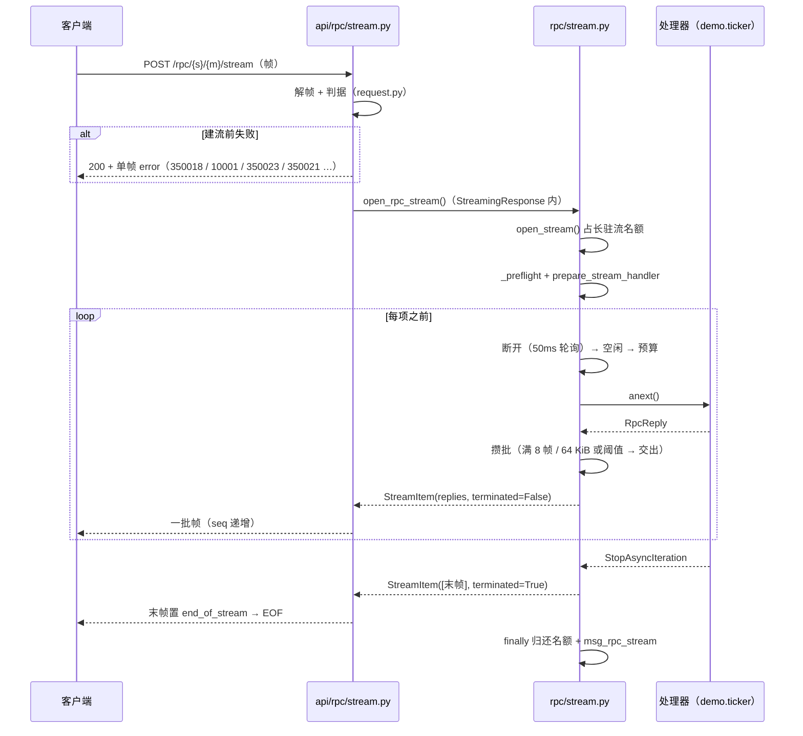

# 04-3-1 服务端流式实施记录

> `POST /rpc/{service}/{method}/stream` × 只接帧形态 × `48 + flags.response` + 末帧 `end_of_stream` × 帧头 `seq` × 结束三态 × 攒批（留一帧 + 停顿即交付）+ inflight 双阈值 × 空闲 `350024` × 预算 `350004` × 长驻流名额 × `msg_rpc_stream` 观测

[文档首页](../../../../../../../文档首页.md) › [消息平台规划](../../../../../../../规划/01_规划_消息平台.md) › [阶段计划](../../../../../计划/01_计划_消息平台.md) › [04-3 流式调用](../../04_RPC_03_流式调用.md) › [04-3-1 服务端流式](../04_RPC_03_流式调用_01_服务端流式.md) › 实施记录

---

## 1. 任务信息 

| 项 | 值 |
| --- | --- |
| 任务 | [04-3-1 服务端流式](../04_RPC_03_流式调用_01_服务端流式.md) |
| 详细设计 | [详细设计](../设计/01_详细设计_04_RPC_03_流式调用_01_服务端流式.md) |
| 测试记录 | [测试记录](../测试/01_测试记录_04_RPC_03_流式调用_01_服务端流式.md) |
| Kiwi 用例 | **2437**（回读平台最大号 2436，取 +1；三个新增用例文件统一 `@pytest.mark.kiwi_id(2437)`） |
| 实施日期 | 2026-11-06 |

## 2. 交付物 

| 文件 | 变化 | 要点 |
| --- | --- | --- |
| `core/config.py` | 改 | `RPC_STREAM_IDLE_MS`（60s）、`RPC_STREAM_COALESCE_BYTES`（64 KiB）、`RPC_STREAM_COALESCE_FRAMES`（8） |
| `errors.py` | 改 | `MsgErrorCode.RPC_STREAM_IDLE = 350024` + `MsgRpcStreamIdleError`（business / 不重试 / 504 / `data` 带 `idle_ms` 与 `idle_elapsed_ms`） |
| `deploy/registry/msg.toml` | 改 | `[[errcodes]] 350024`（`msg.error.rpc_stream_idle` / warning / 504） |
| `api/frame/responses.py` | 改 | `_BUSINESS_CODES` 增 `350024`（否则会被归 system 层、`layer` 判错） |
| `protocol/frame.py` | 改 | `FrameType.RPC` 与 `FrameFlags.END_OF_STREAM` 的注释按「流式已启用」回写（编号与位值未动） |
| `rpc/registry.py` | 改 | `RpcStreamHandler` 协议、`register_stream()` / `resolve_stream()` / `stream_methods()`、**同一 `(service, method)` 形态互斥**（冲突即 `RpcRegistrationError` 拒启）、`services()` / `__len__` 覆盖两形态 |
| `rpc/service.py` | 改 | 抽出 `_preflight()`（形态 → 预算 → 限流 → 参数上限）与 `prepare_handler()` / `prepare_stream_handler()`；`invoke_rpc` 行为不变；`exhausted_error()` 提为公开（流式共用） |
| `rpc/stream.py` | 新增 | `open_rpc_stream()`：产出 → 攒批（留一帧）→ 背压 → 断开 / 空闲 / 预算三判据 → `finally` 收尾 + `msg_rpc_stream`；`StreamItem`（一批结果 + 是否收尾） |
| `rpc/builtin.py` | 改 | 内置流方法 `demo.ticker`（ASCII 十进制条数 → N 帧）与 `demo.idle`（推 1 帧后不再产出） |
| `rpc/contract.py` | 改 | `rpc.stream` 段（端点 / 请求-响应约定 / `seq` / `idle_ms` / 三个错误码 / 流式方法清单，与注册表同源） |
| `rpc/__init__.py` | 改 | 出口补 `RpcStreamHandler`（仍不转出依赖 broker 的 `open_rpc_stream`） |
| `api/rpc/request.py` | 新增 | 请求帧判据（类型 / 响应位 / `request_id` / 路径一致 / 压缩 / 头映射 / `caller`·`trace_id`），一元闸门与流式端点共用 |
| `api/rpc/gate.py` | 改 | 五个判定函数搬到 `api/rpc/request.py`（纯搬家，行为与错误码不变，存量用例即回归网） |
| `api/rpc/responses.py` | 改 | `rpc_stream_frame()`（`seq` + `used_ms` / `remaining_ms` + 可选 `end_of_stream`） |
| `api/rpc/stream.py` | 新增 | 端点：解请求帧 → 建流 → 按批编码；建流前失败一律 `200 + 单帧 error`；名额在生成器内占、`finally` 还 |
| `api/rpc/routes.py` / `api/router.py` | 改 | 新增独立 `stream_router`（同 `/rpc` 前缀、**不挂**一元帧闸门）并聚合到根路径 |
| `deploy/contracts/msg.json` | 改 | 重导：`paths` +1（`/rpc/{service}/{method}/stream`）、`x-msg-frame.rpc.stream` 段 |
| `tests/api/test_rpc_stream.py` | 新增 | 39 条：帧序 / 三态 / 各失败分支 / 背压 / 取消 / 观测 / 服务层分支 |
| `tests/api/test_rpc_stream_h2c.py` | 新增 | 2 条真机 h2c：20 帧逐块到达 + 同连接一元复用；慢消费者挡住生产 |
| `tests/rpc/test_registry_stream.py` | 新增 | 11 条：流方法登记 / 形态互斥 / 清单顺序 / 内置流处理器 |
| `tests/ops/test_frame_contract_snapshot.py` | 改 | 增 `rpc.stream` 段断言（端点 / 结束位 / `seq` / `idle_ms` / 三个错误码 / 流式方法清单同源） |
| `tests_support/rpc_stream.py` | 新增 | `read_stream()`（字节 → 帧序列）与 `call_stream()`（自持 `send` / `receive` 的 ASGI 直调） |
| `tests_support/frame_app.py` | 改 | 聚合追加 `stream_router`（内置流方法随 `default_rpc_registry()` 一并登记，生产同源） |

一元面（`invoke_rpc` 行为、`RpcClient`、`api/rpc/gate.py` 的对外行为）**零变化**：`gate.py` 只是把判据搬家，存量 04-1 / 04-2 用例全绿。

## 3. 关键决策落地 

### 3.1 本轮新确认的四项（2026-11-06，开工前逐项确认）

| 拍板事项 | 结论 | 落地 |
| --- | --- | --- |
| `/stream` 路径参数的契约形态 | **端点内校验**（`Path` 不声明 `pattern` / `minLength`） | 端点用 `ensure_rpc_name`（与一元同一函数、同一码 `10001`）→ 非法形态回 `200 + 单帧 error`；契约里只留可读描述（设计 §4.1 / §10.2 已回写） |
| 请求帧解析的落点 | **抽 `api/rpc/request.py`** | 一元闸门与流式端点共用一份判据；`gate.py` 只搬家，存量用例即回归网 |
| 末帧 `end_of_stream` 与攒批上界 | **攒批保留最后一帧** | 保证「N 次产出 = N 帧」；仅「处理器 0 帧」补一个空 payload 收尾帧 |
| `demo.ticker` 参数 | **ASCII 十进制条数**；空 → 0 帧；非数字 / 越界 → `ParamError` | 覆盖「流内契约错误」分支；`TICKER_MAX_FRAMES=1000` 防被当压测装置 |

### 3.2 实施口径（设计未写死、由实现补的三条，已回写设计 §5.3 / §10.2）

| 口径 | 为什么 | 落点 |
| --- | --- | --- |
| 服务层**不编码**帧，只产 `RpcReply` / 异常；`seq`、标志位、错误帧全在 `api/rpc/` 编码 | 与 `rpc/service.py` 同一取向：帧是承载不是语义；服务层不认识 ASGI / FastAPI | `rpc/stream.py` 的 `StreamItem` = 一批结果 + 是否收尾 |
| 一批**编成一段字节一次 `yield`**（一次 `send`） | 一帧一次 `send` 会让「批」只剩服务层内部概念，且多出 N 次调度；一次 `send` 才让攒批真正落到线上（用例用「批数」断言它） | `api/rpc/stream.py::_stream_body` |
| 处理器**停顿一个轮询周期（50ms）就先交付手上那批** | 只攒不交会把单帧 / 长间隔流整体晚一拍——实测 `demo.idle` 的第一帧要等到流结束（或空闲超时）才可见 | `rpc/stream.py` 的 `if not done:` 分支 |

### 3.3 一条流的真实形状

## 4. 过程与命令 

| 步骤 | 命令 / 要点 |
| --- | --- |
| 1 登记用例 | 回读最大号 2436 → `ssh minjian@192.168.0.107 "docker exec -i bms-kiwi /Kiwi/manage.py shell" < tmp/register_04_3_1.py` → 2437，回读核对（summary 90 字 / `CONFIRMED` / `P2` / 平台骨架 / 自动化） |
| 2 开发期用例 | `pytest backend/services/msg/tests/api/test_rpc_stream.py`、`.../test_rpc_stream_h2c.py`、`services/msg/tests/rpc/test_registry_stream.py`（单文件，秒级） |
| 3 一次会话跑满 | 23 个目标（`api/test_rpc_*` 7 个、`tests/rpc/` 3 个、`test_registry_consistency`、`test_tenant_guard`、`test_error_codes`、`api/test_tenant_*` 3 个、`api/test_frame_*` 7 个、`api/test_connection_heartbeat`、`tests/ops/test_frame_contract_snapshot`）共 **265 条** |
| 4 覆盖率采集 | 同一会话加 `MSG_COVERAGE_DATA=D:/Develop/bizs/msg/.cache/coverage/.coverage` 与 `MSG_COVERAGE_SOURCE="bms_msg,services,ops"`；判前已清 `.cache/coverage/.coverage*` |
| 5 判定 | `backend/.venv/Scripts/python.exe -m engkit coverage --data-file .cache/coverage/.coverage --out .cache/coverage/report-04-3-1.json --module …`（**仓根执行**，13 个模块） |
| 6 契约 | `uv run python -m ops.contract_snapshot export` → `check`（零漂移） |
| 7 静态 | `ruff check` / `ruff format --check` / `pyright --pythonpath .venv/Scripts/python.exe`（改动 22 个文件） |
| 8 文档 | `engkit eol` / `check_links.py` / `check_docs_scope.py` |

## 5. 验证结果 

| 项 | 结果 |
| --- | --- |
| 一次会话用例 | **265 条通过**（含真机 h2c 两条） |
| 模块级覆盖率 | `files=13 missing_lines=0 partial_branches=0 percent=100.00` |
| 契约快照 | `[contract_snapshot] 通过：1 个在运服务快照与公开契约一致` |
| `ruff check` / `format --check` | 通过（22 个文件） |
| `pyright`（strict，带 `--pythonpath`） | 0 error / 0 warning |
| 真机背压观测 | 客户端停读 200ms 时已产出 **288/400** 帧（未读完全部 → 生产确实被挡住） |

## 6. 问题与处置 

### 6.1 `aclose(): asynchronous generator is already running`

首轮 `test_deadline_exhausted_mid_stream` 直接 500：预检/空闲/预算这些分支退出时，「取下一项」的任务还在跑，
收口处的 `aclosing(...)` 紧接着 `aclose()` 同一个生成器 → `RuntimeError`。

**处置**：收尾顺序定为「先 `_cancel_task()`（取消并等它结束）→ 再 `_close_iterator()`」，而不是把两者交给
`aclosing` 的 `__aexit__`。`_close_iterator()` 还额外吞掉 `RuntimeError`：取消路径下（外层任务已被取消）
那次 `await` 会立刻抛 `CancelledError`，等 `aclose()` 时生成器可能仍在运行——它的清理已由那次取消驱动过，
关闭失败不构成资源问题，而抛到 `StreamingResponse` 里只会变成一条无意义的 500 日志。

### 6.2 用 `httpx.ASGITransport` 造断开探测不命中（测试装置问题，但也暴露了口径）

`test_disconnect_stops_stream` 一开始跑到 30s 预算耗尽才结束。根因是 Starlette 的 `is_disconnected()` 把
`receive` 放进一个**立刻取消**的作用域里探一次——凡是「需要 `await` 才能就绪」的消息它都看不见。测试替身的
`receive` 原先在 `disconnect.set()` 之后仍要先 `await` 一次事件，于是永远读不到断开。

**处置**：替身在事件已置位时**同步返回** `http.disconnect`（`tests_support/rpc_stream.py`，已注理由）。

### 6.3 只攒不交会「吞掉时延」（设计没写、实测发现的真问题）

「攒批保留最后一帧」带来一个副作用：处理器只产 1 帧然后停住时，这一帧要等到下一次产出（或流结束）才可见
——`demo.idle` 的首帧实际要等 30s 预算耗尽才发出去，长间隔流整体晚一拍。

**处置**：加「停顿即交付」分支——等待下一项超过一个轮询周期（50ms）就把手上那批写出去。攒批仍只在「连续
到位」的那一串上生效，背压账本不受影响。设计 §5.3 第 4 步与 §10.2 已回写。

### 6.4 `10001` 的 HTTP 状态是 200，不是 4xx

`test_json_request_is_rejected` 首轮断言 `status >= 400` 失败：`10001` 是平台登记在案、对外按 HTTP 200 渲染
的契约层码（一元 JSON 路径同样如此，04-1 的用例只判 `code`）。**处置**：断言改为「JSON 媒体类型 + `code ==
10001`」，与一元面同口径。

### 6.5 覆盖率首轮缺 6 行 / 3 分支，两处都不是新代码的洞

| 缺口 | 根因 | 处置 |
| --- | --- | --- |
| `api/frame/responses` 189~192（心跳结果帧） | 本任务的会话清单里没有心跳用例——该分支是 03-4 的，只是 350024 让这个模块进了判定集 | 会话补 `api/test_connection_heartbeat.py` |
| `api/rpc/request` 94~95（`headers` 正常映射） | 04-1 只测了「不是映射 / 值不是字符串」，没测「合法 map 走通」 | 新增一条流式用例：请求帧带 `headers: {k: v}` → 处理器拿到并随结果帧回显 |

### 6.6 `_flush_due` 不能跨模块直接调（测试写法调整）

首轮把攒批判据写成「直接调 `rpc/stream.py::_flush_due`」的单元用例，pyright strict 报
`reportPrivateUsage`。**处置**：不再直接调私有函数，改为两条端点级用例——① 字节上界（注入
`RPC_STREAM_COALESCE_BYTES=4`）；② 阈值关闭（`tuning(0,0)` 时按帧数上界分批 ⇒ 8 帧出 2 批而不是 8 批）。
分支覆盖不变，判据还落在线上行为上。

## 7. 偏差与遗留 

### 7.1 偏差（均已回写设计）

| # | 偏差 | 说明 |
| --- | --- | --- |
| 1 | 攒批**保留最后一帧** + **停顿即交付** | 设计 §5.3 原写「累积到上界或迭代结束再交出一批」。留一帧是为「末帧必为真实产出帧」，停顿即交付是为「攒批不吞时延」（§6.3）。设计 §5.3 第 4 步 / §10.2 已回写 |
| 2 | 服务层只产 `RpcReply`，编码在 `api/rpc/`，且一批准一次 `yield` | 与 §5.1「编码在 api」一致；§5.3 原措辞「编码后累积」容易读成服务层编码，已改写 |
| 3 | 路径参数**不在契约里**声明 `pattern` / `minLength` | 判据仍用同一函数（`ensure_rpc_name`）；声明了就会先被 FastAPI 拒成 JSON，与「单帧 `error`」口径冲突。设计 §4.1 / §10.2 已回写 |
| 4 | `msg_rpc_stream.outcome` 多一个逃生值 `error` | 只用于非 `BizError` 的处理器故障（不写收尾帧，客户端按「无收尾帧即中断」判）。沿用 03-5 `reason="error"` 兜底口径；设计 §5.7 已补注 |
| 5 | 预检放进生成器体内 | 建流前失败（`350023` / `350005` / `350006` / `350004`）因此也落一条 `msg_rpc_stream`；否则「建流前的失败」在流式视角里完全不可见 |
| 6 | 长驻流名额在**生成器内**占、`finally` 还 | 设计 §5.6 写「端点内」。端点内先占的话，响应从未被迭代（连上即断）时 `finally` 不执行 → 名额永久泄漏一个；放进生成器第一行才能保证「占到了就一定有归还」 |

### 7.2 遗留

| # | 遗留 | 归口 |
| --- | --- | --- |
| 1 | 客户端侧的 `RpcStream`、序号校验、90s 空闲兜底与端到端取消验收 | 04-3-2 |
| 2 | 真实业务流方法（当前只有 `demo.ticker` / `demo.idle`） | 04-5（bms 适配）/ 各业务域 |
| 3 | `msg_rpc_stream` 只有日志，无指标出口（Prometheus / 快照） | 06-3 |
| 4 | 攒批上界（64 KiB / 8 帧）与空闲阈值（60s）未做容量实测 | 8B_12 |
| 5 | 流式调用与 04-6 服务目录不联动（`{service}` 拼错只得 `350023`） | 04-6（沿用 04-1 遗留） |
| 6 | 帧流仍无 close 帧（沿用 03-5 的 EOF 约定，正常结束靠 `end_of_stream`） | 后续需求（若要 close 语义再新增帧类型） |
| 7 | `350024` 的 `errcode_segment` 仍属 07C 暂定段 | 07C（与 3500xx 全体同口径） |
| 8 | 恰好卡攒批上界且处理器在「最后一项之后还有 `await` 清理」时，可能多一个空 payload 收尾帧 | 已知形状：客户端会当作一条空结果；触发条件极窄（末批恰空 + 收尾有 await），暂不特殊处理 |

---

> 依《[文档生成规范](../../../../../../../../bms文档/规范/文档生成规范.md)》编写 · 任务文档见 [04-3-1 服务端流式](../04_RPC_03_流式调用_01_服务端流式.md) · 客户端侧见 [04-3-2 详细设计](../../04_RPC_03_流式调用_02_客户端流式消费/设计/01_详细设计_04_RPC_03_流式调用_02_客户端流式消费.md)
