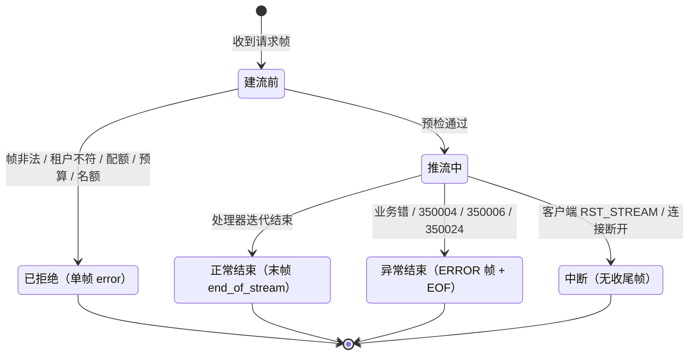

# 服务端流式详细设计

> `POST /rpc/{service}/{method}/stream` × 只接帧形态 × `48 + flags.response` + 末帧 `end_of_stream` × 帧头 `seq` × 结束三态（end 位 / error 帧 / 无收尾即断流）× 攒批 + inflight 双阈值背压 × 空闲超时 `350024` × 预算耗尽 `350004` × 长驻流名额与连接守卫 × `msg_rpc_stream` 观测

[文档首页](../../../../../../../文档首页.md) › [消息平台规划](../../../../../../../规划/01_规划_消息平台.md) › [阶段计划](../../../../../计划/01_计划_消息平台.md) › [04-3 流式调用](../../04_RPC_03_流式调用.md) › [04-3-1 服务端流式](../04_RPC_03_流式调用_01_服务端流式.md) › 详细设计

---

## 1. 概述 <a id="overview"></a>

### 1.1 目标

把「一次请求、多次响应」做成一等能力，且**不改动一元契约的任何一个字节**：

1. **独立端点**：`POST /rpc/{service}/{method}/stream`，只接帧形态；一元端点与闸门零改动。
2. **零新增帧类型**：响应沿用 `FrameType.RPC = 48` + `flags.response`，末帧置 03-2 预留至今未启用的 `flags.end_of_stream`，序号进帧头 `seq`。
3. **结束可区分**：正常 = `end_of_stream` 帧；异常 = `ERROR` 帧；无收尾帧 = 异常中断。三种情形各有确定判据，不靠 EOF 猜。
4. **背压可断言**：h2 窗口负责阻断，应用层 inflight（条数 / 字节双阈值）负责「不无界缓冲」，且慢消费者时 handler 的产出会被真正暂停。
5. **半开可回收**：流层空闲超时（60s）先到、连接心跳（03-4）管连接死活，两层互不计入对方。
6. **预算与取消沿用 04-2**：整条流共享一份 `Deadline`，每次产出前判剩余；取消走既有的 50ms 断开探测，服务端判据一行不改。
7. **观测自成一条**：`msg_rpc_stream` 与 `msg_rpc` 分工（一个流式、一个一元），靠 `request_id` 对账。

### 1.2 边界与承接

| 项 | 本子任务 | 归口 |
| --- | --- | --- |
| `/stream` 端点、请求帧校验、流帧编码（`seq` / `end_of_stream`） | ✅ 交付 | 04-3-1 |
| 服务端流核心（产出 → 攒批 → 背压 → 空闲 / 预算 / 取消） | ✅ 交付 | 04-3-1 |
| `RpcStreamHandler` 与 `register_stream()`、形态冲突拒启 | ✅ 交付 | 04-3-1 |
| `350024` 五处对齐、契约 `rpc.stream` 段、内置流方法 `demo.ticker` / `demo.idle` | ✅ 交付 | 04-3-1 |
| 客户端传输层读队列、`RpcStream`、客户端取消接线与端到端真机验收 | ❌ 不做 | 04-3-2 |
| client streaming / 双向流 / 断点续传（resume token） | ❌ 不做 | 后续需求 |
| 重试 / 退避 / 熔断 / 幂等键 | ❌ 不做 | 04-4 |
| 指标出口（Prometheus / 快照段） | ❌ 只留日志采集点 | 06-3 |
| 一元端点、闸门、`RpcClient`、`client/transport/` | ❌ 一行不改 | 04-1 / 04-7 |

### 1.3 口径来源

| 问题 | 定稿 | 出处 |
| --- | --- | --- |
| 帧类型与结束位 | 沿用 `48` + `response`；末帧 `end_of_stream` | 本设计 §10 决策 2；分组区间（`7-15` 数据面预留 / `48-63` rpc）见 `protocol/contract.py` 的 `reserved_types` |
| 序号落点 | 帧头 `seq`（0 起） | 本设计 §10 决策 3 |
| 端点形态 | 独立路径、只接帧 | 本设计 §10 决策 4 / 5 |
| 背压 | 复用 03-5 机制（`InflightUsage` 双阈值 + 预取 / 攒批计入在途），账本按流一份 | 本设计 §10 决策 6；架构 05 §7 |
| 空闲超时 | 服务端 60s（客户端 90s 兜底归 04-3-2） | 本设计 §10 决策 7 |
| 错误码 | 新增 `350024`（business / 不重试） | 本设计 §10 决策 8 |
| 长驻流名额 | 计入 03-4 的 `max_streams_per_connection`（`350021`） | 本设计 §10 决策 9 |
| 预算与取消 | 整条流共享 04-2 的 `Deadline`；取消判据不改 | 04-2 详细设计 §5 |

## 2. 现状与差距 <a id="gap"></a>

| 现状 | 差距 |
| --- | --- |
| `invoke_rpc` 只有「一进一出」：`_run_handler` 等 handler 返回**单个** `RpcReply` | 流式要多帧、且每帧都要在「预算 / 空闲 / 断开」三条判据下推进 |
| `RpcRegistry.register()` 的 handler 契约是 `RpcCall -> Awaitable[RpcReply]` | 需要迭代器形态的处理器端口，且要与一元方法**互斥**（同 `(service, method)` 不能两种形态） |
| `FrameFlags.END_OF_STREAM` 已预留但全仓无一处置位（`frame.py` 注释写「本任务不置位」） | 流式结束位首次启用，需要明确「哪些帧置、置了之后 EOF 怎么算」 |
| 03-5 的帧式推送（`POST /msg/subscribe`）已是「一请求多帧 + EOF 结束」的完整体例 | 可复用其形（`StreamingResponse` + 逐帧 yield + EOF），但它绑死投递语义（组 / 位点 / ack / 分区），RPC 流不能照搬账本 |
| 03-5 的 inflight 账本键是 `(group, topic_id, partition_no)`，由投递状态维护 | RPC 流没有组、位点、ack，账本要改成「按流一份、产出即计入、写出即释放」 |
| 03-4 的长驻流名额（`connections.open_stream`）目前只有 `/msg/subscribe` 两个形态在用 | RPC 流也是长驻流，必须占名额，否则「单连接能挂多少条流」出现第二套口径 |

## 3. 交付物清单 <a id="deliverables"></a>

| 文件 | 类型 | 职责 |
| --- | --- | --- |
| `protocol/frame.py` | 改 | `FrameType.RPC` 与 `FrameFlags.END_OF_STREAM` 的注释按「流式已启用」回写（编号与位值不动） |
| `errors.py` | 改 | `MsgErrorCode.RPC_STREAM_IDLE = 350024` + `MsgRpcStreamIdleError`（business / 不重试 / 不支持重试间隔） |
| `core/config.py` | 改 | `RPC_STREAM_IDLE_MS`（60s）、`RPC_STREAM_COALESCE_BYTES`（64 KiB）、`RPC_STREAM_COALESCE_FRAMES`（8） |
| `rpc/registry.py` | 改 | `RpcStreamHandler` 协议（`RpcCall -> AsyncIterator[RpcReply]`）、`register_stream()`、形态冲突拒启、`stream_methods()` |
| `rpc/service.py` | 改 | 抽出 `prepare_handler()`（形态 → 预算预检 → 限流 → 参数上限 → 路由），`invoke_rpc` 行为不变 |
| `rpc/stream.py` | 新增 | `open_rpc_stream()`：产出 → 攒批 → 背压 → 空闲 / 预算 / 断开 → `msg_rpc_stream` |
| `rpc/builtin.py` | 改 | 内置流方法 `demo.ticker`（按参数条数推 N 帧）与 `demo.idle`（推 1 帧后不再产出） |
| `rpc/contract.py` | 改 | `rpc.stream` 段（端点 / 结束位 / `seq` / 空闲阈值 / 流内错误码） |
| `api/rpc/responses.py` | 改 | `rpc_stream_frame()`（`seq` + `used_ms` / `remaining_ms` + 可选 `end_of_stream`） |
| `api/rpc/stream.py` | 新增 | 端点实现：解码请求帧 → 建流 → `StreamingResponse`；建流前错误一律单帧 `error` |
| `api/rpc/routes.py` | 改 | 新增 **`stream_router`**（同 `/rpc` 前缀，**不挂一元帧闸门**）+ `POST /{service}/{method}/stream` |
| `api/router.py` | 改 | 根路径聚合追加 `rpc_routes.stream_router` |
| `api/frame/responses.py` | 改 | `_BUSINESS_CODES` 增 `350024`（否则会被归 system 层） |
| `deploy/registry/msg.toml` | 改 | `[[errcodes]] 350024` |
| `deploy/contracts/msg.json` | 改 | 重导：paths +1、`x-msg-frame.rpc.stream` |
| `tests/api/test_rpc_stream.py` | 新增 | 帧流端到端（ASGI）：帧序 / 结束三态 / 各失败分支 / 背压暂停 / 取消释放 |
| `tests/api/test_rpc_stream_h2c.py` | 新增 | 真机 h2c：`httpx` 逐块读，验连续推送、EOF 收尾、窗口阻断（取消验收归 04-3-2） |
| `tests/rpc/test_registry_stream.py` | 新增 | 流方法登记 / 形态冲突 / 重复登记 / 清单顺序（**不并入 `test_registry.py`**，避免 `kiwi_id` 混标） |
| `tests/ops/test_frame_contract_snapshot.py` | 改 | `test_export_contains_rpc_contract` 增 `stream` 段断言（沿用 04-1 的「同源断言」取向） |
| `tests_support/rpc_stream.py` | 新增 | 帧流读取辅助：累积缓冲 → `decode_frames` → 取 `(seq, end, frame)`；把 `StreamingResponse` 的字节还原成帧序列 |
| `tests_support/frame_app.py` | 改 | 注入注册表时一并登记内置流方法（生产同源） |

## 4. 契约：端点、帧与失败分支 <a id="contract"></a>

### 4.1 端点与形态

| 项 | 定稿 |
| --- | --- |
| 路径 | `POST /rpc/{service}/{method}/stream`（`{service}` / `{method}` 沿用 04-1 的 `RPC_SERVICE_PATTERN` / `RPC_METHOD_PATTERN` 与长度上限） |
| 请求 `Content-Type` | 必须是 `application/x-msg-frame`；否则 `10001`（HTTP 状态由基座统一错误响应给，用例只判 `code`，沿用 04-1 §6.2） |
| 响应 | `200` + `application/x-msg-frame`，正文是**连续帧**；结束以「末帧 `end_of_stream`」或「`ERROR` 帧」或「EOF 无收尾」三态表达 |
| 响应形态声明 | `response_class=StreamingResponse`，`responses[200].content` 只声明帧媒体类型（与 03-5 的 `subscribe_frames` 同一写法） |
| 权限 / 守卫 | 复用 `CONNECTION_GUARD` 与 `msg:rpc`（流式与一元同一权限码，不新增） |

**为什么另起 `stream_router` 而不是把路由挂进既有 `router`**：`router` 的路由级依赖里有 `build_rpc_frame_gate()`，它对**任何**带帧媒体类型的请求都整单处理并 `FrameHandled` 短路——挂进去等于流式请求被一元闸门吃掉。改闸门「跳过 `/stream`」是把语义判断塞进一个与语义无关的依赖里，且下次再加一条形态还要再改一次闸门；独立路由把「哪种形态」写在路由表里，一眼可核对。

### 4.2 请求帧

与一元请求帧**完全同形**（客户端编码函数可直接复用）：

| 字段 | 必填 | 说明 |
| --- | --- | --- |
| `request_id` | 是 | 逐帧回显，客户端据此对齐多路流 |
| `service` / `method` | 否 | 给了就必须与路径一致（不一致 `350018`），与 04-1 同判据 |
| `deadline_ms` | 否 | 缺省 30000、区间 0~600000；**它是整条流的预算**，不是单帧预算 |
| `caller` / `trace_id` | 否 | HTTP 头优先，冲突只告警（04-1 §9.2） |
| `tenant` | 否 | 只能与请求身份一致（`ensure_frame_tenant`） |
| `headers` | 否 | `map<str,str>`，透传给处理器 |
| `content_type` / `protocol_version` | 否 | 透传 / 版本核对；压缩仍不支持（`350018`） |

帧本身：`type=48`、**不得置 `response` 与 `end_of_stream`**、payload 为调用参数原始字节（上限 1 MiB，超限 `350006`）。

### 4.3 响应帧与序号

每帧：

| 项 | 取值 |
| --- | --- |
| `type` / `flags` | `48` + `flags.response`；**末帧另置 `flags.end_of_stream`** |
| `header.seq` | 从 **0** 起、逐帧 +1；客户端可据此断言「没丢帧、没乱序」 |
| `header.request_id` / `service` / `method` | 回显 |
| `header.length` | payload 字节数（与一元结果帧同键名） |
| `header.used_ms` / `remaining_ms` | 该帧产出时刻的预算视图（与一元同形，回答「这条流跑到哪了」） |
| `header.headers` | 结果结构化头（`map<str,str>`） |
| `payload` | 处理器产出的结果原始字节（单帧上限 1 MiB，超限 `350006` → 转为流内 `ERROR` 帧） |

**序号为什么进帧头**：payload 必须保持「结果原始字节」——04-1 的契约、handler 的返回值、压缩与校验的将来接入都依赖这一点。放进 body 前 4 字节等于给 payload 加一层私有头，每个消费方都要记住偏移。

**为什么每帧都带 `used_ms` / `remaining_ms`**：流式调用里「跑到哪了」是排障第一问；这两个值就是预算视图，写一帧几乎零成本，且省掉「客户端自己算、与服务端不一致」的老问题。

### 4.4 结束三态与失败分支



| 阶段 | 失败 | 表达 | 码 |
| --- | --- | --- | --- |
| 建流前 | 非帧请求 | 基座统一错误响应（JSON） | `10001` |
| 建流前 | 请求帧不可解析 / 类型不符 / 置了响应位 / 版本不支持 / 缺 `request_id` / 租户不一致 | **单帧 `error` 的流式响应**（HTTP 200，客户端只按帧解析） | `350018` / `350019` / `350012` |
| 建流前 | 路径参数形态非法 | 同上（单帧 `error`） | `10001` |
| 建流前 | 预算已耗尽 | 同上 | `350004` |
| 建流前 | RPC 速率超配额 | 同上 | `350005` |
| 建流前 | 参数超 1 MiB | 同上 | `350006` |
| 建流前 | 方法未注册 / 不是流式方法 | 同上 | `350023` |
| 建流前 | 单连接长驻流名额已满 | 同上（名额未占用，无需归还） | `350021` |
| 推流中 | 处理器抛 `MsgError` | `ERROR` 帧 + EOF | 原码 |
| 推流中 | 单帧结果超 1 MiB | `ERROR` 帧 + EOF | `350006` |
| 推流中 | 预算耗尽 | `ERROR` 帧 + EOF | `350004`（`detail.outcome=unknown`） |
| 推流中 | 空闲超时 | `ERROR` 帧 + EOF | `350024` |
| 推流中 | 客户端取消 / 断开 | 不写任何收尾帧（stream 已 reset） | — |

**「建流前失败」为什么也回帧**：客户端已经按帧说话（`content-type` 是帧），回 JSON 等于要求它维护两套解析；03-2 已把「版本不支持给一个可解析的帧」写成口径，这里延续同一条。

## 5. 实现 <a id="impl"></a>

### 5.1 模块与依赖方向

```text
api/rpc/stream.py  ──→ api/rpc/responses.py ──→ protocol/frame.py
        │                    │
        │                    └──→ rpc/registry.py（类型）
        ├──→ rpc/service.py（prepare_handler，预检共用）
        ├──→ rpc/stream.py（open_rpc_stream）
        │         ├──→ protocol/frame.py（error_frame 由 api 层编码，服务层只产 RpcReply / 异常）
        │         └──→ broker/backpressure.py（InflightUsage / BackpressureTuning）
        └──→ api/frame/guard.py（连接守卫）/ api/deps.py（注册表、限流器、tuning）
```

单向无环：`rpc/stream.py` 不认识 ASGI / FastAPI（与 `rpc/service.py` 同一取向——服务层只判语义，编码在 `api/`）；`api/rpc/stream.py` 不认识 h2（帧就是字节）。

### 5.2 注册表：流方法端口与形态互斥

```python
class RpcStreamHandler(Protocol):
    def __call__(self, call: RpcCall) -> AsyncIterator[RpcReply]: ...
```

| 决策 | 理由 |
| --- | --- |
| 独立协议 + `register_stream()`，不与 `register()` 合并 | 一元是 `Awaitable[RpcReply]`、流式是 `AsyncIterator[RpcReply]`，合并只能靠运行期判别（`isasyncgen`），登记错形态要到第一次调用才炸；两个入口在装配期就把形态固定下来 |
| 同一 `(service, method)` 只能一种形态，冲突抛 `RpcRegistrationError` | 两条路径各挂一个同名方法时，「调哪个」取决于调用方选了哪个端点——这属于隐式行为，正是「重复即拒启」要消灭的 |
| `stream_methods()` 与 `methods()` 分开 | 契约里 `methods`（一元）与 `stream.methods`（流式）要分别发布；混一张表会让客户端以为所有方法都能流式调 |

`RpcCall.deadline_ms` 在流式下**每帧重算**（`deadline.downstream_ms()`），处理器若继续调下游，取最新值才有意义。

### 5.3 服务层：`open_rpc_stream`

```python
async def open_rpc_stream(
    *, registry, limiter, tenant, service, method, payload, headers,
    deadline, trace_id=None, caller=None, request_id=None,
    disconnected: DisconnectProbe | None = None,
    tuning: BackpressureTuning, now=time.monotonic,
) -> AsyncGenerator[StreamItem]: ...
```

职责（判定顺序与 04-1/04-2 一致，不另起一套）：

1. `ensure_rpc_name` → 预算预检 → 限流 → 参数上限 → 路由（全部收在 `prepare_handler()` 里，与 `invoke_rpc` 共用）；
2. 迭代处理器，逐项产出 `RpcReply`；
3. 每项产出前判三条：**断开**（50ms 轮询）→ **预算**（`is_exhausted`）→ **空闲**（距上次写出超 `RPC_STREAM_IDLE_MS`）；
4. 攒批：编码后累积到 `RPC_STREAM_COALESCE_BYTES` / `RPC_STREAM_COALESCE_FRAMES` 或迭代结束，再交给调用方写出一批；
5. 收尾统一在 `finally`：取消处理器迭代、记 `msg_rpc_stream`。

**为什么让服务层产出「一批帧」而不是「一帧」**：攒批是应用层 inflight 的落点。若一帧一 `yield`，`yield` 返回即代表已写出，在途恒 ≤1 帧，双阈值永远不可达（等于装饰）；攒批后「已编码未写出」的帧/字节就是真实在途量，阈值才有意义，也才有「暂停生产」可断言。

### 5.4 背压：窗口 + 应用层双阈值

| 层 | 机制 | 超限动作 | 归属 |
| --- | --- | --- | --- |
| 连接层 | h2 流控窗口（`hypercorn` 的 `StreamBuffer` 高水位会阻塞 ASGI `send`） | 自动暂停写出 | 协议 + `hypercorn` |
| 应用层 | `InflightUsage(messages, bytes)` 按流一份；**已编码未写出**计入在途 | 暂停向处理器索取下一项（`await` 在 drain 事件上） | 本任务 |
| 帧级 | 单帧 payload ≤ 1 MiB | `ERROR` 帧 + `350006` | 04-1 已有判据 |

| 决策 | 理由 |
| --- | --- |
| 账本键是「单条流」，不是 `(group, topic, partition)` | RPC 流没有组 / 位点 / ack，套用投递账本会引入三个永不存在的维度 |
| 阈值取 `BackpressureTuning`（缺省 100 条 / 16 MiB），**用意是护栏** | 日常由上界 64 KiB / 8 帧的攒批决定；阈值是「将来调大攒批或换成不阻塞的传输实现」时的兜底。用例注入小阈值（2 条 / 1 KiB）即可覆盖暂停分支 |
| 超限**不返错误** | 慢消费者是正常状态，返错会引发重试风暴（03-5 已就同一结论拍板） |
| 攒批上界写死常量、不做配置 | 攒批是性能细节而非契约；能配的阈值已经有两个，再加一个只会让定参时更不知道信谁 |

### 5.5 半开、预算与取消

| 判据 | 落点 | 触发后 | 与相邻机制的分工 |
| --- | --- | --- | --- |
| 空闲超时 60s | 服务层「等下一项」的等待里（与断连轮询同一个循环） | 取消处理器、发 `350024` 帧、EOF | 03-4 的连接心跳（10s 探 / 30s 判死）管**连接**死活；本判据只看「这条流还有没有数据」 |
| 预算耗尽 | 每项产出前 + 等待循环里 | 发 `350004` 帧（`detail.outcome=unknown`）、EOF | 预算整条流共享，不按帧重置（否则长流等于没有预算） |
| 客户端取消 | `disconnected()` 50ms 轮询 + `CancelledError` 快路径 | 取消处理器、**不写收尾帧** | 服务端判据一行不改（04-2 已交付）；本任务只保证生成器 `finally` 一定归还名额 |
| 卡在写出时被取消 | `hypercorn` 收口生成器（`GeneratorExit` / `CancelledError`） | `finally` 归还名额、记 `outcome=cancelled` | 卡在 `send` 时无法轮询，这条路径由服务器收口——两条路径都必须在 `finally` 汇合，否则名额泄漏 |

**等待循环的形状**（与 04-2 `_run_handler` 同构，便于对照排障）：

```text
while 未就绪:
    if disconnected() 命中        → 取消迭代，CancelledError
    await asyncio.wait({下一项}, timeout=RPC_CANCEL_POLL_MS)
    若仍未就绪:
        空闲 ≥ RPC_STREAM_IDLE_MS → 350024
        预算耗尽                  → 350004
```

### 5.6 连接守卫与长驻流名额

| 项 | 做法 | 理由 |
| --- | --- | --- |
| 连接数 / drain | 复用 `CONNECTION_GUARD`（与一元、数据面同一实例） | 「RPC 也计入 `max_connections`」是 04-1 既定口径，流式不例外 |
| 长驻流名额 | 端点内 `connections.open_stream(connection_key, limit=connection_tuning.max_streams_per_connection)`，`finally` 归还 | 与订阅流同一本账：连接层的「一条流」是一类资源，分两本账会让「为什么还能开流」需要解释两层 |
| 名额判定时点 | 在**预检之前**判（与 `/msg/subscribe` 一致） | 名额是连接级资源，不必先做租户 / 主题解析；也避免占着名额去做注定失败的解析 |
| 名额满 | 单帧 `error`（`350021`）后立即返回，不占名额 | 与预检失败同形 |

### 5.7 观测

| 事件 | 字段 | 用途 |
| --- | --- | --- |
| `msg_rpc_stream` | `service` / `method` / `request_id` / `outcome`（`ok` / `business_error` / `deadline_exceeded` / `idle` / `cancelled`）/ `frames` / `bytes` / `seq_max` / `duration_ms` / `stalled_ms` | 一条流一条日志；`stalled_ms` 是「两次写出之间的最长等待」，回答背压是否真的发生 |

**为什么不并进 `msg_rpc`**：一元那条的 `outcome` 四态与流式语义不同（流式多了 `idle`、且 `frames` 是一等字段）；混成一条会让「一条日志一个视角」失效。两者靠 `request_id` 对账，指标出口统一归 06-3。

### 5.8 契约片段

```python
"stream": {
    "endpoint": "POST /rpc/{service}/{method}/stream",
    "request": "同一元请求帧（type=48，不置 response / end_of_stream）",
    "response": "同 type + flags.response；末帧另置 flags.end_of_stream",
    "sequence": "header.seq，0 起逐帧 +1（缺帧 / 乱序由客户端判协议错）",
    "idle_ms": RPC_STREAM_IDLE_MS,
    "errors": {"method_not_found": 350023, "deadline_exceeded": 350004, "stream_idle": 350024},
    "methods": [...],  # 与 stream_methods() 同源
}
```

## 6. 测试设计 <a id="tests"></a>

### 6.1 用例文件与覆盖点

| 文件 | 覆盖点 |
| --- | --- |
| `tests/api/test_rpc_stream.py` | ① 连续 5 帧：`seq` 0..4、末帧 `end_of_stream`、payload 与处理器产出一致；② 空流（处理器 0 帧）→ 只剩末帧（`seq=0` + `end_of_stream`，payload 空）；③ 未注册 / 一元方法当流式调 → `350023` 单帧；④ 非帧请求 → `10001`；⑤ 路径参数非法 → `10001` 单帧；⑥ 请求帧类型错 / 置响应位 / 缺 `request_id` / 租户不一致 → `350018` / `350012` 单帧；⑦ 业务错在流内 → `ERROR` 帧 + EOF（顺序：错误帧是最后一帧）；⑧ 预算耗尽 → `350004` 帧；⑨ 空闲超时（注入 `RPC_STREAM_IDLE_MS=30`）→ `350024` 帧；⑩ 背压：注入 `tuning(2, 1024)` + 慢 `send`，断言处理器被暂停（产出计数停在「已写出 + 在途」之内）且内存不上涨；⑪ 取消：`is_disconnected` 置真 → 处理器收 `CancelledError`、名额与流登记归还；⑫ 长驻流名额满 → `350021` 单帧且名额未被占用；⑬ `msg_rpc_stream` 各 `outcome` 的字段齐全（`capture_logs`） |
| `tests/api/test_rpc_stream_h2c.py` | 真 hypercorn + `httpx` 逐块读：20 帧连续到达（`seq` 连续、末帧 `end_of_stream`）；EOF 后无残留；同连接再发一元 `demo.echo` 仍 `200` |
| `tests/rpc/test_registry_stream.py` | 流方法登记 / 重复登记拒 / 与一元同名冲突拒 / `stream_methods()` 插入序 |
| `tests/ops/test_frame_contract_snapshot.py` | `rpc.stream` 段与代码常量同源（端点 / 结束位 / `seq` / `idle_ms` / 三个错误码） |

### 6.2 验收映射

| 完成标准（任务 §3） | 用例 |
| --- | --- |
| 连续推送 N 帧、`seq` 单调、末帧 `end_of_stream` | `test_rpc_stream.test_frames_are_sequential_and_terminated`、`test_rpc_stream_h2c.test_stream_frames_over_h2c` |
| 背压生效、内存不随发送量增长 | `test_rpc_stream.test_backpressure_pauses_producer` |
| 流内错误可识别（四类码） | `test_rpc_stream.test_*_error` 四条 |
| 半开流空闲超时后释放 | `test_rpc_stream.test_idle_timeout_releases_stream` |
| 取消后 150ms 内停推、同连接不受影响 | 本任务验「服务端收口 + 名额归还」；**端到端时延归 04-3-2 真机用例** |
| 非帧 / 超限参数 / 超额调用的码 | `test_rpc_stream.test_rejects_*` 三条 |

### 6.3 Kiwi

拟定 **2437**（实施前回读平台最大号 +1 并回读核对；`summary` ≤ 90 字）。`text` 写覆盖范围与本子任务用例文件路径。04-7-2 的 2436 不改派。

## 7. 覆盖率与门禁 <a id="coverage"></a>

| 项 | 口径 |
| --- | --- |
| 覆盖率 | 变更模块（`rpc/stream.py`、`rpc/registry.py`、`rpc/service.py`、`api/rpc/stream.py`、`api/rpc/responses.py`、`rpc/contract.py`、`rpc/builtin.py`、`errors.py`、`core/config.py`、`api/router.py`、`api/frame/responses.py`）行 + 分支 **100%** |
| 采集 | `MSG_COVERAGE_DATA` 给绝对路径、`MSG_COVERAGE_SOURCE="bms_msg,services,ops"`，目标用例**一次 pytest 会话**跑完；判前清 `.cache/coverage/.coverage.*` |
| 判定 | `backend/.venv/Scripts/python.exe scripts/tools/preflight/coverage_report.py --module <点分模块> ...`（在仓根跑；`engkit coverage` 必须带 `--out`） |
| 同会话范围 | `tests/api/test_rpc_*`、`tests/rpc/*`、`tests/ops/test_frame_contract_snapshot.py`、`test_registry_*`、`test_tenant_*`、`test_frame_*` |
| 静态 | ruff / pyright 改动文件全绿（`pyright --pythonpath .venv/Scripts/python.exe`） |
| 文档 | links / docs-scope / eol 三项 |
| 装配 | 不新增 `BasePluggable` 端口（`RpcStreamHandler` 是普通 Protocol），装配冒烟按常规跑 |

## 8. 实施步骤 <a id="steps"></a>

1. 配置与错误码：`RPC_STREAM_*` 三个常量、`350024` 五处对齐（枚举 / 异常 / `msg.toml` / `x-error-codes` / `_BUSINESS_CODES`）。
2. 注册表：`RpcStreamHandler` / `register_stream()` / 形态互斥；补 `test_registry_stream.py`。
3. 服务层：从 `invoke_rpc` 抽出 `prepare_handler()`（既有用例必须全绿，证明行为未变）。
4. `rpc/stream.py`：产出 → 攒批 → 背压 → 三判据 → 收尾（先写单测友好的纯服务层用例）。
5. 编码与端点：`rpc_stream_frame()`、`api/rpc/stream.py`、`stream_router`、聚合追加。
6. 契约：`rpc.stream` 段 → `python -m ops.contract_snapshot export` → `check` 零漂移。
7. 用例：`test_rpc_stream.py` 全分支 + `test_rpc_stream_h2c.py` 真机；覆盖率补口（一次会话）。
8. 文档：架构 05 §3 端点表补一行；实施 / 测试记录；计划表与任务状态回写。

## 9. 风险与开放项 <a id="risk"></a>

| # | 风险 / 开放项 | 处置 |
| --- | --- | --- |
| 1 | `end_of_stream` 是唯一「正常结束」标记，客户端漏判会把截断当正常 | 客户端在 04-3-2 强制校验；服务端用例断言末帧必置位（含空流） |
| 2 | 卡在 ASGI `send` 时的取消不经过我们的轮询 | 收尾统一放 `finally`；用例覆盖「写出阻塞中被断开」→ 名额与流登记仍归还 |
| 3 | 攒批上界与 `tuning` 双阈值重叠时「谁先停」不直观 | 只有攒批上界会真正先到；阈值仅作护栏，用例用注入小阈值单独验暂停分支 |
| 4 | 空闲超时 60s 与 03-4 心跳 30s 数值接近，可能被误解成同一件事 | 两层判据写进契约（`stream.idle_ms` 与 `connection` 段并列），日志 `outcome` 区分 `idle` |
| 5 | 流式方法与 04-6 服务目录不联动（`{service}` 拼错只得 `350023`） | 沿用 04-1 遗留，归 04-6 |
| 6 | 帧流仍无 close 帧（沿用 03-5 的 EOF 约定） | 用 `end_of_stream` 承担「正常结束」语义，不在本任务新增帧类型 |
| 7 | `350024` 的 `errcode_segment` 仍属 07C 暂定段 | 与 3500xx 全体同口径，归 07C |

## 10. 决策确认与对齐记录 <a id="align"></a>

### 10.1 决策（2026-11-06 逐项确认）

| # | 事项 | 结论 |
| --- | --- | --- |
| 1 | 子任务拆分 | 两段：04-3-1 服务端 / 04-3-2 客户端与端到端 |
| 2 | 流帧取号与形态 | 沿用 `48` + `flags.response`，末帧 `end_of_stream`；不新增类型号、不动 `reserved_types` |
| 3 | 响应序号 | 帧头 `seq`（payload 保持结果原始字节） |
| 4 | 端点路径 | `POST /rpc/{service}/{method}/stream`（独立路径，`StreamingResponse`） |
| 5 | 流式形态 | 只做帧形态（JSON 请求 `10001` 明确拒绝） |
| 6 | 背压 | 复用 03-5 机制（`InflightUsage` 双阈值 + 攒批计入在途），账本按流一份 |
| 7 | 半开 / 空闲超时 | 服务端 60s 先到（`350024`），客户端 90s 兜底（归 04-3-2） |
| 8 | 错误码 | 新增 `350024`（business / 不重试） |
| 9 | 长驻流名额 | 计入 03-4 的 `max_streams_per_connection`（`350021`） |
| 10 | Kiwi | 本子任务单独一条（拟定 2437） |

### 10.2 与既有设计的对齐

| 既有文档 | 原文 | 本次处置 |
| --- | --- | --- |
| 04-3 任务 §2.2 | 「RPC 流帧类型在 `7-15` 取号」 | **回写**为「沿用 48 + `end_of_stream`」——`reserved_types` 已把 `7-15` 登记为数据面预留、`48-63` 为 rpc（04-1 已因同一原因回写过一次） |
| 04-3 任务 §2.1 | 端点 `POST /rpc/{service}/{method}/stream` | 保留并补「只接帧形态」 |
| 04-3 任务 §2.7 | `RpcClient.stream(...)` 返回异步迭代器 | 归 04-3-2（句柄形态：`async for` + `async with`） |
| 04-3 任务 §2.5 | 「超时服务端结束流并释放」 | 落为「预算耗尽发 `350004` 帧」「空闲超时发 `350024` 帧」两条 |
| 04-1 详细设计 §2/§5 | 帧类型 48 与「响应 = 同 type + response 位」 | 流式沿用同一约定，只多用已预留的 `end_of_stream` 位 |
| 04-1 详细设计 §7 | 端点双形态靠路由级帧闸门 | **流式不复用该闸门**（会整单吃掉），改独立 `stream_router`；§7 的闸门结论对一元仍然成立 |
| 03-5 详细设计 | 帧式推送 `open` / `message` / `error` 帧、EOF 结束、inflight 双阈值 | 复用「EOF + 逐帧 yield」形状与双阈值语义；**不复用** 组 / 位点 / ack 与 `open` 帧（RPC 没有「流元数据」要下发） |
| 03-4 详细设计 | 单连接长驻流上限 `350021` | RPC 流计入同一本账 |
| 架构 05 §3 端点表 | 只有 `/rpc/{service}/{method}` | **实施环节回写**：补 `/rpc/{service}/{method}/stream`（POST / 帧流 / 见本节设计） |
| 架构 05 §7 背压 | 「连接层窗口 + 消费层 inflight」 | 流式复用两层含义，但消费层账本换成「单条流」；§7 待实施时补一句口径 |

### 10.3 登记落点

| 登记项 | 落点 | 时点 |
| --- | --- | --- |
| 错误码 `350024` | `deploy/registry/msg.toml` `[[errcodes]]` + `errors.py` 枚举 + 端点 `x-error-codes` | 实施 |
| 公开契约 | `deploy/contracts/msg.json`（paths +1、`x-msg-frame.rpc.stream`） | 实施 |
| 架构 05 §3 | 端点表补 `/stream` 一行 | 实施 |
| 计划进度 | 计划表 04-3 行（进度唯一落点：状态与窗口） | 本会话已回写；完成时迁入已完成表 |
| 任务前置契约 | 04-3 §5 的 04-1 / 04-2 状态 | 本会话已回写 |

---

> 依《[文档生成规范](../../../../../../../../bms文档/规范/文档生成规范.md)》编写 · 任务文档见 [04-3-1 服务端流式](../04_RPC_03_流式调用_01_服务端流式.md) · 客户端侧见 [04-3-2 详细设计](../../04_RPC_03_流式调用_02_客户端流式消费/设计/01_详细设计_04_RPC_03_流式调用_02_客户端流式消费.md)
