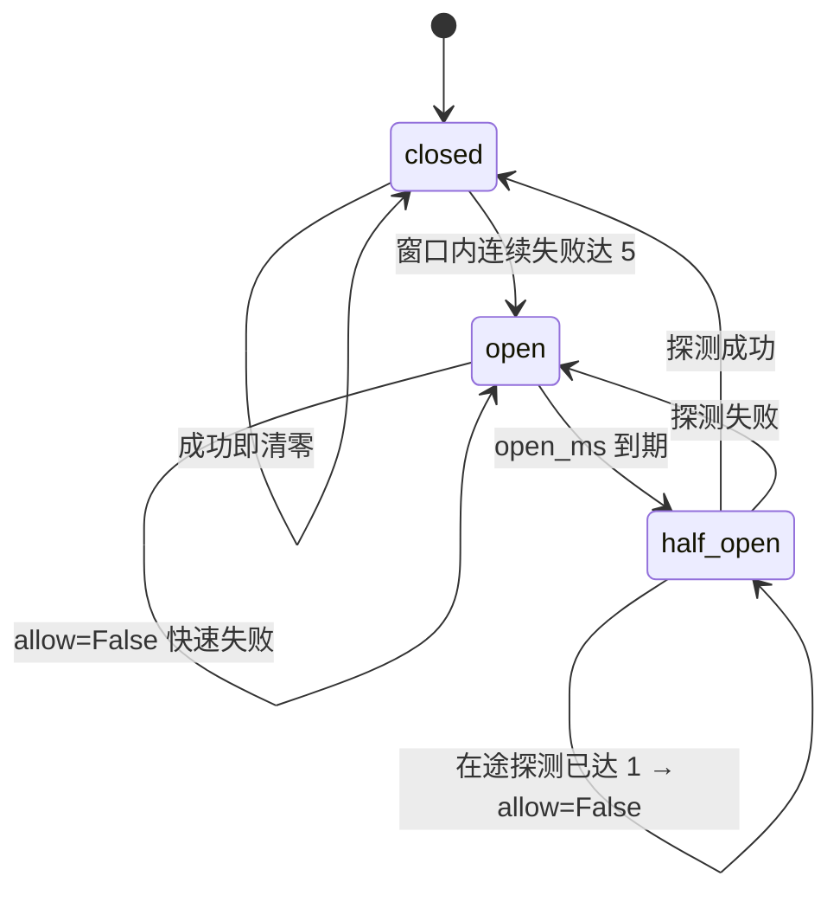
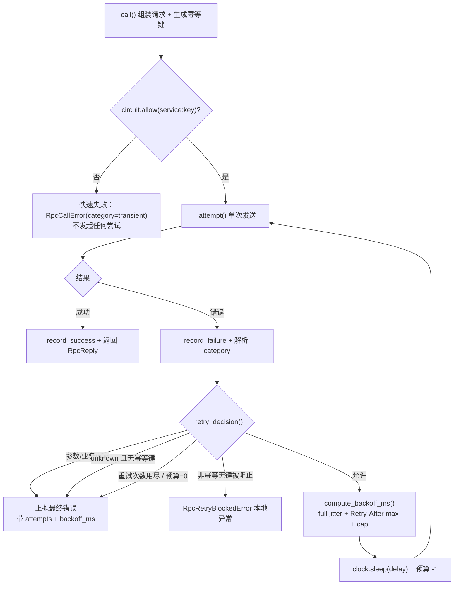

# 04-4 错误语义与幂等重试详细设计

> `ErrorCategory` 五类正式枚举 × `classify` 三元组 × `Outcome` 三值 × 帧头 `idempotency_key` / `retry_budget` × `RetryPolicy` + full jitter 指数退避 × 调用链共享预算（帧头 + `ContextVar`）× 进程内幂等去重（首次结果复用）× 复用 bms `BaseCircuitBreaker` 契约的进程内三态实现 × `Retry-After` 双来源 × **流式完全排除**

[文档首页](../../../../../../文档首页.md) › [消息平台规划](../../../../../../规划/01_规划_消息平台.md) › [阶段计划](../../../../计划/01_计划_消息平台.md) › [04 RPC](../../04_RPC.md) › [04-4 错误语义与幂等重试](../04_RPC_04_错误语义与幂等重试.md) › 详细设计

---

## 1. 概述 <a id="overview"></a>

### 1.1 目标

给 RPC 一元调用补上「能不能重试、怎么重试、重试会不会产生重复副作用」的完整判定链，并让错误分类成为**机读契约**而不是客户端各自维护的隐式码表。

1. 服务端 `classify()` 从 `(layer, retryable)` 升为 `(category, layer, retryable)`，错误帧与 `RpcCallError` 都带 `category`。
2. `RpcClient.call()` 内联重试中间层：只对「可重试且幂等安全」的错误退避重试，遵守 `Retry-After`，受调用链共享预算与熔断约束。
3. 服务端按 `(tenant, service, method, key)` 去重，复用首次结果；首期进程内实现，限制写明。
4. 熔断复用 bms `BaseCircuitBreaker` / `CircuitState` / `service_dependency`，msg 侧补一份进程内三态实现。
5. 变更模块行 + 分支覆盖率 100%，静态检查全绿；一元与流式面零变化。

### 1.2 边界与承接

| 范围 | 本任务 | 归口 |
| --- | --- | --- |
| 错误对象与五类分类 | ✅ 定稿并实现 | — |
| 退避 / 抖动 / 预算 / 幂等键 / 熔断 / `Retry-After` | ✅ 全部在**一元**重试层 | — |
| 流式错误重试 | ❌ **完全排除**：`stream()` / `RpcStream` 零改动 | 8B_12 / 后续阶段（需 `seq` 断点续传契约，见 §9 风险 2） |
| 一元调用端点 / 帧协议形状 / h2 传输 | ❌ 零变化（只增可选帧头字段） | — |
| msg 错误 → bms `ServiceUnavailableError` / `ParamError` 映射 | ❌ 不实现 | 04-5 |
| 实例摘除 / 换实例重试 | ❌ 只留预算与幂等判定接口 | 04-6（其任务文档已声明「重试预算与 04-4 共用」） |
| 幂等去重跨实例 / 跨重启持久化 | ❌ 首期进程内 | 8B_05 / 后续阶段 |
| 认证授权 | ❌ | 05 域 |

**流式排除的落地口径**：重试中间层只包 `call()`；`error_frame()` 虽会多带 `category`（一元与流式共用同一装配），但 `client/stream.py` 不解析、不使用它，`RpcStream` 一行不动。04-3-2 实施记录 §7 遗留「流式错误重试」在本设计 §9 登记归口并闭环。

### 1.3 口径来源

- [需求 04-4](../../../../需求/04_需求_RPC.md#r04-4)、[任务 04-4](../04_RPC_04_错误语义与幂等重试.md) §2.2 / §2.9；
- [架构 05 §5 错误码](../../../../../../设计/架构设计/05_架构设计_接入面_协议与客户端.md#errors) 与 §8 客户端形态；
- bms《[RPC 模型](../../../../../../../bms文档/资料/知识档案/消息与事件驱动/09_事件驱动_RPC模型.md)》§7~9 / §14 / §15、《[后端基类清单](../../../../../../../bms文档/后端基类清单.md)》「服务间调用基座」节；
- bms 既有契约源码：`servicecall/base.py`（`ServiceCallPolicy`）、`circuit/base.py`（`BaseCircuitBreaker` / `CircuitState`）、`circuit/null.py`（`NullCircuitBreaker`）、`idempotency/base.py`（`IdempotencyStore.begin/load/save/release`、`build_idempotency_key`、`IDEMPOTENCY_HEADER`、`DEFAULT_IDEMPOTENCY_TTL`）；
- 仓内既有实现：`api/frame/responses.py`（`classify` / `error_frame`）、`client/rpc.py`（`RpcCallError` / `error_of_frame` / `_error_of`）、`rpc/deadline.py`（`OUTCOME_UNKNOWN`）、`rpc/registry.py`、`rpc/contract.py`、`protocol/contract.py`、`core/config.py`。

## 2. 现状与差距 <a id="gap"></a>

| 现状 | 差距 | 本任务动作 |
| --- | --- | --- |
| `classify(code) -> (layer, retryable)`，三张 frozenset 表；`350004` 显式排除 | 只有「能否重试」二值，客户端无法区分「改参 / 上抛 / 告警」 | 升三元组 + `ErrorCategory` 五类 |
| `RpcCallError` 带 `code/message/retryable/layer/retry_after_ms` | 无类别、无尝试记录 | 增 `category`、`attempts`、`backoff_ms` |
| `OUTCOME_UNKNOWN = "unknown"` 字符串常量 | 04-2 遗留 #2：取值靠约定 | 升 `Outcome` StrEnum（`ok`/`unknown`/`failed`），值仍是字符串，既有用例零破坏 |
| `RpcClient.call()` 单次发送，无重试 / 熔断 / 幂等 | 瞬时故障直接失败；无键写操作一旦重试会重复副作用 | 内联重试中间层 + `RetryPolicy` + 幂等键 + 预算 + 熔断 |
| `_error_of(429)` 硬编码 `retryable=True`，不读响应头 | JSON 429 的 `Retry-After` 被忽略 | 双来源解析，取 max 并封顶 |
| bms `BaseCircuitBreaker` 只有契约 + 恒闭合 `NullCircuitBreaker` | 「复用契约」不等于「有真实三态」 | msg 侧实现 `InProcessCircuitBreaker(BaseCircuitBreaker)` |
| bms `IdempotencyStore` 契约 + `RedisIdempotencyStore` 已交付 | msg 是独立进程、首期不引 Redis | 形状对齐 `begin/load/save/release` 的进程内实现（**不继承** `BasePluggable`，避免把 bms 插件注册表拖进 msg 进程） |
| 帧契约 `request_optional` / `error_frame.fields` 无本任务字段 | 新字段不进契约则跨语言 SDK 只能靠约定 | 写进 `rpc_contract()` 并重导 `deploy/contracts/msg.json` |
| 04-2 / 04-3-2 / 04-7-2 三处遗留指向 04-4 | 未闭环 | §10.3 对齐记录逐条闭环 |

## 3. 交付物清单 <a id="deliverables"></a>

### 3.1 文档（本段只产出第一份）

```text
04_RPC_04_错误语义与幂等重试/
├── 设计/
│   └── 01_详细设计_04_RPC_04_错误语义与幂等重试.md      # 新增（本段产出）
├── 实施/
│   └── 01_实施记录_04_RPC_04_错误语义与幂等重试.md      # 新增（第三次提交）
└── 测试/
    └── 01_测试记录_04_RPC_04_错误语义与幂等重试.md      # 新增（第三次提交）
```

### 3.2 代码（第二次提交，`feat`）

| 文件 | 变化 | 要点 |
| --- | --- | --- |
| `errors.py` | 改 | `ErrorCategory` / `Outcome` 两个 StrEnum；`MsgRpcInProgressError`（复用平台码 `10007`，不进 `MsgErrorCode`） |
| `api/frame/responses.py` | 改 | `classify()` 返回三元组；`error_frame()` 帧头增 `category`；三张码表补 `category` 映射 |
| `rpc/deadline.py` | 改 | `OUTCOME_UNKNOWN` 改为 `Outcome.UNKNOWN` 别名（保持字符串兼容） |
| `client/retry.py` | 新增 | `RetryPolicy` / `CircuitPolicy` / `RetryBudget` / `Clock` 与 `JitterSource` 端口 / `compute_backoff_ms` / `RetryDecision` / `RpcRetryBlockedError` |
| `client/circuit.py` | 新增 | `InProcessCircuitBreaker(BaseCircuitBreaker)`，三态 + 窗口 + 半开限流 |
| `client/rpc.py` | 改 | `call()` 内联重试循环 + `_attempt()`；`RpcCallError` 增字段；`error_of_frame` 读 `category`；`_error_of` 解析 `Retry-After`；构造注入策略与熔断器 |
| `client/__init__.py` | 改 | 出口补 `RetryPolicy` / `CircuitPolicy` / `InProcessCircuitBreaker` / `ErrorCategory` / `Outcome` |
| `rpc/idempotency.py` | 新增 | `InProcessIdempotencyStore`、`scoped_idempotency_key`、`IdempotencyContext` |
| `rpc/registry.py` | 改 | `register` / `register_stream` 增 `idempotent: bool = False`；新增 `declarations()`；`methods()` / `stream_methods()` 签名不变 |
| `rpc/builtin.py` | 改 | 四个内置方法补 `idempotent` 声明 |
| `rpc/contract.py` | 改 | `request_optional` 增两字段、方法条目增 `idempotent`、新增 `retry` / `circuit` 语义段（**只写字段与算法，不写死数值**） |
| `protocol/contract.py` | 改 | `error_frame.fields` 增 `category`、`error_frame.categories` 五类清单 |
| `rpc/service.py` | 改 | `invoke_rpc` 增可选 `idempotency` 参数，`_run_handler` 外包 `begin/load/save/release` |
| `api/rpc/request.py` | 改 | 解析 `idempotency_key` / `retry_budget`（可选文本与整数，形态非法即 `10001`） |
| `api/rpc/gate.py` / `api/rpc/routes.py` | 改 | 从帧头 / JSON 头取幂等键与预算，构造 `IdempotencyContext` 传入 |
| `api/deps.py` | 改 | `get_idempotency_store` + `IdempotencyStoreDep` |
| `main.py` | 改 | `app.state.idempotency_store = InProcessIdempotencyStore(...)` |
| `core/config.py` | 改 | `RPC_RETRY_*` / `RPC_CIRCUIT_*` / `RPC_IDEMPOTENCY_TTL_MS` 默认常量 |
| `deploy/contracts/msg.json` | 改 | 重导契约快照 |
| `tests/ops/test_frame_contract_snapshot.py` | 改 | 补新字段 / 新段断言 |
| `tests_support/rpc_transport.py` | 改 | 脚本化传输支持「按尝试序号返回不同结果」、fake clock / 固定随机源夹具 |

### 3.3 三份用例（第二次提交）

| 文件 | 覆盖域 |
| --- | --- |
| `tests/client/test_rpc_retry_policy.py` | 五类分类 + 退避 full jitter（fake clock）+ `Retry-After` 双来源 + 预算共享 |
| `tests/client/test_rpc_idempotency.py` | 键生成与重试稳定、显式传入、首次结果复用、处理中错、非幂等无键阻止、作用域 / TTL / 注册表声明 |
| `tests/client/test_rpc_circuit.py` | 三态转换、阈值 / 窗口、半开限流、打开快速失败不进重试、与重试联动 |

## 4. 契约 <a id="contract"></a>

### 4.1 错误分类（五类正式枚举）

`ErrorCategory`（`StrEnum`，落 `errors.py`）：`param_error` / `business_reject` / `transient` / `unknown` / `server_bug`。
`Outcome`（`StrEnum`，落 `errors.py`）：`ok` / `unknown` / `failed`。

`classify(code) -> tuple[ErrorCategory, str, bool]` 是**唯一出处**；`layer` 与 `retryable` 的既有判定值一律不变（不回退 04-2 与 03-2 已交付语义），只新增 `category` 一维。

| 类别 | 码 | layer（沿用现状） | retryable | 客户端动作（由 category 推导，不进帧） |
| --- | --- | --- | --- | --- |
| `param_error` 参数错误 | `10001`、`350018`、`350019`、`350006` | protocol / transport | `false` | 改参后放弃，不重试 |
| `business_reject` 业务拒绝 | `350001` / `350002` / `350003` / `350007` / `350008` / `350009` / `350010` / `350011` / `350012` / `350013` / `350014` / `350016` / `350017` / `350023` / `350024` | business | `false` | 上抛调用方，不重试 |
| `transient` 瞬时故障 | `350005` / `350015` / `350020` / `350021` / `350022`、`10006` / `10007`、传输层连接失败（`code=0` / layer=transport） | business / system / transport | `true` | 指数退避 + full jitter 重试 |
| `unknown` 超时未知 | `350004` | business | **`false`** | 仅在带幂等键时谨慎重试（A2 特例） |
| `server_bug` 服务端 bug | system 层未登记码、协议解析异常、非 200 兜底（`code=0`） | system / protocol | `false` | 上抛 + 告警，不自动重试 |

**`retryable` 与「能否重试」不是同一件事**：`retryable` 表示「可否常规重试」；`unknown` 是独立于 `retryable` 的特例，重试层按「`category == unknown` 且带幂等键」单独放行。这是 A2 的核心口径，§5.1 判定函数据此实现。

**350022 的既有张力**：`errors.py` 注释写「退避重试无用」，`classify()` 却判 `retryable=true`。本任务**沿用既有判定不变**（归 `transient`），文案与判定的矛盾登记为开放项，归 02-6 / 后续收口（§9 风险 4）。

### 4.2 错误对象与错误帧字段

| 载体 | 新增字段 | 说明 |
| --- | --- | --- |
| `error_frame()` 帧头 | `category` | 五类之一；缺失（老服务端）时客户端回落 `server_bug`（保守不重试） |
| `error_frame()` 帧头 | `outcome` 仍走 `detail.outcome` | 04-2 形状不变，只把值升为 `Outcome` 枚举成员 |
| `RpcCallError` | `category: ErrorCategory` | 缺省 `server_bug`；本地错误（非 200 / 连接失败 / 协议错）显式给值 |
| `RpcCallError` | `attempts: int`、`backoff_ms: tuple[int, ...]` | 任务 §2.7「记录尝试次数、退避序列与最终错误」；最终错误对象自带，不另造结构 |
| `RpcCallTimeoutError` | `outcome = Outcome.UNKNOWN` | 字符串值 `"unknown"` 不变，04-2 既有用例零破坏 |

**不新增产品码**（A3）：「重试预算耗尽 / 熔断打开 / 非幂等无键被阻止 / 服务端内部异常 / 重复请求处理中」全部是客户端本地判定或既有兜底，用 `category` + 本地异常表达。`MsgRpcInProgressError` 复用平台码 `10007`（`ServiceUnavailableError`，`classify` 已判 `system/true`），`data` 带 `reason="in_progress"` 与 `retry_after_ms`；不进 `MsgErrorCode` 枚举，因此 `deploy/registry/msg.toml` 的 `[[errcodes]]`、规划 §6 标识符登记、`tests/test_error_codes.py` 对账**三处零改动**。

### 4.3 请求帧头新增字段（只增可选）

| 字段 | 类型 | 生成方 | 语义 |
| --- | --- | --- | --- |
| `idempotency_key` | `str`，≤128 字符 | 客户端首次调用生成 `uuid4().hex`，重试全程复用；允许 `call(idempotency_key=...)` 显式覆盖 | 服务端去重键的业务部分 |
| `retry_budget` | `int` ≥ 0 | 客户端无上游预算时取 `RetryPolicy.max_retries`；有上游时取 `min(上游值, 本地剩余)` | 调用链剩余可重试次数，每次重试递减 |

两者均进 `rpc_contract().request_optional`，并在 `rpc.retry` 段写算法与字段语义（不写死数值，同 04-2 决策 14 口径）。`api/rpc/request.py` 用既有 `optional_text` + 新增整数解析；形态非法即 `10001`，未知字段按 03-2 铁律忽略。

**服务端透传**：`RpcCall` 增 `retry_budget: int | None = None`（frozen dataclass 末尾带默认值，既有构造点零改动），handler 若要继续调下游，把这个值原样放进下一次调用——与 `deadline_ms` 逐跳扣减同构。

### 4.4 `RetryPolicy` 与 `CircuitPolicy`

`client/retry.py` 内 frozen dataclass（值对象，可整体传递 / 快照）：

| 字段 | 默认值 | 来源 |
| --- | --- | --- |
| `max_retries` | `2`（共 3 次尝试） | 对齐 bms `DEFAULT_MAX_RETRIES` |
| `base_ms` | `100` | 对齐 bms `DEFAULT_RETRY_BACKOFF=0.1s`，换算成毫秒整数 |
| `multiplier` | `2` | 对齐 bms `base * 2**n` |
| `cap_ms` | `2000` | 新增封顶（bms 无） |
| `jitter` | `full` | `JitterMode` StrEnum（`full` / `none`），`none` 仅供对照用例，生产禁用 |
| `max_budget` | `2` | 调用链预算上限 |

`CircuitPolicy`：`failure_threshold=5`（连续失败）、`window_ms=30_000`、`open_ms=30_000`、`half_open_max_calls=1`。

默认值全部写 `core/config.py` 的 `RPC_RETRY_*` / `RPC_CIRCUIT_*` 常量，与 `RPC_DEADLINE_*` 同风格；`RpcClient` 构造注入 + `call(...)` 逐调用覆盖（关键字可选参数，向后兼容）。

**可注入端口**（覆盖率与确定性断言的前提）：`Clock`（`now_ms()` / `sleep(ms)`）与 `JitterSource`（`uniform(low, high)`）两个 `Protocol`；生产实现走 `time.monotonic` + `asyncio.sleep` + `random.uniform`，用例注入 fake clock 与固定随机源。

### 4.5 幂等键与去重契约

**键生成**：`call()` 首次执行时生成 `uuid4().hex`，写进帧头 `idempotency_key`；重试循环复用**同一键**（这是「稳定」的关键，`request_id` 每次尝试可重新生成，两者语义不同）。调用方可显式传业务语义键。

**作用域**：服务端 `scoped_idempotency_key(tenant, service, method, key)` → `msg:{tenant}:idem:{service}.{method}:{key}`，形状对齐 bms `bms:{tenant|global}:idem:{key}` 但补上 `service`/`method`，避免同名业务键跨方法串味。

**TTL**：`RPC_IDEMPOTENCY_TTL_MS = 300_000`（5 分钟，覆盖最长重试窗口，与 bms `REPLAY_WINDOW=300` 同量级）；`InProcessIdempotencyStore` 用 `dict` + 惰性过期（`begin` 时按插入序清理过期项）。

**首期限制（必须写进设计 / 实施 / 测试记录三处）**：进程内单实例、不跨实例、不跨重启；重启后去重表为空，重试可能重复副作用；多副本或滚动重启场景必须换共享存储（bms `RedisIdempotencyStore` 已交付），归 8B_05。

**重复请求语义**（D2）：`begin=False` → `load`：有首次结果则**原样复用**（payload + headers 一起回）；无结果（首次仍在执行 / 首次失败已 `release`）→ 抛 `MsgRpcInProgressError`（category=`transient`、`retryable=true`、带 `retry_after_ms`），不静默重放业务。

### 4.6 熔断接线

`InProcessCircuitBreaker(BaseCircuitBreaker)` 继承 bms 契约，复用 `CircuitState` 与 `service_dependency(service)` → `service:<service>`；`allow` / `record_success` / `record_failure` / `state` 四方法逐一实现，时钟走 §4.4 的 `Clock` 端口。



- 窗口：`window_ms` 内无新失败即清零连续计数（不是比例阈值，低流量服务也敏感）。
- 半开期只放 `half_open_max_calls=1` 个探测，其余 `allow=False`，避免恢复瞬间被打挂。
- `RpcClient` 构造参数 `circuit: BaseCircuitBreaker | None = None`，**缺省 `NullCircuitBreaker()`**（恒闭合、首期行为等价现状、零回归）；任务完成标准的熔断用例全部显式注入 `InProcessCircuitBreaker`。生产装配默认是否开启登记为遗留（§9 风险 3）。

### 4.7 `Retry-After`

| 来源 | 解析 | 落地 |
| --- | --- | --- |
| 帧 `error_frame` 的 `retry_after_ms` | 已有（`error_of_frame`） | 保持 |
| JSON 429 响应头 `Retry-After` | delta-seconds（非负整数）→ 毫秒；非法 / 负值 / 超长忽略 | 补进 `_error_of(response)` |
| HTTP-date 形态 | **不解析**（不引入时区 / 日期依赖） | 忽略，回落计算退避 |

等待时长 `delay = min(cap_ms, max(jitter_delay, retry_after_ms or 0))`：服务端建议是**下限**不是覆盖值，抖动基线不丢，也不会被超大值拖死；`jitter_delay ≥ 1ms` 保证「禁止无退避的立即重试」。

### 4.8 帧契约快照（E2）

`rpc_contract()` / `frame_contract()` 变更：`request_optional` 增 `idempotency_key` / `retry_budget`；方法清单条目增 `idempotent`；`error_frame.fields` 增 `category`、`error_frame.categories` 增五类清单；新增 `rpc.retry` / `rpc.circuit` 语义段（字段与算法，不含数值）。重导 `deploy/contracts/msg.json`，`tests/ops/test_frame_contract_snapshot.py` 补断言；既有的 `test_exported_contract_equals_code_table` 全等断言自动跟随。

**07C 口径复核**：本任务段位未变、码位未增，无需登记新码；A3 省的只是 `errcodes` 登记与错误码对账，与「帧头字段写进契约」不矛盾。

## 5. 实现 <a id="impl"></a>

### 5.1 重试判定流程



`_retry_decision(error, policy, budget, idempotency_key, attempts) -> RetryDecision | None` 判定顺序（短路）：

1. `category in (param_error, business_reject, server_bug)` → 不重试；
2. `category == unknown` 且 `idempotency_key is None` → 不重试；
3. `category == transient` 但 `retryable=false` → 不重试（防御：服务端判定优先）；
4. `attempts >= policy.max_retries` 或 `budget.remaining <= 0` → 不重试；
5. **幂等安全门槛**：`idempotent is True` 或 `idempotency_key is not None` 才继续；否则 `RpcRetryBlockedError`；
6. 其余 → 返回含 `delay` 的 `RetryDecision`。

`CancelledError` / `GeneratorExit` 不在重试层捕获，原样穿透（与 04-7-2 取消口径一致）；收尾在 `finally` 里归还半开探测名额、写日志事件。

### 5.2 退避与预算算法

```text
raw_cap     = min(cap_ms, base_ms * multiplier ** (attempt - 1))   # attempt 从 1 起
jitter_delay = max(1, rng.uniform(1, raw_cap)) if jitter == full else raw_cap
delay       = min(cap_ms, max(jitter_delay, retry_after_ms or 0))
```

**预算共享**：进程内 `ContextVar[RetryBudget | None]`；`call()` 进入时按「上游预算（ContextVar）→ `policy.max_budget`」取初值，每次重试 `remaining -= 1`；发请求时把 `remaining` 写进帧头 `retry_budget`。服务端解析后放进 `RpcCall.retry_budget`，handler 继续调下游时原样传递——`min(上游, 本地)` 保证 A→B→C 每跳都受同一上限约束，防重试风暴。04-6 换实例重试复用同一个 `RetryBudget` 对象。

### 5.3 服务端去重接线

`app.state.idempotency_store` 单例（`api/deps.py` 加提供者）；`invoke_rpc()` 增可选参数 `idempotency: IdempotencyContext | None`，仅「带键 + 方法声明非幂等」时由闸门构造传入。包在 `prepare_handler` 之后、`_run_handler` 之前：

```text
ctx = request 帧头 idempotency_key + app.state store + scoped_key + ttl
if ctx:
    if not await store.begin(key, ttl):
        cached = await store.load(key)
        if cached is not None: return 首次结果（payload + headers 原样）
        raise MsgRpcInProgressError(retry_after_ms=base_ms)
try:
    reply = await _run_handler(...)
except BaseException:
    await store.release(key); raise          # 失败不占键，允许带键重试
await store.save(key, serialize(reply), ttl)
```

`release` 用 `BaseException` 而非 `Exception`：取消 / `GeneratorExit` 也必须释放键，否则取消过的调用在 TTL 内永远拿不到结果。

### 5.4 观测

日志事件统一走 `structlog`：`msg_rpc_retry`（`attempt` / `delay_ms` / `category` / `budget_remaining` / `idempotency_key` 哈希）、`msg_rpc_retry_stopped`（`reason`）、`msg_rpc_circuit`（`dependency` / `from` / `to`）、`msg_rpc_idempotency`（`hit` / `reason`）。不泄露内部堆栈与原始幂等键明文；用例断言用 `structlog.testing.capture_logs()`（console 格式下 `assert_logged` 抓不到）。

### 5.5 流式零变化

`client/stream.py`、`RpcStream`、`api/rpc/stream.py` 全部不动。`error_frame()` 多带的 `category` 是「只增可选字段」，流式侧不解析即忽略（03-2 铁律 2）。`client/__init__.py` 只增出口、不改 `RpcStream` 的任何行为。

## 6. 测试设计 <a id="tests"></a>

### 6.1 三份用例与覆盖点

| 文件 | 覆盖点 |
| --- | --- |
| `test_rpc_retry_policy.py` | ① 五类 `classify` 三元组（含 `350004` 保持 `false`、`350022` 沿用 `true`）；② error 帧 / `RpcCallError` 带 `category`；③ `Outcome` 三值与 04-2 字符串兼容；④ full jitter 序列（fake clock + 固定 RNG，断言 `1 ≤ delay ≤ cap`、下界绝不 0、指数基线）；⑤ `Retry-After` 帧 ms / HTTP delta-seconds / 非法忽略 / 取 max 封顶；⑥ 预算帧头逐跳递减、`ContextVar` 恢复、预算耗尽不再尝试；⑦ 尝试次数与退避序列落在最终错误上 |
| `test_rpc_idempotency.py` | ① 键自动生成且重试全程稳定（多次尝试同一键）；② 显式传入覆盖；③ 非幂等无键被 `RpcRetryBlockedError` 阻止且零重试；④ 服务端 `begin/load/save` 复用首次结果（payload + headers）；⑤ 首次执行中 / 首次失败 `release` 返回处理中错；⑥ 作用域隔离（换 tenant / service / method 不互撞）；⑦ TTL 过期后可重新执行；⑧ 注册表 `idempotent` 声明与契约方法条目 |
| `test_rpc_circuit.py` | ① closed→open（连续 5 次失败）；② 成功清零；③ 窗口过期清零；④ open 期间 `allow=False` 且**零尝试**；⑤ 打开 30s 后转 half_open（fake clock）；⑥ 半开并发上限 1；⑦ 探测成功回 closed / 失败回 open；⑧ 与重试联动（重试期间的失败也计入计数） |

三份统一 `@pytest.mark.kiwi_id(2439)`。

### 6.2 验收映射

| 任务 §3 完成标准 | 用例 |
| --- | --- |
| 不同错误类型返回正确的 `retryable`；参数错误 / 业务拒绝 / 服务端 bug 不被自动重试 | 三份文件①③④ + 策略文件① |
| 重试有指数退避与抖动；熔断打开时直接失败；非幂等操作重试被阻止 | 策略文件④ + 熔断文件④⑤ + 幂等文件③ |
| 带幂等键的瞬时故障重试不产生重复副作用；超时未知不被当作普通失败直接重试 | 幂等文件④ + 策略文件①（`350004` 特例） |
| 变更模块行 + 分支覆盖率 100%，静态检查全绿 | §7 |

### 6.3 Kiwi

**先回读平台最大号**（04-3-2 为 2438，禁复用）→ `+1 = 2439` → 按 `KiwiTCMS部署使用说明` §5.2 / §5.3 用容器内 Django shell 登记**一条**用例（Category「平台骨架」/ Priority `P2` / `CONFIRMED` / Tag「自动化」，`summary ≤ 90 字`，`text` 写覆盖范围与三份用例文件路径）→ 回读核对 `2439` 与代码标注一致。平台连不上时**停下来问**，不挂空号、不先编码后补号。

### 6.4 用例纪律

- 时序类（重试等待、熔断打开计时、TTL 过期）一律 fake clock；确需真协程时序的用 `try/finally` 记时刻，不只 `except CancelledError`（服务端取消有 `CancelledError` 与 `aclose()` 的 `GeneratorExit` 两条落点，并行档会偶发漏记）。
- `tests_support` 里的替身不算覆盖率分母，但一次会话必须收集到。
- 日志断言用 `structlog.testing.capture_logs()`。

## 7. 覆盖率与门禁 <a id="coverage"></a>

### 7.1 一次会话采集

在 `backend/` 下用 `uv run --project backend` 跑一次 pytest 会话，**同时**给两个环境变量：`MSG_COVERAGE_DATA=D:/Develop/bizs/msg/.cache/coverage/.coverage`（绝对路径）与 `MSG_COVERAGE_SOURCE="bms_msg,services,ops"`。本地跑测试一律带 `CODEBUDDY_SAFE_DELETE_ENABLED=0`。采集文件是 `.coverage.<pid>`，需 `ls -a` 才看得见；判前清 `.cache/coverage/.coverage*`。

**一次会话清单必须含所有会被覆盖到的模块**（上上轮漏 `test_connection_heartbeat.py` 导致 `api/frame/responses` 报假缺口）：

```text
services/msg/tests/client/*（含 transport/ 全目录）
services/msg/tests/api/test_rpc_*、test_frame_*、test_registry_*、test_tenant_*
services/msg/tests/api/test_connection_heartbeat.py
services/msg/tests/rpc/*
services/msg/tests/test_error_codes.py、test_frame_responses.py
tests/ops/test_frame_contract_snapshot.py
tests_support/*（不算分母，用例要在）
tests/api/test_connection_heartbeat.py（若同仓根侧存在，一并收）
```

### 7.2 判定（仓根执行）

```bash
backend/.venv/Scripts/python.exe -m engkit coverage \
  --data-file .cache/coverage/.coverage \
  --out .cache/coverage/report-04-4.json \
  --module bms_msg.errors \
  --module bms_msg.api.frame.responses \
  --module bms_msg.client.rpc \
  --module bms_msg.client.retry \
  --module bms_msg.client.circuit \
  --module bms_msg.rpc.idempotency \
  --module bms_msg.rpc.registry \
  --module bms_msg.rpc.contract \
  --module bms_msg.rpc.service \
  --module bms_msg.rpc.deadline \
  --module bms_msg.api.rpc.request \
  --module bms_msg.api.rpc.gate \
  --module bms_msg.api.rpc.routes \
  --module bms_msg.api.deps \
  --module bms_msg.main \
  --module bms_msg.core.config
```

`--out` 必填；模块清单按最终改动文件复核增减（**宁多勿漏**）。判定原文（缺行 / 分支结论）原样贴进测试记录，不截断、不过滤。

### 7.3 静态与文档

- `ruff check` + `ruff format --check` 覆盖**全部改动文件**；`pyright` 必带 `--pythonpath .venv/Scripts/python.exe`。
- 提交前钩子已装，**不用 `--no-verify`**；完整预检输出（含 stderr）落盘后整体阅读，按「失败 N 项」全表一次性修完再重跑一次。并行档偶发超时 / 抖动时先 `--jobs off` 复跑定性，不急着改代码。
- 文档三项：`check_links.py` / `check_docs_scope.py` / `engkit eol --fix`。
- **改文件后先查行尾**：`Path.write_text` 在 Windows 会把整份文件写成 CRLF，提交前按 `git show HEAD:<path>` 数 `\r\n` 逐文件回正，否则 diff 全红。
- 设计 / 实施 / 测试记录按任务约束措辞（进度类数值字段不写进这三份记录）。
- 预检日志写 `msg/.cache/preflight/`（`tmp/` 会被卫生门禁判违规）。

## 8. 实施步骤 <a id="steps"></a>

| 步 | 动作 | 提交 |
| --- | --- | --- |
| 1 | 本详细设计定稿 + 20 项决策汇总回显，等确认 | `docs(msg): 04-4 详细设计定稿` |
| 2 | 回读 Kiwi 最大号 → 登记 `2439` → 回读核对 | —（并入第 3 步） |
| 3 | `errors` / `responses` / `deadline` 三处分类与枚举；`client/retry.py`、`client/circuit.py`；`client/rpc.py` 内联重试；`rpc/idempotency.py`、注册表声明、`rpc/service.py` 接线、`api` 解析与 deps、`main` 装配、`core/config` 常量 | — |
| 4 | `rpc/contract.py` / `protocol/contract.py` 增字段 → 重导 `deploy/contracts/msg.json` → 快照用例补断言 | — |
| 5 | 三份用例 + `tests_support` 替身 | — |
| 6 | 一次会话采集 + 覆盖率判定 + ruff / format / pyright；按失败清单一次性修完 | `feat(msg): 04-4 错误语义与幂等重试` |
| 7 | 实施记录 / 测试记录、设计回写、架构 05 §5 与 §8、计划表 04-4 行迁入 §2；文档三项校验 | `docs(msg): 04-4 实施/测试记录与回写` |

三次提交**只暂存本任务相关文件**，均 `commit` 不 `push`；推送等单独指令。

## 9. 风险与开放项 <a id="risk"></a>

| # | 风险 / 开放项 | 影响 | 处置 / 归口 |
| --- | --- | --- | --- |
| 1 | 首期幂等去重为进程内单实例，不跨实例 / 不跨重启 | 重启后重试可能重复副作用 | 设计 / 实施 / 测试记录三处写明限制；换共享存储归 8B_05 |
| 2 | 流式错误重试完全排除 | 流式调用无自动恢复 | 已产出 N 帧后无法整体重放，重开流 ≠ 重试，需 `seq` 断点续传契约；归 8B_12 / 后续阶段，闭环 04-3-2 遗留 |
| 3 | `RpcClient` 缺省注入 `NullCircuitBreaker`（恒闭合） | 生产默认不启用熔断 | 完成标准的熔断用例显式注入真实实现；生产装配是否默认开启由 04-5 适配层决定，本任务登记为遗留 |
| 4 | `350022` 注释「退避无用」与 `classify` 判 `retryable=true` 矛盾 | 排障口径不一致 | 本任务**不改既有判定**，归 02-6 / 后续收口 |
| 5 | `classify()` 改三元组影响 `error_frame()` 的全部调用点 | 数据面错误帧也会多带 `category` | `error_frame` 内部解包改一次，调用点签名零改动；回归 `test_frame_responses` / `test_connection_heartbeat` |
| 6 | 帧契约快照重导后全等断言 | 漏改 `rpc_contract()` 会快照漂移 | `test_exported_contract_equals_code_table` 自动兜住；补新字段断言 |
| 7 | 预算字段与 04-6 换实例重试的衔接 | 同一请求在两个实例同时执行 | 接口留 `RetryBudget` 对象；04-6 已声明「非幂等无键调用不换实例重试」 |

**下游消费方标注**：按《AI开发规范》§5 步 10，04-5 / 04-6 任务文档的「前置契约」应补「已交付」——是否纳入本次提交范围，请在确认汇总表时一并示下（不擅自扩展）。

## 10. 决策确认与对齐记录 <a id="align"></a>

### 10.1 决策（2026-11-06 逐项确认，共 20 项，全部取推荐项）

| # | 事项 | 结论 |
| --- | --- | --- |
| A1 | 错误分类表达 | 新增 `ErrorCategory` 五类正式枚举，`classify` 返回 `(category, layer, retryable)`，错误帧与 `RpcCallError` 增 `category` |
| A2 | 超时未知 `350004` | `retryable` 保持 `false`，`category=unknown`；重试层以「unknown + 带幂等键」特例放行谨慎重试 |
| A3 | 新增 RPC 码 | **不新增产品码**；四类本地判定用 `category` + 本地异常表达；`msg.toml` / 07C / 错误码对账零改动 |
| A4 | `outcome` | 升 `Outcome` 三值 StrEnum，只加取值不改形状，闭合 04-2 遗留 #2 |
| A5 | 五类映射表 | 参数错误 / 业务拒绝 / 瞬时故障 / 超时未知 / 服务端 bug 固定表（§4.1）；客户端动作由 `category` 推导，不进帧 |
| B1 | 退避参数与抖动 | `max_retries=2` / `base_ms=100` / `multiplier=2` / `cap_ms=2000` + full jitter（下界 1ms），对齐 bms 默认 |
| B2 | 参数可配落点 | 新建 `RetryPolicy` frozen dataclass（构造注入 + 逐调用覆盖），默认值写 `core/config.py` 的 `RPC_RETRY_*` |
| B3 | 重试预算载体 | 帧头 `retry_budget` 跨跳传播 + 进程内 `ContextVar`，与 `deadline_ms` 逐跳扣减同构 |
| C1 | 幂等键生成 | 客户端生成 `uuid4().hex`，重试全程复用；允许 `call(idempotency_key=...)` 显式覆盖 |
| C2 | 作用域 / TTL / 限制 | `(tenant, service, method, key)` + 300s + 进程内；形状对齐 bms `begin/load/save`，三处写明限制 |
| C3 | 非幂等判定 | 注册表 `register(..., idempotent=False)` 声明进契约 + 调用侧 `call(idempotent=...)` 兜底；有键即可安全重试 |
| C4 | 熔断落点 | 复用 bms `BaseCircuitBreaker` / `CircuitState` / `service_dependency`，msg 内实现进程内三态；缺省 `NullCircuitBreaker` |
| D1 | 服务端去重接线 | `app.state` 单例 + `invoke_rpc()` 入口包 `begin/load/save/release` |
| D2 | 重复请求语义 | 有首次结果则复用；处理中返回明确本地错（`transient` / `retryable=true` / 带 `retry_after_ms`） |
| D3 | `Retry-After` | 帧 ms + HTTP delta-seconds 双来源解析，取 `max(退避, 建议)` 并以 `cap_ms` 封顶；HTTP-date 不解析 |
| D4 | 熔断三态参数 | 连续失败 5 / 窗口 30s / 打开 30s / 半开并发 1，全部可配 |
| E1 | 流式边界 | **完全排除**，`RpcStream` 零改动；设计与记录写明归口，闭环 04-3-2 遗留 |
| E2 | 帧契约快照 | 三个新字段写进对外契约并重导 `deploy/contracts/msg.json`；A3 与 E2 不矛盾（码位 vs 帧头字段） |
| E3 | 重试层落点 | `call()` 内联循环 + 抽 `_attempt()`；对外签名只加可选参数 |
| E4 | 三份用例划分 | 按策略 / 幂等 / 熔断三域分三份，统一 `kiwi_id(2439)` |

### 10.2 实施期补充（2026-11-06，逐项已回写上方 §4 / §5 / §7 / §9）

| # | 事项 | 结论 |
| --- | --- | --- |
| 21 | 幂等存储提供者 | `get_idempotency_store` 增惰性装配：用例自建最小 app 不带 `app.state.idempotency_store` 时补一份并挂回 `app.state`，不引入模块级全局、不改测试辅助；生产仍由 `main.py` 显式装配 |
| 22 | 错误码对账 | `test_error_codes.py::_raised()` 按 `MsgErrorCode` 集合过滤：`MsgRpcInProgressError` 复用 bms 平台码 `10007`，不属 msg 自持声明。`msg.toml` / `MsgErrorCode` 枚举仍零改动（A3 不变） |
| 23 | 退避夹取 | `compute_backoff_ms` 结果夹到 `raw_cap`：随机源是注入端口，替身给越界值也不能突破封顶承诺；恒 `>= 1` 且 `<= cap_ms` |
| 24 | 上游预算收紧 | `call()` 进入时用 `min(上游, 本地)` 收紧 `chain_budget.remaining` 对象本身（不只是帧头值）：判定与帧头共用同一份，`retry_budget=0` 才能真正阻止重试 |
| 25 | 契约方法条目 | 除 `idempotent` 外增 `form`（一元 / 流式）：`declarations()` 按形态过滤同源可断言，SDK 也能读出形态 |
| 26 | 存量断言同步 | `test_classify_table` 按三元组扩展并补 `350004` / `350023` / `350022` 三行；契约快照用例补 `error_frame.categories` / `retry` / `circuit` 新段断言 |
| 27 | 覆盖率口径 | 首轮缺 8 行 / 1 分支：1 行真缺口补用例、7 行既有提供者 `return` 属会话清单不全（补 `test_offset_file_store` / `test_admin_replay` / `test_entrypoints`）；不用 `pragma`、不缩减 `--module`。最终 `files=27 missing_lines=0 partial_branches=0 percent=100.00` |
| 28 | 行尾 | 两份既有测试文件 HEAD 本为 CRLF，按 HEAD 保持（不回正，避免 diff 全红）；其余 27 个新增 / 改动文件 LF |

### 10.3 与既有设计的对齐

| 既有口径 | 本任务落法 |
| --- | --- |
| 03-2「只增可选字段 / 未知字段忽略」 | 三个新帧头字段全部可选；老服务端缺 `category` 时客户端回落 `server_bug` |
| 03-2 `error_frame` 是错误语义唯一出处 | `classify` 升三元组仍只此一处，客户端 `error_of_frame` 照搬 |
| 04-2「超时 = 结果未知，不得直接重试」 | `350004` 保持 `retryable=false`；特例只在带键时放行，不回退语义 |
| 04-2 详细设计 §4「`outcome` 升枚举只加取值不改形状」 | `Outcome` StrEnum 兑现，字符串值兼容 |
| 04-2 实施记录 §7 遗留「`outcome` 升枚举 + `retryable` 全量分类」 | A4 + A5 闭环 |
| 04-3-2 实施记录 §7 遗留「流式错误重试」 | E1 排除 + §9 风险 2 归口闭环 |
| 04-7-2 实施记录 §7 遗留「重试 / 幂等补偿 → 04-4」 | 本任务整体闭环 |
| 04-6 任务文档「重试预算与 04-4 共用」 | B3 的 `RetryBudget` 对象留接口，04-6 直接复用 |
| bms `ServiceCallPolicy` 默认（2 次 / 0.1s / ×2） | B1 逐项对齐并换算毫秒整数；不复用数据类（`retry_statuses` 是 HTTP 码、字段是秒 float） |
| bms `IdempotencyStore` / `IDEMPOTENCY_HEADER` / `build_idempotency_key` | C2 形状对齐、作用域扩展；不继承 `BasePluggable` |
| bms `BaseCircuitBreaker` / `NullCircuitBreaker` | C4 真实继承契约；缺省用 Null，真实实现 msg 侧补齐 |
| 架构 05 §5 码段表 | 码位零新增，只补五类分类与 `category` 字段说明 |
| 架构 05 §8 客户端形态 | 补「重试 / 幂等键 / 熔断 / 预算」职责；流式用句柄口径不变 |

### 10.4 登记落点（第三次提交）

| 文档 | 变更 |
| --- | --- |
| 本详细设计 | 新增（第一次提交）；实施期偏差按 §10.2 格式回写 |
| 实施记录 / 测试记录 | 新增各一份；覆盖率判定原文、门禁结果、Kiwi 回读结果、偏差与遗留 |
| 架构 05 §5 | 补五类分类表、`category` 字段、码段「04-4 无新增码」说明 |
| 架构 05 §8 | RPC Client 行补重试 / 幂等键 / 熔断职责 |
| 计划表 | 04-4 行从 §3 剩余排期迁入 §2 已完成，回填偏差与遗留（含流式归口、进程内去重限制） |
| `deploy/contracts/msg.json` | 重导（第二次提交） |

---

> 依《文档生成规范》编写 · 决策经 2026-11-06 逐项确认后定稿；实施、测试、验收一律以本设计为准
