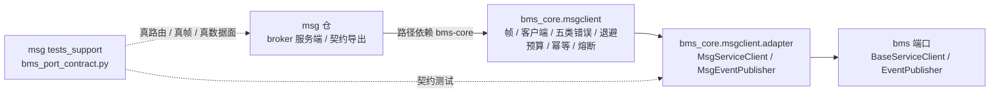

# 04-5 与 bms 端口适配详细设计

> 分工定稿：msg 仓交付协议链上移与两仓契约证据 × bms 仓 07B `06_01` 交付 `BaseServiceClient` / `EventPublisher` 的 msg 实现、`provider` 切换与回滚演练 × 本设计只记 msg 侧边界、契约测试与验收映射，adapter 字段级实现以 bms 设计为权威

[文档首页](../../../../../../文档首页.md) › [消息平台规划](../../../../../../规划/01_规划_消息平台.md) › [阶段计划](../../../../计划/01_计划_消息平台.md) › [04 RPC](../../04_RPC.md) › [04-5 与 bms 端口适配](../04_RPC_05_与bms端口适配.md) › 详细设计

---

## 1. 概述 <a id="overview"></a>

### 1.1 目标

把「bms 业务代码不改就能切到消息平台」这件事收口成**可复核的证据链**，而不是散在两仓的实施记录里：

1. 明确两仓分工与依赖方向：协议链归 `bms_core.msgclient`，适配层归 bms，msg 仓只保留 broker 服务端与契约出口。
2. 明确端口映射语义：`EventPublisher.publish()` → 数据面发布；`BaseServiceClient.call()` → RPC 一元调用；`ServiceCallPolicy` 的韧性字段映射到 04-4 的同一套语义。
3. 补齐事件发布的真实链路契约用例（bms 发布器 → 真 msg 应用 → 真主题消费），并修正「内部租户 id 被当编码」的跨仓缺陷——此前只有 bms 侧 `MockTransport` 证据。
4. 把 04-3 / 04-4 指向 04-5 的三处遗留逐条归口；生产集群联调明确留部署阶段。
5. 04-5 本体**不新增 msg 源码**：协议链上移与契约用例已在 2026-11-06 分两次提交完成，本轮只补事件发布证据与文档收口。

### 1.2 边界与承接

| 范围 | 本任务 | 归口 |
| --- | --- | --- |
| 协议链（帧编解码 / 客户端 / 五类分类 / 退避预算 / 幂等 / 熔断） | ✅ 上移 `bms_core/msgclient`，msg 仓删本地副本 | — |
| `BaseServiceClient` / `EventPublisher` 的 msg 实现 | ❌ 不在 msg 仓实现 | bms 07B `06_01` 步 2 |
| `[service_client].provider` / `[event].provider` 切换、拒启、回滚三态 | ❌ 不在 msg 仓实现 | bms 07B `06_01` 步 2 / 步 3 |
| 两仓契约测试（RPC 六类 + 事件发布真链路） | ✅ 落 msg 仓（唯一能同时 import 两侧的仓） | — |
| 真实 `HttpServiceClient` 调用替换 | ❌ 业务侧替换在 bms 仓完成 | bms 07B `06_01` 步 3；验收判据见 §6 |
| 生产集群联调（真 msg 实例 + 真 platform 服务） | ❌ 本地无编排 | 部署阶段 |
| 跨服务真实迁移（目标方法须在 msg 注册表登记） | ❌ | 8B_08 |
| 流式端口适配 | ❌ bms 端口无流式方法 | 8B_03（SDK） |
| 事务消息 / outbox relay 替换 | ❌ | 8B_04 |
| 多实例选主 / 服务发现 | ❌ | 04-6 / 8B_05 |

### 1.3 口径来源

- [需求 04-5](../../../../需求/04_需求_RPC.md#r04-5)、[任务 04-5](../04_RPC_05_与bms端口适配.md) §2~§3；
- [架构 05 §9 与 bms 端口适配](../../../../../../设计/架构设计/05_架构设计_接入面_协议与客户端.md#adapter)；
- bms《[RPC 模型](../../../../../../../bms文档/资料/知识档案/消息与事件驱动/09_事件驱动_RPC模型.md)》第 11 / 14 节；
- bms 07B `06_01` 的[任务文档](../../../../../../../bms文档/项目/07B_跨产品协同/任务/06_消息平台端口适配/06_消息平台端口适配_01_消息平台端口适配/06_消息平台端口适配_01_消息平台端口适配.md)、[详细设计](../../../../../../../bms文档/项目/07B_跨产品协同/任务/06_消息平台端口适配/06_消息平台端口适配_01_消息平台端口适配/设计/01_详细设计_01_消息平台端口适配.md)（adapter 字段级实现的权威设计）；
- 仓内既有实现：`backend/tests_support/bms_port_contract.py`、`backend/services/msg/tests/client/test_bms_port_contract.py`、`bms_msg/api/data/messages.py`、`bms_msg/schemas/message.py`。

## 2. 现状与差距 <a id="gap"></a>

| 现状 | 差距 | 本任务动作 |
| --- | --- | --- |
| 04-1 ~ 04-4 已交付（Kiwi 2433 / 2434 / 2437~2439） | 协议能力齐，但适配与切换不在 msg 仓 | 明确归口，不在 msg 侧重复实现 |
| bms 07B `06_01` 步 1 ~ 步 3 已收口（Kiwi 2440 / 2441 / 2442），2026-11-06 返修租户解析（Kiwi 2443） | 协议链上移、适配层、切换、回滚、真实调用点均已有实现与用例 | 以 bms 设计 / 记录为权威，本设计只引用不复制 |
| msg 仓已有 11 条 RPC 跨仓契约用例 | 只覆盖请求 / 响应 / 错误 / timeout / cancel / 幂等键 | 保留，作为 RPC 侧证据 |
| 事件发布只有 bms 侧 `httpx.MockTransport` 用例 | 缺「bms 发布器 → 真 msg 应用 → 真主题消费」的真实链路证据；真链路还暴露了租户 id 被当编码的缺陷 | 新增三条事件发布契约用例（§5.2），并闭环 bms 解析链返修（Kiwi 2443） |
| 04-5 任务目录无 `设计/`、`测试/` | 任务链不完整，审计要跨仓猜 | 本设计 + [测试记录](../测试/01_测试记录_04_RPC_05_与bms端口适配.md) |
| 任务文档前置表仍写 04-1「待交付」；01 实施记录仍写「04-5 本体尚未开工」 | 与现状矛盾 | 本轮直接改写为已交付 / 已收口 |
| 04-4 遗留「缺省 Null 熔断是否默认开启」、04-3 遗留「流式 deadline 按业务给值」指向 04-5 | 未在 04-5 归口 | §8 逐条闭环（开启口径 / 转 8B_03） |

## 3. 分工与依赖方向 <a id="direction"></a>



**红线**：`bms_core` 源码**零 `bms_msg` 引用**，反向不成立；否则形成仓级循环依赖，违反 bms 架构 38 §8。各产品仓经路径依赖**天生附带客户端**，无需额外部署或跨仓装配。

**msg 仓保留的 re-export**：`errors.py`（6 个符号）、`core/config.py`（32 个 RPC 常量）、`rpc/registry.py`（2 个值对象）只是转发，不构成第二份客户端实现。契约快照 `deploy/contracts/msg.json` 仍由 msg 导出，字段值取自基座常量。

## 4. 端口映射口径 <a id="mapping"></a>

字段级换算与失败分支以 bms 07B `06_01` [详细设计 §3.7 / §3.9](../../../../../../../bms文档/项目/07B_跨产品协同/任务/06_消息平台端口适配/06_消息平台端口适配_01_消息平台端口适配/设计/01_详细设计_01_消息平台端口适配.md#adapter) 为权威；本表只固化 msg 侧需要知道的语义边界：

| bms 端口 | msg 侧落点 | 语义要点 |
| --- | --- | --- |
| `EventPublisher.publish(event)` | `POST /api/v1/msg/publish`（JSON 数据面） | 首期走 JSON 形态；根路径 `/msg/publish` 是同一实现的帧入口，暂不走。`event_type` → `topic_for()`；`namespace` 取配置；`payload` = base64(`encode_event`)；`aggregate_key` → 分区键；`event_id` / `event_type` / `event_version` / `tenant_id` / `occurred_at` 进 `headers`；租户走 `X-Tenant-ID`（**内部服务传租户 id，外部门户 / 网关传 code**） |
| `EventPublisher.publish_transactional(event)` | 同 `publish` | 事务消息归 8B_04；本层不制造第二套确认语义 |
| `BaseServiceClient.call(ServiceRequest)` | `POST /rpc/{service}/{method}` | `service` 取 `request.service`；`method` 由 `request.path` 归一化（`/api/v1/foo/bar` → `foo.bar`）；`json_body` / `content` → 载荷；`ServiceCallPolicy.timeout` → `deadline_ms`；重试 / 退避 / 熔断 / 限流映射到 04-4 同一套能力 |
| 错误与上下文 | 错误帧 `category` / `retryable` / `code` | 按五类分派到 bms 异常；原始码进 `data`；`trace_id` / `tenant_id` / 服务 JWT 沿用既有链路；cancel 原样穿透、timeout 判「结果未知」 |
| 配置切换 | `[service_client].provider` / `[event].provider` = `msg` | 业务代码不改；切回原实现行为恢复；缺实现拒启，不静默降级 |

**已知差异**（bms 设计 §8.4 已定稿，保持现状）：`local=True` 不再享受进程内直连；`query` 只透传为帧头；`retry_statuses` 不参与帧层判定。三条均不改变端口形状，运维口径随部署说明登记。

## 5. 契约测试设计 <a id="contract"></a>

### 5.1 RPC 六类（已交付，保留）

`backend/tests_support/bms_port_contract.py` 是**六类 wire 期望的单一来源**：请求 / 响应 / 错误五类逐码 / timeout / cancel / 幂等键。`backend/services/msg/tests/client/test_bms_port_contract.py` 用 `AsgiRpcTransport` 驱动真实 msg 应用（真路由 → 真帧 → 真处理器），bms 侧用真实业务函数 `fetch_catalog_snapshot` 发起调用。

**为什么夹具落 msg 仓**：`bms-core` 是 msg 的路径依赖，只有这边能同时 import 两侧；bms 仓 CI 不 clone msg，复制期望值必然漂移。

### 5.2 事件发布真链路（本轮新增）

| 用例 | 断言 |
| --- | --- |
| 真实发布 → 真实消费 | 经管理面创建 `topic_for("demo.order.created")` 主题；bms `MsgEventPublisher` 用 `httpx.ASGITransport` 调真实 msg 应用；消费端拉取后消息体与 `encode_event(event)` 逐字节一致；`headers` 带 `event_id` / `event_type` / `event_version` / `tenant_id` / `occurred_at`；`aggregate_key` 落 `key`；租户隔离成立 |
| 事件自带租户 id | `event.tenant_id`（雪花 id）写 `X-Tenant-ID`，bms 租户解析链按 `by_id` 解析（内部统一 id）；`other` 租户消费端可见，载荷与属性仍与 `encode_event` / `event_attributes` 一致 |
| 缺失主题的错误映射 | 未创建主题时发布 → msg 返回非 200；`MsgEventPublisher` 抛 `EventPublishError`，`data` 保留 `event_type` / `topic` / `status`，不吞成成功 |

**测试纪律**：不 mock 帧编解码、不 mock msg 路由；固定 `occurred_at` 与 `event_id`，避免时间漂移造成假绿；复用 `msg_app` 夹具与真实数据面；事件发布用例与 RPC 六类共用同一 `kiwi_id(2442)`。

### 5.3 用例清单

```text
backend/tests_support/bms_port_contract.py                      # 夹具单一来源（本轮追加事件发布构造器）
backend/services/msg/tests/client/test_bms_port_contract.py     # RPC 六类 + 事件发布三条（共 14 条）
```

## 6. 验收映射 <a id="accept"></a>

| 任务 §3 完成标准 | 结论 | 依据 |
| --- | --- | --- |
| 业务代码不改即可在 msg / 原实现之间切换；切回后行为恢复 | ✅ | bms `tests/msgclient/adapter/test_rollback.py`（5 条：在途请求 / 通道互斥 / 两通道等价 / 不可达同构收敛）+ `tests/outbox/test_provider_switch.py`（1 条：未确认事件不丢 / 不双写 / 不重投）；msg 真帧 RPC 用例 |
| 错误码、超时、trace、租户映射正确；非幂等按 04-4 规则处理 | ✅ | 六类夹具逐码断言（`10001` / `350023` / `350005` / `350016` / `350004` / `350002`）+ timeout `outcome=unknown` + cancel 穿透 + 同键去重；事件发布真链路补 tenant / trace 属性；**租户 id 写头**由 bms 解析链按 `by_id` 解析（Kiwi 2443） |
| 一个真实 `HttpServiceClient` 调用被 RPC 替换（8B_03 退出条件） | ✅（进程内验收） | bms 真实调用点 `fetch_catalog_snapshot` 两通道等价 + msg 仓真 msg 应用真帧往返；生产集群联调归部署阶段 |
| msg 侧变更模块行 + 分支覆盖率 100%，静态全绿；两仓契约测试全绿 | ✅ | 本轮 msg 侧**无源码改动**，不产生新覆盖率分母；契约用例全绿；ruff / format / pyright 全绿；bms 侧按其门禁验收 |

## 7. 交付物清单 <a id="deliverables"></a>

```text
04_RPC_05_与bms端口适配/
├── 设计/
│   └── 01_详细设计_04_RPC_05_与bms端口适配.md        # 新增（本轮）
├── 实施/
│   ├── 01_实施记录_04_RPC_05_协议链上移.md            # 既有（步 1）
│   └── 02_实施记录_04_RPC_05_跨仓契约测试.md          # 既有（步 3）
├── 测试/
│   └── 01_测试记录_04_RPC_05_与bms端口适配.md         # 新增（本轮）
└── 04_RPC_05_与bms端口适配.md                          # 回写前置状态与收口说明
```

**代码**：msg 仓本轮只改测试与测试夹具，无 `bms_msg` 源码改动；bms 侧实现已由其任务提交，不在本仓重复。

## 8. 决策与对齐记录 <a id="alignment"></a>

| # | 事项 | 结论 |
| --- | --- | --- |
| 1 | 协议链归属 | 整条链上移 `bms_core/msgclient`；msg 仓删本地副本，只保留 broker 服务端与契约导出（bms 07B `06_01` Q21 / §3.1 定稿） |
| 2 | 适配层归属 | `MsgServiceClient` / `MsgEventPublisher` 与 `provider` 切换在 bms 仓实现；msg 仓不写插件代码（任务 §2.1 已拍板） |
| 3 | 事件发布路径 | 首期走 JSON `/api/v1/msg/publish`；`/msg/publish` 帧入口留后续，不把 base64 与帧头耦合进发布器（bms 设计 Q32） |
| 4 | 缺省熔断 | bms 适配层缺省注入 `PolicyCircuitBreaker(InProcessCircuitBreaker())`，`ServiceCallPolicy.circuit_breaker` 缺省 `True` → **生产默认启用三态**；显式 `False` 时恒放行且不计数。闭环 04-4 遗留 |
| 5 | 流式 deadline | bms 端口没有流式方法，04-3 遗留「按业务给值」**转 8B_03 SDK**，不在 04-5 造第二套流式适配 |
| 6 | 事件发布证据 | 在 msg 仓补真应用 + 真数据面用例；bms 侧 `MockTransport` 用例保留（CI 不 clone msg，两半合起来才是完整证据链） |
| 7 | Kiwi | 事件发布断言复用 **2442** 并更新平台 text；租户解析返修另登记 **2443**（回读 2442 → +1） |
| 8 | 投入与窗口 | 只在阶段计划回写（本设计不承载）；04-5 与 04-6 的窗口调整见阶段计划 |
| 9 | 历史记录 | 直接改写 01 / 02 实施记录中的过期结论（不新增 03 记录） |
| 10 | 租户缺陷 | 真链路实测发现 `event.tenant_id`（雪花 id）被当成租户编码，msg 返回 `350012`；按「内部统一 id、外部交换才用 code」修 bms 解析链，不改发布器、不改 msg 源码 |
| 11 | 修复载体 | 重开 bms 07B `06_01`（台账置部分完成后恢复已交付），新增 Kiwi **2443**；04-5 待返修转绿后再收口 |

## 9. 风险与开放项 <a id="risk"></a>

| # | 事项 | 处置 |
| --- | --- | --- |
| 1 | 生产集群联调（真 msg 实例 + 真 platform 服务） | 本地无 msg 编排，归部署阶段；不阻塞 04-5 收口 |
| 2 | 事件发布请求体与 msg `PublishRequest` 漂移 | 真链路契约用例逐字段断言；字段变更由 msg 契约快照与两仓用例同时拦截 |
| 3 | 跨服务真实迁移 | 目标方法须在 msg 注册表登记，归 8B_08；本任务不做转发处理器 |
| 4 | 两仓版本错配 | 独立提交、同步发布；契约用例以 msg 仓夹具为单一来源，bms 仓不复制 |
| 5 | 进程内幂等去重不跨实例 / 重启 | 归 8B_05；本任务沿用 04-4 限制 |
| 6 | 熔断阈值未压测 | 归 8B_12；本任务只确认缺省开启口径 |
| 7 | 租户头形态演进 | 内部传 id、外部门户传 code；两形态互斥（编码字母开头、主键纯数字），非法值仍等同未提供；bms 解析链返修见 2443 |

## 10. 参考文档 <a id="ref"></a>

- [需求 04-5 与 bms 端口适配](../../../../需求/04_需求_RPC.md#r04-5)
- [任务 04-5 与 bms 端口适配](../04_RPC_05_与bms端口适配.md)
- [架构设计 · 接入面：协议与客户端 §9](../../../../../../设计/架构设计/05_架构设计_接入面_协议与客户端.md#adapter)
- bms《[RPC 模型](../../../../../../../bms文档/资料/知识档案/消息与事件驱动/09_事件驱动_RPC模型.md)》第 11 / 14 节
- bms《[后端开发规范](../../../../../../../bms文档/规范/后端开发规范.md)》「服务间调用必须走基座」节
- bms 07B `06_01` [详细设计](../../../../../../../bms文档/项目/07B_跨产品协同/任务/06_消息平台端口适配/06_消息平台端口适配_01_消息平台端口适配/设计/01_详细设计_01_消息平台端口适配.md)、[实施记录](../../../../../../../bms文档/项目/07B_跨产品协同/任务/06_消息平台端口适配/06_消息平台端口适配_01_消息平台端口适配/实施/01_实施记录_01_消息平台端口适配.md)、[测试记录](../../../../../../../bms文档/项目/07B_跨产品协同/任务/06_消息平台端口适配/06_消息平台端口适配_01_消息平台端口适配/测试/01_测试记录_01_消息平台端口适配.md)
- [04-1 RPC 一元调用](../../04_RPC_01_一元调用/04_RPC_01_一元调用.md)、[04-4 错误语义与幂等重试](../../04_RPC_04_错误语义与幂等重试/04_RPC_04_错误语义与幂等重试.md)

---

> 依《[文档生成规范](../../../../../../../bms文档/规范/文档生成规范.md)》编写 · 与设计 / 实施 / 测试记录同批提交
